This was written entirely with AI.

## How to Use These Notes
Each section answers one question and adds one new idea. When a section needs a fact from an earlier section, it tells you the fact again. Each lecture ends with a short list of what you know now. The tutorial questions, with their answers and the concepts they test, are on the separate tutorial pages.

## 1. What an Operating System Is

### 1.1 The two jobs of an OS
A computer has hardware: the CPU, memory and I/O devices (disk, keyboard, screen, network card). Programs want to use this hardware. The **operating system (OS)** is the program that sits between the programs and the hardware.

The OS has two goals:

1. **Make the computer easy to use.** The OS hides the details of the hardware. A programmer calls `open()` to open a file. The programmer does not need to know how the disk controller works.
2. **Use the hardware efficiently.** The OS gives the CPU, memory and devices to programs in a smart way, so that the hardware does not stay idle.

**The two goals can work against each other.** To share the hardware in the best way, the OS must collect information about the programs and run its own bookkeeping code. That code uses CPU time and memory, which the user programs then cannot use.

### 1.2 The four layers of a computer system
Lecture 1 divides a computer system into four parts:

| Part | What it does | Examples |
|---|---|---|
| Hardware | Gives the basic resources | CPU, memory, I/O devices |
| Operating system | Controls the hardware and shares it among programs and users | Linux, Windows |
| Application programs | Use the resources to solve problems for users | Compilers, databases, games |
| Users | Use the applications | People, machines, other computers |

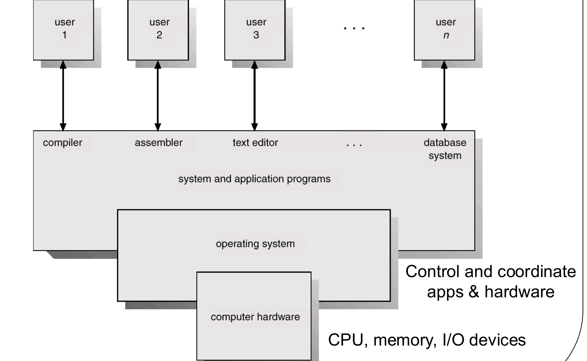

### 1.3 Three ways to describe the OS
The lecture gives three names for what the OS is. Each name looks at the OS from a different side:

* **Resource allocator.** The OS manages the hardware and decides which program gets which resource.
* **Control program.** The OS controls how user programs run, and how I/O devices operate. It stops a program from damaging other programs.
* **Kernel.** The kernel is the one program that runs all the time. It is always ready to accept requests from user programs and signals from the hardware. Everything else is an application program.

## 2. Types of Computing Systems
The OS changed as computers changed. Each type of system below solved a problem of the type before it.

### 2.1 Simple batch systems
In early computers, an operator collected similar jobs into a **batch** and ran them one after another. This reduced the setup time between jobs. The system moved from one job to the next automatically (**automatic job sequencing**).

Memory held the OS and **only one user job**.

**The problem:** when the job waited for I/O (for example, for a tape to read), the CPU had nothing to do. The CPU stayed idle.

### 2.2 Multiprogrammed systems
**Multiprogramming** solves the idle-CPU problem. The OS keeps **several jobs in memory at the same time**. When one job waits for I/O, the OS gives the CPU to another job. So the CPU is busy more of the time.

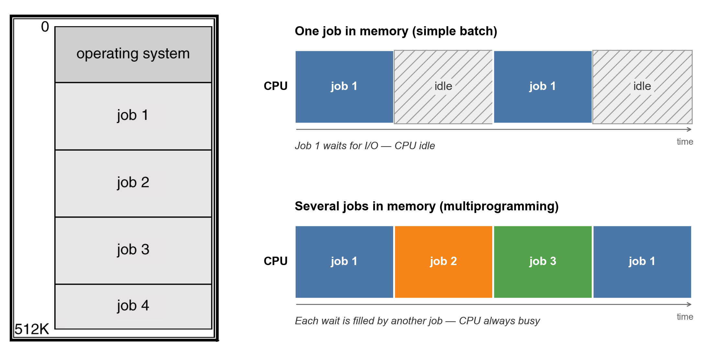

To make multiprogramming work, the OS needs three new functions:

* **Memory management:** give memory to several jobs.
* **CPU scheduling:** select which ready job runs next.
* **I/O device scheduling:** give I/O devices to jobs.

### 2.3 Time-sharing systems
A **time-sharing** system is a multiprogrammed system that is also **interactive**. The CPU switches between jobs so quickly that each user feels that they have the computer alone. When the OS finishes one command, it reads the next command from the user. The OS can also move (**swap**) a job out of memory to the disk, and back again later.

### 2.4 Other types

| Type | Main idea | Main concern |
|---|---|---|
| **Desktop** | A computer for one user, with many I/O devices | User convenience and fast response |
| **Embedded / cyber-physical** | A computer inside a physical system, which it monitors and controls | Few resources: low power, small memory |
| **Real-time** | The computer controls a device, for example an airbag | Each job must finish before a **deadline** |
| **Handheld** | Phones and tablets (iOS, Android, HarmonyOS) | Limited memory, slow processor, small screen |
| **Multiprocessor** | More than one CPU, or one CPU with many **cores** | Sharing memory between the CPUs |

**Multiprocessor systems** are also called **tightly coupled**, because the CPUs communicate through shared memory. They have three advantages:

1. **More throughput.** More work finishes in each second.
2. **Lower cost.** The CPUs share memory and I/O devices, so they cost less than many separate one-CPU computers.
3. **More reliability.** If one CPU fails, the others can continue.

### 2.5 Multiprogramming and multiprocessing are different
These two words look similar but mean different things:

* **Multiprogramming** means more than one program is in memory and in progress. It works **even with one CPU core**. The core switches between the programs.
* **Multiprocessing** means the computer has **more than one core**. Two programs can run at the same moment.

A computer can have both.

## 3. How the Hardware Works With the OS

### 3.1 Device controllers and the bus
The CPU and the device controllers connect to memory through a shared **bus**. Each **device controller** is in charge of one type of device, for example the disk controller or the USB controller. Each controller has its own small memory, a **buffer**.

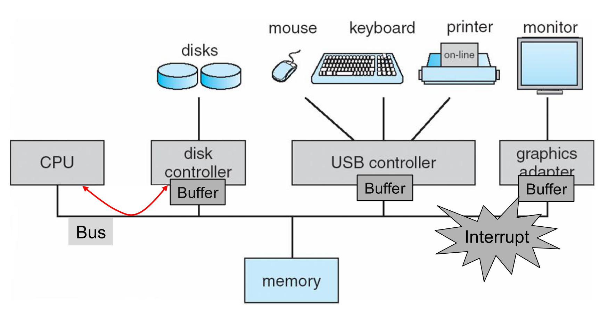

The CPU and the devices can work **at the same time**. Think about a disk read:

1. The CPU tells the disk controller to read a block.
2. The disk controller moves the data from the disk into its buffer. While it does this, the CPU runs other work.
3. The controller tells the CPU that it has finished. It does this with an **interrupt**.

### 3.2 Interrupts
An **interrupt** is a signal from a device to the CPU. It means "I need attention now". When an interrupt arrives, the CPU does these steps:

1. **Save the state.** The OS stores the CPU registers and the **program counter** (the address of the next instruction). Then the stopped program can continue later.
2. **Find the type.** The OS finds which type of interrupt occurred.
3. **Run the handler.** The OS runs the **interrupt service routine (ISR)** for that type. The **interrupt vector** is a table that holds the address of the ISR for each interrupt type.

While the CPU handles one interrupt, it **disables other incoming interrupts**. This prevents the loss of an interrupt.

**A trap is an interrupt that the CPU makes itself.** A program causes a trap in two ways:

* **An error.** For example, a division by zero, or an access to memory that the program must not use.
* **A request.** The program asks the OS for a service. This is a **system call** (section 5).

**The OS is interrupt-driven.** The OS does not run all the time on its own. It runs when an interrupt or a trap occurs. If there were no interrupts, the OS would have to **poll**: ask each device again and again if it has finished. Polling wastes CPU time.

### 3.3 Interrupt-driven I/O
The figure shows a CPU that runs user programs while a device transfers data. When the transfer is done, the device sends an interrupt. The CPU stops the user program for a short time to process the interrupt. Then it continues.

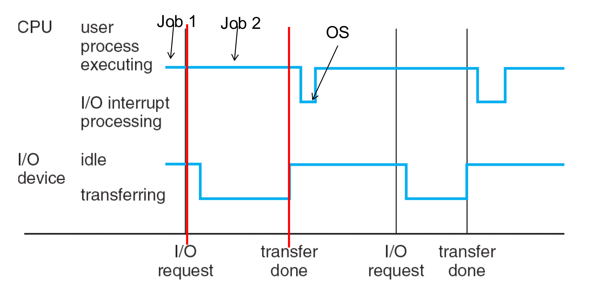

With interrupt-driven I/O, a slow device causes **one interrupt for each small unit of data** (for example each byte). For a fast device, this means very many interrupts.

### 3.4 Direct memory access (DMA)
With interrupt-driven I/O, the CPU copies every byte into memory itself. For a fast device, this means very many interrupts. **DMA** (direct memory access) takes this work away from the CPU:

1. The OS tells the device controller three things: the address of the buffer in memory, the location on the device, and the number of bytes.
2. The controller moves the **whole block** directly into main memory over the bus. The CPU does not copy any byte.
3. The controller sends **one interrupt** when the whole block is in memory.

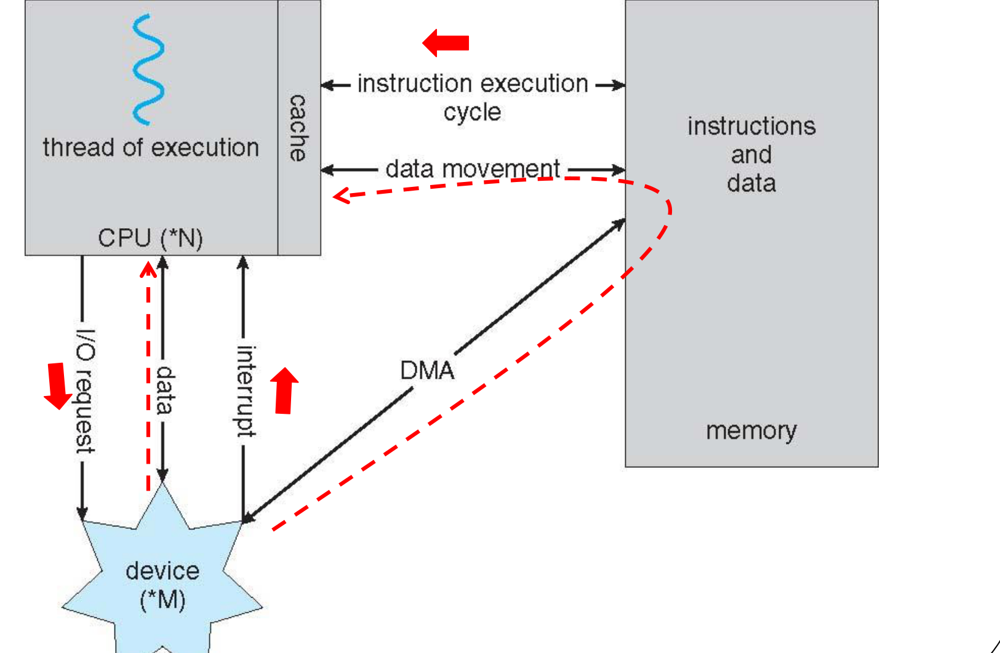

### 3.5 Interrupt-driven I/O and DMA, step by step
**Both methods switch programs.** In both methods, the program that asks for I/O **blocks**: it waits and cannot run. The OS gives the CPU to another ready program while the transfer happens. So the difference is not *whether* the OS switches programs.

**The difference is how many times the CPU must stop to move the data into memory.**

* **Interrupt-driven I/O:** the CPU stops for **every byte** (or word).
* **DMA:** the CPU stops **once**, after the whole block is in memory.

The table follows one read of a 4 KB block (4,096 bytes). Program A asks for the data. Program B is another ready program.

| Step | Interrupt-driven I/O (one byte at a time) | DMA (one block at a time) |
|---|---|---|
| **1. Request** | Program A makes a system call, for example `read()`. The CPU goes into kernel mode. The OS tells the device controller to read the data. | Program A makes a system call, for example `read()`. The CPU goes into kernel mode. |
| **2. Set up** | The OS puts Program A in the **blocked** state. The OS gives the CPU to **Program B**. | The OS tells the DMA controller the buffer address, the device location and the length (4,096 bytes). The OS puts Program A in the **blocked** state and gives the CPU to **Program B**. |
| **3. Transfer** | The controller reads **1 byte** and sends an **interrupt**. The CPU stops Program B. The ISR copies the byte from the controller into memory. The CPU continues Program B. **This repeats 4,096 times.** | The controller copies the data directly into memory over the bus. The CPU runs Program B **without a stop**. No interrupt occurs while the data moves. The controller uses some bus cycles, so Program B can run a little slower (**cycle stealing**). |
| **4. Finish** | After byte 4,096, the ISR marks the buffer as complete. | When all 4,096 bytes are in memory, the controller sends **one interrupt**. |
| **5. Wake up** | The OS moves Program A from **blocked** to **ready**. The scheduler then selects Program A or Program B to run. | The same as interrupt-driven I/O. |

**Count the interrupts:** 4,096 for interrupt-driven I/O, 1 for DMA. Each interrupt costs a save of the CPU state, a run of the ISR and a restore. So DMA leaves far more CPU time for Program B.

| | Interrupt-driven I/O | DMA |
|---|---|---|
| Who moves the data into memory | The CPU (in the ISR) | The device controller |
| Interrupts | One for each unit (for example each byte) | One for each block |
| Good for | Slow devices | Fast devices |

### 3.6 The storage hierarchy (not examinable)
Storage goes from small, fast and expensive (CPU registers, cache) to large, slow and cheap (main memory, disk). **Caching** copies data into a faster storage level. The lecture marks these slides as not examinable.

## 4. Hardware Protection
Many programs share one computer. A bad program must not damage the OS or other programs. The hardware gives three types of protection.

### 4.1 Dual-mode operation
The CPU has a **mode bit** that shows the current mode:

| Mode | Mode bit | Who runs in it | What it can do |
|---|---|---|---|
| **Monitor mode** (also: kernel mode, supervisor mode, system mode) | 0 | The OS | All instructions, including **privileged instructions** |
| **User mode** | 1 | User programs | Only normal instructions |

A **privileged instruction** is an instruction that only monitor mode can run. Examples: I/O instructions, the instructions that load the base and limit registers, and the instruction that disables interrupts.

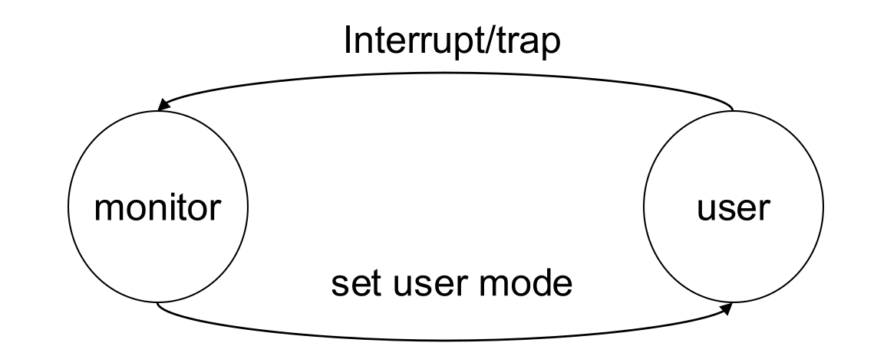

The mode changes like this:

* **User → monitor:** when an interrupt or a trap occurs, the **hardware** switches to monitor mode.
* **Monitor → user:** the OS sets the mode bit back to user mode before it returns to the user program.

So user code can get into monitor mode only through a trap or an interrupt. Then the OS, not the user program, decides what runs in monitor mode.

**Kernel mode is not the same as root (administrator).**

* Kernel mode and user mode are **hardware** modes of the CPU.
* Root or administrator is a **user account** in the OS.
* A program that root runs still runs in **user mode**. Root can only get code into kernel mode **indirectly**, for example by loading a kernel module.

### 4.2 I/O protection
A user program could try to do an illegal I/O operation. For example, it could read a file that does not exist, or use a device that it must not use. To prevent this:

* **All I/O instructions are privileged.** A user program cannot run them.
* So every I/O operation must go through the OS. The OS checks that the operation is correct and legal.
* If a program tries to do I/O without the OS, the CPU makes a trap.

### 4.3 Memory protection
The OS must protect memory: at least the interrupt vector and the ISRs, and also each program's memory from other programs. The hardware uses two registers:

* **Base register:** the first legal physical address of the program.
* **Limit register:** the size of the legal range.

So the legal addresses are from `base` up to `base + limit - 1`.

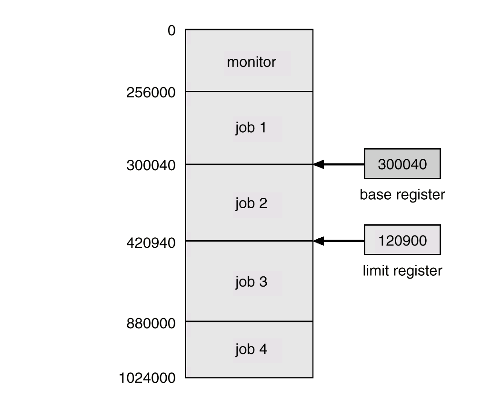

On **every** memory access in user mode, the hardware checks the address:

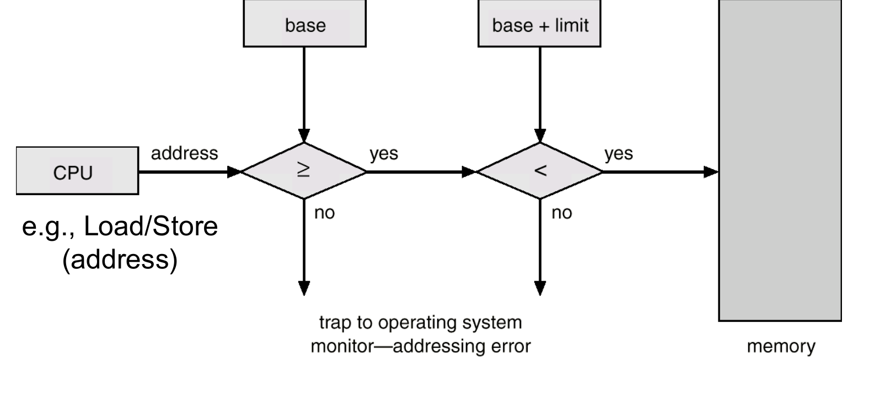

1. Is `address >= base`? If no: trap to the OS (addressing error).
2. Is `address < base + limit`? If no: trap to the OS.
3. If both are yes, the access continues to memory.

The instructions that load the base and limit registers are **privileged**. Otherwise a user program could change its own limits.

## 5. Operating System Services and System Calls

### 5.1 What a system call is
A **system call** is the interface between a user program and the OS. A user program uses a system call to ask the OS for a service that it cannot do itself, for example I/O.

Programs usually do not make system calls directly. They call a function in an **API** (application programming interface), for example the standard C library. The API function then makes the system call. For example, the C function `fopen()` calls the system call `open()`.

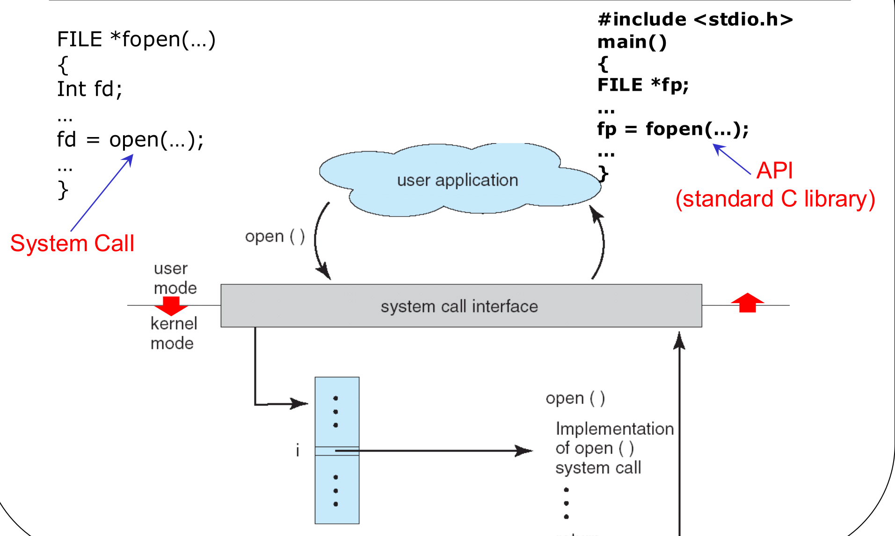

**A system call always causes a trap**, because it needs a switch from user mode to kernel mode.

### 5.2 A system call and an interrupt follow two different paths
Both events stop the user program and run OS code. The difference is **who starts it**:

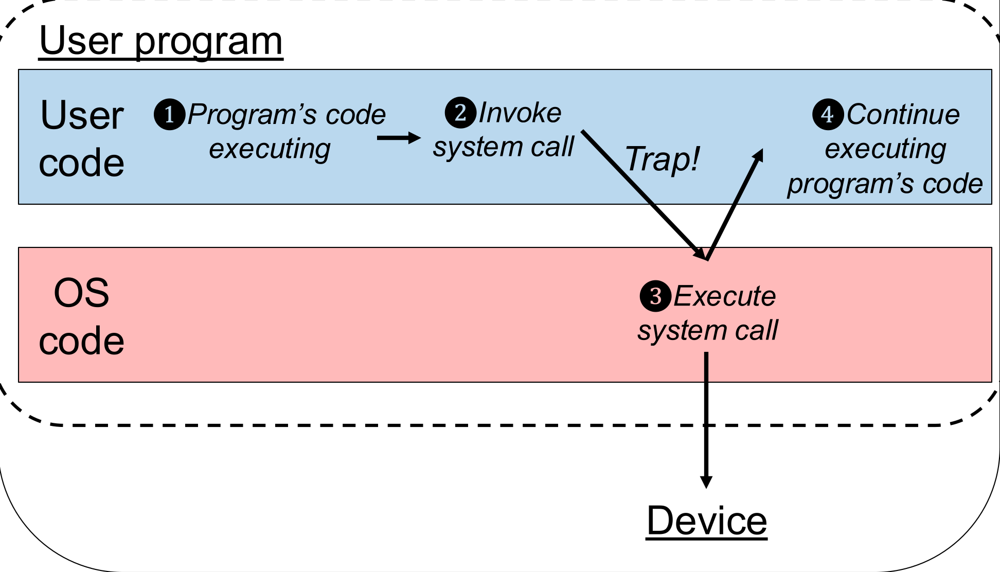

**A system call starts in the program** (CPU to device):

1. The program runs.
2. The program invokes a system call. This causes a trap.
3. The OS runs the system call. It can start an operation on a device.
4. The program continues.

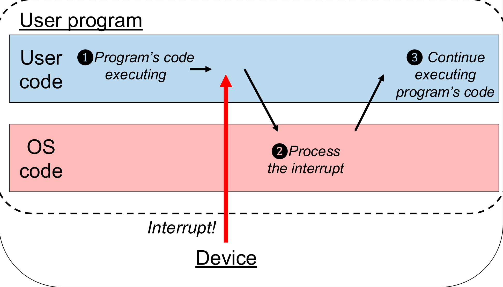

**An interrupt starts in a device** (device to CPU):

1. The program runs.
2. A device sends an interrupt. The OS processes the interrupt.
3. The program continues.

| | System call | Interrupt |
|---|---|---|
| Who starts it | The running program (software) | A device (hardware) |
| Is it a trap? | Yes: a trap that the program asked for | No: an interrupt from outside the CPU |
| Mode change | User → kernel | User → kernel |

## What You Know Now (Lecture 1)

* The OS makes the computer easy to use and uses the hardware efficiently. These goals can conflict.
* Multiprogramming keeps several jobs in memory, so the CPU has work when one job waits for I/O. Multiprocessing means more than one core.
* A device signals the CPU with an interrupt. A program signals the OS with a trap. The OS is interrupt-driven.
* DMA moves a whole block without the CPU, with one interrupt for each block.
* The mode bit separates user mode from kernel mode. Privileged instructions run only in kernel mode. Root is a user account, not a mode.
* All I/O instructions are privileged. Base and limit registers protect memory: legal addresses are from `base` to `base + limit - 1`.
* A system call is a request from a program, and it always causes a trap.
