This was written entirely with AI.

## 1. What a Process Is

### 1.1 A program and a process are different
A **program** is a file on the disk. It contains instructions, but it does nothing on its own.

A **process** is a **program in execution**. When you start a program, the OS loads it into memory and starts to run it. Now it is a process. If you start the same program two times, you get two processes.

A process runs its instructions **one after another** (sequentially). The textbook also uses the word **job** for a process. In these notes, job and process mean the same thing.

### 1.2 What a process looks like in memory
The OS gives each process a region of memory. The region has four parts:

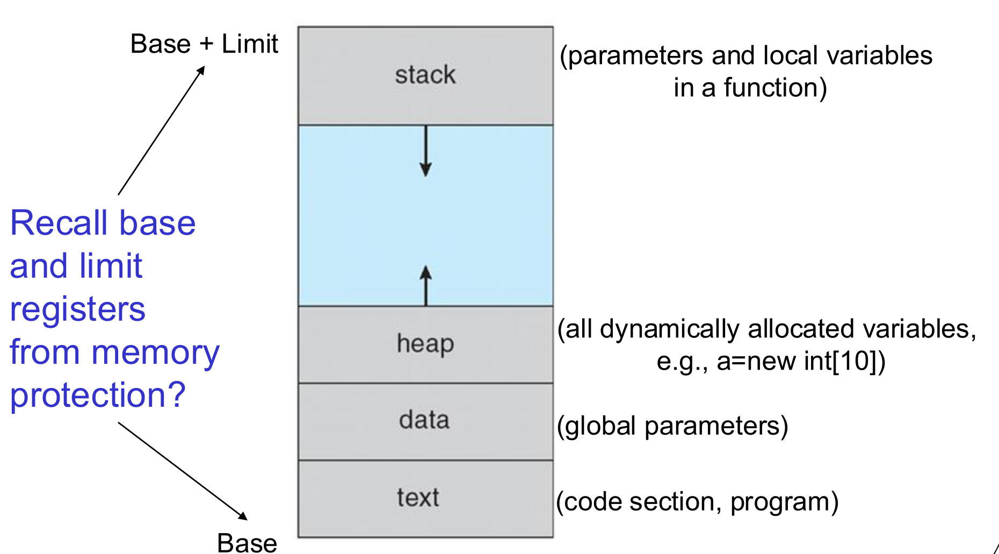

| Part | What it holds | Size |
|---|---|---|
| **Text** | The program code | Fixed |
| **Data** | Global variables | Fixed |
| **Heap** | Memory that the program asks for while it runs, for example `a = new int[10]` | Grows and shrinks |
| **Stack** | The parameters and local variables of each function call | Grows and shrinks |

The heap and the stack grow toward each other, into the free space between them.

**Data and stack: two differences**

1. The data part has a fixed size. The stack grows and shrinks while the process runs.
2. The data part holds global variables. The stack holds the local variables and parameters of functions.

The base and limit registers from Lecture 1 mark the start and the end of this region.

## 2. The Life of a Process: Process States

### 2.1 The five states
While a process exists, it changes **state**. The state tells what the process does now:

1. **New:** the OS is creating the process.
2. **Ready:** the process can run, but it waits for the CPU.
3. **Running:** the CPU runs the instructions of the process now.
4. **Waiting:** the process cannot run. It waits for an event, for example the end of an I/O operation.
5. **Terminated:** the process has finished.

A one-core CPU runs only **one** process at a time. All other processes are ready or waiting.

### 2.2 The transitions between states

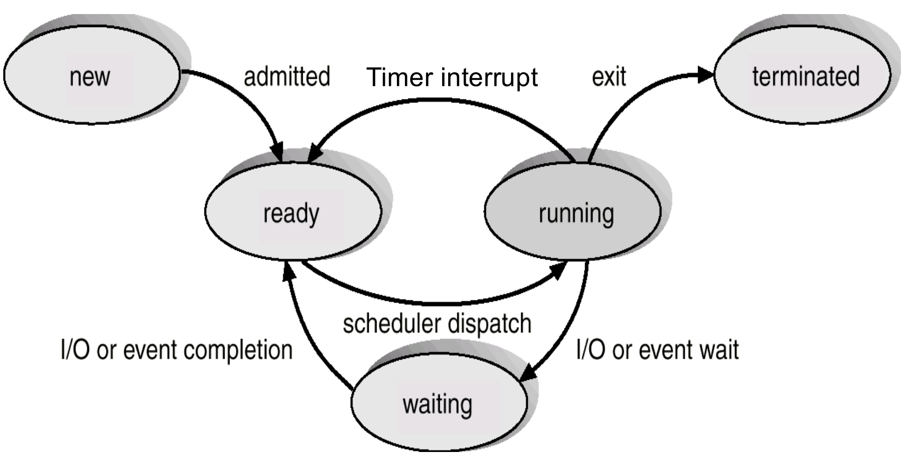

| Transition | What causes it |
|---|---|
| New → Ready | The OS **admits** the process |
| Ready → Running | The scheduler **dispatches** the process (gives it the CPU) |
| Running → Ready | An **interrupt**, for example the timer. The process can still run, but it must give the CPU to another process |
| Running → Waiting | The process asks for I/O or waits for an event |
| Waiting → Ready | The I/O or the event finishes |
| Running → Terminated | The process **exits** |

Two facts that exams test:

* **A waiting process never goes directly to running.** It goes to ready first, and then waits for the scheduler.
* **"Ready" and "waiting" are different.** A ready process waits only for the CPU. A waiting process waits for an event, and the CPU cannot help it.

The **timer interrupt** is what lets a multiprogrammed system move the CPU from one ready process to another.

## 3. How the OS Keeps Track of a Process

### 3.1 The process control block (PCB)
The OS keeps a record for each process, the **process control block (PCB)**. The PCB holds everything the OS needs to stop the process and continue it later:

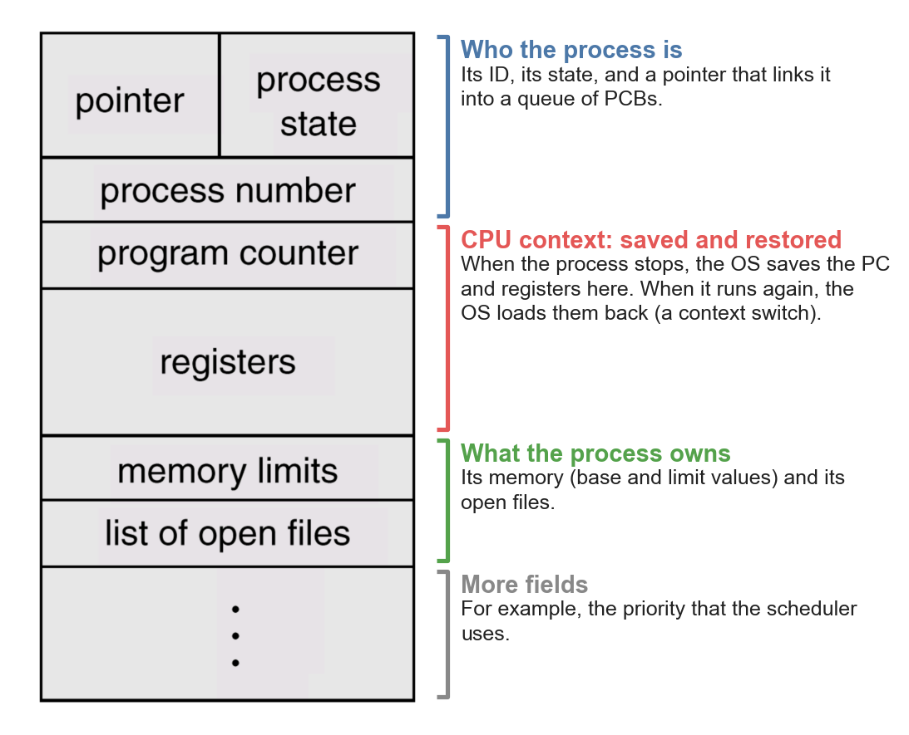

1. A **pointer** to other PCBs (the OS keeps PCBs in queues or lists)
2. The **process state**
3. The **process number** (process ID)
4. The **program counter**: the address of the next instruction
5. The **CPU registers**
6. The **priority**, which the scheduler uses
7. **Memory-management information**, for example the base and limit values
8. **File information**, for example the list of open files

All PCBs are in **kernel memory**. User programs cannot read or change them.

### 3.2 The context switch
When the OS moves the CPU from process P0 to process P1, it must do two things:

1. **Save the context of P0** into PCB0. The context is the state of the CPU: the registers and the program counter.
2. **Load the context of P1** from PCB1 into the CPU.

This is a **context switch**.

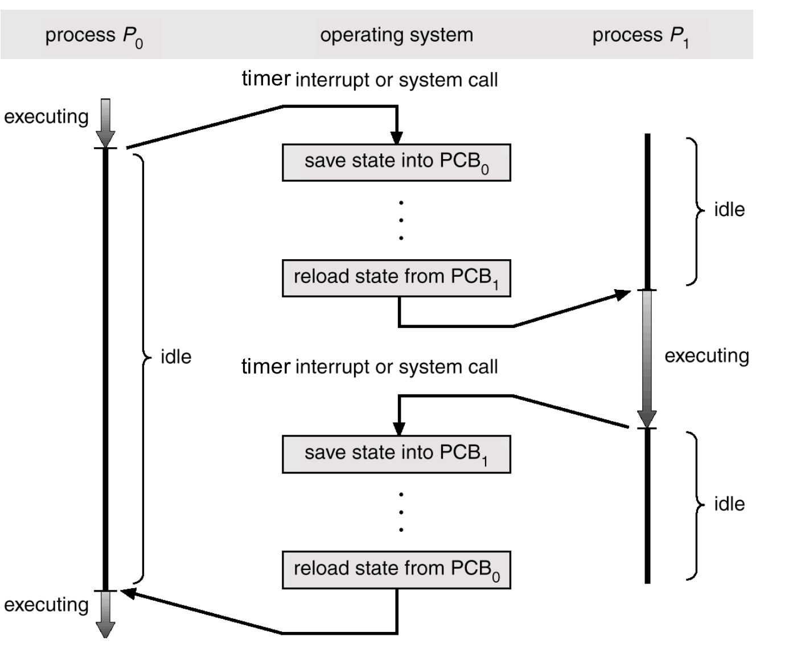

**A context switch is overhead.** While the OS switches, no user process runs, so the system does no useful work. The OS runs this code in kernel mode, because the PCBs are in kernel memory.

### 3.3 Scheduling queues
The OS keeps processes in queues. Each queue holds the PCBs of processes in the same state:

* The **ready queue** holds all processes in the ready state.
* A **device queue** holds the processes that wait for one particular I/O device.

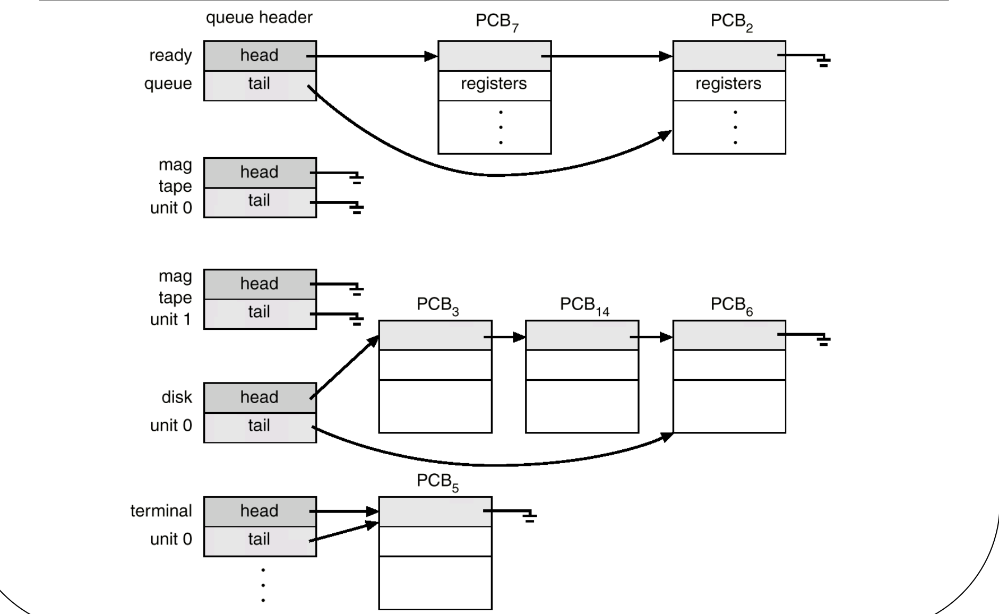

When a process changes state, the OS moves its PCB from one queue to another. All queues are in kernel memory.

### 3.4 Three schedulers
The OS has three schedulers. Each one makes a different decision:

| Scheduler | Decision | How often it runs |
|---|---|---|
| **Long-term** (job scheduler) | Which new processes to load from the disk into memory | Seldom: seconds or minutes |
| **Short-term** (CPU scheduler) | Which ready process gets the CPU next | Very often: for example every 100 ms |
| **Medium-term** | When the load is heavy, **swap out** a partly-run process from memory to the disk. When the load is light, swap it back in | When the load changes |

The **degree of multiprogramming** is the number of processes in memory. The long-term scheduler sets it at the start. Later, the medium-term scheduler controls it.

The short-term scheduler runs often, because it must keep the CPU busy and the system responsive. Lecture 3 studies it in detail.

## 4. Creating and Ending Processes

### 4.1 Process creation
A process (the **parent**) can create new processes (its **children**). The children can create their own children. This makes a **tree** of processes. In Unix, a process creates a child with `fork()`.

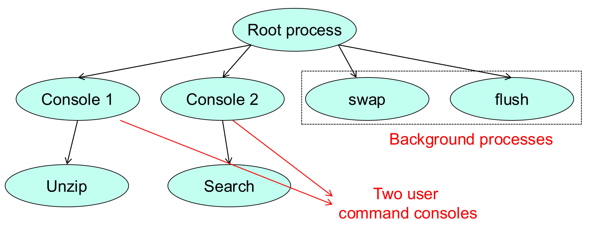

After the parent creates a child, there are two choices:

1. The parent and the child run **at the same time**, independently.
2. The parent **waits** until its children finish. It uses `wait()` (also called `join()`).

**`wait()` is for the parent.** The parent calls `wait()` to wait until a child finishes. A child does not use `wait()` to get instructions from the parent.

Examples: a web browser can create a new process for each tab. The OS creates background processes for maintenance work.

### 4.2 Process termination
A process ends in one of two ways:

* **Exit.** The process runs its last statement and asks the OS to delete it. It can return data to its parent. The OS takes back all its resources.
* **Abort.** The parent ends the child. The parent can do this because the child used too many resources, because the task of the child is no longer necessary, or because the parent itself is exiting.

## 5. Interprocess Communication (IPC)

### 5.1 Independent and cooperating processes
* An **independent** process cannot affect other processes, and other processes cannot affect it.
* A **cooperating** process can affect other processes, or other processes can affect it. Cooperating processes must exchange data.

Processes exchange data by **interprocess communication (IPC)**. There are two models.

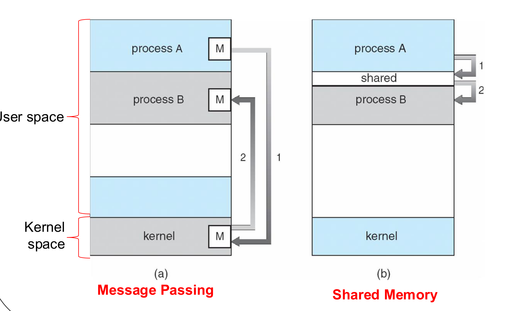

### 5.2 Model 1: shared memory
The processes share a region of memory. Process A writes into the region. Process B reads from it. After the OS sets up the region, the processes exchange data **without the kernel**.

The processes must coordinate their access to the shared region themselves. Lecture 4 explains how.

### 5.3 Model 2: message passing
The processes do not share variables. They use two system calls:

* `send(message)`
* `receive(message)`

A message can have a fixed or a variable size. Before two processes can communicate, they must set up a **communication link**.

Each message goes through the kernel: the sender copies it into kernel memory, and the receiver copies it out. So **message passing uses more memory than shared memory**, and each send and receive is a system call.

| | Shared memory | Message passing |
|---|---|---|
| How data moves | Through a shared region | Through the kernel, with `send` and `receive` |
| Kernel involvement | Only to set up the region | For every message |
| Memory use | Less | More (copies in the kernel) |
| Who coordinates access | The processes themselves | The kernel |

### 5.4 Direct and indirect message passing

* **Direct:** each process names the other process.
    * `send(P, message)`: send a message to process P.
    * `receive(Q, message)`: receive a message from process Q.
* **Indirect:** processes send messages to a **mailbox** (also called a **port**) and receive from it. A mailbox works like a queue.
    * `send(A, message)`: send a message to mailbox A.
    * `receive(A, message)`: receive a message from mailbox A.

### 5.5 The producer–consumer pattern
This is the classic example of cooperating processes:

* A **producer** process makes information.
* A **consumer** process uses it.
* A **buffer** holds the information between them.

There are two types of buffer:

1. An **unbounded** buffer has no practical size limit. The producer never needs to wait.
2. A **bounded** buffer has a fixed size. The producer must wait when the buffer is full. The consumer must wait when the buffer is empty.

The lecture shows a bounded buffer that uses a mailbox with space for B messages. The producer waits while the mailbox is full, then sends. The consumer waits while the mailbox is empty, then receives. This uses **indirect** communication, because both processes use the mailbox and do not name each other.

## 6. Threads

### 6.1 What a thread is
A **thread** is the basic unit that the CPU runs. Another name is **lightweight process**. Each thread has its own:

* thread ID
* program counter
* set of registers
* stack

The threads in one process **share**:

* the code (text) and the data
* the heap
* OS resources, for example open files

Each thread also has a **thread control block (TCB)**, which is similar to a PCB.

A traditional process is a **heavyweight** process: it has only one thread.

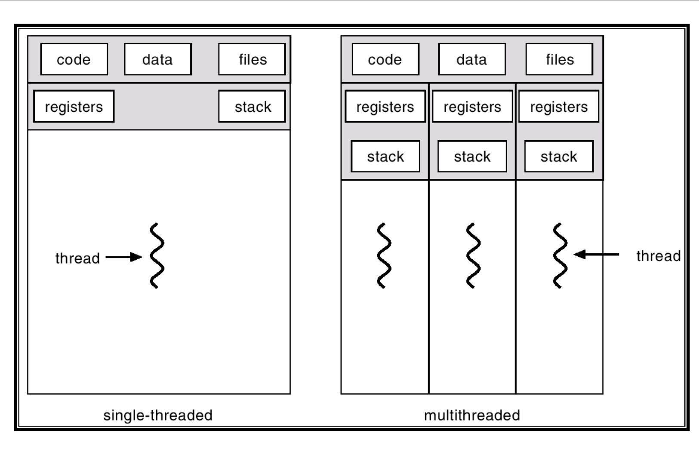

### 6.2 Why use more than one thread
In a multithreaded process, **when one thread waits** (for example for I/O), **another thread of the same process can run**. So the process does more work in the same time: throughput goes up.

Example: a word processor. One thread reads the keyboard, another thread displays the text, and a third thread saves the file in the background.

Example: a web server. When a request arrives, the server creates a new thread to handle it, and then listens for the next request at once.

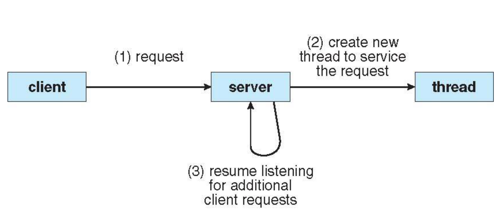

### 6.3 User threads and kernel threads
There is a conflict:

* Programmers want to create as many threads as they like.
* The kernel can support only a limited number of threads, because each thread uses kernel resources.

The solution has two layers:

* **User threads** are created in user space, by a thread library. They are fast to create. A program can create as many as it wants.
* **Kernel threads** are created in kernel space, by the OS. They are slower to create and manage. The kernel gives real resources (for example CPU time) only to kernel threads.

The OS **maps** user threads onto kernel threads. A user thread can run only when the OS maps it to a kernel thread.

### 6.4 The three mapping models

**Many-to-one.** Many user threads map to one kernel thread.

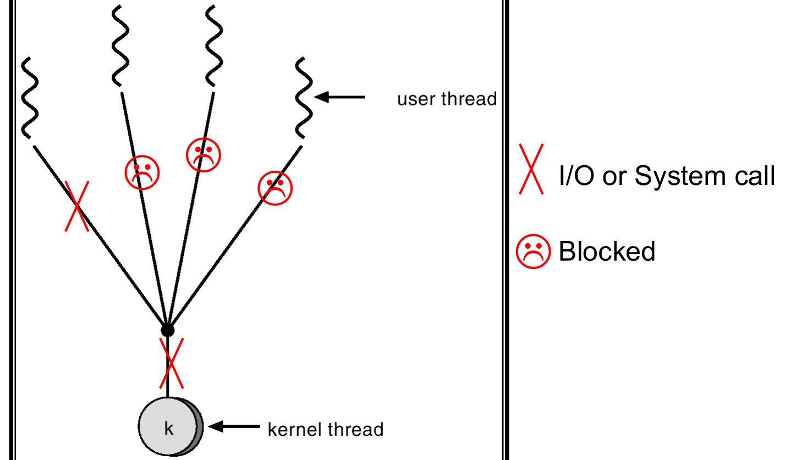

* Problem: if one user thread makes a blocking system call, the kernel thread blocks. Then **all** the user threads on that kernel thread block too.

**One-to-one.** Each user thread maps to its own kernel thread. Examples: Windows 95/98/NT/2000, OS/2.

* Advantage: more concurrency. When one thread blocks, the others can still run.
* Problem: each new user thread needs a new kernel thread. Too many kernel threads put a heavy load on the system.

**Many-to-many.** Many user threads map to a smaller or equal number of kernel threads. Examples: C++20 coroutines, Go goroutines.

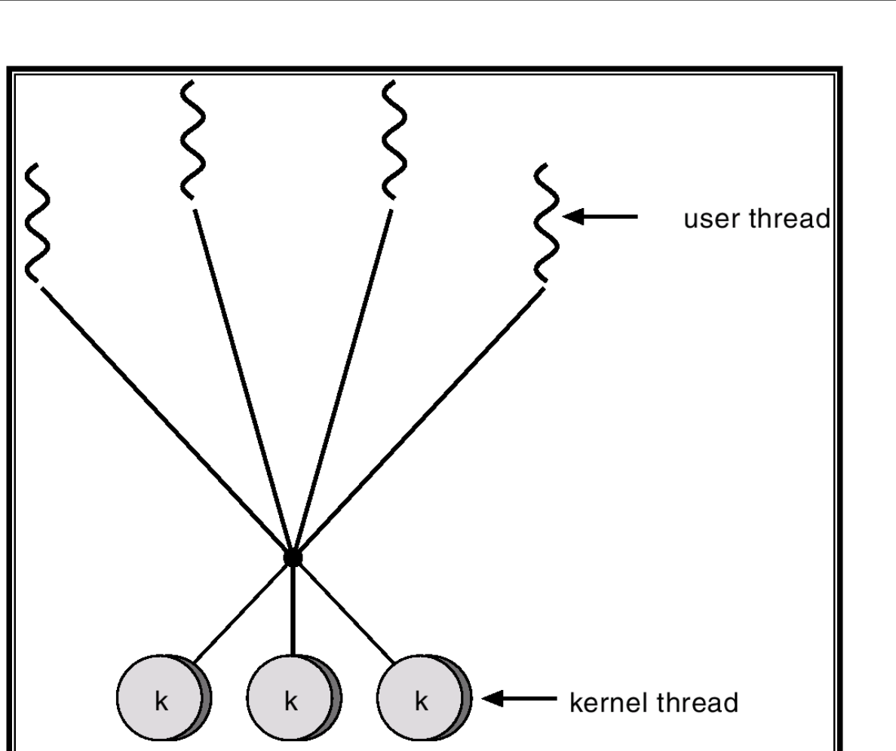

* Advantage: the OS can create just enough kernel threads. It avoids the problems of the other two models.
* Problem: it is difficult to decide the best mapping.

| Model | A blocked thread blocks the others? | Kernel threads created | Main problem |
|---|---|---|---|
| Many-to-one | Yes | One | One blocking call stops all threads |
| One-to-one | No | One for each user thread | Too many kernel threads |
| Many-to-many | No | As many as necessary | The mapping is hard to decide |

**Why is there no one-to-many model?** Mapping one user thread onto many kernel threads wastes kernel resources. One user thread runs only one sequence of instructions, so it can use only one kernel thread at a time.

## What You Know Now (Lecture 2)

* A process is a program in execution. Its memory has text, data, heap and stack.
* A process moves between new, ready, running, waiting and terminated. A waiting process always goes to ready before it runs again.
* The PCB holds the state of a process. A context switch saves one PCB and loads another. It is pure overhead.
* The long-term scheduler loads jobs, the short-term scheduler picks the next process to run, and the medium-term scheduler swaps processes out and in.
* A parent creates children and can `wait()` for them.
* IPC uses shared memory (fast, no kernel per message) or message passing (through the kernel, more memory).
* Threads in one process share code, data, heap and files. Each thread has its own registers, program counter and stack.
* Many-to-one blocks all threads on one blocking call. One-to-one creates too many kernel threads. Many-to-many avoids both.
