This was written entirely with AI.

## 1. Why the OS Needs a Scheduler

### 1.1 CPU bursts and I/O bursts
A process does not use the CPU all the time. It does some computing, then it waits for I/O, then it computes again:

* A **CPU burst** is one period of computing.
* An **I/O burst** is one period of waiting for I/O.

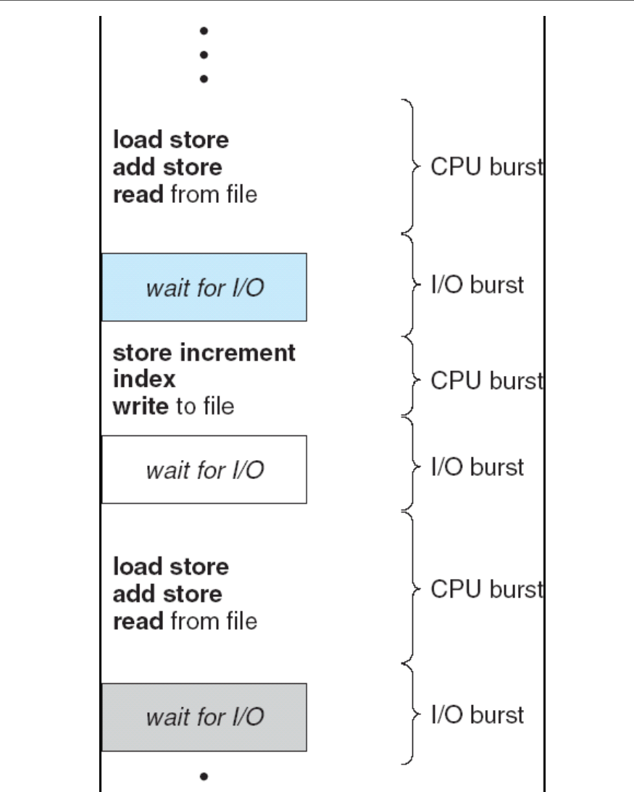

While one process is in an I/O burst, the CPU has nothing to do for it. With multiprogramming (Lecture 1), the OS gives the CPU to another process in that time. The goal of CPU scheduling is to **keep the CPU as busy as possible**.

This lecture studies the **short-term scheduler**. It selects a process from the **ready queue** and gives it a CPU core. One core runs one process at a time.

### 1.2 When the scheduler must run
The scheduler can run whenever a process changes state. The lecture numbers five transitions:

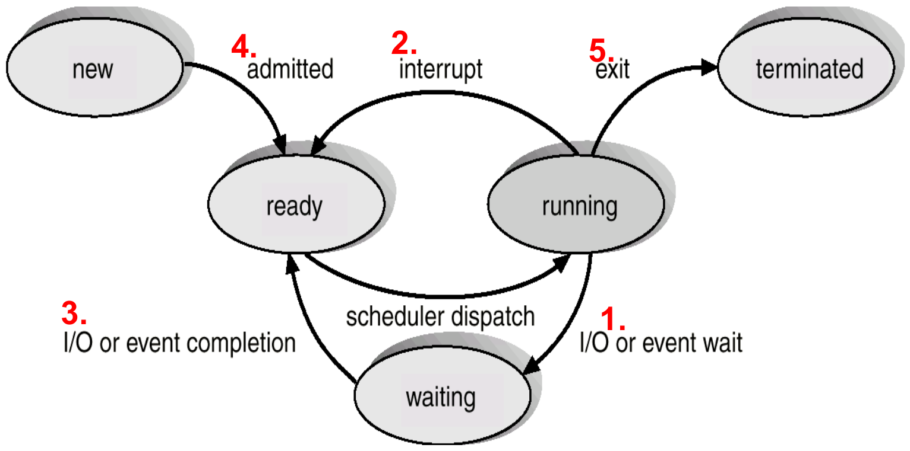

| Number | Transition | Cause |
|---|---|---|
| 1 | Running → Waiting | The process asks for I/O or waits for an event |
| 2 | Running → Ready | An interrupt |
| 3 | Waiting → Ready | The I/O or the event finishes |
| 4 | New → Ready | A new process arrives (is admitted) |
| 5 | Running → Terminated | The process exits |

**Which transitions force the scheduler to run?** Only **1 and 5**. In both cases, the running process leaves the CPU, so the core becomes idle. The scheduler must pick a new process, or the core stays idle.

In transitions 2, 3 and 4, a process can continue to run. The scheduler **may** run, but it does not have to. (Exception: transition 4 on an idle core. If no process runs and a new one arrives, the scheduler should run to use the idle core.)

### 1.3 Preemptive and nonpreemptive scheduling
This difference comes directly from the transitions:

* **Nonpreemptive.** Once a process has the CPU, it keeps it until it **gives it up itself**: it finishes, or it waits for I/O or an event. The scheduler runs only at transitions 1 and 5 (and 4 on an idle core).
* **Preemptive.** The scheduler can **take the CPU away** from a running process at any time. The scheduler also runs at transitions 2, 3 and 4, or at any other moment.

The word **preempt** means "take the CPU away from a process that still wants to run".

## 2. How to Measure a Scheduler

### 2.1 System-wide measures (make these large)

* **CPU utilization:** the percentage of time that the cores run processes.
  $$\text{CPU utilization} = \frac{\text{sum of the busy time of all cores}}{\text{total time} \times \text{number of cores}}$$
* **Throughput:** the number of processes that finish in each unit of time. In other words, the number of "exit" transitions in each unit of time.

### 2.2 Measures for each process (make these small)
Three times describe what one process experiences:

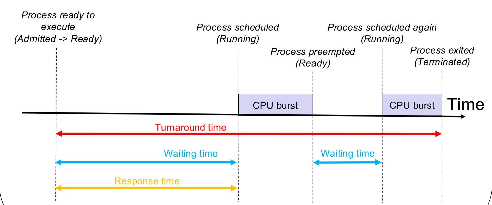

* **Turnaround time:** from the moment the process arrives (is admitted) to the moment it finishes.
  $$\text{turnaround} = \text{finish time} - \text{arrival time}$$
  It includes everything: running, waiting for I/O, and waiting in the ready queue.
* **Waiting time:** the total time that the process spends in the **ready queue**.
  $$\text{waiting} = \text{turnaround} - \text{CPU bursts} - \text{I/O bursts} - \text{event waits}$$
  Time in an I/O burst does **not** count as waiting time. The scheduler cannot shorten it.
* **Response time:** from arrival to the **first** time the process runs.

For the whole system, take the **average** of each time over all processes.

In this lecture, the examples assume each process has **one** CPU burst and no I/O, unless the question says otherwise. Then:

$$\text{waiting} = \text{turnaround} - \text{burst}$$

### 2.3 How to read a Gantt chart
A **Gantt chart** is a time line. Each box shows which process runs on the core, from the start time to the end time below the box.

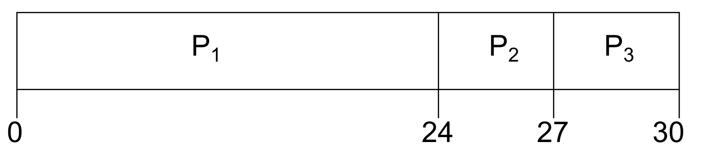

To find the measures from a Gantt chart:

1. Read the **finish time** of each process: the end of its last box.
2. Turnaround = finish time − arrival time.
3. Waiting = turnaround − burst time (with one CPU burst and no I/O).
4. Response = start of its first box − arrival time.

In the chart above, P2 arrives at 0, and its box goes from 24 to 27. So P2 finishes at 27, its turnaround is 27 − 0 = 27, its waiting time is 27 − 3 = 24, and its response time is 24 − 0 = 24.

## 3. Scheduling Algorithms for One Core

### 3.1 First-come, first-served (FCFS)
**Rule:** run the processes in the order they arrive. Each process runs until its burst ends.

FCFS is **nonpreemptive**: a process gives up the CPU only when it finishes or waits.

**Example (slides 3.11–3.12).** Three processes arrive at time 0 with bursts P1 = 24, P2 = 3, P3 = 3.

* Order P1, P2, P3: the chart is P1 (0–24), P2 (24–27), P3 (27–30). Waiting times 0, 24 and 27. Average = 17.
* Order P2, P3, P1: the chart is P2 (0–3), P3 (3–6), P1 (6–30). Waiting times 6, 0 and 3. Average = 3.

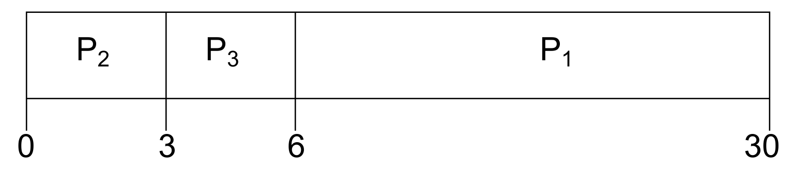

The same processes give very different averages. The cause is the **convoy effect**: short processes wait behind one long process that arrived first, like cars behind a slow truck.

### 3.2 Shortest job first (SJF) and shortest remaining time first (SRTF)
**Idea:** run the process with the **shortest CPU burst** first. This fixes the convoy effect.

There are two versions:

* **SJF (nonpreemptive).** When the core becomes free, pick the ready process with the shortest burst. It runs to the end of its burst.
* **SRTF (preemptive SJF).** When a new process arrives, compare its burst with the **remaining** burst of the running process. If the new burst is shorter, preempt the running process.

**SJF/SRTF gives the lowest possible average waiting time.** Every time a short job goes before a long job, the short job saves more waiting than the long job loses.

**Example (slides 3.15–3.16).** Arrival time and burst: P1 (0, 7), P2 (2, 4), P3 (4, 1), P4 (5, 4).

Nonpreemptive SJF:

* At 0, only P1 is ready. P1 runs 0–7.
* At 7, P2, P3 and P4 are ready. The shortest is P3: 7–8. Then P2 and P4 both have 4. P2 arrived first: 8–12. Then P4: 12–16.
* Waiting: P1 = 0, P2 = 8 − 2 = 6, P3 = 7 − 4 = 3, P4 = 12 − 5 = 7. Average = 4.

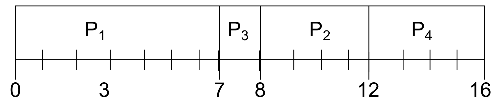

SRTF:

* At 0, P1 runs. At 2, P2 arrives with 4. P1 has 5 left. 4 < 5, so P2 preempts P1.
* At 4, P3 arrives with 1. P2 has 2 left. 1 < 2, so P3 preempts P2. P3 runs 4–5.
* At 5, P4 arrives with 4. P2 has 2 left, P1 has 5 left. P2 runs 5–7. Then P4 runs 7–11, and P1 runs 11–16.
* Waiting: P1 = 16 − 0 − 7 = 9, P2 = 7 − 2 − 4 = 1, P3 = 0, P4 = 11 − 5 − 4 = 2. Average = 3.

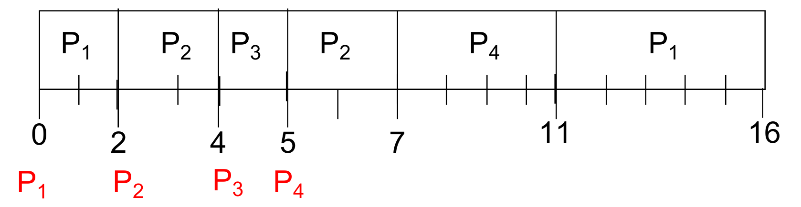

SRTF has the lower average here, because it can react to short jobs that arrive later.

**The weakness of SJF:** the OS must know the length of the next CPU burst in advance. In a real system it can only estimate it.

### 3.3 Priority scheduling
**Rule:** each process has a priority number. The CPU goes to the process with the highest priority. Usually, a **smaller number means a higher priority**. Priority scheduling can be preemptive or nonpreemptive.

FCFS and SJF are special cases of priority scheduling:

* FCFS: the priority is the arrival order.
* SJF: the priority is the burst length.

**Problem: starvation.** In a busy system, high-priority processes keep arriving. A low-priority process may **never** run.

**Solution: aging.** The OS slowly raises the priority of a process the longer it waits. Finally, it becomes the highest priority and runs.

### 3.4 Round robin (RR)
**Rule:** each process runs for at most a fixed **time quantum** `q`. If it has not finished, the OS preempts it and puts it at the **end** of the ready queue. The processes take turns in a cycle. RR is preemptive. Usually `q` is 10–100 ms.

**Property:** with `n` processes in the ready queue, no process waits more than $(n-1)q$ before its next turn. So RR gives good **response time**.

**The choice of `q` matters:**

* **Large `q`:** each process finishes its burst before the quantum ends. RR becomes FCFS.
* **Small `q`:** many context switches. Each switch is overhead, so the CPU spends more time switching and less time on work.

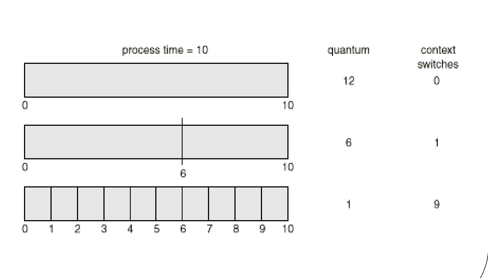

**Average turnaround time and `q` have no simple relation.** The graph goes up and down as `q` changes. But once `q` is larger than the longest CPU burst, the average turnaround time stays the same, because RR is then FCFS.

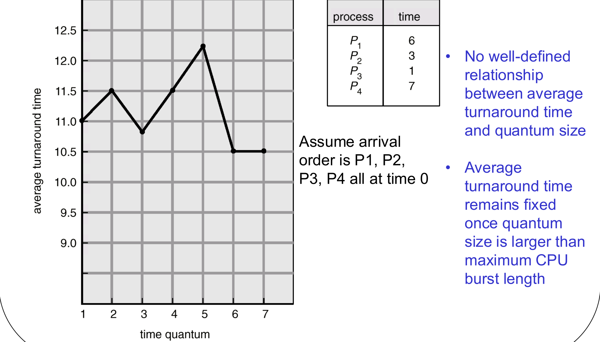

**Example (slide 3.19).** Four processes arrive at time 0 in the order P1, P2, P3, P4 with bursts 53, 17, 68 and 24. With q = 20, the chart is:

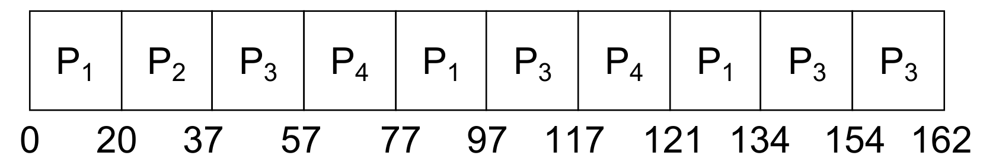

P2 needs only 17, so it finishes before its quantum ends, and the next process starts at once at 37.

Compared with SJF, RR usually has a **higher average waiting and turnaround time**, but a **better response time**.

### 3.5 Multilevel queue scheduling
Different processes need different things:

* **Foreground** (interactive) processes need fast response. RR suits them.
* **Background** (batch) processes do not need fast response. FCFS suits them, because it has little overhead.

**Multilevel queue scheduling** divides the ready queue into several queues. Each queue has its own algorithm. Then the OS must also decide **which queue** gets the CPU. There are two ways:

* **Fixed priority:** serve the queues in priority order, for example foreground before background. Problem: the low-priority queues can **starve**.
* **Time slices:** give each queue a fixed share of CPU time, for example 80 ms for foreground, then 20 ms for background, and repeat.

### 3.6 The one-core algorithms side by side

| Algorithm | Preemptive? | Strength | Weakness |
|---|---|---|---|
| FCFS | No | Simple; low overhead | Convoy effect |
| SJF | No | Lowest average waiting time (nonpreemptive) | Must know burst lengths; long jobs can starve |
| SRTF | Yes | Lowest average waiting time overall | Must know burst lengths; long jobs can starve |
| Priority | Either | Important work first | Starvation (fix: aging) |
| RR | Yes | Good response time; fair | Higher average waiting; overhead if `q` is small |
| Multilevel queue | Depends on each queue | Different policies for different types of process | Lower queues can starve with fixed priority |

## 4. Scheduling on Many Cores
Now the CPU has several cores. Each process can run on **only one core at a time**. There are two approaches.

### 4.1 Partitioned scheduling (asymmetric multiprocessing, AMP)
* When a process is created, the OS **assigns** it to one core. The process always runs on that core.
* Each core has its own ready queue and its own one-core scheduler. Different cores can use different algorithms.

**Advantage:** it is simple. It is the one-core scheduling from section 3, applied to each core.

**Problem: how to assign processes to cores.** A poor assignment gives **unequal loads**: one core is idle while another is overloaded. The best assignment is an NP-hard problem, similar to the knapsack problem. If the burst lengths are known, a heuristic such as best-fit can help.

### 4.2 Global scheduling (symmetric multiprocessing, SMP)
* There are one or more ready queues for the **whole system**. No queue belongs to a core.
* When **any** core becomes idle, the scheduler gives it the next process, with one rule for all cores (FCFS, SJF and so on).
* A process can run on different cores at different times.

**Advantage:** there is no assignment problem. No core stays idle while processes are ready.

**Problems:**

* **More complex.** The cores must synchronize their clocks, and the scheduler must decide for all cores together.
* **More overhead.** A process can stop on one core and continue on another. This is **migration**. The data in the private cache of the first core is then not useful, and must move.

Migration overhead is a problem of **global** scheduling only. In partitioned scheduling, processes never move between cores.

| | Partitioned (AMP) | Global (SMP) |
|---|---|---|
| Ready queues | One for each core | Shared by all cores |
| Can a process move between cores? | No | Yes |
| Main problem | Unequal loads (assignment is NP-hard) | Complexity and migration overhead |
| Each core can use its own algorithm? | Yes | No: one rule for all cores |

### 4.3 How to draw a global schedule
In a global schedule, at each moment, the scheduler picks the best ready processes for **all** free cores together. With two cores, the two best ready processes run.

**Example (slide 3.28): SRTF on two cores.** P1 (0, 7), P2 (2, 4), P3 (4, 1), P4 (5, 4).

* At 0, P1 runs on core 1. Core 2 is idle.
* At 2, P2 arrives. Core 2 is free, so P2 runs there. No preemption is necessary.
* At 4, P3 arrives with 1. Both cores are busy: P1 has 3 left, P2 has 2 left. P3 preempts the process with the **longest** remaining time, P1. P3 runs 4–5 on core 1.
* At 5, P3 finishes and P4 arrives. P1 (3 left) and P4 (4) wait. P1 goes on core 1. At 6, P2 finishes on core 2, and P4 starts there.
* Waiting: P1 = 1, P2 = 0, P3 = 0, P4 = 1. Average = 0.5.

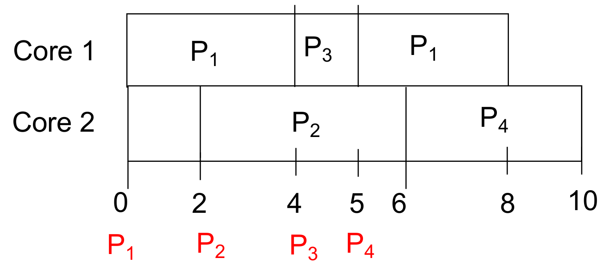

**Example (slide 3.29): RR with q = 20 on two cores.** The processes are the same as in the one-core RR example: P1, P2, P3 and P4 arrive at time 0 in that order, with bursts 53, 17, 68 and 24. When a quantum ends, the process goes to the end of the shared ready queue. The next free core takes the process at the head of the queue. So a process can continue on a different core: P1 runs on core 1 (0–20), then on core 2 (37–57), then on core 1 again (60–73).

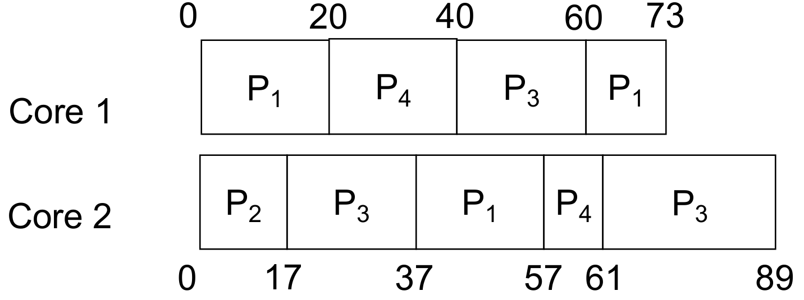

## What You Know Now (Lecture 3)

* The scheduler must run when a process waits (transition 1) or exits (transition 5). Preemptive scheduling also runs at other times.
* Turnaround = finish − arrival. Waiting = time in the ready queue. Response = first run − arrival.
* FCFS has the convoy effect. SJF/SRTF gives the lowest average waiting time but needs burst lengths. Priority can starve processes; aging fixes it. RR gives good response time; a large quantum turns it into FCFS.
* Multilevel queues use a different algorithm for each queue.
* Partitioned scheduling fixes each process to a core and risks unequal loads. Global scheduling shares one queue and pays for migration.
