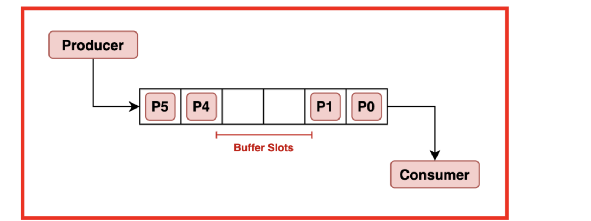
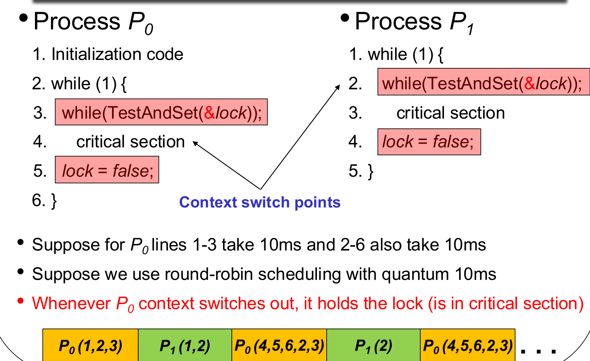
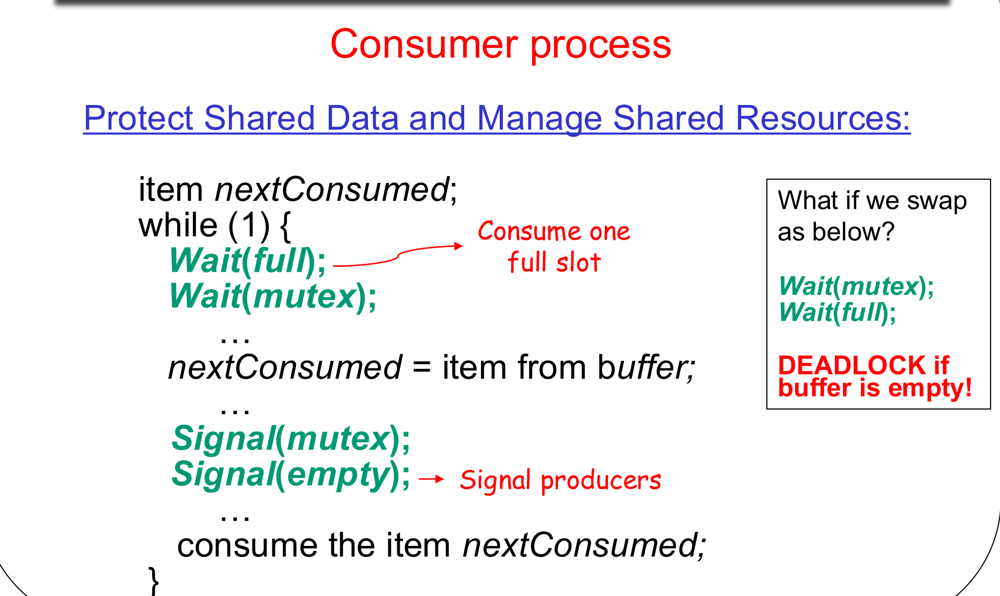
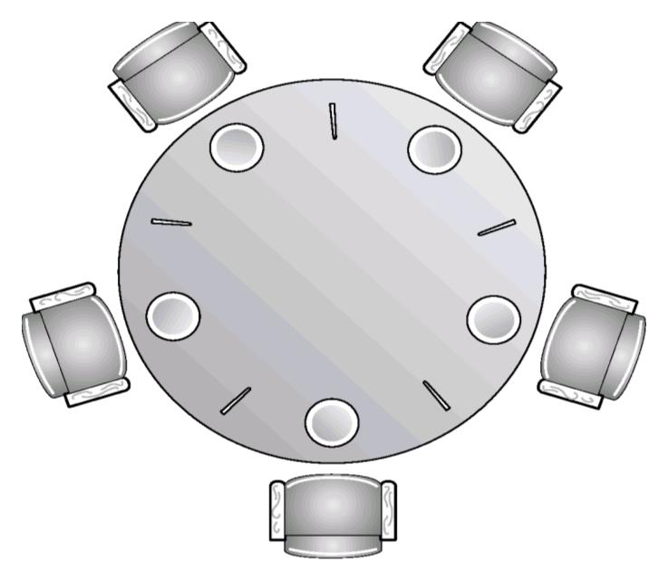

This was written entirely with AI.

## 1. The Problem: Shared Data and Bad Timing

### 1.1 A producer and a consumer share a counter
Lecture 2 introduced the producer–consumer pattern. Here, the producer and the consumer share a buffer of 10 places in memory:



They share three variables:

* `buffer[10]`: the places.
* `in`: the next empty place. Only the producer uses it.
* `out`: the next full place. Only the consumer uses it.
* `counter`: the number of items in the buffer. **Both** processes change it.

```c
// Producer                                  // Consumer
while (1) {                                  while (1) {
  while (counter == BUFFER_SIZE) ;  // wait    while (counter == 0) ;  // wait
  buffer[in] = nextProduced;                   nextConsumed = buffer[out];
  in = (in + 1) % BUFFER_SIZE;                 out = (out + 1) % BUFFER_SIZE;
  counter++;                                   counter--;
}                                            }
```

The code looks correct. But `counter++` and `counter--` can give a wrong result.

### 1.2 Why `counter++` is not one step
The CPU runs `counter++` as three machine instructions:

```text
register1 = counter          // read
register1 = register1 + 1    // add
counter = register1          // write
```

`counter--` is the same, with `- 1`. A **context switch** can occur between any two instructions.

Start with `counter = 5`. The producer adds one item and the consumer removes one item. The correct result is 5. Now look at this order (slide 4.9):

| Step | Process | Instruction | Result |
|---|---|---|---|
| 1 | Producer | `register1 = counter` | register1 = 5 |
| 2 | Producer | `register1 = register1 + 1` | register1 = 6 |
| 3 | | context switch to the consumer | |
| 4 | Consumer | `register2 = counter` | register2 = 5 |
| 5 | Consumer | `register2 = register2 - 1` | register2 = 4 |
| 6 | | context switch to the producer | |
| 7 | Producer | `counter = register1` | counter = 6 |
| 8 | | context switch to the consumer | |
| 9 | Consumer | `counter = register2` | counter = **4** |

The counter is 4, not 5. The consumer wrote over the producer's result.

### 1.3 Names for this problem
* A **race condition** occurs when the result depends on the order in which the instructions of concurrent processes run, in other words on when the context switches occur.
* The data is then **inconsistent**: its value is not the value that a correct order would give.

To keep data consistent, the OS must control the order of the reads and writes to shared data.

## 2. The Critical-Section Problem

### 2.1 What a critical section is
Think about `n` processes that share some data. Each process has a part of its code that reads or changes the shared data. That part is its **critical section**. At least one process **writes** the shared data. (If all processes only read, there is no problem.)

**The problem:** design a protocol so that **when one process runs its critical section, no other process runs its critical section**.

### 2.2 The general structure
Every solution has the same shape:

```c
while (1) {
    entry section       // ask for permission to enter
    critical section
    exit section        // tell the other processes that you have left
    remainder section   // all other code
}
```

The question is always: **what code goes into the entry section and the exit section?**

### 2.3 Three requirements for a correct solution
A correct solution must satisfy all three:

1. **Mutual exclusion.** If a process is in its critical section, no other process can be in its critical section at the same time.
2. **Progress.** If no process is in its critical section and some processes want to enter, the choice of the next process **cannot be postponed forever**. In simple words: if the critical section is free, someone must be able to enter.
3. **Bounded waiting.** After a process asks to enter, the other processes can enter before it only a **limited number of times**. In simple words: no process waits forever while others go in again and again.

Progress and bounded waiting together make sure that a process does not stay in the entry section forever.

**Progress does not give bounded waiting.** Think about a solution that always lets P0 in first. If the critical section is free, someone always enters, so progress holds. But P1 can wait forever while P0 enters again and again. So bounded waiting fails.

The solutions make two assumptions:

* Every process makes progress in its critical section and remainder section. It does not stop there forever.
* The solutions make **no assumption about speed**. The processes can run at any relative speed.

## 3. Solutions in User Code (Two Processes)
First, look at solutions in normal user code, with no help from the OS or special hardware. There are two processes, P0 and P1. In the code for process Pi, `k` is the other process.

### 3.1 Algorithm 1: take turns
One shared variable, `turn`, starts at 0. `turn == i` means that Pi can enter.

```c
// Process Pi
while (1) {
    while (turn != i) ;   // entry: wait for my turn
    critical section
    turn = k;             // exit: give the turn to the other process
    remainder section
}
```

* **Mutual exclusion: yes.** Only the process whose turn it is can enter. The turn changes only in the exit section.
* **Progress: no.** Suppose `turn = 0`, but P0 is in a long remainder section (for example an endless loop, or blocked I/O). P1 wants to enter. The critical section is free, but P1 must wait for P0 to give it the turn. That may never occur.
* **Bounded waiting: yes.** The turn goes back and forth, so each process waits at most one turn.

The weakness: Algorithm 1 does not know if the other process even **wants** to enter.

### 3.2 Algorithm 2: show interest with a flag
Each process has a flag. `flag[i] = true` means that Pi wants to enter. Both flags start as `false`.

```c
// Process Pi
while (1) {
    flag[i] = true;        // entry: I want to enter
    while (flag[k]) ;      //        wait while the other process wants to enter
    critical section
    flag[i] = false;       // exit: I no longer want to enter
    remainder section
}
```

* **Mutual exclusion: yes.** If P0 is inside, `flag[0]` is true, so P1 waits.
* **Progress: no.** Look at this order:
    1. P0 sets `flag[0] = true`.
    2. Context switch to P1.
    3. P1 sets `flag[1] = true`.

    Now both flags are true. Each process waits for the other, forever. Neither process is inside.
* **Bounded waiting: yes.** Once P0 has set its flag, P1 cannot enter before it.

The weakness: when both processes want to enter at the same time, Algorithm 2 cannot choose between them.

### 3.3 Algorithm 3: flags and a turn (Peterson's solution)
Combine both ideas. The flag says "I want to enter". The turn breaks a tie.

```c
// Process Pi
while (1) {
    flag[i] = true;                     // entry: I want to enter
    turn = k;                           //        but you can go first
    while (flag[k] && turn == k) ;      //        wait only if you want in AND it is your turn
    critical section
    flag[i] = false;                    // exit
    remainder section
}
```

* **Mutual exclusion: yes.** If P0 is inside, `flag[0]` is true. If P1 now wants to enter, it first sets `turn = 0`. Then P1 waits, because `flag[0]` is true and `turn == 0`.
* **Progress: yes.** If P1 is in its remainder section, `flag[1]` is false, and P0 enters at once. If both are in the entry section, `turn` lets exactly one of them in: the one that did **not** write `turn` last.
* **Bounded waiting: yes.** Each process gives the turn to the other, so a waiting process enters after at most one turn of the other.

Algorithm 3 satisfies all three requirements. But it works for two processes, and it is difficult to extend to more.

| | Mutual exclusion | Progress | Bounded waiting |
|---|---|---|---|
| Algorithm 1 (`turn`) | Yes | **No** | Yes |
| Algorithm 2 (`flag`) | Yes | **No** | Yes |
| Algorithm 3 (`flag` + `turn`) | Yes | Yes | Yes |

**How to test a solution yourself.** To show that a requirement **fails**, find one order of instructions (with context switches) that breaks it. To show that it **holds**, argue about all possible orders, usually by looking at which variable blocks the other process.

## 4. Hardware Support

### 4.1 Why the OS needs help
The user-level solutions are hard to write for more than two processes. So the OS offers three tools, from low level to high level:

1. Synchronization hardware
2. Semaphores
3. Monitors

### 4.2 Disable interrupts (one CPU only)
On a computer with **one** CPU, a process can disable interrupts before its critical section and enable them after it. With no interrupts, no context switch can occur, so no other process (not even the OS) runs. This gives mutual exclusion.

This does not work on a computer with many CPUs: the other CPUs continue to run. Also, disabling interrupts is a privileged instruction, so a user program cannot do it.

### 4.3 TestAndSet: check and change in one step
Modern CPUs have special **atomic** instructions. **Atomic** means that the instruction cannot be interrupted: no context switch can occur in the middle of it.

`TestAndSet` reads a variable and sets it to `true`, as one atomic step:

```c
boolean TestAndSet(boolean *target) {   // runs as ONE atomic instruction
    boolean rv = *target;               // get the old value
    *target = true;                     // set it to true
    return rv;                          // return the old value
}
```

### 4.4 A lock built from TestAndSet
One shared variable, `lock`, starts as `false` (free).

```c
// Process Pi
while (1) {
    while (TestAndSet(&lock)) ;   // entry: acquire the lock
    critical section
    lock = false;                 // exit: release the lock
    remainder section
}
```

How it works:

* If `lock` was `false`, TestAndSet returns `false` and sets `lock` to `true`. The loop ends, and the process enters. It is the one that changed the lock from free to taken.
* If `lock` was `true`, TestAndSet returns `true` and changes nothing. The process tries again.

Because the read and the write are one step, two processes can never both read `false`.

* **Mutual exclusion: yes.** Only the process that changed `lock` from false to true enters. `lock` becomes false again only in its exit section.
* **Progress: yes.** If `lock` is false, the first process that runs TestAndSet enters at once.
* **Bounded waiting: no.** See the next section.

### 4.5 Why TestAndSet does not give bounded waiting
Look at the example from slide 4.27. P0 and P1 both use the TestAndSet lock. The scheduler uses round robin with a 10 ms quantum. The timing is such that **every time P0 loses the CPU, it is inside its critical section**:



* P0 gets the lock and is inside the critical section when its quantum ends.
* P1 runs. It finds `lock = true` and spins for its whole quantum.
* P0 runs again. It leaves the critical section, loops, and takes the lock again before its quantum ends.
* This repeats forever. P1 never enters.

So the plain TestAndSet lock gives no bound on how long a process waits. (The textbook has a more complex version that does give bounded waiting. It is not examinable.)

## 5. Semaphores

### 5.1 What a semaphore is
A **semaphore** `S` is a shared integer. Processes can use it only through two **atomic** operations:

* **`Wait(S)`:** if `S > 0`, subtract 1 from `S`. Otherwise, wait.
* **`Signal(S)`:** add 1 to `S`.

There are two types:

* **Counting semaphore:** the value can be any integer.
* **Binary semaphore:** the value is never more than 1. It is used as a lock, often with the name `mutex`.

### 5.2 A semaphore solves the critical-section problem
One shared semaphore, `mutex`, starts at 1.

```c
// Process Pi
while (1) {
    Wait(mutex);       // entry: acquire the semaphore
    critical section
    Signal(mutex);     // exit: release the semaphore
    remainder section
}
```

The first process that runs `Wait(mutex)` changes it from 1 to 0 and enters. Every other process must wait until `Signal(mutex)` makes it 1 again.

### 5.3 Implementation 1: busy waiting
The simple implementation makes the process loop until the semaphore is free:

```c
Wait(S):   while (S <= 0) ;   // busy wait
           S--;
Signal(S): S++;
```

* **Advantage:** no context switch. This is good when critical sections are short.
* **Disadvantage:** a waiting process wastes CPU cycles. This is bad when critical sections are long.

**Why `Wait` must be atomic.** In machine code, `while (S <= 0)` and `S--` are separate instructions. Start with `S = 1`:

1. P0 checks `S <= 0`. It is false, so P0 leaves the loop.
2. Context switch to P1.
3. P1 checks `S <= 0`. It is still false. P1 runs `S--`. Now S = 0, and P1 enters.
4. Context switch to P0.
5. P0 runs `S--`. Now S = −1, and P0 enters too.

Both processes are in the critical section. Also `S++` and `S--` on their own can lose updates, as `counter++` did in section 1. So **every check and change of S must be atomic.**

### 5.4 Implementation 2: blocking
The current implementation lets a waiting process **sleep** instead of spinning. The semaphore becomes a record:

```c
typedef struct {
    int value;
    struct process *L;    // queue of the processes that wait on this semaphore (a list of PCBs)
} semaphore;
```

Two helper operations change the state of a process:

* **`block()`:** take the current process off the ready queue, add it to list `L`, and change its state to **waiting**.
* **`wakeup(P)`:** take a process P off list `L`, add it to the ready queue, and change its state to **ready**. This leads to a context switch later.

```c
Wait(S):                         Signal(S):
    S.value--;                       S.value++;
    if (S.value < 0)                 if (S.value <= 0)
        block();                         wakeup(P);   // P is a process from S.L
```

**What the value means.** Here the value can be negative:

* If `S.value > 0`, it is the number of processes that can still pass `Wait` without blocking.
* If `S.value < 0`, then `-S.value` is the **number of processes waiting** in list `L`. For example, `S.value = -2` means two processes wait.

Why `Signal` uses `<= 0`: after `S.value++`, a value of 0 or less means that at least one process was waiting before the increment. So `Signal` must wake one.

**A simple way to track the value.** Each `Wait` subtracts 1 and each `Signal` adds 1. So at any time:

$$S.\text{value} = \text{start value} - (\text{number of Waits}) + (\text{number of Signals})$$

### 5.5 Blocking `Wait` and `Signal` must still be atomic
The blocking version does not remove the need for atomic operations. Slide 4.35 shows two failures if `Wait` and `Signal` are not atomic:

**Failure 1: two Waits.** Start with `S.value = 1`.

1. P0 runs `S.value--`. The value becomes 0. A context switch occurs **before** P0 checks the value.
2. P1 runs `S.value--`. The value becomes −1. P1 checks it, sees −1, and blocks.
3. Context switch to P0. P0 now checks the value. It sees −1, and it blocks too.

Both processes block, but the semaphore was free for one of them. No one will wake them. **Progress fails.**

**Failure 2: two Signals.** Start with `S.value = -1`. Process P2 is blocked.

1. P0 runs `S.value++` and a context switch occurs before its check.
2. P1 runs `S.value++`. Now the value is 1. P1 checks `S.value <= 0`. It is false, so P1 does not wake anyone.
3. P0 continues. It also sees 1 and does not wake anyone.

P2 stays blocked forever although two Signals occurred. **Progress fails for P2.** Also, `--` and `++` without atomicity can lose updates, and then mutual exclusion can fail.

So: **every update and check of S must be atomic.** The OS makes them atomic, for example with TestAndSet or by disabling interrupts for these few instructions.

### 5.6 Why `S.value--` must come before the check
Slide 4.36 looks at a version that checks first and subtracts at the end:

```c
Wait(S):                           Signal(S):
    if (S.value <= 0) block();         S.value++;
    S.value--;                         if (S.value <= 1) wakeup(P);
```

Here, a process that blocks must later continue and run `S.value--`. A context switch can occur between `block()` returning and `S.value--`. Then:

1. `S.value = 0`. P0 calls `Wait` and blocks.
2. P1 calls `Signal`. The value becomes 1, and P1 wakes P0.
3. Before P0 runs, P2 calls `Wait`. The value is 1, so P2 does not block. It subtracts 1 and enters the critical section.
4. P0 runs. It subtracts 1 (the value becomes −1) and also enters.

Two processes are inside. **Mutual exclusion fails.** The decrement must happen before the check, so that a process reserves its place at the moment it calls `Wait`.

### 5.7 From flags to semaphores: what each step fixes
Sections 3 to 5 build one solution on top of the last:

1. **Algorithms 1 to 3** use only normal reads and writes. Peterson's solution is correct, but only for two processes.
2. **TestAndSet** adds one atomic hardware instruction. Now one lock works for any number of processes. But a waiting process spins, and there is no bound on how long it waits.
3. **A semaphore** puts the atomic step inside two OS operations, `Wait` and `Signal`. It can count more than one unit, and the blocking version lets a waiting process sleep.

::: {widths="18,21,23,38"}
| | Algorithms 1 to 3 (user code) | TestAndSet lock | Semaphore |
|---|---|---|---|
| **Where the atomic step comes from** | Nowhere. The order of the `flag` and `turn` writes must make it correct | One hardware instruction reads and sets `lock` | The OS makes `Wait` and `Signal` atomic, for example with TestAndSet or by disabling interrupts |
| **Number of processes** | Two. Difficult to extend | Any number | Any number |
| **Shared variables** | `turn`, `flag[2]`, or both | One boolean, `lock` | One integer (the blocking version also has list `L`) |
| **Entry section** | `while (...) ;` on `flag` and `turn` | `TestAndSet` in a `while` loop | `Wait(S)` |
| **Exit section** | `turn = k` or `flag[i] = false` | `lock = false` | `Signal(S)` |
| **Mutual exclusion** | Yes (all three) | Yes | Yes, if `Wait` and `Signal` are atomic |
| **Progress** | Algorithms 1 and 2: **no**. Peterson: yes | Yes | Yes, if `Wait` and `Signal` are atomic |
| **Bounded waiting** | Yes (all three) | **No** (section 4.5) | Busy waiting: no bound. Blocking: yes if list `L` is FIFO, **no** if it uses priority or LIFO (section 6.4) |
| **How a process waits** | Spins: uses the CPU | Spins: uses the CPU | Busy waiting: spins. Blocking: sleeps in list `L` and uses no CPU |
| **What it can count** | Only "inside" or "not inside" | Only free or taken | Any number of units (counting semaphore), for example the empty places in a buffer |
| **Other uses** | None | None | Forces an order between processes (start value 0, section 6.2) |
:::

## 6. How to Use Semaphores Correctly

### 6.1 A three-step method (slide 4.38)
1. **Understand the problem.** List the **shared variables** (data that processes change) and the **shared resources** (things that processes use up and give back, for example empty places in a buffer).
2. **Protect the shared variables.** Find each critical section. Use a **binary semaphore** for it: `Wait` in the entry section, `Signal` in the exit section.
3. **Manage the shared resources.** Use **one counting semaphore for each kind of resource**.
    * Start value: the number of units of that resource at the start.
    * When a process takes or uses up a unit: `Wait`.
    * When a process gives back or creates a unit: `Signal`.

### 6.2 A semaphore can force an order
A semaphore can also make one process wait for another. Suppose code B in process Pk must run only **after** code A in process Pi. Use a semaphore `flag` with start value **0**:

```c
// Process Pi          // Process Pk
A;                     Wait(flag);
Signal(flag);          B;
```

If Pk reaches `Wait(flag)` first, it waits, because `flag` is 0. It continues only after Pi runs A and then `Signal(flag)`.

### 6.3 Wrong use 1: deadlock
A **deadlock** occurs when two or more processes wait forever for an event that only one of the waiting processes can cause.

Let S and Q be two semaphores, both starting at 1:

```c
// P0           // P1
Wait(S);        Wait(Q);
Wait(Q);        Wait(S);
...             ...
Signal(S);      Signal(Q);
Signal(Q);      Signal(S);
```

1. P0 runs `Wait(S)`. S becomes 0.
2. Context switch to P1. P1 runs `Wait(Q)`. Q becomes 0. Then P1 runs `Wait(S)` and blocks.
3. Context switch to P0. P0 runs `Wait(Q)` and blocks.

P0 holds S and waits for Q. P1 holds Q and waits for S. Neither can continue. Lecture 5 studies deadlock in detail.

### 6.4 Wrong use 2: starvation
**Starvation** means that a process waits forever (indefinite postponement). With semaphores, a process can starve because of the **order** in which the OS removes processes from list `L`:

* **Priority order:** a low-priority process can starve if higher-priority processes keep joining the list.
* **Last-in-first-out (LIFO):** the process that joined first can starve.

A first-in-first-out queue prevents this.

## 7. Three Classical Problems
Exams use these three problems to test semaphores. Each one shows a different pattern.

### 7.1 The bounded buffer (producer–consumer)
Now there are **several** producers and **several** consumers. Apply the three-step method:

**Step 1. What is shared?**

* Shared data: the buffer and its indexes `in` and `out`. Several producers share `in`, and several consumers share `out`.
* Shared resources: the **empty places** (producers use them up) and the **full places** (consumers use them up).

**Steps 2 and 3. Three semaphores:**

| Semaphore | Type | Start value | Meaning |
|---|---|---|---|
| `mutex` | Binary | 1 | Only one process changes the buffer at a time |
| `empty` | Counting | n (the buffer size) | Number of empty places |
| `full` | Counting | 0 | Number of full places |

The old `counter` variable is no longer necessary: `full` and `empty` already count the items.

```c
// Producer                         // Consumer
while (1) {                         while (1) {
    produce an item;                    Wait(full);     // take one full place
    Wait(empty);   // take one          Wait(mutex);
                   // empty place       remove an item from the buffer;
    Wait(mutex);                        Signal(mutex);
    add the item to the buffer;         Signal(empty);  // one more empty place
    Signal(mutex);                      consume the item;
    Signal(full);  // one more      }
                   // full place
}
```

**The order of the two Waits is important.** The consumer must call `Wait(full)` **before** `Wait(mutex)`.



If the consumer calls `Wait(mutex)` first, and the buffer is empty:

1. The consumer takes `mutex`. Then it blocks on `Wait(full)`, and it **still holds `mutex`**.
2. A producer wants to add an item. It blocks on `Wait(mutex)`.
3. Only a producer can signal `full`. Only the consumer can release `mutex`. Neither can happen: **deadlock**.

The producer has the same problem if it calls `Wait(mutex)` before `Wait(empty)` when the buffer is full.

**Rule: wait for the resource first, then for the mutex.** Never block for a resource while you hold the mutex. The order of the two **Signals** does not matter, because `Signal` never blocks.

### 7.2 The dining philosophers
Five philosophers sit at a round table. Each philosopher thinks, then eats, then thinks again. There are five plates and only **five chopsticks**, one between each pair of plates. A philosopher needs **both** chopsticks next to them to eat.



**First solution.** Each chopstick is a binary semaphore, `chopstick[i]`, starting at 1. Philosopher `i` uses chopstick `i` and chopstick `(i+1) % 5`:

```c
while (1) {
    Wait(chopstick[i]);             // pick up one chopstick
    Wait(chopstick[(i + 1) % 5]);   // pick up the other
    eat;
    Signal(chopstick[i]);
    Signal(chopstick[(i + 1) % 5]);
    think;
}
```

**This can deadlock.** Look at this order:

1. P0 picks up chopstick 0. Context switch.
2. P1 picks up chopstick 1. Context switch.
3. P2 picks up chopstick 2. Then P3 picks up 3, and P4 picks up 4.

Now each philosopher holds one chopstick and waits for the next one, which a neighbour holds. All five wait forever.

**Why the deadlock occurs.** Two conditions together cause it:

* Each philosopher **holds** one chopstick while it **waits** for the other one.
* The waits make a **closed circle**: P0 waits for P1, P1 waits for P2, and so on, and P4 waits for P0.

If one of these conditions cannot occur, the deadlock cannot occur. Slide 4.50 gives three remedies. Each one removes one condition. Below, chopstick `i` is the **left** chopstick of philosopher `i`, and chopstick `(i+1) % 5` is the **right** one.

**Remedy 1: allow at most four philosophers to be hungry at the same time.**

*What it does.* Add a counting semaphore `seats` with start value 4. A philosopher calls `Wait(seats)` before it picks up a chopstick, and `Signal(seats)` after it puts both down. The fifth hungry philosopher blocks on `seats` and holds no chopstick.

```c
while (1) {
    Wait(seats);                    // at most 4 philosophers get past here
    Wait(chopstick[i]);
    Wait(chopstick[(i + 1) % 5]);
    eat;
    Signal(chopstick[i]);
    Signal(chopstick[(i + 1) % 5]);
    Signal(seats);
    think;
}
```

*Why it works.* The circle needs all five philosophers, but only four can take part. Example: P4 waits on `seats`. P0, P1, P2 and P3 each pick up their left chopstick (0, 1, 2 and 3). Chopstick 4 is still free, because only P3 and P4 use it, and P4 holds nothing. So P3 picks up chopstick 4 and eats. When P3 puts its chopsticks down, P2 gets chopstick 3 and eats, and so on. The chain of waiting has an end, so it is not a circle.

**Remedy 2: pick up the chopsticks only if both are free.**

*What it does.* A philosopher checks both chopsticks inside a critical section (protected by a `mutex`). If both are free, it picks up both. If not, it picks up **neither** and waits.

*Why it works.* A philosopher never holds one chopstick while it waits for the other. So the first condition, "hold one and wait", cannot occur. Without it, no circle can form.

**Remedy 3: use an asymmetric order.**

*What it does.* An odd-numbered philosopher picks up the left chopstick first, then the right one. An even-numbered philosopher picks up the right chopstick first, then the left one.

```c
while (1) {
    if (i % 2 == 1) {                   // odd: left, then right
        Wait(chopstick[i]);
        Wait(chopstick[(i + 1) % 5]);
    } else {                            // even: right, then left
        Wait(chopstick[(i + 1) % 5]);
        Wait(chopstick[i]);
    }
    eat;
    Signal(chopstick[i]);
    Signal(chopstick[(i + 1) % 5]);
    think;
}
```

*Why it works.* For a circle, all five philosophers must hold their first chopstick at the same time. But some neighbours now want the **same** chopstick first. For example, P0 (even) wants chopstick 1 first (its right), and P1 (odd) also wants chopstick 1 first (its left). Only one of them gets it. The other one holds **nothing** while it waits, so it is not part of a circle. Thus the circle cannot close.

### 7.3 The readers–writers problem
A database or file is shared:

* A **writer** needs **exclusive** access. No one else can read or write at the same time.
* Many **readers** can read **at the same time**, because reading does not change the data.

The lecture's version gives **readers the preference**: if a reader is already inside, new readers can enter too.

Shared data and semaphores:

* `readcount = 0`: the number of readers inside.
* `mutex = 1`: a binary semaphore that protects `readcount`.
* `wrt = 1`: a binary semaphore for exclusive access to the database.

```c
// Writer                          // Reader
Wait(wrt);                         Wait(mutex);
write;                             readcount++;
Signal(wrt);                       if (readcount == 1) Wait(wrt);   // first reader locks out writers
                                   Signal(mutex);
                                   read;
                                   Wait(mutex);
                                   readcount--;
                                   if (readcount == 0) Signal(wrt); // last reader lets writers in
                                   Signal(mutex);
```

How it works:

* **The first reader** takes `wrt`. This blocks all writers. Later readers see `readcount > 1` and go straight in.
* **The last reader** releases `wrt`. Now a writer can enter.
* `mutex` protects `readcount`, because all readers change it.

Because readers have the preference, a writer can **starve** if readers keep arriving. (A writer-preference version is also possible.)

## 8. Monitors (not examinable)
A **monitor** is a high-level tool. It groups shared data with the procedures that use it. Only one process at a time can run a procedure of the monitor, and only those procedures can use the data. The lecture marks this slide as not examinable.

## What You Know Now (Lecture 4)

* A race condition occurs when the result depends on when context switches occur. `counter++` is three instructions.
* A correct critical-section solution needs mutual exclusion, progress and bounded waiting. Progress does not imply bounded waiting.
* Algorithm 1 (turn) and Algorithm 2 (flag) fail progress. Algorithm 3 (flag + turn) satisfies all three.
* TestAndSet reads and sets in one atomic step. A TestAndSet lock gives mutual exclusion and progress, but not bounded waiting.
* A blocking semaphore puts waiting processes in list L. A negative value is the number of waiting processes. Wait and Signal must be atomic, and Wait must decrement before it checks.
* Use a binary semaphore for each critical section and a counting semaphore for each kind of resource. A semaphore that starts at 0 forces an order.
* In the bounded buffer, wait for `empty`/`full` before `mutex`, or deadlock occurs.
* The simple dining-philosophers solution can deadlock. Limit the eaters to four, take both chopsticks together, or use an asymmetric order.
* In readers–writers, the first reader locks out writers and the last reader lets them in.
