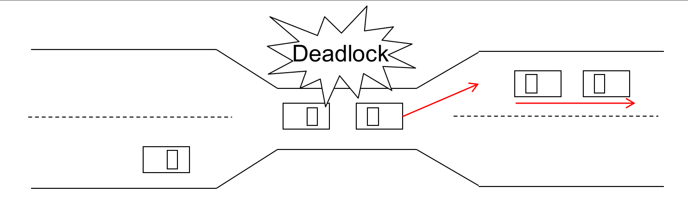
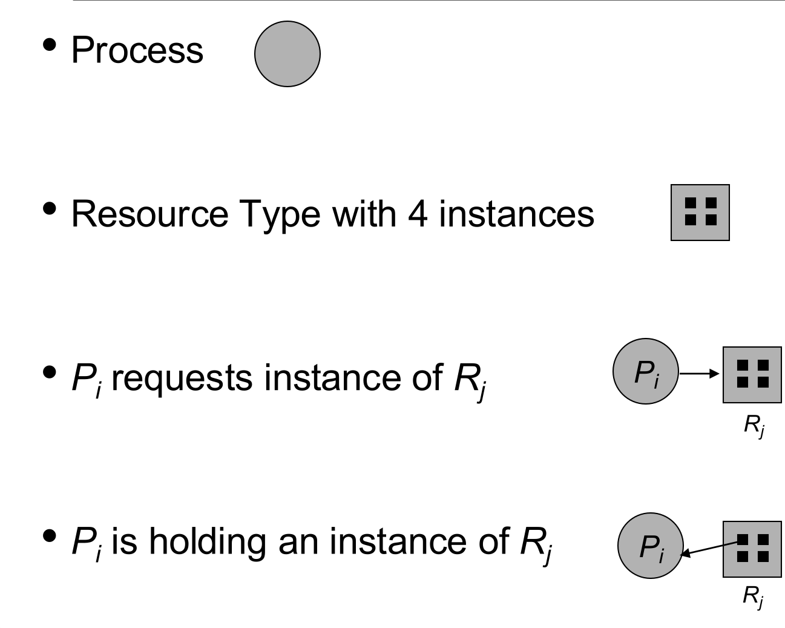
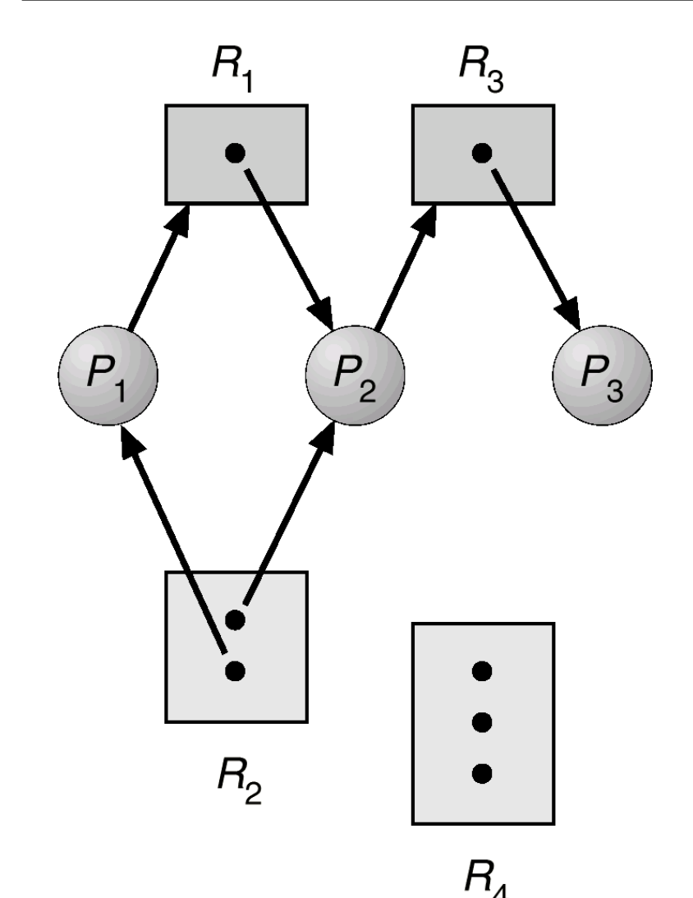
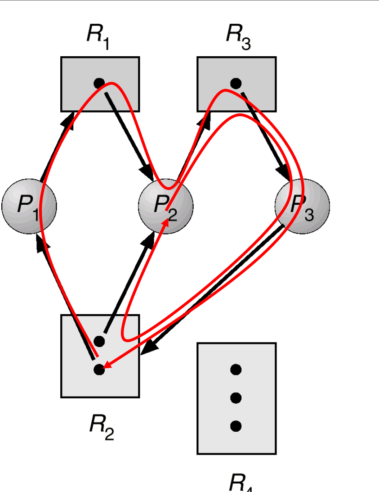
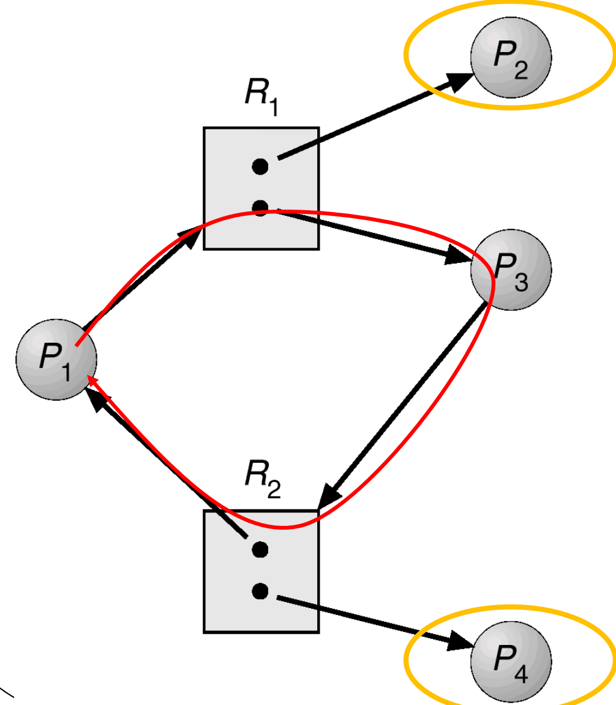
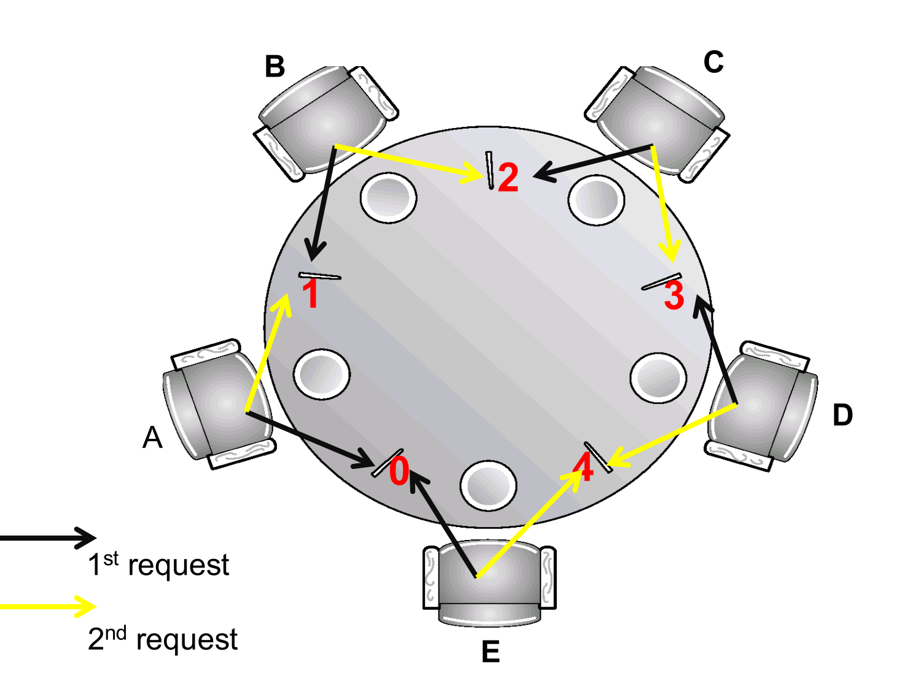
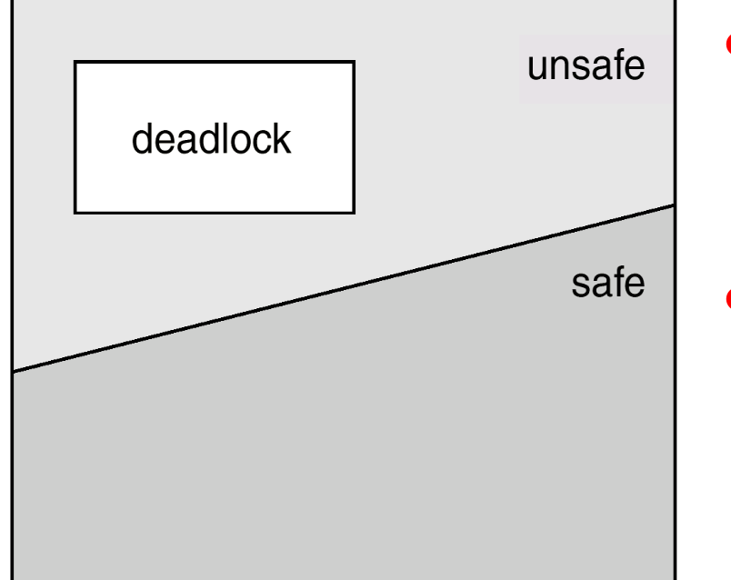

This was written entirely with AI.

## 1. What a Deadlock Is

### 1.1 Definition
A **deadlock** is a situation where a set of processes are all **blocked**. Each process **holds** a resource and **waits** for a resource that another process in the set holds. None of them can continue, so they wait forever.

**Example 1.** A system has two tape drives. Processes P1 and P2 each need both drives. P1 holds one drive and P2 holds the other. Each waits for the other's drive.

**Example 2.** Semaphores A and B both start at 1:

```c
// P0           // P1
Wait(A);        Wait(B);
Wait(B);        Wait(A);
```

If a context switch occurs after P0's `Wait(A)`, P1 takes B. Then each process holds one semaphore and waits for the other.

### 1.2 A picture: the narrow bridge
Only one car fits on the bridge at a time. The bridge is the shared resource. Two cars drive onto it from opposite ends. Neither can move forward.



To end the deadlock, one car must **back up**. This means: release the resource and roll back. Sometimes several cars must back up.

### 1.3 Deadlock and starvation are different
* In a **deadlock**, the processes wait for **each other**. None of them can ever continue.
* In **starvation**, a process waits forever, but other processes continue. For example, the scheduler keeps choosing others.

**A deadlock needs at least two processes.** One process alone cannot both hold a resource and wait for another process to release one.

## 2. The System Model

### 2.1 Resources
* There are resource **types** R1, R2, …, Rm. Examples: memory space, I/O devices, semaphores.
* Each type Ri has **Wi identical instances**. For example, the type "printer" can have 3 instances. A process that asks for a printer can get any of the 3.

A process uses a resource in three steps:

1. **Request** a number of instances. If they are not free, the process waits.
2. **Use** them.
3. **Release** them.

### 2.2 The resource-allocation graph
A **resource-allocation graph** shows who holds what and who waits for what.

{width=70%}

* A **circle** is a process.
* A **box** is a resource type. Each dot inside the box is one instance.
* A **request edge** Pi → Rj: process Pi waits for an instance of Rj. When the OS grants the request, this edge becomes an assignment edge.
* An **assignment edge** Rj → Pi: an instance of Rj is held by Pi. The edge starts at a dot. When Pi releases the instance, the edge disappears.

### 2.3 Reading a graph: is there a deadlock?
Try to find an order in which every process can finish:

1. Find a process whose requests can all be met by **free instances** now.
2. Let it finish. It releases everything it holds. Those instances are now free.
3. Repeat. If every process can finish, there is no deadlock.

{width=45%}

In slide 5.10, P3 waits for nothing, so it finishes and frees its instance of R3. Then P2 can get R3 and finish. Then P1 can finish. The order P3 → P2 → P1 works, so there is no deadlock.

**What a cycle is.** A **cycle** is a path that follows the arrows and comes back to where it started. In a resource-allocation graph, a cycle means: each process on the path waits for a resource that the next process on the path holds.

**How to find a cycle:**

1. Start at a process.
2. Follow an arrow **in its direction only**. From a process, follow its request edge to a box. From a box, follow an assignment edge (it starts at a dot) to a process.
3. Continue in the same way. If a box has several assignment edges, try each one.
4. If you come back to a circle or box that is already on your path, you found a cycle.
5. If you reach a process with no request edge, this path ends there. That process waits for nothing, so this path has no cycle. Try another start or another branch.

In slide 5.10, start at P1: P1 → R1 → P2 → R3 → P3. P3 has no request edge, so the path ends. Every other path also ends. So slide 5.10 has **no cycle**.

{width=45%}

In slide 5.11, P3 now also requests R2. Now P3 has a request edge, so the path continues. There are two cycles (the red lines):

* P1 → R1 → P2 → R3 → P3 → R2 → P1
* P2 → R3 → P3 → R2 → P2

All instances of R2 are held. P1, P2 and P3 each wait for something another one holds, and no process can finish. This is a deadlock.

{width=50%}

In slide 5.12, the graph has one cycle (the red line): P1 → R1 → P3 → R2 → P1. But R1 and R2 each have two instances, and the other instances are held by P2 and P4 (circled in yellow). P2 and P4 are not on the cycle, and they wait for nothing. They finish and release instances of R1 and R2. Then P3 and P1 can get them. The order P2 → P4 → P3 → P1 works. So **a cycle does not always mean a deadlock**.

### 2.4 The basic facts about cycles

* **No cycle → no deadlock.**
* **A cycle, and every resource type has only one instance → deadlock.**
* **A cycle, and some resource types have several instances → a deadlock is possible, but not certain.** You must check with the method in section 2.3.

## 3. The Four Conditions for Deadlock
A deadlock can occur only if **all four** of these conditions hold **at the same time**:

1. **Mutual exclusion.** Only one process at a time can use a resource instance.
2. **Hold and wait.** A process holds at least one resource and waits for more resources that other processes hold.
3. **No preemption.** A resource cannot be taken away. The process releases it only voluntarily, after it finishes its task.
4. **Circular wait.** There is a set of waiting processes {P0, P1, …, Pn} where P0 waits for P1, P1 waits for P2, …, and Pn waits for P0.

These conditions are **necessary but not sufficient**. If one condition is missing, deadlock **cannot** occur. If all four hold, deadlock **may** occur, but it does not have to.

## 4. How an OS Can Deal With Deadlock
There are three approaches:

1. **Never enter a deadlock.** Use **prevention** (section 5) or **avoidance** (section 6).
2. **Allow deadlock, then detect it and recover.** (Detection is not examinable.)
3. **Ignore the problem.** Pretend that deadlocks never occur. **Most operating systems do this, including UNIX and Windows**, because the other methods cost time all the time, while deadlocks are rare.

## 5. Deadlock Prevention: Break One Condition
**Idea:** make sure that at least one of the four conditions can never hold. The lecture uses the dining philosophers (Lecture 4) as the example. Recall: five philosophers, five chopsticks, each chopstick a binary semaphore, and each philosopher picks up chopstick `i` and then chopstick `(i+1) % 5`.

| Condition | How to break it | For the philosophers |
|---|---|---|
| 1. Mutual exclusion | Make the resource shareable | **Not possible.** Two people cannot use one chopstick at the same time |
| 2. Hold and wait | A process may request resources only if it holds none, or it must get all of them at once | Pick up chopsticks only if **both** are free |
| 3. No preemption | If a process cannot get the next resource, it releases what it holds | If the second chopstick is not free, put down the first one |
| 4. Circular wait | Make a cycle impossible | Allow at most four hungry philosophers; or the odd–even order; or number the chopsticks and always pick them up in order |

**Breaking circular wait by ordering.** Give every resource a number. Every process must request resources in **increasing** order of number. Then a cycle cannot form: a cycle would need some process to hold a higher-numbered resource while it waits for a lower-numbered one.



For the philosophers: number the chopsticks 0 to 4. Each philosopher first picks up the lower-numbered of its two chopsticks. Philosopher E sits between chopsticks 4 and 0, so E picks up chopstick 0 first, not 4. This breaks the circle.

## 6. Deadlock Avoidance: Look Ahead Before You Grant

### 6.1 The idea
Prevention puts fixed rules on how processes request resources. **Avoidance** is more flexible. When a process requests a free resource, the OS looks at the whole state and asks: **"If I grant this, can the system still be sure to finish every process?"** If yes, it grants the request. If no, the process waits, even though the resource is free.

### 6.2 Safe sequences and safe states
A sequence of processes ⟨P1, P2, …, Pn⟩ is a **safe sequence** if each Pi can get what it still needs from:

$$\text{currently available resources} + \text{the resources held by all } P_j \text{ with } j < i$$

The idea: if Pi cannot get its resources now, it waits until P1, …, Pi−1 finish and release their resources. Then Pi gets what it needs, finishes and releases. Then Pi+1 can continue, and so on. All processes finish.

A system is in a **safe state** if **at least one** safe sequence exists. Other sequences can be unsafe; that does not matter.

**Example (slide 5.26).** Available = 1. Each process holds and requests units of one resource type:

| Process | Holds | Still requests |
|---|---|---|
| P1 | 1 | 1 |
| P2 | 1 | 2 |
| P3 | 1 | 3 |

* ⟨P1, P2, P3⟩: P1 needs 1 ≤ 1 available. P1 finishes and frees 1, so 2 are free. P2 needs 2 ≤ 2. P2 frees 1 more, so 3 are free. P3 needs 3 ≤ 3. **Safe.**
* ⟨P3, P2, P1⟩: P3 needs 3, but only 1 is available. **Not safe.**
* The system is **safe**, because one safe sequence (⟨P1, P2, P3⟩) exists.

### 6.3 Safe, unsafe and deadlock



* **Safe state → no deadlock.**
* **Unsafe state → a deadlock is possible**, not certain. A process may release resources long before it finishes, and then no deadlock occurs.
* Every deadlock state is unsafe, but not every unsafe state is a deadlock.

**Avoidance means: never let the system enter an unsafe state.**

## 7. The Banker's Algorithm
The **Banker's algorithm** is an avoidance algorithm for resource types with **several instances**. Like a bank, it lends resources only if it can still meet the maximum needs of all customers.

**Assumptions:**

* Each process declares in advance the **maximum** number of instances of each type that it may need.
* When a process gets all the resources it needs, it returns them in a finite time.

### 7.1 The data
Let n = the number of processes and m = the number of resource types.

| Name | Shape | Meaning |
|---|---|---|
| `Available` | vector of length m | `Available[j]` = free instances of type Rj |
| `Max` | n × m matrix | `Max[i][j]` = the most instances of Rj that Pi may request |
| `Allocation` | n × m matrix | `Allocation[i][j]` = instances of Rj that Pi holds now |
| `Need` | n × m matrix | `Need[i][j]` = instances of Rj that Pi may still request |

$$\text{Need} = \text{Max} - \text{Allocation}$$

**Comparing vectors.** For two vectors, $V_1 \le V_2$ means that **every** element of V1 is ≤ the same element of V2. For example, (1, 2, 2) ≤ (3, 3, 2) is true. But (1, 2, 3) ≤ (3, 3, 2) is false, because 3 > 2 in the last element.

### 7.2 Part 1: the safety algorithm
This part answers: "Is the current state safe?"

1. Set `Work = Available`. Set `Finish[i] = false` for every process.
2. Find a process i with `Finish[i] == false` **and** `Need[i] ≤ Work`. If there is none, go to step 4.
3. Pretend Pi finishes and returns what it holds: `Work = Work + Allocation[i]`, `Finish[i] = true`. Go back to step 2.
4. If `Finish[i] == true` for all i, the state is **safe**. Otherwise it is **unsafe**.

At every point, `Work` = Available + the resources of all the processes that have finished so far.

**What if several processes qualify in step 2?** Pick any of them. A finished process only adds resources to `Work`, so a process that could run now can still run later. The final answer (safe or unsafe) does not depend on the choice. Only the safe sequence you write down changes.

### 7.3 Part 2: the resource-request algorithm
This part answers: "Process Pi requests the vector `Request_i`. Can the OS grant it now?"

1. If `Request_i ≤ Need_i`, go to step 2. Otherwise, it is an **error**: the process asked for more than its declared maximum.
2. If `Request_i ≤ Available`, go to step 3. Otherwise, Pi must **wait**: the resources are not free.
3. **Pretend** to grant the request. Change the state:
    * `Available = Available − Request_i`
    * `Allocation_i = Allocation_i + Request_i`
    * `Need_i = Need_i − Request_i`
4. Run the safety algorithm on this new state.
    * **Safe:** grant the request. Keep the new state.
    * **Unsafe:** Pi must wait. **Restore** the old state.

### 7.4 The lecture example
Five processes P0–P4 and three types: A (10 instances), B (5) and C (7). The state at time T0:

| Process | Allocation (A B C) | Max (A B C) | Need = Max − Allocation |
|---|---|---|---|
| P0 | 0 1 0 | 7 5 3 | 7 4 3 |
| P1 | 2 0 0 | 3 2 2 | 1 2 2 |
| P2 | 3 0 2 | 9 0 2 | 6 0 0 |
| P3 | 2 1 1 | 2 2 2 | 0 1 1 |
| P4 | 0 0 2 | 4 3 3 | 4 3 1 |

Available = (3, 3, 2).

**Is the state safe?** Run the safety algorithm:

| Step | Process that can finish | Its Need ≤ Work? | Work after it finishes |
|---|---|---|---|
| start | | | (3, 3, 2) |
| 1 | P1 | (1,2,2) ≤ (3,3,2) | (3,3,2) + (2,0,0) = (5, 3, 2) |
| 2 | P3 | (0,1,1) ≤ (5,3,2) | + (2,1,1) = (7, 4, 3) |
| 3 | P4 | (4,3,1) ≤ (7,4,3) | + (0,0,2) = (7, 4, 5) |
| 4 | P2 | (6,0,0) ≤ (7,4,5) | + (3,0,2) = (10, 4, 7) |
| 5 | P0 | (7,4,3) ≤ (10,4,7) | + (0,1,0) = (10, 5, 7) |

All processes finish. The state is **safe**, with the safe sequence ⟨P1, P3, P4, P2, P0⟩. The final Work equals the total number of instances (10, 5, 7), as it must.

**P1 requests (1, 0, 2).**

1. (1,0,2) ≤ Need1 = (1,2,2). True.
2. (1,0,2) ≤ Available = (3,3,2). True.
3. Pretend: Available = (2, 3, 0). Allocation1 = (3, 0, 2). Need1 = (0, 2, 0).
4. Safety: the sequence ⟨P1, P3, P4, P0, P2⟩ works. **Safe, so grant the request.**

**Next, P0 requests (0, 2, 0).**

1. (0,2,0) ≤ Need0 = (7,4,3). True.
2. (0,2,0) ≤ Available = (2,3,0). True.
3. Pretend: Available = (2, 1, 0). Need0 = (7, 2, 3).
4. Safety: no process has Need ≤ (2, 1, 0). **Unsafe, so P0 must wait.** Restore the old state.

The resources were free, but the OS still refused. That is the point of avoidance.

## 8. Deadlock Detection (not examinable)
A system can also let deadlocks occur, then run a detection algorithm and recover. For resource types with several instances, the detection algorithm looks like the safety algorithm, but it uses each process's **current request** instead of its **Need**. Any process that cannot finish at the end is deadlocked. The lecture marks this part as not examinable.

## What You Know Now (Lecture 5)

* A deadlock is a set of processes that each hold a resource and wait for a resource held by another one in the set.
* In a resource-allocation graph: no cycle means no deadlock. A cycle with single-instance resources means deadlock. A cycle with multi-instance resources only means a deadlock is possible.
* Deadlock needs all four conditions: mutual exclusion, hold and wait, no preemption, circular wait. They are necessary, not sufficient.
* Prevention breaks one condition. Ordering the resources breaks circular wait.
* Avoidance keeps the system in a safe state. Safe means at least one safe sequence exists. Unsafe means deadlock is possible.
* The Banker's algorithm checks Request ≤ Need, then Request ≤ Available, then pretends to grant and runs the safety algorithm.
* Most operating systems ignore deadlock.
