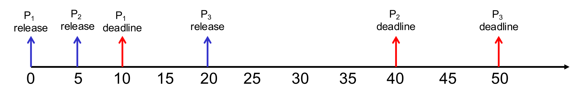
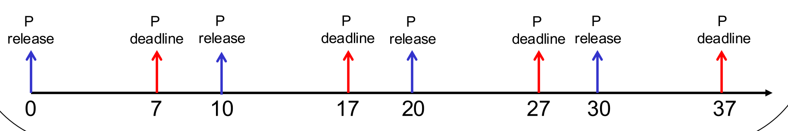
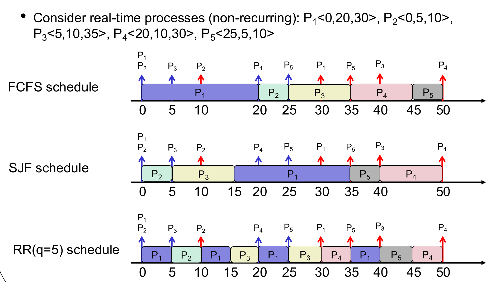
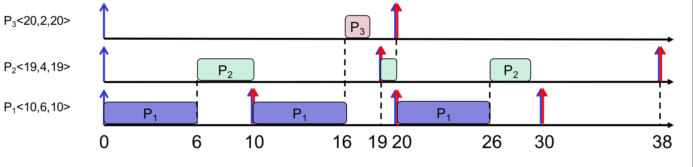
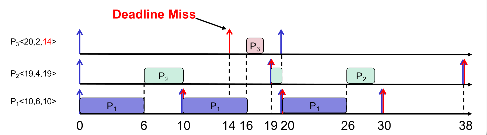
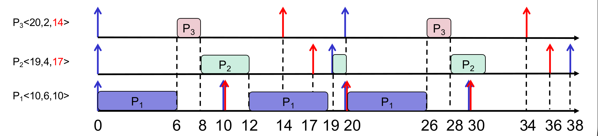

This was written entirely with AI.

## 1. What a Real-Time System Is

### 1.1 Computers that control physical things
A **cyber-physical system** is a physical system that a computer monitors and controls. Examples:

* Cars: autonomous driving, parking assist, airbag control.
* Aircraft: flight navigation and control.
* Factories: robots and process control.
* Medicine: robotic surgery, pacemakers.

All these systems repeat three steps:

1. **Sense.** Collect data from sensors.
2. **Decide.** Run a control law to compute the response.
3. **Act.** Send commands to the actuators (motors, valves, the airbag), **within a reasonable time**.

What is "reasonable" depends on the job: milliseconds for collision avoidance in a car, up to a second for a pacemaker. It also depends on the available hardware, the timing of the sensors and actuators, and the time to detect and recover from failures.

### 1.2 Real-time means predictable, not fast
A common mistake is to think that "real-time" means "fast". It does not.

* **Real-time ≠ fast.**
* **Real-time = predictable, even in the worst case.**

The lecture gives a picture: a man drowned in a river whose **average** depth was 20 cm. The average was safe, but one deep place was not. In the same way, a real-time system must meet its deadline **every** time, not only on average.

### 1.3 Definition
A **real-time system** is a system whose correctness depends on two things:

1. The **logical** result: is the answer right?
2. The **time** of the result: does the answer come before its **deadline**?

A late answer is a wrong answer.

A **real-time OS (RTOS)** gives OS services to such systems. Examples: FreeRTOS, MicriumOS. An RTOS is measured by **timeliness**: how predictably it meets deadlines. The **worst case** matters more than the average case.

**Normal desktop OSes are not real-time.** Windows and Linux for personal computers are time-sharing systems. They aim for good average performance, not guaranteed deadlines.

## 2. Describing a Real-Time Process

### 2.1 One process: ⟨R, C, D⟩
A real-time process is described by three numbers ⟨R, C, D⟩:

* **R** (release time): the time when the process becomes ready.
* **C** (execution requirement): the CPU time that the process needs.
* **D** (relative deadline): how long after its release the process must finish.

So the process needs **C units of CPU time in the interval [R, R + D)**. Its **absolute deadline** is R + D.

In this lecture, each process has a single CPU burst of length C.

Example: P1⟨0, 5, 10⟩ is released at 0, needs 5 units, and must finish by 0 + 10 = 10. P3⟨20, 10, 30⟩ is released at 20 and must finish by 50.

### 2.2 Recurrent and periodic processes
Real-time work usually **repeats**: sense, decide, act, again and again. A **recurrent** real-time process runs the same function many times. Each run is called an **instance**, and each instance is a real-time process ⟨R, C, D⟩.

A **periodic** process repeats at fixed intervals. For example, a sensor sends new data every 10 ms. A periodic process is described by ⟨T, C, D⟩:

* **T** (period): the time between two releases.
* **C** and **D**: as before.

Its instances are released at R = 0, T, 2T, 3T, …. Instance k is released at kT and must finish by kT + D.

Example: P⟨10, 5, 7⟩ is released at 0, 10, 20, 30, …. Each instance needs 5 units and must finish 7 units after its release: by 7, 17, 27, 37, ….

**Be careful with the order of the numbers.** A single process is ⟨R, C, D⟩. A periodic process is ⟨T, C, D⟩. The first number changes meaning.

## 3. Why Normal Schedulers Fail
Lecture 3's algorithms (FCFS, SJF, RR) do not look at deadlines. The lecture runs them on five processes: P1⟨0,20,30⟩, P2⟨0,5,10⟩, P3⟨5,10,35⟩, P4⟨20,10,30⟩, P5⟨25,5,10⟩.

All three miss some deadlines. For example, under FCFS, P1 (20 units) runs first, and P2 must wait until 20, but P2's deadline is 10. The algorithms do not give priority to urgent work.

## 4. Real-Time Scheduling

### 4.1 The problem
Given a set of periodic (or sporadic) real-time processes, find a scheduler for **one** CPU that meets **every** deadline of **every** instance.

The lecture's running example has three periodic processes:

* P1⟨10, 6, 10⟩: every 10 units, needs 6, deadline 10 after release.
* P2⟨19, 4, 19⟩: every 19 units, needs 4, deadline 19.
* P3⟨20, 2, 20⟩: every 20 units, needs 2, deadline 20.

The schedulers below are **preemptive**: when a higher-priority instance is released, it takes the CPU at once.

### 4.2 Fixed-priority scheduling
In **fixed-priority** scheduling, each recurrent process has **one priority for all of its instances**. If P1 has a higher priority than P2, then **every** instance of P1 has a higher priority than **every** instance of P2, whatever their release times.

### 4.3 Rate monotonic (RM)
**RM** is a fixed-priority scheduler. Its rule:

* **The shorter the period T, the higher the priority.** Ties are broken arbitrarily.

The name comes from the **rate** (1/T): a process with a high rate gets a high priority.

In the example, T1 = 10 < T2 = 19 < T3 = 20, so P1 > P2 > P3.

**How to build an RM schedule:**

1. Give each process a fixed priority by period: shorter T, higher priority.
2. Mark the release times and deadlines of every instance.
3. At every moment, run the released, unfinished instance of the **highest-priority process**. A release of a higher-priority process preempts a lower one.
4. Check each instance against its deadline.

RM is very popular in industry, because it is simple and predictable (section 4.5).

**RM can miss a deadline.** RM looks only at periods, not at deadlines. Change P3 to ⟨20, 2, **14**⟩. P3 still has the lowest priority, because its period is still 20. P1 and P2 run first, and P3 cannot finish by 14:

### 4.4 Earliest deadline first (EDF)
**EDF** is a **dynamic-priority** scheduler. Its rule:

* **The instance with the earliest absolute deadline gets the highest priority.** Ties are broken arbitrarily.

"Dynamic" means that the priority belongs to each **instance**, not to the process. Instance 1 of P2 can have a higher priority than instance 2 of P1, and later instance 3 of P1 can have a higher priority than instance 2 of P2.

**Use the absolute deadline of the instance (R + D), not the parameter D.** An instance with a large D that was released long ago can have an earlier absolute deadline than a new instance with a small D.

With P3⟨20, 2, 14⟩ and P2⟨19, 4, 17⟩, EDF meets every deadline. At time 6, P3's deadline (14) is earlier than P2's (17), so P3 runs first.

**How to build an EDF schedule:**

1. Mark the release times and the absolute deadlines of every instance on the time line.
2. At every release and every finish, look at all instances that are released and not finished.
3. Run the one with the earliest absolute deadline. If a newly released instance has an earlier deadline than the running one, it preempts it.
4. Check that every instance finishes by its deadline.

EDF is more powerful than RM: if any scheduler can meet all deadlines of a process set on one CPU, EDF can too.

### 4.5 RM and EDF side by side

| | RM | EDF |
|---|---|---|
| Type of priority | Fixed: one priority for each process | Dynamic: one priority for each instance |
| Priority rule | Shorter period first | Earlier absolute deadline first |
| Implementation | Simpler: a separate queue for each recurrent process | Harder: the OS must sort the queue by deadline while it runs |
| Under heavy load | **Predictable** for high-priority processes: they still meet their deadlines | Can be **unpredictable**: any process can miss its deadline |
| Power | Can miss deadlines that EDF meets | More powerful |

## What You Know Now (Lecture 6a)

* A real-time system is correct only if its results are right **and** on time. Real-time means predictable in the worst case, not fast.
* A real-time process is ⟨R, C, D⟩: release, CPU need, relative deadline. Its absolute deadline is R + D.
* A periodic process is ⟨T, C, D⟩. Instances are released at 0, T, 2T, ….
* FCFS, SJF and RR ignore deadlines, so they miss them.
* RM gives fixed priorities by period: shorter period first. It is simple and predictable, but can miss deadlines.
* EDF gives dynamic priorities by absolute deadline: earliest first. It is more powerful, harder to implement, and unpredictable under overload.
