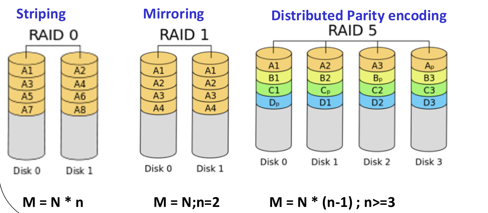
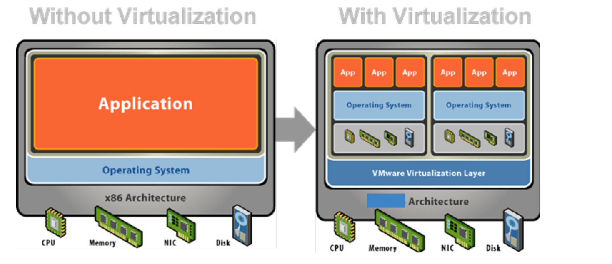
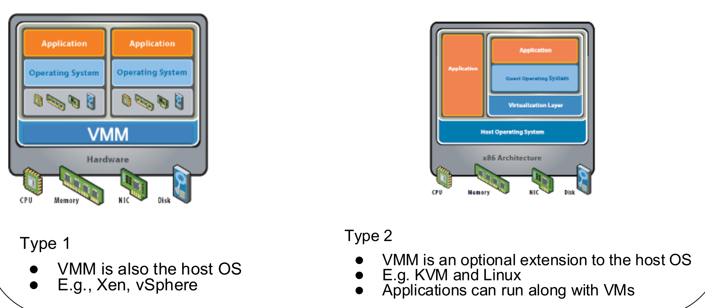
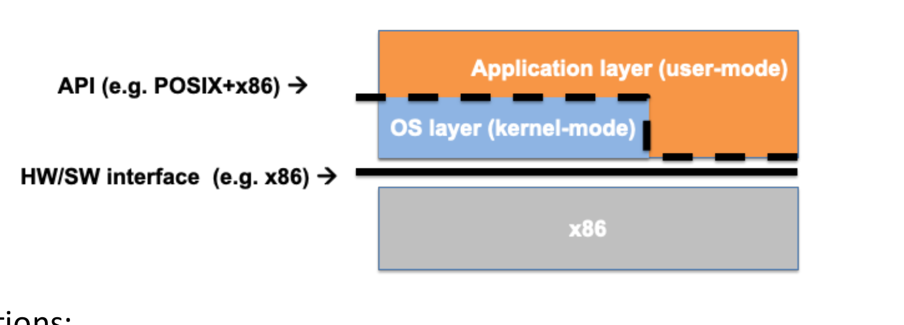
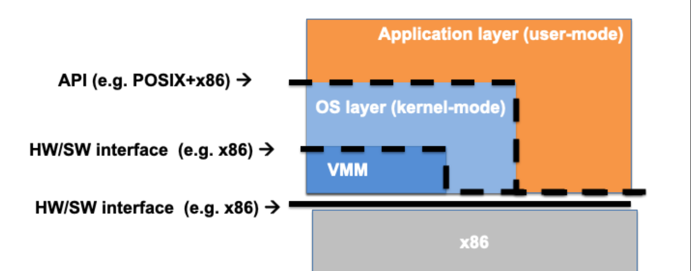

This was written entirely with AI.

## 1. The Basic Idea

### 1.1 Add a layer
David Wheeler said: "Any problem in computer science can be solved by adding a level of indirection. But this usually creates another problem." **Indirection** means: do not use a thing directly; go through a layer in the middle.

**Virtualization** is one type of indirection. A layer gives the programs above it an interface that looks **the same** as the layer below it. The lecture calls this **layered and compatible**:

* The new layer exports a **virtual X**, which looks like the **physical X** below it.
* The layer **hides the physical names**. A program sees only the virtual X, so it cannot reach other programs' resources. This gives **isolation**.

You already know examples. A process sees a whole CPU (Lecture 2), but the OS shares one physical CPU among many processes. A process sees its own memory addresses (Lecture 7), but they are not the real RAM addresses.

### 1.2 Why virtualize the CPU
* **Share** the physical CPU among many virtual machines. Multiprogramming already showed that sharing uses the hardware better.
* **Isolate** workloads, for security and for performance. A cloud server can run the jobs of tens to thousands of customers.
* Run **several operating systems** on the same hardware.

## 2. Three Ways to Virtualize
In each method below, **P** is the physical resource and **V** is the virtual resource that programs see.

### 2.1 Multiplexing: one looks like many
**Multiplexing** shares **one** physical resource among **many** virtual ones. Examples: the CPU, memory.

**Virtual CPUs.** Each virtual machine has one or more **virtual CPU cores (vCPUs)**:

* The **host** OS schedules the vCPUs onto the physical cores, like it schedules processes. Linux, for example, treats each vCPU as a process.
* Inside each virtual machine, the **guest** OS schedules its own processes onto its vCPUs, like a normal OS.

Examples:

* A 4-core server can run 4 virtual machines with 1 vCPU each.
* A 4-core server can run 8 virtual machines with 2 vCPUs each, which is 16 vCPUs on 4 cores. This is **CPU overcommitment**. It works only because not all virtual machines run processes at the same time.

### 2.2 Aggregation: many look like one
**Aggregation** makes **many** physical resources look like **one** virtual resource. Examples:

* The memory controller joins several memory modules (DIMMs) into one memory address range.
* **RAID** (Redundant Array of Inexpensive Disks) makes several disks look like one disk volume.
* Link aggregation joins several network links into one virtual link with more bandwidth.

**Three RAID levels.** Let N be the size of one disk, n the number of disks, and M the usable size of the volume.

| Level | Method | Usable size | What it gives |
|---|---|---|---|
| RAID 0 | **Striping:** spread the blocks across all disks | M = N × n | Speed (disks work in parallel), but no protection: one failed disk loses data |
| RAID 1 | **Mirroring:** write every block to two disks | M = N, with n = 2 | Protection: one disk can fail. Half the space is used for copies |
| RAID 5 | **Distributed parity:** spread data and parity blocks across the disks | M = N × (n − 1), with n ≥ 3 | Protection against one failed disk, at the cost of one disk of space |

### 2.3 Emulation: one thing looks like another
**Emulation** uses software to make a resource look like a **different** resource. Sometimes there is no physical X at all, or the physical resource is of a different kind. Examples:

| Example | Physical (P) | Virtual (V) |
|---|---|---|
| RAM disk | Memory (DRAM) | A disk, on which you can mount a file system (for example `/tmp`) |
| Java Virtual Machine | An x86-64 or ARM CPU | A processor that runs Java bytecode |
| Apple Rosetta (2006) | An x86-64 core | A PowerPC processor |
| Apple Rosetta (2020) | An ARM v8 core | An x86-64 processor |
| `127.0.0.1` (localhost) | None | A network interface |

| Method | How many P | How many V | Example |
|---|---|---|---|
| Multiplexing | 1 | Many | vCPUs on one core |
| Aggregation | Many | 1 | RAID |
| Emulation | 1 of one kind | 1 of another kind | JVM, RAM disk |

## 3. Virtual Machines

### 3.1 A whole computer, virtualized
A **virtual machine (VM)** applies virtualization to the **whole computer**: P is a computer system, and V is also a computer system.

**History.** VMs were popular in the 1960s and 1970s, when hardware was expensive and operating systems were primitive. They came back after 2000:

* to run the OS of your choice (compatibility),
* to put many servers onto fewer machines (consolidation),
* to let different owners share one machine (multi-tenancy),
* because a VM is easier to set up than a real machine.

For these reasons, VMs are the **foundation of the cloud**.

### 3.2 The Popek and Goldberg definition (1974)
A virtual machine is **an efficient, isolated duplicate of the real machine**. The software that runs the VMs is the **virtual machine monitor (VMM)**, also called the **hypervisor**. The VMM:

* is **always in complete control** of the system, and
* uses the hardware **directly**, so programs in a VM are at most a little slower.

### 3.3 Terms
**Operating systems:**

* **Guest OS:** the OS that runs inside a VM.
* **Host OS:** the OS that runs directly on the hardware, together with the VMM. Example: Linux with KVM.

**Memory:**

* **Virtual memory:** as in Lecture 8, the addresses that a process uses.
* **Guest physical memory:** what the guest OS thinks is physical memory. It belongs to the VM.
* **Host physical memory:** the real physical memory.

**The layers, from top to bottom:** applications → guest OS → VMM (hypervisor) → hardware. So the **guest OS** gives its applications an interface to the virtual hardware, and the **VMM** gives the guest OS an interface to the real hardware. Managing the interaction between a guest OS and its own applications is the job of the guest OS, not the VMM.

### 3.4 Type 1 and Type 2 hypervisors

| | Type 1 | Type 2 |
|---|---|---|
| Where the VMM is | The VMM **is** the host OS. It runs directly on the hardware | The VMM is an **optional extension** of a normal host OS |
| Normal applications on the host | No | Yes: they run next to the VMs |
| Examples | Xen, vSphere | KVM with Linux |

### 3.5 Full virtualization and para-virtualization

| | Full virtualization | Para-virtualization |
|---|---|---|
| What the VM shows | A complete copy of the real hardware | A special software interface (API) between the guest OS and the VMM |
| Guest OS | Runs **unmodified**. It does not know that the hypervisor exists | Must be **modified** to use the new API |
| Advantage | Any OS can run | More efficient: the VMM does not need to virtualize the hard parts of the instruction set |
| Examples | VMware ESXi, Microsoft Virtual Server | Xen, VMware, XtratuM |

## 4. How a VMM Is Built

### 4.1 Multiplex the CPU and memory, emulate the devices
A VMM uses all three methods from section 2:

* **Multiplex the CPU**, with hardware support. Each VM has its own vCPUs (P = core, V = core).
* **Multiplex memory**, with hardware support for virtual memory. Each VM has its own guest physical memory (P = physical memory, V = physical memory).
* **Emulate I/O devices**: a virtual disk, keyboard, screen, network card and network switch.

### 4.2 Limited direct execution on a normal computer
First, recall how a normal OS runs a program **without** a VMM:

* The application runs its **unprivileged** instructions **directly** on the CPU. This is fast.
* For services, the application makes **system calls**, which switch to kernel mode.
* **Privileged** instructions are reserved for the OS. If user code tries one, the CPU traps to the OS.

This is **limited direct execution**: the program runs directly on the hardware, but only within limits that the OS enforces.

### 4.3 System-level limited direct execution in a VMM
The VMM adds one more layer below the OS. Because the VMM shows the guest the **same** hardware/software interface (for example x86-64), the guest OS and its applications still work.

To stay efficient:

* The application **and the guest OS** run directly on the CPU.
* The VMM **traps some privileged instructions** that the guest OS issues, and handles them itself.

The VM runs in a special **non-root mode**, so the VMM stays in control. This is the same idea as protected mode for processes, extended from applications to whole operating systems.

### 4.4 The virtual CPU in one paragraph
A vCPU is multiplexed **in space and in time**, much like a kernel thread:

* **Space:** the VMM runs vCPUs of different VMs on different cores.
* **Time:** the VMM shares a few physical cores among many vCPUs.

Isolation comes from non-root mode for the VM, and from the assumption that the VMM (or host OS) is correct.

## 5. Beyond This Lecture (not examinable)
The lecture also shows containers, serverless computing, and GPU virtualization for AI services. These slides are marked not examinable.

## What You Know Now (Lecture 6b)

* Virtualization adds a layer that shows the same interface as the layer below it, and hides the physical names for isolation.
* Multiplexing: one physical resource looks like many (vCPUs). Aggregation: many look like one (RAID). Emulation: one looks like another kind (JVM, RAM disk).
* RAID 0 stripes (size N × n, no protection), RAID 1 mirrors (size N with 2 disks), RAID 5 uses distributed parity (size N × (n − 1), n ≥ 3).
* A VM is an efficient, isolated duplicate of the real machine. The VMM (hypervisor) is always in control.
* Type 1: the VMM is the host OS. Type 2: the VMM extends a normal host OS.
* Full virtualization runs an unmodified guest. Para-virtualization modifies the guest to use a special API, which is more efficient.
* Limited direct execution: code runs directly on the CPU, and privileged instructions trap. A VMM extends this to the guest OS.
