This was written entirely with AI.

These notes cover Lecture 7. Lectures 2 to 6 shared the **CPU** among processes. This lecture shares **main memory** among them. It answers three questions in order: how an address in a program becomes a real memory address, how the OS gives memory to many processes at once, and how the hardware makes the translation fast and small.

## 1. From Program File to Process in Memory

### 1.1 The process image
To run a program, the OS creates a **process image** and loads it into memory. Lecture 2 showed its four parts:

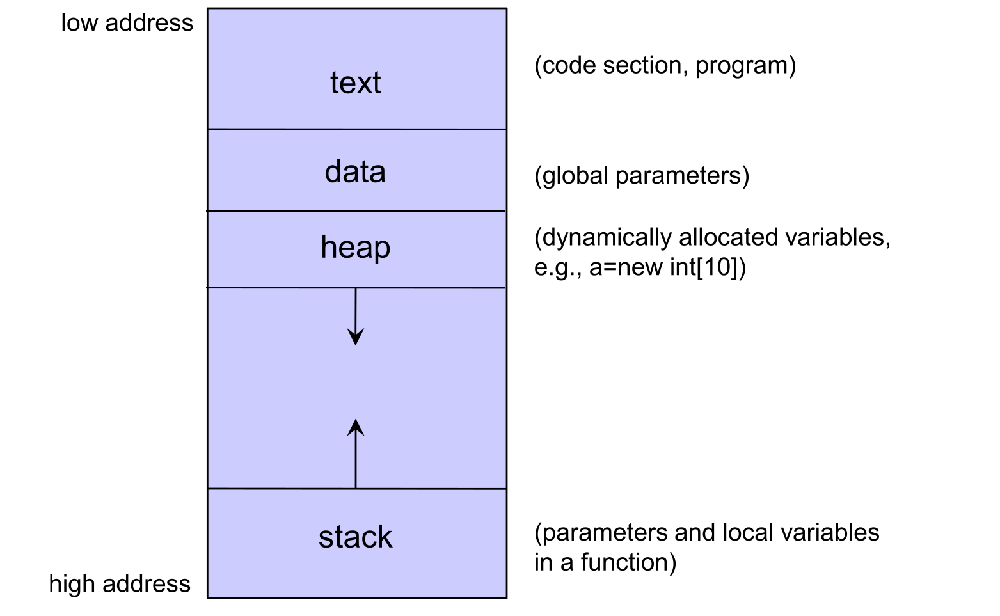{width=70%}

| Part | Holds | Position |
|---|---|---|
| Text | The program code | Low addresses |
| Data | Global variables | Above the text |
| Heap | Memory that the program allocates while it runs, for example `new int[10]` | Grows up |
| Stack | Function parameters and local variables | High addresses, grows down |

### 1.2 Compile, link, load
Three tools turn source code into a process in memory:

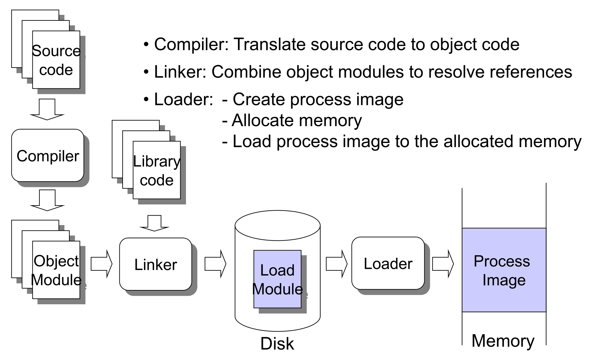

1. The **compiler** translates source code into an **object module**.
2. The **linker** joins object modules and library code, and resolves the references between them. The result is a **load module** on the disk.
3. The **loader** creates the process image, allocates memory, and copies the image into that memory.

### 1.3 The problem: which address does an instruction use?
An instruction such as `LOAD X` or `JUMP Y` contains an address. The CPU uses that address to fetch data or the next instruction.

But when the compiler writes the program, it does not know **where in memory** the OS will put it. So at some time, something must turn the addresses in the code into real memory addresses. This step is **address binding**. The next section shows the three times when it can occur.

---

## 2. Address Binding: When Does an Address Become Real?

All three cases use the lecture's example. The program is **1000 bytes** long, so its own addresses go from 0 to 999. It contains `LOAD 800` (load the data at byte 800 of the program) and `JUMP 400` (jump to byte 400 of the program). The OS loads the program at memory address **1024**. So the program occupies addresses 1024 to 2023.

### 2.1 Compile-time binding
The compiler already knows that the program will start at 1024. It writes **absolute addresses** (real memory addresses) into the code: `LOAD 1824`, `JUMP 1424`. Note that 1824 = 1024 + 800 and 1424 = 1024 + 400.

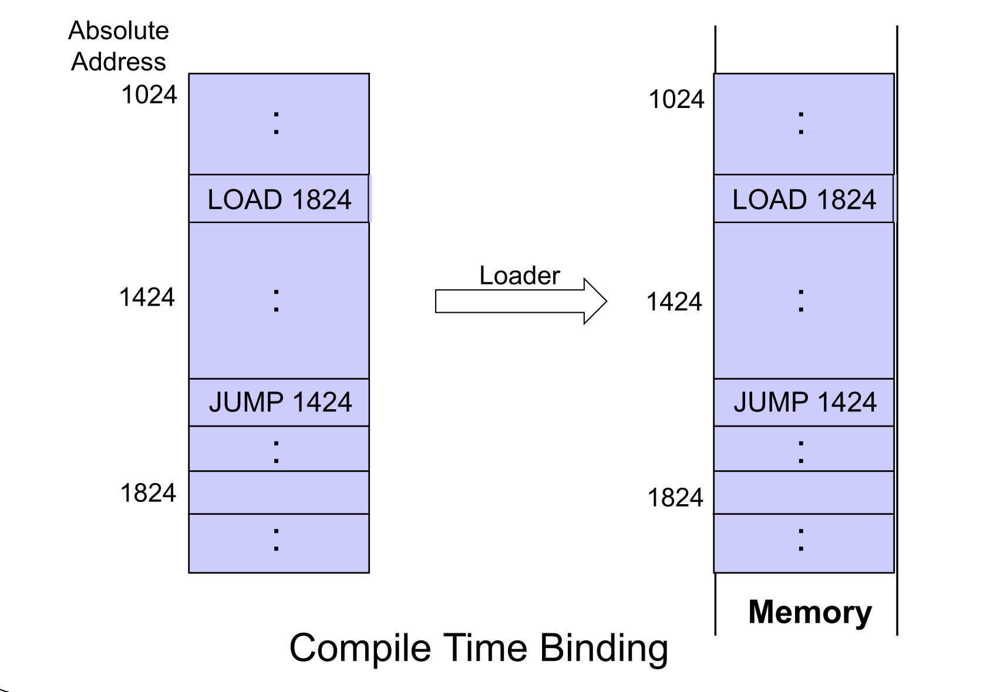{width=70%}

* The loader copies the code as it is.
* **Problem:** if the start address changes, you must **compile the program again**.

### 2.2 Load-time binding
The compiler writes **relocatable addresses**, counted from 0: `LOAD 800`, `JUMP 400`. When the **loader** copies the program into memory, it adds the start address to every address. In memory, the code says `LOAD 1824` and `JUMP 1424`.

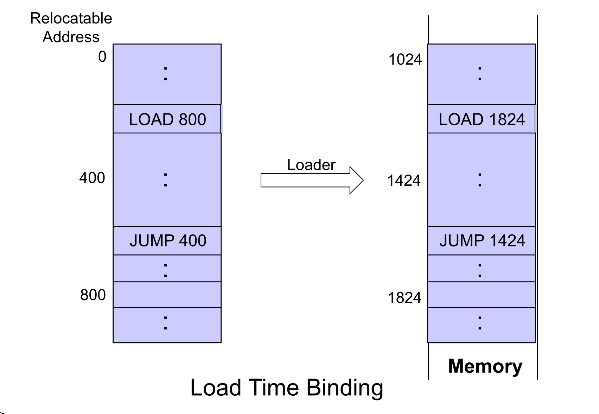{width=70%}

* The OS can put the program anywhere when it loads it.
* **Problem:** after loading, the program cannot move. Its memory now holds absolute addresses, and they are correct only at that location.

### 2.3 Execution-time binding
The code in memory **keeps** its relative addresses: `LOAD 800`, `JUMP 400`. The hardware adds the start address **on every memory access**, while the program runs.

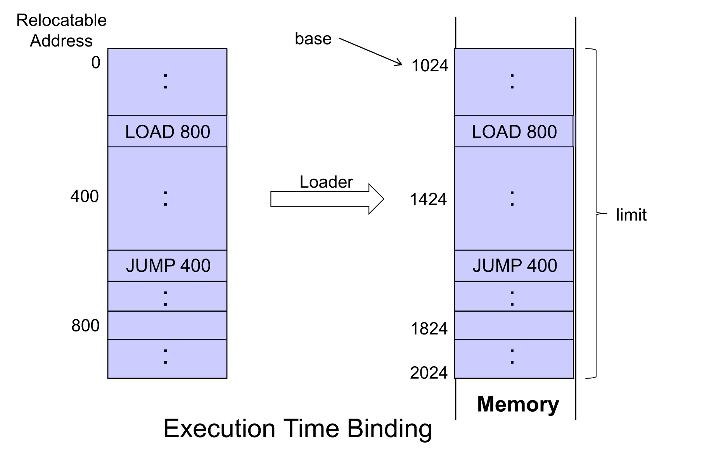{width=70%}

The hardware unit that adds the start address is the **memory-management unit (MMU)**. The MMU keeps the start address in a **relocation register**, which is the base register of Lecture 1.

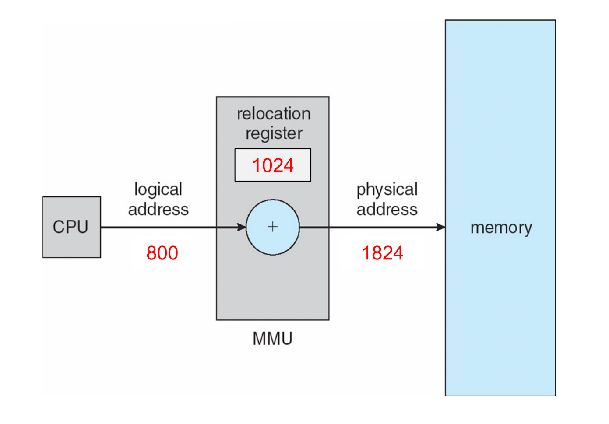{width=70%}

The CPU generates address 800. The MMU adds 1024. Memory receives address 1824.

* The OS can **move** the program while it runs. It copies the program to the new place and changes the relocation register. The code itself does not change.

### 2.4 The protection check depends on the binding
Lecture 1 introduced two registers that keep a process inside its own memory:

* the **base register** holds the start address (here 1024),
* the **limit register** holds the size (here 1000).

The check is different for absolute and relative addresses:

| Binding | Addresses in the code | Legal if | Physical address |
|---|---|---|---|
| Compile time or load time | Absolute | base ≤ address < base + limit | = the address |
| Execution time | Relative (from 0) | address < limit | = address + base |

If the check fails, the hardware traps to the OS.

**Examples with base 1024 and limit 1000:**

* Compile-time or load-time binding. The CPU generates 1824. Check: 1024 ≤ 1824 < 2024. Legal. Memory receives 1824.
* Execution-time binding. The CPU generates 800. Check: 800 < 1000. Legal. Memory receives 800 + 1024 = 1824.
* Execution-time binding. The CPU generates 1200. Check: 1200 < 1000 is false. The hardware traps to the OS.

### 2.5 Logical and physical addresses
* The **logical address** is the address in the code. The CPU generates it when it runs an instruction.
* The **physical address** is the address that the memory unit receives.
* The **address space** of a process is the set of all addresses that the process can use.

With execution-time binding, the logical address space always **starts from 0**. It is one continuous sequence of bytes, from 0 to limit − 1. The process sees only this space. It never sees physical addresses.

---

## 3. Contiguous Allocation: One Block per Process

Many processes must be in memory at the same time. The first approach gives each process **one continuous block** of physical memory. This is **contiguous allocation**. (Section 4 shows the other approach.)

### 3.1 Fixed partitioning
The OS divides memory into **regions with fixed boundaries**, called **partitions**. Each process goes into one partition.

* **Problem: internal fragmentation.** If a process is smaller than its partition, the rest of the partition is unused. No other process can use that space.

### 3.2 Dynamic partitioning
The OS gives each process **exactly** the amount of memory it asks for. A free block of memory is a **hole**. Over time, holes of many sizes appear all through memory. When a process arrives, the OS gives it memory from a hole that is large enough. The OS keeps a list of the allocated blocks and the holes.

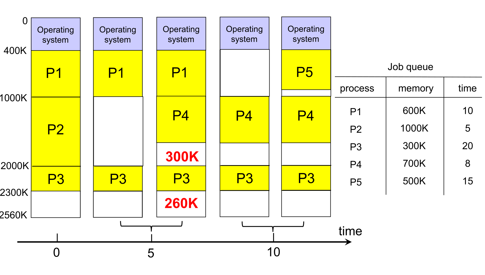

The lecture's example, step by step. Memory is 2560K. The OS uses the lowest 400K, so 2160K is for users. Five processes arrive. "Time" is how long each one runs.

| Process | Memory | Time |
|---|---|---|
| P1 | 600K | 10 |
| P2 | 1000K | 5 |
| P3 | 300K | 20 |
| P4 | 700K | 8 |
| P5 | 500K | 15 |

1. **Time 0.** P1 goes to 400K–1000K, P2 to 1000K–2000K, and P3 to 2000K–2300K. One hole is left: 2300K–2560K, which is 260K. P4 needs 700K, so it waits.
2. **Time 5.** P2 finishes. Its 1000K becomes a hole. P4 goes into it, at 1000K–1700K. A 300K hole is left at 1700K–2000K.
3. Now P5 needs 500K. The holes are 300K and 260K. Together they are 560K, which is enough, but **neither hole alone** is large enough. So P5 must wait.
4. **Time 10.** P1 finishes. Its 600K becomes a hole. P5 goes into it, at 400K–900K. A 100K hole is left.

At the end, memory holds three small holes: 100K, 300K and 260K.

### 3.3 Which hole to use
The OS must choose a hole for a request of size n. Three rules:

| Rule | Which hole | Effect |
|---|---|---|
| **First-fit** | The **first** hole that is large enough | Fast: it stops searching early |
| **Best-fit** | The **smallest** hole that is large enough | Must search the whole list (unless the list is sorted by size). Leaves the **smallest** leftover hole |
| **Worst-fit** | The **largest** hole | Must search the whole list. Leaves the **largest** leftover hole |

**Example.** The holes, in memory order, are 300K, 600K, 350K, 200K and 750K. A process asks for 320K.

* First-fit: 300K is too small. 600K is large enough, so it takes 600K. The leftover hole is 280K.
* Best-fit: the holes that are large enough are 600K, 350K and 750K. The smallest is 350K. The leftover hole is 30K.
* Worst-fit: the largest hole is 750K. The leftover hole is 430K.

### 3.4 Two kinds of fragmentation
* **External fragmentation:** there is enough free memory **in total**, but it is not in one continuous block. The waste is **outside** the partitions. Dynamic partitioning has this problem (step 3 of the example above).
* **Internal fragmentation:** a process gets a little **more** memory than it asked for. The unused part is **inside** its partition. Fixed partitioning has this problem.

### 3.5 Compaction
**Compaction** reduces external fragmentation. The OS moves the processes in memory, so that all the free memory forms one large block.

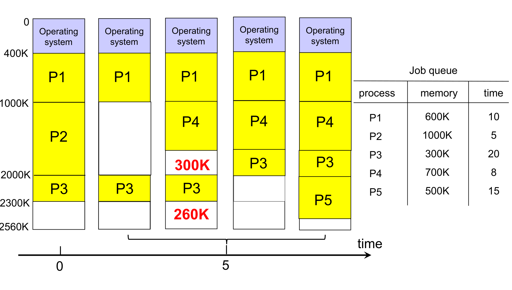

The slide repeats the example with compaction. At time 5, P4 is in place, and the holes are 300K (1700K–2000K) and 260K (2300K–2560K). The OS moves P3 down to 1700K–2000K. Now the two holes join into one 560K hole, at 2000K–2560K. P5 (500K) fits there **at once**. It does not need to wait until time 10.

**Compaction needs execution-time binding.** To move a process, the OS must make all its addresses point to the new place.

* With execution-time binding, the code holds relative addresses. The OS only changes the base register.
* With compile-time or load-time binding, the code holds absolute addresses. After a move, every address inside the process points to the old place. So the OS cannot move it.

---

## 4. Paging: Many Small Blocks per Process

### 4.1 The idea
Contiguous allocation needs one free block that is large enough. External fragmentation makes that hard to find. **Paging** removes the need for one large block. A process can use any free memory, wherever it is:

* Divide **physical memory** into fixed-size blocks, called **frames**. The size is a power of 2, between 512 and 8192 bytes.
* Divide **logical memory** (the logical address space of a process) into blocks of the same size, called **pages**.
* To run a program of n pages, find **any** n free frames, and load one page into each.
* Keep a **page table** for each process. Entry i of the table holds the frame number of page i.

The OS keeps a list of all free frames.

* **No external fragmentation.** Every free frame is usable, because every page fits in every frame.
* **Internal fragmentation is still possible.** The last page of a process is usually not full, but it uses a whole frame.

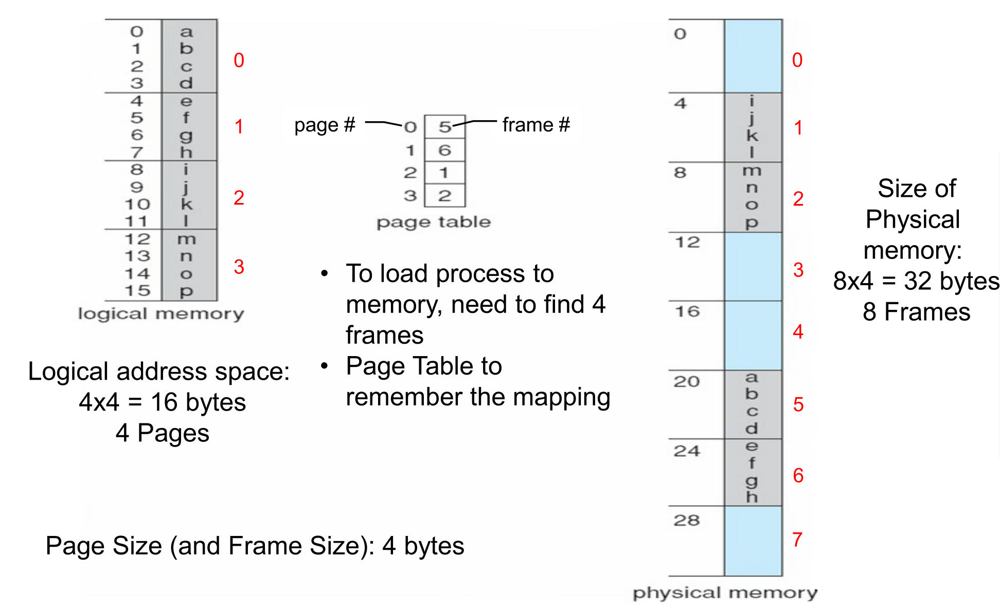

In the slide, the page size is 4 bytes. The logical memory has 4 pages (16 bytes). The physical memory has 8 frames (32 bytes). The page table maps page 0 → frame 5, page 1 → frame 6, page 2 → frame 1 and page 3 → frame 2.

### 4.2 Splitting an address into page number and offset
A logical address has two parts:

* The **page number p** says which page. It is an index into the page table. The entry gives the frame number.
* The **page offset d** says which byte inside the page. A page and its frame have the same size, so the offset stays the same in the frame.

**Why the page size is a power of 2.** If the page size is $2^n$, the offset is simply the **low n bits** of the address, and the page number is the bits above them. The hardware splits the address by taking bits. It does not need to divide.

If the page size is $2^n$ bytes and the logical address space is $2^m$ bytes:

* The **low n bits** are the offset d.
* The **high m − n bits** are the page number p.
* The process can have up to $2^{m-n}$ pages, so the page table has $2^{m-n}$ entries.

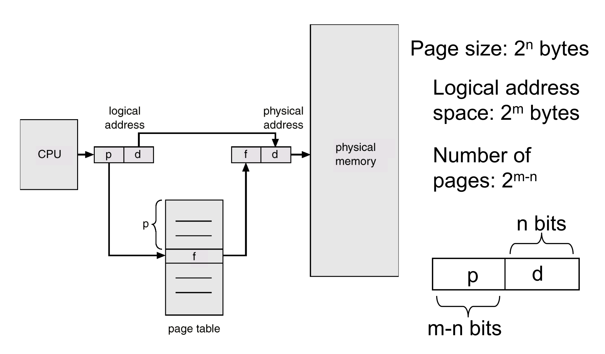

### 4.3 Translating an address
**To translate a logical address to a physical address:**

1. Split the address: p = the high bits, d = the low n bits.
2. Read entry p of the page table. It gives the frame number f.
3. Write f, then d after it. That is the physical address. As a number: f × page size + d.

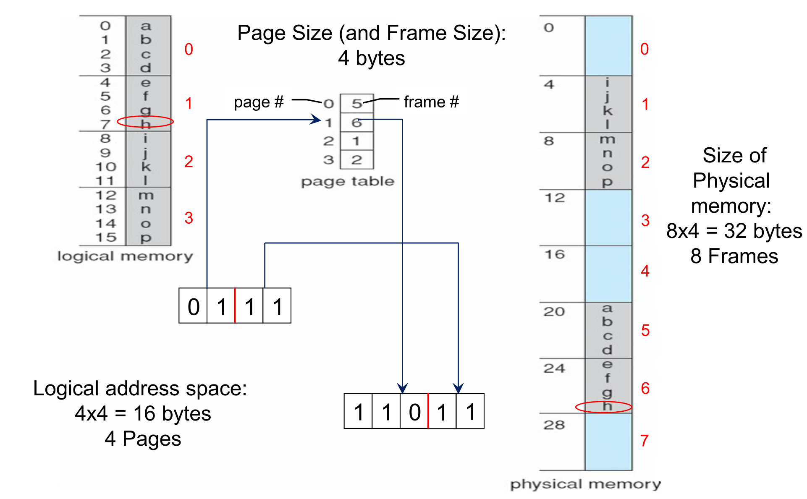

The slide's example. The logical address has 4 bits. The page size is 4 bytes, so n = 2.

1. Logical address `0111`. The high 2 bits are p = `01` = 1. The low 2 bits are d = `11` = 3.
2. Entry 1 of the page table holds frame 6 = `110`.
3. The physical address is `110` followed by `11`, which is `11011` = 27.

Check with numbers: 6 × 4 + 3 = 27.

### 4.4 How to work out every size
The logical and the physical side have their own sizes:

* The page number size depends on the size of the **logical** address space.
* The frame number size depends on the size of **physical** memory.

Let the logical address have m bits, the page size be $2^n$ bytes, and physical memory be $2^q$ bytes.

| Quantity | Value |
|---|---|
| Offset | n bits (same in the logical and the physical address) |
| Page number | m − n bits |
| Page-table entries (one for each page) | $2^{m-n}$ |
| Number of frames | $2^{q-n}$ |
| Frame number | q − n bits |
| Physical address | q bits = (q − n) + n |

**Example.** A 24-bit logical address, 2 KB pages, and 4 MB of physical memory.

* 2 KB = $2^{11}$ bytes, so the offset is 11 bits.
* The page number is 24 − 11 = 13 bits. The page table has $2^{13}$ = 8192 entries.
* 4 MB = $2^{22}$ bytes, so the physical address is 22 bits.
* The frame number is 22 − 11 = 11 bits. There are $2^{11}$ = 2048 frames.

So the logical address is (13 | 11) and the physical address is (11 | 11).

---

## 5. Making Paging Fast: the TLB

### 5.1 The problem: two memory accesses for every access
The page table is too large for registers, so it is kept in **main memory**:

* The **page-table base register (PTBR)** holds the address of the current process's page table.
* The **page-table length register (PTLR)** holds the size of that page table.

Now each access to data or an instruction needs **two** memory accesses:

1. Read the page-table entry, to get the frame number.
2. Read the data or the instruction itself.

If one memory access takes μ, each access now takes 2μ. Paging has made memory twice as slow.

### 5.2 The TLB: a cache for page-table entries
The **translation look-aside buffer (TLB)** is a small, fast hardware cache. It holds recent (page number → frame number) pairs. Another name is **associative registers**. The TLB checks all its entries at the same time, so a lookup is very fast.

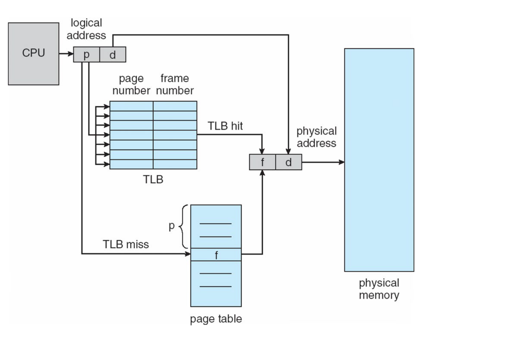

On each access, the hardware first looks in the TLB:

* **TLB hit:** the page number is in the TLB. The frame number comes from the TLB. Only **one** memory access is needed, for the data.
* **TLB miss:** the hardware reads the page table in memory (one access), then the data (one more access). It also puts the pair into the TLB, for the next time.

### 5.3 Effective access time with a TLB
Let:

* ε = the time for one TLB lookup,
* μ = the time for one memory access,
* α = the **hit ratio**: the fraction of accesses that find the page number in the TLB.

The cost of each case:

* A hit costs one TLB lookup and one memory access: μ + ε.
* A miss costs one TLB lookup, one page-table access and one data access: 2μ + ε.

The **effective access time (EAT)** is the average cost:

$$\text{EAT} = (\mu + \varepsilon)\,\alpha + (2\mu + \varepsilon)(1 - \alpha) = (2 - \alpha)\,\mu + \varepsilon$$

**Example.** μ = 100 ns, ε = 10 ns, α = 0.95.

EAT = (2 − 0.95) × 100 + 10 = 105 + 10 = 115 ns. Without a TLB, each access takes 2 × 100 = 200 ns.

### 5.4 When does a TLB help?
A TLB helps only if the EAT with it is less than 2μ:

$$(2 - \alpha)\,\mu + \varepsilon < 2\mu \quad\Longleftrightarrow\quad \alpha\,\mu > \varepsilon \quad\Longleftrightarrow\quad \alpha > \frac{\varepsilon}{\mu}$$

Every access pays ε, hit or miss. So if the hit ratio is very low, the TLB makes access **slower**. In the example above, the TLB helps only if α > 10 / 100 = 0.1. Real programs have high hit ratios, because of locality (Lecture 8).

---

## 6. Shared Pages

Two processes can share code: their page tables point to the **same frames**. For example, three users run the same editor. The editor code is in physical memory only once. Each user has private data pages.

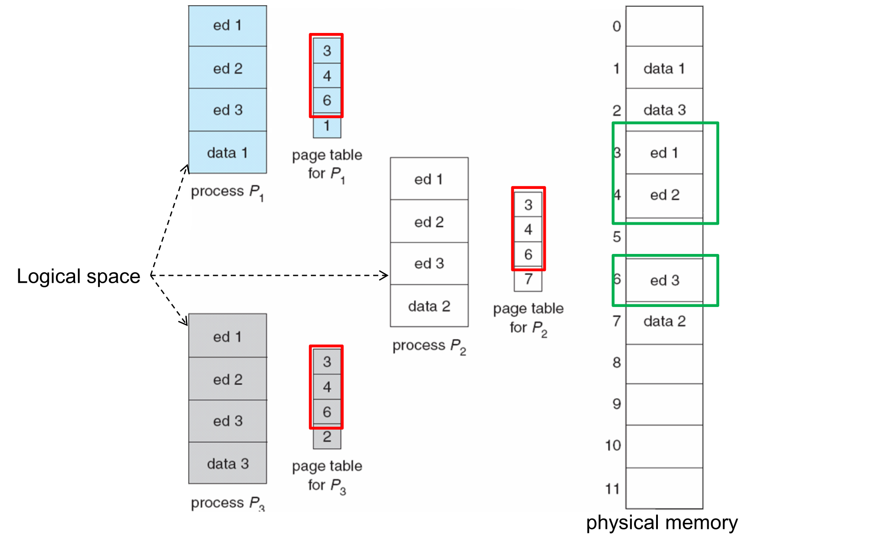

In the slide, the page tables of P1, P2 and P3 all map the editor pages ed 1, ed 2 and ed 3 to frames 3, 4 and 6. Each process maps its own data page to a different frame.

Shared code must not change while it runs. It must be **read-only**. Otherwise one process could change the code for all the others.

---

## 7. Two-Level Page Tables

### 7.1 The problem: a one-level page table is large
Take the lecture's machine: a 32-bit logical address and 4 KB pages.

1. 4 KB = $2^{12}$ bytes, so the offset is 12 bits.
2. The page number is 32 − 12 = 20 bits.
3. So the page table has $2^{20}$ entries, one for each page.
4. Each entry is 4 bytes. So the page table is $2^{20}$ × 4 bytes = $2^{22}$ bytes = **4 MB**.

That is 4 MB **for each process**, only for its page table.

### 7.2 Why the size hurts: the page table must be contiguous
The hardware finds entry p by arithmetic:

$$\text{address of entry } p = \text{PTBR} + p \times \text{entry size}$$

This works only if the whole table is **one continuous block** in memory. So a 4 MB page table needs 4 MB / 4 KB = 1024 frames **next to each other**.

But finding a large continuous block is exactly the problem that paging was meant to solve (section 4.1). The page table brings it back.

### 7.3 The idea: page the page table
The page table is just data in memory. So treat it like any other data, and **split it into pages**:

* Cut the 4 MB page table into pieces of 4 KB, the size of one page.
* Each piece fits in **one frame**. The pieces can go into **any** frames. They do not need to be next to each other.

How many pieces, and how many entries in each piece?

* Number of pieces: 4 MB / 4 KB = $2^{22}$ / $2^{12}$ = $2^{10}$ = 1024 pieces.
* Entries in each piece: 4 KB / 4 bytes = $2^{12}$ / $2^{2}$ = $2^{10}$ = 1024 entries.

Check: 1024 pieces × 1024 entries = $2^{20}$ entries. That is the whole page table.

### 7.4 A new problem, and a small new table
The pieces are now in scattered frames. The hardware must know **which frame holds each piece**. So the OS keeps one more table: the **outer page table**.

* The outer page table has one entry for each piece: 1024 entries.
* Each entry holds the frame number of one piece.
* Its size is 1024 × 4 bytes = 4 KB. That is **exactly one page**, so it fits in one frame.

The PTBR now points to the outer page table. The pieces of the original table are the **inner page table**. (The lecture calls one piece "a page of the page table".)

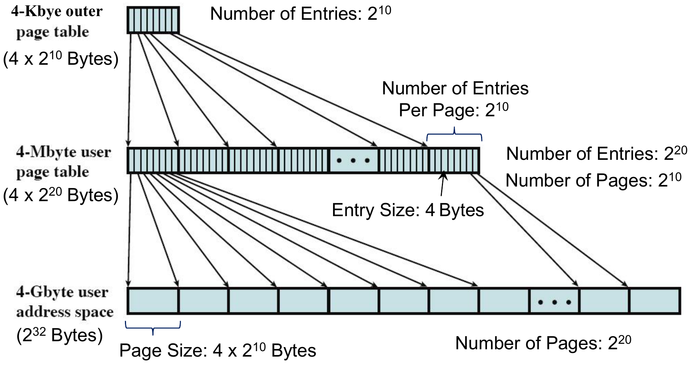

### 7.5 Splitting the page number into p1 and p2
In a one-level table, the 20-bit page number p picks entry p. Now that entry is inside some piece. Which piece, and where in it?

* Each piece holds 1024 entries. So entry p is in **piece number p ÷ 1024** (whole-number division).
* Its **position in that piece** is p mod 1024 (the remainder).

Because 1024 = $2^{10}$, the hardware does not need to divide:

* p ÷ 1024 is the **high 10 bits** of p. Call it **p1**. It indexes the outer page table.
* p mod 1024 is the **low 10 bits** of p. Call it **p2**. It indexes one piece of the inner page table.

So the 32-bit logical address now has three parts:

| p1 (outer index) | p2 (inner index) | d (offset) |
|---|---|---|
| 10 bits | 10 bits | 12 bits |

Where each width comes from:

* d = 12 bits, because a page is $2^{12}$ bytes.
* p2 = 10 bits, because one page of the page table holds $2^{10}$ entries.
* p1 = 10 bits, because the outer table has $2^{10}$ entries, one for each piece.

### 7.6 Translating an address, step by step

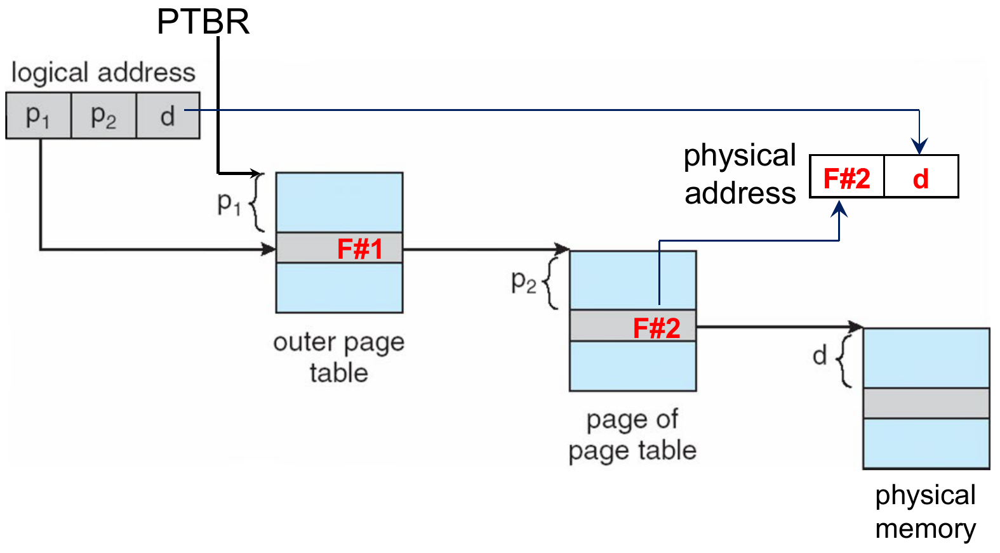

1. Use **p1** as an index into the outer page table (found through the PTBR). The entry gives **F#1**: the frame that holds one page of the inner table.
2. In frame F#1, use **p2** as an index. The entry gives **F#2**: the frame that holds the data.
3. The physical address is **F#2 followed by d**.

**A worked example** (the frame numbers are invented for the example). Translate the logical address `0x00C02ABC`.

1. Write it in binary and split it 10 | 10 | 12:

   `0000000011 | 0000000010 | 101010111100`

   So p1 = 3, p2 = 2, d = `0xABC` = 2748.

2. Check against the one-level view. The full page number is p = p1 × 1024 + p2 = 3 × 1024 + 2 = 3074. Entry 3074 is in piece 3074 ÷ 1024 = 3, at position 3074 mod 1024 = 2. That matches p1 and p2.
3. Suppose entry 3 of the outer table says that piece 3 is in frame 57. So F#1 = 57.
4. Suppose entry 2 in frame 57 says that the data page is in frame 900. So F#2 = 900.
5. The physical address is 900 × 4096 + 2748 = 3,686,400 + 2748 = **3,689,148**.

### 7.7 The cost: one more memory access on a TLB miss
A one-level table needs one page-table access on a TLB miss. A two-level table needs **two**: one in the outer table and one in the inner table. Then one more access reads the data.

| Case | One-level table | Two-level table |
|---|---|---|
| TLB hit | ε + μ | ε + μ |
| TLB miss | ε + 2μ | ε + 3μ |

The TLB stores the final pair (page number → F#2). So a TLB hit costs the same as before. With a high hit ratio, the extra level adds only a little to the EAT. This is the lecture's "small increase in effective access time".

With hit ratio α, the formula of section 5.3 becomes:

$$\text{EAT}_{\text{two-level}} = (\varepsilon + \mu)\,\alpha + (\varepsilon + 3\mu)(1 - \alpha) = (3 - 2\alpha)\,\mu + \varepsilon$$

(The lecture gives the formula only for one level. This line uses the same method with one more access on a miss.)

### 7.8 What two levels buy
* **No large contiguous block.** Each piece of the table, and the outer table, fits in one frame. The OS can put each one in any free frame. This is the reason the lecture gives.
* **Less memory, in practice.** (Standard, but not on the slides.) Most processes use only a small part of their 4 GB logical space. If no page in a piece's 4 MB range is in use, the OS does not create that piece at all. It marks the outer entry as unused. For example, a process that uses only the lowest 4 MB (code and data) and the highest 4 MB (stack) needs only 2 pieces plus the outer table: 3 × 4 KB = 12 KB, not 4 MB.

### 7.9 A general method: how many levels?
Sometimes two levels are not enough: the outer table is still larger than one page. Then the OS pages the outer table too, and adds a third level. The rule is: **keep adding levels until the outermost table fits in one page.**

Let the logical address have m bits, the page size be $2^n$ bytes, and each entry be e bytes.

1. **Offset:** n bits.
2. **Page number:** m − n bits.
3. **Index bits for one level:** one page of a table holds $2^n / e$ entries. Write this as $2^k$. So each level index can use at most k bits.
4. **Number of levels:** $L = \lceil (m - n) / k \rceil$ (divide, then round up).
5. **The address format:** every inner level gets k bits. The **outermost** level gets what is left: (m − n) − (L − 1) × k bits. The outermost table is the only one that may be smaller than a page.

**Check with the lecture's machine.** m = 32, n = 12, e = 4. Then k = 12 − 2 = 10, and m − n = 20. L = 20 / 10 = 2 levels. The outermost level gets 20 − 10 = 10 bits. Format: (10 | 10 | 12). This matches section 7.5.

**A second example.** m = 32, 2 KB pages (n = 11), e = 4 bytes.

1. Offset: 11 bits.
2. Page number: 32 − 11 = 21 bits.
3. One page holds $2^{11} / 4 = 2^9$ entries, so k = 9.
4. L = ⌈21 / 9⌉ = ⌈2.33⌉ = 3 levels.
5. The inner two levels get 9 bits each. The outermost gets 21 − 18 = 3 bits.

Format: (3 | 9 | 9 | 11).

Why two levels are not enough here: with two levels, the inner index has 9 bits, so the outer index has 21 − 9 = 12 bits. The outer table has $2^{12}$ entries × 4 bytes = 16 KB. That is larger than one 2 KB page. So a third level is needed.

**To test whether a table fits in one page:** table size = (number of entries) × (entry size). Compare it with the page size.

---

## 8. Inverted Page Tables

### 8.1 The problem
Each process has its own page table. Its size grows with the **logical** address space, not with the memory that the process really uses. With many processes, all the page tables together use a lot of memory.

### 8.2 The idea: one entry for each frame
Turn the table around. Use **one table for the whole system**, with **one entry for each physical frame**. Entry i says which ⟨process ID, page number⟩ is now in frame i.

| | Index | Content |
|---|---|---|
| Normal page table | Page number | Frame number |
| Inverted page table | Frame number | ⟨process ID, page number⟩ |

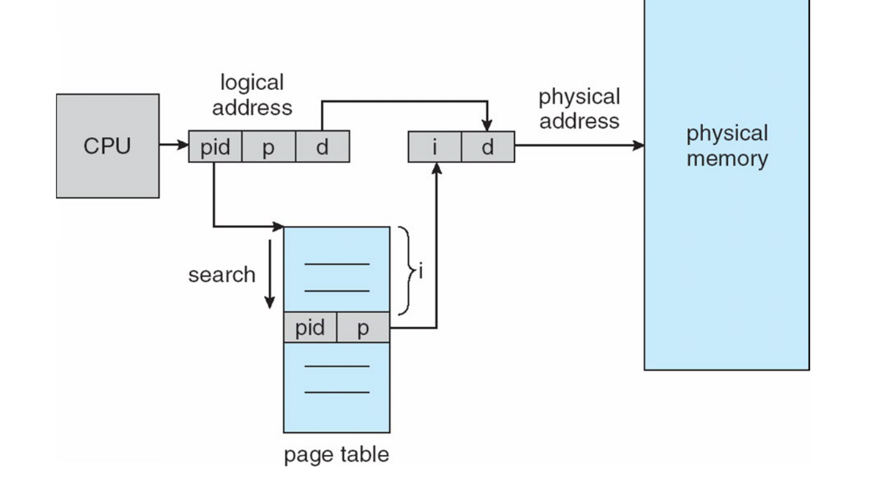{width=80%}

### 8.3 Translating an address
* The logical address is ⟨process ID, page number, offset⟩.
* The hardware **searches** the table for the pair ⟨process ID, page number⟩.
* If the match is at entry i, the physical address is ⟨i, offset⟩. The **position** of the entry is the frame number.

### 8.4 Its size
The number of entries equals the number of frames = physical memory size ÷ page size.

**Example.** 256 MB of physical memory ($2^{28}$ bytes) and 4 KB pages ($2^{12}$ bytes). The inverted page table has $2^{28} / 2^{12} = 2^{16}$ = 65,536 entries, for the whole system. With a 32-bit logical address, a normal page table has $2^{20}$ entries **for each process**.

### 8.5 Advantage and disadvantage
* **Advantage:** only one table, and its size grows with **physical** memory.
* **Disadvantage: slow search.** The table is ordered by frame number, but the lookup uses the page number. The hardware cannot index it directly. In the worst case it searches the whole table.

| | Normal page table | Inverted page table |
|---|---|---|
| How many | One for each process | One for the whole system |
| Number of entries | One for each **page** of the process | One for each **frame** of physical memory |
| Lookup | Index by page number (direct) | Search for ⟨pid, page⟩ |

---

## 9. Segmentation

### 9.1 The idea
A programmer does not think of a program as pages of equal size. They think of **logical parts**: the main program, functions, the stack, a symbol table, arrays. **Segmentation** divides the program into these parts, the **segments**, and places each one in memory separately.

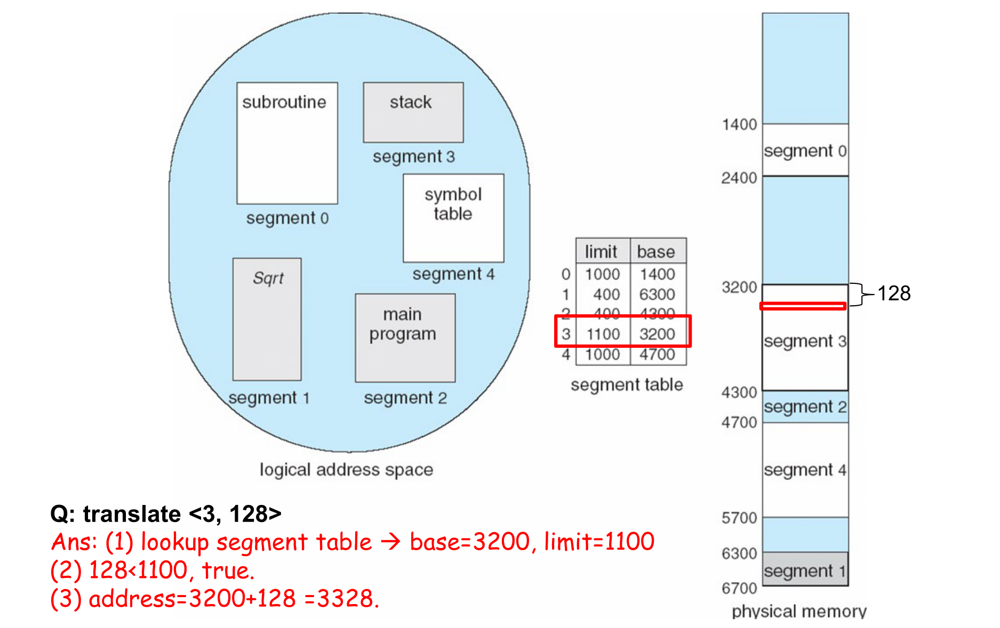

* Segments can have **different sizes**.
* The segments of one process do **not** need to be next to each other in memory.

### 9.2 The address format
A logical address is ⟨segment number s, offset d⟩. The offset gives the position inside the segment.

If the largest possible segment is $2^k$ bytes, the offset needs k bits. The other bits of the address are the segment number. **Example:** a 16-bit address and a largest segment of 4 KB ($2^{12}$). The offset is 12 bits, and the segment number is 16 − 12 = 4 bits, so a process can have up to 16 segments.

### 9.3 Translating a segment address
The **segment table** has one entry for each segment:

* **base:** the physical start address of the segment,
* **limit:** the length of the segment.

The **segment-table base register (STBR)** points to the segment table. The **segment-table length register (STLR)** gives the number of segments that the program uses.

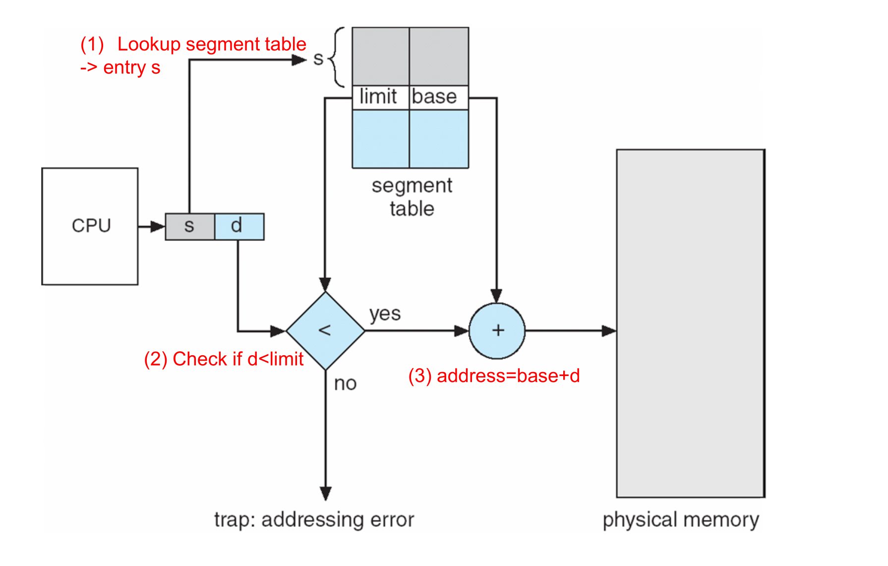{width=80%}

**To translate ⟨s, d⟩:**

1. Read entry s of the segment table.
2. Check that d < limit. If not, trap to the OS (addressing error).
3. The physical address is base + d.

**The slide's example.** Translate ⟨3, 128⟩. Segment 3 has base 3200 and limit 1100. 128 < 1100, so the address is legal. The physical address is 3200 + 128 = 3328.

**Two more requests on the same segment table** (segment 1: base 6300, limit 400; segment 2: base 4300, limit 400):

* ⟨2, 53⟩: 53 < 400, legal. Physical address 4300 + 53 = 4353.
* ⟨1, 500⟩: 500 < 400 is false. The hardware traps to the OS.

**Compare with paging.** Paging **joins** the frame number and the offset, as bits. Segmentation **adds** the base and the offset, as numbers, because a segment can start at any address. Paging needs no limit check on the offset, because every offset fits in a page. Segmentation must check, because segments have different lengths.

### 9.4 Segmentation has external fragmentation
Segments have different sizes. So placing them is the same problem as dynamic partitioning (section 3.2). The OS usually uses best-fit or first-fit. When a process leaves, its segments become **holes of different sizes**. So segmentation has **external fragmentation**.

It has no internal fragmentation, because each segment gets exactly its own size.

### 9.5 Paging and segmentation side by side

| | Paging | Segmentation |
|---|---|---|
| Block size | Fixed (pages) | Variable (segments) |
| Based on | The hardware's page size | The logical parts of the program |
| External fragmentation | No | Yes |
| Internal fragmentation | Yes (in the last page) | No |
| Translation | Frame number joined with offset | Base + offset, after the check d < limit |
| Sharing code | Through shared pages; the code in a page must not change | Natural: share a whole segment, such as one function |

---

## 10. Summary of the Allocation Schemes

| Scheme | Contiguous? | Internal fragmentation | External fragmentation |
|---|---|---|---|
| Fixed partitioning | Yes | Yes | No |
| Dynamic partitioning | Yes | No | Yes |
| Paging | No | Yes | No |
| Segmentation | No | No | Yes |

## What You Know Now (Lecture 7)

* Binding can occur at compile time (absolute code), at load time (the loader adds the start address) or at execution time (the MMU adds the base on every access). Only execution-time binding lets a process move while it runs.
* With absolute addresses, an address is legal if base ≤ address < base + limit. With relative addresses, it is legal if address < limit, and the physical address is address + base.
* Fixed partitions waste space inside (internal fragmentation). Dynamic partitions leave holes outside (external fragmentation). Compaction joins the holes, but needs execution-time binding.
* First-fit takes the first hole that is large enough, best-fit the smallest such hole, worst-fit the largest hole.
* Paging splits a logical address into page number (high bits) and offset (low bits). The page table maps pages to frames. The page number size comes from logical memory; the frame number size comes from physical memory.
* A TLB caches page-table entries: EAT = (2 − α)μ + ε. It helps only if α > ε/μ.
* A one-level page table can be large and must be contiguous. A two-level table pages it: p1 indexes the outer table, p2 indexes one page of the inner table. For 32-bit addresses and 4 KB pages: 10 | 10 | 12. Add levels until the outermost table fits in one page.
* An inverted page table has one entry for each frame, for the whole system, and must be searched.
* Segmentation uses variable-size logical segments, checks d < limit, and adds base + d. It has external fragmentation.
