This was written entirely with AI.

## 1. Why Virtual Memory

### 1.1 Swapping
The OS can move a whole process **out** of memory to a **backing store** (a fast disk), and later move it back **in** to continue. This is **swapping**.

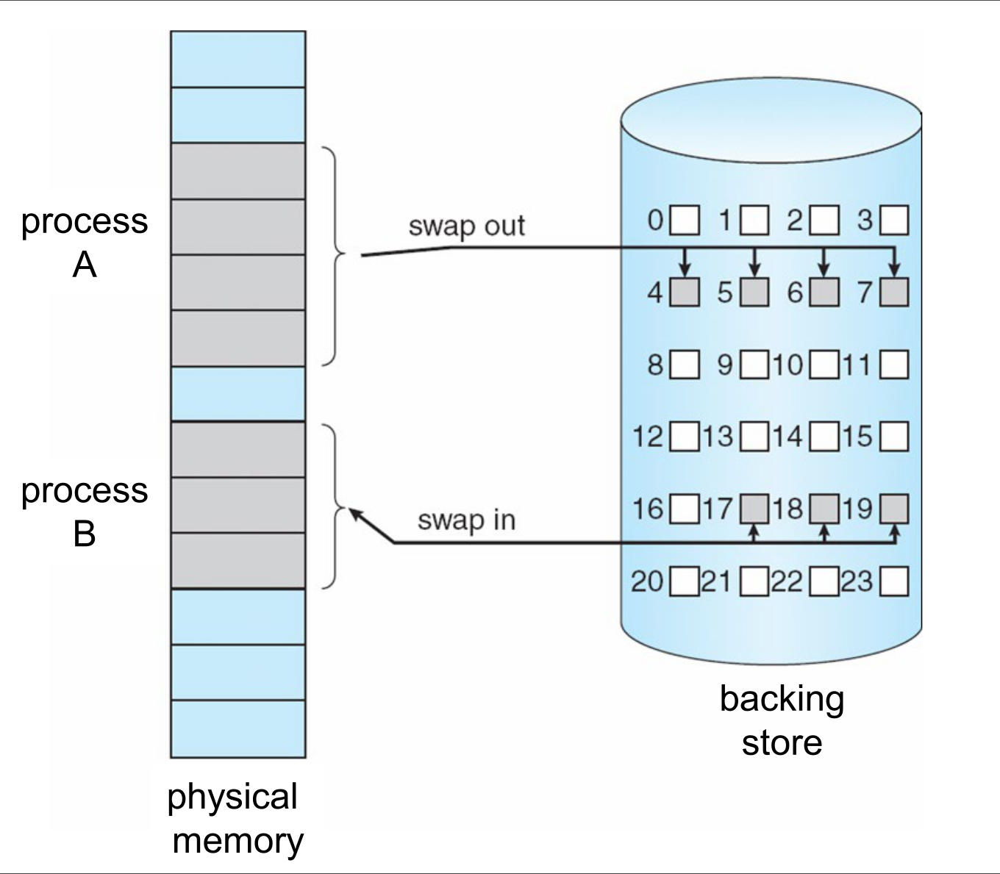

* The backing store must be large enough to hold copies of all the processes' memory images, with direct access to each one.
* Most of the swap time is **transfer time**. It grows with the amount of memory that moves.
* Swapping frees memory for processes that need more, and lets more processes be in progress (a higher degree of multiprogramming).

### 1.2 The limit of Lecture 7
In Lecture 7, the **whole** program had to be in memory to run. So a program could never be larger than physical memory.

**Virtual memory** removes this limit. It **separates** the logical memory of a program from the physical memory:

* The logical address space can be **much larger** than physical memory. Its size is limited only by the address format of the computer.
* Only **part** of a program needs to be in memory to run.

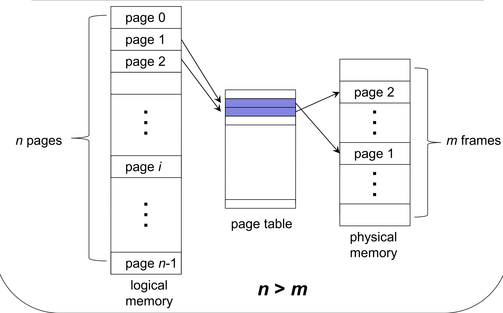

Results:

* More processes fit in memory, so the degree of multiprogramming and the CPU utilization go up.
* The OS must be able to move pages **in and out** of memory while processes run.

Virtual memory is usually built with **demand paging**.

## 2. Demand Paging

### 2.1 Load a page only when the program needs it
With **demand paging**, the OS loads a page into memory only when the program refers to it. A logical address ⟨page number, offset⟩ is a reference to that page, so that page is needed.

Each page-table entry gets a **valid–invalid bit**:

* **v (valid):** the page is in memory. The entry holds its frame number.
* **i (invalid):** the page is not in memory. The entry holds where the page is on the disk.

At the start, every entry is **i**. The backing store always holds a copy of the whole process image.

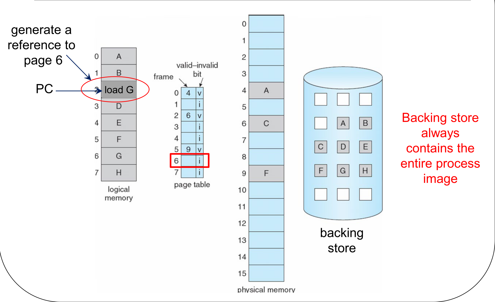

### 2.2 The page fault
When the CPU translates an address and finds **i** in the page-table entry, it causes a **page fault**: a trap to the OS. The OS then brings the page in:

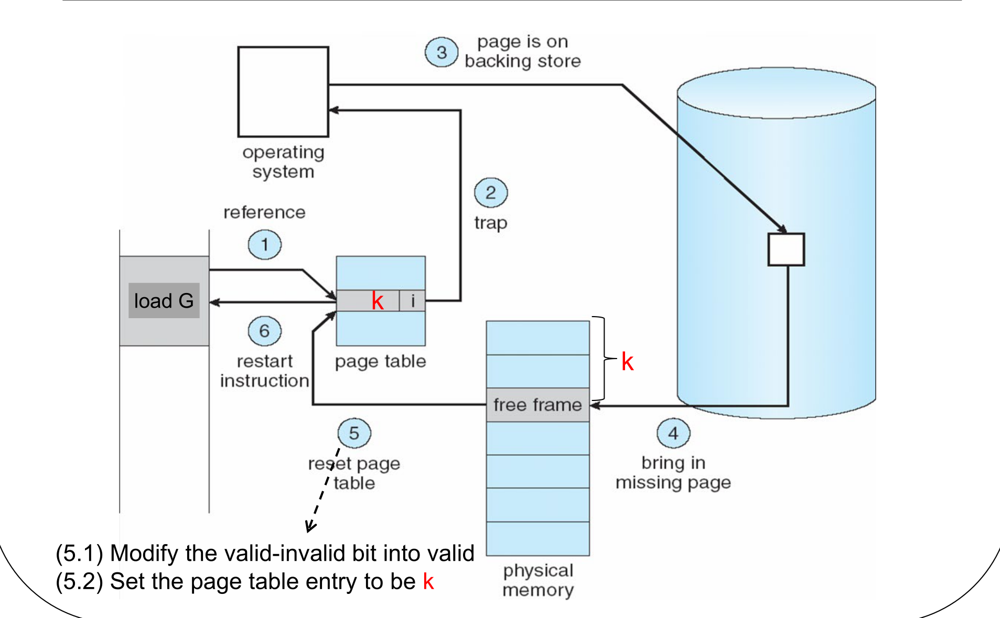

1. The program refers to a page. The hardware checks the page table.
2. The page is not in memory, so the hardware **traps** to the OS. The OS saves the state of the interrupted process.
3. The OS uses the page-table entry to find the page on the backing store.
4. The OS finds a **free frame** (from the free-frame list, or with a page-replacement algorithm, section 3). It starts a disk read of the page into that frame.
5. When the disk read is complete, the OS updates the page-table entry: it sets the bit to **v** and writes the frame number k.
6. The OS restores the state of the process and **restarts the instruction** that caused the fault. This time the access succeeds.

While the disk read runs, the OS can give the CPU to another process. So a page fault also causes context switches.

### 2.3 How much page faults cost
Let p be the **probability of a page fault** (0 ≤ p ≤ 1). If p = 0 there are no faults; if p = 1 every access faults.

$$\text{EAT} = (1 - p) \times \text{memory access time} + p \times \text{page fault time}$$

**Memory access time is much smaller than page fault time.** A memory access takes nanoseconds. A page fault needs a disk read, which takes milliseconds: about a million times longer. So even a very small p makes the EAT much worse. To keep the system fast, p must be very small.

## 3. Page Replacement

### 3.1 When there is no free frame
A page fault occurs, but every frame is in use:

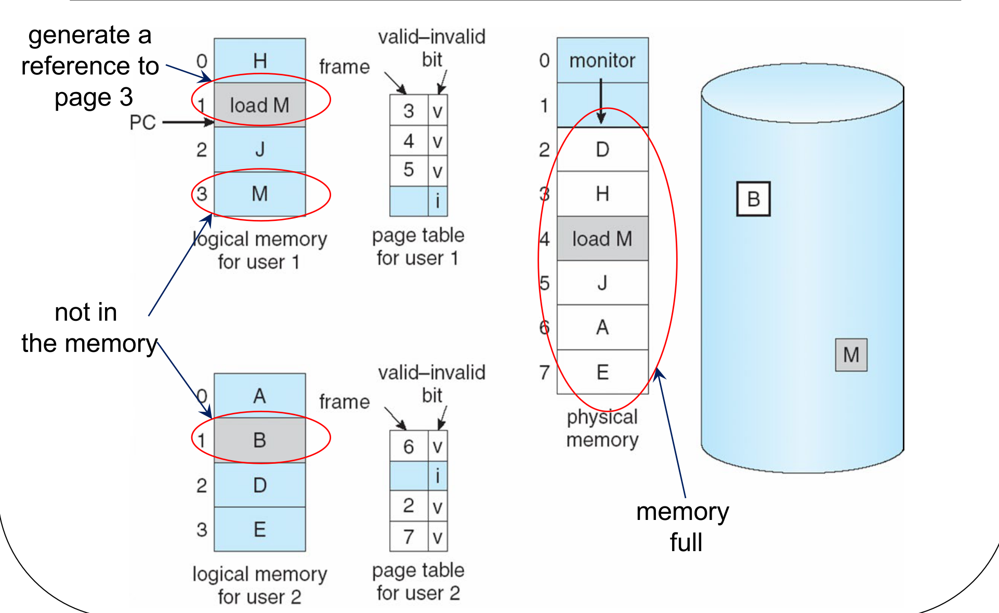

The solution: find a page in memory that is not really in use, and **replace** it. The process is:

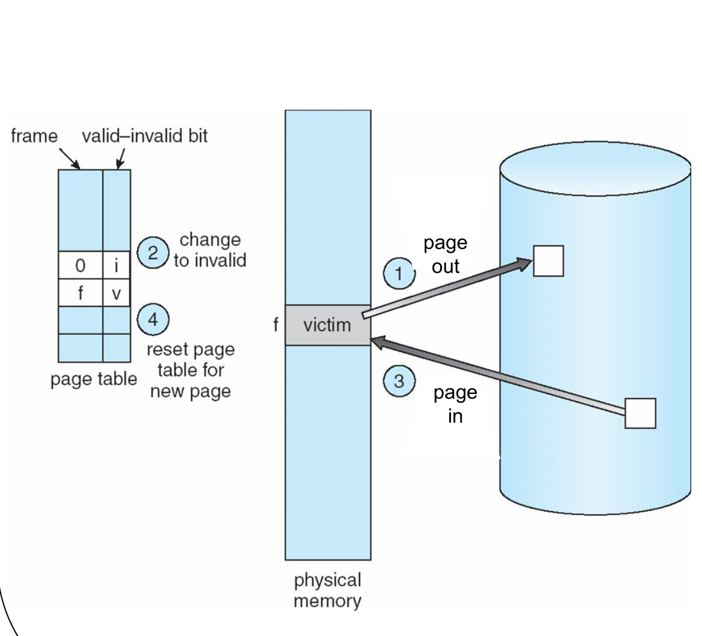

1. Use a **page-replacement algorithm** to choose a **victim** page. Write the victim to the backing store (**page out**).
2. Change the victim's page-table entry to **invalid**.
3. Read the needed page into the freed frame (**page in**).
4. Update the page-table entry of the new page.

Now a page fault can need **two** disk transfers: one out and one in. This makes the page fault time even longer.

### 3.2 The dirty bit saves a write
Many victim pages have **not changed** since they were loaded. Their copy on the disk is still correct, so the OS does not need to write them out.

The hardware sets a **modify bit** (also called the **dirty bit**) in a page's entry when the process writes to the page. **Only dirty pages are written back** when they are replaced. Clean pages are simply overwritten.

**Do not confuse the dirty bit with the reference bit** (section 4.5). The dirty bit says "the page was **written**". The reference bit says "the page was **used**" (read or written).

With page replacement, the separation of logical and physical memory is complete: a large virtual memory can run on a small physical memory.

### 3.3 How to compare algorithms
A good algorithm gives the **lowest page-fault rate**. To compare algorithms, run each one on the same **reference string**: the sequence of page numbers that a process refers to. Count the page faults.

The lecture always uses this reference string:

```text
1, 2, 3, 4, 1, 2, 5, 1, 2, 3, 4, 5
```

When the frames start empty, the first reference to each page is always a fault. That is the minimum number of faults: the number of different pages in the string.

You expect **more frames → fewer faults**:

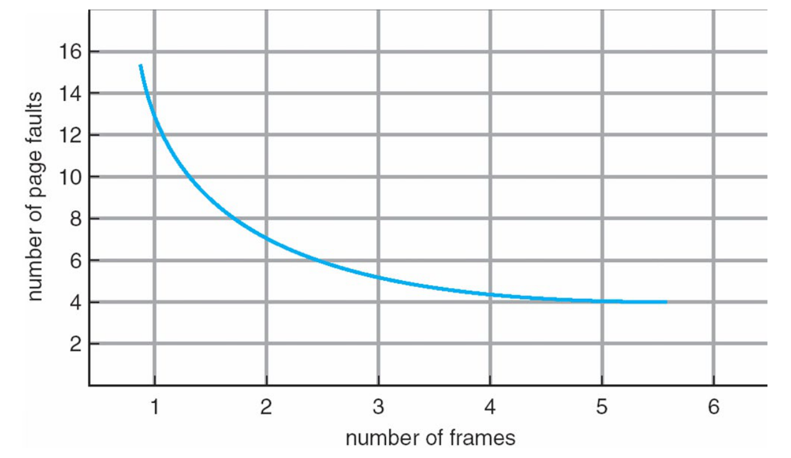

But this is not always true (section 4.1).

## 4. Page-Replacement Algorithms
For each algorithm, the tables below show the content of each frame after each reference. "P" marks a page fault.

### 4.1 First-in, first-out (FIFO)
**Rule:** replace the page that has been **in memory the longest**. The time it was **loaded** matters, not the time it was last used.

With 3 frames:

| Reference | 1 | 2 | 3 | 4 | 1 | 2 | 5 | 1 | 2 | 3 | 4 | 5 |
|---|---|---|---|---|---|---|---|---|---|---|---|---|
| Frame 1 | 1 | 1 | 1 | 4 | 4 | 4 | 5 | 5 | 5 | 5 | 5 | 5 |
| Frame 2 | | 2 | 2 | 2 | 1 | 1 | 1 | 1 | 1 | 3 | 3 | 3 |
| Frame 3 | | | 3 | 3 | 3 | 2 | 2 | 2 | 2 | 2 | 4 | 4 |
| Fault | P | P | P | P | P | P | P | | | P | P | |

**9 page faults.**

With 4 frames:

| Reference | 1 | 2 | 3 | 4 | 1 | 2 | 5 | 1 | 2 | 3 | 4 | 5 |
|---|---|---|---|---|---|---|---|---|---|---|---|---|
| Frame 1 | 1 | 1 | 1 | 1 | 1 | 1 | 5 | 5 | 5 | 5 | 4 | 4 |
| Frame 2 | | 2 | 2 | 2 | 2 | 2 | 2 | 1 | 1 | 1 | 1 | 5 |
| Frame 3 | | | 3 | 3 | 3 | 3 | 3 | 3 | 2 | 2 | 2 | 2 |
| Frame 4 | | | | 4 | 4 | 4 | 4 | 4 | 4 | 3 | 3 | 3 |
| Fault | P | P | P | P | | | P | P | P | P | P | P |

**10 page faults**, more than with 3 frames.

**Belady's anomaly:** with some algorithms, **more frames can cause more page faults**. FIFO has this problem.

### 4.2 Optimal (OPT)
**Rule:** replace the page that will **not be used for the longest time in the future**.

With 4 frames:

| Reference | 1 | 2 | 3 | 4 | 1 | 2 | 5 | 1 | 2 | 3 | 4 | 5 |
|---|---|---|---|---|---|---|---|---|---|---|---|---|
| Frame 1 | 1 | 1 | 1 | 1 | 1 | 1 | 1 | 1 | 1 | 1 | 4 | 4 |
| Frame 2 | | 2 | 2 | 2 | 2 | 2 | 2 | 2 | 2 | 2 | 2 | 2 |
| Frame 3 | | | 3 | 3 | 3 | 3 | 3 | 3 | 3 | 3 | 3 | 3 |
| Frame 4 | | | | 4 | 4 | 4 | 5 | 5 | 5 | 5 | 5 | 5 |
| Fault | P | P | P | P | | | P | | | | P | |

**6 page faults.** At reference 5, the pages in memory are 1, 2, 3 and 4. Looking ahead: 1 is used next, then 2, then 3, then 4. So 4 is used last, and OPT replaces it.

* OPT gives the **lowest possible** number of faults.
* **It cannot be built**, because the OS does not know the future references. It is used as a **benchmark** to judge other algorithms.
* OPT does **not** have Belady's anomaly. One more frame only lets it keep more pages. The pages in memory with n frames are always a subset of the pages with n + 1 frames. This is the **inclusion property**.

### 4.3 Least recently used (LRU)
**Rule:** replace the page that has **not been used for the longest time in the past**. It is OPT looking **backward** instead of forward: the recent past predicts the near future.

With 4 frames:

| Reference | 1 | 2 | 3 | 4 | 1 | 2 | 5 | 1 | 2 | 3 | 4 | 5 |
|---|---|---|---|---|---|---|---|---|---|---|---|---|
| Frame 1 | 1 | 1 | 1 | 1 | 1 | 1 | 1 | 1 | 1 | 1 | 1 | 5 |
| Frame 2 | | 2 | 2 | 2 | 2 | 2 | 2 | 2 | 2 | 2 | 2 | 2 |
| Frame 3 | | | 3 | 3 | 3 | 3 | 5 | 5 | 5 | 5 | 4 | 4 |
| Frame 4 | | | | 4 | 4 | 4 | 4 | 4 | 4 | 3 | 3 | 3 |
| Fault | P | P | P | P | | | P | | | P | P | P |

**8 page faults.** At reference 5, the last uses are: 1 at step 5, 2 at step 6, 3 at step 3, 4 at step 4. Page 3 was used least recently, so LRU replaces it.

LRU does **not** have Belady's anomaly.

### 4.4 How to build LRU
Exact LRU needs to know the order of all uses. There are two ways:

**Counter method.**

* Each page-table entry has a **time-of-use** field.
* The CPU has a logical clock that goes up by 1 on every memory reference.
* On every reference, the OS copies the clock into the time-of-use field of that page.
* On a page fault, replace the page with the **smallest** time-of-use.

**Stack method.**

* Keep a stack of page numbers, as a doubly linked list.
* When a page is referenced, move it to the **top**.
* The **bottom** of the stack is always the LRU page.
* Each reference costs a list update, but a replacement needs no search.

Both methods need hardware help on **every** memory reference. That is expensive, and most hardware does not have it.

### 4.5 LRU approximation: the reference bit
Most hardware gives a simpler aid: a **reference bit R** for each page.

* At the start, R = 0.
* When the page is referenced (read or written), the hardware sets R = 1.

Pages with R = 0 have not been used recently, so they are good victims. But R does not show the **order** of use, and many pages can have R = 0. So R only **approximates** LRU.

### 4.6 Second chance (the clock algorithm)
**Second chance** is FIFO with a check of the reference bit:

1. Take the **oldest** page as the candidate.
2. If its R = 1, give it a **second chance**: set R = 0, and treat it as if it had just been loaded. Move on to the next oldest page.
3. If its R = 0, replace it.

The **clock algorithm** builds second chance with a circular list of the frames and a **hand** that points to the oldest page:

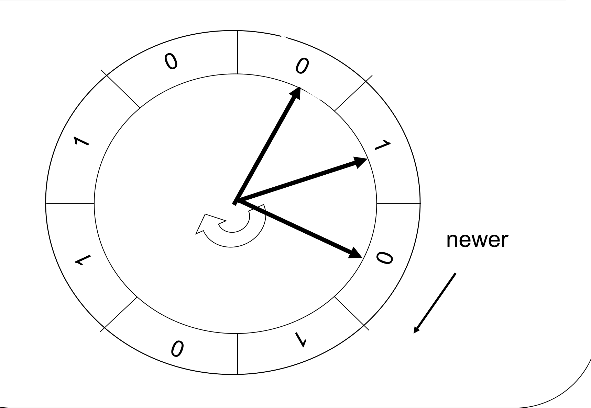

On a page fault:

1. Look at the page under the hand.
2. If R = 1: set R = 0, and move the hand one place. Repeat step 1.
3. If R = 0: replace this page with the new page. Move the hand one place.

On a **hit**, the hardware sets the page's R = 1, and the hand does **not** move.

In the worst case, every page has R = 1. The hand goes all the way round, clears every bit, and comes back to the page where it started. Then the clock replaces the oldest page: it becomes **FIFO**.

On the lecture's reference string with 4 frames, the clock algorithm also gives **8 page faults** (slide 8.32).

### 4.7 The algorithms side by side

| Algorithm | Replaces the page that… | Faults (4 frames) | Belady's anomaly? | Practical? |
|---|---|---|---|---|
| FIFO | was **loaded** earliest | 10 | **Yes** | Yes, simple |
| OPT | will be used **furthest in the future** | 6 | No | **No**, it needs the future |
| LRU | was **used** least recently | 8 | No | Expensive: hardware help on every reference |
| Clock (second chance) | is oldest with R = 0 | 8 | Not stated in the lecture | Yes: needs only a reference bit |

## 5. How Many Frames Each Process Gets

### 5.1 The trade-off
The OS must decide how many frames to give each process:

* Fewer frames for each process → more processes fit in memory.
* But too few frames → more page faults.
* Above some number of frames, more frames no longer reduce the page faults.

### 5.2 Fixed and variable allocation
* **Fixed allocation:** each process gets a fixed number of frames, for example an equal share, or a share in proportion to its size. On a page fault, one of **that process's own** pages must be replaced.
* **Variable allocation:** the number of frames of a process can change during its life.

### 5.3 Local and global replacement
* **Global replacement:** the victim can be **any** frame, including a frame of **another** process. One process can take a frame from another. A process's performance then depends on what the other processes do.
* **Local replacement:** the victim must be one of the process's **own** frames. A process can then hold on to pages that it does not use much, and other processes cannot get them.

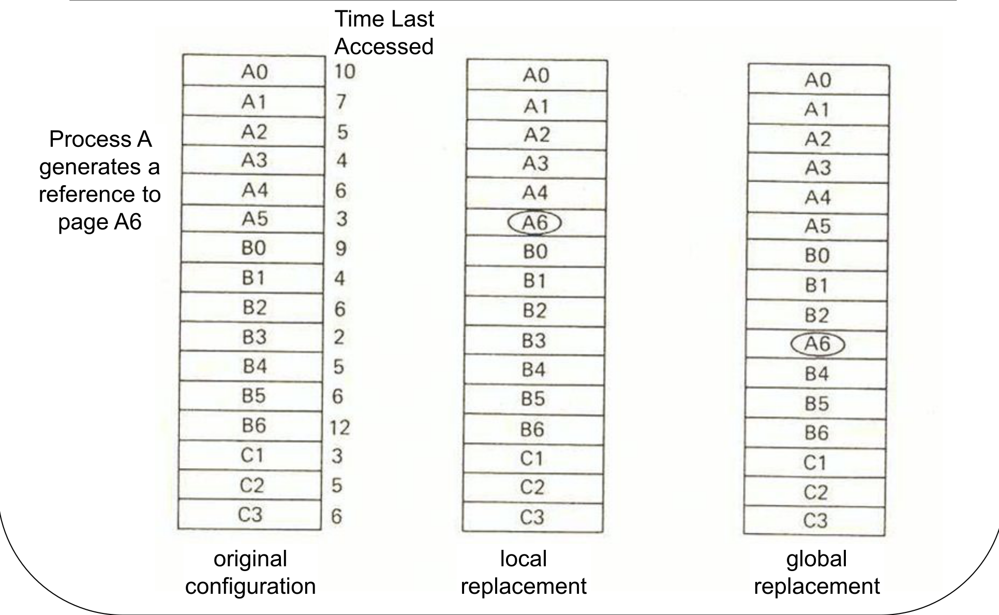

In the slide, process A needs page A6. With local replacement, LRU picks the least recently used page **of A**. With global replacement, LRU picks the least recently used page **of all processes**, here a page of process B.

### 5.4 Which combinations are possible

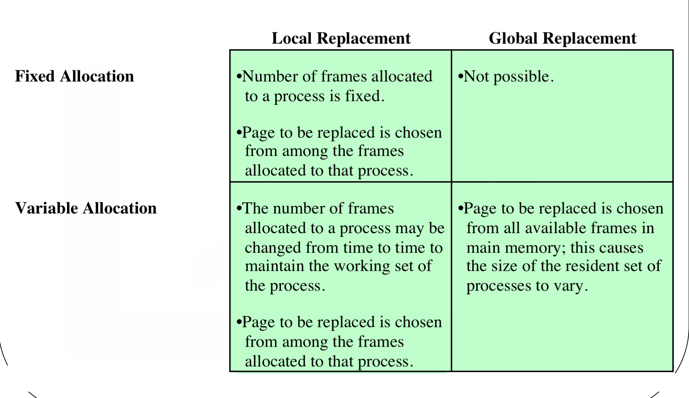

| | Local replacement | Global replacement |
|---|---|---|
| **Fixed allocation** | The number of frames stays fixed. The victim is one of the process's own pages | **Not possible.** Taking another process's frame would change both processes' frame counts |
| **Variable allocation** | The OS changes the number of frames from time to time, to fit the working set. The victim is one of the process's own pages | The victim can be any frame in memory. The size of each process's set of frames changes |

**Fixed allocation requires local replacement.** Variable allocation can use either local or global replacement.

## 6. Thrashing

### 6.1 What thrashing is
If a process does not have "enough" frames, it page-faults all the time: it needs a page, replaces a page that it will need soon, and so on. **Thrashing** means that a process is busy moving pages in and out, and does almost no useful work.

### 6.2 How thrashing makes itself worse
1. Processes page-fault a lot, so they wait for the disk. CPU utilization drops.
2. The OS sees low CPU utilization. Its usual reaction is to **add another process** (raise the degree of multiprogramming).
3. The new process takes frames from the others. They fault even more.
4. CPU utilization drops further.

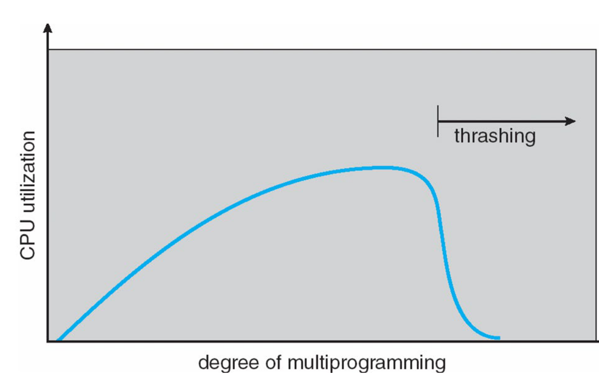

So **low CPU utilization with a high degree of multiprogramming is a sign of thrashing**, not a reason to add more processes.

There are two ways to fight thrashing: the working-set model and the page-fault frequency scheme.

### 6.3 Locality of reference
Programs do not use their pages at random. They tend to use a **small group of pages** for a while, then move to another group. This is **locality of reference**. It has two forms:

* **Temporal locality:** a location used just now will likely be used again soon. Example: the variable `sum` in a loop, or the loop instructions themselves.
* **Spatial locality:** locations near each other tend to be used together. Example: the elements of an array accessed one after another, or instructions run in sequence.

```c
sum = 0;
for (i = 0; i < n; i++)
    sum += a[i];      // sum: temporal; a[0], a[1], ...: spatial
return sum;
```

**The order of loops matters.** For a 2D array stored row by row, a loop that goes along each row (`i` outside, `j` inside) uses neighbouring memory, so it touches few pages. A loop that goes down each column jumps to a new row, often a new page, on every access. That gives worse locality and more page faults.

### 6.4 The working-set model
**Idea:** give each process enough frames for the pages it is using **now**.

* The **working-set window** Δ is a fixed number of the most recent page references.
* The **working set** of a process at time t is the set of pages referenced in the last Δ references.
* **WSS_i** (working-set size) is the number of pages in the working set of process Pi. It changes with time.

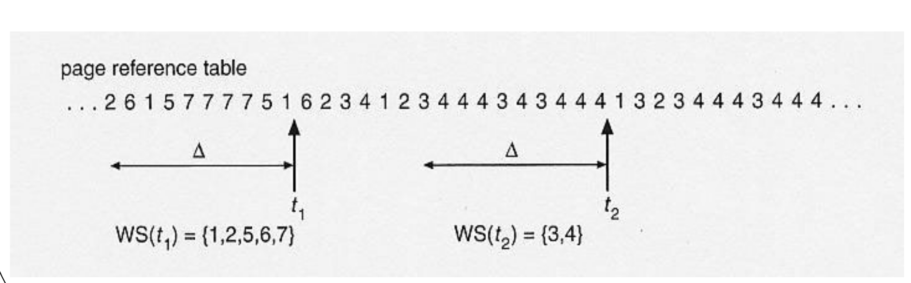

In the slide, with Δ = 10, the working set at t1 is {1, 2, 5, 6, 7}, and at t2 it is {3, 4}. The working set is the set of **different** pages in the window, so repeated references count once.

**Using it to prevent thrashing:**

* Total demand: $D = \sum_i WSS_i$.
* Let m be the total number of frames.
* If D > m, the processes need more frames than exist, so thrashing will occur.
* **Policy:** if D > m, **suspend** (swap out) one of the processes.

### 6.5 The page-fault frequency (PFF) scheme
**Idea:** measure the page-fault rate of each process directly, and keep it between two bounds.

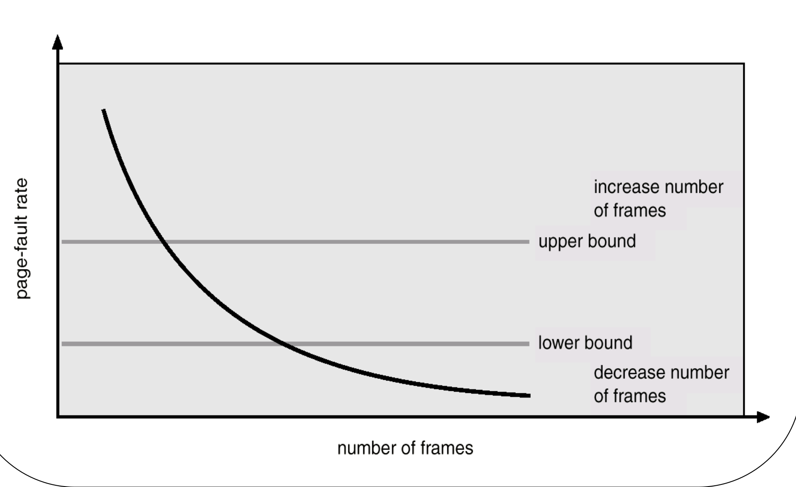

* Set an acceptable range for the page-fault rate: a lower bound and an upper bound.
* If a process's rate is **too low** (below the lower bound), it has more frames than it needs: **take a frame away**.
* If its rate is **too high** (above the upper bound), it needs more frames: **give it a frame**.
* If the rate is too high and there are no free frames, **suspend** (swap out) a process.

## What You Know Now (Lecture 8)

* Virtual memory separates logical memory from physical memory, so a program can be larger than RAM and only part of it needs to be in memory.
* Demand paging loads a page only when it is used. An invalid entry causes a page fault, the OS reads the page in, and the instruction restarts.
* EAT = (1 − p) × memory time + p × fault time. Because a fault is so slow, p must be tiny.
* With no free frame, the OS replaces a victim. Only dirty pages are written back.
* FIFO replaces the oldest loaded page and has Belady's anomaly. OPT replaces the page used furthest in the future and is only a benchmark. LRU replaces the least recently used page. Clock uses a reference bit to approximate LRU, and becomes FIFO when all bits are set.
* Fixed allocation needs local replacement. Variable allocation can use local or global.
* Thrashing: processes spend their time paging. The working-set model suspends a process when the total working sets exceed memory. PFF keeps each process's fault rate between two bounds.
