This was written entirely with AI.

These notes cover Lecture 9. Lectures 7 and 8 managed **main memory**, which loses its content when the power goes off. This lecture manages the **disk**, which keeps data. A disk only stores numbered blocks. The file system turns those blocks into named files in folders, controls who can use them, and decides which blocks each file uses.

## 1. What a File System Does

### 1.1 The problem
A disk is divided into **blocks**: fixed-size pieces of storage, numbered 0, 1, 2, and so on. The disk can only read or write a whole block, by its number.

Users do not want to remember block numbers. They want to say "open `report.txt` in my `work` folder". So the OS must:

* give each file a **name**, and keep information about it,
* group files into **directories** (folders),
* stop users from using files that are not theirs,
* decide **which disk blocks** hold each file, and find them again,
* keep track of which blocks are **free**.

The part of the OS that does this is the **file system**.

### 1.2 The file system in layers
The lecture divides the file system into four levels, from the user down to the hardware:

| Level | What it does |
|---|---|
| **Logical file system** | Manages the directory structure. Creates, opens and deletes files. Handles protection and security. |
| **File-organisation module** | Allocates disk space to files. Translates **logical** block numbers (block 0, 1, 2 of the file) into **physical** block numbers (blocks on the disk). Manages free space. |
| **Basic file system** | Manages buffers and caches. Sends general commands to the device driver, to read or write a physical block. |
| **I/O control** | The device drivers and interrupt handlers. They move data between memory and the disk. |

Sections 2 to 5 are about the logical file system. Sections 6 to 8 are about the file-organisation module.

---

## 2. Files

### 2.1 What the OS records about a file
A file has **attributes**: information about the file, separate from its content.

| Attribute | Meaning |
|---|---|
| Name | The only attribute in human-readable form |
| Type | Needed by systems that treat file types differently |
| Location | A pointer to where the file is on the device |
| Size | The current size of the file |
| Protection | Who can read, write or execute the file |
| Time, date, user ID | For protection, security and usage monitoring |

The OS keeps these attributes in the **directory structure**, on the disk (section 3).

### 2.2 File types
The **type** of a file says what kind of data it holds. Many systems show the type with an **extension**, the part of the name after the dot:

| Type | Usual extensions | Holds |
|---|---|---|
| Executable | exe, com, bin, or none | A machine-language program, ready to run |
| Object | obj, o | Compiled machine code, not linked yet |
| Source code | c, p, pas, asm, a | Source code in a programming language |
| Batch | bat, sh | Commands for the command interpreter |
| Text | txt, doc | Text documents |
| Word processor | wp, tex, rrf | Word-processor formats |
| Library | lib, a | Libraries of routines |
| Print or view | ps, dvi, gif | ASCII or binary data for printing or viewing |
| Archive | arc, zip, tar | Related files grouped into one file, sometimes compressed |

### 2.3 File structure: a sequence of bytes
A file could be a set of **records** with a fixed layout. But if the OS supported many record layouts, it would need code for each one. So most systems leave the structure to the application programs.

UNIX and MS-DOS treat a file as **unstructured**: a sequence of bytes. Each byte has an address, counted from the start of the file (byte 0, byte 1, …). **The rest of this lecture assumes this model.**

### 2.4 Access methods
* **Sequential access:** the program processes the file in order, from the start, one byte after the other.
* **Direct access:** the program reads bytes in any order, by giving the byte number.

### 2.5 File operations

| Operation | What the OS does |
|---|---|
| Create | Allocates disk space. Creates a directory entry with the file's attributes. |
| Delete | Removes the directory entry. Frees the disk space. |
| Open | Searches the directory structure for the file's entry. Copies it into memory, into the **open-file table** (section 5). |
| Close | Writes the in-memory copy of the directory entry back to the directory structure on disk. |
| Read | Finds the file in the open-file table. Reads data from the position given by the **current position pointer**. |
| Write | Finds the file in the open-file table. Writes data at the position given by the current position pointer. |

The **current position pointer** is the byte number where the next read or write starts. Each read or write moves it forward.

**Why "open" exists.** Searching the directory on the disk is slow. If every read had to search it, every read would be slow. So the OS searches once, at open, and keeps what it found in memory. Later reads and writes use that copy. For an open file, the OS keeps:

* the current position pointer,
* the **file open count**: how many processes have the file open,
* the disk location of the file.

---

## 3. Directories

### 3.1 What a directory entry holds
A **directory** is a list of entries, usually one entry for each file. The directory and the files are both on the disk. An entry can have one of two forms:

* **(a)** the file name and all the other attributes, in the entry itself; or
* **(b)** the file name and a **pointer** to another data structure that holds the attributes.

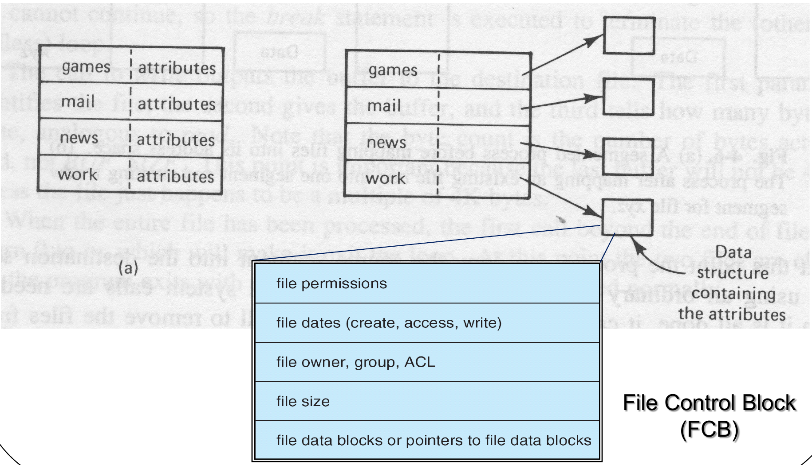{width=85%}

The data structure in form (b) is the **file control block (FCB)**. It holds the file's permissions, dates (create, access, write), owner and group, size, and the data blocks (or pointers to them). In UNIX, the FCB is the **inode** (section 7).

### 3.2 How to find an entry quickly
A directory can be stored as:

* **A linear list** of entries. It is simple. But to find one file, the OS must search the list from the start. That is slow for a large directory.
* **A linear list with a hash table.** A **hash function** turns the file name into a position in the table, and that position points to the entry. Search is fast. A **collision** occurs when two names hash to the same position. The fix: each position in the table holds a list of entries.

### 3.3 Tree-structured directories and path names
A directory can contain other directories. This gives a **tree**, with one **root** directory at the top.

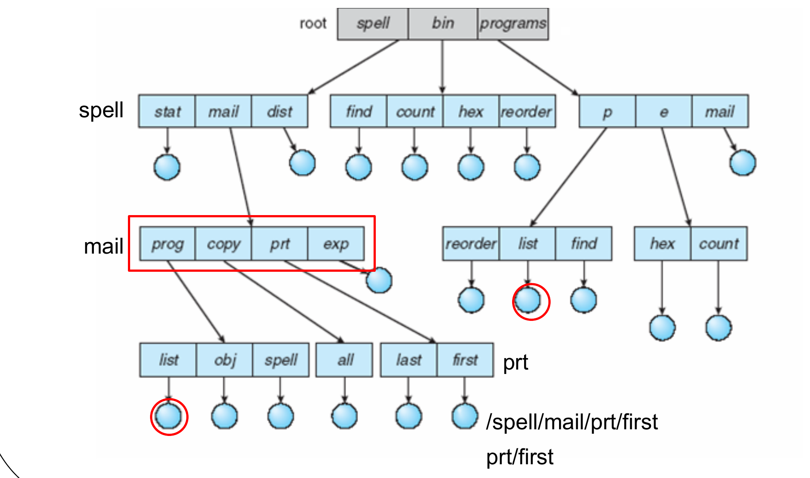{width=85%}

A **path name** gives the way to a file:

* An **absolute path name** starts at the root, and follows the directories down to the file. Example: `/spell/mail/prt/first`.
* A **relative path name** starts at the **current directory**: the directory the user is working in now. If the current directory is `/spell/mail`, the same file is `prt/first`.

A tree gives three benefits:

* **Efficient searching:** the path name says exactly where the file is.
* **Naming:** files in different directories can have the same name. (The slide's tree has two files named `list` and two named `reorder`.)
* **Grouping:** related files can go in one directory.

### 3.4 Acyclic-graph directories: one file in two places
In a strict tree, each file has exactly one parent directory. But two users may want to share one file, each from their own directory.

An **acyclic-graph directory** allows that. A file (or directory) can appear in more than one directory. "Acyclic" means there are no loops: following the entries never leads back to where you started.

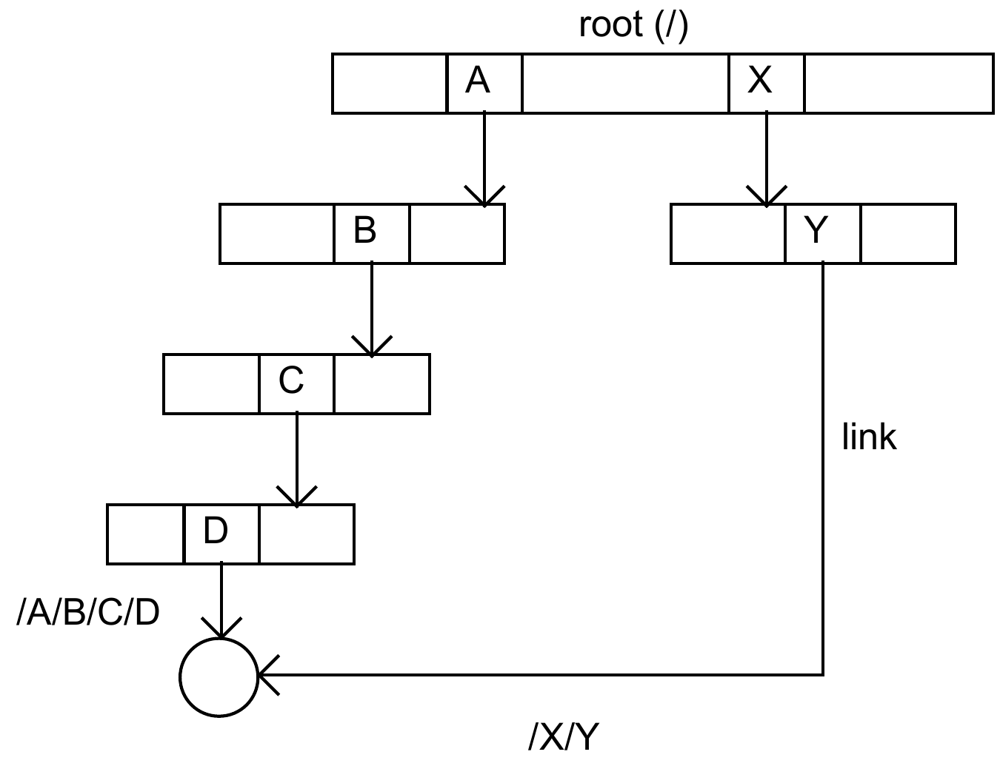{width=55%}

In the slide, one file has two names: `/A/B/C/D` and `/X/Y`. So in an acyclic graph, **one file can have several path names**.

### 3.5 Two ways to share: symbolic links and hard links
**Symbolic link.** The OS creates a special directory entry, a **link**. The link holds the **path name** (absolute or relative) of the real file. To use the link, the OS reads the path name and looks it up, to find the real file.

* Access is **slower** than with a hard link, because the OS must resolve the path name every time.

**Hard link.** The OS **copies all the information** about the file into the second directory. Both entries lead straight to the same file.

| | Symbolic link | Hard link |
|---|---|---|
| The second entry holds | The path name of the file | All the information about the file (the same as the first entry) |
| To reach the file | Look up the path name again | Go directly |
| Speed | Slower | Faster |

(Standard, not on the slides: in UNIX, a hard link is a second directory entry with the **same inode number**. The inode counts how many entries point to it. This is the "Links" column in `ls -l`.)

### 3.6 Problems with sharing
**Problem 1: the same file is visited twice.** A program that visits every file (for example, a backup program) can reach a shared file through both paths.

* **Solution:** ignore link entries during the traversal.

**Problem 2: dangling pointers.** Suppose the owner deletes a shared file, but a link to it still exists. The link now points to a file that does not exist: a **dangling pointer**. Worse, the OS may later reuse the freed disk space, or the same path name, for a **new** file. Then the old link leads to the new file, which is the wrong file.

* **Solutions** (any one of them):
  * Search for dangling links and remove them when the file is deleted.
  * Leave the dangling links, and remove each one only when someone tries to use it.
  * Keep the file until **all** references to it are deleted. (A count of the references tells the OS when the last one is gone.)

**One shared copy or one copy per user?** (Not on the slides.) Links keep **one** copy, which all users see. A change by one user is seen by all, and the disk holds the data once. The cost is the sharing problems above. Giving each user their **own copy** avoids those problems, but it uses more disk space, and the copies can become different from each other.

### 3.7 Directory operations

| Operation | What it does |
|---|---|
| Create | Creates a directory. In UNIX, two entries are added automatically: `.` (this directory) and `..` (its parent). |
| Delete | Deletes a directory. **Only an empty directory can be deleted.** A directory that holds only `.` and `..` counts as empty. |
| List | Lists all the files (and directories) in a directory, and the content of their entries. |
| Search | Searches the directory structure for the entry of one file. |
| Traverse | Visits every directory and every file in a directory structure. |

---

## 4. File Protection in UNIX

### 4.1 Three rights, three classes of user
UNIX controls three kinds of access:

* **r (read):** read the file.
* **w (write):** change the file.
* **x (execute):** run the file as a program.

It gives these rights separately to three classes of user:

* **owner** (the user who owns the file),
* **group** (the users in the file's group),
* **public** (all other users).

That is 3 × 3 = 9 bits. Each class has 3 bits, in the order r w x. A 1 means the right is given, a 0 (shown as `-`) means it is not. Each group of 3 bits is also written as one octal digit (r = 4, w = 2, x = 1).

### 4.2 Reading a listing
The lecture's example:

```text
-rwxr-x--x  1  smith  58  Mar 3  3:04  game1
```

The first character is the **file type**: `-` for an ordinary file, `d` for a directory. The next nine characters split into three groups:

| Class | Bits | Binary | Octal | Rights |
|---|---|---|---|---|
| Owner | `rwx` | 111 | 7 | read, write, execute |
| Group | `r-x` | 101 | 5 | read, execute |
| Public | `--x` | 001 | 1 | execute only |

So the protection is **751**. The owner and the group can read `game1`. Other users can only run it.

**To answer "who can do X?"**, look at the bit for X in **each** of the three groups. Do not stop at the owner.

### 4.3 What r, w and x mean for a directory
For a directory, the three rights have a different meaning:

* **x (execute)** is **essential** to use the directory at all. Without it, a user cannot run any command on the directory, and cannot reach **any** file in the tree below it, even a file whose own bits allow access.
* **r (read):** list the names in the directory. Without it, the user cannot list it.
* **w (write):** create or delete files in the directory. Without it, the user cannot.

The lecture's example:

```text
drwxr-x---  0  smith  5  Feb 2  12:01  games
```

* `d`: it is a directory.
* Owner `rwx`: list it, add and delete files, and use the files in it.
* Group `r-x`: list it and use the files in it, but not add or delete files.
* Public `---`: no access at all, so no access to any file below `games`.

Note that **deleting** a file needs **w on the directory**, because deleting changes the directory's list. It does not depend on the bits of the file itself.

---

## 5. What Happens in Memory on open() and read()

### 5.1 The problem
Two processes can open the same file at the same time, and read it at **different** positions. But the file's FCB (its attributes and block pointers) is the same for both. So the OS keeps two kinds of table in kernel memory:

* A **per-process open-file table**, one for each process. Each entry holds **this process's** current position pointer and access rights (for example `r w -`), and points to an entry in the system-wide table.
* A **system-wide open-file table**, one for the whole system. Each entry holds **one copy of the FCB** of an open file, and the **file open count**.

The index of the entry in the per-process table is returned to the process. This index is the **file descriptor**. The process passes it to every later `read`, `write` and `close`.

### 5.2 The steps of open()

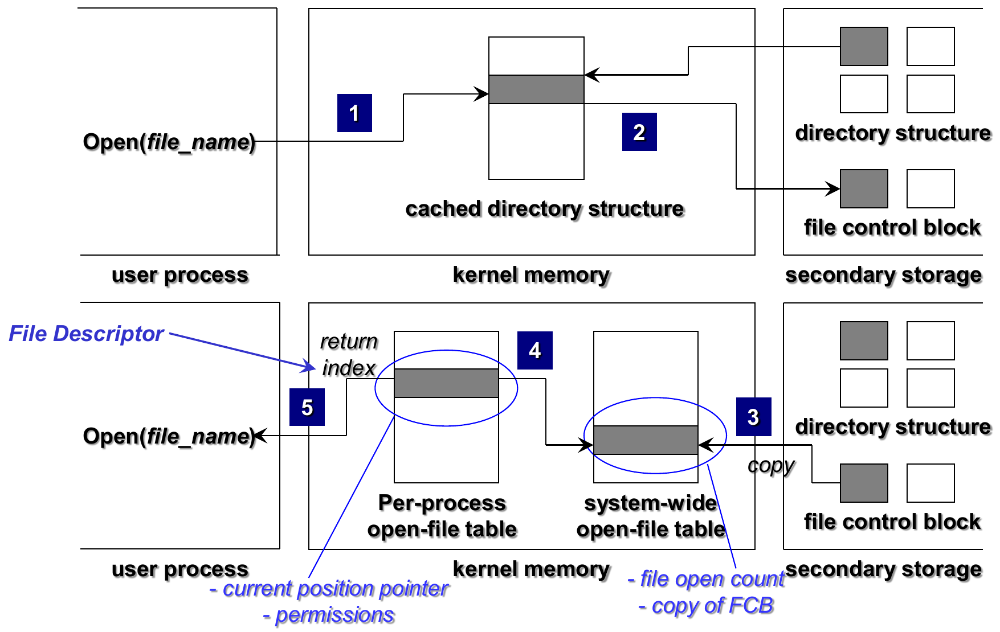

1. The process calls `open(file_name)`. The OS searches the directory structure. It uses the part cached in kernel memory, and reads more from the disk if needed.
2. The OS finds the file's entry, and from it the file's FCB on the disk.
3. The OS copies the FCB into the **system-wide** open-file table. If another process already has the file open, the copy is already there, and the OS only adds 1 to the file open count.
4. The OS checks the access rights, and creates an entry in the **per-process** open-file table. The entry points to the system-wide entry.
5. The OS returns the index of that entry, the **file descriptor**, to the process.

### 5.3 The steps of read()

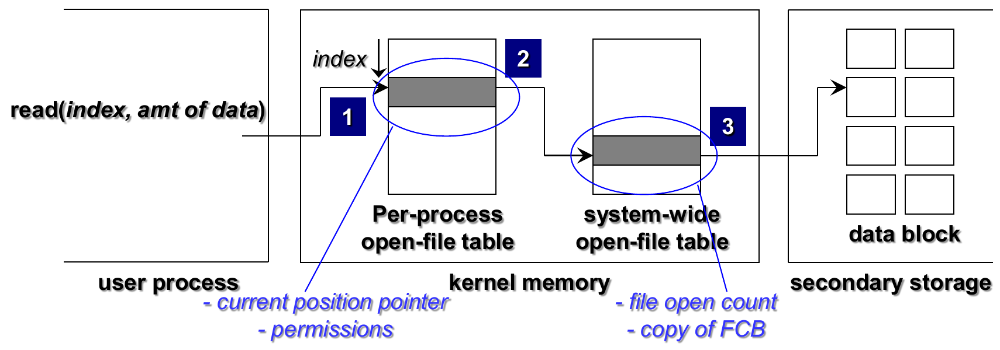{width=80%}

1. The process calls `read(index, amount)`. The index selects the entry in its per-process table.
2. That entry gives the **current position pointer**, and points to the system-wide entry.
3. The system-wide entry holds the **FCB**. The OS reads the data blocks from the disk.

Two facts decide which block is read:

* **The current position pointer and the amount** tell the OS which **logical** blocks of the file it needs.
* **The FCB and the allocation method** tell it where those blocks are on the **disk** (sections 6 and 7).

**What the open-file tables do not hold:** file data. They hold information **about** the file (FCB copy, position, rights, count). Caching of data blocks is a job of the basic file system, not of the open-file table.

---

## 6. Allocation Methods: Which Blocks Hold a File?

### 6.1 The question, and one tool for all methods
A file is a sequence of bytes. The disk is a set of blocks. The **allocation method** decides which disk blocks hold the file, and how the OS finds the block that holds a given byte.

All three methods start with the same step. Divide the **logical address** (the byte number in the file) by the amount of file data in one block:

$$\text{logical address} = Q \times (\text{data bytes per block}) + R$$

* Q (the quotient) is the **logical block number**: block 0, 1, 2, … of the file.
* R (the remainder) is the **offset**: the byte inside that block.

Then each method maps logical block Q to a physical block on the disk in its own way. The lecture uses logical address **2333** and 512-byte blocks in every example.

### 6.2 Contiguous allocation
Each file uses a set of **consecutive** blocks on the disk. The directory entry holds only the **start block** and the **length** (number of blocks).

**Mapping:** with 512-byte blocks, logical address = Q × 512 + R.

* Block to access = start block + Q.
* Offset in the block = R.

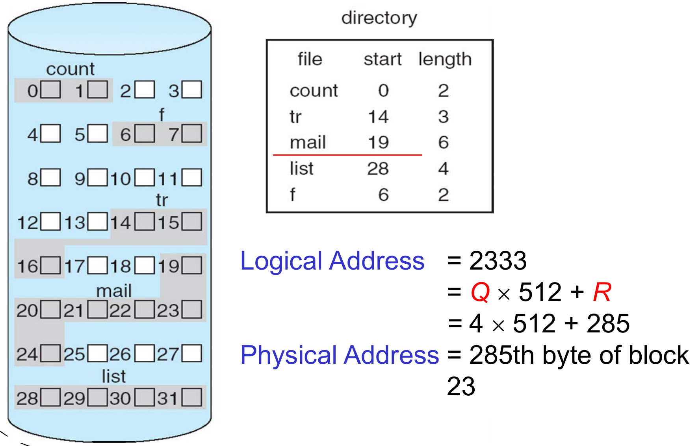{width=85%}

**The slide's example.** The file `mail` starts at block 19, with length 6, so it uses blocks 19 to 24.

1. 2333 = 4 × 512 + 285, so Q = 4 and R = 285.
2. Block = 19 + 4 = 23.
3. The byte is byte 285 of block 23.

**Advantages:**

* Simple: two numbers per file.
* **Random access** is easy. Any block is found by one addition, with no extra disk reads.

**Problems:**

* The same problems as dynamic partitioning of main memory (Lecture 7). The OS must find a **hole** (a run of free blocks) large enough, with first-fit or best-fit. Over time this gives **external fragmentation**: enough free blocks in total, but no run long enough.
* A file cannot easily **grow**. The blocks after it may be in use, so the whole file may have to move to a bigger hole.
* If the OS reserves extra space in advance, and the file never uses it, the space is wasted: **internal fragmentation**.

### 6.3 Linked allocation
Each file is a **linked list** of blocks. The blocks can be anywhere on the disk. Each block holds a **pointer** to the next block of the file. The directory entry holds the **first** block (and, in the slide, the last block too).

**Course convention:** the first 4 bytes of each block hold the pointer. So each 512-byte block holds only **508 bytes** of file data.

**Mapping:** logical address = Q × 508 + R.

* The block to access is the **(Q + 1)th block in the chain**. The OS must follow the chain from the first block to reach it.
* Offset in the block = R + 4 (skip the 4-byte pointer).

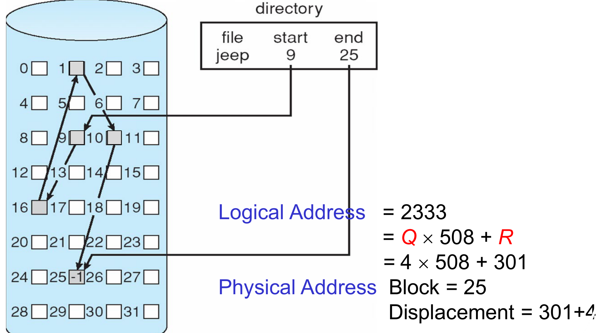{width=85%}

**The slide's example.** The file `jeep` starts at block 9 and ends at block 25. The chain is 9 → 16 → 1 → 10 → 25. Block 25 holds −1, which marks the end.

1. 2333 = 4 × 508 + 301, so Q = 4 and R = 301.
2. Block Q + 1 = 5th in the chain. Follow it: 9 (1st), 16 (2nd), 1 (3rd), 10 (4th), **25** (5th).
3. Offset = 301 + 4 = 305. The byte is byte 305 of block 25.

**Advantages:**

* Simple: the directory needs only the start block.
* **No external fragmentation.** Any free block can be used, so no space is wasted between files.
* The file can **grow** freely: add a block at the end when needed.

**Problem: no random access.** Only block 9 knows where block 16 is, only block 16 knows where block 1 is, and so on. To reach the (Q + 1)th block, the OS must **read all Q + 1 blocks** of the chain from the disk. Reaching the end of a large file is slow.

**FAT.** (The lecture's outline names it, but the slides do not explain it. This is the standard idea.) A **file allocation table (FAT)** moves all the next-block pointers out of the blocks, into one table at the start of the disk, with one entry for each disk block. The OS keeps the table in memory. Then it can follow a chain in memory, without reading every block from the disk.

### 6.4 Indexed allocation
Each file has an **index block**. The index block holds a list of pointers: entry 0 points to logical block 0, entry 1 to logical block 1, and so on. The directory entry holds the number of the index block.

This is like a page table (Lecture 7): the index block maps the file's logical blocks to disk blocks.

**Mapping:** logical address = Q × 512 + R.

* Entry Q of the index table gives the block to access.
* Offset in the block = R.

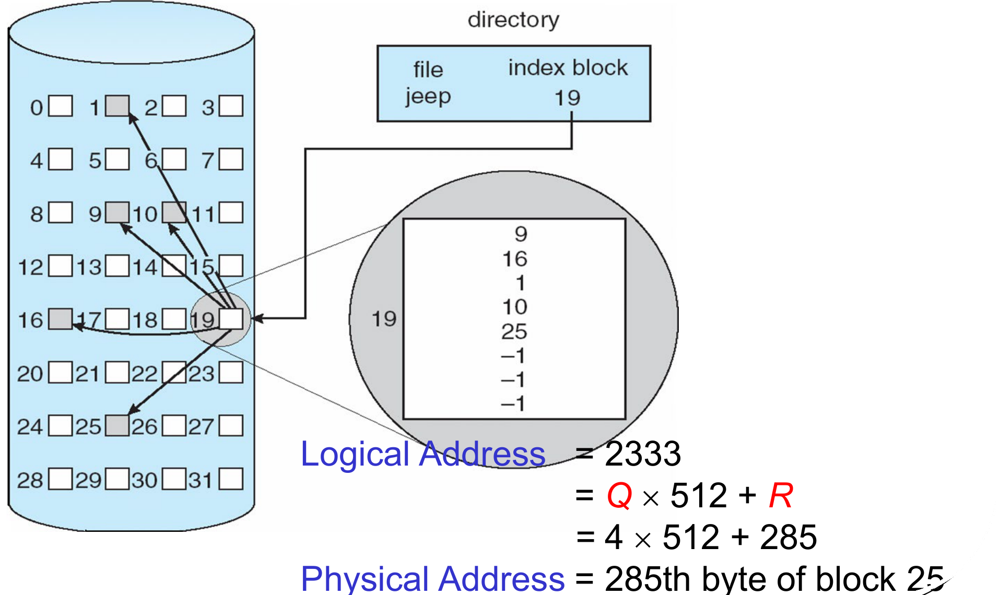{width=85%}

**The slide's example.** The file `jeep` has index block 19. Block 19 holds 9, 16, 1, 10, 25, −1, −1, −1 (−1 means unused).

1. 2333 = 4 × 512 + 285, so Q = 4 and R = 285.
2. Entry 4 of the index (counting from 0) is 25.
3. The byte is byte 285 of block 25.

**How large is the index?** The lecture's case: the largest file is 128 KB, a block is 512 bytes, and a pointer is 4 bytes.

1. The largest file needs 128 KB / 512 B = 131,072 / 512 = **256 blocks**.
2. So the index needs 256 pointers × 4 bytes = **1024 bytes**.
3. One block holds only 512 bytes. So the index needs 1024 / 512 = **2 blocks**.

**Advantages:**

* **Random access:** entry Q gives block Q directly.
* **No external fragmentation:** any free block can be used, as with paging.

**Problem:** the index blocks use disk space, and the mapping costs time (an extra read if the index block is not in memory).

### 6.5 Comparing the three: how many disk reads to reach one byte?
To read the block that holds logical address A, first find Q. Then count the disk reads. Assume that **only the directory entry is in memory** (the usual exam assumption; check what the question says).

| Method | Disk reads to reach logical block Q | Why |
|---|---|---|
| Contiguous | **1** | The block number is start + Q, computed in memory |
| Linked | **Q + 1** | Read every block of the chain, from block 0 to block Q |
| Indexed | **2** (1 if the index block is already in memory) | Read the index block, then the data block |

With the lecture's address 2333 (Q = 4): contiguous 1 read, linked 5 reads, indexed 2 reads.

**If the data runs over two blocks.** A read of n bytes from address A touches the blocks from Q = ⌊A / size⌋ to ⌊(A + n − 1) / size⌋. Count each block that is touched. With linked allocation, the next block in the chain comes "for free" in the count, because the OS has to read the earlier blocks anyway.

| | Contiguous | Linked | Indexed |
|---|---|---|---|
| Directory entry holds | Start block, length | First block (and last) | Index block number |
| Random access | Yes, fast | **No**, must follow the chain | Yes |
| External fragmentation | **Yes** | No | No |
| File can grow easily | **No** | Yes | Yes |
| Space overhead | None | One pointer in every block | The index block(s) |

---

## 7. The UNIX inode

### 7.1 The problem with one index block
With indexed allocation, a small file wastes most of its index block, and a very large file needs many index blocks. UNIX solves both with a **multi-level** index, the **inode**.

### 7.2 What an inode holds
Every file and every directory has one **inode** (index node). It holds:

* the file attributes (mode, owners, timestamps, size, block count),
* **12 direct pointers**: each points to one data block,
* **3 indirect pointers**:
  * **single indirect:** points to an index block, full of pointers to data blocks,
  * **double indirect:** points to an index block of pointers to index blocks, which point to data blocks,
  * **triple indirect:** one more level.

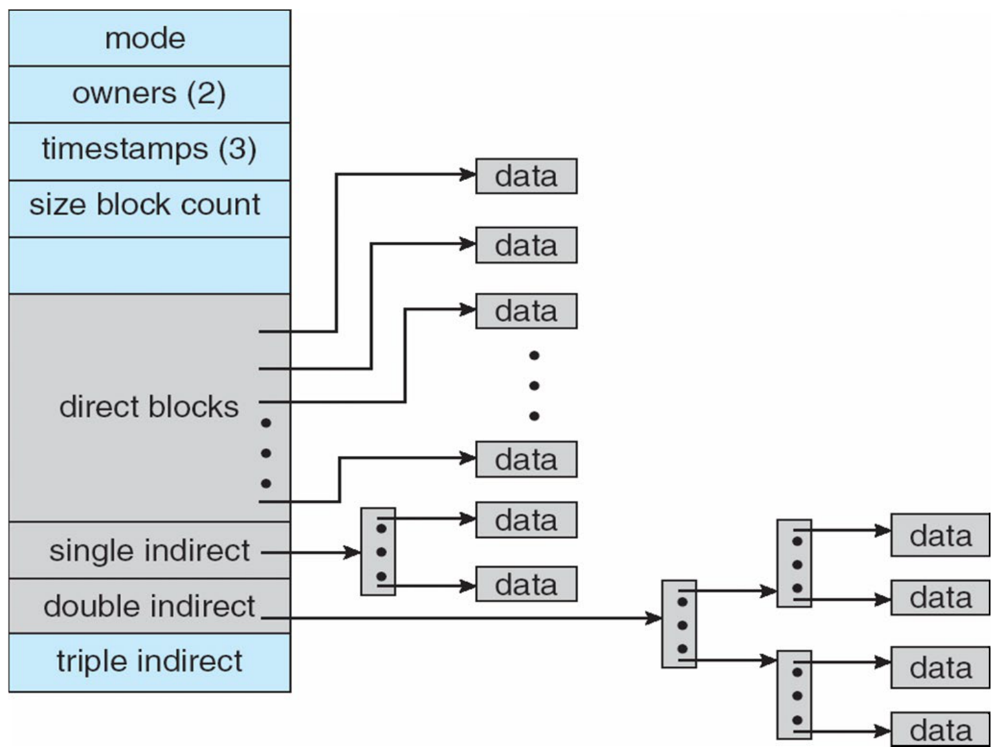{width=70%}

A small file uses only the direct pointers, so it needs no extra index blocks. A large file uses the indirect pointers as it grows.

Each UNIX directory entry holds only a **file name** and an **inode number**. Each inode is at a **fixed place** on the disk, so the inode number tells the OS where to read it.

### 7.3 The largest possible file
Let the block size be B and the pointer size be p. One index block holds **P = B / p** pointers.

| Part | Data blocks it reaches | Bytes |
|---|---|---|
| 12 direct pointers | 12 | 12 × B |
| Single indirect | P | P × B |
| Double indirect | P × P | P² × B |
| Triple indirect | P × P × P | P³ × B |

The largest file is the sum of the rows.

**The lecture's example:** 4 KB blocks and 4-byte pointers. P = 4096 / 4 = 1024 = $2^{10}$.

* Direct: 12 × 4 KB = **48 KB**.
* Single indirect: $2^{10}$ × 4 KB = $2^{10}$ × $2^{12}$ = $2^{22}$ bytes = **4 MB**. With the direct blocks: 48 KB + $2^{22}$ bytes.
* Double indirect: $2^{10}$ × $2^{10}$ × 4 KB = $2^{32}$ bytes = **4 GB**. With the others: 48 KB + $2^{22}$ + $2^{32}$ bytes, which is more than 4 GB.
* (Triple indirect, by the same method: $2^{30}$ × 4 KB = $2^{42}$ bytes = 4 TB.)

**Apply the formula to the inode you are given.** Some inodes have fewer direct pointers, or no double or triple indirect pointer. Use only the parts that exist. A smaller pointer means more pointers per block, so P changes too.

### 7.4 Which pointer reaches logical block Q?
Number the file's blocks from 0. With D direct pointers and P pointers per index block:

| Logical blocks | Reached through | Reads to reach the data, with the inode in memory |
|---|---|---|
| 0 to D − 1 | Direct pointer Q | 1 (the data block) |
| D to D + P − 1 | Single indirect, entry Q − D | 2 (index block, data block) |
| D + P to D + P + P² − 1 | Double indirect | 3 (two index blocks, data block) |

An index block that was already read for an earlier block, in the same operation, does not need to be read again (unless the question says nothing is cached).

**The method, step by step,** to count the disk reads for `read(fd, buf, n)` with the current position at byte A:

1. Find the first and last logical block: ⌊A / B⌋ and ⌊(A + n − 1) / B⌋.
2. For each block in that range, find which pointer reaches it (table above).
3. Add up the reads. Count each index block once.

**The lecture's figure** (slides 9.39 and 9.40) uses an inode with **6** direct pointers (Blk 0 to Blk 5) and one single-indirect pointer, and blocks of 1000 bytes.

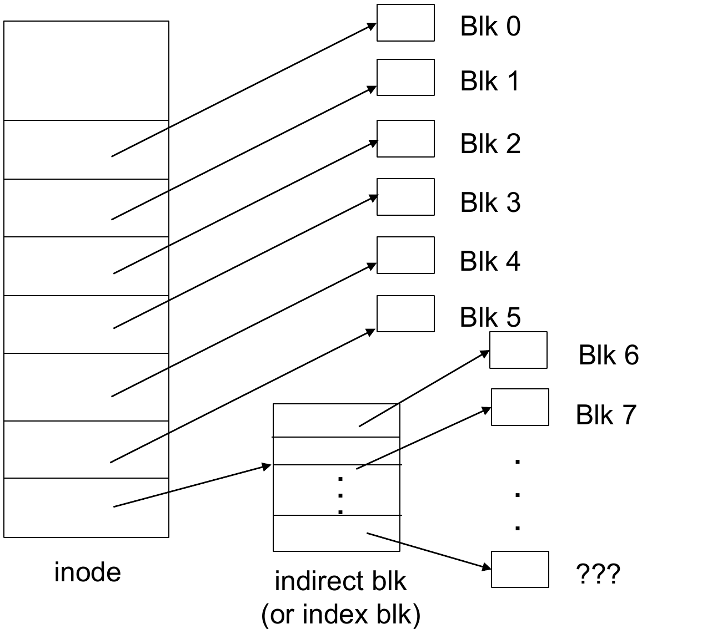{width=60%}

At `open`, a copy of the inode went into the system-wide open-file table, so the inode is in memory.

* **The lecture's case:** the current position is 5100, and the process reads 200 bytes. The bytes are 5100 to 5299. ⌊5100 / 1000⌋ = 5 and ⌊5299 / 1000⌋ = 5. So only logical block 5 is needed, from offset 100. Block 5 is direct (5 < 6). **1 disk read.**
* **Another case (own numbers):** position 2950, read 100 bytes. The bytes are 2950 to 3049. That is block 2 (bytes 2950 to 2999) and block 3 (bytes 3000 to 3049). Both are direct. **2 disk reads.**
* **Another case (own numbers):** position 6400, read 100 bytes. Only block 6 is needed. 6 ≥ 6, so it is entry 0 of the single-indirect block. Read the indirect block, then the data block. **2 disk reads.**

### 7.5 Finding a file from its path name
To open `/usr/ast/mbox`, the OS must find the inode of `mbox`. Each directory in the path is itself a file, with an inode and data blocks. So the OS repeats one step for each directory in the path: **read the directory's inode, to find its data block; read the data block, to find the next name.**

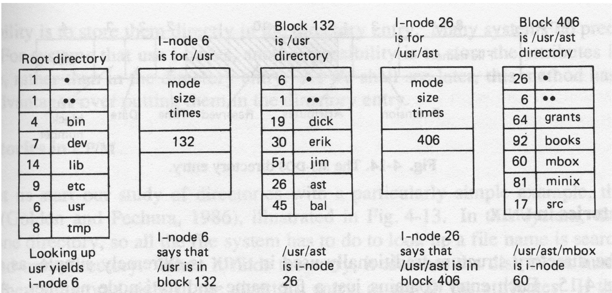

The lecture's example. The root directory is already in memory.

1. Search the root directory for `usr`. It gives **inode 6**. (No disk read: the root is in memory.)
2. Read **inode 6**. It says that the `/usr` directory is in **block 132**. (1 disk read.)
3. Read **block 132**. Search it for `ast`. It gives **inode 26**. (1 disk read.)
4. Read **inode 26**. It says that the `/usr/ast` directory is in **block 406**. (1 disk read.)
5. Read **block 406**. Search it for `mbox`. It gives **inode 60**. (1 disk read.)
6. Read **inode 60**, the inode of the file itself. (1 disk read.)

In total, 5 disk reads, if each directory fits in one block and nothing else is cached. **The general rule:** with the root in memory, each directory after the root costs 2 reads (its inode and its block), and the file costs 1 read (its inode). For a path with k names after the root, that is 2(k − 1) + 1 reads.

---

## 8. Disk-Space Management

### 8.1 Choosing the block size
The block size changes both speed and space:

* **Large blocks:** a file fits in few blocks, so the OS finds and transfers it quickly. But the last block of a file is usually not full, and the unused part is wasted (**internal fragmentation**). With large blocks, that waste is large.
* **Small blocks:** less waste in the last block. But a file needs many blocks, so reading it needs many separate transfers, and the **data rate** is low.

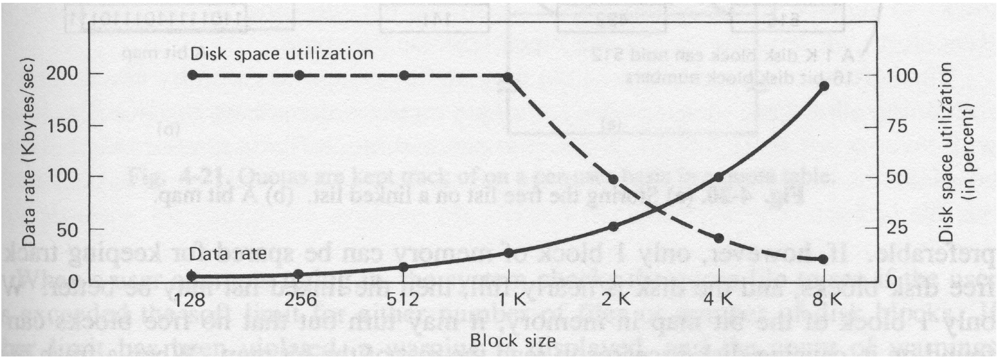{width=75%}

In the slide's graph, the solid line (data rate) rises with the block size, and the dashed line (disk space utilization) falls. No size is best for both, so the designer must choose a compromise between time and space.

### 8.2 Keeping track of free blocks
The OS must know which blocks are free, to give them to files. This is the same problem as keeping track of free memory with dynamic partitions (Lecture 7). The lecture gives two methods.

**Bit map (bit vector).** One bit for each block: **0 = free, 1 = allocated.**

* It uses extra space. **The lecture's example:** block size $2^9$ = 512 bytes, disk size $2^{34}$ bytes = 16 GB.
  1. Number of blocks = $2^{34} / 2^{9} = 2^{25}$.
  2. One bit for each block = $2^{25}$ bits.
  3. In bytes: $2^{25} / 8 = 2^{22}$ bytes = **4 MB**.
* The bit map is kept at a fixed place on the disk. The OS may copy it into memory to make it faster, but must write it back to the disk from time to time, for consistency and safety.
* Finding a free block is easy, but only fast if the **whole** map is in memory.

**Linked list.** Link all the free blocks together. Each free block holds a pointer to the next free block. The OS keeps a pointer to the first free block at a special place on the disk, and a copy in memory.

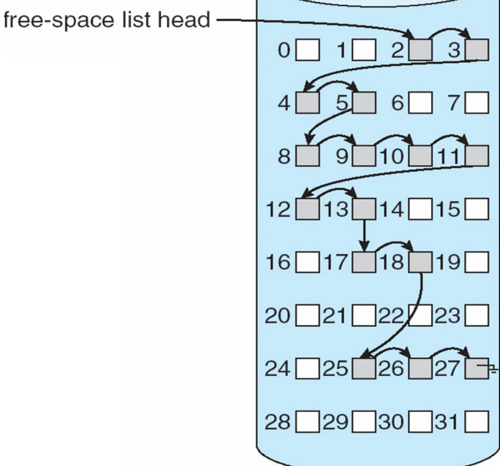{width=45%}

* **No extra space:** the pointers are stored inside the free blocks themselves.
* **Not efficient:** to find many free blocks, the OS must read each block from the disk to get the next pointer.

| | Bit map | Linked list |
|---|---|---|
| Extra space | One bit per block | None (pointers live in the free blocks) |
| Finding free blocks | Easy, if the map is in memory | Slow: follow the list on the disk |

## What You Know Now (Lecture 9)

* The file system turns disk blocks into named files. Its levels are the logical file system, the file-organisation module, the basic file system and I/O control.
* A directory entry holds the attributes, or a pointer to the file control block (FCB). In UNIX, an entry is a name and an inode number.
* Absolute path names start at the root; relative ones start at the current directory. In an acyclic graph, one file can have several path names.
* A symbolic link holds a path name and is resolved each time (slower). A hard link duplicates the file's information (faster). Deleting a shared file can leave dangling pointers.
* UNIX protection: r, w, x for owner, group and public, 9 bits, often written in octal (rwxr-x--x = 751). On a directory, x is needed to reach anything inside, r lists it, and w creates or deletes files in it.
* `open` copies the FCB into the system-wide open-file table (with an open count) and makes a per-process entry (with the current position pointer). It returns the index as the file descriptor.
* Every allocation method starts with logical address = Q × (data per block) + R. Contiguous: start + Q, 1 read, external fragmentation. Linked: the (Q + 1)th block of the chain, Q + 1 reads, offset R + 4. Indexed: entry Q of the index block, 2 reads.
* An inode has 12 direct pointers and single, double and triple indirect pointers. With P = block size / pointer size, the largest file is (12 + P + P² + P³) × block size.
* Large blocks transfer fast but waste space; small blocks save space but are slow. Free space is tracked with a bit map (1 bit per block) or a linked list (no extra space, slow).
