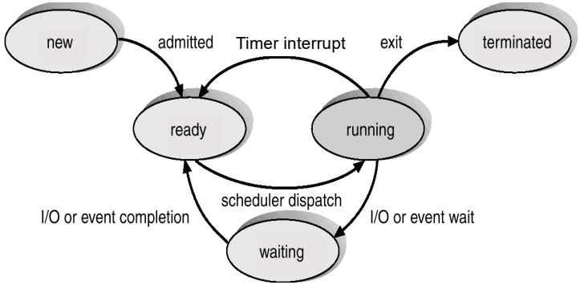
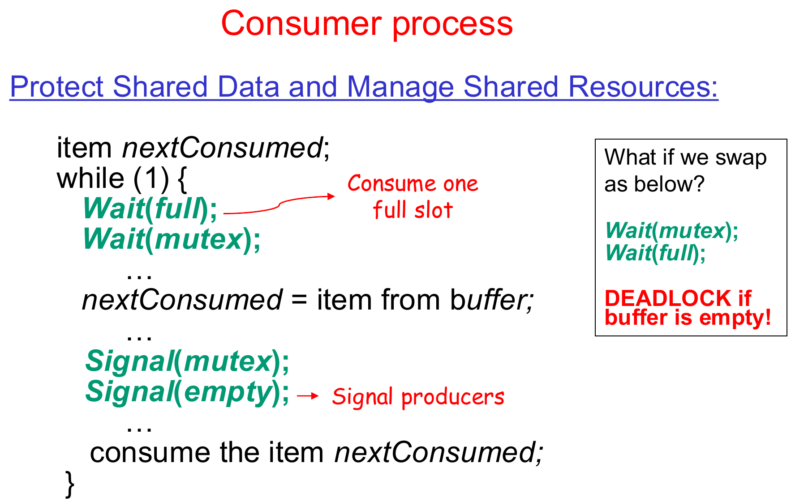

This was written entirely with AI.

## How to Use This Guide
Read the parts in order. Each section answers one question and adds one new idea. When a section needs a fact from an earlier section, it tells you the fact again. At the end of each part, a short list tells you what you know now.

## Part 0: Before You Start

### 1. What You Do in This Lab
In this lab, two or more programs use the same data at the same time. You stop them from damaging the data. You also make one program stop and wait until another program tells it to continue.

You do four tasks:

1. You read the **spinlock**. This is a lock that the xv6 kernel already has.
2. You read the kernel functions `sleep()` and `wakeup()`. They let a program wait without using the CPU.
3. You complete a **semaphore** in the kernel. A semaphore is a counter that programs use to take turns.
4. You use the semaphore in two test programs: a shared counter and a shared buffer.

### 2. Words You Need
This table gives the basic words. You do not need to remember it now. The guide explains each word again where it first uses it.

| Word | What it means in this lab |
|---|---|
| **xv6** | A small teaching operating system. It is similar to Unix. You change its source code in this lab. |
| **QEMU** | A program on your Linux computer that copies the behaviour of a RISC-V computer. xv6 runs inside QEMU. |
| **CPU** | The part of the computer that runs instructions. With `CPUS=3`, QEMU gives xv6 three CPUs. Three programs can then run at the same moment. |
| **Kernel** | The part of xv6 that controls the computer. It runs in **kernel mode**, which can access all memory. |
| **User program** | A normal program, for example `race_test`. It runs in **user mode**, which cannot access kernel memory. |
| **Process** | One user program while it runs. Each process has a number, the **PID**. |
| **System call** | A request from a user program to the kernel. The program stops, the kernel does the work, and then the program continues. |
| **Shared data** | Data that two or more processes can read and change. |
| **Critical section** | The lines of code that read or change shared data. Only one process at a time must run these lines. |
| **Race condition** | An error that occurs when two processes run a critical section at the same time. The result then depends on which process runs first. |

### 3. Process States in xv6
The kernel keeps a record for each process. One field in this record is the **state**. The state tells what the process does now.

| xv6 state | Lecture name | Meaning |
|---|---|---|
| `RUNNING` | Running | The process runs on a CPU now. |
| `RUNNABLE` | Ready | The process can run. It waits for a free CPU. |
| `SLEEPING` | Waiting | The process cannot run. It waits for an event. |



In xv6, "waiting" is `SLEEPING` and "ready" is `RUNNABLE`.

The **scheduler** is the kernel code that selects the next `RUNNABLE` process. It then makes that process `RUNNING`. You studied the scheduler in Lab 2.

### 4. Files in This Lab

| Part | File | What is in the file |
|---|---|---|
| 1 | `kernel/spinlock.h`, `kernel/spinlock.c` | The spinlock: `acquire()`, `release()`, `push_off()`, `pop_off()` |
| 1 | `kernel/proc.c` | Kernel `sleep()`, `wakeup()`, `sched()`, `yield()` |
| 2 | `kernel/semaphore.c` | The semaphore code. You complete three functions here. |
| 2 | `kernel/sysproc.c` | The system calls for the semaphore. They are already done. |
| 2 | `kernel/main.c` | Boot code. It calls `seminit()`, `ucnt_init()` and `ubuf_init()`. |
| 3 | `kernel/ucnt.c` | The shared counter |
| 4 | `kernel/ubuf.c` | The shared buffer |
| 2–4 | `user/race_test.c` | The test program. It has three tests. |

### 5. How to Start
* Use the `lab3` branch. Start xv6 with `make CPUS=3 qemu`.
* Use three CPUs. Then two processes can run at the same moment, and errors with shared data occur more often. (In Lab 2 you used one CPU. One CPU made the scheduling result easy to predict.)
* The program `race_test` runs three tests in this sequence: `sem_basic()`, `race_test()`, `producer_consumer()`. To run one test only, put the other two calls and the line that prints `ALL TESTS PASSED` in comments. Do not remove `exit(0)`.
* If a test stops and does not continue, press `Ctrl-a`, release the keys, then press `x`. This stops QEMU. Start QEMU again before you try again. A stopped test can leave semaphores and child processes behind.

### 6. How the Lab Is Checked
The lab has a **checkpoint** at the end of each part. At a checkpoint, a TA asks you to show the test result and to explain the code. You do not submit logs or AI chats.

The manual gives prompts for the course **Gemini Notebook**. The notebook contains the Lab 3 source code and the xv6 book. The manual tells you to use it in five steps:

1. Say what result you expect.
2. Ask the notebook a short question. Ask for file names, function names and line numbers.
3. Open those lines in the source code. Correct any claim from the notebook that does not agree with the `lab3` branch.
4. Build xv6 and run the test.
5. Explain the result with the code.

Do not ask the notebook to check your own code. If your code fails, give the notebook the exact error or output. Use its answer as a list of things to check.

### 7. Why the Shared Data Is in the Kernel
The function `fork()` makes a new process, the **child**. The child gets a **copy** of the memory of the first process, the **parent**.

Think about a counter that is a normal variable in `race_test.c`. After `fork()`, the parent has one copy and the child has a different copy. Each process adds to its own copy. The two processes do not share the counter.

For this reason, the lab puts the counter, the buffer and the semaphores in **kernel memory**. `fork()` does not copy kernel memory. So there is only one counter, one buffer and one table of semaphores. Each process uses them through system calls.

A semaphore has a number, the **semaphore ID** (`semid`). This number is the position of the semaphore in the kernel table. `fork()` copies the number into the child. In the child, the number still points to the same semaphore in the kernel.

```text
      Parent memory              Child memory (a copy)
      ┌──────────────────┐       ┌──────────────────┐
      │ int semid = 3    │       │ int semid = 3    │   <- fork() copies the number
      └────────┬─────────┘       └────────┬─────────┘
               │  sem_wait(3)             │  sem_wait(3)
               ▼  (system call)           ▼  (system call)
      ══════════════ kernel memory (fork() does not copy it) ═══════
               semaphores[3]   <- both processes use this one semaphore
               ucnt[0]         <- one counter
               ubuf            <- one buffer
```

---

## Part 1: Spinlocks, Sleep and Wakeup

### 1. The Problem: `counter++` Is Three Steps
Lecture 4 uses `counter++` as an example. This line looks like one step. But the CPU does it in three steps:

```text
1. Read:   copy counter from memory into a CPU register.
2. Add:    add 1 to the register.
3. Write:  copy the register back into counter in memory.
```

A **register** is a small storage place inside the CPU. Each CPU has its own registers.

Two processes A and B can do these steps at the same time. At the start, `counter` is 5:

| Time | Process A | Process B | `counter` in memory |
|---|---|---|---|
| 1 | reads 5 | | 5 |
| 2 | | reads 5 | 5 |
| 3 | adds 1, writes 6 | | 6 |
| 4 | | adds 1, writes 6 | 6 |

Both processes added 1. But `counter` went from 5 to 6, not to 7. B wrote over the result of A. This is a **race condition**. The three steps together are a **critical section**: only one process at a time must run them.

### 2. What a Correct Solution Must Do
A process puts code before and after the critical section:

* **Entry section:** the process asks for permission before the critical section.
* **Exit section:** the process gives back the permission after the critical section.

Lecture 4 (slides 4.12–4.13) gives three rules for a correct solution:

1. **Mutual exclusion:** only one process is in the critical section at a time.
2. **Progress:** if the critical section is free and a process wants to go in, the process must not wait forever.
3. **Bounded waiting:** other processes can go in first only a limited number of times.

### 3. A Lock, and the Simplest Lock That Fails
A **lock** is a variable that shows if the critical section is in use: 0 means free, 1 means in use. A process **acquires** (takes) the lock before the critical section. It **releases** (gives back) the lock after the critical section.

The first idea for "take the lock" is two separate steps:

```c
while(lk->locked != 0) ;   // check: wait until the lock is free
lk->locked = 1;            // set: take the lock
```

This code fails. At the start, `locked` is 0. CPU 0 and CPU 1 both run the code:

| Time | CPU 0 | CPU 1 | `locked` |
|---|---|---|---|
| 1 | reads `locked`: it is 0. Stops waiting. | | 0 |
| 2 | | reads `locked`: it is 0. Stops waiting. | 0 |
| 3 | writes `locked = 1` | | 1 |
| 4 | | writes `locked = 1` | 1 |
| 5 | **goes into the critical section** | **goes into the critical section** | 1 |

Both CPUs read 0 before either CPU wrote 1. Mutual exclusion fails.

**Remember the cause.** There is a **gap** between the check (time 1) and the set (time 3). The other CPU runs inside that gap. You will see the same type of gap again in section 10.

### 4. The Fix: One Instruction That Checks and Sets
RISC-V has an instruction, `amoswap`, that closes the gap. It does two things as **one step**:

1. It reads the old value of `locked`.
2. It writes 1 into `locked`.

"One step" means that no other CPU can read or write `locked` between part 1 and part 2. The word for this is **atomic**.

The instruction gives back the old value:

* If the old value is 0, the lock was free. This CPU now has the lock.
* If the old value is 1, another CPU has the lock. Writing 1 over 1 changes nothing. The CPU tries again.

In C, xv6 writes this instruction as `__sync_lock_test_and_set(&lk->locked, 1)`. Lecture 4 (slides 4.24–4.25) calls it `TestAndSet`. Lecture 4 also shows the same gap for a semaphore that waits in a loop (slide 4.31).

The xv6 spinlock is in `kernel/spinlock.h`:

```c
struct spinlock {
  uint locked;       // 0 = free, 1 = in use
  char *name;        // name of the lock, for error messages
  struct cpu *cpu;   // the CPU that has the lock
};
```

The function `acquire()` in `kernel/spinlock.c` takes the lock:

```c
void acquire(struct spinlock *lk) {
  push_off();                    // Step 1: stop interrupts on this CPU (section 5)
  if(holding(lk))
    panic("acquire");            // Step 2: this CPU has the lock already: error

  while(__sync_lock_test_and_set(&lk->locked, 1) != 0)
    ;                            // Step 3: check and set in one step; try again if in use

  __sync_synchronize();          // Step 4: memory fence (section 6)
  lk->cpu = mycpu();             // record which CPU has the lock
}
```

`panic()` prints a message and stops the whole kernel. The kernel calls it when it finds an error that it cannot repair.

The function `release()` does the opposite steps. It sets `locked` back to 0 and then calls `pop_off()`.

A CPU that waits for the lock runs the loop in step 3 again and again. This is **spinning**, and it gives the **spinlock** its name. While a CPU spins, it does no useful work.

### 5. A Second Danger: An Interrupt on the Same CPU
An **interrupt** is a signal from a device, for example the timer. When an interrupt comes, the CPU stops the code that it runs. It runs an **interrupt handler**, which is a short kernel function. After the handler, the CPU continues the code that it stopped.

Without step 1 of `acquire()`, this error can occur:

1. Kernel code on CPU 0 has lock `L`.
2. A timer interrupt comes on CPU 0. The interrupt handler also wants lock `L`.
3. The handler spins and waits for `L`.
4. The code that has `L` cannot continue, because the handler does not end. `L` never becomes free. CPU 0 stops forever.

`push_off()` stops interrupts **on this CPU only**. So no handler can start on CPU 0 while CPU 0 has a lock.

**Stopping interrupts does not stop another CPU.** Each CPU has its own interrupt setting. When CPU 0 stops its interrupts, CPU 1 continues to run. CPU 1 can still read and write the same memory. Only the `amoswap` instruction controls what two CPUs do together.

| What `acquire()` does | What it prevents | What it does not prevent |
|---|---|---|
| Stops interrupts on this CPU (`push_off`) | An interrupt handler on this CPU waits for a lock that this CPU has | Another CPU runs at the same time |
| Reads and writes `locked` in one step (`amoswap`) | Two CPUs both take the lock | — |

On a computer with **one** CPU, stopping interrupts is enough. With no interrupt, the kernel cannot change to a different process, so no other code can run. This is why the lecture slide for `TestAndSet` says "interrupt is disabled". On a computer with many CPUs, xv6 needs both protections.

`push_off()` and `pop_off()` count. Each `acquire()` adds 1 to a counter on the CPU, `noff`. Each `release()` subtracts 1. Interrupts start again only when `noff` is 0. If a CPU has two locks, interrupts start again only after it releases both locks.

### 6. The Memory Fence
A modern CPU and a compiler can change the sequence of memory reads and writes to make the program faster. `__sync_synchronize()` puts a **fence** instruction in the code. Reads and writes cannot move across the fence. So all the reads and writes of the critical section stay between `acquire()` and `release()`. Without the fence, another CPU could see the lock as free before it sees the new data.

### 7. When Spinning Wastes the CPU
A spinlock is good for a short wait, for example 10 instructions. Some waits are long.

Here is an example of a long wait. Process A wants to take one item from a shared count, `value`. But `value` is 0. A must wait until a different process B adds 1. B can take a long time. B is possibly not running yet.

If A spins, A uses a full CPU for the full wait, and does no work. The next sections show a better method: A **sleeps**.

### 8. Sleep: Give the CPU Away While You Wait
Think about a restaurant. You order food, but the food is not ready. You can stand at the counter and ask "Is it ready?" again and again. That is spinning. Or you can take a buzzer, sit down, and do something else. When the food is ready, the kitchen presses your buzzer. That is sleeping.

In xv6, A does the same:

1. A sees that `value` is 0.
2. A calls the kernel function `sleep()`. The kernel changes A from `RUNNING` to `SLEEPING`. Then the kernel gives the CPU to a different process.
3. Later, B adds 1 to `value`.
4. B calls the kernel function `wakeup()`. The kernel changes A from `SLEEPING` to `RUNNABLE`.
5. Later, the scheduler selects A, and A runs again.

While A is `SLEEPING`, A uses no CPU time.

**Do not mix up the two `sleep` functions.** xv6 has a different `sleep` for user programs:

| | User `sleep(ticks)` | Kernel `sleep(chan, lk)` |
|---|---|---|
| Who calls it | A user program (it is a system call) | Kernel code only |
| What it waits for | A number of timer ticks | An event: a value in kernel memory changes |
| What ends the wait | The time passes | A different process calls `wakeup(chan)` |

This guide always means the kernel `sleep()`.

### 9. How `wakeup()` Finds the Correct Process: the Channel
Many processes can sleep at the same time. Each one waits for a different event. `wakeup()` must wake only the processes that wait for **this** event.

In the restaurant, each buzzer has a number. The kitchen presses only your number. In xv6, the number is the **channel**, `chan`:

* `sleep(chan)` writes the channel into the record of the process: `p->chan = chan`.
* `wakeup(chan)` looks at every process. It wakes each process that is `SLEEPING` and has the same `chan`.

`chan` is only a label. It is a memory address, but the kernel never reads or writes the memory at that address. It only compares the addresses. Usually the label is the address of the object that the process waits for. Two different objects have two different addresses, so they have two different labels.

Here is a first, simple version of the two functions. It has no locks:

```c
// First version. It has a bug (section 10).
void sleep(void *chan) {
  struct proc *p = myproc();   // the process that calls sleep()
  p->chan = chan;              // write the label
  p->state = SLEEPING;         // RUNNING -> SLEEPING
  sched();                     // give the CPU to the scheduler; the process stops here
  p->chan = 0;                 // the process continues here after a wakeup
}

void wakeup(void *chan) {
  for(each process p)
    if(p->state == SLEEPING && p->chan == chan)
      p->state = RUNNABLE;     // SLEEPING -> RUNNABLE, not RUNNING
}
```

`sched()` saves the registers of the process and starts the scheduler. You studied it in Lab 2.

A and B use the two functions like this:

```c
// Process A (waits)                // Process B (gives)
while(value == 0)                   value = 1;
  sleep(&value);                    wakeup(&value);
value--;
```

### 10. The Bug: A Wakeup That Comes Too Early
A and B run at the same time, on two CPUs. At the start, `value` is 0:

| Time | Process A | Process B |
|---|---|---|
| 1 | checks `value`: it is 0. Decides to sleep. | |
| 2 | | sets `value = 1` |
| 3 | | calls `wakeup(&value)`. A is not `SLEEPING` yet. So `wakeup()` changes nothing. |
| 4 | sets `state = SLEEPING`. Calls `sched()`. | |
| 5 | sleeps forever. But `value` is 1. | |

B sent the wakeup at time 3. Nobody received it. The name for this is a **lost wakeup**.

In the restaurant, the kitchen presses your buzzer while you walk to your seat, before you switch the buzzer on. You then wait forever for food that is already on the counter.

**Find the cause.** It is the same type of gap as in section 3. There is a gap between A's check (time 1) and A's change to `SLEEPING` (time 4). B ran inside the gap.

**The goal:** B must not be able to change `value` and call `wakeup()` while A is inside the gap.

### 11. Close the Gap, Step 1: A Lock for the Value
Add a spinlock, `lk`, that protects `value`. The rule: every process holds `lk` while it reads or changes `value`.

```c
// Process A (waits)                // Process B (gives)
acquire(&lk);                       acquire(&lk);
while(value == 0)                   value = 1;
  sleep(&value, &lk);               wakeup(&value);
value--;                            release(&lk);
release(&lk);
```

Now A holds `lk` when it checks `value`. B cannot change `value` until A releases `lk`.

**A new problem.** A cannot keep `lk` while it sleeps. B needs `lk` to change `value` and to call `wakeup()`. If A sleeps with `lk`, B spins forever on `lk`. Then B never wakes A, and A sleeps forever. (Also, xv6 does not let a process keep `lk` when it gives up the CPU. Section 15 explains this.)

So `sleep()` must release `lk`. This is why `lk` is an argument of `sleep()`. But **when** can `sleep()` release it?

* If `sleep()` releases `lk` **before** A is `SLEEPING`, the gap opens again. B can run in it.
* A cannot release `lk` **after** it stops running.

So, from the view of `wakeup()`, "release `lk`" and "become `SLEEPING`" must be one step. xv6 does this with a second lock.

### 12. Close the Gap, Step 2: Pass From One Lock to the Other
Each process has its own spinlock, `p->lock`. It protects the `state` and `chan` of that process. `wakeup()` takes the `p->lock` of each process before it reads that process's state. So while A holds A's `p->lock`, `wakeup()` cannot look at A.

`sleep()` uses the two locks like a relay race, where one runner hands the baton to the next:

1. A takes `p->lock` **first**.
2. Then A releases `lk`.

So A **always holds at least one of the two locks**:

* While A holds `lk`, B cannot change `value`.
* While A holds `p->lock`, B's `wakeup()` cannot look at A.

Here is the same example again, with the two locks:

| Time | Process A | Process B |
|---|---|---|
| 1 | holds `lk`. Checks `value`: it is 0. Calls `sleep()`. | |
| 2 | takes `p->lock` | |
| 3 | releases `lk` | |
| 4 | | takes `lk`. Sets `value = 1`. Calls `wakeup()`. |
| 5 | | `wakeup()` tries to take A's `p->lock`. A holds it. B spins. |
| 6 | sets `chan`, sets `state = SLEEPING`, calls `sched()` | |
| 7 | the CPU leaves A. The scheduler releases A's `p->lock`. | |
| 8 | | `wakeup()` takes A's `p->lock`. Finds A `SLEEPING` with the same `chan`. Sets A to `RUNNABLE`. |

B's wakeup now arrives after A is `SLEEPING`. A receives it.

At time 7, A cannot release its own `p->lock`, because A stopped at `sched()`. The scheduler code releases it, after the CPU has fully left A.

There are only two possible cases for B:

* B takes `lk` **before** A's check. Then A sees `value == 1` and does not sleep.
* B takes `lk` **after** A releases it. Then `wakeup()` must wait for A's `p->lock`, and A holds that lock until A is `SLEEPING`. So `wakeup()` finds A.

#### The real code
Now read the real code in `kernel/proc.c`. Each line has a letter:

```c
void sleep(void *chan, struct spinlock *lk) {
  struct proc *p = myproc();     // the process that calls sleep()

  acquire(&p->lock);   // (a) take the process lock first
  release(lk);         // (b) then release the condition lock

  p->chan = chan;      // (c) write the label
  p->state = SLEEPING; //     RUNNING -> SLEEPING

  sched();             // (d) give the CPU to the scheduler; the process stops here

  // The process continues here after a wakeup, when the scheduler selects it again.
  p->chan = 0;         // (e) clear the label
  release(&p->lock);
  acquire(lk);         // (f) take the condition lock again before it returns
}

void wakeup(void *chan) {
  struct proc *p;
  for(p = proc; p < &proc[NPROC]; p++) {   // look at every process
    if(p != myproc()) {                    // skip the process that calls wakeup()
      acquire(&p->lock);
      if(p->state == SLEEPING && p->chan == chan)
        p->state = RUNNABLE;               // SLEEPING -> RUNNABLE, not RUNNING
      release(&p->lock);
    }
  }
}
```

The xv6 name for `lk` is the **condition lock**, because it protects the condition that the process checks (here, `value == 0`).

* Lines (a) and (b) are the relay: first take `p->lock`, then release `lk`.
* Line (d): the scheduler releases `p->lock` after it switches away from A.
* Line (e): when the scheduler selects A again, the scheduler takes A's `p->lock` first. So A continues here with `p->lock`, and A releases it.
* Line (f): A takes `lk` again. The caller's `while` loop checks `value` again after `sleep()` returns. It must hold `lk` for that check.

### 13. Why A Checks Again After It Wakes: `while`, Not `if`
`wakeup()` changes the state from `SLEEPING` to `RUNNABLE`. That is all it does:

* It does not run the process now. The scheduler runs the process later.
* It wakes **all** processes that sleep on that `chan`, not only one.
* It does not keep the resource for the process that it wakes.

So, when A runs again, a different process can already have taken the value. For this reason, code that calls `sleep()` always uses a `while` loop, not an `if`:

```c
acquire(lk);
while(the value is not correct)   // use WHILE, not IF
  sleep(chan, lk);
// Here: the value is correct, and this process has lk.
...
release(lk);
```

Part 2 shows an example with two sleeping processes.

### 14. The Full Path of States

| Event | Function | State change |
|---|---|---|
| The value is not correct. The process waits. | `sleep()` | `RUNNING` → `SLEEPING` |
| A different process changes the value | `wakeup()` | `SLEEPING` → `RUNNABLE` |
| The scheduler selects the process | `scheduler()` | `RUNNABLE` → `RUNNING` |

A process that leaves `SLEEPING` always goes to `RUNNABLE` (ready). It never goes directly to `RUNNING`.

### 15. A Process Must Not Keep a Spinlock When It Gives Up the CPU
`sched()` does this check:

```c
if(mycpu()->noff != 1)
  panic("sched locks");
```

`noff` is the number of spinlocks that this CPU holds (section 5). When a process gives up the CPU, it must hold **exactly one** spinlock: its own `p->lock`. Think about what occurs if it holds a different spinlock too:

* Interrupts stay off on that CPU.
* Any other process that needs that spinlock spins until the sleeping process runs again. That can take a very long time.

This is why `sleep()` releases `lk` before it calls `sched()`.

It is also the main difference between a spinlock and a semaphore. A process **can** keep a semaphore while it sleeps or gives up the CPU. A process **cannot** keep a spinlock at that time. Part 4 uses this fact.

### 16. Spin or Sleep: Which Costs Less? (Manual §1.3)
The manual asks which is cheaper: to spin or to sleep. There is no single correct number. You must give your assumptions.

**What sleeping costs.** The process takes `p->lock`, changes its state and switches to the scheduler. The scheduler selects a different process. Later, `wakeup()` looks at every process in the table. The scheduler selects the process again and switches back. This is at least two **context switches**. (A context switch saves the registers of one process and loads the registers of another.) Assume that all this costs a few thousand CPU cycles.

**What spinning costs.** One CPU does no useful work for the full wait.

| Wait time | Better choice | Reason |
|---|---|---|
| About 10 cycles | **Spin** | The wait ends before one sleep and wakeup could finish. Sleeping costs more than it saves. |
| About 10,000 cycles | **Sleep** | Spinning uses 10,000 cycles of a CPU. That is more than the cost of a sleep and a wakeup. A different process can use the CPU instead. |

Give these assumptions:

* Spinning helps only if the process that has the lock runs on **a different CPU**. On one CPU, that process cannot run while you spin. Then you waste all the spin cycles.
* The cost of a context switch is an assumption. It is not a measured xv6 value.
* Lecture 4 (slide 4.30) says the same thing. A lock that waits in a loop has no context switch cost. But it wastes CPU time if the critical section is long.

### What You Know Now (Part 1)

* `counter++` is three steps. Two processes can mix the steps and lose an update.
* A lock with a separate check and set fails, because the other CPU runs in the gap between them. `amoswap` checks and sets in one step.
* `acquire()` also stops interrupts on its own CPU. This does not stop other CPUs.
* For a long wait, a process sleeps. It writes a label (`chan`) and becomes `SLEEPING`. `wakeup(chan)` makes it `RUNNABLE`.
* A wakeup that comes between the check and the sleep never reaches the waiting process. `sleep()` prevents this: it takes `p->lock` before it releases `lk`.
* After a wakeup, the process checks again in a `while` loop.

---

## Part 2: The Semaphore

### 1. What a Semaphore Is
Think about the sign at a car park that shows the number of free spaces. A car waits at the gate if the number is 0. When a car goes in, the number goes down by 1. When a car leaves, the number goes up by 1, and a waiting car can go in.

Lecture 4 (slide 4.28) gives the same idea. A **semaphore** is an integer `S`. Processes change it only with two operations:

* **`Wait(S)`:** if `S` is more than 0, subtract 1 from `S`. If `S` is 0, wait.
* **`Signal(S)`:** add 1 to `S`. If a process waits, let it continue.

Each operation is one step (atomic).

There are two types:

* A **binary semaphore** has the value 0 or 1. It lets one process at a time into a critical section. Another name for it is **mutex** (from "mutual exclusion").
* A **counting semaphore** can have any value from 0 up. It counts how many items of a resource are free, for example empty places in a buffer.

### 2. The Semaphore Uses the Pattern From Part 1
In Part 1, process A waited until `value` was more than 0, and then took one. Process B added 1 and woke A. A semaphore does exactly this:

| Part 1 | xv6 semaphore |
|---|---|
| A's code: wait while `value == 0`, then `value--` | `sem_wait()` |
| B's code: `value = 1`, then `wakeup()` | `sem_signal()` |
| `value` | `sem->value` |
| The condition lock `lk` | `sem->lock` |
| The label `chan` | `sem` (the address of the semaphore) |

So, if you understand Part 1, you already understand most of the semaphore code.

### 3. The xv6 Semaphore Table (`kernel/semaphore.c`)

```c
#define MAX_SEMAPHORES 32

struct semaphore {
  struct spinlock lock;   // protects value
  int value;              // the count; it is never less than 0
  int in_use;             // 1 if a program has this semaphore, 0 if it is free
};

struct semaphore semaphores[MAX_SEMAPHORES];   // the table: 32 semaphores
struct spinlock sem_table_lock;                // protects in_use
```

The file has two types of lock. They protect different data:

* `sem_table_lock` protects the `in_use` fields. Only `sem_alloc()` and `sem_free()` use it.
* Each semaphore has its own `lock`. It protects the `value` of that semaphore. `sem_wait()`, `sem_signal()` and `sem_getvalue()` use it.

### 4. Three Functions With Similar Names

| Function | Where it is | When it runs | What it does |
|---|---|---|---|
| `seminit()` | `kernel/semaphore.c`. `kernel/main.c` calls it. | **One time, when xv6 starts** | Prepares the full table. Marks all 32 semaphores as free. Prepares each spinlock. |
| `sem_init(value)` | `user/user.h` | When a user program wants a semaphore | It is a system call. The kernel function `sys_sem_init()` receives it. |
| `sem_alloc(value)` | `kernel/semaphore.c` | `sys_sem_init()` calls it | Takes `sem_table_lock`. Finds the first free semaphore. Sets `in_use = 1` and sets `value`. Gives back the position in the table. Gives back -1 if all 32 are in use. |

### 5. How a Call Gets to the Kernel
You did this in Lab 1. The path for `sem_init(1)` is:

```text
User program calls sem_init(1)
  │  user/usys.pl makes a short function for each system call:
  │      li a7, SYS_sem_init     put the system call number in register a7
  │      ecall                   go into the kernel
  ▼
Kernel: usertrap() → syscall()   reads a7 and finds the correct function
  ▼
kernel/sysproc.c: sys_sem_init()       reads the argument with argint()
  ▼
kernel/semaphore.c: sem_alloc(value)   the result goes back to the user program
```

The functions in `sysproc.c` only read the arguments and call the kernel function. All the semaphore logic is in `semaphore.c`.

### 6. The Code You Complete
Each function first checks the semaphore ID. Then it does the Part 1 pattern.

```c
int sem_wait(int semid) {
  if(semid < 0 || semid >= MAX_SEMAPHORES || !semaphores[semid].in_use)
    return -1;                      // incorrect ID: error

  struct semaphore *sem = &semaphores[semid];

  acquire(&sem->lock);
  while(sem->value == 0)            // check again after each wakeup
    sleep(sem, &sem->lock);         // label = sem; condition lock = sem->lock
  sem->value--;                     // here value > 0, and we have the lock
  release(&sem->lock);
  return 0;
}

int sem_signal(int semid) {
  if(semid < 0 || semid >= MAX_SEMAPHORES || !semaphores[semid].in_use)
    return -1;

  struct semaphore *sem = &semaphores[semid];

  acquire(&sem->lock);
  sem->value++;
  wakeup(sem);                      // the same label as in sem_wait()
  release(&sem->lock);
  return 0;
}

int sem_getvalue(int semid) {
  if(semid < 0 || semid >= MAX_SEMAPHORES || !semaphores[semid].in_use)
    return -1;

  struct semaphore *sem = &semaphores[semid];
  int v;

  acquire(&sem->lock);
  v = sem->value;
  release(&sem->lock);
  return v;
}
```

#### Which lock and which label
* **Condition lock:** `sem->lock`, the spinlock of this one semaphore. Do not use `sem_table_lock`. That lock is for the `in_use` fields, not for `value`.
* **Label (`chan`):** `sem`, the address of the semaphore. `sem_wait()` sleeps with this label. `sem_signal()` wakes this label. Each semaphore has a different address. So a signal on semaphore 3 does not wake a process that waits on semaphore 5.
* `sem_signal()` changes `value` and calls `wakeup()` **while it holds `sem->lock`**. This is B's side of the rule in Part 1, section 11.

#### Why `sem_getvalue()` also takes the lock
Another CPU can change `value` at the same time. With the lock, you read a value that was correct at one moment. Without the lock, you can read a value from the middle of a change.

### 7. An Example: Why `sem_wait()` Uses `while`
A semaphore has `value = 0`. Processes A and B sleep on it.

1. Process P calls `sem_signal()`. Now `value = 1`. `wakeup(sem)` makes **both** A and B `RUNNABLE`.
2. A runs first. It takes `sem->lock`. It sees `value == 1`. It subtracts 1, so `value` is 0. A continues.
3. B runs. It takes `sem->lock`.
   * With `if`: B does not check again. It subtracts 1, so `value` is -1. B goes into the critical section with A. This is an error.
   * With `while`: B checks again. It sees `value == 0`. It sleeps again. This is correct.

The same problem can occur with only one sleeping process. A third process C, which never slept, can call `sem_wait()` before A runs. Then C takes the value first.

### 8. The Lecture Semaphore and the xv6 Semaphore

| | Lecture 4 semaphore (slides 4.32–4.34) | xv6 Lab 3 semaphore |
|---|---|---|
| Wait | `value--; if (value < 0) block();` | `while (value == 0) sleep(); value--;` |
| Signal | `value++; if (value <= 0) wakeup(P);` | `value++; wakeup(sem);` |
| Can `value` be less than 0? | Yes. -2 means that 2 processes wait. | **No.** 0 means "nothing is free". |
| List of waiting processes | The semaphore has a list `L` of processes | No list. The waiting processes are all processes in the process table with `state == SLEEPING` and `chan == sem`. |
| How many processes wake up | **One** process from the list | **All** processes that sleep on that label |
| After a process wakes up | It continues. The semaphore kept the value for it. | It must **check again**. Nobody kept the value for it. |
| What makes Wait and Signal one step | The lecture says "they must be atomic" | `sem->lock`, a spinlock |

The manual says: **do not mix the two designs.** For example, `sem_wait()` must not make `value` less than 0 when `sem_signal()` uses the `while` design. If you mix them, the value has no clear meaning.

**A difference to remember.** Lecture slide 4.36 says: do not subtract 1 at the end of `Wait`. But xv6 subtracts 1 at the end. Why is xv6 correct?

* The lecture's incorrect version is `if (value <= 0) block(); value--;`. After the process wakes, it subtracts 1 and does not check again. Another process can take the same value first. Then both processes go in.
* xv6 checks with a `while` loop. It also checks and subtracts while it holds `sem->lock`. So the value cannot change between the check and the subtraction.

To subtract 1 at the end is correct **only** when the process checks again while it holds the lock.

### 9. What the xv6 Semaphore Does Not Promise
Part 1 gave three rules for a correct critical section. The xv6 semaphore gives the first two rules. It does **not** give the third rule, **bounded waiting**:

* `wakeup()` makes all sleeping processes `RUNNABLE`. The process that the scheduler runs first takes the value. The process that waited longest does not always go first.
* A process that never slept can call `sem_wait()` and take the value before the processes that `wakeup()` woke.
* So, in theory, one process can lose every time and wait forever. This is **starvation**.

Lecture 4 shows the same problem twice. Slide 4.27 shows that a `TestAndSet` lock does not give bounded waiting. Slide 4.41 shows that the sequence in which a semaphore wakes processes can cause starvation (for example, priority order or last-in-first-out). The lecture's list `L` can be a first-in-first-out queue, and then each waiting process goes in turn. xv6 has no such list.

The lab tests do not check bounded waiting.

### 10. The Basic Test: `sem_basic()`

```c
int semid = sem_init(1);            // value 1
T_ASSERT(sem_getvalue(semid) == 1);
sem_wait(semid);                    // 1 -> 0. The process does not wait.
T_ASSERT(sem_getvalue(semid) == 0);
sem_signal(semid);                  // 0 -> 1. No process sleeps, so no wakeup.
T_ASSERT(sem_getvalue(semid) == 1);
sem_free(semid);
```

`T_ASSERT(x)` stops the test with an error message if `x` is false.

If the test passes, it prints: `[sem_basic] PASS: Basic semaphore operations work.`

At the start of the lab, `sem_getvalue()` always gives -1. So the first `T_ASSERT` fails until you complete `sem_getvalue()`.

The values go **1 → 0 → 1**. This test **does not** check these items:

* A `sem_wait()` that must sleep. The value is never 0 when the test calls `sem_wait()`.
* A `wakeup()` that wakes a sleeping process, and the check after the wakeup.
* Two or more processes, or two or more CPUs.
* What occurs when all 32 semaphores are in use (`sem_init` gives -1).

The test does not show the sleeping part. You must explain it from your code.

### 11. When Can You Free a Semaphore?
`sem_free()` only sets `in_use = 0`. It does **not** wake sleeping processes. It does **not** wait until other processes stop using the semaphore.

If you free a semaphore too early:

* A process that sleeps on it sleeps forever. No process will signal a free semaphore.
* A process that still has the old `semid` gets -1 from each semaphore call. Or, a new `sem_init()` takes the same position in the table. Then the old process uses the wrong semaphore and does not know it.

The rule: **make the semaphore before `fork()`. Free it only after all processes that use it have stopped.** The parent knows that a child has stopped when `wait()` for that child returns.

### What You Know Now (Part 2)

* A semaphore is a count. `sem_wait()` waits while the count is 0 and then subtracts 1. `sem_signal()` adds 1 and wakes the waiting processes.
* `sem_wait()` is the waiting side of the Part 1 pattern. `sem_signal()` is the giving side. The lock is `sem->lock`, and the label is `sem`.
* The xv6 value is never less than 0. The lecture value can be less than 0.
* The xv6 semaphore does not give bounded waiting.
* Make a semaphore before `fork()`. Free it after `wait()`.

---

## Part 3: The Shared Counter

### 1. The Code You Get

```c
// kernel/ucnt.c (kernel memory, so all processes use the same counter)
int ucnt[16];
void ucnt_set(int idx, int val) { ucnt[idx] = val; }   // write
int  ucnt_get(int idx)          { return ucnt[idx]; }  // read

// user/race_test.c
int N = 1000;
void do_work(int pid, int semid) {
  for (int i = 0; i < N; i++) {
    int val = ucnt_get(0);     // system call 1: read the counter
    ucnt_set(0, val + 1);      // system call 2: write the counter
  }
}
```

`race_test()` sets counter 0 to 0. It calls `fork()` one time. Then the parent and the child both run `do_work()`. Each process adds 1 to the counter 1,000 times. The correct result is 2 × 1,000 = **2,000**.

### 2. The Lost Update
To add 1, `do_work()` reads and then writes. These are two different system calls. The kernel does not hold a lock between them. With `CPUS=3`, the parent and the child run at the same time:

| Time | Parent | Child | `ucnt[0]` |
|---|---|---|---|
| 1 | `val = ucnt_get(0)` gives 41 | | 41 |
| 2 | | `val = ucnt_get(0)` gives 41 | 41 |
| 3 | `ucnt_set(0, 42)` | | 42 |
| 4 | | `ucnt_set(0, 42)` | 42 |

Two processes added 1. But the counter went up by 1 only. The child wrote over the parent's update. This is the `counter++` problem from Part 1. After 2,000 additions, the result is often less than 2,000.

**A system call is not a lock.** `ucnt_get()` and `ucnt_set()` do not use a lock. Also, if each function used a lock, the lock would be free between the two calls.

**The error can also occur with one CPU.** The parent can call `ucnt_get()`, and then a timer interrupt can stop it before `ucnt_set()`. The scheduler then runs the child, which reads the same old value. With one CPU, the steps take turns. With three CPUs, the steps can also occur at the same moment. Both cases lose updates.

**One correct result does not show that the code is correct.** The error occurs only when the steps occur in a bad sequence. If one run prints 2,000, that bad sequence did not occur in that run. It can occur in the next run.

### 3. The Correction

```c
void do_work(int pid, int semid) {
  for (int i = 0; i < N; i++) {
    T_ASSERT(sem_wait(semid) == 0);    // entry section
    int val = ucnt_get(0);             // ┐ critical section:
    ucnt_set(0, val + 1);              // ┘ the read AND the write
    T_ASSERT(sem_signal(semid) == 0);  // exit section
  }
}

void race_test() {
  ucnt_set(0, 0);
  int semid = sem_init(1);             // binary semaphore (mutex)
  T_ASSERT(semid >= 0);                // -1 means no free semaphore

  int pid = fork();                    // AFTER sem_init(): both processes have semid
  ...
  // parent: do_work(); then wait(0); then check that the counter is 2*N
  sem_free(semid);                     // after wait(): the child has stopped
}
```

This follows Lecture 4, slide 4.38, step 2: find the critical section, use a binary semaphore, put `Wait` before it and `Signal` after it.

### 4. Which Start Value to Use

| Start value | Result |
|---|---|
| **1** | Correct. The first `sem_wait()` makes it 0. The other process sleeps until `sem_signal()`. |
| 0 | Both processes sleep at their first `sem_wait()`. No process signals. They wait forever. This is a **deadlock**. |
| 2 or more | Both processes can go into the critical section at the same time. Updates are still lost. |

### 5. Why You Cannot Protect Each Call Separately

```c
sem_wait(s); val = ucnt_get(0);     sem_signal(s);   // read, protected
sem_wait(s); ucnt_set(0, val + 1);  sem_signal(s);   // write, protected
```

Each call now runs alone. But between the first `sem_signal()` and the second `sem_wait()`, the other process can read the same old value. The table in section 2 can still occur. The write uses the value from the read, so the read and the write together are the critical section.

### 6. Why the Parent Calls `wait()` Before It Checks and Frees
* **Before it checks the counter:** the child can still be adding. If the parent reads too early, it sees less than 2,000, even with correct locks.
* **Before it frees the semaphore:** the child can still call `sem_wait()` and `sem_signal()`. After the free, those calls give -1, and the `T_ASSERT` in the child fails.

If the test passes, it prints:
`[race_test] final counter=2000 (expected 2000)` and `[race_test] PASS: consistent counter`.

### 7. What the Correction Costs
Each loop now does four system calls, not two. Also, only one process at a time does the read and write. The two processes no longer do this work at the same time. You pay for a correct result with speed.

### What You Know Now (Part 3)

* The read and the write are two system calls. The other process can run between them and lose an update.
* The fix puts `sem_wait()` before the read and `sem_signal()` after the write. The semaphore starts at 1.
* The parent calls `wait()` before it checks the counter and before it frees the semaphore.
* One correct run does not show that the code is correct.

---

## Part 4: Producers and a Consumer

### 1. What a Bounded Buffer Is
A **buffer** is an area of memory that keeps items until a process uses them. A **bounded** buffer has a fixed number of places.

* A **producer** is a process that puts items into the buffer.
* A **consumer** is a process that takes items out of the buffer.

This lab uses a **circular** buffer. When an index gets to the end, it goes back to place 0.

### 2. The Buffer You Get (`kernel/ubuf.c`)

```c
#define UBUF_SIZE 16

// buffer writes to head and read from tail    <- THIS COMMENT IS INCORRECT
struct ubuf {
  char data[UBUF_SIZE];   // 16 places, one character each
  int head;               // in the code: the next place to READ
  int tail;               // in the code: the next place to WRITE
};

char ubuf_read(void) {
  char data = ubuf.data[ubuf.head];        // 1. read the place
  yield();                                 // 2. give up the CPU on purpose
  ubuf.head = (ubuf.head + 1) % UBUF_SIZE; // 3. move to the next place
  return data;
}

void ubuf_write(char val) {
  ubuf.data[ubuf.tail] = val;              // 1. write the place
  yield();                                 // 2. give up the CPU on purpose
  ubuf.tail = (ubuf.tail + 1) % UBUF_SIZE; // 3. move to the next place
}
```

`% UBUF_SIZE` gives the remainder after division by 16. So after place 15, the index goes back to 0.

Remember these three facts:

1. **The comment above `struct ubuf` is incorrect.** Use the function code. `ubuf_read()` uses `head`. `ubuf_write()` uses `tail`.
2. **The functions do not check if the buffer is empty or full.** A read from an empty buffer gives old data. A write into a full buffer writes over data that nobody has read. The code that calls these functions must prevent this.
3. **`yield()` is between step 1 and step 3.** `yield()` changes the process from `RUNNING` to `RUNNABLE` and lets another process run. So another process can run in the middle of a read or a write. (The process is in the kernel at this time, because `ubuf_read()` and `ubuf_write()` run inside a system call.) The `yield()` makes a protection error occur quickly. Without it, the error could occur only one time in a million runs.

**An example of the error, with two producers and no protection:**

| Time | Producer A | Producer B | Result |
|---|---|---|---|
| 1 | writes `'c'` into `data[5]` (tail is 5). Calls `yield()`. | | place 5 = `'c'` |
| 2 | | writes `'f'` into `data[5]` (tail is still 5). Calls `yield()`. | place 5 = `'f'`. B wrote over the `'c'`. |
| 3 | sets `tail = 6` | | |
| 4 | | sets `tail = 7` | Nobody wrote place 6. It has **old data**. |

### 3. The Test (`producer_consumer()`)
* **Two child processes are producers.** Each sends the 48 characters of `msg = "cafeface…cafe"`. It does not send the `'\0'` at the end of the string.
* **The parent is the consumer.** It reads `MSG_SIZE * NUM_PROD` = 48 × 2 = **96** characters.
* The buffer has only 16 places. So the producers often must wait for an empty place, and the consumer often must wait for a character.

### 4. Two Questions Before Each Buffer Call
Before a process calls `ubuf_write()` or `ubuf_read()`, it must answer two different questions.

**Question 1: is there something for me?** A producer needs an empty place. The consumer needs a full place. Lecture 4 (slides 4.38 and 4.43) calls these **shared resources**. A counting semaphore answers this question. Its start value is the number of items of that resource at the start.

**Question 2: is any other process using `head`, `tail` or `data` now?** Only one process at a time must change them. Lecture 4 calls this **shared data**. A binary semaphore, `mutex`, answers this question. Its start value is 1.

### 5. The Three Semaphores and Their Start Values
At the start, the buffer is **empty**. It has `UBUF_SIZE` = 16 places.

| Semaphore | What it counts | Start value | Who waits on it | Who signals it |
|---|---|---|---|---|
| `empty` | Empty places that a producer can fill | **16** | Producer, before it writes | Consumer, after it reads |
| `full` | Full places that the consumer can read | **0** | Consumer, before it reads | Producer, after it writes |
| `mutex` | Permission to use `head`, `tail` and `data` | **1** | Both, before the buffer call | Both, after the buffer call |

When no process is in the middle of an operation, `empty + full = 16`.

In the lecture, the producer index is `in` and the consumer index is `out`. Here `in` is `tail` and `out` is `head`. The lecture's `counter` variable is not necessary. `full` and `empty` already show how many items are in the buffer.

**Why `full` starts at 0.** Lecture 4 (slide 4.39) shows a second use of a semaphore: to make one process wait until another process has done something. The semaphore starts at 0. Process B calls `Wait` and sleeps. Process A does its work and then calls `Signal`. Only then can B continue. `full` works in the same way. The consumer cannot read until a producer has written and called `sem_signal(full)`.

### 6. The Sequence of Calls

```c
struct buf_sem {
  int empty;    // semaphore ID: empty places
  int full;     // semaphore ID: full places
  int mutex;    // semaphore ID: only one process uses the buffer at a time
};

void producer(const char* msg, struct buf_sem b) {
  for (const char* p = msg; *p != '\0'; p++) {
    T_ASSERT(sem_wait(b.empty) == 0);    // 1. get an empty place (sleep if the buffer is full)
    T_ASSERT(sem_wait(b.mutex) == 0);    // 2. get permission to use the buffer
    ubuf_write(*p);                      // 3. critical section
    T_ASSERT(sem_signal(b.mutex) == 0);  // 4. give back the permission
    T_ASSERT(sem_signal(b.full) == 0);   // 5. tell the consumer: one more full place
  }
}

void consumer(struct buf_sem b, int loops, int valid[]) {
  char tmp;
  for (int i = 0; i < loops; i++) {
    T_ASSERT(sem_wait(b.full) == 0);     // 1. get a full place (sleep if the buffer is empty)
    T_ASSERT(sem_wait(b.mutex) == 0);    // 2. get permission to use the buffer
    tmp = ubuf_read();                   // 3. critical section
    T_ASSERT(sem_signal(b.mutex) == 0);  // 4. give back the permission
    T_ASSERT(sem_signal(b.empty) == 0);  // 5. tell the producers: one more empty place
    T_ASSERT(valid[(unsigned char)tmp]);
  }
}

void producer_consumer() {
  ...
  struct buf_sem b;
  b.empty = sem_init(UBUF_SIZE);  T_ASSERT(b.empty >= 0);
  b.full  = sem_init(0);          T_ASSERT(b.full  >= 0);
  b.mutex = sem_init(1);          T_ASSERT(b.mutex >= 0);

  for (int i = 0; i < NUM_PROD; i++) { /* fork() the two producers */ }

  consumer(b, MSG_SIZE * NUM_PROD, valid);
  for (int i = 0; i < NUM_PROD; i++) wait(0);    // wait for both producers to stop
  printf("[producer_consumer] PASS: message delivered\n");
  sem_free(b.empty); sem_free(b.full); sem_free(b.mutex);   // only now
}
```

Each child gets a **copy** of `struct buf_sem`. This is correct, for the same reason as in Part 3: the struct holds only semaphore IDs. Each ID points to a semaphore in the kernel.

### 7. One Character, Step by Step
At the start: `empty = 16`, `full = 0`, `mutex = 1`, `head = tail = 0`.

| Step | Process | Call | `empty` | `full` | `mutex` | Buffer |
|----|----------|----------------------------|-------|------|-------|------------------|
| 1 | Producer | `sem_wait(empty)` | 15 | 0 | 1 | |
| 2 | Producer | `sem_wait(mutex)` | 15 | 0 | 0 | |
| 3 | Producer | `ubuf_write('c')`. It calls `yield()` in the middle. Other processes cannot get `mutex`. | 15 | 0 | 0 | `data[0]='c'`, `tail=1` |
| 4 | Producer | `sem_signal(mutex)` | 15 | 0 | 1 | |
| 5 | Producer | `sem_signal(full)`. If the consumer sleeps, this wakes it. | 15 | 1 | 1 | |
| 6 | Consumer | `sem_wait(full)` | 15 | 0 | 1 | |
| 7 | Consumer | `sem_wait(mutex)` | 15 | 0 | 0 | |
| 8 | Consumer | `ubuf_read()` gives `'c'` | 15 | 0 | 0 | `head=1` |
| 9 | Consumer | `sem_signal(mutex)` | 15 | 0 | 1 | |
| 10 | Consumer | `sem_signal(empty)` | 16 | 0 | 1 | |

Look at step 3. The producer calls `yield()` while `mutex` is 0. If another process gets to `sem_wait(mutex)` now, it **sleeps** until step 4. So the `yield()` shows that `mutex` protects the full read or write.

This is also why `mutex` must be a **semaphore** and not a spinlock. The producer keeps `mutex` while it gives up the CPU. Part 1, section 15 showed that a process cannot keep a spinlock at that time (`panic("sched locks")`).

### 8. Why `empty` and `full` Alone Do Not Protect the Indexes
`empty` and `full` answer only Question 1: is there a place for me? They do not answer Question 2: is another process using `tail` now?

At the start, `empty = 16`. **Both producers** pass `sem_wait(empty)` immediately. Without `mutex`, both producers then write `data[tail]` before either producer moves `tail`. This is the error in the table in section 2. A counting semaphore controls **how many** processes continue. It does not make the change of an index one step.

**A special case.** With only **one** producer and **one** consumer, `full` and `empty` keep them on different places. The producer uses only `tail`, and the consumer uses only `head`. In this lab, `mutex` is necessary because **two producers** use `tail`. One `mutex` also makes the consumer wait for the producers. That is more protection than necessary, but it is simple and correct.

### 9. Why the Sequence of the Two Waits Is Important (Deadlock)
A **deadlock** occurs when two or more processes wait forever for each other.



The slide shows the correct sequence: `Wait(full)` first, then `Wait(mutex)`. If you change the two waits, a deadlock occurs when the buffer is empty.

**Incorrect consumer:** `sem_wait(mutex)` first, then `sem_wait(full)`.

1. The buffer is empty, so `full = 0`.
2. The consumer gets `mutex`, so `mutex = 0`. Then it sleeps at `sem_wait(full)`. It **still has `mutex`**.
3. A producer gets to `sem_wait(mutex)`. It sleeps, because the consumer has `mutex`.
4. Only a producer can signal `full`. Only the consumer can give back `mutex`. Neither event can occur. All processes wait forever.

**Incorrect producer** is the same. When the buffer is full (`empty = 0`), a producer that has `mutex` sleeps at `sem_wait(empty)`. The consumer cannot get `mutex` to empty a place.

Lecture 5 gives four conditions for a deadlock. All four are true here:

1. **Mutual exclusion:** only one process can have `mutex`.
2. **Hold and wait:** the consumer has `mutex` and waits for `full`.
3. **No preemption:** the kernel cannot take `mutex` away from the consumer.
4. **Circular wait:** the consumer waits for a producer, and the producer waits for the consumer.

The rule: **first wait for the resource (`empty` or `full`), then wait for `mutex`.** Never sleep for a resource while you have `mutex`.

The sequence of the two **signals** cannot cause a deadlock, because `sem_signal()` never sleeps. If you release `mutex` first, the next process can only start a little sooner.

### 10. What the Test Shows and What It Does Not Show
The consumer checks only `valid[(unsigned char)tmp]`. This checks that each character is one of `c`, `a`, `f`, `e`. These are the characters in `msg`.

| The test shows | The test does **not** show |
|---|---|
| All 96 reads finished, and the processes did not wait forever in this run | That no character was **lost**. If `'f'` writes over `'c'`, the result is still a correct character. |
| Each character that the consumer read is a character from `msg` | That the consumer did not read a character **two times** |
| Both producers stopped, and the parent waited for them | The **sequence** of the characters |
| | That the code is correct in other runs. One run shows one sequence of events. |

Use the PASS message **and** your explanation of the counts, the mutex and the sequence of calls. Do not say that the test alone shows that the buffer is correct.

### 11. When the Test Stops and Does Not Continue: `Ctrl-p`
Press `Ctrl-p` in the xv6 console. xv6 prints each process: its PID, its state (`run`, `runble`, `sleep`) and its name.

If all `race_test` processes show `sleep`, there is a deadlock. Each process sleeps in `sem_wait()` on a semaphore that no process will signal. Usual causes:

* The two waits are in the wrong sequence.
* A start value is wrong, for example `full = 16` or `empty = 0`.
* A `sem_signal()` is missing.

Free the three semaphores only **after** the consumer loop ends **and** after `wait()` returns for both producers.

### What You Know Now (Part 4)

* Each process answers two questions before a buffer call. `empty` or `full` answers "is there something for me?". `mutex` answers "is the buffer free?".
* Start values: `empty = 16`, `full = 0`, `mutex = 1`.
* Wait for `empty` or `full` first, then for `mutex`. The other sequence causes a deadlock.
* `mutex` must be a semaphore, because the producer keeps it across `yield()`.
* The test checks only that each character is valid.

---

## Summary: Three Tools Side by Side

| | Spinlock | Kernel `sleep` / `wakeup` | xv6 semaphore |
|---|---|---|---|
| Where it is | Kernel | Kernel | Kernel. User programs use it through system calls. |
| What a waiting process does | Runs in a loop (spins) | Sleeps (`SLEEPING`) | Sleeps (it uses `sleep()`) |
| What it is made from | `amoswap` instruction, and interrupts stopped | `p->lock`, `sched()` | A spinlock and `sleep()` / `wakeup()` |
| Can a process keep it while it gives up the CPU? | **No** (`panic("sched locks")`) | — | **Yes**. It is only a count. |
| Good for | Very short critical sections | Waiting for a value to change | One process at a time, and counting resources |
| Use in this lab | Protects `sem->value` | Makes `sem_wait()` sleep | The counter mutex; `empty`, `full` and `mutex` |

---

## Lab 3 Self-Check & Quiz Traps

1. **Why can a separate read and write not replace the test-and-set in `acquire()`?**
   Two CPUs can both read `locked == 0` before either CPU writes 1. Then both take the lock. `amoswap` reads the old value and writes 1 in one step. So only one CPU can read 0.
2. **True or false: on a computer with many CPUs, it is enough to stop interrupts to protect a critical section.**
   False. Each CPU has its own interrupt setting. Another CPU continues to run and uses the same memory. xv6 stops interrupts to prevent a deadlock with an interrupt handler on the same CPU. It uses `amoswap` to control the other CPUs.
3. **What is `chan` in kernel `sleep()`?**
   A memory address that the kernel uses as a label for the event. `wakeup(chan)` changes every process with `state == SLEEPING` and `p->chan == chan` to `RUNNABLE`. It is not a list and it holds no data.
4. **Why does `sleep()` take `p->lock` before it releases `lk`?**
   To prevent a lost wakeup. The process that changes the value needs `lk`. `wakeup()` needs `p->lock` to look at the sleeping process. The waiting process always holds one of the two locks. So the wakeup cannot occur between the check and the sleep.
5. **When `wakeup()` finds a process, what state does the process go to?**
   `RUNNABLE` (ready). It does not go to `RUNNING`. The scheduler runs it later.
6. **Why must `sem_wait()` use `while (value == 0)` and not `if`?**
   `wakeup()` wakes all processes on that label and keeps nothing for them. Another process can take the value first. So the process must check again, while it holds `sem->lock`, before it subtracts 1.
7. **What is the difference between `seminit()`, `sem_init()` and `sem_alloc()`?**
   `seminit()` prepares the full table one time when xv6 starts. `sem_init(value)` is the system call that a user program uses. `sem_alloc(value)` is the kernel function that `sys_sem_init()` calls to get a free semaphore and set its value.
8. **Which lock does `sem_wait()` give to `sleep()`?**
   `sem->lock`, the spinlock that protects `value`. Not `sem_table_lock`, which protects only `in_use`.
9. **In the lecture semaphore, what does `S.value = -2` mean? Can the lab semaphore be -2?**
   Two processes wait in list `L`. The lab semaphore is never less than 0. It sleeps while the value is 0 and subtracts 1 only when the value is more than 0.
10. **After `fork()`, the parent and child are different processes. How do they use the same counter and semaphore?**
    Both are in kernel memory. `fork()` does not copy kernel memory. `semid` is a number. The copy in the child points to the same semaphore in the kernel.
11. **Why is it not enough to protect `ucnt_get()` and `ucnt_set()` separately?**
    Between the two protected calls, the other process can read the same old value. The read and the write together must be one critical section.
12. **What start value must the counter semaphore have? What occurs with 0? With 2?**
    1. With 0, both processes sleep forever (deadlock). With 2, both processes can go in at the same time, and they lose updates.
13. **One run of the counter without protection printed 2,000. Is the code correct?**
    No. The error occurs only with a bad sequence of steps. One run shows only one sequence.
14. **What are the start values of `empty`, `full` and `mutex` for a buffer with 16 places?**
    `empty = 16`, `full = 0`, `mutex = 1`.
15. **Why does a deadlock occur if the consumer calls `sem_wait(mutex)` before `sem_wait(full)`?**
    When the buffer is empty, the consumer sleeps on `full` and keeps `mutex`. The producers sleep on `mutex`, so they cannot signal `full`. This is hold and wait, and circular wait.
16. **Why are `empty` and `full` not enough when there are two producers?**
    Both producers can pass `sem_wait(empty)` together. Then both write the same `data[tail]` before either moves `tail`. The counting semaphores control how many processes continue. They do not make the change of an index one step.
17. **Why does `ubuf.c` call `yield()` in `ubuf_read()` and `ubuf_write()`?**
    To let another process run between the use of a place and the change of its index. Then incorrect protection fails quickly and you can see it.
18. **Which index does `ubuf_write()` use?**
    `tail`. The comment above `struct ubuf` says the opposite. The comment is incorrect.
19. **What does `sem_free()` do to processes that sleep on the semaphore?**
    Nothing. It only marks the semaphore as free. Those processes never wake up. For this reason, free a semaphore only after all processes have stopped using it.
20. **What does the producer–consumer test not check?**
    Lost characters, characters read two times, and the sequence of characters. It only checks that each character is one of the characters in `msg`.
21. **For a wait of 10 cycles, is it cheaper to spin or to sleep? For 10,000 cycles?**
    Spin for 10 cycles, because a sleep and a wakeup cost much more. Sleep for 10,000 cycles, if a context switch costs a few thousand cycles. Spinning helps only if the process with the lock runs on a different CPU.
22. **Why does Lab 3 use `CPUS=3`, but the starvation test in Lab 2 used `CPUS=1`?**
    Lab 3 needs processes to run at the same time, so the errors occur. Lab 2 needed one CPU so that the even-PID process could keep it. With more CPUs, another CPU would run the odd-PID process, and you would not see the starvation.
23. **Does the xv6 semaphore give bounded waiting?**
    No. `wakeup()` wakes all sleeping processes, and the scheduler decides which one runs first. A process that never slept can also take the value first. So one process can, in theory, wait forever (starvation). Lecture 4 shows the same problem for `TestAndSet` (slide 4.27) and for some semaphore queue orders (slide 4.41).
