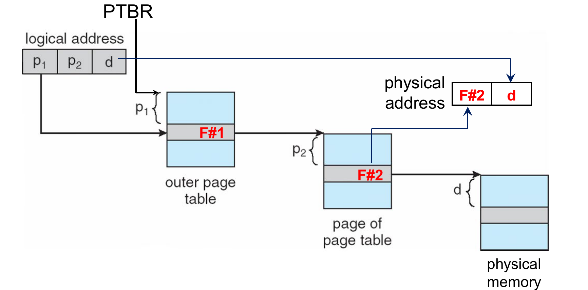
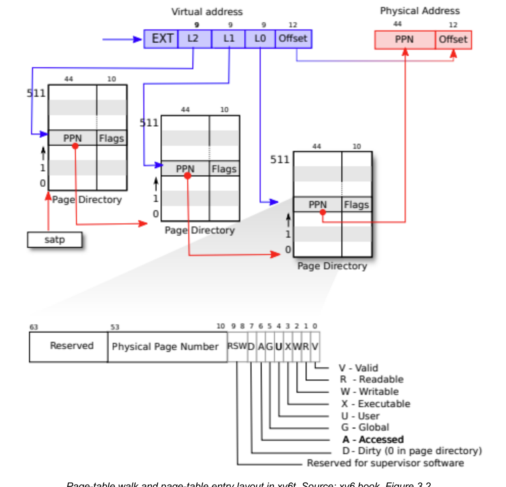
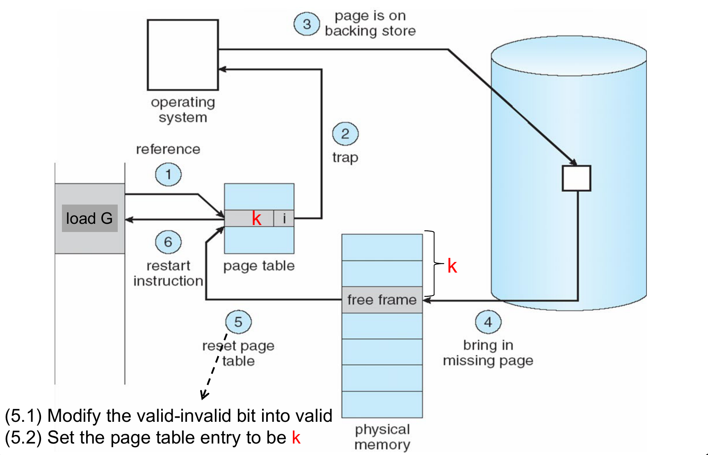
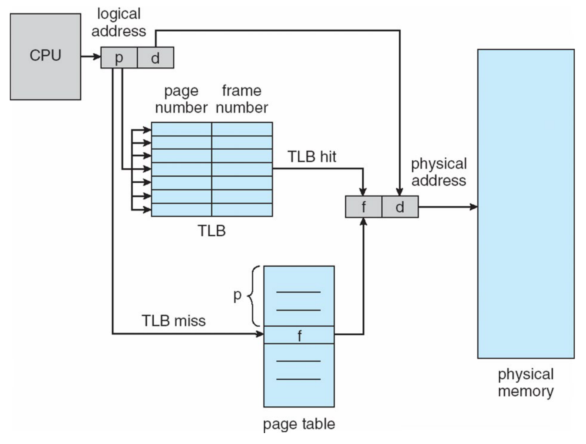

This was written entirely with AI.

## How to Use This Guide
Read the parts in order. Each section answers one question and adds one new idea. When a section needs a fact from an earlier section, it tells you the fact again. At the end of each part, a short list tells you what you know now.

## Part 0: Before You Start

### 1. What You Do in This Lab
A program uses addresses to read and write memory. In xv6, these addresses are not the real addresses in RAM. The hardware changes each program address into a real RAM address. It uses a table for this, the **page table**. In this lab, you look at this table. Then you change the time when xv6 gives RAM to a program.

You do four tasks:

1. You read how xv6 changes a program address into a RAM address. You also read how the `sbrk()` system call gives more memory to a program.
2. You add two system calls. `countvp()` counts the memory that a program can use. `countpp()` counts the RAM that the program really has.
3. You run a program that uses an address that it must not use. You follow what the CPU and the kernel do.
4. You change `sbrk()`. After the change, `sbrk()` does not give RAM immediately. xv6 gives RAM to a part of memory only when the program uses that part for the first time.

### 2. Words You Need
This table gives the basic words. You do not need to remember it now. The guide explains each word again where it first uses it.

| Word | What it means in this lab |
|---|---|
| **xv6** | A small teaching operating system. It is similar to Unix. You change its source code in this lab. |
| **QEMU** | A program on your Linux computer that copies the behaviour of a RISC-V computer. xv6 runs inside QEMU. |
| **RISC-V** | The type of CPU that QEMU copies. Its rules decide the layout of the page table. |
| **Kernel** | The part of xv6 that controls the computer. It runs in **kernel mode** (RISC-V calls it **supervisor mode**). It can use all memory. |
| **User program** / **process** | A normal program while it runs. It runs in **user mode**. It cannot use kernel memory. |
| **Physical address** | A real address in RAM. |
| **Virtual address** | An address that a program uses. The hardware changes it into a physical address. Each process has its own virtual addresses. |
| **Page** | A block of 4,096 bytes of **virtual** addresses. |
| **Frame** | A block of 4,096 bytes of **physical** RAM. The xv6 code calls a frame a "physical page". |
| **Page table** | A table that tells which frame holds each page, and what the process can do with that page. Each process has its own page table. |
| **PTE** (page-table entry) | One line of a page table. It is 8 bytes. |
| **Map** a page | Write a PTE that connects a page to a frame. |
| **Register** | A small storage place inside the CPU. |
| **System call** | A request from a user program to the kernel. You added system calls in Lab 1. |
| **Trap** | An event that stops the user program and makes the CPU run kernel code. |

### 3. Three Fields of the Process Record
The kernel keeps a record for each process: `struct proc` in `kernel/proc.h`. Three fields are important in this lab:

| Field | What it holds |
|---|---|
| `p->sz` | The size of the process memory in bytes. The process can use addresses from 0 up to `p->sz - 1`. The end of this range is also called the **program break**. |
| `p->pagetable` | The physical address of the first page table of the process (the root table). |
| `p->trapframe` | A page where xv6 saves the user registers of the process during a trap. |

### 4. Files in This Lab

| File | What you look at |
|---|---|
| `kernel/vm.c` | `walk()`, `walkaddr()`, `mappages()`, `uvmalloc()`, `uvmunmap()` |
| `kernel/riscv.h` | PTE flags, `PGSIZE`, `PGROUNDUP`, `MAXVA`, functions that read CPU registers |
| `kernel/memlayout.h` | The addresses `TRAMPOLINE` and `TRAPFRAME` |
| `kernel/proc.h`, `kernel/proc.c` | `struct proc`, `growproc()` |
| `kernel/exec.c` | How xv6 makes the stack and the guard page for a new program |
| `kernel/kalloc.c` | `kalloc()` gives one free frame. `kfree()` gives a frame back. |
| `kernel/trap.c`, `kernel/trampoline.S` | `usertrap()`, `usertrapret()`, `uservec`, `userret` |
| `kernel/sysproc.c`, `kernel/syscall.c`, `kernel/syscall.h`, `kernel/defs.h` | Where you add system calls |
| `user/user.h`, `user/usys.pl`, `Makefile` | User-side declarations and the system call list |
| `user/umalloc.c` | `malloc()`, which calls `sbrk()` |
| `user/lazytest.c`, `user/fault.c` | The two test programs |

### 5. How to Start
* Make a **new copy** of the repository and use the `lab4` branch. Then changes from Lab 3 do not get into Lab 4. Start xv6 with `make CPUS=3 qemu`.
* The `lab4` branch adds `user/lazytest.c` and `user/fault.c`. It also adds `countvp()` and `countpp()` to `user/user.h`. **It does not change the kernel.** At the start, the kernel gives RAM immediately.
* `lazytest.c` has two temporary functions with the names `countvp()` and `countpp()`. They give 0. You remove them in Part 2.
* The build makes `user/usys.S` from `user/usys.pl`. Change `usys.pl`. Do not change `usys.S`.
* You can do Part 2 and Part 3 in any sequence. Part 4 needs the system calls from Part 2.
* If xv6 stops with a `panic` message or does not respond, read the message first. Then press `Ctrl-a`, then `x`, to stop QEMU, and start it again.

### 6. How the Lab Is Checked
The lab has a **checkpoint** at the end of each part. At a checkpoint, a TA asks you to show the result and to explain the code. You do not submit logs or AI chats.

The manual gives prompts for the course **Gemini Notebook**. The notebook contains the Lab 4 source code and the xv6 book. Use it in the same five steps as in Lab 3. Say what you expect. Ask a short question. Check the answer in the source code. Run the test. Explain the result with the code. Do not ask the notebook to check your own code.

The manual also refers to a **Lab 4 Supplementary Slide Deck** with slides on Sv39, the 3-level page table, memory allocation and the page-fault sequence. This guide explains each of those topics from the xv6 source code and the lectures.

---

## Part 1: Page Tables and Memory That xv6 Gives Immediately

### 1. The Problem: One Block of RAM for Each Process
Lecture 7 starts with **contiguous allocation**. Each process gets one block of RAM with no gaps. Two registers, **base** and **limit**, give the start and the size of the block.

This causes a problem. Processes start and stop, and the free RAM breaks into many small pieces. There can be enough free RAM in total, but no single piece is large enough for a new process. This is **external fragmentation**.

### 2. The Idea of Paging
**Paging** solves this problem in four steps:

1. Divide the memory of the program into pages of 4,096 bytes.
2. Divide RAM into frames of the same size.
3. Put each page into any free frame. The frames do not need to be next to each other.
4. Use a page table to record which frame holds each page.

Now any free frame is useful, so external fragmentation does not occur. A different small problem stays: the last page of a program is often not full. The unused part of that page is **internal fragmentation**.

### 3. How the Hardware Uses the Page Table: a Small Example
A program reads the byte at virtual address 8,200. The hardware must find that byte in RAM. It does three steps:

1. **Find the page.** 8,200 / 4,096 = 2, with remainder 8. So the byte is in page 2, at byte 8 of that page.
2. **Look up the page.** The hardware reads line 2 of the page table. Think that line 2 says "frame 7".
3. **Find the byte in RAM.** Frame 7 starts at 7 × 4,096 = 28,672. So the physical address is 28,672 + 8 = 28,680.

The two parts of the address have names:

* **Page number** `p` (here 2): tells which line of the page table to use.
* **Offset** `d` (here 8): tells which byte inside the page to use.

The hardware does not really divide. 4,096 is $2^{12}$. So the low 12 bits of the address are the offset, and the bits above them are the page number. In general, if a page is $2^n$ bytes, the low $n$ bits are the offset.

### 4. Why the Table Has More Than One Level
A table with one line for every page is very large. Lecture 7 gives a 32-bit example: $2^{20}$ lines × 4 bytes = 4 MiB for each process. Most of those lines stay empty, because a small program uses only a few pages.

The solution is to divide the page table itself into pages. Then the computer keeps only the parts of the table that are in use. This gives a **two-level page table**. Think of a large book with a short contents page at the front. You read the contents page first. It tells you which chapter to open. Then you find the line in that chapter.



The figure shows the same steps:

1. The PTBR register holds the address of the outer table (the "contents page").
2. `p1` selects a line in the outer table. That line gives the frame of one part of the inner table.
3. `p2` selects a line in that part. That line gives the frame `F#2`.
4. The frame number and the offset `d` make the physical address.

xv6 on RISC-V uses the same idea with **three** levels.

### 5. Sv39: The xv6 Page Table
**Sv39** is the name of the RISC-V page table design that xv6 uses. It uses 39 bits of the virtual address.



The top part of the figure shows how the hardware goes through the three tables. The bottom part shows the bits of one PTE. The same figure is on page 4 of the Lab 4 manual. The register `satp` holds the address of the first table. It does the same job as PTBR in the lecture.

#### How many bits each part needs (manual §1.1)
Start with two facts from the manual:

* A page is **4,096 bytes**.
* A PTE is **8 bytes**.

From these two facts:

* **Offset:** 4,096 = $2^{12}$. So the offset needs **12 bits**.
* **Lines in one page table:** each page table fills exactly one page. One page holds 4,096 / 8 = 512 = $2^9$ PTEs. So the index for each level needs **9 bits**.

| Part | Bits | What it does |
|---|---|---|
| Level-2 index | **30–38** | Selects a line in the level-2 table (the root table) |
| Level-1 index | **21–29** | Selects a line in a level-1 table |
| Level-0 index | **12–20** | Selects the line in a level-0 table that gives the frame of the page |
| Page offset | **0–11** | Selects a byte in the frame |

12 + 9 + 9 + 9 = 39 bits. This is why the name is Sv**39**.

xv6 uses only half of this range. `MAXVA` in `kernel/riscv.h` is $2^{38}$. So bits 38 to 63 of a user address are always 0. (RISC-V has a rule: if bit 38 is 1, bits 39 to 63 must also be 1. xv6 does not use addresses with bit 38 at 1, so it never needs this rule.)

The code calculates each index with these macros:

```c
#define PXSHIFT(level)  (PGSHIFT + (9*(level)))       // 12, 21 or 30
#define PX(level, va)   ((((uint64)(va)) >> PXSHIFT(level)) & 0x1FF)
```

`>>` moves the bits to the right. `& 0x1FF` keeps the low 9 bits.

**The lecture design and the xv6 design:**

| | Lecture 7 (32-bit, two levels) | xv6 (Sv39) |
|---|---|---|
| Number of levels | 2 | 3 |
| Size of one PTE | 4 bytes | 8 bytes |
| PTEs in one table | 4,096 / 4 = 1,024, so a 10-bit index | 4,096 / 8 = 512, so a 9-bit index |
| Parts of the address | 10 / 10 / 12 | 9 / 9 / 9 / 12 |
| Register with the address of the first table | PTBR | `satp` |

Both designs follow one rule: **each page table is exactly one page.** So the kernel can use its normal function `kalloc()` to get a frame for a page table.

#### An example
Divide `va = 0x12345678` into its parts:

| Part | Calculation | Value |
|---|---|---|
| Level-2 index | `(va >> 30) & 0x1FF` | 0 |
| Level-1 index | `(va >> 21) & 0x1FF` | 145 (0x91) |
| Level-0 index | `(va >> 12) & 0x1FF` | 325 (0x145) |
| Offset | `va & 0xFFF` | 0x678 |

The hardware does these steps:

1. Read line 0 of the root table. It gives the frame of a level-1 table.
2. Read line 145 of that table. It gives the frame of a level-0 table.
3. Read line 325 of that table. It gives the frame of the data.
4. Physical address = (frame number × 4,096) + 0x678.

A small user program uses less than 2 MiB. For such a program, all addresses have level-2 index 0 and level-1 index 0. So one root table, one level-1 table and one level-0 table are enough for its code, data, stack and a small heap.

### 6. The Bits of a PTE

```text
 63        54 53                         10 9   8 7 6 5 4 3 2 1 0
┌────────────┬─────────────────────────────┬─────┬─┬─┬─┬─┬─┬─┬─┬─┐
│  reserved  │  PPN (44 bits)              │ RSW │D│A│G│U│X│W│R│V│
└────────────┴─────────────────────────────┴─────┴─┴─┴─┴─┴─┴─┴─┴─┘
```

**PPN** is the **physical page number**. It is the frame number: the physical address divided by 4,096. The low 10 bits are **flags**. A flag is one bit that is on (1) or off (0).

| Flag | Meaning when the bit is 1 |
|---|---|
| `PTE_V` (bit 0) | **Valid.** The PTE is in use. If this bit is 0, the hardware ignores the PTE, and any access through it causes a fault. |
| `PTE_R` (bit 1) | The process can **read** the page. |
| `PTE_W` (bit 2) | The process can **write** the page. |
| `PTE_X` (bit 3) | The CPU can run the page as **code**. |
| `PTE_U` (bit 4) | Code in **user mode** can use the page. If this bit is 0, only the kernel can use the page. |

Macros that change between a physical address and a PTE:

* `PTE2PA(pte) = (pte >> 10) << 12` gets the physical address from a PTE.
* `PA2PTE(pa) = (pa >> 12) << 10` puts a physical address into a PTE.
* `PTE_FLAGS(pte) = pte & 0x3FF` gets the 10 flag bits.

**Two types of valid PTE.** A PTE can point to one of two things:

* A valid PTE with R, W and X all at 0 points to the **next page table**.
* A valid PTE with R, W or X at 1 points to a **data frame**. The name for this type is a **leaf** PTE.

This is why `uvmunmap()` stops with "not a leaf" when `PTE_FLAGS(*pte) == PTE_V`. That PTE points to a table, not to data.

Lecture 8 uses a **valid–invalid bit** in each PTE. In xv6, this bit is `PTE_V`.

### 7. `walk()` and `walkaddr()` (`kernel/vm.c`)
The hardware goes through the three levels on each memory access. Sometimes the kernel must do the same, in software. For example, the kernel must find the PTE of a page before it changes the PTE. `walk()` does this.

```c
pte_t *walk(pagetable_t pagetable, uint64 va, int alloc) {
  if(va >= MAXVA)
    panic("walk");                                   // stop the kernel: bad address

  for(int level = 2; level > 0; level--) {           // only levels 2 and 1
    pte_t *pte = &pagetable[PX(level, va)];
    if(*pte & PTE_V) {
      pagetable = (pagetable_t)PTE2PA(*pte);         // go down to the next table
    } else {
      if(!alloc || (pagetable = (pde_t*)kalloc()) == 0)
        return 0;                                    // the table is missing; do not make it
      memset(pagetable, 0, PGSIZE);                  // a new empty table
      *pte = PA2PTE(pagetable) | PTE_V;              // V only: points to a table
    }
  }
  return &pagetable[PX(0, va)];                      // address of the LEVEL-0 PTE
}
```

`panic()` prints a message and stops the whole kernel.

What `walk()` gives back:

* The **address of the level-0 PTE** for `va`. `walk()` does not check this PTE. It can be invalid.
* **0** if a level-2 or level-1 table is missing and `alloc` is 0. It also gives 0 if `kalloc()` finds no free frame.

With `alloc = 1`, `walk()` makes missing tables. So it can get frames from `kalloc()` for **page tables** at level 1 and level 0. These frames hold PTEs, not code or data of the process. `walk()` never gets the data frame. `mappages()` calls `walk(..., 1)` to make the missing tables. Then `mappages()` writes the level-0 PTE itself.

```c
uint64 walkaddr(pagetable_t pagetable, uint64 va) {
  if(va >= MAXVA) return 0;
  pte_t *pte = walk(pagetable, va, 0);   // never makes tables
  if(pte == 0)               return 0;
  if((*pte & PTE_V) == 0)    return 0;   // not valid
  if((*pte & PTE_U) == 0)    return 0;   // not for user mode
  return PTE2PA(*pte);
}
```

The kernel uses `walkaddr()` when a system call gets an address from a user program. For example, `read()` gets the address of the buffer where it must write data. `walkaddr()` checks `PTE_U`. So the kernel does not write into a page that the user cannot use, for example the guard page. Without this check, a user program could give the guard page address to `read()`, and the kernel would write there for it.

| | `walk(pt, va, 0)` | `walk(pt, va, 1)` | `walkaddr(pt, va)` |
|---|---|---|---|
| Makes missing tables? | No | Yes | No |
| Gives back | Address of the level-0 PTE, or 0 | Address of the level-0 PTE, or 0 if no RAM | Physical address, or 0 |
| Checks `PTE_V` of the level-0 PTE? | No | No | Yes |
| Checks `PTE_U`? | No | No | Yes |

### 8. The Memory of an xv6 Process

```text
MAXVA = 2^38 ─►┌──────────────────────────┐
               │ TRAMPOLINE   (R X, no U) │  same address in the user and kernel tables
               ├──────────────────────────┤
               │ TRAPFRAME    (R W, no U) │  saved user registers of this process
               ├──────────────────────────┤
               │        (not used)        │
       p->sz ─►├──────────────────────────┤  program break (end of process memory)
               │ heap (sbrk adds pages up)│
               ├──────────────────────────┤
               │ user stack (1 page)      │  sp starts at the top and moves down
               ├──────────────────────────┤
               │ guard page (V, no U)     │  has a frame; user code cannot use it
               ├──────────────────────────┤
               │ data                     │  global variables
               │ text                     │  program code
           0 ─►└──────────────────────────┘
```

* The **heap** is memory that the program asks for while it runs, for example with `malloc()`.
* The **stack** holds local variables and function arguments. The **stack pointer** register `sp` shows the current end of the stack.

Lecture 7 (slide 7.2) shows text, data, heap, and then the stack at the high end. In the lecture, the heap and the stack grow toward each other. xv6 is different in two ways:

* The stack is **one page with a fixed size**. It is **below** the heap, not at the top.
* A **guard page** is directly below the stack. If the stack becomes too large, the program uses the guard page. This causes a fault. Without the guard page, the stack would write over the data and nobody would know.

`exec()` makes this layout when a program starts:

```c
sz = PGROUNDUP(sz);
uvmalloc(pagetable, sz, sz + (USERSTACK+1)*PGSIZE, PTE_W);  // 2 pages: guard page and stack
uvmclear(pagetable, sz-(USERSTACK+1)*PGSIZE);               // set PTE_U to 0 on the lower page
```

`PGROUNDUP(x)` makes `x` larger, up to the next multiple of 4,096. If `x` is already a multiple of 4,096, it does not change.

`uvmclear()` only does `*pte &= ~PTE_U`. This sets `PTE_U` to 0. The guard page **keeps its frame and `PTE_V`**. Only user code cannot use it.

The guard page is below `p->sz`, like the code, the data and the stack. `TRAMPOLINE` and `TRAPFRAME` are much higher than `p->sz`. They do not have `PTE_U`.

### 9. The Kernel Has Its Own Page Table
The CPU uses a page table also when it runs kernel code. xv6 has one **kernel page table** for all CPUs. It is different from the user page tables.

The kernel page table maps most of RAM with **virtual address = physical address**. RAM starts at physical address `KERNBASE` (0x80000000) and ends at `PHYSTOP` (128 MiB later). So the kernel can use any frame through its physical address. This is why:

* `kalloc()` gives back a physical address that the kernel can use as a normal pointer.
* `p->trapframe` and `p->pagetable` hold physical addresses, and the kernel reads and writes them directly.
* `walk()` can follow `PTE2PA(*pte)` to the next table with no extra step.

The kernel page table also maps the trampoline page at `TRAMPOLINE`, the same address as in each user page table. Part 3 explains why.

### 10. Where Frames Come From: `kalloc()` and `kfree()`
Lecture 7 says that the OS must "keep track of all free frames". In xv6, `kernel/kalloc.c` does this with a **free list**. A free list is a linked list of all free frames.

* At boot, `kinit()` calls `kfree()` for each frame from the end of the kernel up to `PHYSTOP`. This puts every free frame on the list.
* The list needs no extra memory. Each free frame holds the link to the next free frame in its first bytes (`struct run { struct run *next; }`).
* `kalloc()` removes the first frame from the list and gives back its address. If the list is empty, it gives back 0.
* `kfree()` puts a frame back at the front of the list.
* A spinlock, `kmem.lock`, protects the list, because two CPUs can call `kalloc()` at the same time. (Lab 3 explains spinlocks.)

`kalloc()` always gives exactly **one** frame of 4,096 bytes. It never gives a larger block. Paging makes this enough: the pages of a process do not need frames that are next to each other.

### 11. How the Heap Gets More Memory Now (Eager Allocation)
At the start of the lab, xv6 gives frames **immediately** when a program asks for more memory. This is **eager allocation**. Follow one call of `malloc()` from the top:

```text
malloc(n)                              user/umalloc.c
 └─ morecore(nu)        asks for at least 4096 × 16 bytes = 64 KiB
     └─ sbrk(nu * sizeof(Header))      user side: li a7, SYS_sbrk ; ecall
         ═══════ the CPU goes into the kernel ═══════
         └─ sys_sbrk()                 kernel/sysproc.c
             addr = p->sz              keep the OLD end of memory
             └─ growproc(n)            kernel/proc.c
                 └─ uvmalloc(pagetable, sz, sz+n, PTE_W)   kernel/vm.c
                     for each new page:
                       mem = kalloc()                 ← get one frame
                       memset(mem, 0, PGSIZE)         ← write zeros into the frame
                       mappages(..., mem, PTE_R|PTE_U|PTE_W)  ← write the PTE
                 p->sz = new size
             return addr               ← give back the OLD end of memory
```

The kernel gets, clears and maps every frame **during the call**. It does this also if the program never uses some of the pages.

**Why the kernel writes zeros into the frame.** `kalloc()` fills a new frame with the value 5. `kfree()` fills a free frame with the value 1. Both help to find errors. Also, a frame can hold data from a different process that used it before. If the kernel did not clear the frame, the new process could read that data. So new heap memory always contains zeros.

**What the argument of `sbrk(n)` does:**

| `n` | What occurs | What `sbrk()` gives back |
|---|---|---|
| More than 0 | `uvmalloc()` gets and maps frames up to `sz + n` | The old end of memory (the start of the new memory) |
| 0 | Nothing changes | The current end of memory. `fault.c` uses this. |
| Less than 0 | `uvmdealloc()` calls `uvmunmap(..., do_free=1)`, which removes the PTEs and frees the frames | The old end of memory |
| Error | `uvmalloc()` gave 0 because there is no free RAM | -1. The user program sees `(char *)-1`. |

**Why `sbrk()` gives back the old end.** The program must know where its new memory starts. Before the call, the end of memory is the first byte after the process memory. After the call, that same byte is the first byte of the new memory.

### What You Know Now (Part 1)

* A virtual address is a page number and an offset. The page table changes the page number into a frame number.
* Sv39 divides the address into 9 + 9 + 9 index bits and 12 offset bits. Each table is one page of 512 PTEs.
* A PTE holds a frame number and flags. `PTE_V` says "in use". `PTE_U` says "user mode can use it".
* `walk()` finds the level-0 PTE. `walkaddr()` also checks `PTE_V` and `PTE_U`.
* `kalloc()` takes one frame from the free list.
* At the start of the lab, `sbrk()` gets, clears and maps every new frame immediately.

---

## Part 2: Count Pages and Frames

### 1. What Each Count Includes
Both system calls look at the process that calls them (`myproc()`). Both count from address 0 up to, but not including, `p->sz`.

| System call | What it counts | Count these | Do not count these |
|---|---|---|---|
| `countvp()` | Pages from 0 to `p->sz` | A last page that is only partly used. The guard page. | Anything at `p->sz` or higher |
| `countpp()` | Frames that a valid level-0 PTE connects to those pages | The frame of the guard page. Its PTE is valid. Only `PTE_U` is 0. | Frames that hold page tables. The kernel stack. `TRAMPOLINE`. `TRAPFRAME`. |

With **eager** allocation, the kernel maps every page from 0 to `p->sz`. So `countvp()` equals `countpp()`.

With **lazy** allocation (Part 4), `countvp() - countpp()` is the number of pages that the process asked for but has not used yet.

### 2. The Code

```c
// countvp: a page that is only partly used counts as one page
int countvp(void) {
  struct proc *p = myproc();
  return PGROUNDUP(p->sz) / PGSIZE;
}

// countpp: look at the PTEs, but do not make new ones
int countpp(void) {
  struct proc *p = myproc();
  int n = 0;
  for(uint64 va = 0; va < p->sz; va += PGSIZE) {
    pte_t *pte = walk(p->pagetable, va, 0);   // alloc = 0: never make tables
    if(pte != 0 && (*pte & PTE_V))            // a valid level-0 PTE
      n++;
  }
  return n;
}
```

This code makes three decisions. Each one can be a quiz question:

* **Use `walk(..., 0)`, not `walk(..., 1)`.** The count must not change the memory that it counts. With `alloc = 1`, `walk()` would get new frames for missing tables.
* **Use `walk()`, not `walkaddr()`.** `walkaddr()` gives 0 for a PTE that has no `PTE_U`. So it would **not count the guard page**, and the result would be 1 too small. With `walk()`, you can check only `PTE_V`.
* **Check `pte != 0` before you read `*pte`.** After Part 4, a full level-0 table can be missing. Then `walk(..., 0)` gives 0. If you read address 0, the kernel stops.

### 3. How to Add the System Calls (as in Lab 1)

| File | What to change |
|---|---|
| `kernel/syscall.h` | Add `#define SYS_countvp 22` and `#define SYS_countpp 23` (the next free numbers) |
| `kernel/syscall.c` | Add `extern uint64 sys_countvp(void);` and `extern uint64 sys_countpp(void);`. Add `[SYS_countvp] sys_countvp,` and `[SYS_countpp] sys_countpp,` to the `syscalls[]` table. |
| `kernel/sysproc.c` | Add `uint64 sys_countvp(void)` and `uint64 sys_countpp(void)` with the code above |
| `kernel/defs.h` | Add declarations only if you put the code in a different file, for example `vm.c`. `defs.h` already declares `walk()`. |
| `user/usys.pl` | Add `entry("countvp");` and `entry("countpp");` |
| `user/user.h` | No change. Both declarations are already there. |
| `user/lazytest.c` | **Remove the two temporary functions.** Then the calls go to your system calls. |

If you do not remove the temporary functions, `lazytest` continues to print 0. Also, after `usys.pl` makes the real functions, there are two functions with the same name, and the build fails. When `lazytest` prints numbers that are not 0, you know that it uses your system calls.

### 4. What `lazytest` Does

```c
vp_before = countvp();  pp_before = countpp();
start = sbrk(4096 * 30);                        // ask for 30 pages
vp_after_sbrk = countvp(); pp_after_sbrk = countpp();
for (i = 0; i < 30; i++) start[i * 4096] = 'x'; // write 1 byte in each of the 30 pages
pp_after_touch = countpp();
```

It prints these messages:

* If VP did not go up by exactly 30: "Error: VP count did not increase by 30".
* If PP changed after `sbrk()`: "Error: PP count changed immediately (should be lazy)". If not: "Success: PP count unchanged (lazy allocation verified)".
* If PP went up by 30 or more after the writes: "Success: PP count increased after touching pages".

### 5. The Result With Eager Allocation

| When | VP (compared to the start) | PP (compared to the start) | Why |
|---|---|---|---|
| After `sbrk(30 pages)` | **+30** | **+30** | `uvmalloc()` got and mapped all 30 frames during the call |
| After the 30 writes | +30 | **+30 (no more change)** | The kernel already mapped all pages. A write is a normal memory access. No fault occurs, and xv6 gets no new frame. |

With eager allocation, the message "**PP count changed immediately**" is **correct**. It tells you that the kernel does not use lazy allocation yet.

Two traps:

* The last message, "Success: PP count increased…", **also prints with eager allocation**, because +30 is 30 or more. This message does not show if the kernel is eager or lazy.
* `lazytest` **always stops with exit status 0**, also after an error message. Look at the printed numbers. Do not use the exit status.

### What You Know Now (Part 2)

* `countvp()` counts the pages below `p->sz`. `countpp()` counts the valid level-0 PTEs below `p->sz`.
* `countpp()` uses `walk(..., 0)`. It does not use `walkaddr()`, because `walkaddr()` skips the guard page.
* With eager allocation, VP and PP both go up by 30 after `sbrk()`.

---

## Part 3: Page Faults and Traps

### 1. What a Trap Is
Lecture 1: a **trap** is an interrupt that the CPU makes itself. The cause is an error in the program or a request from the program. The hardware changes to kernel mode and runs kernel code.

In xv6, three types of event use the same path into the kernel:

* **System calls.** The program runs the `ecall` instruction on purpose.
* **Device interrupts.** For example, the timer or the disk sends a signal.
* **Exceptions.** An instruction causes an error. One type is the **page fault**: the hardware cannot change the address, or the PTE flags do not let the program do the access.

Lecture 8 shows the steps of a usual page fault:



The figure has six steps. (1) The program uses an address. (2) The PTE is invalid, so a trap occurs. (3, 4) The OS finds the page and puts it in a free frame. (5) The OS changes the PTE. (6) The CPU runs the instruction again.

### 2. Three Registers That the CPU Fills
When the fault occurs, the RISC-V CPU writes three registers. The kernel reads them to find out what occurred:

| Register | What it holds | Kernel function that reads it |
|---|---|---|
| `scause` | **Why** the trap occurred (a number) | `r_scause()` |
| `sepc` | The address of the **instruction** that caused the trap | `r_sepc()` |
| `stval` | For a page fault: the **address that the instruction tried to use** | `r_stval()` |

Values of `scause` in this lab:

| `scause` | Meaning |
|---|---|
| 8 | The user program ran `ecall` (a system call) |
| **12** | Page fault while the CPU **got an instruction** |
| **13** | Page fault on a **load** (a read of data) |
| **15** | Page fault on a **store** or an **AMO** (a write of data) |

An **AMO** is an atomic memory operation: an instruction that reads and writes memory in one step. The `amoswap` instruction in the Lab 3 spinlock is an AMO. An AMO writes memory, so a fault on it uses the same number as a store.

Do not mix up `sepc` and `stval`. In `fault read`, `sepc` is an address in the **code** of the program: the address of the read instruction. `stval` is the **data** address that the instruction tried to read.

### 3. The `usertrap()` Function at the Start of the Lab
`usertrap()` in `kernel/trap.c` is the C function that handles every trap from user mode. It reads `scause` and selects one of three paths:

```c
void usertrap(void) {
  ...
  w_stvec((uint64)kernelvec);           // traps from now on go to the kernel trap code
  struct proc *p = myproc();
  p->trapframe->epc = r_sepc();         // save the address of the user instruction

  if(r_scause() == 8){                  // path 1: a system call
    ...
    p->trapframe->epc += 4;             // continue at the NEXT instruction after ecall
    intr_on();
    syscall();
  } else if((which_dev = devintr()) != 0){
    // path 2: a device interrupt
  } else {                              // path 3: all other causes, for example a page fault
    printf("usertrap(): unexpected scause 0x%lx pid=%d\n", r_scause(), p->pid);
    printf("            sepc=0x%lx stval=0x%lx\n", r_sepc(), r_stval());
    setkilled(p);                       // mark the process to be stopped
  }

  if(killed(p))
    exit(-1);                           // the process stops here
  ...
  usertrapret();                        // go back to the user program
}
```

At the start of the lab, a page fault takes path 3, and the process stops.

The manual tells you to add a message for page faults in path 3:

```c
uint64 cause = r_scause();
if(cause == 13 || cause == 15)
  printf("usertrap(): %s page fault pid=%d va=0x%lx sepc=0x%lx\n",
         cause == 13 ? "load" : "store", p->pid, r_stval(), r_sepc());
else {
  /* the two original printf lines */
}
setkilled(p);    // in this part, the process must still stop
```

### 4. The `fault` Program

```c
char *end = sbrk(0);                          // the end of memory; no new memory
uint64 address = PGROUNDUP((uint64)end);      // the first byte of the next FULL page
volatile char *target = (volatile char *)address;
printf("fault: pid %d, break %p, target %p, mode %s\n", ...);
if(write) *target = 'x';                      // a store
else      (void)*target;                      // a load
fprintf(2, "fault: ERROR: access returned; expected process termination\n");
```

* **Why `PGROUNDUP`?** The kernel maps full pages. Think about an end of memory that is not a multiple of 4,096. Then the bytes after the end are still in the last mapped page. An access to them **works**, and no fault occurs, but they are after `p->sz`. `PGROUNDUP` selects the first byte of a page that has no PTE. If the end is already a multiple of 4,096, `PGROUNDUP` does not change it. That address is already the first page with no PTE.
* **Why `volatile`?** The code `(void)*target` does not use the value that it reads. So the compiler can remove the read. `volatile` tells the compiler to keep the read in the code.

What you expect to see:

| Command | `scause` | `stval` | `sepc` | Result |
|---|---|---|---|---|
| `fault read` | 13 (0xd), load page fault | The same as the printed target | The address of the load instruction in the code of `fault` | The process stops. The ERROR line does not print. |
| `fault write` | 15 (0xf), store page fault | The same as the printed target | The address of the store instruction | The process stops. The ERROR line does not print. |

### 5. Why the Process Stops but the Shell Continues
`usertrap()` marks only **this** process. Then this process calls `exit(-1)`. The shell is a different process with its own page table. The shell waits in `wait()` until its child stops. Then `wait()` returns, and the shell shows its prompt again.

Each process has its own page table. So a bad access in one process cannot damage another process.

### 6. The Trampoline: How the CPU Gets Into the Kernel
Section 3 started at `usertrap()`. But some code must run **before** `usertrap()`. This section explains that code, one problem at a time.

#### Problem 1: the CPU still uses the user page table
A trap changes the CPU to kernel mode. It does **not** change the page table. The register `satp` holds the address of the current page table, and the trap does not change `satp`. So the first kernel instruction after the trap runs with the **user** page table.

The user page table does not map the kernel code or the kernel stack. So the first code cannot be `usertrap()`. It must be a small piece of code at an address that the user page table maps. xv6 puts this code in one page, the **trampoline** page, at address `TRAMPOLINE`. The code is in `kernel/trampoline.S`, in assembly language.

The register `stvec` holds the address of the code that the CPU runs on a trap. While a user program runs, `stvec` points to `uservec`, the first part of the trampoline.

#### Problem 2: the user registers must stay safe
The kernel code will use the CPU registers. But the user program needs its register values back later. So `uservec` first saves all 31 user registers. It saves them into the **trapframe**, a page at address `TRAPFRAME` that the user page table also maps.

#### Then: change to the kernel page table
After it saves the registers, `uservec` reads values that the kernel left in the trapframe: the kernel page table address, the kernel stack and the address of `usertrap()`. It writes the kernel page table address into `satp`. Then it jumps to `usertrap()`.

#### Problem 3: the next instruction after the change
`uservec` changes `satp` with the instruction `csrw satp, t1`. The CPU gets the **next** instruction through the **new** page table. If the trampoline had a different address in the kernel page table, or no address, the CPU would get the wrong instruction or a fault.

xv6 maps the trampoline at `TRAMPOLINE` in **both** tables. So the address of the next instruction stays correct after the change.

#### The way back
To go back to the user program, the kernel does the same steps in the opposite sequence:

1. `usertrapret()` sets `stvec` back to `uservec`, for the next trap. It writes the kernel values into the trapframe, for the next trap.
2. `usertrapret()` sets `sepc` to the saved user instruction address, `trapframe->epc`.
3. `userret`, the second part of the trampoline, writes the user page table address into `satp`.
4. `userret` loads the user registers from the trapframe.
5. `sret` changes the CPU to user mode and jumps to the address in `sepc`.

#### The full path

```text
USER MODE: a load or store causes a fault at address sepc
   │  the hardware sets scause, sepc and stval; changes to kernel mode;
   │  jumps to the address in stvec
   ▼
uservec  (trampoline.S, at address TRAMPOLINE; still uses the USER page table)
   │  csrw sscratch, a0          keep register a0 in a spare register
   │  li a0, TRAPFRAME           a0 = the address of the trapframe page
   │  sd ra..t6 → trapframe      save all user registers
   │  ld kernel_sp, kernel_hartid, kernel_trap (usertrap), kernel_satp
   │  sfence.vma ; csrw satp, t1 ; sfence.vma   ← CHANGE to the KERNEL page table
   │  jr t0                       jump to usertrap()
   ▼
usertrap()  (trap.c; kernel page table; kernel stack)
   │  finds the cause: system call, device, page fault, or stop the process
   ▼
usertrapret()  (trap.c)
   │  stvec = uservec;  write the kernel_* fields for the next trap
   │  sstatus: SPP = 0 (go back to user mode), SPIE = 1 (interrupts on)
   │  sepc = trapframe->epc
   │  call userret with the address of the USER page table
   ▼
userret  (trampoline.S)
   │  sfence.vma ; csrw satp, a0 ; sfence.vma   ← CHANGE to the USER page table
   │  ld user registers ← TRAPFRAME
   │  sret                        change to user mode; jump to the address in sepc
   ▼
USER MODE
```

**What each side saves in the trapframe:**

| Who writes it | What |
|---|---|
| `uservec`, on the way in | All 31 user registers. (`usertrap()` also saves the user instruction address as `epc`.) |
| `usertrapret()`, on the way out | `kernel_satp`, `kernel_sp`, `kernel_trap`, `kernel_hartid`. `uservec` needs these values at the next trap. |

The trampoline page and the trapframe page have **no `PTE_U`**. So user code cannot read or change them.

### 7. The TLB and `sfence.vma`
Lecture 7 explains the **TLB**. It is a small, fast store in the CPU that keeps recent page-to-frame results. With the TLB, the CPU does not need to read the page table on each access.



After `satp` changes, the TLB still holds results from the old page table. These results are now wrong. The `sfence.vma` instructions around `csrw satp` clear them.

### What You Know Now (Part 3)

* A page fault is a trap. The CPU writes `scause` (why), `sepc` (which instruction) and `stval` (which address).
* `scause` is 13 for a load fault and 15 for a store fault.
* At the start of the lab, `usertrap()` stops the process on a page fault. The shell continues, because it is a different process.
* The trampoline saves the user registers and changes `satp`. It has the same address in both page tables, so the next instruction after the change is correct.

---

## Part 4: Give Frames Only When the Program Uses a Page

### 1. The Idea: Demand Paging for the Heap
Lecture 8 explains **demand paging**. The OS puts a page into RAM only when the program uses it. If the PTE is invalid, a page fault occurs. The OS gets the page, and the CPU runs the instruction again.

**Lazy heap allocation** is a simple type of demand paging:

1. `sbrk()` only makes `p->sz` larger. It gets no frames.
2. When the program uses a new page for the first time, a page fault occurs.
3. The fault handler gets one frame, writes zeros into it and maps it.
4. The CPU runs the instruction again, and now it works.

| | Lecture 8: demand paging | Lab 4: lazy heap allocation |
|---|---|---|
| Where the data for the page comes from | The disk (backing store) | Nowhere. The frame is new and contains only zeros. |
| Disk read or write during the fault | Yes. It reads the page, and it can write a different page out. | No |
| What occurs when there is no free frame | The OS selects a page to remove (FIFO, LRU, clock …) | The process stops. xv6 does not use a disk for pages. |
| How the OS finds a bad access | The valid–invalid bit | No valid PTE **and** the address is not below `p->sz` |
| The instruction runs again | "The instruction is now re-started" (step 6) | The handler does not change `epc` |

The result: a program can ask for a large heap. It uses RAM only for the pages that it really writes or reads.

### 2. The Three Changes
You change three kernel functions. Each change fixes one problem:

| Change | Function | The problem it fixes |
|---|---|---|
| 1 | `sys_sbrk()` | It gets frames immediately. After the change, it only reserves addresses. |
| 2 | `usertrap()` | It stops the process on every page fault. After the change, it gives a frame on the first use of a reserved page. |
| 3 | `uvmunmap()` | It stops the kernel when a page has no PTE. After the change, it skips such pages. |

The next three sections explain each change.

### 3. Change 1: `sbrk()` Only Reserves the Addresses

```c
uint64 sys_sbrk(void) {
  int n;
  argint(0, &n);
  struct proc *p = myproc();
  uint64 addr = p->sz;                       // the old end, as before

  if(n > 0){
    uint64 newsz = addr + n;
    if(newsz < addr || newsz > TRAPFRAME)    // the number became too large, or gets to the trap pages
      return -1;
    p->sz = newsz;                           // only change the size: NO uvmalloc()
  } else if(n < 0){
    if(growproc(n) < 0)                      // make the heap smaller: remove PTEs and free frames
      return -1;
  }
  return addr;                               // sbrk(0) changes nothing
}
```

* **`n` more than 0:** only `p->sz` becomes larger. There is no `kalloc()` and no `mappages()`. The new pages have no PTE, or an invalid PTE.
* **`n` is 0 or less than 0:** these work as before. To make the heap smaller, `growproc()` calls `uvmdealloc()`, which calls `uvmunmap()`. Change 3 makes `uvmunmap()` accept pages with no PTE.
* **The size check is necessary.** `p->sz` is now only a number. A very large request could make the number go past the maximum and start again at 0. Or it could include the addresses of `TRAPFRAME` and `TRAMPOLINE`. Then a later fault could map a heap page on top of them.

You do **not** need to make empty PTEs now. When the fault handler calls `mappages()`, `walk(..., 1)` makes the missing level-1 and level-0 tables.

### 4. Change 2: Give a Frame on the First Use (`usertrap`)
After change 1, a page fault can mean two different things:

1. The process uses a **heap page that it reserved**, but the page has no frame yet. Then the handler gets a frame, maps it, and lets the instruction run again.
2. The process uses an address that it **must not use**. Then the handler stops the process, as before.

Add a new path to `usertrap()`, before the device path:

```c
} else if(r_scause() == 13 || r_scause() == 15) {       // load or store page fault
  uint64 va = r_stval();                                // the address the instruction used
  if(lazy_alloc(p, va) < 0)
    setkilled(p);                                       // bad access: stop, as before
} else if((which_dev = devintr()) != 0){
```

`lazy_alloc()` decides between case 1 and case 2. It does four steps:

```c
// Gives back 0 if the page is now mapped.
// Gives back -1 if the access is not permitted, or if there is no free frame.
int lazy_alloc(struct proc *p, uint64 va) {
  if(va >= p->sz)                       // (1) the address is not in the process memory
    return -1;                          //     check this BEFORE you round down

  uint64 a = PGROUNDDOWN(va);           //     the start of the page
  pte_t *pte = walk(p->pagetable, a, 0);
  if(pte != 0 && (*pte & PTE_V))        // (2) the page has a valid PTE already. So the
    return -1;                          //     fault is about permission, not a missing frame.

  char *mem = kalloc();                 // (3) get one frame
  if(mem == 0)
    return -1;
  memset(mem, 0, PGSIZE);               //     write zeros, as uvmalloc() does
  if(mappages(p->pagetable, a, PGSIZE, (uint64)mem,
              PTE_R | PTE_W | PTE_U) != 0){
    kfree(mem);                         //     give the frame back; do not lose it
    return -1;
  }
  return 0;                             // (4) do NOT change epc
}
```

`PGROUNDDOWN(x)` makes `x` smaller, down to the start of its page (a multiple of 4,096).

Now look at each step.

**Step (1): is the address in the process memory?** The process reserved addresses from 0 up to `p->sz - 1`. An address at `p->sz` or higher is never correct.

* **Check before you round down.** Think about a `p->sz` that is not a multiple of 4,096. An address just after `p->sz` is in the same page as `p->sz - 1`. If you round it down first, you get the start of that page. That start is below `p->sz`, so the check passes. But the address itself is not in the process memory.
* **Check before you call `walk()`.** `walk()` calls `panic()` if `va >= MAXVA`, and this stops the whole kernel. A user program must never be able to stop the kernel with a bad address.

**Step (2): does the page already have a valid PTE?** If yes, the page already has a frame. So the fault is about permission: the PTE does not have a flag that the access needs. Examples: a write to the code, or a use of the guard page. Stop the process.

**Why "no valid PTE" is enough to find a heap page.** `exec()` maps all the pages below the heap immediately: the code, the data, the guard page and the stack. So, from 0 to `p->sz`, the only pages with no valid PTE are heap pages that the program has not used yet.

**Step (3): get, clear and map one frame.** This is the same work that `uvmalloc()` did for one page.

* **Why `PTE_R | PTE_W | PTE_U`.** The program must read and write heap pages in user mode. The eager `uvmalloc(..., PTE_W)` gives the same flags: `PTE_R | PTE_U | PTE_W`. The heap is not code, so it does not get `PTE_X`.
* **If `mappages()` fails, call `kfree()`.** Otherwise the frame is not on the free list and not in a page table. Nobody can use it again.
* **A read also gets a frame.** If the program reads a heap page that it has not used (scause 13), the handler gives it a new frame with zeros. So the program reads 0. With eager allocation, it would also read 0.

**Step (4): do not change `epc`.** For a system call, `usertrap()` adds 4 to `epc`. The `ecall` instruction is complete, and the program must continue at the next instruction. A load or store that caused a fault **did not complete**. If the handler does not change `epc`, the CPU runs the same load or store again. This time the address has a frame, and the instruction works. This is step 6 in Lecture 8: "restart instruction". If you added 4 to `epc`, the program would skip its read or write, and it would continue with a wrong value.

**How the handler sorts each type of fault:**

| The access | The check that finds it | Result |
|---|---|---|
| First use of a page that `sbrk()` reserved | `va < p->sz`, and no valid PTE | **Get a frame, map it, run the instruction again** |
| `fault read` or `fault write` (address at or after the end) | `va >= p->sz` | Process stops |
| The stack becomes too large and uses the guard page | The guard page **has** a valid PTE (only `PTE_U` is 0) | Process stops (permission fault) |
| A write to the program code | The code page has a valid PTE without `PTE_W` | Process stops (permission fault) |

### 5. Change 3: Free a Heap That Has Gaps (`uvmunmap`)
To free memory, `uvmunmap()` goes through each page in a range. With eager allocation, every page had a PTE. So the code at the start of the lab calls `panic()` if a PTE is missing:

```c
if((pte = walk(pagetable, a, 0)) == 0)  panic("uvmunmap: walk");
if((*pte & PTE_V) == 0)                 panic("uvmunmap: not mapped");
if(PTE_FLAGS(*pte) == PTE_V)            panic("uvmunmap: not a leaf");
```

With lazy allocation, a page that the program did not use has no PTE. It is a **gap**. There is no frame to free. So the new loop skips gaps:

```c
for(a = va; a < va + npages*PGSIZE; a += PGSIZE){
  if((pte = walk(pagetable, a, 0)) == 0)
    continue;                           // no level-0 table: a gap
  if((*pte & PTE_V) == 0)
    continue;                           // the level-0 PTE is invalid: a gap
  if(PTE_FLAGS(*pte) == PTE_V)
    panic("uvmunmap: not a leaf");      // KEEP this check: a valid PTE here must point to data
  if(do_free)
    kfree((void*)PTE2PA(*pte));         // free the frame
  *pte = 0;                             // remove the PTE
}
```

`uvmunmap()` runs on the heap at these times:

* **When the process stops.** `exit` leads to `proc_freepagetable()`, which calls `uvmfree(pagetable, p->sz)`, which calls `uvmunmap()` from 0 to `p->sz`. Think about a process that reserved 30 pages and used 1. Without this change, the **kernel stops** when the process stops.
* **When `sbrk()` gets a number less than 0.** `growproc()` calls `uvmdealloc()`, which calls `uvmunmap()`.

**Not part of this lab (and `lazytest` does not test it):**

* `fork()` copies memory with `uvmcopy()`. `uvmcopy()` calls `panic("uvmcopy: page not present")` when a page has no PTE.
* System calls that copy data into or out of user memory use `copyin()` and `copyout()`. These use `walkaddr()`. They do not cause a page fault. So a `read()` into a heap page that the program did not use **fails**. It does not get a frame.

To make these work, you must also change `uvmcopy()`, `copyin()`, `copyout()` and other functions.

### 6. Check the Result in One Run

| When in `lazytest` | VP (compared to the start) | PP (compared to the start) | Why |
|---|---|---|---|
| After `sbrk(30 pages)` | **+30** | **+0** | `p->sz` became larger. xv6 got no frames. |
| After the 30 writes | +30 | **+30** | 30 page faults on first use. Each fault got one frame. |

Now "Success: PP count unchanged (lazy allocation verified)" prints. The last check passes for **any** increase of 30 or more. So make sure that the increase is **exactly** 30. If it is more than 30, something else got frames. For example, you counted page-table frames, or the handler mapped more than one page for each fault.

**More checks from the manual:**

1. **Use only one page.** Change the write loop to one time. Keep the 30-page `sbrk()`. PP must go up by **1**. The process must stop with **no** `uvmunmap` panic, because `uvmunmap()` skips the 29 gaps. (The last "Success" check does not apply to this run.) After the check, change the loop back to 30 times.
2. **Make the heap smaller.** `sbrk()` with a number less than 0 must free a partly used heap with no panic.
3. **`fault read` and `fault write` must still stop.** `fault` never calls `sbrk()` with a number more than 0. So its address is at or after `p->sz`, and the handler does not accept it.

**Why `lazytest` continues after its page faults, but `fault` stops.** In both programs, the page has no PTE. The difference is `p->sz`. `lazytest` reserved its pages with `sbrk()`, so its addresses are below `p->sz`. They are correct heap pages. The address in `fault` is at or after `p->sz`. The process never asked for it.

### 7. Eager and Lazy Allocation Side by Side

| | Eager (start of the lab) | Lazy (after Part 4) |
|---|---|---|
| What `sbrk(n)` does | Gets, clears and maps every page | Only makes `p->sz` larger |
| Frames for heap pages that the program never uses | All of them | **None** |
| Page faults when the program uses the heap | None | One for each page, at the first use |
| `countvp() - countpp()` | 0 | The number of reserved pages that the program has not used |
| When the program finds out that RAM is full | At `sbrk()`, which gives -1 | Later, at the first use of the page. The process stops. |
| Kernel changes | None | `sys_sbrk`, `usertrap`, `uvmunmap` (and `uvmcopy`, `copyin`, `copyout` for full support) |

Lazy allocation **saves RAM when a program reserves pages and does not use them**. The cost is one trap for each page that the program uses.

Lecture 8 gives the **effective access time**. This is the average time for one memory access:
$EAT = (1-p) \times \text{memory access time} + p \times \text{page fault time}$, where $p$ is the chance that an access causes a page fault.

In this lab, a page fault does not read the disk, so it is much faster than in Lecture 8. But it is still much slower than a normal memory access. It occurs only one time for each page.

### 8. Optional: A Stack That Becomes Larger
How could the stack become larger when it needs more space? At the moment, the stack is one page with a fixed size, and the guard page is below it (`exec()`). To let the stack grow:

* Find a correct stack fault. The address is just below the current end of the stack, inside a maximum stack size, and not in the heap.
* Get a frame and map it, as for the heap.
* Keep a guard page below the new end of the stack. Then a stack that becomes too large still causes a fault.

In the xv6 layout this is difficult. The guard page and the stack are **below** the heap. There is no free space below the stack. In the lecture layout, the stack starts at a high address and grows down. That layout gives the stack free space to grow.

### What You Know Now (Part 4)

* Lazy allocation needs three changes: `sbrk()` only changes `p->sz`, `usertrap()` maps a frame on the first use, and `uvmunmap()` skips gaps.
* The handler accepts a fault only if `va < p->sz` and the page has no valid PTE.
* The handler does not change `epc`, so the CPU runs the same instruction again.
* With lazy allocation, PP stays the same after `sbrk()` and goes up by 30 after the 30 writes.

---

## Lab 4 Self-Check & Quiz Traps

1. **What is a virtual address, a PTE and a physical frame?**
   A virtual address is an address that a program uses. The hardware divides it into indexes and an offset. A PTE is one 8-byte line of a page table. It holds a 44-bit frame number (PPN) and flags (V, R, W, X, U and others). A frame is a 4,096-byte block of RAM.
2. **Which bits does Sv39 use for each part?**
   Offset: bits 0–11. Level-0 index: bits 12–20. Level-1 index: bits 21–29. Level-2 index: bits 30–38. The offset has 12 bits because a page is $2^{12}$ bytes. Each index has 9 bits because one 4,096-byte table holds 4,096 / 8 = 512 PTEs.
3. **What does `walk()` give back? What can it get from `kalloc()`?**
   The address of the level-0 PTE, which can be invalid. Or 0. With `alloc = 1`, it gets frames for missing **page tables**. It never gets the data frame.
4. **Why does `walkaddr()` check `PTE_U`?**
   The kernel uses it for addresses that come from a user program. Without the check, a system call could read or write a page that only the kernel can use, for example the guard page.
5. **Where does eager allocation occur when `sbrk(n)` gets a number more than 0?**
   `sys_sbrk` calls `growproc`, which calls `uvmalloc`. For each page: `kalloc()`, `memset()` to zero, and `mappages()` with `PTE_R|PTE_U|PTE_W`.
6. **Why does `sbrk()` give back the old end of memory?**
   The old end is the first byte of the new memory, and the program needs that address. So `sbrk(0)` gives the current end.
7. **Why does `countpp()` count the guard page?**
   The guard page has a frame and a valid PTE. `uvmclear()` only sets `PTE_U` to 0. The manual counts valid level-0 PTEs, not pages for user mode. With `walkaddr()`, the count would skip the guard page.
8. **What does `countpp()` not count?**
   Frames that hold page tables, the kernel stack, and `TRAMPOLINE` and `TRAPFRAME` (they are higher than `p->sz`).
9. **With eager allocation, how do the counts change after `sbrk(30 pages)` and after the writes?**
   VP and PP both go up by 30 immediately. The writes change nothing, because the kernel already mapped all pages. The message "PP count changed immediately" is expected.
10. **Which register holds the address that caused the fault? Which holds the address of the instruction?**
    `stval` holds the data address. `sepc` holds the address of the instruction. `scause` holds the cause: 13 for a load, 15 for a store, 12 for an instruction fetch, 8 for a system call.
11. **Why does `fault` use `PGROUNDUP(sbrk(0))` and not `sbrk(0)`?**
    If the end of memory is not a multiple of 4,096, the rest of that page is still mapped. An access just after the end would work. `PGROUNDUP` selects the first page with no PTE.
12. **Why must the trampoline have the same address in the user page table and the kernel page table?**
    The trampoline code changes `satp`. The CPU gets the next instruction through the new page table. So the code must be at the same address in both tables.
13. **The process with the fault stops. Why does the shell continue?**
    `usertrap()` marks only the process with the fault, and only that process stops. The shell is a different process with its own page table. It waits in `wait()`.
14. **After the handler maps the page, why must it not change `epc`?**
    The load or store did not complete. The CPU must run the same instruction again, and now it works. A system call adds 4 to `epc` because `ecall` did complete.
15. **How does the handler find the difference between a missing heap page and a permission fault?**
    A heap page is below `p->sz` and has **no valid PTE**. A permission fault (guard page, write to code) occurs on a page that **has** a valid PTE but does not have the necessary flag. An address at or after `p->sz` is always a bad access.
16. **Why check `va < p->sz` before you round `va` down?**
    If `p->sz` is not a multiple of 4,096, an address just after `p->sz` rounds down to a page start that is below `p->sz`. Then the check would pass, but the address is not in the process memory.
17. **What must the handler do if `mappages()` fails?**
    Call `kfree()` for the new frame, and then stop the process. If it does not free the frame, nobody can use that frame again.
18. **Why must you change `uvmunmap()` for lazy allocation?**
    Reserved pages that the program did not use have no PTE. When the process stops, or when `sbrk()` gets a number less than 0, `uvmunmap()` goes through the full range. The original code calls `panic()` on a missing PTE. The new code must skip the gaps but keep the "not a leaf" check.
19. **What does `lazytest` not check?**
    It does not check three things. First, the exact increase: the last check accepts 30 or more. Second, `fork()` of a process with gaps. Third, system calls that copy data into pages that the program has not used. Also, its exit status is always 0.
20. **Why can `lazytest` continue after its first-use page faults, but `fault` stops?**
    `sbrk()` reserved the pages of `lazytest`, so they are below `p->sz`. The address in `fault` is at or after `p->sz`. The process never reserved it.
21. **How is lazy heap allocation different from demand paging in Lecture 8?**
    It does not use the disk. The new frame contains zeros, and the kernel reads no data from a disk. It does not remove pages: if there is no free frame, the process stops.
22. **Which register in Sv39 does the same job as the PTBR in the lecture?**
    `satp`. It holds the frame number of the root (level-2) page table.
23. **How does xv6 keep track of free frames?**
    With a free list in `kernel/kalloc.c`. Each free frame holds a link to the next free frame. `kalloc()` takes the first frame from the list, and `kfree()` puts a frame back. A spinlock (`kmem.lock`) protects the list. `kalloc()` always gives one 4,096-byte frame.
