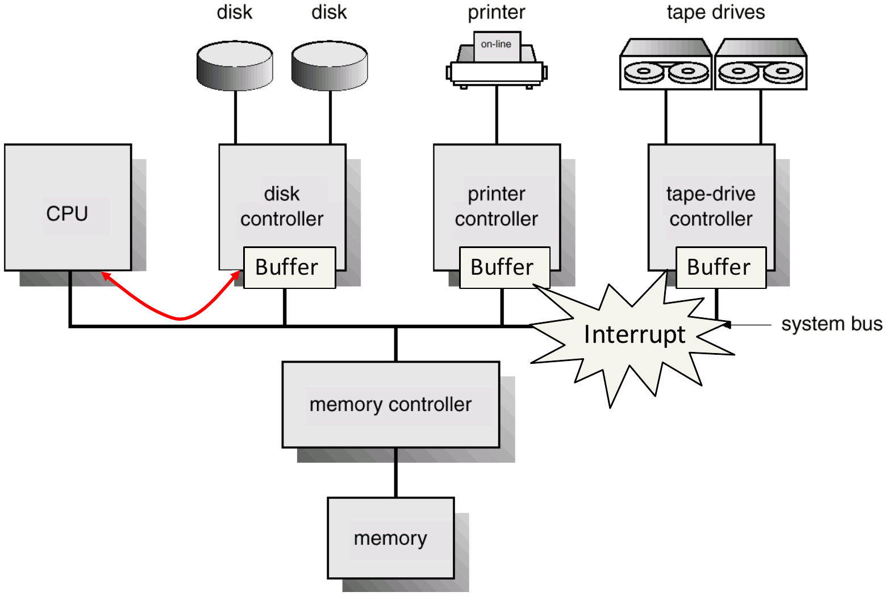
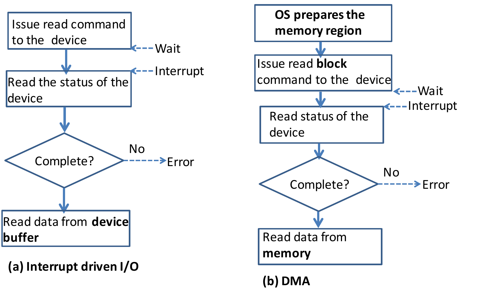

This page works through Tutorial 1, which tests Lecture 1 (Overview of Operating Systems). The questions are copied from the tutorial sheet. The answers follow the **official solutions**. The explanations around them are mine.

**How to use this page.** Try each part first, then open its drawer. Each question ends with a **Recap** drawer that lists the concepts the question used. Points marked **Not in the main notes** come from the official solutions and are missing from the lecture chapters. The **Extensions** at the end test Lecture 1 ideas that this tutorial skips. Their answers are **unofficial**.

---

## Question 1: Computer system operation

Review the following concepts on Computer System Operation, and explain how they are related to Operating Systems.

a) Computer Organization

<strong>Answer</strong> 

::: qa-answer
{width=70%}

The official answer asks three questions:

* **What is a device controller?** A device controller is in charge of the operations of one particular device type (for example, all the disks). Each controller has a local **buffer**.
* **How do the devices and the CPU communicate?** Through a **system bus**, which they all share.
* **How does a device tell the CPU that its I/O is done?** With an **interrupt**.

**The link to the OS:** the CPU and the controllers work at the same time. The OS starts an operation on a controller, runs other work, and gets an interrupt when the controller finishes. This is what lets the OS keep the CPU busy.
:::

b) Interrupts

<strong>Answer</strong> 

::: qa-answer
**Why do we say "operating systems are interrupt driven"?** If there are no interrupts (and no traps), the OS does not run. It stays idle. OS code runs only in response to an event: a device interrupt, a timer, an error, or a system call.

**The three major steps of interrupt handling:**

1. The OS **saves the state** of the current execution (the registers and the program counter).
2. The OS **finds the interrupt service routine (ISR)** for this interrupt type. (The interrupt vector holds one ISR address for each type.)
3. The **ISR runs**.

After the ISR, the saved state is restored, and the interrupted work continues.
:::

c) I/O Structure: Interrupt-Driven Data Transfer, Direct Memory Access (DMA) Data Transfer

<strong>Answer</strong> 

::: qa-answer
{width=75%}

| | Interrupt-driven I/O | DMA |
|---|---|---|
| Who moves the data | The CPU copies it from the **device buffer** into memory | The controller writes it straight into **memory** |
| Size of each transfer | Small (a byte or a word) | A **block** |
| Interrupts | **Many**: one for each small transfer | **Few**: one for each block |
| Suits | **Low-speed** devices | **High-speed** devices |

**The extra DMA step.** Before DMA starts, the **OS prepares the memory region** that the block goes into. This is the first box in the DMA flowchart, and the reason the last box reads "from memory", not "from device buffer".

**Why this matters for the OS:** with a fast device, interrupt-driven I/O sends so many interrupts that the CPU spends its time in ISRs. DMA cuts this to one interrupt for each block.
:::

<strong>Recap: concepts in Question 1</strong> 

::: qa-answer
* A **device controller** runs one device type and has a local buffer. All parts share the **system bus**.
* A device reports "done" with an **interrupt**. With no interrupts and no traps, the OS does not run: the OS is **interrupt driven**.
* Interrupt handling: **save state → find the ISR → run the ISR**.
* Interrupt-driven I/O: small transfers, many interrupts, slow devices. DMA: block transfers, one interrupt per block, fast devices, and the OS prepares the memory region first.
:::

---

## Question 2: True or false

Indicate whether the following statements are true or false. Justify your answers.

a) All I/O instructions are privileged instructions.

<strong>Answer</strong> 

::: qa-answer
**True.** I/O operations must go through the OS, so that the OS can check they are correct and legal. If a user program could run an I/O instruction itself, it could read another user's file or use a device it must not use. So the hardware lets only kernel mode run I/O instructions.
:::

b) Given a base register value of 0x1000 and a limit register value of 0x1000, access to memory location 0x1FFF will generate a trap.

<strong>Answer</strong> 

::: qa-answer
**False.** Each memory access must be in the range $[\text{base}, \text{base} + \text{limit} - 1]$.

$$[\texttt{0x1000},\ \texttt{0x1000} + \texttt{0x1000} - 1] = [\texttt{0x1000},\ \texttt{0x1FFF}]$$

0x1FFF is the **last legal address**, so the access succeeds. The first illegal address above the range is $\text{base} + \text{limit} = \texttt{0x2000}$.
:::

c) Popular operating systems for personal computer use (such as Windows and Linux) are real-time systems.

<strong>Answer</strong> 

::: qa-answer
**False.** They are usually **time-sharing** systems. A time-sharing system switches between jobs fast enough that each user feels they have the computer alone. It does not promise that each job finishes before a deadline. A **real-time** system makes that promise, for example the computer that fires an airbag.
:::

d) A system call always generates a trap.

<strong>Answer</strong> 

::: qa-answer
**True.** When the program makes a system call, the hardware generates a trap and switches from user mode to kernel mode. The kernel then finds the matching system-call function and runs it.

The reverse is not true: **not every trap is a system call**. An error such as a division by zero is also a trap.
:::

<strong>Recap: concepts in Question 2</strong> 

::: qa-answer
* **All I/O is privileged**, so all I/O goes through the OS.
* Legal addresses are $[\text{base}, \text{base} + \text{limit} - 1]$. The address $\text{base} + \text{limit} - 1$ is legal; $\text{base} + \text{limit}$ traps. Do the hex arithmetic carefully.
* Windows and Linux are **time-sharing**, not real-time. Real-time means deadlines.
* A **system call always traps** (user → kernel mode). A trap is not always a system call.
:::

---

## Question 3: Multiprogramming and multiprocessing

Distinguish between multiprogramming and multiprocessing. What were the key motivations for the development of each?

<strong>Answer</strong> 

::: qa-answer
| | Multiprogramming | Multiprocessing |
|---|---|---|
| What it means | More than one program runs **concurrently** (in progress at the same time), **even on one core** | Programs run on a computer with **more than one core** |
| Goal | **Improve CPU utilization**: when one program waits for I/O, another uses the CPU | **Increase computing power** with a parallel architecture |

**The official analogy: a food shop.** Each customer orders, waits for the food, then gets it. User A buys chicken wings; user B buys noodles.

* **Multiprogramming shop (one cook):** A orders, then B orders while A's food cooks. The cook is never idle, but the two orders still take turns on one cook.
* **Multiprocessing shop (two cooks):** A and B order and get their food **in parallel**, each with their own cook.
:::

<strong>Recap: concepts in Question 3</strong> 

::: qa-answer
* **Multiprogramming** = several programs in progress, interleaved on one core. Motivation: the CPU sat idle during I/O.
* **Multiprocessing** = several cores, true parallel execution. Motivation: more computing power.
* They are independent. A computer can have either one, or both.
:::

---

## Extensions

These test Lecture 1 ideas that the tutorial does not ask about. The answers are **unofficial**, worked from the lecture.

1. With base = 0x3000 and limit = 0x0400, which of these addresses trap: 0x2FFF, 0x3000, 0x33FF, 0x3400?

<strong>Answer (unofficial)</strong> 

::: qa-answer
The legal range is $[\texttt{0x3000},\ \texttt{0x3000} + \texttt{0x0400} - 1] = [\texttt{0x3000},\ \texttt{0x33FF}]$.

* 0x2FFF: below base → **trap**.
* 0x3000: the first legal address → legal.
* 0x33FF: the last legal address → legal.
* 0x3400: equals base + limit → **trap**.
:::

2. True or false: a program run by the root (administrator) user runs in kernel mode.

<strong>Answer (unofficial)</strong> 

::: qa-answer
**False.** Kernel mode and user mode are **hardware** modes, set by the mode bit. Root is a **user account** in the OS. A program that root runs still runs in user mode, and must still use system calls for I/O.
:::

3. What is the mode bit for kernel (monitor) mode, and what switches the CPU from user mode into kernel mode?

<strong>Answer (unofficial)</strong> 

::: qa-answer
Course convention: **monitor (kernel) mode = 0, user mode = 1**. The **hardware** switches to kernel mode when an **interrupt or a trap** occurs. The OS switches back to user mode before it returns to the user program. So user code can enter kernel mode only through a trap or an interrupt.
:::

4. Name three privileged instructions, and say why the instruction that loads the base register must be one of them.

<strong>Answer (unofficial)</strong> 

::: qa-answer
From the lecture: **I/O instructions**, the instructions that **load the base and limit registers**, and the instruction that **disables interrupts**.

If a user program could load the base register, it could move its own legal range over another program's memory, or over the OS. Memory protection would then mean nothing.
:::

5. True or false: DMA transfers cause no interrupts.

<strong>Answer (unofficial)</strong> 

::: qa-answer
**False.** DMA still causes interrupts, but only **one for each block**, not one for each byte. The interrupt tells the CPU that the block is in memory.
:::

6. How does a time-sharing system differ from a plain multiprogrammed system?

<strong>Answer (unofficial)</strong> 

::: qa-answer
A multiprogrammed system switches jobs **when a job waits for I/O**. Its goal is CPU utilization. A **time-sharing** system is a multiprogrammed system that is also **interactive**. It switches between jobs often and quickly, so each user gets fast responses and feels they have the computer alone. It may also swap jobs between memory and disk.
:::

7. Compare how a system call and a device interrupt start, and what mode change each causes.

<strong>Answer (unofficial)</strong> 

::: qa-answer
| | System call | Device interrupt |
|---|---|---|
| Who starts it | The running program (software) | A device (hardware) |
| Is it a trap? | Yes | No |
| Mode change | User → kernel | User → kernel |

Both stop the program and run OS code. The difference is the source: a system call goes from the CPU **to** a device; an interrupt comes **from** a device to the CPU.
:::

