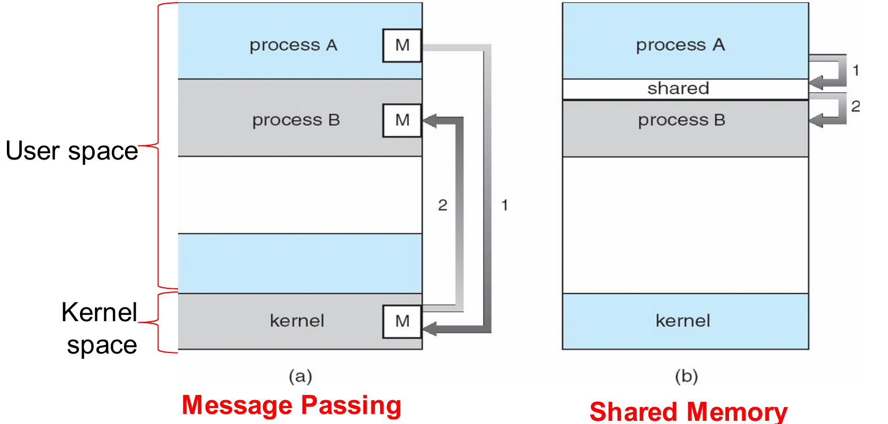
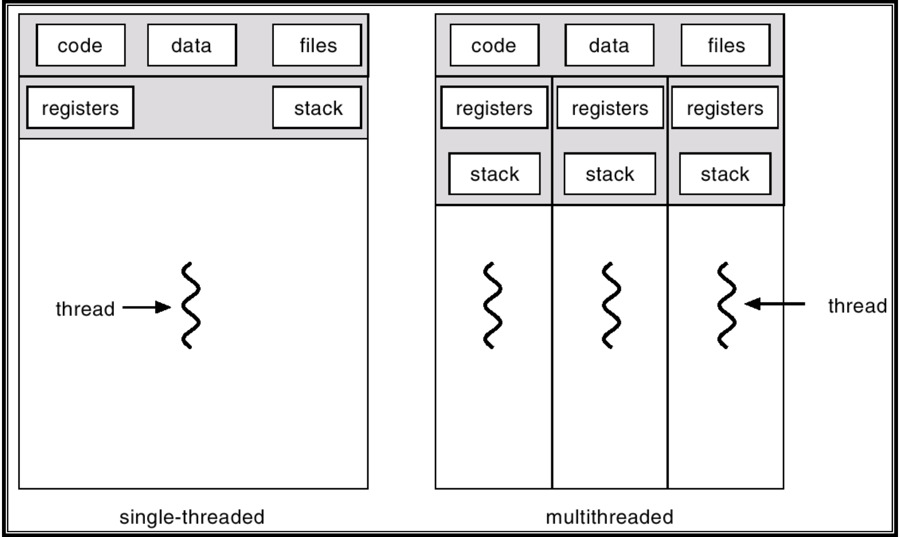
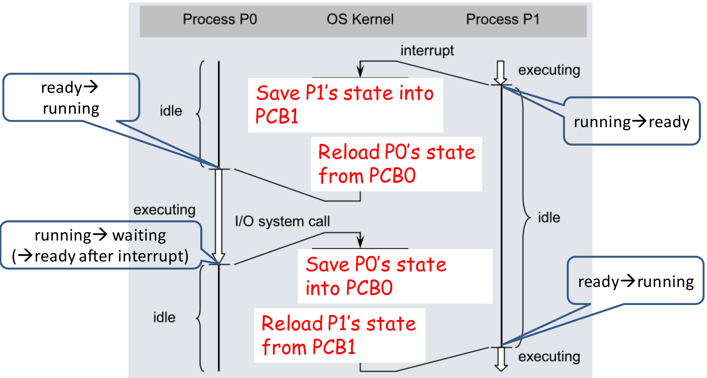

This page works through Tutorial 2, which tests Lecture 2 (Processes and Threads). The questions are copied from the tutorial sheet. The answers follow the **official solutions**. The explanations around them are mine.

**How to use this page.** Try each part first, then open its drawer. Each question ends with a **Recap** drawer. Points marked **Not in the main notes** come from the official solutions and are missing from the lecture chapters. The **Extensions** at the end test Lecture 2 ideas that this tutorial skips. Their answers are **unofficial**.

---

## Question 1: True or false

Indicate whether the following statements are true or false. Justify your answers.

a) A ready process waiting to get access to the CPU is in the "waiting" state.

<strong>Answer</strong> 

::: qa-answer
**False.** The process is in the **ready** state. A process in the **waiting** state waits for an event, or for an I/O operation to finish. The CPU cannot help a waiting process; a ready process needs only the CPU.
:::

b) When any hardware interrupt (not a trap) arrives, the process that is currently in the "running" state (if any), will be moved to the "ready" state.

<strong>Answer</strong> 

::: qa-answer
**True.** The OS moves the running process to **ready**, so that the interrupt service routine (ISR) can run. After the ISR, the OS picks the next process from the ready queue. It can be the same process or another one.

**Not in the main notes:** some OS implementations **do not update** the state in the PCB to "ready" while the ISR runs. They skip it when the OS knows that the same process will continue after the ISR. For the exam, the expected answer is still **True**.

Why not "waiting"? The interrupted process did not ask for anything. It can still run; it only lost the CPU. That is the definition of ready.
:::

c) The "wait()" system call is generally used by a child process to wait for instructions from a parent process.

<strong>Answer</strong> 

::: qa-answer
**False.** The **parent** calls `wait()` to wait until a **child finishes**.

**Not in the main notes:** `wait()` is also called `join()`, after the **fork-join** model. In this model, a parent forks several children to do independent computations. Then it joins them: it waits for each child and combines their results.
:::

d) Message passing based Inter-Process Communication (IPC) consumes less memory than shared memory based IPC.

<strong>Answer</strong> 

::: qa-answer
**False.** Message passing consumes **more** memory.

{width=70%}

In message passing, each message has a copy in the **sender**, a copy in the **kernel**, and a copy in the **receiver**. In shared memory, the data exists once, in the shared region.
:::

<strong>Recap: concepts in Question 1</strong> 

::: qa-answer
* **Ready** = waits only for the CPU. **Waiting** = waits for an event or I/O.
* A hardware interrupt moves the running process to **ready**, so the ISR can run. Afterwards the scheduler may pick a different process. (Some OSes skip the PCB update when the same process resumes.)
* `wait()` / `join()` is called by the **parent**, to wait for a child to finish. Fork-join: fork children, then join and combine results.
* **Message passing uses more memory** than shared memory, because every message is copied through the kernel.
:::

---

## Question 2: Data and stack regions

What are two main differences between the data and stack regions of a process memory?

<strong>Answer</strong> 

::: qa-answer
| | Data region | Stack region |
|---|---|---|
| Size | **Fixed** (static) when the process starts | **Grows and shrinks** as the process runs |
| What it holds | **Global** variables | **Local** variables and parameters of functions |

The stack grows when a function is called (its locals and parameters are pushed) and shrinks when the function returns. Globals live for the whole run, so their space can be fixed in advance.
:::

<strong>Recap: concepts in Question 2</strong> 

::: qa-answer
* Data: **fixed size, globals**. Stack: **grows and shrinks, locals and parameters**.
* (From the lecture: the **heap** is the other region that changes size. It holds memory allocated at run time.)
:::

---

## Question 3: Single-threaded and multi-threaded processes

Explain the difference between a single-threaded and a multi-threaded process.

<strong>Answer</strong> 

::: qa-answer
{width=65%}

* **What threads share:** the threads of one process share the **code, data and heap** regions. **Each thread has its own stack.** Each thread also has its own **thread control block (TCB)**, which is similar to a PCB.
* **Single-threaded:** there is only one thread of execution, so the thread and the process are the same thing.
* **Multi-threaded:** the threads can run concurrently, so **throughput goes up**. When one thread is blocked (in the "waiting" state), another thread of the same process can continue (in the "running" state).
:::

<strong>Recap: concepts in Question 3</strong> 

::: qa-answer
* Shared by all threads: **code, data, heap** (and open files).
* Private to each thread: **stack, registers, program counter**, and a **TCB**.
* Benefit: when one thread blocks, another thread of the same process runs. Higher throughput.
:::

---

## Question 4: Tracing a context switch

The figure below shows the execution of processes P0 and P1 in a multiprogramming system.

a) Identify state transitions of each process.

b) Describe operations A, B, C and D performed by the operating system kernel.

{width=50%}

<strong>Answer to (a) and (b)</strong> 

::: qa-answer
{width=80%}

**(a) State transitions**

| When | P0 | P1 |
|---|---|---|
| The interrupt arrives (A–B) | ready → running | running → ready |
| P0 makes the I/O system call (C–D) | running → waiting (→ ready later, when the I/O-done interrupt arrives) | ready → running |

**(b) Kernel operations**

* **A:** save P1's state into PCB1.
* **B:** reload P0's state from PCB0.
* **C:** save P0's state into PCB0.
* **D:** reload P1's state from PCB1.

Each pair (A–B, C–D) is one **context switch**: save the old process's context, then load the new one's.
:::

<strong>Why these transitions and not others</strong> 

::: qa-answer
**Not in the main notes.** The official solution discusses two other readings of the figure:

* **Could P0's first transition be waiting → ready → running?** Yes. P0 may have been waiting for an earlier I/O, and the interrupt in the figure may be the "I/O done" signal for it. Then P0 goes waiting → ready on the interrupt, and ready → running at B.
* **Could P1's first transition be running → waiting → ready?** Only if the "interrupt" were really an I/O system call by P1 (a trap). But then P1 would need some later event to move it from waiting to ready before it runs again at D. The figure shows no such event. So P1's first transition must be **running → ready**.

**The method:** a process can leave waiting only through an event that the figure shows. If no event appears, the process was not waiting.
:::

<strong>The exact steps between A and B</strong> 

::: qa-answer
**Not in the main notes.** The official solution lists the full sequence:

1. The interrupt arrives.
2. The CPU pauses the running process, switches the hardware to **kernel mode**, and gives control to the OS.
3. The OS saves the context of the running process.
4. The OS changes the state of that process from running to **ready** in its PCB.
5. The OS finds and runs the ISR.
6. After the ISR, the OS picks the next process from the ready queue.
7. The OS changes the state of the new process from ready to **running** in its PCB.
8. The OS switches the hardware to **user mode**.
9. The OS loads the context of the new process.
10. The new process starts running on the CPU.

Note the order: the **mode switch to kernel happens in hardware, first**; the switch back to user mode is done by the OS, at the end.
:::

<strong>Recap: concepts in Question 4</strong> 

::: qa-answer
* An interrupt: the running process goes **running → ready**. An I/O system call: the caller goes **running → waiting**, and later **waiting → ready** when the I/O finishes.
* A context switch = **save** the old context into its PCB, then **reload** the new context from its PCB.
* Infer states only from events the figure shows. A process cannot leave waiting without a shown event.
* Full interrupt sequence: hardware enters kernel mode → save context → PCB state to ready → ISR → pick next → PCB state to running → OS sets user mode → load context → run.
:::

---

## Extensions

These test Lecture 2 ideas that the tutorial does not ask about. The answers are **unofficial**, worked from the lecture.

1. Which of these transitions are impossible: waiting → running, ready → waiting, new → ready, running → terminated?

<strong>Answer (unofficial)</strong> 

::: qa-answer
**Waiting → running** and **ready → waiting** are impossible.

* A waiting process goes to **ready** first, then waits for the scheduler.
* A ready process is not running, so it cannot make an I/O request, so it cannot start to wait.

New → ready (admit) and running → terminated (exit) are normal transitions.
:::

2. A context switch takes 5 µs, and a process runs for 1 ms between switches. What fraction of CPU time is overhead? In which mode does the switch run, and why?

<strong>Answer (unofficial)</strong> 

::: qa-answer
Overhead fraction = $\frac{5\ \mu s}{1000\ \mu s + 5\ \mu s} \approx 0.5\%$. During the switch no user process runs, so this time is pure overhead.

The switch runs in **kernel mode**, because the PCBs are in kernel memory, which user programs cannot touch.
:::

3. Which scheduler controls the degree of multiprogramming after the system is running, and how?

<strong>Answer (unofficial)</strong> 

::: qa-answer
The **medium-term** scheduler. When the load is heavy, it **swaps out** a partly-run process from memory to disk. When the load is light, it swaps the process back in. (The **long-term** scheduler sets the degree at the start, by choosing which jobs to load. The **short-term** scheduler only picks which ready process runs next.)
:::

4. A program uses the many-to-one thread model. One thread calls a blocking `read()`. What happens to the other threads? Which model avoids this, and what does it cost?

<strong>Answer (unofficial)</strong> 

::: qa-answer
In many-to-one, all user threads share **one kernel thread**. The blocking call blocks that kernel thread, so **all** the user threads block.

**One-to-one** avoids it: each user thread has its own kernel thread, so the others keep running. The cost: every user thread needs a kernel thread, and too many kernel threads load the system. Many-to-many avoids both problems, but the best mapping is hard to decide.
:::

5. Name the PCB field that the scheduler uses to choose between ready processes, and the field that lets the process continue at the right instruction.

<strong>Answer (unofficial)</strong> 

::: qa-answer
The **priority** field (used by the scheduler) and the **program counter** (the address of the next instruction). The saved **CPU registers** are also needed to continue correctly.
:::

6. Two processes communicate through a mailbox. Is this direct or indirect message passing? What must the producer do when a bounded mailbox is full?

<strong>Answer (unofficial)</strong> 

::: qa-answer
**Indirect.** The processes send to and receive from a mailbox (port), and do not name each other. With a **bounded** mailbox, the producer must **wait** while it is full. The consumer must wait while it is empty.
:::

