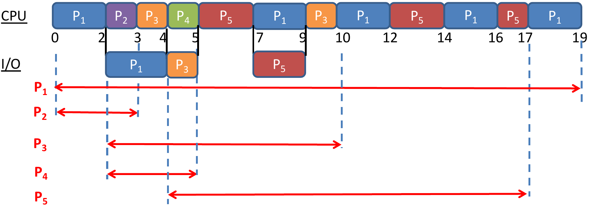

## Tutorial 1: Overview of Operating Systems

### Q1. Computer system operation

Review the following concepts on Computer System Operation, and explain how they are related to Operating Systems.

a) Computer Organization

<details class="qa">
<summary><strong>Answer</strong> <span class="qa-caret" aria-hidden="true"></span></summary>

::: qa-answer
{width=65%}

* **What is a device controller?** Each device controller is in charge of the operations for one particular device type. It has a local **buffer**.
* **What is the channel through which devices and the CPU communicate?** A **system bus**.
* **How do devices notify the CPU that I/O operations are done?** With an **interrupt**.

The CPU and the controllers work at the same time: the OS starts an operation, runs other work, and gets an interrupt when the controller finishes.
:::

</details>

b) Interrupts

<details class="qa">
<summary><strong>Answer</strong> <span class="qa-caret" aria-hidden="true"></span></summary>

::: qa-answer
**Why do we say "operating systems are interrupt driven"?** If there are no interrupts, the OS does not execute: it stays idle.

**The major steps of interrupt handling:**

1. The OS **saves the state** of the current execution.
2. It **determines the interrupt service routine (ISR)** according to the interrupt type.
3. The **ISR is executed**.
:::

</details>

c) I/O Structure: Interrupt-Driven Data Transfer, Direct Memory Access (DMA) Data Transfer

<details class="qa">
<summary><strong>Answer</strong> <span class="qa-caret" aria-hidden="true"></span></summary>

::: qa-answer
{width=70%}

| (a) Interrupt-driven I/O | (b) DMA |
|---|---|
| Issue read command → wait → interrupt → read status → read data from the **device buffer** | **OS prepares the memory region** → issue read **block** command → wait → interrupt → read status → read data from **memory** |
| Small-size I/O | Block-based I/O |
| More interrupts | Fewer interrupts |
| Low-speed devices | High-speed devices |
:::

</details>

### Q2. True or false

Indicate whether the following statements are true or false. Justify your answers.

<details class="qa">
<summary>a) All I/O instructions are privileged instructions. <span class="qa-caret" aria-hidden="true"></span></summary>

::: qa-answer
**True.** I/O operations must go through the OS to ensure their correctness and legality.
:::

</details>

<details class="qa">
<summary>b) Given a base register value of 0x1000 and a limit register value of 0x1000, access to memory location 0x1FFF will generate a trap. <span class="qa-caret" aria-hidden="true"></span></summary>

::: qa-answer
**False.** For memory protection, each access must be in the range $[\text{base}, \text{base} + \text{limit} - 1]$. Here that is $[\texttt{0x1000}, \texttt{0x1FFF}]$, so the access to 0x1FFF succeeds and does not trap. (0x2000 would trap.)
:::

</details>

<details class="qa">
<summary>c) Popular operating systems for personal computer use (such as Windows and Linux) are real-time systems. <span class="qa-caret" aria-hidden="true"></span></summary>

::: qa-answer
**False.** Those systems are usually **time-sharing** systems. (Real-time systems must meet deadlines.)
:::

</details>

<details class="qa">
<summary>d) A system call always generates a trap. <span class="qa-caret" aria-hidden="true"></span></summary>

::: qa-answer
**True.** When a system call is encountered, the hardware switches from user to kernel mode and generates a trap. The kernel then identifies and executes the matching system-call function. (The reverse does not hold: errors such as division by zero also trap.)
:::

</details>

### Q3. Multiprogramming vs multiprocessing

Distinguish between multiprogramming and multiprocessing. What were the key motivations for the development of each?

<details class="qa">
<summary><strong>Answer</strong> <span class="qa-caret" aria-hidden="true"></span></summary>

::: qa-answer
* **Multiprogramming:** running more than one program concurrently in a computer system, **even with a single-core CPU**. Goal: **improve CPU utilization**.
* **Multiprocessing:** executing programs on a computer with **more than one processing core**. Goal: **increase computing power** with parallel architectures.

**The official shop analogy.** Each customer orders, waits for the food, then gets it. User A buys chicken wings; user B buys noodles.

| Multiprogramming shop (one counter) | Multiprocessing shop (two counters) |
|---|---|
| A orders, B orders, A gets food, B gets food: the two orders interleave at one counter | A orders and gets food at one counter **while** B orders and gets food at the other |
:::

</details>

<details class="qa">
<summary><strong>Key points: Tutorial 1</strong> <span class="qa-caret" aria-hidden="true"></span></summary>

::: qa-answer
* Device controller: one device type, local buffer, shared system bus, signals "done" with an interrupt.
* The OS is interrupt driven. Handling: save state → find the ISR by interrupt type → run the ISR.
* Interrupt-driven I/O: small transfers, many interrupts, slow devices. DMA: OS prepares memory, block transfers, few interrupts, fast devices.
* All I/O is privileged. Legal addresses: $\text{base}$ to $\text{base} + \text{limit} - 1$.
* Windows and Linux are time-sharing. A system call always traps.
* Multiprogramming = one core, utilization. Multiprocessing = many cores, computing power.
:::

</details>

### Extensions

<details class="qa">
<summary>Base 0x3000, limit 0x0400: which of 0x2FFF, 0x3000, 0x33FF, 0x3400 trap? <span class="qa-caret" aria-hidden="true"></span></summary>

::: qa-answer
Legal range $[\texttt{0x3000}, \texttt{0x3000} + \texttt{0x0400} - 1] = [\texttt{0x3000}, \texttt{0x33FF}]$. **0x2FFF** (below base) and **0x3400** (= base + limit) trap; 0x3000 and 0x33FF are legal.
:::

</details>

<details class="qa">
<summary>True or false: a program run by the root user runs in kernel mode. <span class="qa-caret" aria-hidden="true"></span></summary>

::: qa-answer
**False.** Kernel and user mode are **hardware** modes set by the mode bit. Root is a **user account**. Root's programs run in user mode and still use system calls for I/O.
:::

</details>

<details class="qa">
<summary>What is the mode bit for kernel mode, and what switches the CPU into it? <span class="qa-caret" aria-hidden="true"></span></summary>

::: qa-answer
Monitor (kernel) mode = **0**, user mode = 1. The **hardware** switches to kernel mode on an **interrupt or trap**; the OS sets user mode again before returning to the program.
:::

</details>

<details class="qa">
<summary>Name three privileged instructions. Why must loading the base register be one? <span class="qa-caret" aria-hidden="true"></span></summary>

::: qa-answer
I/O instructions, loading the base and limit registers, and disabling interrupts. If a user program could load the base register, it could move its legal range over another program's memory or the OS.
:::

</details>

<details class="qa">
<summary>True or false: DMA transfers cause no interrupts. <span class="qa-caret" aria-hidden="true"></span></summary>

::: qa-answer
**False.** DMA causes **one interrupt per block**, not one per byte.
:::

</details>

<details class="qa">
<summary>How does time-sharing differ from plain multiprogramming? <span class="qa-caret" aria-hidden="true"></span></summary>

::: qa-answer
Multiprogramming switches jobs when one waits for I/O (goal: utilization). Time-sharing is multiprogramming that is also **interactive**: it switches quickly and often, so each user gets fast response.
:::

</details>

---

## Tutorial 2: Processes and Threads

### Q1. True or false

Indicate whether the following statements are true or false. Justify your answers.

<details class="qa">
<summary>a) A ready process waiting to get access to the CPU is in the "waiting" state. <span class="qa-caret" aria-hidden="true"></span></summary>

::: qa-answer
**False.** The process is in the **ready** state. A process in the waiting state is waiting for an event or the completion of an I/O operation.
:::

</details>

<details class="qa">
<summary>b) When any hardware interrupt (not a trap) arrives, the process that is currently in the "running" state (if any), will be moved to the "ready" state. <span class="qa-caret" aria-hidden="true"></span></summary>

::: qa-answer
**True.** The running process moves to ready so that the ISR can execute. After the ISR, either the same process or another process from the ready queue is selected.

*Note (new):* some OS implementations do not update the PCB state to ready while the ISR runs, when the OS knows that the same process will continue after the ISR.
:::

</details>

<details class="qa">
<summary>c) The "wait()" system call is generally used by a child process to wait for instructions from a parent process. <span class="qa-caret" aria-hidden="true"></span></summary>

::: qa-answer
**False.** It is used by a **parent** to wait for the completion of a **child**. It is sometimes called **`join()`** *(new)*, after the **fork-join** model: a parent forks several children for independent computations, then combines their results with `join()`.
:::

</details>

<details class="qa">
<summary>d) Message passing based Inter-Process Communication (IPC) consumes less memory than shared memory based IPC. <span class="qa-caret" aria-hidden="true"></span></summary>

::: qa-answer
**False.** It consumes **more** memory.

{width=60%}

Each message has a copy in the sender, in the kernel and in the receiver. Shared data exists once.
:::

</details>

### Q2. Data vs stack

What are two main differences between the data and stack regions of a process memory?

<details class="qa">
<summary><strong>Answer</strong> <span class="qa-caret" aria-hidden="true"></span></summary>

::: qa-answer
1. The size of the **data** region is **statically fixed**, whereas the **stack** can **grow and shrink** as the process executes.
2. The data region stores **global** variables, whereas the stack stores **local** variables and parameters of functions.
:::

</details>

### Q3. Single- vs multi-threaded

Explain the difference between a single-threaded and a multi-threaded process.

<details class="qa">
<summary><strong>Answer</strong> <span class="qa-caret" aria-hidden="true"></span></summary>

::: qa-answer
{width=55%}

* Threads in a process share the **code, data and heap** regions, whereas **stack space is unique to each thread**. Each thread also has its own **Thread Control Block (TCB)**, similar to a PCB.
* In a single-threaded process there is only one thread of execution, so it is identical to a process.
* In a multi-threaded process the threads can execute concurrently, increasing throughput: when one thread is blocked (waiting), another can continue (running).
:::

</details>

### Q4. Tracing a context switch

The figure below shows the execution of processes P0 and P1 in a multiprogramming system.

a) Identify state transitions of each process.

b) Describe operations A, B, C and D performed by the operating system kernel.

{width=45%}

<details class="qa">
<summary><strong>Answer (a) and (b)</strong> <span class="qa-caret" aria-hidden="true"></span></summary>

::: qa-answer
{width=75%}

**(a)** P0: ready → running (at B), then running → waiting at the I/O system call (→ ready after the I/O-done interrupt). P1: running → ready (at the interrupt), then ready → running (at D).

**(b)** A: save P1's state into PCB1. B: reload P0's state from PCB0. C: save P0's state into PCB0. D: reload P1's state from PCB1.
:::

</details>

<details class="qa">
<summary><strong>State transition options</strong> <span class="qa-caret" aria-hidden="true"></span></summary>

::: qa-answer
*(new)*

* **P0:** its first transition is ready → running. It could also be waiting → ready → running: the waiting → ready step would happen in response to the interrupt in the figure, for example if it signals the end of an I/O operation that P0 started earlier.
* **P1:** could its first transition be running → waiting → ready? Only if the "interrupt" in the figure were really an I/O system call (a trap). But then some event would have to move P1 from waiting to ready before it runs again, and the figure shows none. So P1's first transition must be **running → ready**.
:::

</details>

<details class="qa">
<summary><strong>Exact sequence of steps from A to B</strong> <span class="qa-caret" aria-hidden="true"></span></summary>

::: qa-answer
*(new)*

1. The interrupt arrives.
2. The CPU pauses the running process, switches the hardware to kernel mode, and gives control to the OS.
3. The OS saves the context of the running process.
4. The OS changes that process's state from running to ready in its PCB.
5. The OS identifies and executes the ISR.
6. After the ISR, the OS identifies the next process to run from the ready queue.
7. The OS changes the new process's state from ready to running in its PCB.
8. The OS switches the hardware to user mode.
9. The OS loads the context of the new process.
10. The new process starts running on the CPU.
:::

</details>

<details class="qa">
<summary><strong>Key points: Tutorial 2</strong> <span class="qa-caret" aria-hidden="true"></span></summary>

::: qa-answer
* Ready = waits only for the CPU. Waiting = waits for an event or I/O. A hardware interrupt sends the running process to ready.
* `wait()` / `join()` is called by the parent. Message passing uses more memory than shared memory (kernel copies).
* Data: fixed size, globals. Stack: grows and shrinks, locals and parameters.
* Threads share code, data and heap; each has its own stack and TCB.
* Context switch = save the old context into its PCB, reload the new context from its PCB.
* A process can leave waiting only through an event the figure shows. *(new)*
:::

</details>

### Extensions

<details class="qa">
<summary>Which transitions are impossible: waiting → running, ready → waiting, new → ready, running → terminated? <span class="qa-caret" aria-hidden="true"></span></summary>

::: qa-answer
**Waiting → running** (a waiting process goes to ready first) and **ready → waiting** (a ready process is not running, so it cannot request I/O). The other two are normal.
:::

</details>

<details class="qa">
<summary>A context switch takes 5 µs and a process runs 1 ms between switches. What fraction is overhead, and in which mode does the switch run? <span class="qa-caret" aria-hidden="true"></span></summary>

::: qa-answer
$5 / (1000 + 5) \approx 0.5\%$, pure overhead. It runs in **kernel mode**, because the PCBs are in kernel memory.
:::

</details>

<details class="qa">
<summary>Which scheduler controls the degree of multiprogramming while the system runs? <span class="qa-caret" aria-hidden="true"></span></summary>

::: qa-answer
The **medium-term** scheduler: it swaps partly-run processes out to disk when the load is heavy, and back in when it is light. The long-term scheduler sets the degree at the start; the short-term scheduler picks the next ready process.
:::

</details>

<details class="qa">
<summary>Many-to-one threads: one thread makes a blocking read(). What happens, and which model avoids it? <span class="qa-caret" aria-hidden="true"></span></summary>

::: qa-answer
All user threads block, because they share one kernel thread. **One-to-one** avoids it, at the cost of one kernel thread per user thread (too many load the system). Many-to-many avoids both, but the mapping is hard to decide.
:::

</details>

<details class="qa">
<summary>Two processes communicate through a mailbox. Direct or indirect? What must a producer do when a bounded mailbox is full? <span class="qa-caret" aria-hidden="true"></span></summary>

::: qa-answer
**Indirect** (they do not name each other). The producer must **wait** while it is full; the consumer waits while it is empty.
:::

</details>

---

## Tutorial 3: CPU Scheduling

### Q1. True or false

State whether each of the following statements are true or false. Justify your answers.

<details class="qa">
<summary>(a) When a new process is admitted in the system, the short-term scheduler must execute in order to keep the CPU busy. <span class="qa-caret" aria-hidden="true"></span></summary>

::: qa-answer
**False.** To keep the CPU busy, the short-term scheduler must execute only when a running process **terminates or blocks**. When a new process is admitted, it must execute only if **there is no other running process** in the system.
:::

</details>

<details class="qa">
<summary>(b) Partitioned multi-processor scheduling suffers from migration overheads due to data in private core-specific caches. <span class="qa-caret" aria-hidden="true"></span></summary>

::: qa-answer
**False.** Migration overheads occur in **global** scheduling, when a process partially executes on one core and then migrates to another. In partitioned scheduling processes don't migrate. Partitioned scheduling instead has **unbalanced loading** of the cores, depending on the process-core mapping.
:::

</details>

### Q2. Gantt charts with I/O

Consider the following set of processes that are using the same I/O device.

| Process | CPU Burst Times | I/O Burst Time | Arrival Time |
|---|---|---|---|
| P1 | 2, 8 | 2 (after first CPU burst) | 0 (order: 1) |
| P2 | 1 | 0 | 0 (order: 2) |
| P3 | 1, 1 | 1 (after first CPU burst) | 2 (order: 1) |
| P4 | 1 | 0 | 2 (order: 2) |
| P5 | 2, 3 | 2 (after first CPU burst) | 4 |

(a) Draw two Gantt charts illustrating the execution of these processes using:

i. Round-Robin (quantum = 2) uni-processor scheduling.

ii. Shortest Remaining Time First (SRTF) global multi-processor scheduling with 2 cores.

(b) What are the turnaround and waiting times of processes for each algorithm?

<details class="qa">
<summary><strong>Two rules you need</strong> <span class="qa-caret" aria-hidden="true"></span></summary>

::: qa-answer
*(new)*

1. **Same-instant queue order.** When several processes join the ready queue at the same time, they join in this order: a **new** process, then a **preempted** process, then a process **returning from I/O**.
2. **One shared I/O device** serves one process at a time. A process that finishes its CPU burst while the device is busy waits in the **device queue**.
:::

</details>

<details class="qa">
<summary><strong>Answer (a) i: Round robin, q = 2</strong> <span class="qa-caret" aria-hidden="true"></span></summary>

::: qa-answer


| Time | Event | Ready queue (head first) | Runs |
|---|---|---|---|
| 0 | P1, P2 arrive | P1, P2 | P1 0–2, then I/O 2–4 |
| 2 | P3, P4 arrive | P2, P3, P4 | P2 2–3, done |
| 3 | | P3, P4 | P3 3–4, then I/O 4–5 |
| 4 | **P5 new, P1 back from I/O** | P4, **P5, P1** | P4 4–5, done |
| 5 | P3 back from I/O | P5, P1, P3 | P5 5–7, then I/O 7–9 |
| 7 | | P1, P3 | P1 7–9 (6 left) |
| 9 | **P1 preempted, P5 back from I/O** | P3, **P1, P5** | P3 9–10, done |
| 10 | | P1, P5 | P1 10–12 (4 left) |
| 12 | P1 preempted | P5, P1 | P5 12–14 (1 left) |
| 14 | P5 preempted | P1, P5 | P1 14–16 (2 left) |
| 16 | P1 preempted | P5, P1 | P5 16–17, done |
| 17 | | P1 | P1 17–19, done |

A burst that ends before its quantum frees the CPU at once (P2 at 3, P3 at 4).
:::

</details>

<details class="qa">
<summary><strong>Answer (a) ii: global SRTF, 2 cores</strong> <span class="qa-caret" aria-hidden="true"></span></summary>

::: qa-answer


| Time | Event | Decision |
|---|---|---|
| 0 | P1 (2), P2 (1) arrive | Both run. P2 done at 1; core 2 idle 1–2 |
| 2 | P1 → I/O 2–4. P3 (1), P4 (1) arrive | Both run 2–3. P4 done |
| 3 | P3's first burst ends | Device busy with P1 until 4, so P3's I/O runs 4–5 |
| 4 | P1 back (next burst 8), P5 arrives (2) | Both cores free: P1 core 1, P5 core 2 |
| 5 | P3 back (1) | Preempts the running process with the **longest** remaining time, P1 (7 left). P3 5–6, done |
| 6 | P5 → I/O 6–8 | P1 resumes 6–13 |
| 8 | P5 back (3) | P5 8–11 on core 2 |

SRTF compares the remaining time of the **current CPU burst**: P1 returns at 4 with 8, not 2 + 8.
:::

</details>

<details class="qa">
<summary><strong>Answer (b): turnaround and waiting times</strong> <span class="qa-caret" aria-hidden="true"></span></summary>

::: qa-answer
* **Turnaround** = completion time − arrival time.
* **Waiting** = turnaround − all CPU bursts − time waiting for I/O. The I/O time **includes device-queue time** *(new)*, so waiting counts only ready-queue time.



| | P1 | P2 | P3 | P4 | P5 |
|---|---|---|---|---|---|
| RR turnaround | 19 | 3 | 8 | 3 | 13 |
| RR waiting | 7 | 2 | 5 | 2 | 6 |
| SRTF turnaround | 13 | 1 | 4 | 1 | 7 |
| SRTF waiting | 1 | 0 | 0 | 0 | 0 |

Checks: RR P1 $= 19 - 10 - 2 = 7$. RR P5 $= 13 - 5 - 2 = 6$. SRTF P3 $= 4 - 2 - 1\ (\text{device queue}) - 1\ (\text{I/O}) = 0$.
:::

</details>

### Q3. Reading a schedule backwards

Consider a set of processes P0–P6 with the following arrival times.

| Process | Arrival Time Instant |
|---|---|
| P0, P1, P4, P5, P6 | 0 (order: P0, P1, P4, P5, P6) |
| P2 | 3 |
| P3 | 9 |

A dual-core schedule of these processes is shown in the figure below.

{width=70%}

(a) What are the CPU and I/O burst lengths for each process (if there are multiple CPU or I/O bursts for a process, then identify all of them)?

(b) Does the schedule represent partitioned or global multiprocessor scheduling? Identify the scheduling algorithm(s) used in the schedule (select from those covered in the lectures). Justify your answer.

<details class="qa">
<summary><strong>Answer (a)</strong> <span class="qa-caret" aria-hidden="true"></span></summary>

::: qa-answer
As (CPU, I/O, CPU): P0 (1, 2, 2) · P1 (6) · P2 (1, 2, 1) · P3 (2) · P4 (3, 3, 2) · P5 (2) · P6 (4).

P2's CPU burst ends at 5 but its I/O starts at 7: the device is busy with P4 until 7. The gap is device-queue time, not a burst.
:::

</details>

<details class="qa">
<summary><strong>Answer (b)</strong> <span class="qa-caret" aria-hidden="true"></span></summary>

::: qa-answer
There are several possible answers. Assume processes join the ready queue in **PID order**.

**Partitioned scheduling (P1, P5, P6 on core 2):**

* **Core 2:** cannot be FCFS or RR, since both would run P1 first. It can be **SJF or SRTF**.
* **Core 1:**
    * FCFS: not possible, because P0 should have run at 4 (P0 and P2 are both ready then; P0 is first).
    * RR: the quantum would have to be ≥ 3 (P4 ran 3 units unbroken), but it is not possible for the same reason as FCFS.
    * **SRTF and SJF** are valid: both generate the schedule shown.

**Global scheduling:**

* FCFS or RR: not possible, because P1 should have run first, in parallel with P0.
* SRTF: not possible, because P6 (on core 2) should be preempted by P2 at time 3.
* **SJF: possible**, assuming SJF prioritizes by burst length. P4's first burst (3) is shorter than P6's (4), so at time 1 P4 runs before P6.
:::

</details>

### Q4. CPU efficiency under round robin

Measurements of a certain system have shown that the average process runs for time $T$ before blocking on I/O. A process switch requires time $S$, which is effectively wasted (overhead). Define what is meant by CPU efficiency. For round robin scheduling with quantum $Q$, give a formula for the CPU efficiency for each of the following cases:

(a) $Q = \infty$ (b) $Q > T$ (c) $S < Q < T$ (d) $Q = S$ (e) $Q = 0$

<details class="qa">
<summary><strong>Answer</strong> <span class="qa-caret" aria-hidden="true"></span></summary>

::: qa-answer
*(new)*

{width=75%}

$$\text{CPU efficiency} = \frac{\text{useful CPU time}}{\text{total CPU time}} = \frac{\text{CPU burst}}{\text{CPU burst} + \text{overhead per switch} \times \#\text{switches}} = \frac{T}{T + S \times \#\text{switches}}$$

* The quanta (green) add up to exactly $T$ (blue).
* The switch $S$ (black) is **neither part of $T$ nor part of $Q$**.
* **Include the first context switch**, which starts the process: it is also overhead.

| Case | #Switches | Efficiency |
|---|---|---|
| (a) $Q = \infty$ | 1 | $T/(S + T)$ |
| (b) $Q > T$ | 1 | $T/(S + T)$ |
| (c) $S < Q < T$ | $\lceil T/Q \rceil$ | $T/(T + S\lceil T/Q \rceil)$ |
| (d) $Q = S$ | $\lceil T/S \rceil$ | $T/(T + S\lceil T/S \rceil) \approx 0.5$ |
| (e) $Q = 0$ | $\infty$ | 0 |
:::

</details>

<details class="qa">
<summary><strong>Key points: Tutorial 3</strong> <span class="qa-caret" aria-hidden="true"></span></summary>

::: qa-answer
* The scheduler **must** run when the running process blocks or terminates; an arrival forces it only if no process is running.
* Global → migration overhead. Partitioned → unbalanced load.
* Same-instant queue order: **new → preempted → back from I/O**. *(new)*
* One shared I/O device: other requests wait in the device queue. *(new)*
* Waiting time = turnaround − CPU − I/O (including device queue) = ready-queue time. *(new)*
* SRTF/SJF compare the **current** burst. Global SRTF preempts the running process with the longest remaining time.
* Identify a scheduler by contradiction at each decision point; several answers can be valid. *(new)*
* Efficiency $= T/(T + S \cdot \#\text{switches})$; switches $= \lceil T/Q \rceil$, or 1 if $Q \ge T$; count the first switch. *(new)*
:::

</details>

### Extensions

<details class="qa">
<summary>RR, q = 2. P3 arrives at 0 (CPU 1, I/O 2, CPU 1); P1 at 1 (CPU 5); P2 at 3 (CPU 1). Chart and waiting times? <span class="qa-caret" aria-hidden="true"></span></summary>

::: qa-answer
P3 0–1, I/O 1–3. P1 1–3 (3 left). At 3, P2 (new), P1 (preempted) and P3 (back from I/O) join → **P2, P1, P3**. Then P2 3–4, P1 4–6, P3 6–7, P1 7–8.

Waiting: P1 $= 7 - 5 = 2$, P2 $= 1 - 1 = 0$, P3 $= 7 - 2 - 2 = 3$.
:::

</details>

<details class="qa">
<summary>SRTF on one core: P1 (0, 8), P2 (1, 4), P3 (2, 9), P4 (3, 5). Average waiting time? <span class="qa-caret" aria-hidden="true"></span></summary>

::: qa-answer
P1 0–1; P2 preempts (4 < 7) and runs 1–5; P4 5–10; P1 10–17; P3 17–26. Waiting: P1 9, P2 0, P3 15, P4 2. Average $= 26/4 = 6.5$.
:::

</details>

<details class="qa">
<summary>T = 10 ms, S = 1 ms. Efficiency for Q = 4 ms and Q = 20 ms? <span class="qa-caret" aria-hidden="true"></span></summary>

::: qa-answer
$Q = 4$: $\lceil 10/4 \rceil = 3$ switches → $10/13 \approx 76.9\%$. $Q = 20 > T$: 1 switch → $10/11 \approx 90.9\%$.
:::

</details>

<details class="qa">
<summary>FCFS: P1 (24), P2 (3), P3 (3) arrive at 0 in that order. Average wait? In the order P2, P3, P1? <span class="qa-caret" aria-hidden="true"></span></summary>

::: qa-answer
Waits 0, 24, 27 → average 17. Reordered: 0, 3, 6 → average 3. This is the **convoy effect**.
:::

</details>

<details class="qa">
<summary>What problem does priority scheduling have, and what fixes it? <span class="qa-caret" aria-hidden="true"></span></summary>

::: qa-answer
**Starvation** of low-priority processes. Fix: **aging**, raising priority the longer a process waits. SJF and SRTF can starve long jobs the same way.
:::

</details>

<details class="qa">
<summary>RR with 5 ready processes and q = 20 ms: longest wait for the next turn? What if q exceeds every burst? <span class="qa-caret" aria-hidden="true"></span></summary>

::: qa-answer
$(n-1)q = 80$ ms. If q exceeds every burst, RR becomes **FCFS**, and a larger q no longer changes average turnaround (below that, turnaround has no simple relation to q).
:::

</details>

<details class="qa">
<summary>Multilevel queue with fixed priority (foreground RR before background FCFS): the risk, and the alternative? <span class="qa-caret" aria-hidden="true"></span></summary>

::: qa-answer
The background queue can **starve**. Alternative: **time slices** between queues, for example 80% foreground, 20% background.
:::

</details>

<details class="qa">
<summary>Why is the best process-to-core assignment hard in partitioned scheduling? <span class="qa-caret" aria-hidden="true"></span></summary>

::: qa-answer
It is **NP-hard** (similar to knapsack), so systems use heuristics such as best-fit.
:::

</details>

---

## Tutorial 4: Process Synchronization I

The three requirements: **mutual exclusion** (at most one process in its critical section), **progress** (if the critical section is free and some processes want to enter, the choice cannot be postponed forever), **bounded waiting** (after a process requests entry, others can enter before it only a limited number of times).

### Q1. A broken user-level solution

Consider the following user-level solution to the critical section problem, where `flag` and `turn` are shared variables initialized to `false` and `0`, respectively.

```c
// Process P0                      // Process P1
while (1) {                        while (1) {
    flag = true;                       turn = 0;
    while (turn == 1);                 while (flag and turn == 0);
    critical-section                   critical-section
    turn = 1;                          flag = false;
    remainder-section                  remainder-section
}                                  }
```

Determine which of the three requirements are not satisfied, with justifications.

<details class="qa">
<summary><strong>Mutual exclusion</strong> <span class="qa-caret" aria-hidden="true"></span></summary>

::: qa-answer
**Not guaranteed.** Consider this sequence:

1. P1: `turn = 0;`
2. P1: `while (flag and turn == 0);` (flag is false, so P1 passes)
3. P1: critical section
4. Context switch from P1 to P0
5. P0: `flag = true;`
6. P0: `while (turn == 1);` (turn is 0, so P0 passes)
7. P0: critical section

P0 and P1 are both in the critical section.
:::

</details>

<details class="qa">
<summary><strong>Progress</strong> <span class="qa-caret" aria-hidden="true"></span></summary>

::: qa-answer
**Not guaranteed.** Consider this sequence:

1. P0 executes the while loop once, and `turn` becomes 1.
2. P0: `flag = true;`
3. P0: `while (turn == 1);` loops forever (only P1 resets `turn`, and P1 may stay in its remainder section).

Progress is not satisfied for P0.
:::

</details>

<details class="qa">
<summary><strong>Bounded waiting</strong> <span class="qa-caret" aria-hidden="true"></span></summary>

::: qa-answer
**Satisfied.**

1. **P0 waiting at `while (turn == 1);`**: P0 enters the moment P1 executes the first statement inside its loop (`turn = 0`). So P1 can enter its critical section **0 times** after P0 has requested access.
2. **P1 waiting at `while (flag and turn == 0);`**: P1 enters the moment P0 executes `turn = 1` after its critical section. So P0 can enter its critical section **1 time** after P1 has requested access.
:::

</details>

### Q2. True or false

Indicate whether the following statements are true or false. Justify your answers.

<details class="qa">
<summary>a) Mutual exclusion can be achieved by disabling interrupts during the critical section. <span class="qa-caret" aria-hidden="true"></span></summary>

::: qa-answer
**True.** By disabling interrupts, no other process, including the operating system, can run during the critical section.

From the lecture: this works on **one CPU only** (other CPUs keep running), and disabling interrupts is privileged. A variant that says "on a multiprocessor" is **False**.
:::

</details>

<details class="qa">
<summary>b) If a solution to a critical section problem satisfies progress, then it also satisfies bounded waiting. <span class="qa-caret" aria-hidden="true"></span></summary>

::: qa-answer
**False.** A solution that always favours a process P0 over another process P1 can satisfy progress without satisfying bounded waiting; bounded waiting is violated for P1. Example, with `flag` initialized to `false` and `timeout` some large value:

```c
// Process P0                 // Process P1
while (flag);                 while (flag) { wait(timeout); }
flag = true;                  flag = true;
critical section;             critical section;
flag = false;                 flag = false;
```

* Progress holds: when `flag` is false, a waiting process can enter.
* Bounded waiting fails for P1: P1 rechecks only after a long `timeout`, while P0 rechecks constantly. P0 can enter again and again while P1 sleeps.
:::

</details>

### Q3. A wrong TestAndSet

Consider the following implementation of `TestAndSet()`.

```c
boolean TestAndSet (boolean *target) {
    boolean rv = *target;
    *target = false;
    return rv;
}
```

Consider the following hardware-level solution to the critical section problem, where the code for a process Pi (i = 0 or 1) is shown. `lock` is a Boolean variable. The initial value of `lock = True`.

```c
// Process Pi:
while (1) {
    while (TestAndSet(&lock) == false);
    critical-section
    lock = false;
    remainder-section
}
```

Does this solution satisfy the properties of mutual exclusion and progress? Justify your answers.

<details class="qa">
<summary><strong>Answer</strong> <span class="qa-caret" aria-hidden="true"></span></summary>

::: qa-answer
Here `TestAndSet` sets the target to **false**, and the lock starts **True**: so `true` = free, `false` = taken.

* **Mutual exclusion: satisfied.** If either P0 or P1 enters the critical section, the other cannot enter, because `lock = false`: its `TestAndSet` returns false and it keeps looping.
* **Progress: not satisfied.** After either process executes its critical section, the exit sets `lock = false`, so the critical section **remains locked**. The other process waits indefinitely to enter. (The exit should set `lock = true`.)
:::

</details>

<details class="qa">
<summary><strong>Key points: Tutorial 4</strong> <span class="qa-caret" aria-hidden="true"></span></summary>

::: qa-answer
* To show a requirement **fails**, give one instruction sequence with context switches that breaks it.
* To show bounded waiting **holds**, take each place a process can wait and count how often the other can enter first.
* The requirements are independent: a solution can fail mutual exclusion and progress yet satisfy bounded waiting. **Progress does not imply bounded waiting** (a solution favouring one process).
* Disabling interrupts gives mutual exclusion on one CPU only.
* For any lock, work out which value means free; the exit section must restore it.
:::

</details>

### Extensions

<details class="qa">
<summary>counter = 5. A counter++ and a counter-- run concurrently, each as read, change, write. Possible results? <span class="qa-caret" aria-hidden="true"></span></summary>

::: qa-answer
**4, 5 or 6.** 5 if one finishes before the other reads. 6 or 4 if both read 5 and the last writer wins. This is a race condition.
:::

</details>

<details class="qa">
<summary>Algorithm 1 (turn only: while (turn != i); … turn = k;): which requirement fails? <span class="qa-caret" aria-hidden="true"></span></summary>

::: qa-answer
**Progress.** If `turn = 0` and P0 stays in its remainder section, P1 cannot enter even though the critical section is free. Mutual exclusion and bounded waiting hold.
:::

</details>

<details class="qa">
<summary>Algorithm 2 (flags only: flag[i] = true; while (flag[k]);): give a sequence that breaks progress. <span class="qa-caret" aria-hidden="true"></span></summary>

::: qa-answer
P0 sets `flag[0] = true`; switch; P1 sets `flag[1] = true`. Each now waits for the other's flag forever, and neither is inside.
:::

</details>

<details class="qa">
<summary>Peterson's solution: both processes are in the entry section at once. Which enters? <span class="qa-caret" aria-hidden="true"></span></summary>

::: qa-answer
The one that did **not** write `turn` last: each gives the turn away, so the last write hands it to the other. Peterson's satisfies all three requirements, for two processes.
:::

</details>

<details class="qa">
<summary>With the correct TestAndSet lock (sets true, lock starts false), which requirement fails? <span class="qa-caret" aria-hidden="true"></span></summary>

::: qa-answer
**Bounded waiting.** Under RR, if P0 is always inside when its quantum ends, P1 spins for its whole quantum, then P0 leaves and retakes the lock before P1 runs again. This can repeat forever.
:::

</details>

<details class="qa">
<summary>When is busy waiting better than blocking? <span class="qa-caret" aria-hidden="true"></span></summary>

::: qa-answer
When critical sections are **short**: a short spin costs less than the context switch that blocking needs.
:::

</details>

---

## Tutorial 5: Process Synchronization II

### Q1. Apples and oranges

Alice is playing a game that involves pairing apples with oranges. The game produces apples and oranges in separate baskets at random instants. For Alice to get points, she must pair exactly 1 apple with 2 oranges by picking them from the respective baskets. Each basket is protected by a semaphore; A for the apple basket and O for the orange basket. To access a basket, Alice must first acquire the corresponding semaphore.

Complete the code in the below figure to help Alice to play this game. You should only use the operations `Wait(A)`, `Wait(O)`, `Signal(A)` and `Signal(O)` in the boxes provided. You may use any number of these operations (including zero) in each of the boxes. Your solution must be deadlock-free even in the presence of other players who may be executing a different code.

```text
[ Box 1 ]
// Pick 1 apple
[ Box 2 ]
If (atleast 2 oranges in basket) {
    ** Pick 2 oranges and pair with apple. **
    [ Box 3 ]
} else {
    [ Box 4 ]
    ** Drop 1 apple back in basket **
    [ Box 5 ]
}
```

<details class="qa">
<summary><strong>Answer</strong> <span class="qa-caret" aria-hidden="true"></span></summary>

::: qa-answer
```text
Wait(A)                       // Box 1
// Pick 1 apple
Signal(A)                     // Box 2
Wait(O)
If (atleast 2 oranges in basket) {
    ** Pick 2 oranges and pair with apple. **
    Signal(O)                 // Box 3
} else {
    Signal(O)                 // Box 4
    Wait(A)
    ** Drop 1 apple back in basket **
    Signal(A)                 // Box 5
}
```

1. First acquire an apple and release semaphore A.
2. If there are at least 2 oranges available, acquire them and release semaphore O.
3. Else release semaphore O, drop the apple back, and release semaphore A.

**There is no deadlock, because the two semaphores are never acquired together (no nesting).** If Alice held A while waiting for O, another player taking O then A could deadlock with her.
:::

</details>

### Q2. A shifted semaphore

Consider the following implementations of the system calls `Wait()` and `Signal()`.

```c
Wait (Semaphore S)              Signal (Semaphore S)
{                               {
    S.value--;                      S.value++;
    If (S.value < -1) {             If (S.value <= 0) {
        block();                        wakeup();
    }                               }
}                               }
```

Suppose these system calls are guaranteed to be atomic and a Semaphore `S` in this system is used to protect critical sections as shown below. Assume `S` is initialized to 0. Explain if this solution ensures mutual exclusion and progress with justifications?

```c
// Process Pi:
While (1)
{
    Wait(S);
    Critical-section for Pi
    Signal(S);
    Remainder-section for Pi
}
```

<details class="qa">
<summary><strong>Answer</strong> <span class="qa-caret" aria-hidden="true"></span></summary>

::: qa-answer
* **Mutual exclusion: satisfied.** The first process to execute `Wait()` gets the critical section, and S becomes −1 *(the slide says "1", a typo: 0 − 1 = −1)*. Since the check is `< -1`, it does not block. Thereafter no other process can enter until the first executes `Signal()`. Also, since `Wait()` and `Signal()` run in pairs in that order and S starts at 0, its value can never be greater than 0.
* **Progress: satisfied.** When S goes from −1 to 0, `Signal()` executes an **unnecessary `wakeup()`** although no process is waiting. If S is less than −1, processes are blocked, and any `Signal()` wakes one of them. So no process is blocked while the semaphore is available (S = 0).

*Method (new):* tabulate what each value means. Here 0 = free, −1 = one inside, −1 − k = one inside and k waiting: the standard semaphore shifted down by 1, with the block test shifted the same way.
:::

</details>

### Q3. A semaphore from TestAndSet

Describe how `Wait(S)` and `Signal(S)` of a semaphore can be implemented using a TestAndSet instruction, given the below semaphore structure definition.

*Hint:* The semaphore value and the process queue `L` are shared variables among different processes when those processes access the semaphore.

```c
typedef struct {
    int value;
    struct process *L;
} semaphore;
```

<details class="qa">
<summary><strong>Step 1: where is the critical section?</strong> <span class="qa-caret" aria-hidden="true"></span></summary>

::: qa-answer
```c
// Current implementation of Wait(S)
S.value--;                                  // critical section
if (S.value < 0) {                          // critical section
    block();
        add current process to S.L;         // critical section
        put current process to waiting state;   // remainder section
}

// Current implementation of Signal(S)
S.value++;                                  // critical section
if (S.value <= 0) {                         // critical section
    wakeup(P);
        remove a process P from S.L;        // critical section
        add process P to ready queue;       // remainder section
}
```

**Not all of `block()` and `wakeup()` is in the critical section**: only the parts that touch the shared `S.value` and `S.L`.
:::

</details>

<details class="qa">
<summary><strong>Step 2: the implementation</strong> <span class="qa-caret" aria-hidden="true"></span></summary>

::: qa-answer
Shared variable: `boolean lock = false;`

```c
wait(S):
    while (TestAndSet(&lock));
    S.value = S.value - 1;
    if (S.value < 0) {
        add current process to S.L;
        lock = false;
        put current process to waiting state;
    }
    else lock = false;

signal(S):
    while (TestAndSet(&lock));
    S.value = S.value + 1;
    if (S.value <= 0) {
        remove a process P from S.L;
        lock = false;
        add process P to ready queue;
    }
    else lock = false;
```

* Every path releases the lock exactly once (inside the `if` or in the `else`).
* *(new)* The lock is released **before** the process goes to sleep. A sleeper holding the lock would block every `signal`, so no one could wake it.
* *(new)* The spin on `lock` lasts only a few instructions; the long wait is a real sleep in `S.L`.
:::

</details>

<details class="qa">
<summary><strong>Key points: Tutorial 5</strong> <span class="qa-caret" aria-hidden="true"></span></summary>

::: qa-answer
* Hold a semaphore only while touching its resource. **Never wait while holding another semaphore** when other code may use a different order: no nesting, no deadlock. *(new)*
* Modified semaphore: tabulate each value's meaning. An extra wakeup is harmless; a missed wakeup breaks progress. *(new)*
* Paired `Wait`/`Signal` from start value $v$ keep the value at most $v$.
* TestAndSet guards only the code touching `S.value` and `S.L`; the state change and the ready queue are outside. *(new)*
* Release the guard lock before sleeping, on every path. *(new)*
:::

</details>

### Extensions

<details class="qa">
<summary>A blocking semaphore starts at 2. Five processes call Wait, then one calls Signal. Value, and how many blocked? <span class="qa-caret" aria-hidden="true"></span></summary>

::: qa-answer
$2 - 5 + 1 = -2$, so **2 are blocked** (a value of $-k$ means $k$ waiting).
:::

</details>

<details class="qa">
<summary>Code B in Pk must run only after code A in Pi. Which semaphore, start value and placement? <span class="qa-caret" aria-hidden="true"></span></summary>

::: qa-answer
`flag` starting at **0**. Pi: `A; Signal(flag);` Pk: `Wait(flag); B;` If Pk arrives first, it blocks until Pi signals.
:::

</details>

<details class="qa">
<summary>Bounded buffer: the consumer calls Wait(mutex) before Wait(full) on an empty buffer. What happens? <span class="qa-caret" aria-hidden="true"></span></summary>

::: qa-answer
**Deadlock.** The consumer blocks on `full` while holding `mutex`; a producer then blocks on `mutex` and can never signal `full`. Wait for the resource first, then the mutex. The order of the two `Signal`s does not matter.
:::

</details>

<details class="qa">
<summary>Dining philosophers: three remedies for deadlock, and the condition each removes? <span class="qa-caret" aria-hidden="true"></span></summary>

::: qa-answer
At most four hungry (`seats = 4`): removes **circular wait**. Pick up both chopsticks only if both are free: removes **hold and wait**. Asymmetric order (odd left-first, even right-first): removes **circular wait**.
:::

</details>

<details class="qa">
<summary>Readers-preference readers–writers: who can starve, and why does only the first reader call Wait(wrt)? <span class="qa-caret" aria-hidden="true"></span></summary>

::: qa-answer
**Writers** can starve while readers keep arriving. The first reader locks out writers for the whole group; the last reader (`readcount == 0`) signals `wrt`. `mutex` protects `readcount`.
:::

</details>

<details class="qa">
<summary>Which orders of removal from list L can cause starvation? <span class="qa-caret" aria-hidden="true"></span></summary>

::: qa-answer
**Priority** and **LIFO**. FIFO prevents starvation.
:::

</details>

<details class="qa">
<summary>Why must Wait decrement S.value before checking it? <span class="qa-caret" aria-hidden="true"></span></summary>

::: qa-answer
If it decrements after waking, a third process can take the unit between the wakeup and the decrement, and both enter: mutual exclusion fails. Decrementing first reserves the place at the moment of the call.
:::

</details>

---

## Tutorial 6: Deadlocks

### Q1. True or false

Indicate whether the following statements are true or false. Justify your answers.

<details class="qa">
<summary>(a) In the dining-philosopher problem with five philosophers, if we allow at most four of them to be hungry simultaneously, deadlock may still occur. <span class="qa-caret" aria-hidden="true"></span></summary>

::: qa-answer
**False.** Deadlock does not occur, since at least one philosopher can get both chopsticks: four hungry philosophers share five chopsticks, so even if each holds one, one chopstick is free.
:::

</details>

<details class="qa">
<summary>(b) It is impossible to have a deadlock involving only one single process. <span class="qa-caret" aria-hidden="true"></span></summary>

::: qa-answer
**True.** The hold-and-wait condition can never be satisfied.
:::

</details>

<details class="qa">
<summary>(c) If a resource allocation graph contains a cycle, then a deadlock has occurred. <span class="qa-caret" aria-hidden="true"></span></summary>

::: qa-answer
**False.** It depends on the number of instances per resource type. One instance each → deadlock. Several instances → deadlock possible, not certain.
:::

</details>

### Q2. Banker's algorithm, one resource type

A resource-allocation state is given below. Assume Available = 2.

| | Allocation | Max | Need |
|---|---|---|---|
| PROCESS 1 | 1 | 6 | 5 |
| PROCESS 2 | 1 | 5 | 4 |
| PROCESS 3 | 2 | 4 | 2 |
| PROCESS 4 | 4 | 7 | 3 |

(a) If PROCESS 4 requests for one unit of the resource next, does this lead to a safe state or an unsafe one?

(b) If PROCESS 3 requests for one unit of the resource next, does this lead to a safe state or an unsafe one?

<details class="qa">
<summary><strong>Answer (a)</strong> <span class="qa-caret" aria-hidden="true"></span></summary>

::: qa-answer
After granting, Available = 1:

| | Allocation | Max | Need |
|---|---|---|---|
| PROCESS 1 | 1 | 6 | 5 |
| PROCESS 2 | 1 | 5 | 4 |
| PROCESS 3 | 2 | 4 | 2 |
| PROCESS 4 | **5** | 7 | **2** |

**Unsafe**, since $\text{Need}_i > \text{Available}$ for all $i$.
:::

</details>

<details class="qa">
<summary><strong>Answer (b)</strong> <span class="qa-caret" aria-hidden="true"></span></summary>

::: qa-answer
After granting, Available = 1:

| | Allocation | Max | Need |
|---|---|---|---|
| PROCESS 1 | 1 | 6 | 5 |
| PROCESS 2 | 1 | 5 | 4 |
| PROCESS 3 | **3** | 4 | **1** |
| PROCESS 4 | 4 | 7 | 3 |

**Safe**, since ⟨PROCESS 3, PROCESS 2, PROCESS 1, PROCESS 4⟩ satisfies the safety requirement: Available goes 1 → 4 (P3 returns 3) → 5 (P2 returns 1) → 6 (P1 returns 1) → 10 (P4 returns 4).
:::

</details>

### Q3. Banker's algorithm with unknowns

Consider the following snapshot of a system's state, with five processes (P0, P1, P2, P3 and P4) and four resource types (A, B, C and D). The current **Allocation**, **Need** and **Available** matrices are as shown in the table below.

| Process | Allocation (A B C D) | Need (A B C D) |
|---|---|---|
| P0 | 2 2 0 0 | 1 4 0 0 |
| P1 | 3 1 0 0 | 0 1 0 0 |
| P2 | 1 1 0 0 | 1 0 0 0 |
| P3 | 0 0 1 1 | 0 0 1 1 |
| P4 | 0 0 1 1 | 0 0 3 2 |

Available (A B C D) = 0 **x** **y** 1

Suppose process P3 generates the resource request (A=0 B=0 C=0 D=1) next. Compute the minimum values for **x** and **y** so that this request from P3 can be granted and the resulting system state is safe. Justify your answer and show the algorithm steps for generating the safe sequence.

<details class="qa">
<summary><strong>Answer</strong> <span class="qa-caret" aria-hidden="true"></span></summary>

::: qa-answer
The minimum values are **x = 2 and y = 2**. The safe sequence is **⟨P1, P2, P3, P0, P4⟩**.

A and B are only used by P0–P2, and C and D only by P3–P4. P1 and P2 can be processed with x = 1, but x = 2 is needed to complete P0 (B reaches only $1 + 1 + 1 = 3 < 4$ with x = 1). P3 can be processed with y = 1, but y = 2 is needed to complete P4 (C reaches only $1 + 1 = 2 < 3$ with y = 1).

Initially Available = 0 2 2 1. Granting P3's request (0 0 0 1): Available becomes **0 2 2 0**, P3's Need becomes **0 0 1 0** and its Allocation **0 0 1 2**.

| Available | Need | Allocation | Process completion |
|---|---|---|---|
| 0 2 2 0 | 0 1 0 0 | 3 1 0 0 | P1 |
| 3 3 2 0 | 1 0 0 0 | 1 1 0 0 | P2 |
| 4 4 2 0 | 0 0 1 0 | 0 0 1 2 | P3 |
| 4 4 3 2 | 1 4 0 0 | 2 2 0 0 | P0 |
| 6 6 3 2 | 0 0 3 2 | 0 0 1 1 | P4 |
| 6 6 4 3 | | | |

*Method (new):* apply the request first; split independent resource groups; find each group's bottleneck process; solve the inequality ($x + 2 \ge 4$, $y + 1 \ge 3$); check that one less fails.
:::

</details>

<details class="qa">
<summary><strong>Key points: Tutorial 6</strong> <span class="qa-caret" aria-hidden="true"></span></summary>

::: qa-answer
* At most four hungry philosophers → one always eats → no deadlock. One process alone cannot deadlock (no hold-and-wait).
* Cycle + single instances = deadlock. Cycle + multiple instances = maybe.
* Resource request: Request ≤ Need, Request ≤ Available, pretend to grant, run the safety algorithm, grant only if safe.
* A finished process returns its **Allocation**. Need ≤ Work must hold in every element.
* Unknowns: apply the request, split groups, find bottlenecks, solve, check one less fails. *(new)*
:::

</details>

### Extensions

<details class="qa">
<summary>The four necessary conditions for deadlock? If all four hold, must deadlock occur? <span class="qa-caret" aria-hidden="true"></span></summary>

::: qa-answer
Mutual exclusion, hold and wait, no preemption, circular wait. **Necessary but not sufficient**: deadlock may occur, but need not.
:::

</details>

<details class="qa">
<summary>Numbering resources and requesting them in increasing order breaks which condition, and why? <span class="qa-caret" aria-hidden="true"></span></summary>

::: qa-answer
**Circular wait.** A cycle would need a process holding a higher-numbered resource while waiting for a lower one, which the rule forbids.
:::

</details>

<details class="qa">
<summary>Q2 table: PROCESS 1 requests 6 units. Then, instead, 3 units. What happens each time? <span class="qa-caret" aria-hidden="true"></span></summary>

::: qa-answer
6 > Need (5): **error** (more than the declared maximum). 3 ≤ Need but 3 > Available (2): the process **waits**. The safety check runs only after both tests pass.
:::

</details>

<details class="qa">
<summary>P1 holds R1 and requests R2; P2 holds R2 and requests R1. Deadlock? What if R2 has a second instance held by P3, which requests nothing? <span class="qa-caret" aria-hidden="true"></span></summary>

::: qa-answer
One instance each: **deadlock**. With the second R2 held by P3: P3 finishes and releases R2, P1 gets it and finishes, then P2 gets R1. **No deadlock**, although the cycle exists.
:::

</details>

<details class="qa">
<summary>True or false: an unsafe state is a deadlocked state. <span class="qa-caret" aria-hidden="true"></span></summary>

::: qa-answer
**False.** Every deadlock is unsafe, but unsafe only means deadlock is possible.
:::

</details>

<details class="qa">
<summary>What do most operating systems, including UNIX and Windows, do about deadlock? <span class="qa-caret" aria-hidden="true"></span></summary>

::: qa-answer
**Ignore** it: prevention and avoidance cost time on every request, and deadlocks are rare.
:::

</details>

<details class="qa">
<summary>How do deadlock and starvation differ? <span class="qa-caret" aria-hidden="true"></span></summary>

::: qa-answer
Deadlock: a set of processes wait for each other and none can continue. Starvation: one process waits forever while others keep running.
:::

</details>
