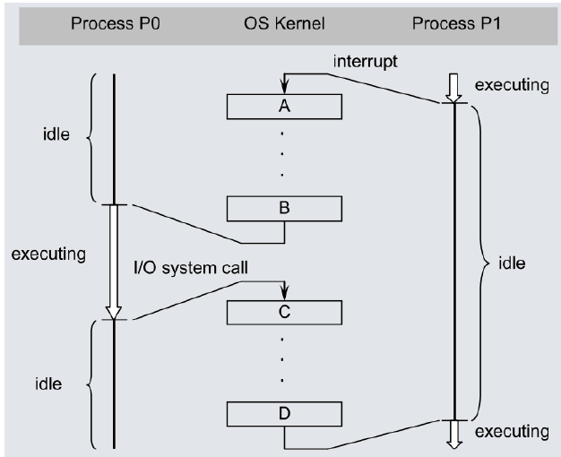
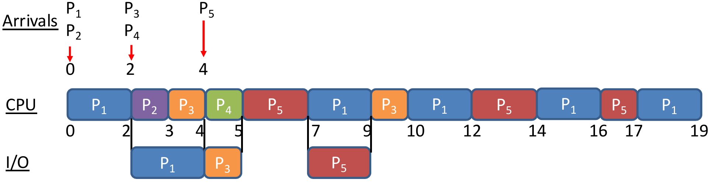
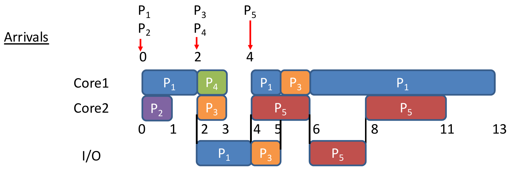
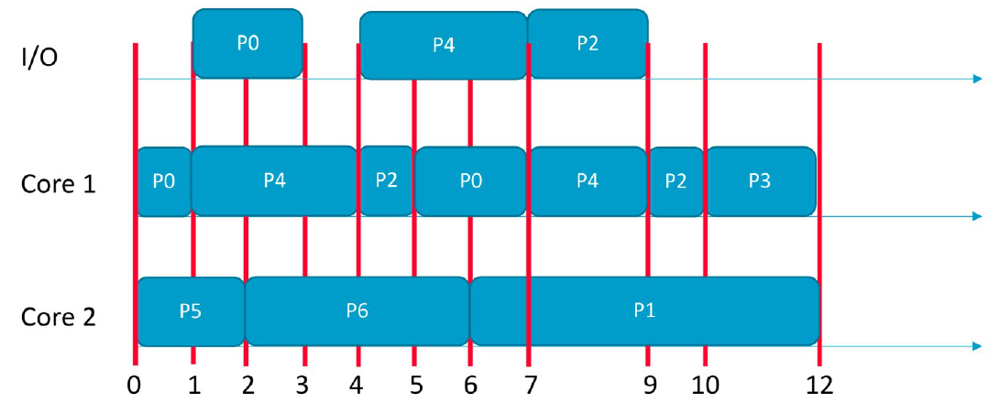

## Tutorial 1: Overview of Operating Systems

### Q1. Computer system operation

Review the following concepts on Computer System Operation, and explain how they are related to Operating Systems: a) Computer Organization; b) Interrupts; c) I/O Structure: Interrupt-Driven Data Transfer, Direct Memory Access (DMA) Data Transfer.

<details class="qa">
<summary><strong>Answer</strong> <span class="qa-caret" aria-hidden="true"></span></summary>

::: qa-answer
* **(a)** Each **device controller** runs one device type and has a local buffer. The CPU and the controllers share a **system bus**. A device tells the CPU its I/O is done with an **interrupt**.
* **(b)** The OS is **interrupt driven**: with no interrupts, it does not run. Handling: **save state → find the ISR for this interrupt type → run the ISR**.
* **(c)**

| | Interrupt-driven I/O | DMA |
|---|---|---|
| Data moves | CPU copies from the device buffer | Controller writes a block straight into memory |
| Interrupts | Many (one per small transfer) | Few (one per block) |
| Suits | Small I/O, slow devices | Block I/O, fast devices |

Before DMA starts, the **OS prepares the memory region** *new*.
:::

</details>

### Q2. True or false (justify)

<details class="qa">
<summary>a) All I/O instructions are privileged instructions. <span class="qa-caret" aria-hidden="true"></span></summary>

::: qa-answer
**True.** All I/O must go through the OS, which checks it is correct and legal.
:::

</details>

<details class="qa">
<summary>b) Given a base register value of 0x1000 and a limit register value of 0x1000, access to memory location 0x1FFF will generate a trap. <span class="qa-caret" aria-hidden="true"></span></summary>

::: qa-answer
**False.** Legal range $= [\text{base}, \text{base} + \text{limit} - 1] = [\texttt{0x1000}, \texttt{0x1FFF}]$. 0x1FFF is the last legal address; 0x2000 would trap.
:::

</details>

<details class="qa">
<summary>c) Popular operating systems for personal computer use (such as Windows and Linux) are real-time systems. <span class="qa-caret" aria-hidden="true"></span></summary>

::: qa-answer
**False.** They are **time-sharing** systems. Real-time means each job must meet a deadline.
:::

</details>

<details class="qa">
<summary>d) A system call always generates a trap. <span class="qa-caret" aria-hidden="true"></span></summary>

::: qa-answer
**True.** The hardware traps and switches to kernel mode; the kernel then runs the system-call function. (Not every trap is a system call: errors also trap.)
:::

</details>

### Q3. Multiprogramming vs multiprocessing

Distinguish between multiprogramming and multiprocessing. What were the key motivations for the development of each?

<details class="qa">
<summary><strong>Answer</strong> <span class="qa-caret" aria-hidden="true"></span></summary>

::: qa-answer
* **Multiprogramming:** several programs run concurrently, **even on one core**. Goal: **CPU utilization** (use the CPU while a program waits for I/O).
* **Multiprocessing:** programs run on **more than one core**. Goal: **more computing power** through parallel hardware.
:::

</details>

<details class="qa">
<summary><strong>Key points: Tutorial 1</strong> <span class="qa-caret" aria-hidden="true"></span></summary>

::: qa-answer
* Interrupt handling: save state → find ISR → run ISR. No interrupts, no OS activity.
* Interrupt-driven I/O = many interrupts, slow devices. DMA = one interrupt per block, fast devices.
* All I/O is privileged. Legal addresses: $\text{base}$ to $\text{base} + \text{limit} - 1$.
* Windows/Linux = time-sharing. A system call always traps.
* Multiprogramming (one core, utilization) ≠ multiprocessing (many cores, power).
:::

</details>

### Extensions

<details class="qa">
<summary>Base 0x3000, limit 0x0400: which of 0x2FFF, 0x3000, 0x33FF, 0x3400 trap? <span class="qa-caret" aria-hidden="true"></span></summary>

::: qa-answer
Legal range [0x3000, 0x33FF]. **0x2FFF and 0x3400 trap**; the other two are legal.
:::

</details>

<details class="qa">
<summary>True or false: a program run by root runs in kernel mode. <span class="qa-caret" aria-hidden="true"></span></summary>

::: qa-answer
**False.** Kernel/user is a hardware mode; root is a user account. Root's programs run in user mode.
:::

</details>

<details class="qa">
<summary>What is the mode bit for kernel mode, and what switches the CPU into it? <span class="qa-caret" aria-hidden="true"></span></summary>

::: qa-answer
Kernel (monitor) = **0**, user = 1. The **hardware** switches to kernel mode on an **interrupt or trap**.
:::

</details>

<details class="qa">
<summary>True or false: DMA causes no interrupts. <span class="qa-caret" aria-hidden="true"></span></summary>

::: qa-answer
**False.** One interrupt per block.
:::

</details>

---

## Tutorial 2: Processes and Threads

### Q1. True or false (justify)

<details class="qa">
<summary>a) A ready process waiting to get access to the CPU is in the "waiting" state. <span class="qa-caret" aria-hidden="true"></span></summary>

::: qa-answer
**False.** It is **ready**. "Waiting" means waiting for an event or I/O.
:::

</details>

<details class="qa">
<summary>b) When any hardware interrupt (not a trap) arrives, the process that is currently in the "running" state (if any), will be moved to the "ready" state. <span class="qa-caret" aria-hidden="true"></span></summary>

::: qa-answer
**True.** It goes to ready so the ISR can run; afterwards the OS picks the same or another process. *new*: some OSes skip the PCB update when they know the same process will resume.
:::

</details>

<details class="qa">
<summary>c) The "wait()" system call is generally used by a child process to wait for instructions from a parent process. <span class="qa-caret" aria-hidden="true"></span></summary>

::: qa-answer
**False.** The **parent** calls it to wait for a child to finish. *new*: also called `join()`, from the fork-join model (fork children, then join and combine their results).
:::

</details>

<details class="qa">
<summary>d) Message passing based Inter-Process Communication (IPC) consumes less memory than shared memory based IPC. <span class="qa-caret" aria-hidden="true"></span></summary>

::: qa-answer
**False.** It uses **more**: each message is copied from the sender into the kernel, then into the receiver.
:::

</details>

### Q2. Data vs stack

What are two main differences between the data and stack regions of a process memory?

<details class="qa">
<summary><strong>Answer</strong> <span class="qa-caret" aria-hidden="true"></span></summary>

::: qa-answer
Data: **fixed size**, holds **globals**. Stack: **grows and shrinks**, holds **locals and function parameters**.
:::

</details>

### Q3. Single- vs multi-threaded

Explain the difference between a single-threaded and a multi-threaded process.

<details class="qa">
<summary><strong>Answer</strong> <span class="qa-caret" aria-hidden="true"></span></summary>

::: qa-answer
* Threads share **code, data, heap**; each has its **own stack** and a **TCB** (like a PCB).
* Single-threaded: one thread = the process.
* Multi-threaded: threads run concurrently, so throughput rises; when one thread blocks, another keeps running.
:::

</details>

### Q4. Tracing a context switch

The figure below shows the execution of processes P0 and P1 in a multiprogramming system. a) Identify state transitions of each process. b) Describe operations A, B, C and D performed by the operating system kernel.

{width=45%}

<details class="qa">
<summary><strong>Answer</strong> <span class="qa-caret" aria-hidden="true"></span></summary>

::: qa-answer
| Kernel op | What it does | P0 | P1 |
|---|---|---|---|
| A | Save P1's state into PCB1 | | running → ready |
| B | Reload P0's state from PCB0 | ready → running | |
| C | Save P0's state into PCB0 | running → waiting (→ ready when its I/O ends) | |
| D | Reload P1's state from PCB1 | | ready → running |

*new*: P0's first transition could also be waiting → ready → running, if the interrupt signalled the end of P0's earlier I/O. P1's cannot be running → waiting: no event in the figure would release it.

*new*: full interrupt sequence: hardware enters kernel mode → save context → PCB state to ready → run ISR → pick next process → PCB state to running → OS sets user mode → load context → run.
:::

</details>

<details class="qa">
<summary><strong>Key points: Tutorial 2</strong> <span class="qa-caret" aria-hidden="true"></span></summary>

::: qa-answer
* Ready = needs only the CPU. Waiting = needs an event. An interrupt sends the running process to **ready**.
* `wait()`/`join()` is for the **parent**. Message passing uses **more** memory than shared memory.
* Data: fixed, globals. Stack: grows, locals. Threads share code/data/heap; each has its own stack, registers and TCB.
* Context switch = save old context to its PCB, reload new context from its PCB.
* A process leaves waiting only through a visible event. *new*
:::

</details>

### Extensions

<details class="qa">
<summary>Which transitions are impossible: waiting → running, ready → waiting, new → ready, running → terminated? <span class="qa-caret" aria-hidden="true"></span></summary>

::: qa-answer
**Waiting → running** (must pass through ready) and **ready → waiting** (a ready process isn't running, so it can't request I/O).
:::

</details>

<details class="qa">
<summary>Which scheduler controls the degree of multiprogramming while the system runs? <span class="qa-caret" aria-hidden="true"></span></summary>

::: qa-answer
The **medium-term** scheduler, by swapping processes out and in. (Long-term sets it at the start; short-term picks the next ready process.)
:::

</details>

<details class="qa">
<summary>Many-to-one threads: one thread makes a blocking call. What happens? <span class="qa-caret" aria-hidden="true"></span></summary>

::: qa-answer
**All** the user threads block (they share one kernel thread). One-to-one avoids it, at the cost of many kernel threads.
:::

</details>

<details class="qa">
<summary>In which mode does a context switch run, and is it useful work? <span class="qa-caret" aria-hidden="true"></span></summary>

::: qa-answer
**Kernel mode** (PCBs are in kernel memory). It is **pure overhead**.
:::

</details>

---

## Tutorial 3: CPU Scheduling

### Q1. True or false (justify)

<details class="qa">
<summary>(a) When a new process is admitted in the system, the short-term scheduler must execute in order to keep the CPU busy. <span class="qa-caret" aria-hidden="true"></span></summary>

::: qa-answer
**False.** It **must** run only when the running process **terminates or blocks**. An arrival forces it only if **no process is running**.
:::

</details>

<details class="qa">
<summary>(b) Partitioned multi-processor scheduling suffers from migration overheads due to data in private core-specific caches. <span class="qa-caret" aria-hidden="true"></span></summary>

::: qa-answer
**False.** Migration overhead is a **global** scheduling problem. Partitioned processes never move; their problem is **unbalanced load**.
:::

</details>

### Q2. Gantt charts with I/O

Consider the following set of processes that are using the same I/O device.

| Process | CPU Burst Times | I/O Burst Time | Arrival Time |
|---|---|---|---|
| P1 | 2, 8 | 2 (after first CPU burst) | 0 (order: 1) |
| P2 | 1 | 0 | 0 (order: 2) |
| P3 | 1, 1 | 1 (after first CPU burst) | 2 (order: 1) |
| P4 | 1 | 0 | 2 (order: 2) |
| P5 | 2, 3 | 2 (after first CPU burst) | 4 |

(a) Draw two Gantt charts using: i. Round-Robin (quantum = 2) uni-processor scheduling; ii. Shortest Remaining Time First (SRTF) global multi-processor scheduling with 2 cores. (b) What are the turnaround and waiting times of processes for each algorithm?

<details class="qa">
<summary><strong>Two rules first</strong> <span class="qa-caret" aria-hidden="true"></span></summary>

::: qa-answer
1. *new* **Same-instant queue order:** a **new** process joins before a **preempted** one, which joins before one **returning from I/O**.
2. *new* **One shared I/O device:** it serves one process at a time. A process that finishes its CPU burst while the device is busy waits in the **device queue**.
:::

</details>

<details class="qa">
<summary><strong>Answer (a) i: RR, q = 2</strong> <span class="qa-caret" aria-hidden="true"></span></summary>

::: qa-answer


The tie decisions:

* **t = 4:** P5 (new) and P1 (back from I/O) join together → queue P4, **P5, P1**.
* **t = 9:** P1 (quantum over) and P5 (back from I/O) join together → queue P3, **P1, P5**.
* A burst that ends before its quantum frees the CPU at once (P2 at 3, P3 at 4).
:::

</details>

<details class="qa">
<summary><strong>Answer (a) ii: global SRTF, 2 cores</strong> <span class="qa-caret" aria-hidden="true"></span></summary>

::: qa-answer


* **t = 3:** P3 finishes its CPU burst, but the device is busy with P1 until 4, so P3's I/O runs 4–5.
* **t = 5:** P3 returns (1). It preempts the running process with the **longest** remaining time, P1 (7 left), not P5 (1 left).
* "Remaining time" is for the **current CPU burst**: P1 returns at 4 competing with 8, not 2 + 8.
:::

</details>

<details class="qa">
<summary><strong>Answer (b): times</strong> <span class="qa-caret" aria-hidden="true"></span></summary>

::: qa-answer
Turnaround = completion − arrival. **Waiting = turnaround − CPU bursts − I/O time**, where I/O time **includes device-queue time** *new*. So waiting counts only ready-queue time.

| | P1 | P2 | P3 | P4 | P5 |
|---|---|---|---|---|---|
| RR turnaround | 19 | 3 | 8 | 3 | 13 |
| RR waiting | 7 | 2 | 5 | 2 | 6 |
| SRTF turnaround | 13 | 1 | 4 | 1 | 7 |
| SRTF waiting | 1 | 0 | 0 | 0 | 0 |

SRTF P3: $4 - 2\ (\text{CPU}) - 1\ (\text{device queue}) - 1\ (\text{I/O}) = 0$.
:::

</details>

### Q3. Reading a schedule backwards

Processes P0, P1, P4, P5, P6 arrive at 0 (order: P0, P1, P4, P5, P6); P2 arrives at 3; P3 at 9. A dual-core schedule of these processes is shown below. (a) What are the CPU and I/O burst lengths for each process? (b) Does the schedule represent partitioned or global multiprocessor scheduling? Identify the scheduling algorithm(s) used (select from those covered in the lectures). Justify your answer.

{width=70%}

<details class="qa">
<summary><strong>Answer (a)</strong> <span class="qa-caret" aria-hidden="true"></span></summary>

::: qa-answer
(CPU, I/O, CPU): P0 (1, 2, 2) · P1 (6) · P2 (1, 2, 1) · P3 (2) · P4 (3, 3, 2) · P5 (2) · P6 (4).

P2's CPU burst ends at 5 but its I/O starts at 7: it waited for the device (busy with P4). The gap is not a burst.
:::

</details>

<details class="qa">
<summary><strong>Answer (b)</strong> <span class="qa-caret" aria-hidden="true"></span></summary>

::: qa-answer
Several answers are valid. Ties join the queue in PID order.

* **Partitioned** (P1, P5, P6 on core 2) fits, since no process migrates.
    * Core 2 ran P5, P6, P1 (shortest first): **SJF or SRTF**. Not FCFS or RR, which would start P1.
    * Core 1: **SJF or SRTF**. Not FCFS or RR: at 4, P0 (ready since 3) is ahead of P2 in PID order, but P2 ran.
* **Global:** only **SJF** fits (using the current burst: at 1, P4's 3 beats P6's 4). FCFS and RR would run P1 at time 0. SRTF would preempt P6 (3 left) for P2 (1) at time 3.

*new* method: no migration → partitioned possible. At each decision point, ask what each algorithm would pick; one contradiction eliminates it.
:::

</details>

### Q4. CPU efficiency under RR

The average process runs for time $T$ before blocking on I/O. A process switch takes time $S$ (overhead). Define CPU efficiency. For round robin with quantum $Q$, give a formula for: (a) $Q = \infty$ (b) $Q > T$ (c) $S < Q < T$ (d) $Q = S$ (e) $Q = 0$.

<details class="qa">
<summary><strong>Answer</strong> <span class="qa-caret" aria-hidden="true"></span></summary>

::: qa-answer
*new* **Efficiency = useful CPU time ÷ total CPU time** $= \dfrac{T}{T + S \times \#\text{switches}}$. Count the **first** switch too.

| Case | Switches | Efficiency |
|---|---|---|
| (a) $Q = \infty$, (b) $Q > T$ | 1 | $T/(T + S)$ |
| (c) $S < Q < T$ | $\lceil T/Q \rceil$ | $T/(T + S\lceil T/Q \rceil)$ |
| (d) $Q = S$ | $\lceil T/S \rceil$ | $T/(T + S\lceil T/S \rceil) \approx 0.5$ |
| (e) $Q = 0$ | $\infty$ | 0 |
:::

</details>

<details class="qa">
<summary><strong>Key points: Tutorial 3</strong> <span class="qa-caret" aria-hidden="true"></span></summary>

::: qa-answer
* Scheduler **must** run when the running process blocks or exits. Global → migration; partitioned → unbalanced load.
* Same-instant order: **new → preempted → back from I/O**. *new*
* One shared I/O device: extra requests wait in the device queue. *new*
* Waiting time = ready-queue time only (exclude CPU, I/O and device-queue time). *new*
* SRTF/SJF compare the **current** burst. Global SRTF preempts the running process with the longest remaining time.
* Identify a scheduler by contradiction at decision points; several answers can be right. *new*
* Efficiency $= T/(T + S \cdot \#\text{switches})$, switches $= \lceil T/Q \rceil$ (1 if $Q \ge T$). *new*
:::

</details>

### Extensions

<details class="qa">
<summary>RR, q = 2. P3 arrives at 0 (CPU 1, I/O 2, CPU 1); P1 at 1 (CPU 5); P2 at 3 (CPU 1). Order of the queue at t = 3? <span class="qa-caret" aria-hidden="true"></span></summary>

::: qa-answer
P3 0–1 then I/O 1–3; P1 1–3. At 3: P2 (new), P1 (preempted), P3 (back from I/O) → **P2, P1, P3**. Chart: P2 3–4, P1 4–6, P3 6–7, P1 7–8. Waiting: P1 2, P2 0, P3 3.
:::

</details>

<details class="qa">
<summary>T = 10 ms, S = 1 ms. Efficiency for Q = 4 ms and Q = 20 ms? <span class="qa-caret" aria-hidden="true"></span></summary>

::: qa-answer
$Q = 4$: 3 switches → $10/13 \approx 77\%$. $Q = 20$: 1 switch → $10/11 \approx 91\%$.
:::

</details>

<details class="qa">
<summary>FCFS: P1 (24), P2 (3), P3 (3) arrive at 0 in that order. Average wait? And in the order P2, P3, P1? <span class="qa-caret" aria-hidden="true"></span></summary>

::: qa-answer
17, then 3. The **convoy effect**: short jobs stuck behind a long one.
:::

</details>

<details class="qa">
<summary>RR with 5 ready processes and q = 20 ms: longest wait for the next turn? What if q exceeds every burst? <span class="qa-caret" aria-hidden="true"></span></summary>

::: qa-answer
$(n-1)q = 80$ ms. If q exceeds every burst, RR = **FCFS**.
:::

</details>

<details class="qa">
<summary>Which problem does priority scheduling have, and what fixes it? <span class="qa-caret" aria-hidden="true"></span></summary>

::: qa-answer
**Starvation** of low-priority processes; fixed by **aging** (priority rises with waiting time).
:::

</details>

---

## Tutorial 4: Process Synchronization I

The three requirements: **mutual exclusion** (one process inside at a time), **progress** (if the critical section is free, someone who wants it can enter), **bounded waiting** (others can enter only a limited number of times ahead of a waiting process).

### Q1. A broken user-level solution

`flag` and `turn` are shared, initialized to `false` and `0`. Determine which of the three requirements are not satisfied, with justifications.

```c
// Process P0                      // Process P1
while (1) {                        while (1) {
    flag = true;                       turn = 0;
    while (turn == 1);                 while (flag and turn == 0);
    critical-section                   critical-section
    turn = 1;                          flag = false;
    remainder-section                  remainder-section
}                                  }
```

<details class="qa">
<summary><strong>Answer</strong> <span class="qa-caret" aria-hidden="true"></span></summary>

::: qa-answer
* **Mutual exclusion fails.** P1: `turn = 0`, passes its loop (`flag` still false), enters. Switch to P0: `flag = true`, passes `while (turn == 1)` (turn is 0), enters. Both inside.
* **Progress fails.** After one pass P0 sets `turn = 1`; next time it spins on `while (turn == 1)` forever if P1 stays in its remainder section.
* **Bounded waiting holds.** A waiting P0 enters as soon as P1 runs `turn = 0` (P1 enters 0 times first). A waiting P1 enters as soon as P0 runs `turn = 1` (P0 enters at most once first).
:::

</details>

### Q2. True or false (justify)

<details class="qa">
<summary>a) Mutual exclusion can be achieved by disabling interrupts during the critical section. <span class="qa-caret" aria-hidden="true"></span></summary>

::: qa-answer
**True** (official). No interrupts → no other process, not even the OS, runs. Caveat: on **one CPU only**; on a multiprocessor it is **False**.
:::

</details>

<details class="qa">
<summary>b) If a solution to a critical section problem satisfies progress, then it also satisfies bounded waiting. <span class="qa-caret" aria-hidden="true"></span></summary>

::: qa-answer
**False.** A solution that **always favours P0** satisfies progress but lets P1 wait forever. Official example: P0 checks `flag` constantly; P1 checks it only every long `timeout`, so P0 keeps getting in first.
:::

</details>

### Q3. A wrong TestAndSet

```c
boolean TestAndSet (boolean *target) {
    boolean rv = *target;
    *target = false;
    return rv;
}

// Process Pi (lock starts True):
while (1) {
    while (TestAndSet(&lock) == false);
    critical-section
    lock = false;
    remainder-section
}
```

Does this solution satisfy mutual exclusion and progress? Justify.

<details class="qa">
<summary><strong>Answer</strong> <span class="qa-caret" aria-hidden="true"></span></summary>

::: qa-answer
Here **`true` = free, `false` = taken**.

* **Mutual exclusion: yes.** The first process gets `true` and sets `false`; the other then gets `false` and spins.
* **Progress: no.** The exit sets `lock = false`, which means *still taken*. The lock never frees, so the other process waits forever. (Correct exit: `lock = true`.)
:::

</details>

<details class="qa">
<summary><strong>Key points: Tutorial 4</strong> <span class="qa-caret" aria-hidden="true"></span></summary>

::: qa-answer
* A requirement **fails**: show one bad interleaving. Bounded waiting **holds**: count, for each waiting spot, how often the other process can enter first.
* The three requirements are independent: progress ⇏ bounded waiting.
* Disabling interrupts: mutual exclusion on one CPU only.
* For any lock, work out which value means free; the exit must restore it.
:::

</details>

### Extensions

<details class="qa">
<summary>counter = 5; one counter++ and one counter-- run concurrently. Possible results? <span class="qa-caret" aria-hidden="true"></span></summary>

::: qa-answer
**4, 5 or 6**: a race condition (read, change, write can interleave).
:::

</details>

<details class="qa">
<summary>Algorithm 1 (turn only) and Algorithm 2 (flags only): which requirement fails? <span class="qa-caret" aria-hidden="true"></span></summary>

::: qa-answer
Both fail **progress**. Turn only: the other process may never hand over the turn. Flags only: both set their flags and wait forever. Peterson's (flag + turn) satisfies all three.
:::

</details>

<details class="qa">
<summary>Which requirement does the correct TestAndSet lock fail? <span class="qa-caret" aria-hidden="true"></span></summary>

::: qa-answer
**Bounded waiting**: one process can retake the lock again and again while the other spins.
:::

</details>

<details class="qa">
<summary>When is busy waiting better than blocking? <span class="qa-caret" aria-hidden="true"></span></summary>

::: qa-answer
When critical sections are **short**: spinning briefly costs less than a context switch.
:::

</details>

---

## Tutorial 5: Process Synchronization II

### Q1. Apples and oranges

Alice must pair exactly 1 apple with 2 oranges, picked from two baskets. Semaphore A protects the apple basket and O the orange basket; Alice must acquire a basket's semaphore to access it. Fill the boxes using only `Wait(A)`, `Wait(O)`, `Signal(A)`, `Signal(O)` (any number, including zero). The solution must be deadlock-free even if other players run different code.

```text
[ Box 1 ]
// Pick 1 apple
[ Box 2 ]
If (atleast 2 oranges in basket) {
    ** Pick 2 oranges and pair with apple. **
    [ Box 3 ]
} else {
    [ Box 4 ]
    ** Drop 1 apple back in basket **
    [ Box 5 ]
}
```

<details class="qa">
<summary><strong>Answer</strong> <span class="qa-caret" aria-hidden="true"></span></summary>

::: qa-answer
Box 1 `Wait(A)` · Box 2 `Signal(A); Wait(O)` · Box 3 `Signal(O)` · Box 4 `Signal(O); Wait(A)` · Box 5 `Signal(A)`.

No deadlock because Alice **never holds both semaphores at once** (no nesting). If she held A while waiting for O, a player taking O then A could deadlock with her.
:::

</details>

### Q2. A shifted semaphore

`Wait` and `Signal` are atomic; S starts at 0. Does `Wait(S); critical section; Signal(S);` ensure mutual exclusion and progress?

```c
Wait (Semaphore S)              Signal (Semaphore S)
{                               {
    S.value--;                      S.value++;
    If (S.value < -1) {             If (S.value <= 0) {
        block();                        wakeup();
    }                               }
}                               }
```

<details class="qa">
<summary><strong>Answer</strong> <span class="qa-caret" aria-hidden="true"></span></summary>

::: qa-answer
* **Mutual exclusion: yes.** The first `Wait` makes S = −1 (the slide says "1", a typo) and does not block, since the test is `< -1`. Any later `Wait` makes S ≤ −2 and blocks until a `Signal`.
* **Progress: yes.** Going from −1 to 0, `Signal` calls an unneeded but harmless `wakeup()`. Below −1, every `Signal` wakes a blocked process. No one stays blocked while S = 0 (free).

*new* method: tabulate what each value means. Here every value is the standard one shifted by −1, and so is the block test.
:::

</details>

### Q3. A semaphore from TestAndSet

Describe how `Wait(S)` and `Signal(S)` can be implemented with TestAndSet, given `typedef struct { int value; struct process *L; } semaphore;` (value and L are shared).

<details class="qa">
<summary><strong>Answer</strong> <span class="qa-caret" aria-hidden="true"></span></summary>

::: qa-answer
Only the code that touches `S.value` and `S.L` is the critical section. Shared `boolean lock = false;`:

```c
wait(S):
    while (TestAndSet(&lock));
    S.value = S.value - 1;
    if (S.value < 0) {
        add current process to S.L;
        lock = false;                  // release BEFORE sleeping
        put current process to waiting state;
    }
    else lock = false;

signal(S):
    while (TestAndSet(&lock));
    S.value = S.value + 1;
    if (S.value <= 0) {
        remove a process P from S.L;
        lock = false;
        add process P to ready queue;
    }
    else lock = false;
```

*new*: release the lock before sleeping, or no one can ever signal the sleeper. The spin on `lock` is short (a few instructions); the long wait is a real sleep in `S.L`.
:::

</details>

<details class="qa">
<summary><strong>Key points: Tutorial 5</strong> <span class="qa-caret" aria-hidden="true"></span></summary>

::: qa-answer
* Never `Wait` while holding another semaphore if others may use a different order. *new*
* Modified semaphore: tabulate the meaning of each value. An extra wakeup is harmless; a missed one breaks progress. *new*
* TestAndSet guards only the `S.value`/`S.L` code; state changes and the ready queue are outside. *new*
* Release the guard lock before sleeping; every path must release it. *new*
:::

</details>

### Extensions

<details class="qa">
<summary>A semaphore starts at 2. Five Waits, then one Signal. Value, and how many blocked? <span class="qa-caret" aria-hidden="true"></span></summary>

::: qa-answer
$2 - 5 + 1 = -2$ → **2 blocked**.
:::

</details>

<details class="qa">
<summary>Make code B (in Pk) run only after code A (in Pi). <span class="qa-caret" aria-hidden="true"></span></summary>

::: qa-answer
Semaphore `flag = 0`. Pi: `A; Signal(flag);` Pk: `Wait(flag); B;`
:::

</details>

<details class="qa">
<summary>Bounded buffer: the consumer calls Wait(mutex) before Wait(full) on an empty buffer. Result? <span class="qa-caret" aria-hidden="true"></span></summary>

::: qa-answer
**Deadlock**: it blocks holding `mutex`, so no producer can add an item. Wait for the resource first, then the mutex.
:::

</details>

<details class="qa">
<summary>Readers-preference readers–writers: who can starve? <span class="qa-caret" aria-hidden="true"></span></summary>

::: qa-answer
**Writers**, if readers keep arriving.
:::

</details>

<details class="qa">
<summary>Which removal orders from list L can starve a process? <span class="qa-caret" aria-hidden="true"></span></summary>

::: qa-answer
**Priority** and **LIFO**. FIFO prevents starvation.
:::

</details>

---

## Tutorial 6: Deadlocks

### Q1. True or false (justify)

<details class="qa">
<summary>(a) In the dining-philosopher problem with five philosophers, if we allow at most four of them to be hungry simultaneously, deadlock may still occur. <span class="qa-caret" aria-hidden="true"></span></summary>

::: qa-answer
**False.** Four philosophers, five chopsticks: at least one gets both.
:::

</details>

<details class="qa">
<summary>(b) It is impossible to have a deadlock involving only one single process. <span class="qa-caret" aria-hidden="true"></span></summary>

::: qa-answer
**True.** Hold-and-wait needs another process to wait on.
:::

</details>

<details class="qa">
<summary>(c) If a resource allocation graph contains a cycle, then a deadlock has occurred. <span class="qa-caret" aria-hidden="true"></span></summary>

::: qa-answer
**False.** It depends on the number of instances: single instances → deadlock; multiple → only possible.
:::

</details>

### Q2. Banker's algorithm, one resource type

Available = 2.

| | Allocation | Max | Need |
|---|---|---|---|
| PROCESS 1 | 1 | 6 | 5 |
| PROCESS 2 | 1 | 5 | 4 |
| PROCESS 3 | 2 | 4 | 2 |
| PROCESS 4 | 4 | 7 | 3 |

(a) If PROCESS 4 requests one unit next, is the result safe or unsafe? (b) If PROCESS 3 requests one unit next?

<details class="qa">
<summary><strong>Answer</strong> <span class="qa-caret" aria-hidden="true"></span></summary>

::: qa-answer
* **(a) Unsafe.** After granting: Available = 1; Needs are 5, 4, 2, 2. All exceed 1, so no process can finish first.
* **(b) Safe.** After granting: Available = 1, PROCESS 3 Need = 1. Sequence ⟨P3, P2, P1, P4⟩: Available goes 1 → 4 → 5 → 6 → 10.
:::

</details>

### Q3. Banker's algorithm with unknowns

| Process | Allocation (A B C D) | Need (A B C D) |
|---|---|---|
| P0 | 2 2 0 0 | 1 4 0 0 |
| P1 | 3 1 0 0 | 0 1 0 0 |
| P2 | 1 1 0 0 | 1 0 0 0 |
| P3 | 0 0 1 1 | 0 0 1 1 |
| P4 | 0 0 1 1 | 0 0 3 2 |

Available = (0, x, y, 1). P3 requests (0, 0, 0, 1) next. Find the minimum x and y so that the request can be granted and the resulting state is safe. Show the safe sequence.

<details class="qa">
<summary><strong>Answer</strong> <span class="qa-caret" aria-hidden="true"></span></summary>

::: qa-answer
**x = 2, y = 2**; safe sequence **⟨P1, P2, P3, P0, P4⟩**.

A, B are used only by P0–P2; C, D only by P3–P4, so solve each group alone. Bottlenecks: P0 needs B = 4 after P1 and P2 each return 1 B, so $x + 2 \ge 4$. P4 needs C = 3 after P3 returns 1 C, so $y + 1 \ge 3$.

Grant the request: Available 0 2 2 0; P3 Need 0 0 1 0, Allocation 0 0 1 2. Then:

| Work | Runs | Returns |
|---|---|---|
| 0 2 2 0 | P1 | 3 1 0 0 |
| 3 3 2 0 | P2 | 1 1 0 0 |
| 4 4 2 0 | P3 | 0 0 1 2 |
| 4 4 3 2 | P0 | 2 2 0 0 |
| 6 6 3 2 | P4 | 0 0 1 1 |
| 6 6 4 3 | done | |
:::

</details>

<details class="qa">
<summary><strong>Key points: Tutorial 6</strong> <span class="qa-caret" aria-hidden="true"></span></summary>

::: qa-answer
* At most four hungry philosophers → no deadlock. One process alone cannot deadlock.
* Cycle + single instances = deadlock; cycle + multiple instances = maybe.
* Request: check Request ≤ Need, Request ≤ Available, pretend to grant, then run the safety check. A finished process returns its **Allocation**.
* Unknowns: apply the request first, split independent resource groups, find each bottleneck, solve the inequality, check one less fails. *new*
:::

</details>

### Extensions

<details class="qa">
<summary>The four necessary conditions? If all hold, must deadlock occur? <span class="qa-caret" aria-hidden="true"></span></summary>

::: qa-answer
Mutual exclusion, hold and wait, no preemption, circular wait. Necessary, **not sufficient**: deadlock may occur.
:::

</details>

<details class="qa">
<summary>Numbering resources and requesting them in increasing order breaks which condition? <span class="qa-caret" aria-hidden="true"></span></summary>

::: qa-answer
**Circular wait.**
:::

</details>

<details class="qa">
<summary>Q2 table: PROCESS 1 requests 6 units; then 3 units. What happens? <span class="qa-caret" aria-hidden="true"></span></summary>

::: qa-answer
6 > Need (5): **error**. 3 ≤ Need but > Available (2): **wait**. The safety check runs only if both tests pass.
:::

</details>

<details class="qa">
<summary>True or false: an unsafe state is a deadlock. <span class="qa-caret" aria-hidden="true"></span></summary>

::: qa-answer
**False.** Unsafe means deadlock is possible, not certain.
:::

</details>

<details class="qa">
<summary>What do UNIX and Windows do about deadlock? <span class="qa-caret" aria-hidden="true"></span></summary>

::: qa-answer
**Ignore** it: prevention and avoidance cost time constantly, and deadlocks are rare.
:::

</details>
