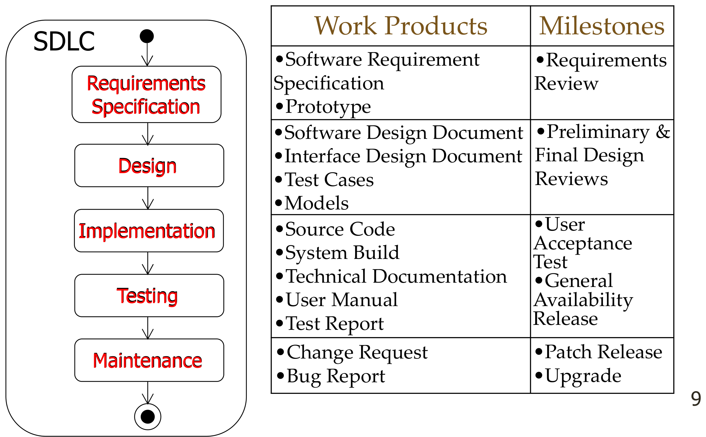
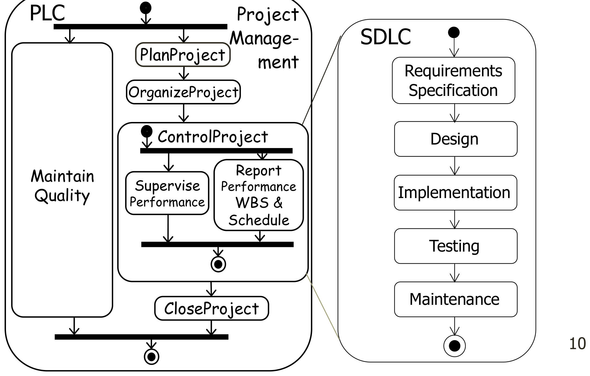
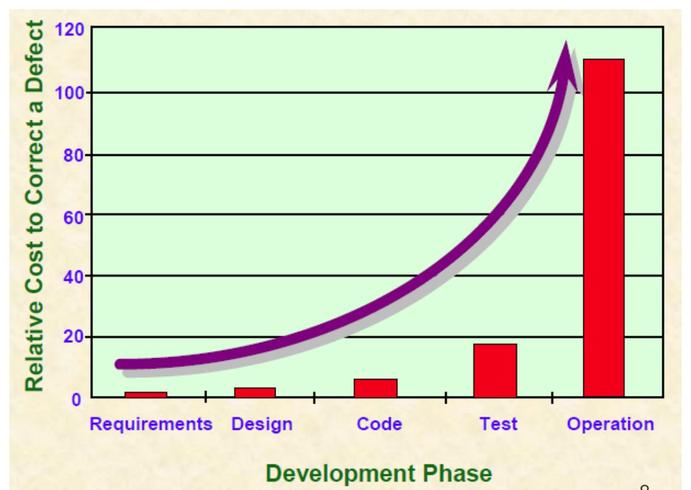

This was written entirely with AI.

# What software engineering is

A program that one person writes for one afternoon does not need much method. A system that 20 people build over two years, and that a company then uses for ten years, is different. Many people must agree on what to build. The work must finish on time and within the budget. Other people must be able to change the system later.

Software engineering is the method that makes this possible. The course uses this definition:

> Software engineering is the production of **maintainable**, **fault-free** software that **meets the user's requirements** and is **delivered on time and within budget**.

Each part of the definition is a separate goal:

- **Maintainable.** Other people can understand and change the software later.
- **Fault-free.** The software does not fail when people use it.
- **Meets the user's requirements.** The software does what the users need, not what the developers think the users need.
- **On time and within budget.** The project does not run late and does not cost more than the plan.

# The engineering activities

Think about how a company builds an office building. First, it decides what the building is for. Then it decides how many rooms, how big, and how it will look. Next, it designs the building and chooses materials, power and plumbing. Then it plans the schedule, builds, tests, and finally uses and repairs the building for many years.

Software follows the same order:

1. Decide what the software must do (requirements).
2. Decide how the software will do it (design).
3. Build it (implementation).
4. Make sure that it works and has no faults (testing).
5. Release it and keep it working (maintenance).

## The software development life cycle (SDLC)

These five activities are the **software development life cycle (SDLC)**. Each activity makes **work products**, which are documents or code. Each activity ends at a **milestone**, which is a check that the work is good enough to continue.

Some examples from the figure:

- Requirements specification makes the Software Requirements Specification (SRS) and a prototype. It ends at the requirements review.
- Testing makes test cases and a test report. It ends at the user acceptance test.
- Maintenance makes change requests and bug reports. It ends with patch releases and upgrades.

## The project life cycle (PLC)

The SDLC is the technical work. The project also needs management work: plan the project, organise the team, control progress, and close the project. This management work is the **project life cycle (PLC)**. The PLC runs around the SDLC for the full project.

# Why a fault costs more when you find it late

A wrong requirement is cheap to correct while it is still only a sentence in a document. After the team designs, builds and tests the system on that wrong sentence, the correction must change all of that work. If customers already use the system, the cost is highest.

This one fact explains many topics later in the course:

- Teams spend effort on good requirements (Parts 2–4).
- Teams make prototypes and models before they write code (Parts 3, 5, 6).
- Agile teams show working software to the customer often (Part 8).
- "Shift left" moves testing earlier in the project.

# Why software is costly and hard to maintain

## Why development costs are high

Development costs are high mostly because of rework. Rework is work that the team must do again.

1. **Low quality.** Many faults need more redesign, more coding and more testing than the plan expected.
2. **Wrong functions.** The team builds a function that the customer did not want. The team must redesign and build it again.
3. **Wrong user interface.** The team builds screens that the users cannot use well. The team must redesign them.
4. **Extra functions.** The team builds functions that nobody asked for. This makes the schedule longer.

Items 2, 3 and 4 all come from bad requirements.

## Why maintenance takes so much effort

1. Users keep asking for changes after the system is built.
2. People problems: the new staff do not fully understand the old system, morale is low, and managers give maintenance a low priority.
3. Technical problems: the design documents are not good, the code and its documents are low quality, and the system is hard to test.
4. Real-time systems and closely synchronised systems are hard to change safely.
5. A system that must last many years needs more maintenance over its life.
6. A system that depends on its hardware must change each time the hardware changes.

## Three properties of software that make development hard

- **Malleability.** Software is easy to change. So there is always pressure to change the software instead of replacing it. Many small changes damage its structure over time.
- **Complexity.** Software has many possible paths between its parts. A complex system needs more explanation than a simple system.
- **Size.** The number of errors increases faster than the size. A rough rule: if a program is two times as big, it has about four times as many errors (errors ≈ size²).

## How software is different from making hardware

1. **Software is not mass-produced.** A factory makes the same product again and again with the same design and process. So it can collect data and improve the process with statistics. To make a copy of software, you only copy a file. Each new software project has new requirements or a new design, so it is hard to learn from earlier projects with statistics.
2. **Software does not wear out.** A machine part wears out, so you replace it. Software does not wear out, so there is no clear time to retire it. Users keep asking for new functions in the old system. These changes damage the structure and decrease the quality.

Because of these two differences, software projects must do requirements work more often and more carefully.

# Getting ready for exam questions

- If a question asks why a project failed or became costly, connect the cause to **rework** and to **late discovery of faults**.
- If a question asks why maintenance is hard, give reasons from both sides:
  - **people:** understanding, morale, priorities;
  - **technical:** bad documents, low-quality code, hard to test, hardware dependence.
