This was written entirely with AI.

# Object design

System design gives the architecture. **Object design** fills in the details of the classes inside it. It has four activities:

1. **Interface specification.** Define the operations of each class: arguments, type signatures and exceptions.
2. **Reuse.** Use existing libraries and design patterns.
3. **Restructuring.** Change the design to meet goals such as maintainability and flexibility.
4. **Optimisation.** Improve speed or memory use.

# Design patterns

A **design pattern** is a proven solution to a problem that occurs again and again in a context. It is a template of classes and objects: their dependencies, structure, interactions and conventions. The "Gang of Four" (GoF) book of 1994 lists 23 patterns.

Each pattern has four elements:

| Element | Content |
|---|---|
| **Name** | A short name. It gives designers a shared vocabulary. |
| **Problem** | When to apply the pattern. What problem it solves. |
| **Solution** | The classes, their relationships, responsibilities and collaborations. |
| **Consequences** | The results: benefits and costs. They depend on the situation. |

The GoF patterns are in three groups:

| Group | Purpose | Patterns in this course |
|---|---|---|
| **Creational** | How objects are created | Factory (Factory Method, Abstract Factory) |
| **Structural** | How classes and objects are combined into larger structures | Façade |
| **Behavioural** | How objects interact and share responsibility | Strategy, Observer |

In an exam answer about a pattern, always give the **design problem** first, then the **pattern**, then the **class diagram with the role of each class**.

# Strategy pattern

## Problem

A set of algorithms or behaviours must be **interchangeable**. The client must be able to change the algorithm, even at run time, without a change to the client code. New algorithms must be addable without changes to existing code.

Signs in a project description: "a variety of …", "different methods of …", "the user can choose …", "support new … in future".

## Solution

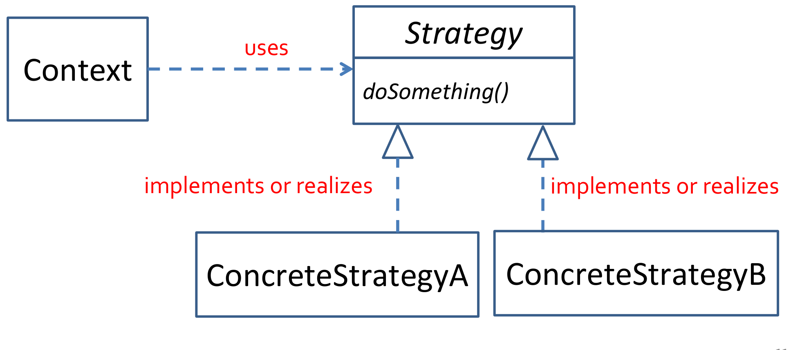

| Class | Role |
|---|---|
| **Context** | Uses an algorithm. It holds a reference to a Strategy object and calls it. It does not know which concrete strategy it has. |
| **Strategy** (interface) | Declares the operation that all algorithms share, for example `doSomething()`. |
| **ConcreteStrategyA, B, …** | Each one implements the operation in its own way. |

The Context depends only on the Strategy interface (**program to an interface**). To add a new algorithm, add a new ConcreteStrategy class. No existing class changes (**open–closed**). The varying part is moved out of the Context into separate classes (**encapsulate what varies**, **composition over inheritance**).

## Example in code: payment methods

```java
// Strategy interface
public interface PaymentStrategy {
    void pay(int amount);
}

// Concrete strategies
public class CreditCardStrategy implements PaymentStrategy {
    private String cardNumber;
    public CreditCardStrategy(String cardNumber) { this.cardNumber = cardNumber; }
    public void pay(int amount) { System.out.println(amount + " paid with credit card."); }
}

public class PaypalStrategy implements PaymentStrategy {
    private String email;
    public PaypalStrategy(String email) { this.email = email; }
    public void pay(int amount) { System.out.println(amount + " paid using PayPal."); }
}

// Context
public class ShoppingCart {
    private PaymentStrategy paymentStrategy;
    public void setPaymentStrategy(PaymentStrategy s) { this.paymentStrategy = s; }
    public void checkout(int amount) { paymentStrategy.pay(amount); }
}

// Client
ShoppingCart cart = new ShoppingCart();
cart.setPaymentStrategy(new CreditCardStrategy("1234-5678-9012-3456"));
cart.checkout(500);
cart.setPaymentStrategy(new PaypalStrategy("user@example.com"));
cart.checkout(300);
```

## Example: network protocols on a mobile device

A mobile device must use many network protocols (LAN, Wi-Fi, Bluetooth, 3G, 4G). New protocols must be addable with little effect on the application.

- **Design problem:** the protocols must be interchangeable and invisible to the rest of the application. New protocols must be addable with minimal change (extensibility).
- **Pattern:** Strategy.

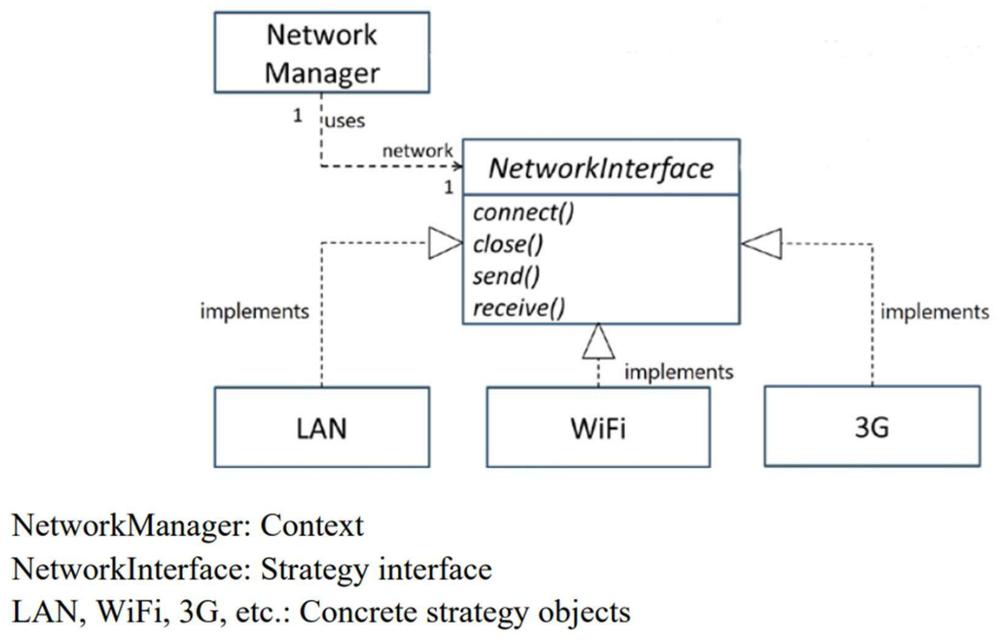

Other uses:

- sorting algorithms: quick sort or merge sort, chosen by the size of the data;
- compression formats: ZIP, GZIP or TAR;
- routes in a navigation app: driving, walking, cycling or public transport;
- recommendation or ranking algorithms.

## Consequences

| Pros | Cons |
|---|---|
| Encapsulates each algorithm | Code becomes complex and hard to follow if it is overused |
| Hides the implementation from the client | The client (or something) must still choose the concrete strategy |
| Behaviour can change at run time | More classes |

# Observer pattern

## Problem

Many objects (**observers**) must get an update when another object (the **subject**) changes. Two conditions make this hard:

- The subject does not know, and does not care, who the observers are or how many there are. Observers can join and leave at any time.
- The observers want to know about each change at once, but they do not know when it will happen. They cannot keep checking the subject, because they have other work to do.

Example: a baby (subject) cries. Caregivers (observers) want to know when the baby cries, but they cannot watch the baby all the time. The baby does not care who looks after it. Each caregiver decides what to do when the baby cries.

Other examples: a course site and the students registered on it; a stock market and its investors; a worksheet and its charts.

The solution must give **loose coupling** between the subject and the observers. Loose coupling is a benefit for both sides. The Observer pattern is also called **publish–subscribe**.

> The Observer pattern defines a **one-to-many** dependency between objects. When one object changes state, all its dependents are notified and updated automatically.

## Solution

The pattern has two mechanisms:

1. **Subscription.** Observers register and unregister with the subject whenever they want. The subject keeps a list of observers.
2. **Notification.** When the subject changes, it goes through its list and tells each observer.

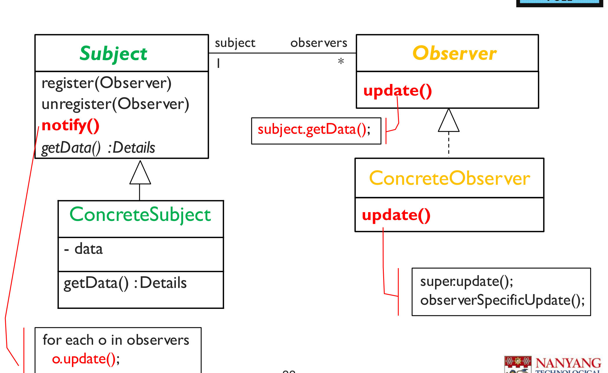

| Class | Role |
|---|---|
| **Subject** | Keeps the list of observers. Has `register(Observer)`, `unregister(Observer)` and `notify()`. `notify()` calls `update()` on each observer. |
| **ConcreteSubject** | Holds the real data. Has `getData()` so that observers can read the new state. |
| **Observer** (interface) | Declares `update()`. |
| **ConcreteObserver** | Implements `update()` with its own reaction. Holds a reference to its subject. |

The subject knows only the Observer interface. It never knows the concrete observer classes.

## Pull, push, and push + pull

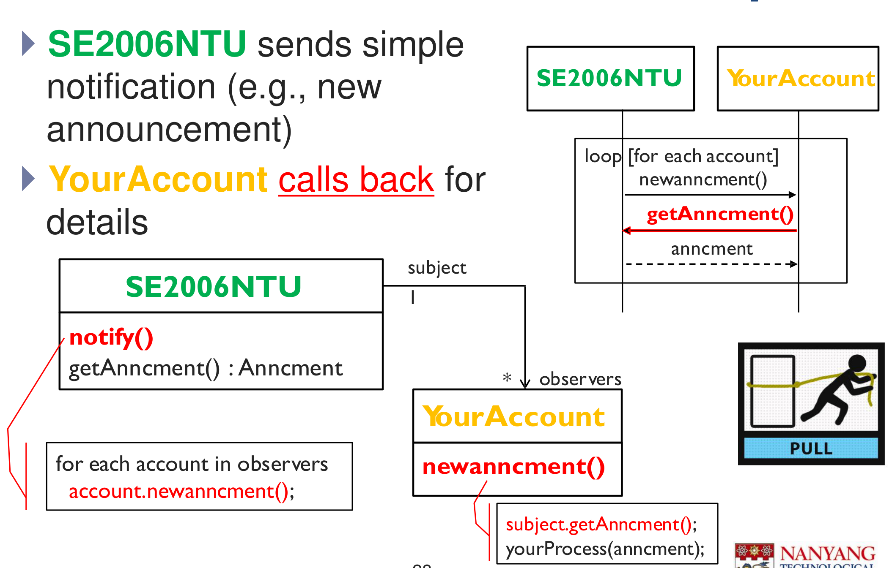

| Protocol | How it works | Communication |
|---|---|---|
| **Pull** | The subject sends a simple notification: `update()`. If the observer is interested, it calls back `subject.getData()` for the details. | Two-way |
| **Push** | The subject sends the full details in the notification: `update(details)`, whether the observer wants them or not. The observer does not need to call back. | One-way |
| **Push + pull** | The subject pushes some details. If the observer wants more, it pulls the rest with `getMoreData()`. | Both |

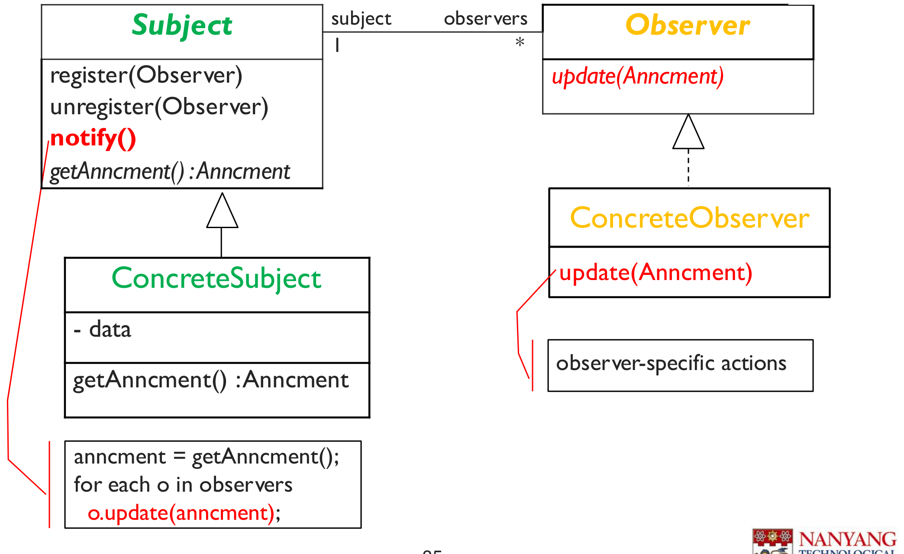

Which is better depends on the case:

- Push is simpler for observers and faster when all observers need the same small data. It wastes effort if the data is large and most observers do not need it.
- Pull sends only a small notification. Each observer fetches only what it needs. But each observer needs a reference to the subject, and it makes an extra call.

## Selective notification and interest subscription

Often, an observer cares about only part of the subject. A student in a course wants only the announcements for their own tutorial group. An investor wants only the price changes for their own stocks.

- **Interest subscription:** `register(Observer, Interest)` and `unregister(Observer, Interest)`. The subject keeps a list of observers for each interest.
- **Selective notification:** `notify(Interest)` tells only the observers of that interest.

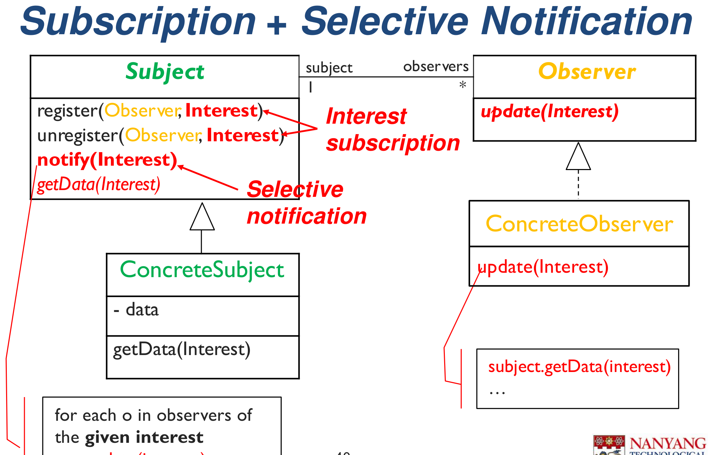

## Example: Java Swing events

Event handling in Java Swing is the Observer pattern. A button is the subject. Action listeners are the observers.

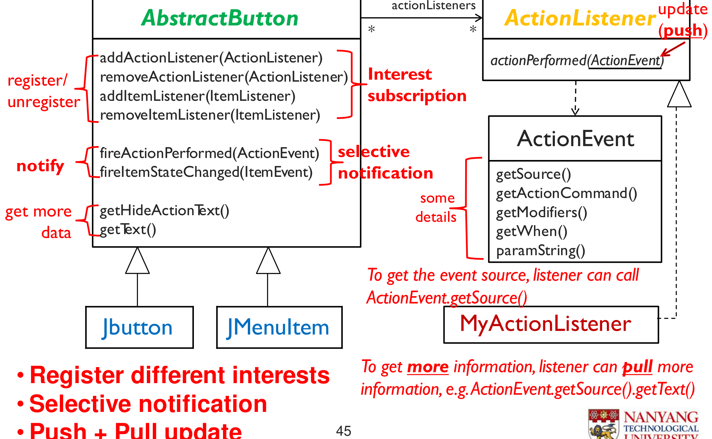

- `addActionListener` and `addItemListener` are interest subscription.
- `fireActionPerformed` notifies only the action listeners (selective notification).
- `actionPerformed(ActionEvent)` pushes some details. The listener can pull more with `event.getSource().getText()` (push + pull).

## Consequences

| Pros | Cons |
|---|---|
| Loose coupling between subject and observers | Slower: each change triggers many calls |
| Supports broadcast communication | Adds complexity if it is not needed |
| Subjects and observers can be reused independently | The order of notification is not defined |

# Factory pattern

## Problem

The client must create objects, but:

- it does not know which class it needs until run time;
- it must create one of several classes that share one interface, without knowing the creation logic;
- the choice of class and the creation steps are complex;
- the team wants to replace existing classes or add new classes later.

Without a factory, each client has its own `if / else` code that chooses the class with `new`. This creation code is copied in many places. Each new class forces changes in all of them.

## Solution

Move the selection and creation of objects into one place: a factory.

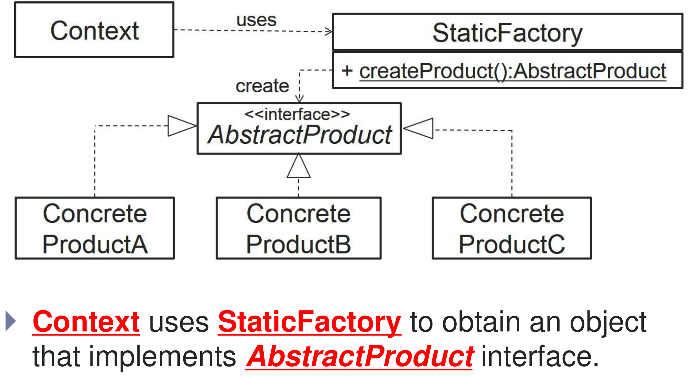

| Class | Role |
|---|---|
| **Context** (client) | Asks the factory for an object. Uses it only through the AbstractProduct interface. |
| **StaticFactory** | Has `createProduct()`. Decides which concrete class to create and creates it. |
| **AbstractProduct** (interface) | The interface that all products share. |
| **ConcreteProductA, B, C** | The classes that the factory can create. |

## Benefits

- **Encapsulates object creation.** Removes duplicate creation code from the clients. Puts the class selection and creation code in one place.
- **Easy to extend.** Replace a class (MySQLImpl1 → MySQLImpl2) or add a class (OracleImpl) in one place.
- **Easy to change the creation logic.** For example, return one shared object (Singleton) or create the object only when it is first needed (lazy initialisation).

## Strategy + Factory

Strategy makes the algorithms interchangeable. But some code must still choose and create the concrete strategy. A Factory does this. The two patterns often work together.

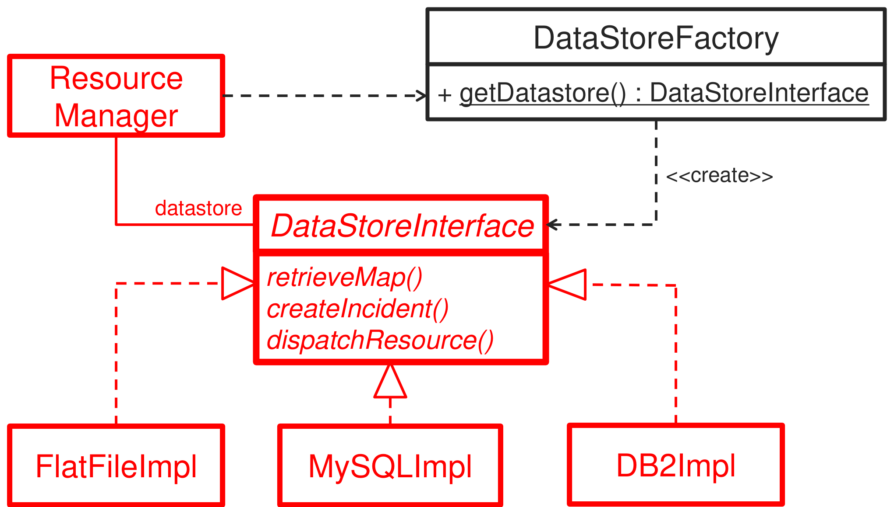

## Strategy + Factory + dynamic loading

The factory can read the class name from a configuration file and load that class at run time. Then the program can use a new class **without any change to its code**. This is how frameworks load the classes that applications provide:

- Eclipse loads new views (plug-ins) this way.
- Java Swing loads new look-and-feel classes.
- JDBC loads the database driver for each database.

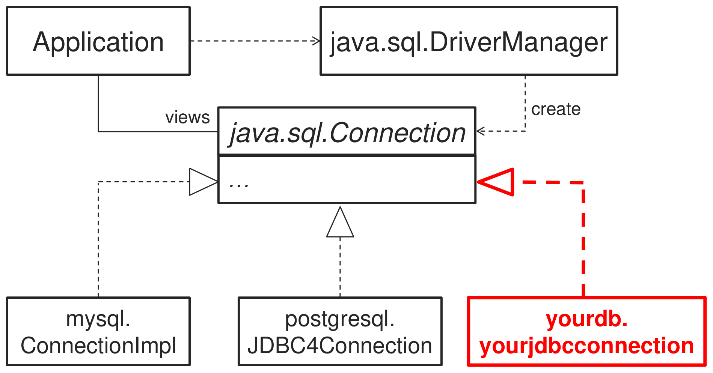

# Façade pattern

## Problem

A client must use a complex subsystem with many classes. The client must know all of them and call them in the right order. The client is tightly coupled to the subsystem.

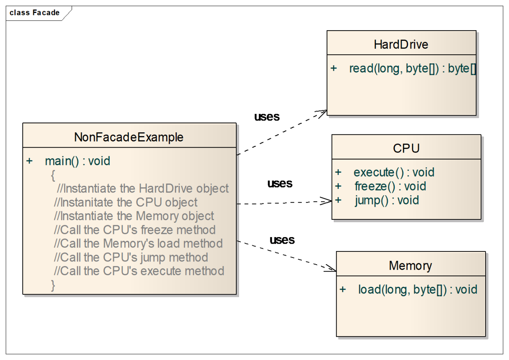

## Solution

> A façade provides a unified interface to a set of interfaces in a subsystem. It defines a higher-level interface that makes the subsystem easier to use.

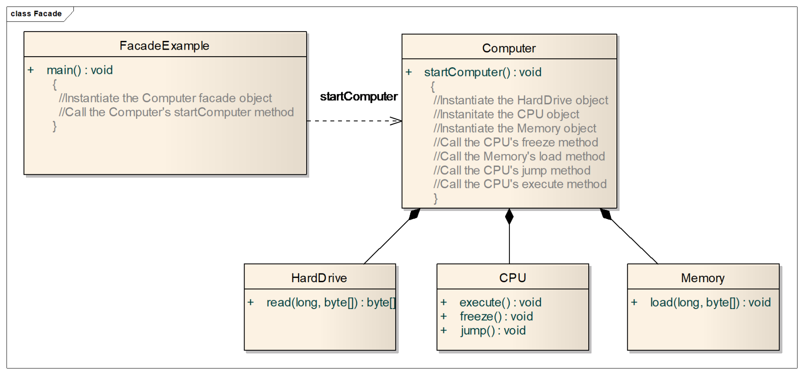

The client calls `computer.startComputer()`. The `Computer` façade creates and calls the CPU, the memory and the hard drive in the right order.

| Pros | Cons |
|---|---|
| Code is easier to use and to understand | A badly designed façade causes more rework |
| Fewer dependencies on subsystem classes | Many façade classes add complexity and slow the program |
| Decouples the client from a complex subsystem | |

# Combining patterns

Real designs often need more than one pattern, because one pattern solves only one problem.

## Worked example: notifications through many channels

Processing plants register an interest in specific kinds of shipments. When a shipment arrives, the system notifies each interested plant through the plant's preferred channel: email, SMS or both. Plants can change their interests and channels at any time. New channels must be easy to add.

Three problems:

1. Plants must get updates about **their** interests only, and must be able to join and leave → **Observer** with interest subscription and selective notification.
2. The notification channel must be **interchangeable** and new channels must be easy to add → **Strategy**.
3. Some code must choose and create the right channel object → **Factory**.

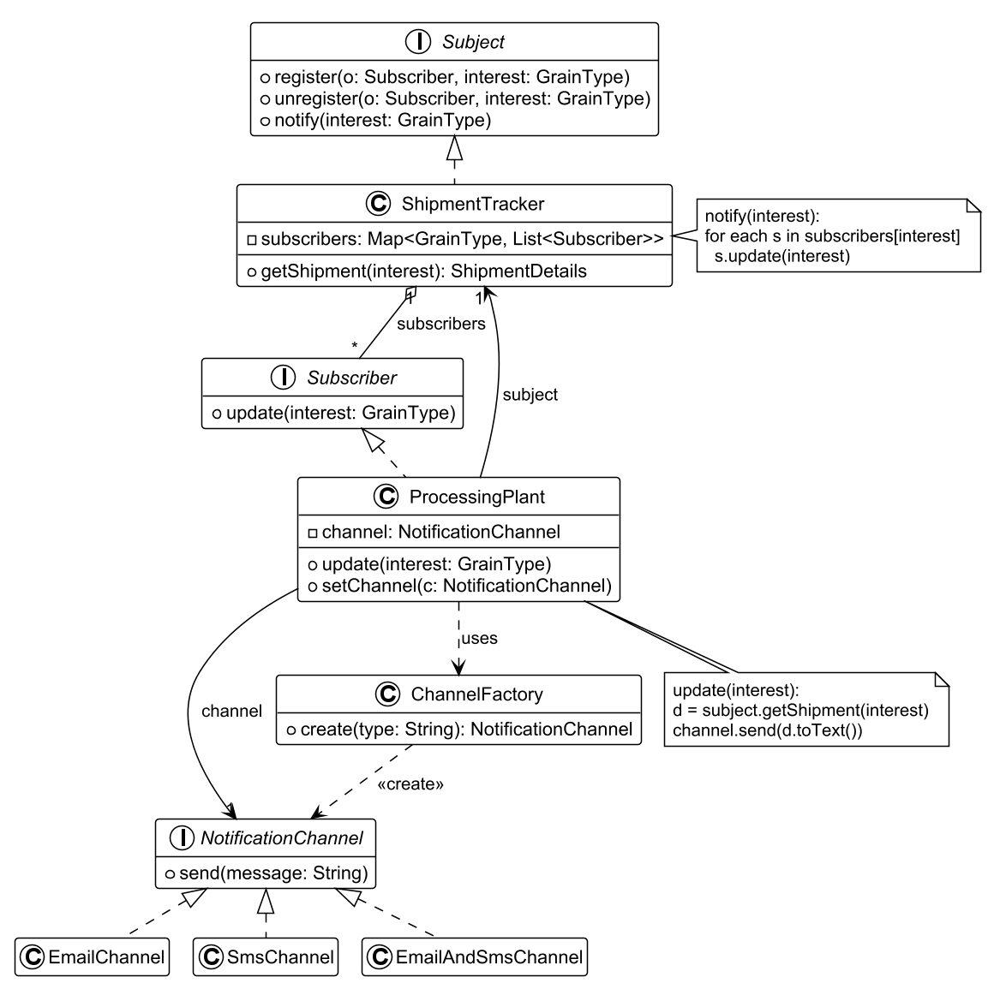

Roles:

- `ShipmentTracker` is the **concrete subject**. It keeps the subscribers for each interest and notifies only the matching subscribers.
- `ProcessingPlant` is the **concrete observer**. In `update()`, it pulls the shipment details and sends them through its channel.
- `NotificationChannel` is the **strategy interface**. `EmailChannel`, `SmsChannel` and `EmailAndSmsChannel` are **concrete strategies**.
- `ProcessingPlant` is also the **context** of the strategy. `setChannel()` changes the channel at run time.
- `ChannelFactory` creates the right channel from a name, so no client contains `new EmailChannel()`.

## What is missing from a Strategy-only design

A Strategy design shows how the context uses interchangeable algorithms. It does not show **who creates** the concrete strategy. Without a factory, each client chooses and creates the strategy with its own `if / else` and `new`. Then each new strategy changes these clients, which breaks the open–closed principle. A **Factory** completes the design: it puts the selection and the creation in one place.

## Is it always good to combine patterns, or to use many patterns?

No. Use a pattern only when its problem is really present.

- **For:** each pattern solves a real problem. Together they give loose coupling, flexibility and extensibility. MVC itself is a combination of Observer, Strategy and other patterns.
- **Against:** each pattern adds classes, interfaces and indirection. If the variation that a pattern prepares for never happens, the extra classes only make the code harder to read, debug and maintain. Combined patterns are harder for new team members to learn. Each extra call can slow the program.
- **Conclusion:** apply a pattern when the requirements show a clear need (a real change or variation). Do not add patterns "just in case". This matches the agile idea of simple design.

# Getting ready for exam questions

The usual question: "Propose a scenario in the system where more than one design pattern can be applied together, and draw the class diagram" (about 6 marks).

1. Pick a feature with **two** problems: something that must notify many parties (Observer) **and** something that must vary (Strategy). Add a Factory if the varying object must be created.
2. Write the design problem for each pattern in one or two sentences.
3. Draw the class diagram with the interfaces, the concrete classes, and the methods that matter (`register`, `notify`, `update`, the strategy method, `create`).
4. Label the role of each class: Subject, Observer, Context, Strategy, ConcreteStrategy, Factory.

Good scenarios for many project types:

| Feature | Observer | Strategy | Factory |
|---|---|---|---|
| Alerts to users | Users subscribe to alerts, for example for their location or interest | Delivery by app push, SMS or email | Create the delivery object |
| Payment | — | Card, PayPal, wallet | Create the payment object from the user choice |
| Device control | The UI observes the device state | Different device protocols | Create the protocol object per device type |
| Recommendations | Users get a notice when new results match their preferences | Different ranking algorithms | Create the ranking algorithm |
