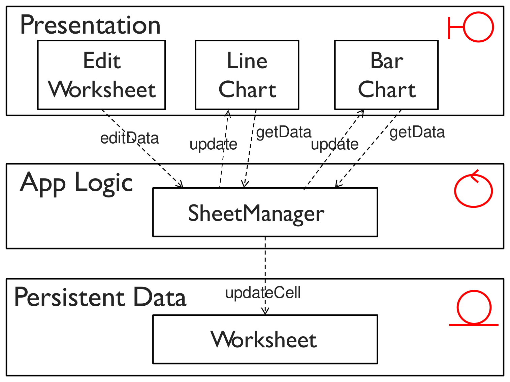
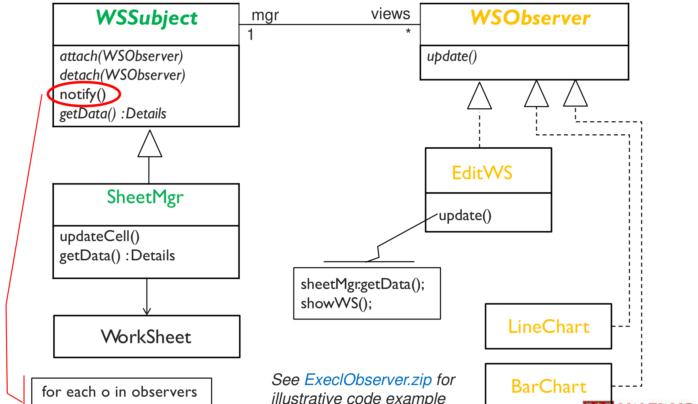
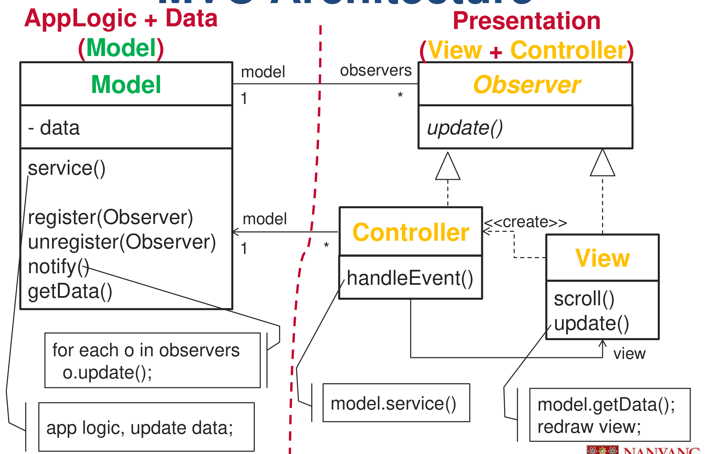
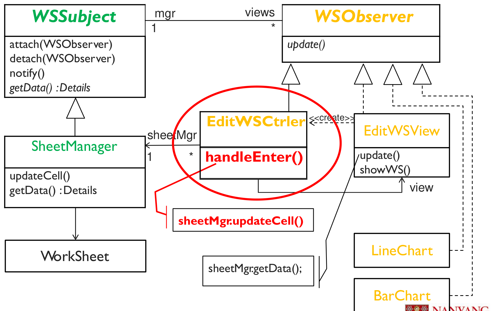

This was written entirely with AI.

# The problem with interactive systems

Interactive, event-driven systems have special design problems:

- User interfaces change often.
- The same data must be shown in different ways (a table, a line chart, a bar chart).
- Changes to the UI must be easy, sometimes even while the program runs.
- The display must show each data change at once.
- The same display can need a different look and feel.
- The application must be able to react to user input in different ways.

All of these need the UI to be **loosely coupled** to the core functions and data.

# Step 1: a layered design is not enough

Take a spreadsheet program. The user edits a cell in the worksheet view. A line chart and a bar chart must show the new value.

The problem: after the data changes, the lower layer (SheetManager) must tell the charts in the higher layer to redraw. That is an **up-call** from a lower layer to a higher layer. If SheetManager calls LineChart and BarChart directly, it depends on them. Then each new kind of chart forces a change in SheetManager. The layers become tightly coupled.

The design problem is the Observer problem:

- The worksheet (subject) must notify its views (observers) of each data change. Views can be created and deleted at any time.
- The views must show each change at once, but they do not know when a change will happen.

# Step 2: add the Observer pattern

Now SheetManager knows only the `WSObserver` interface. It calls `update()` on each registered view. Each view calls `getData()` and redraws itself. A new chart type only needs to implement `WSObserver` and register. SheetManager does not change.

The Observer pattern allows up-calls without making the lower layer depend on the higher layer.

But the Observer pattern does not solve all the problems in the list. "The same presentation can have a different look and feel" and "the application reacts to user input in different ways" are **interchangeability** problems. They need the **Strategy** pattern. One problem often needs more than one pattern.

# MVC

## Goal and key idea

**Goal:** make it easy to build interactive systems, especially systems that show the same shared data in many synchronised views.

**Key idea:** separate the **Model** from the **View** and the **Controller**. This separates the presentation and the interaction from the data. If the user changes the model through the controller of one view, all other views that show the same data show the change.

MVC supports these needs:

- Many different UIs (desktop, web browser, mobile phone) reuse the same core functions.
- UI details change often. These changes must not affect the core functions.
- Adding a new UI must be easy.

## The three components

| Component | Responsibility | Stereotype |
|---|---|---|
| **Model** | Holds the core data and the processing (application logic). | Entity (+ control logic) |
| **View** | Presents the data to the user. Each view gives one presentation of the same model. Each view **observes** the model. When the model changes, all views are notified at once and redraw. | Boundary |
| **Controller** | Handles user interaction. Captures user input (mouse clicks, key presses) and passes it to the model and the view. Each view has a controller. The user interacts with the system only through controllers. | Boundary / control |

## How MVC works

1. The **view** subscribes to the **model** (Observer subscription).
2. The user acts. The **controller** gets the input and updates the **model**.
3. The **model** changes its data and notifies all subscribed views (Observer notification).
4. Each **view** gets the new data from the model and updates the display. The user sees the change.

MVC is **not hierarchical**. The three components form a triangle, unlike the strict top-to-bottom layers.

## The patterns inside MVC

**Observer pattern (View–Model):** the model is the subject and the views are observers. When the model data changes, the model notifies all views. This allows many views of the same model.

**Strategy pattern (View–Controller):** the view is concerned only with the visual display. It delegates the response to user input to its controller. The view is the **context** and the controller is the **strategy**. You can replace the controller so that the same view reacts differently to user input.

Other patterns also help in MVC:

| Pattern | Use in MVC |
|---|---|
| **Observer** | View–Model, Controller–Model |
| **Strategy** | View–Controller, View–Look and feel |
| **Abstract Factory** | Create the controller or the look and feel for a view |
| Composite | Nested views (a panel contains buttons and other panels) |
| Decorator | Add UI functions such as scrolling to a view |
| Command | Support undo and redo of user actions |

**Observer, Strategy and Abstract Factory are the key patterns in MVC.** Web frameworks such as Django, Rails and ASP.NET MVC use this composition.

## Pros and cons of MVC

| Pros | Cons |
|---|---|
| **Simultaneous development.** Different developers can work on the model, the views and the controllers at the same time. | **Harder to navigate and to learn.** MVC adds layers of abstraction. Developers must learn its way of splitting the code. |
| **Many views for one model.** | **Consistency across many artifacts.** One feature is split into three parts (model, view, controller). Developers must keep all three consistent. |
| **High cohesion.** Related actions are grouped in one controller. The views of one model are grouped together. | |
| **Low coupling** between models, views and controllers. | |

# MVC versus the layered architecture

| | Layered | MVC |
|---|---|---|
| Shape | Strict stack. Each layer calls only the layer below. | Triangle. Model notifies views through Observer. |
| Up-calls | Not allowed directly | Built in, through Observer |
| Best for | Systems with a clear split of UI, logic and data | Interactive systems with many synchronised views of the same data |

# Getting ready for exam questions

- If the system has several UIs (web, mobile, voice) or several views of the same data, propose **MVC**. Say: "Many views share one model. The model notifies all views when data changes (Observer). Each view delegates user input to its controller (Strategy)."
- When asked for the roles in MVC, describe model, view and controller, and name the Observer relationship (view–model) and the Strategy relationship (view–controller).
- Give the four pros (simultaneous development, many views, high cohesion, low coupling) and the two cons (learning curve, consistency across artifacts).
