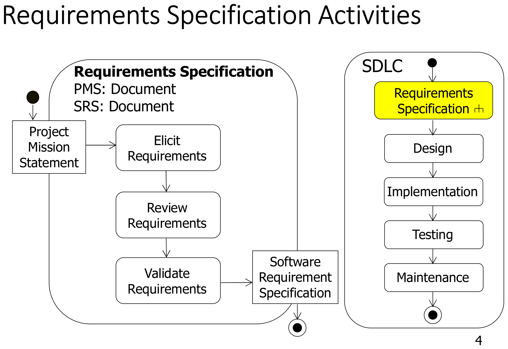

This was written entirely with AI.

# Where requirements work fits

Before a team designs anything, it must know what the customer needs. Customers usually explain their needs in a vague and incomplete way. Requirements work changes that vague description into a precise, technical and consistent document. This document is the **Software Requirements Specification (SRS)**.

The steps are:

1. Write a **project mission statement** (PMS).
2. **Elicit** the requirements. "Elicit" means to get information out of people.
3. **Analyse** the requirements (Parts 5 and 6).
4. **Validate** the requirements with the stakeholders.
5. Write the **SRS** (Part 4).

# Project mission statement

A project mission statement describes the project in two or three sentences. These sentences tell:

1. **The problem**: what the team will make, and its scope and limits.
2. **The people**: the stakeholders, the developers and the users.
3. **The outcomes**: the result and the benefits of the project.

Example:

> The GoFast team will develop a website that lets airline travellers rate their travel experiences. The project is complete when the FactFinding Organisation tests and approves the website for release. The project supports the objective of the International Travel Watchdogs to let air passengers openly compare airlines.

# How to elicit requirements

The team must learn the problem domain and study the tasks that the users do. The six techniques are:

| Technique | What the team does | Good for |
|---|---|---|
| Interview | Asks stakeholders questions, one person or a small group at a time | Details of each person's needs |
| Observation | Watches users do their real work | Steps that users forget to mention |
| Workshop | Brings many stakeholders together in one meeting | Agreement between groups with different needs |
| Legacy product study | Studies the old system that the new system replaces | Functions that must not be lost |
| Competitive product study | Studies similar products from other companies | Ideas and expected standard functions |
| Prototype | Shows a model of the screens and lets users try it | Feedback on the user interface |

# Functional and non-functional requirements

A **functional requirement** tells what the system must **do**. It describes how the system interacts with its environment: which inputs it takes and which outputs it gives.

A **non-functional requirement** tells a **property** that the system must have. It is not a function. It is a quality or a constraint on how well the system does its functions.

A simple test: if you can describe the requirement as "the system must *do* X", it is functional. If you describe it as "the system must *be* X" or "X must happen *within* Y", it is non-functional.

## Functional requirements

Functional requirements come in three kinds:

| Kind | Example |
|---|---|
| A function that the system does | The bank customer must be able to withdraw cash from the ATM. |
| Information that the system processes | The system must display the temperature in degrees Celsius, from −10 °C to +130 °C, to one decimal place. |
| An interface with other systems | The system must control up to six robot arms at the same time. |

## Non-functional requirements

| Category | Example |
|---|---|
| Usability | Help messages must show in the local language of the user. |
| Reliability | After a reboot, the full system must work again within 5 minutes. |
| Performance | When a book is put on the checkout pad, the system must detect it within 2 seconds. |
| Supportability | The database must be replaceable by any commercial product that supports standard SQL. |
| Security | Each user must log in with a password before the system shows personal data. |
| Availability | The system must be available 99.5% of the time each month. |
| Scalability | The system must support 10 000 users at the same time. |
| Maintainability | A new payment method must be addable without a change to the checkout code. |

Non-functional requirements are constraints on the design. For example, a scalability requirement can force the team to choose a client–server architecture (Part 9).

# How to write requirements

Good requirements obey these rules:

- Write complete, simple, precise sentences. Use the **active voice**.
- Define each term clearly. Use each term in the same way each time.
- Use a clear layout. Put related requirements together, in a numbered hierarchy.
- Use **"must"** or **"shall"** for each requirement.
- Make each requirement **atomic**, **verifiable** and **traceable**.

## Atomic requirements

An atomic requirement states **one** thing only. You cannot split it into two smaller requirements. Atomic requirements are easy to test, easy to trace and easy to change one at a time.

Not atomic:

> When a computer is added, the tracking system requires the user to specify its type and allow the user to provide a description. Both these fields must be text of length >0 and <512 characters.

This sentence holds four requirements. Split it into a hierarchy:

> 1.1 When a computer is added to the tracking system, the user must enter the computer type.
> 1.1.1 The computer type must be text of at least 1 character and less than 512 characters.
> 1.2 When a computer is added to the tracking system, the user must enter a description of the computer.
> 1.2.1 The description must be text of at least 1 character and less than 512 characters.

### Method to atomize a paragraph

1. Underline each verb that the system or the user does. Each verb is a possible requirement.
2. Find each condition ("if", "when"). Each condition gives a separate requirement.
3. Find each list of data items. Each data item can get its own child requirement.
4. Write each requirement as one sentence with "must". Use the active voice.
5. Number the requirements as a hierarchy: a parent requirement and its details.
6. Check each requirement: can a tester write a test for it?

### Worked example

Paragraph:

> The system may be queried. A query may contain a user number or a serial number. If the query contains a user number, all equipment assigned to that user is reported. If the query contains a serial number, the assignment for that computer is reported. All query results show the name, office and user number of a user, followed by the serial numbers and types of all computers assigned to that user, and the date of each assignment. If a user is not assigned a computer or a computer not assigned to a user, this is reported.

Atomized:

> 1 The system must let the user query the computer assignments.
> 1.1 The user must be able to query by user number.
> 1.2 The user must be able to query by computer serial number.
> 2 When the query contains a user number, the system must display all computers assigned to that user.
> 3 When the query contains a serial number, the system must display the assignment of that computer.
> 4 Each query result must display:
> 4.1 the name of the user;
> 4.2 the office of the user;
> 4.3 the user number;
> 4.4 the serial number of each computer assigned to the user;
> 4.5 the type of each computer assigned to the user;
> 4.6 the date of each assignment.
> 5 When no computer is assigned to the user, the system must display "No computer assigned to this user".
> 6 When the computer is not assigned to a user, the system must display "This computer is not assigned".

Note the changes:

- "May be queried" is passive and weak. It becomes "the system must let the user query".
- "This is reported" does not say what the user sees. It becomes a specific message.
- Each displayed field is now a separate child requirement.

## Verifiable requirements

A requirement is verifiable when it is specific enough to test. A tester must be able to say "pass" or "fail".

| Not verifiable | Verifiable |
|---|---|
| The user interface must be user-friendly. | 80% of first-time users must be able to enter a simple search query within 2 minutes of starting to use the system. |
| The system must control more than one drill press. | The system must control up to seven drill presses at the same time. |

To make a requirement verifiable, replace each vague word with a number, a range, a time limit or an exact message.

## Traceable requirements

Traceability is the ability to follow a requirement through the full life cycle:

- forwards, from the SRS to the design, the code, the documents and the tests;
- backwards, from a test or a part of the code to the requirement that caused it.

Traceability also tracks the dependencies between requirements, system functions and system components. Each requirement needs a unique number for this. Example: "Test case TC-14 checks requirement 3.2."

# Validating requirements

Validation checks that the requirements are the right requirements. It has two goals:

- **For the stakeholders:** the specified system meets their needs (the requirements are correct), and the requirements have priorities.
- **For the development team:** the team understands the requirements and the assumptions behind them.

Two ways to validate:

1. **Review.** A walkthrough, an inspection or a critical review. Use a checklist for completeness, consistency, unambiguity and correctness.
2. **Prototype.** Let the stakeholders see and try a model of the system.

## User interface prototype

A picture tells more than many words. A prototype shows what the system will look like. It brings the requirements to life for all stakeholders. Three types:

- **Storyboard.** A series of pictures that shows the screens in one interaction, in order.
- **Still images.** Screen pictures made on a computer.
- **Interactive prototype.** A model that the user can click through. It simulates a dialogue with the system.

A prototype lowers the risk of building the wrong product, or of building the right product badly.

# The data dictionary

Different stakeholders use the same word with different meanings. A university manager and a student can mean different things by "course". The **data dictionary** is a glossary of the **problem domain**. It gives one clear meaning for each term. All stakeholders agree on these meanings.

| Term | Definition |
|---|---|
| Programme of study | A university programme that a student enrols in. There are three levels: undergraduate, master and PhD. |
| Semester | There are four semesters in an academic year. Semesters 1 and 4 have 13 teaching weeks. Semesters 2 and 3 have 5 teaching weeks. |
| Course | A basic unit of teaching. A course is compulsory or elective. A course includes lectures and tutorials. Some courses also have labs. |
| Lecture | A class in a lecture theatre. Each lecture is video recorded and published in the learning management system. |
| Tutorial | An interactive, small class in a tutorial room. Tutorials are not video recorded. |

Rules for a good data dictionary:

- Define **problem-domain** terms ("Shipment", "Silo", "Guest"). Do not define implementation terms ("HashMap", "SQL table").
- Give facts that the system needs: types, ranges, sizes, allowed values. Example: "Silo: holds 1 type of grain of 1 grade. Two sizes: 8000 bushels and 12 000 bushels."
- Use the dictionary terms in the use case descriptions, with the same spelling.

# The elicitation process, step by step

**Step 1 — the project team works alone.** It reviews the specification from the client and any old or competing products. Then it:

1. atomizes the requirements;
2. identifies the actors;
3. identifies the main use cases (the functional requirements);
4. identifies the non-functional requirements;
5. starts the data dictionary;
6. lists each uncertainty to clarify with the client. Mark each uncertainty "TBD" (to be determined). **Do not guess what the users need.**

**Step 2 — the team meets the client.** Choose a suitable meeting type: interview, observation or workshop. Agree on the agenda and the expected outcomes before the meeting. A typical agenda:

1. Present and walk through the first requirements and the data dictionary. Get agreement.
2. Clarify the TBD items.
3. Discuss the new requirements that the client identifies.

**Repeat steps 1 and 2** until all uncertainties are resolved and the client agrees with all requirements and dictionary terms. A prototype of the screens can help. Make each meeting productive, so that the number of meetings stays small.

# Getting ready for exam questions

- **Classify FR vs NFR.** Ask "does the system *do* it, or must the system *be* it?". Put each NFR in a named category (performance, security, usability, reliability, availability, scalability, maintainability).
- **Write an NFR.** Always include a measurable value: "within 2 seconds", "99.5% of the time", "10 000 users at the same time". A vague NFR loses marks.
- **Atomize.** One requirement per sentence, "must", active voice, numbered hierarchy, and a specific message for each error case.
- **Data dictionary.** Take the nouns from the project description. Give each one a definition with sizes, ranges and allowed values. Do not include implementation terms.
