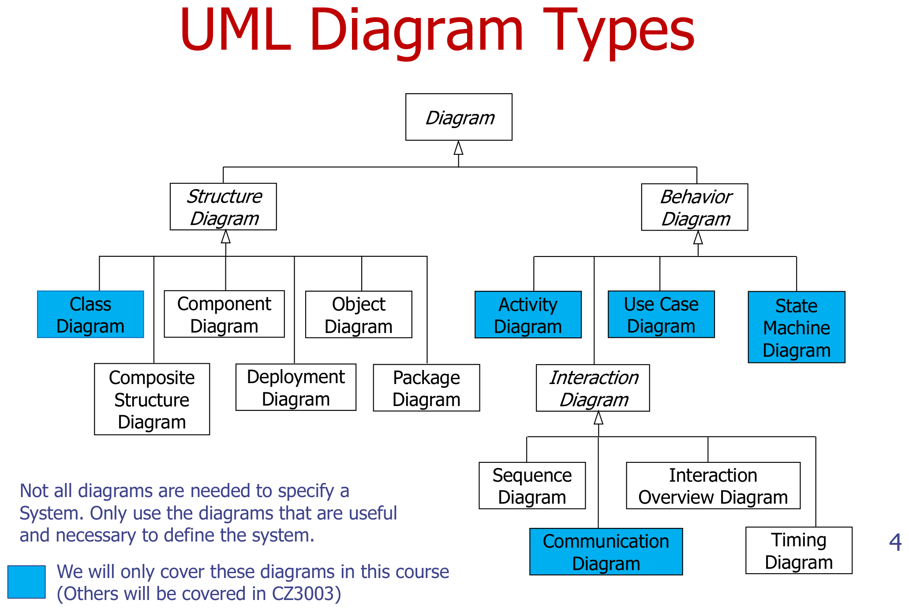
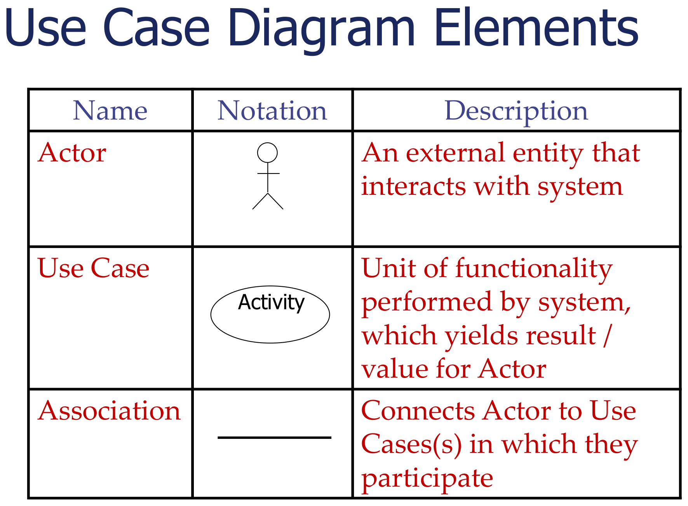
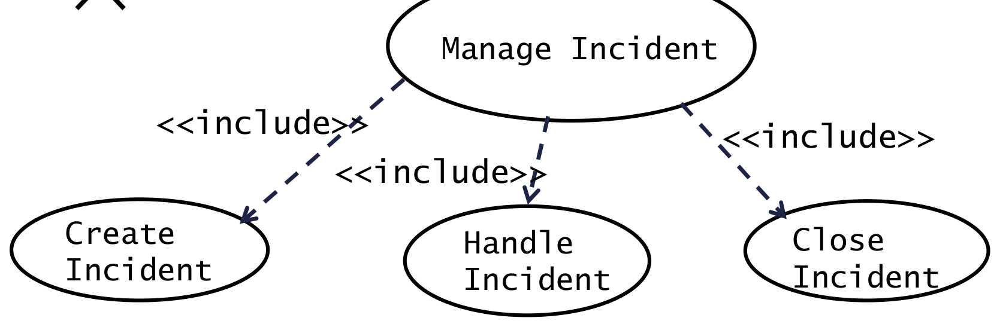
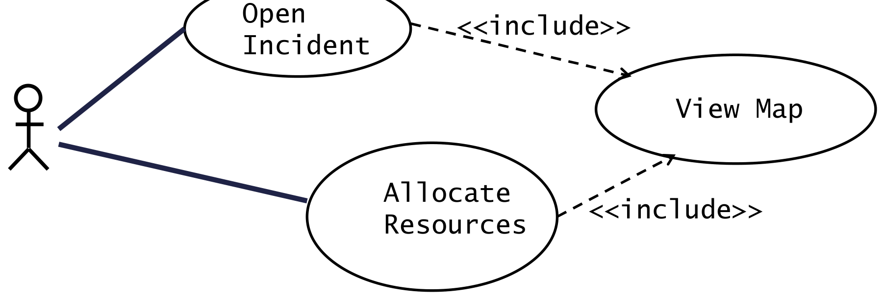
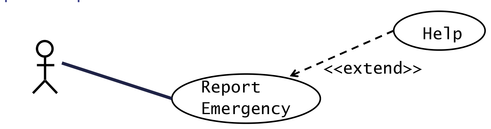
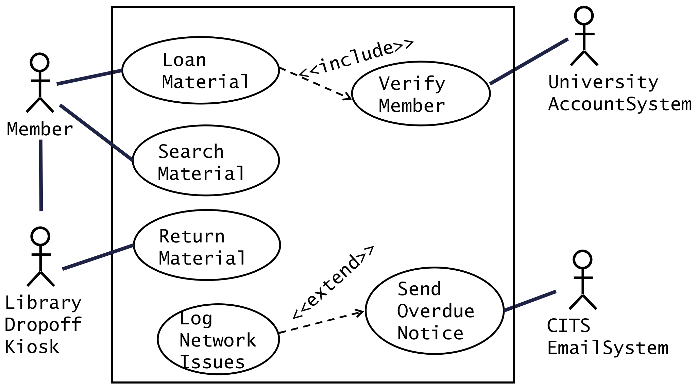
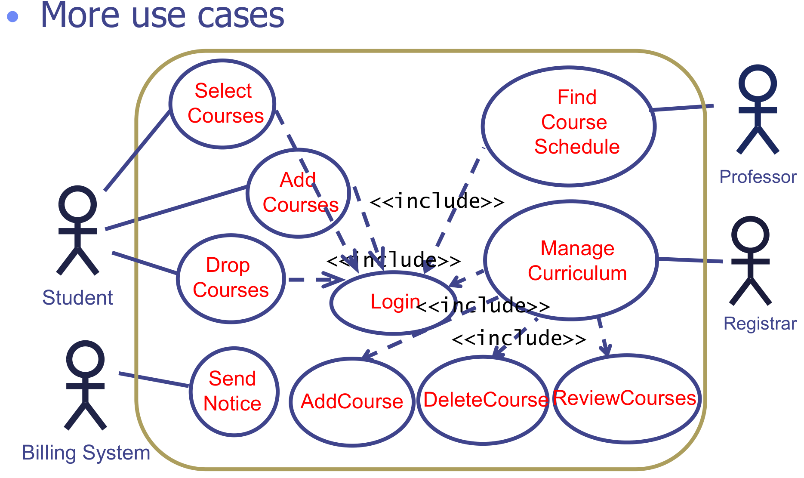
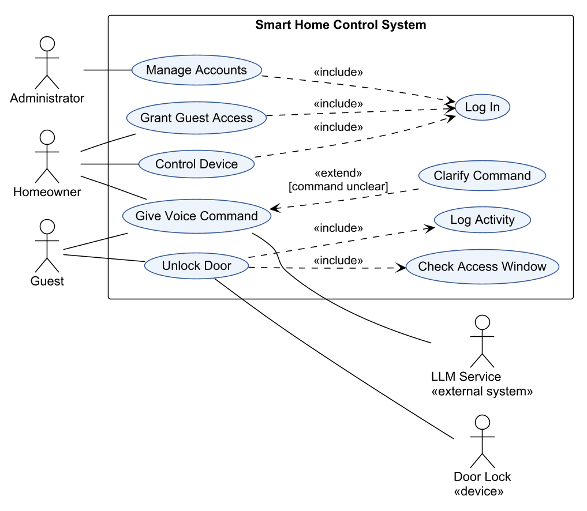

This was written entirely with AI.

# UML

UML (Unified Modeling Language) is a standard graphical notation. Booch, Jacobson and Rumbaugh created it in 1996. Teams use it to specify, document and communicate the structure and the behaviour of software systems. UML is not a programming language. Because it is an industry standard, all engineers read the same diagram in the same way.

UML has two families of diagrams:

- **Structure diagrams** show what the parts of the system are. Example: the class diagram.
- **Behaviour diagrams** show what the system does over time. Examples: use case, activity and state machine diagrams.

Use only the diagrams that help to define the system. A project does not need all of them.

# Use cases

A **use case** describes how a user uses the system to reach one goal. It is a list of steps. In each step, a role (the **actor**) and the system interact.

Functional requirements and use cases both describe the functions of the system, but at different levels:

- A **functional requirement** says **what** the system must do.
- A **use case** says **how** the actor and the system interact to do it.

Functional requirements are the starting point for use cases.

# The use case model

The use case model has two parts:

1. **Use case diagram** (static). It shows all actors, all use cases, and how they connect.
2. **Use case descriptions** (dynamic). Each use case has a text that gives its steps.

Together they describe the functions of the system in pictures and in text. In iterative development, the team gives each use case a priority and builds the most important use cases first.

# The use case diagram

## Elements

| Element | Notation | Meaning |
|---|---|---|
| Actor | Stick figure | Something **outside** the system that interacts with it |
| Use case | Ellipse with a verb phrase | One unit of function that the system does. It gives a result of value to an actor. |
| Association | Solid line | Connects an actor to each use case in which it takes part |
| System boundary | Rectangle with the system name | Everything inside is the system. Actors stay outside. |

## Who can be an actor

An actor is a **role**, not a person. One person can have two roles. An actor can be:

- a human user (Customer, Homeowner, Administrator);
- a device (Sensor, Door Lock, Card Reader);
- an external system (Bank, Email Server, Payment Gateway, LLM service).

**The system that you model is never an actor.** Only external systems that interact with it are actors.

## Actor generalization

When two actors share use cases, you can make a general actor and connect the shared use cases to it. Draw a solid line with a hollow triangle from the special actor to the general actor. Example: Homeowner and Guest both specialise User, and User connects to "Give Voice Command".

## Use case names

Name each use case with a **verb + noun** that describes a goal: "Unlock Door", "Grant Guest Access", "Search Material". Do not use one click as a use case ("Press OK button"). Do not use a full subsystem as a use case ("Door Module").

# Include and extend

Associations between use cases reduce complexity. There are two kinds.

## Include

An include relationship from use case A to use case B means: **A always runs all of B.** A delegates part of its work to B. B is like a subroutine that A calls.

Use include for two reasons.

**1. Functional decomposition.** A use case is too complex. Split it into smaller use cases and include them.

**2. Reuse of shared function.** Two or more use cases do the same steps. Move those steps into one use case and include it from each of them.

Facts about include:

- The arrow is **dashed** with an open arrowhead. It goes **from the base (including) use case to the included use case**.
- The included behaviour is **required**, not optional. The base use case is not complete without it.
- All of the included behaviour runs at one point in the base use case. Then the base use case continues.

## Extend

An extend relationship from use case B to use case A means: **B sometimes adds behaviour to A, under a condition.**

Facts about extend:

- The arrow is **dashed** with an open arrowhead. It goes **from the extending use case to the base (extended) use case**. This is the opposite direction to include.
- The base use case is **complete and meaningful by itself**. It does not know about the extension.
- The extending use case is often not meaningful by itself.
- The extension happens only in **unusual or exceptional** cases, under a **condition**.
- The extension happens at an **extension point** in the base use case. Write the extension point and the condition on the diagram, as a note or in the base ellipse.
- One extending use case can extend more than one base use case.

## Include or extend: how to choose

Ask: "Does the base use case **always** need this behaviour?"

| Answer | Relationship | Arrow direction |
|---|---|---|
| Yes, always | `<<include>>` | Base → included |
| Only sometimes, under a condition | `<<extend>>` | Extending → base |

Memory aid: the arrow always points **towards the use case that does not know about the other one**. The included use case does not know who includes it. The base use case does not know who extends it.

# From requirements to a use case diagram

Method:

1. **Find the actors.** Find each person, device and external system that the requirements mention, other than the system itself.
2. **Find the use cases.** Find each goal that an actor wants from the system. Each goal is usually one verb phrase in a functional requirement.
3. **Connect actors to use cases** with associations.
4. **Find include and extend relationships.** Look for "must first", "before", "always" (include) and "if", "when there is a problem", "optionally" (extend).
5. **Check the diagram.** There is no single correct diagram, but each use case must come from the requirements. Each use case has at least one actor or is included/extending. Each actor connects to something. No arrow shows data flow or order of steps.

## Worked example: a library system

Requirements:

1. The library member must be able to search the system for library materials.
2. The library member must be able to loan library materials.
3. The library management system must verify the library membership with the University Account System before the member can loan library materials.
4. The library member must return library materials via the library drop-off kiosk.
5. The library management system must send an overdue notice to the member through the CITS Email Server.
6. When there are network problems with the CITS Email Server, the library management system must log the event.

Analysis:

- Actors: Member, University Account System (external system), Library Drop-off Kiosk (device), CITS Email System (external system).
- Use cases: Search Material, Loan Material, Verify Member, Return Material, Send Overdue Notice, Log Network Issues.
- Requirement 3 says "before the member can loan": each loan must verify. So Loan Material **includes** Verify Member.
- Requirement 6 says "when there are network problems": this happens only sometimes. So Log Network Issues **extends** Send Overdue Notice.

Two common mistakes on this example:

- **Leaving out the kiosk.** Requirement 4 says that returns go through the kiosk. The kiosk is a device outside the system, so it is an actor.
- **Inventing a "Member Login" use case.** The requirements do not mention a login. Requirement 3 describes a verification with the university system. Model what the requirements say.

## Worked example: course registration

Requirements: the Registrar manages the curriculum. Students select 4 primary and 2 alternate courses, and add or drop courses until the end of week 2. After a student registers, the system notifies the Billing System. Professors find their course schedule. All users must log in first.

Points to note:

- "All users must log in first" means that each main use case **includes** Login.
- Manage Curriculum is large, so it **includes** three smaller use cases (decomposition).
- The Billing System is an external system, so it is an actor.

## Worked example with all features

- Unlock Door **includes** Check Access Window and Log Activity, because each unlock must check the time window and must be logged.
- Clarify Command **extends** Give Voice Command, because the system asks a clarifying question only when the command is unclear.
- The LLM service and the door lock are outside the system, so they are actors.

# The use case description

Each use case needs a description. Use the template:

| Field | Content |
|---|---|
| Use case ID and name | "UC-03 Unlock Door" |
| Actors | **Initiating actor**: the actor that starts the use case. **Participating actors**: other actors that take part. If a system event or another use case starts it, the initiating actor is NULL. |
| Description | One or two sentences about the goal |
| Preconditions (entry conditions) | What must be true **before** the use case can start |
| Postconditions (exit conditions) | What must be true **after** the use case ends, for success and for failure |
| Priority, frequency of use | For example High / High |
| Flow of events (normal flow) | The numbered main steps when all goes well |
| Alternative flows | Variations or errors that **return to the normal flow** |
| Exceptions | Problems that make the use case **fail and end** |
| Includes | The included use cases |
| Special requirements, assumptions, notes | Other information |

## Flow of events

The normal flow is the main success path. Its steps alternate:

1. The actor does something (this step starts the use case).
2. The system responds.
3. The actor does the next thing.
4. The system responds, and so on.

Use the terms from the data dictionary. Use the active voice. Each step has one subject: the actor or the system.

## Alternative flows and exceptions

- An **alternative flow** is a variation or an error that the system can handle. After it, the flow **returns** to a step in the normal flow. Number it by the step where it starts. Example: "AF-S5" starts at step 5.
- An **exception** is a situation that makes the use case **fail**. The use case ends.

## Worked example: withdraw money at an ATM

**Actors:** Bank Customer (initiating), Bank (participating).

**Preconditions:** 1. The Bank Customer has an account with the Bank. 2. The Bank Customer has an ATM card and a PIN.

**Postconditions:** 1. The Bank Customer receives the requested cash, **or** 2. the Bank Customer receives an explanation from the ATM why the cash could not be dispensed.

**Flow of events:**

| Actor steps | System steps |
|---|---|
| 1. The Bank Customer inserts the card into the ATM. | |
| | 2. The ATM requests a six-digit PIN. |
| 3. The Bank Customer enters a PIN. | |
| | 4. The ATM verifies the card and PIN with the account information in the Bank. |
| | 5. If the card and PIN are verified, the ATM requests the amount to withdraw. |
| 6. The Bank Customer enters an amount. | |
| | 7. The ATM verifies that the amount is available in the account. |
| | 8. If the account has sufficient funds, the ATM outputs the money, the card and a receipt. |
| 9. The Bank Customer removes the card, the receipt and the money. | |

**Alternative flows:**

- AF-S5: If the card and PIN are not valid: 1. The ATM shows "Invalid card and PIN. Please try again!" for 2 seconds. 2. The ATM returns to step 2.
- AF-S8: If the account has insufficient funds: 1. The ATM shows "Insufficient funds in your account! Please enter a smaller amount!" for 2 seconds. 2. The ATM returns to step 6.

**Exceptions:**

- EX1: If the Bank Customer enters a wrong PIN three times: 1. The ATM shows "Card is suspended! Please call customer service (1633) to reactivate the card" for 2 seconds. 2. The ATM outputs the card.
- EX2: If the ATM has insufficient cash: 1. The ATM shows "This ATM is off-service due to insufficient funds!" at the start screen. 2. The ATM does not accept cards.

## How to show include and extend in the text

- **Include:** write it as one step of the base flow. Example: "1. The system uses the included use case Login to verify the Registrar." The included use case states its entry condition as "invoked as an included use case by Manage Curriculum".
- **Extend:** write it in the description of the **extending** use case. Give the base use case, the extension point and the condition. Example: "Clarify Command extends Give Voice Command at step 3, when the command is unclear."

## Worked example: a guest unlocks a door

**Use case:** UC-05 Unlock Door
**Actors:** Guest (initiating), Door Lock (participating)
**Preconditions:** 1. The Homeowner has granted the Guest access to the door. 2. The Guest has logged in to the mobile app.
**Postconditions:** Success: the door is unlocked and the event is logged. Failure: the door stays locked and the denied attempt is logged.

**Flow of events:**

1. The Guest selects the door and selects "Unlock".
2. The system checks the access window with the included use case Check Access Window.
3. The system sends the unlock command to the Door Lock.
4. The Door Lock unlocks and confirms to the system.
5. The system logs the event with the included use case Log Activity.
6. The system shows "Door unlocked" to the Guest.

**Alternative flows:**

- AF-S2: If the current time is outside the access window: 1. The system shows "Access not allowed at this time". 2. The system logs the denied attempt. 3. The use case returns to step 1.

**Exceptions:**

- EX1: If the Door Lock does not respond within 5 seconds: 1. The system shows "Door lock not available. Try again later." 2. The system logs the failure. 3. The use case ends.

**Includes:** Check Access Window, Log Activity.

# Getting ready for exam questions

Use case diagram questions give the most marks in the paper (about 18 of 25 in Q1). Check each item:

- [ ] A rectangle with the **system name** surrounds all use cases.
- [ ] All actors are outside the rectangle. **The system itself is not an actor.**
- [ ] Each device and each external system in the description is an actor (sensors, payment systems, email servers, LLM services, door locks).
- [ ] Each use case name is a **verb + noun** goal.
- [ ] Each actor–use case link is a **plain solid line**, not an arrow and not labelled.
- [ ] Include arrows point **from base to included**. Extend arrows point **from extending to base**. Both are dashed and labelled.
- [ ] Each extend has a **condition** (and an extension point, if asked).
- [ ] Shared steps such as Login use include.
- [ ] There is an actor generalization where two actors share many use cases.
- [ ] No use case shows a sequence of screens or a data flow.
- [ ] Each use case in the diagram comes from the description. Do not invent functions.

For use case descriptions:

- [ ] Give all fields that the question asks for. If it asks for "actors, preconditions, flow of events, alternative flows", give exactly those.
- [ ] Mark the **initiating** actor.
- [ ] Number the steps. Alternate actor step and system step.
- [ ] Each alternative flow says where it starts (AF-S*n*) and which step it returns to.
- [ ] Put failures that end the use case in Exceptions, not in Alternative flows.
- [ ] Show each include as a step: "The system uses the included use case X."
- [ ] Use the exact terms from the data dictionary or the project description.
