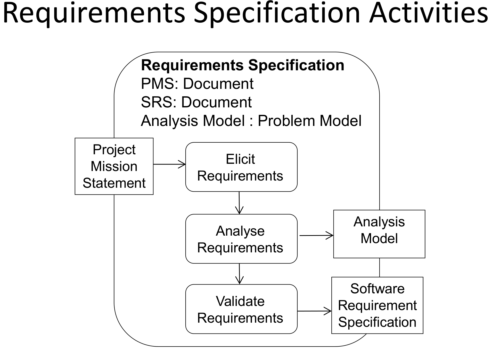

This was written entirely with AI.

# What the SRS is

The **Software Requirements Specification (SRS)** is the document that comes out of requirements elicitation and requirements analysis.

The SRS is:

1. A written record of what the development organisation understands about the needs of the customer, at one point in time, before design and development start.
2. A **two-way insurance policy**. It makes sure that the client and the developer understand each other's requirements in the same way.
3. A precise statement of the functions that the software must provide, and of the constraints that it must obey.
4. A blueprint that lets the project finish with as little extra cost as possible.
5. A detailed list of functional and non-functional requirements. **The SRS does not contain design decisions.** It says what the system must do, not how the code will do it.

# Why the SRS is necessary

1. It shows the customer that the developer understands the problem and the behaviour that the software needs.
2. It breaks the problem into smaller parts.
3. It is the input to design. It must contain enough detail for the designers to find a solution.
4. It is the parent document for testing. Testers check the finished system against each requirement in the SRS.

# Who writes it, and how

- Write it in natural language, without ambiguity. Add diagrams where they help.
- The development team must understand the detailed functional and non-functional requirements.
- Programmers and managers are often not the best writers of formal documents, but they often must write the SRS.
- A **technical writer** in the team helps. Technical writers plan documents well and meet the needs of the customer better.

# Contents of the SRS

Each organisation has its own template. IEEE 830-1998 is a standard template. The key contents are:

1. **Product description**
   a. **Purpose of the system.** The project mission statement and a short high-level description, 100–200 words.
   b. **Scope of the system.** Identify the system and the software that the document applies to.
   c. **Users and stakeholders.** All people and organisations with an interest in the system: users, clients, funding bodies, standards bodies.
   d. **Assumptions and constraints.** Anything that can affect the SRS. Example: "We assume that the external interfaces are fully specified and will not change." Regulations that the system must obey.
2. **Functional requirements.** Precise numbered statements, with use case diagrams and descriptions, activity diagrams, class diagrams, state machine diagrams, and UI prototypes as necessary.
3. **Non-functional requirements.** Precise numbered statements about performance, standards, reliability, availability, security, maintainability and portability.
4. **Interface requirements.**
   a. **User:** screen formats, page and window layouts, report contents, menus, function keys.
   b. **Hardware:** number of ports, instruction sets.
   c. **Software:** interfaces to a database, an operating system, a maths package.
5. **Data dictionary.** A clear definition of each term, phrase and abbreviation in the SRS.

# The nine quality characteristics of a good SRS

| Characteristic | Meaning | How to check |
|---|---|---|
| **Correct** | Each requirement describes the function that the users really need. | Only user representatives can decide this. Include them in reviews. |
| **Feasible** | The team can build it within the known limits of the system and its environment. | Ask: "Can we build this with the time, money and technology that we have?" |
| **Necessary** | It records something that the customer really needs, or something that a standard or an interface requires. | Find the source of the requirement. If there is no source, it may not be necessary. |
| **Unambiguous** | Each reader understands it in only one way, and all readers understand it in the same way. | Ask two people to explain it. |
| **Verifiable** | A test, inspection or demonstration can show that the product meets it. | Ask: "How do I test this?" |
| **Complete** | No requirement or necessary information is missing. | Organise the requirements in a hierarchy so that gaps are easier to see. |
| **Consistent** | It does not conflict with other requirements or with higher-level business requirements. | Resolve each conflict before development starts. |
| **Modifiable** | You can change the SRS and keep a history of the changes. | Each requirement has a unique label and stands separately from others. |
| **Traceable** | You can link each requirement to its source (a business requirement, a use case, a customer statement). | Each requirement has an ID and a source. |

# Words to use and words to avoid

## Words to use

| Word | Use |
|---|---|
| **Shall** | To state that the system must provide a function |
| **Must / must not** | To state a performance requirement or a constraint |
| **Is required to** | As an imperative in a requirement |
| **Are applicable** | To include a standard or another document by reference |
| **Responsible for** | When the architecture is already defined: "The scheduler is responsible for …" |
| **Will** | For things that the environment provides to the system: "The hospital network will provide …" |

## Words to avoid

These words make a requirement vague, so it is not verifiable:

> adequate, as a minimum, be capable of, as applicable, as appropriate, effective, if possible, if practical, timely, normal

Example: "The system shall respond in a timely manner." Change it to: "The system shall display the search results within 2 seconds."

# Getting ready for exam questions

- If a question asks what makes a good SRS, give the nine characteristics with a one-line meaning each.
- If a question shows a bad requirement, name the broken characteristic (usually unambiguous or verifiable) and rewrite it with a number.
- Remember: the SRS describes the problem. **No design in the SRS.**
