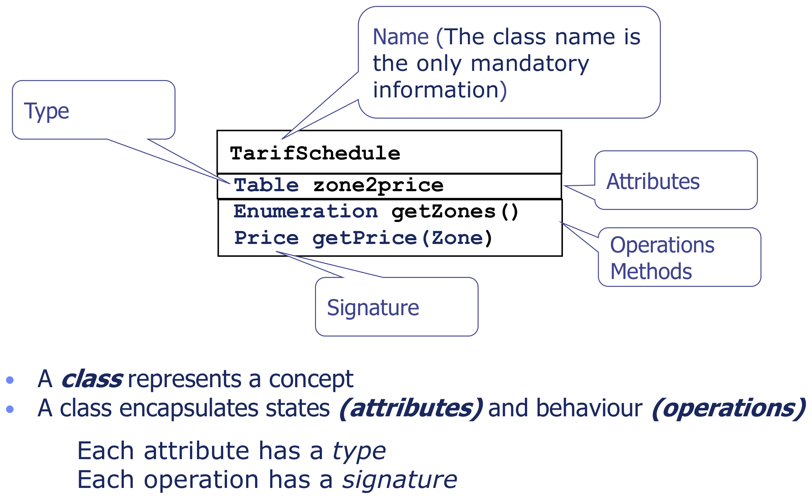
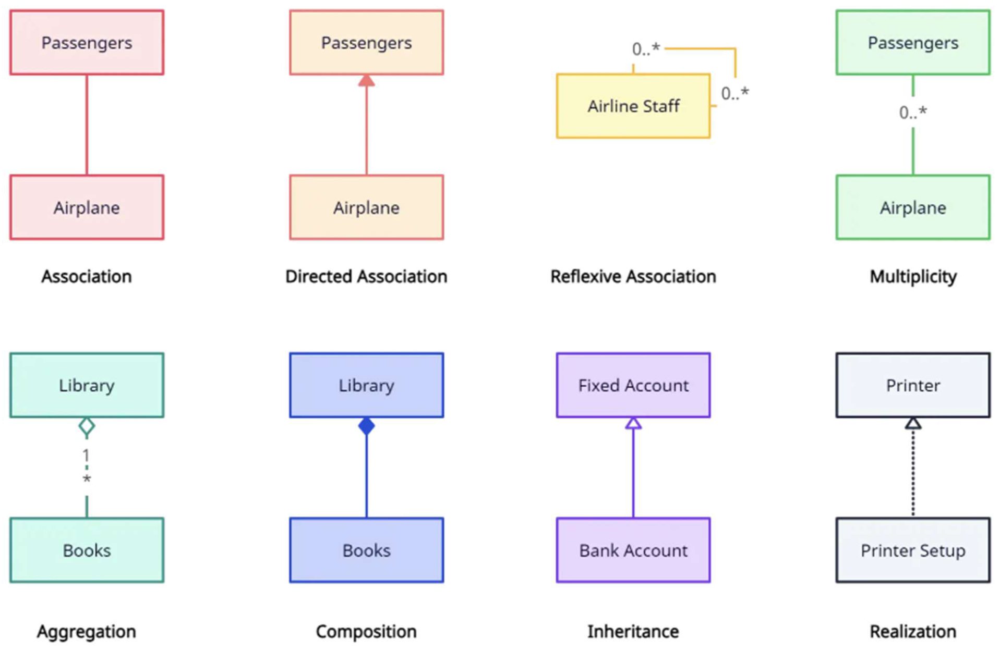
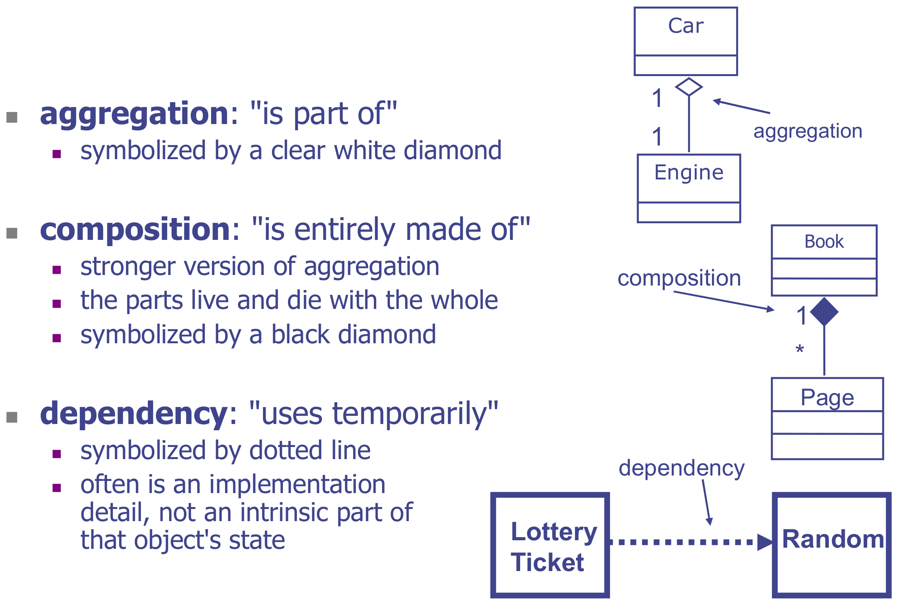
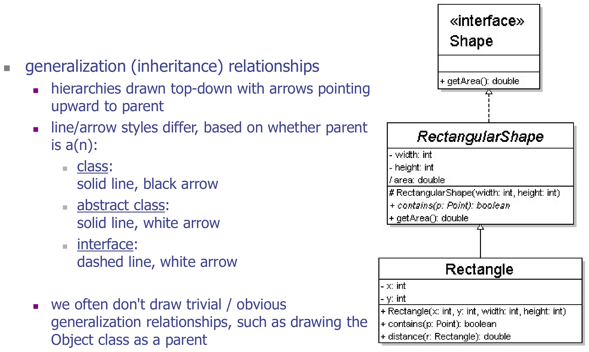
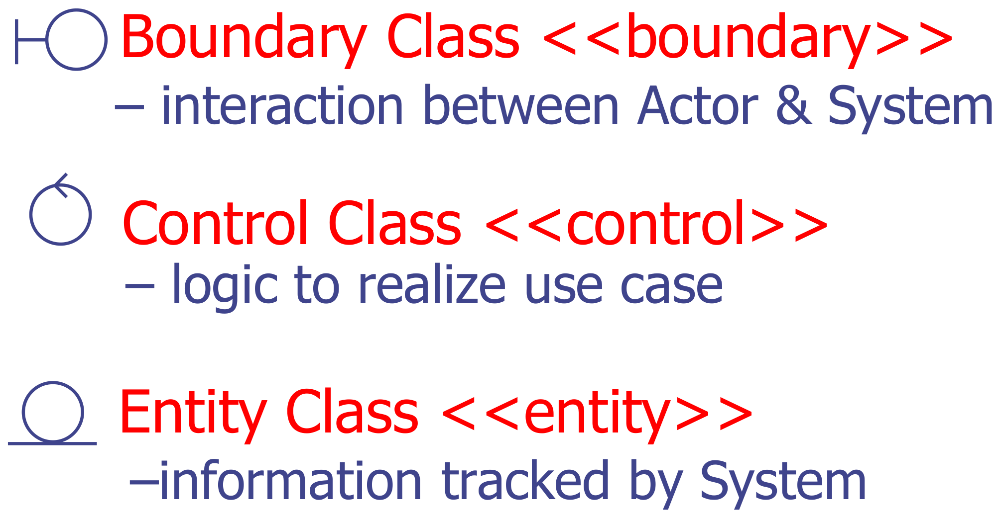
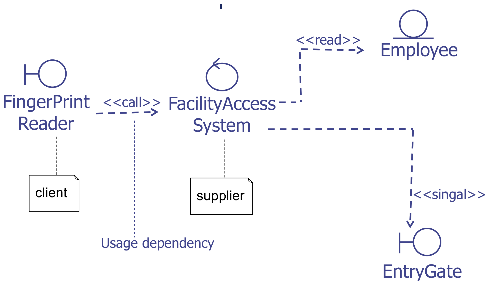
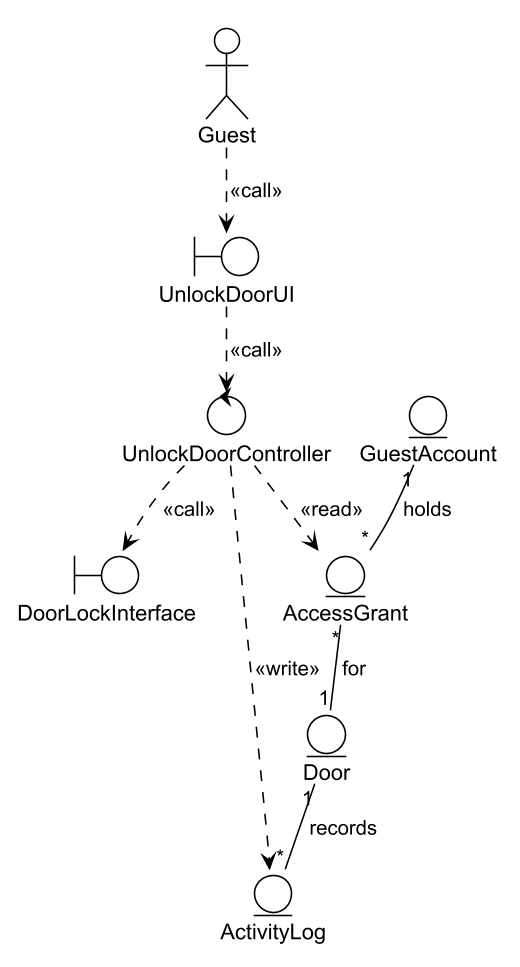

This was written entirely with AI.

# From elicitation to analysis

| | Requirements elicitation | Requirements analysis |
|---|---|---|
| Purpose | Find out what the customer wants | Make a system model that is correct, complete, consistent and unambiguous |
| Output | Actors and use cases | A **conceptual model** (structure) and a **dynamic model** (behaviour) |

Elicitation uses the language of the customer. Analysis starts to use the language of the software engineer. The analysis models help in three ways:

- They make the structure and the behaviour of the system clear.
- They check the requirements. A missing class or a step that no class can do shows a gap in the requirements.
- They are the base for the design (Parts 9–11).

The two analysis models are:

- **Conceptual model** (this part). It identifies the objects in the use cases and the role of each object. You draw it as a **class diagram**.
- **Dynamic model** (Part 6). It shows how the objects carry out the use cases over time.

# Objects, attributes and operations

- An **object** is anything that has a state and a behaviour. Examples: a bus, a dog, a login form, a user list.
- An **attribute** is a variable that holds part of the state. A bus has seats and a colour.
- An **operation** is a procedure that other objects call. A bus can start and stop. A login form can submit.

A **class** describes a group of objects of the same kind. A class diagram shows the classes and the relationships between them.

# Class notation

A class is a box with three compartments:

1. the **name** (the only part that you must give);
2. the **attributes**, each with a type;
3. the **operations**, each with a signature (name, parameters and return type).

# Associations and multiplicity

An **association** is a solid line between two classes. It shows that objects of one class are linked to objects of the other class.

**Multiplicity** at each end of the association tells how many objects at that end are linked to one object at the other end:

| Notation | Meaning |
|---|---|
| `1` | exactly one |
| `0..1` | zero or one |
| `*` or `0..*` | zero or more |
| `1..*` | one or more |
| `1..6` | one to six |

Read the multiplicity at the **far** end. Example: Person `1` —— `1` Head means one person has one head. Polygon `1` —— `*` Point means one polygon has many points.

# The kinds of class relationship

| Relationship | Meaning | Symbol | Example |
|---|---|---|---|
| Association | Objects are linked | Solid line | Customer —— Account |
| Directed association | Only one side knows the other | Solid line with open arrow | Order → Product |
| Aggregation | "is part of". The part can exist without the whole. | Solid line, **hollow diamond** at the whole | Car ◇—— Engine |
| Composition | "is entirely made of". The parts live and die with the whole. | Solid line, **filled diamond** at the whole | Book ◆—— Page |
| Generalization (inheritance) | "is a kind of" | Solid line, **hollow triangle** at the parent | Rectangle —▷ Shape |
| Realization | A class implements an interface | **Dashed** line, **hollow triangle** at the interface | MySQLImpl - - ▷ DataStore |
| Dependency | "uses for a short time". Not part of the object's state. | **Dashed** line with open arrow | LotteryTicket - - > Random |

How to choose between aggregation and composition: delete the whole. If the parts are also deleted, it is composition. A book's pages go with the book (composition). An engine can go into another car (aggregation).

Generalization hierarchies are drawn from top to bottom, with the parent at the top. Do not draw obvious parents, such as the Object class in Java.

# How to find the classes

The four activities are:

1. Identify the classes.
2. Find the attributes of each class.
3. Find the operations of each class.
4. Find the associations between the classes.

To find the first classes, look for:

1. nouns and concepts that occur many times in the use case descriptions;
2. real-world things that the system must track;
3. problem-domain terms in the data dictionary.

Then review the definitions and the attributes with the stakeholders.

Example flow of events (Enter Secure Facility):

1. The **User** presses a finger on the **FingerprintReader**.
2. The **FingerprintReader** scans the fingerprint and sends the image to the **FacilityAccessSystem**.
3. The **FacilityAccessSystem** validates the fingerprint and unlocks the **EntryGate**.
4. The **EntryGate** sends a signal to the **FacilityAccessSystem** that it has opened.
5. The **FacilityAccessSystem** locks the **EntryGate**, logs the entry event and increases the occupant count.

Possible classes: FingerprintReader, FacilityAccessSystem, EntryGate, Employee (who owns the fingerprint).

# Boundary, control and entity classes

The analysis model puts each class into one of three **stereotypes**. Each stereotype has a different responsibility.

| Stereotype | Icon | Responsibility | Examples |
|---|---|---|---|
| `<<boundary>>` | Circle with a line on its left | The interaction between an actor and the system. Screens, forms and interfaces to devices and external systems. | LoginUI, PaymentGatewayInterface, SensorInterface |
| `<<control>>` | Circle with an arrow on top | The logic of one use case. It connects boundaries and entities. | LoginController, AllocationManager |
| `<<entity>>` | Circle with a line under it | Information that the system tracks and stores. Often from the domain. | Account, Shipment, Silo |

Why split classes this way: each kind of class changes for a different reason. Screens change often. Business rules change sometimes. Stored data changes rarely. When each kind is in a separate class, a change to one kind does not force a change to the others.

## Which stereotypes can communicate

| From \ To | Entity | Boundary | Control |
|---|---|---|---|
| **Entity** | ✓ | ✗ | ✓ |
| **Boundary** | ✗ | ✗ | ✓ |
| **Control** | ✓ | ✓ | ✓ |

The important rules:

- An **actor** talks only to a **boundary**.
- A **boundary** talks only to a **control**. A boundary never talks directly to an entity.
- A **control** can talk to entities, boundaries and other controls.
- **Entities** link to other entities with associations.

## Stereotyped dependencies

Label each dependency with what it does:

| Label | Meaning |
|---|---|
| `<<call>>` | The client calls an operation of the supplier |
| `<<read>>` | The client reads data from an entity |
| `<<write>>` | The client changes data in an entity |
| `<<signal>>` | The client sends a signal, for example to a device |
| `<<use>>` | A general use |
| `<<create>>` | The client creates the supplier object |

# Method: draw a conceptual class diagram for one function

1. Read the use case description and the data dictionary for the function.
2. **Boundaries.** Add one boundary for each actor that takes part:
   - a UI class for each human actor (for example `UnlockDoorUI`);
   - an interface class for each device or external system (for example `DoorLockInterface`, `EmailServerInterface`).
3. **Controls.** Add one control for each use case in the function (for example `UnlockDoorController`). An included use case can get its own control.
4. **Entities.** Add one entity for each noun that the system must remember (for example `AccessGrant`, `Door`, `ActivityLog`).
5. **Dependencies.** Draw actor → boundary → control → entity. Label them `<<call>>`, `<<read>>`, `<<write>>`.
6. **Associations between entities.** Add multiplicities. Add generalization where one entity is a kind of another.
7. Show the **stereotype** of every class, as an icon or as `<<boundary>>` text.
8. Leave out attributes and operations, unless the question asks for them.

## A larger example: shipments into silos

A storage system records arriving shipments of grain and allocates each shipment to silos. The manager can also allocate a shipment manually.

- **Boundaries:** `MainUI`, `ShipmentInterface`, `AllocationInterface`, `ManualAllocationInterface`.
- **Controls:** `MainManager`, `ShipmentManager`, `AllocationManager`, `ManualAllocationManager`.
- **Entities:** `Shipment` (with subclasses `ArrivalShipment` and `DepartureShipment`), `Grain`, `Silo`, `Allocation`.
- **Dependencies:** the manager actor calls `MainUI`. `MainUI` uses `MainManager`. `MainManager` calls each interface. Each interface uses its own manager. `ShipmentManager` writes `Shipment`. `AllocationManager` reads `Shipment` and `Silo` and writes `Allocation`.
- **Associations:** `Shipment` —— `Grain` —— `Silo`, each with multiplicity.

The first version of a conceptual model often has only entities. The boundary and control classes come when you refine the model.

# Getting ready for exam questions

The usual question: "For function X, identify the main classes and their associations and draw a conceptual class diagram. Show the stereotype of each class. You do not need attributes or operations." (8–9 marks)

- [ ] Each class shows its stereotype (icon or `<<…>>`).
- [ ] Each human actor has a UI boundary. Each device or external system has an interface boundary.
- [ ] Each use case in the function has a control.
- [ ] Each stored noun has an entity.
- [ ] **No boundary–entity link. No boundary–boundary link.**
- [ ] The actor connects only to a boundary.
- [ ] Entity–entity associations have multiplicities.
- [ ] Use generalization for "kinds of" (ArrivalShipment and DepartureShipment are kinds of Shipment).
- [ ] Use only the function that the question names. Do not draw the full system.
- [ ] Keep it a **conceptual** model: it is not the detailed design class diagram. Attributes and operations are optional.
