This was written entirely with AI.

The conceptual model shows what the parts of the system are. The dynamic model shows how the system behaves over time. This course uses two dynamic diagrams:

- The **state machine diagram** shows the states of **one object or system** and the events that move it from one state to another.
- The **activity diagram** shows a **workflow**: the activities, their order, and who does each one.

# State machine diagrams

## States

A **state** is a stable condition of a system or an object. The system stays in a state for some time, until an event moves it to another state. Most systems have a limited number of states.

Example: a 2-bit binary counter has 4 states: 00, 01, 10, 11. Each clock signal moves it to the next state.

A state is a box with round corners. It has a name. It can also show:

- `entry / action` — an action that runs once, when the system enters the state;
- `exit / action` — an action that runs once, when the system leaves the state;
- `do / activity` — an activity that runs for the full time that the system stays in the state.

## Transitions

A **transition** is an arrow from one state to the next. It happens instantly, in response to an event. Its label has three optional parts:

```
event(arguments) [guard] / action
```

- **event:** what causes the transition. Example: `insert(c: Coin)`.
- **guard:** a condition in square brackets. The transition happens only if the guard is true. Example: `[amount is enough for i]`.
- **action:** what the system does during the transition. Example: `/ log`.

A diagram starts at a **start node** (a filled circle). It ends at an **end node** (a filled circle inside a ring). A system that runs for ever has no end node.

![State notation. The transition label has the form event(arguments)[guard]/action.](6-artifacts/state-notation.png)

## Example: a vending machine

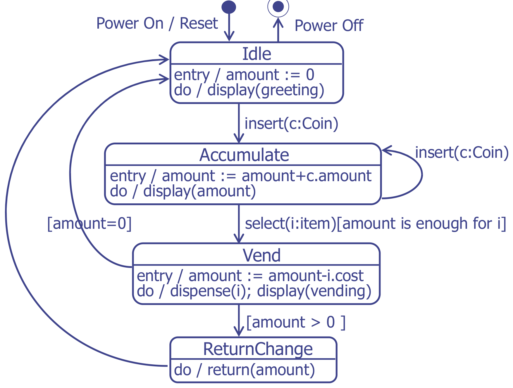

Read it like this:

- In **Idle**, the amount is set to 0 on entry. The machine shows a greeting while it waits.
- `insert(c: Coin)` moves it to **Accumulate**. Each extra coin is a **self-transition** back into Accumulate. The entry action adds the coin value.
- `select(i: item)` moves it to **Vend**, but only if the guard `[amount is enough for i]` is true.
- After Vend, the guards decide: `[amount > 0]` goes to **ReturnChange**, and `[amount = 0]` goes to **Idle**.

## Dialog maps

Many user interfaces are state machines. Only one screen is active at a time (a state). Defined user actions move the user to another screen (a transition). A state machine diagram of the screens is a **dialog map**.

A dialog map, used with a prototype, helps the team:

- find missing or wrong navigation paths early, when they are cheap to correct;
- find screens that the team can reuse, and screens that repeat each other, before it designs the screens in detail.

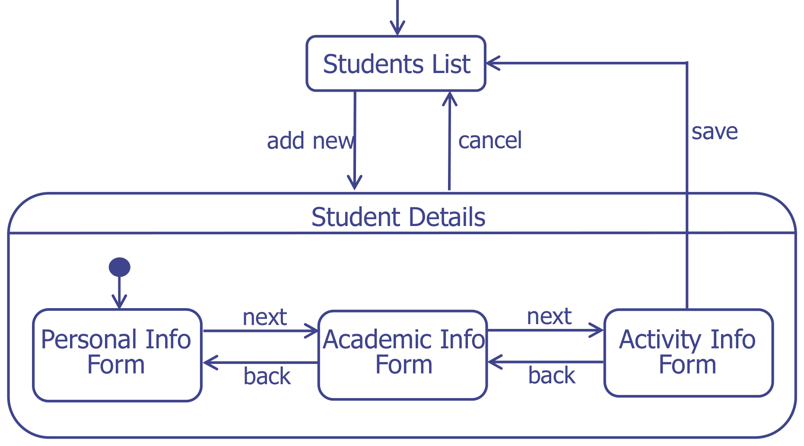

**Student Details** is a **composite state**. It contains its own start node and sub-states. The transition "cancel" leaves the composite state from any of its sub-states.

## Example: a stopwatch

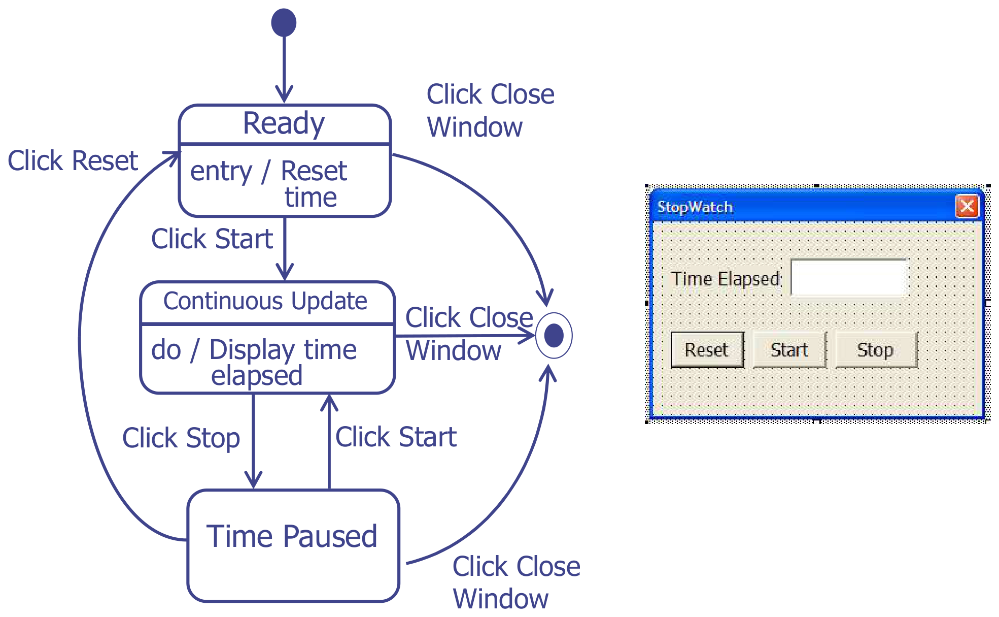

Each state needs its own exit transition for "Click Close Window". A missing transition means that the user cannot do that action in that state.

## Example: a projector with a composite state

A projector starts OFF. When the lecturer turns it on, it beeps and its red light blinks while it warms up. When it is ready, the light turns green and it takes input from the PC. The lecturer can switch between PC and LAPTOP input. The OFF button works only when the light is not blinking.

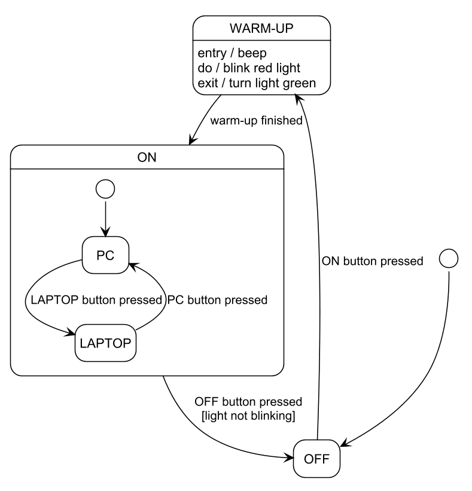

Note three techniques:

- **entry / do / exit** actions describe what the projector does in WARM-UP.
- **ON is a composite state.** Its inner start node shows that PC is the default input. The OFF transition leaves ON from either PC or LAPTOP, so you draw it only once, from the border of ON.
- The **guard** `[light not blinking]` blocks the OFF button during warm-up.

## Worked example: temporary guest access

A homeowner grants a guest access for a time window. The access becomes active at the start time and expires at the end time. The homeowner can revoke it at any time.

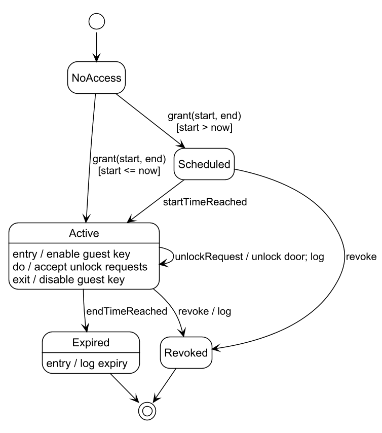

## Method: draw a state machine diagram

1. Choose the **one object** that the question names (a controller, an order, a session).
2. List its states. A state is a **condition that lasts**: "Idle", "Warming up", "Active". It is not an action such as "Push" or "Validate". If the name is a verb, it is probably an activity, not a state.
3. Find the start state and the end state(s).
4. For each state, ask: "Which events can happen here?" Draw one transition for each event.
5. Add **guards** where the same event can lead to different states.
6. Add entry, exit and do actions where the system does something in a state.
7. Check: each state is reachable, and each state has a way out (unless it is final).

Common mistakes:

- Naming an operation as a state ("Push", "Pop"). A stack has states such as **Empty**, **NotEmpty** and **Full**. Push and pop are events.
- Drawing a flow chart of steps instead of states. That is an activity diagram.
- Forgetting the start node.
- Forgetting the events that are possible from every state (power off, cancel, timeout).

# Activity diagrams

An activity diagram is a flow chart of the activities that a system or a business process does.

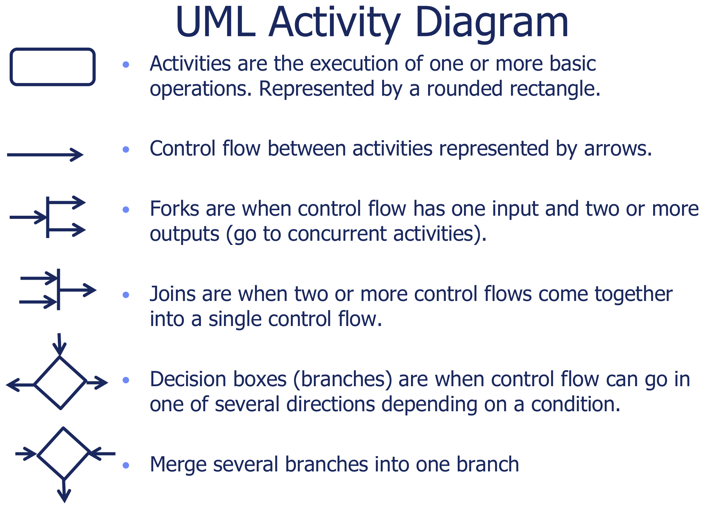

| Element | Symbol | Meaning |
|---|---|---|
| Activity | Box with round corners | One or more basic operations |
| Control flow | Arrow | The order of activities |
| Decision | Diamond with one input and two or more outputs | Control goes one way, depending on a **guard** such as `[valid PIN]` |
| Merge | Diamond with two or more inputs and one output | Branches come back together |
| Fork | Thick bar with one input and two or more outputs | The activities after it run **at the same time** |
| Join | Thick bar with two or more inputs and one output | Wait until **all** incoming flows finish |
| Swimlane | Vertical column with a name | Shows **who** does each activity |
| Start / end | Filled circle / filled circle in a ring | Start and end of the flow |

## Examples

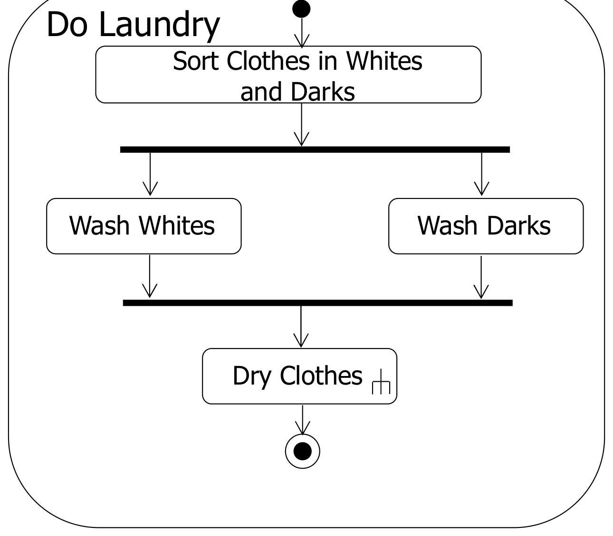

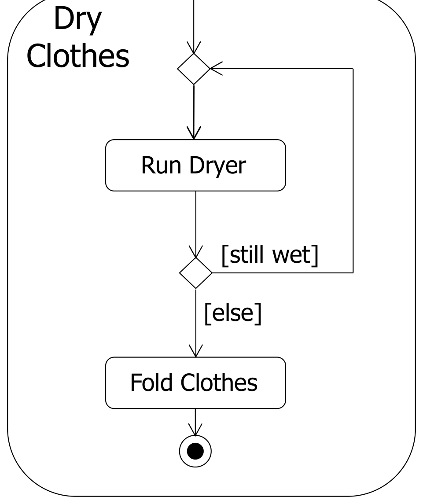

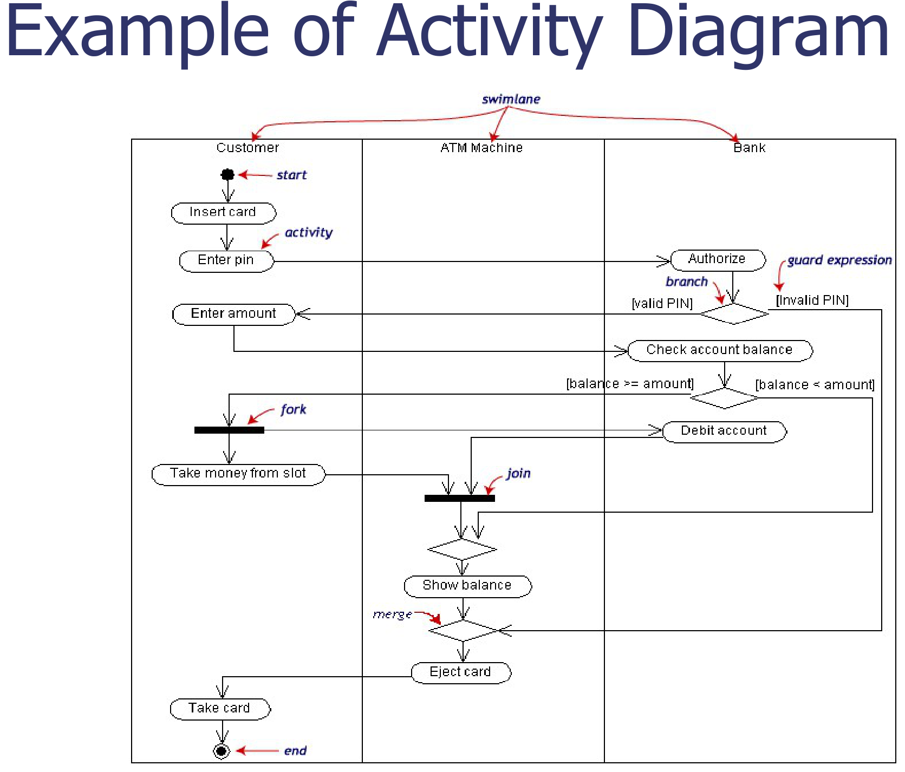

## Worked example: a guest unlocks the door by voice

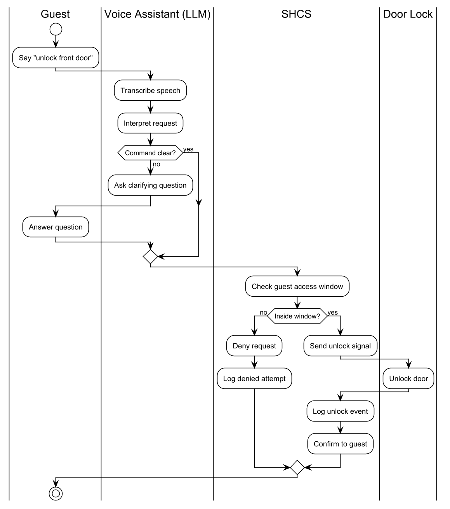

## Method: draw an activity diagram with swimlanes

1. Make one **swimlane** for each actor and for the system. Add a lane for each external system or device that does work.
2. Put the **start node** in the lane of the actor who starts the process.
3. Write each activity as a short verb phrase in the lane of whoever does it.
4. Where the flow depends on a check, add a **decision** diamond. Put a **guard** on each outgoing arrow: `[valid]` and `[invalid]`.
5. Where activities happen at the same time, use a **fork** and a **join**.
6. Bring the branches back together with a **merge** diamond.
7. End at an **end node**. A process can have more than one end node.

Common mistakes:

- Missing guards on the arrows out of a decision.
- A decision with only one outgoing arrow.
- Mixing a fork (same time, all paths) with a decision (one path only).
- No swimlanes when the question says "with swimlanes".

# State machine diagram versus activity diagram

| | State machine diagram | Activity diagram |
|---|---|---|
| Describes | The **states** of one object or system | The **workflow** of activities |
| A box is | A condition that lasts (Idle, Active) | Something that is done (Check PIN) |
| An arrow means | An event moves the object to a new state | Control passes to the next activity |
| Use it for | Controllers, sessions, devices, screen navigation (dialog maps) | Business processes, use case flows, algorithms |

The requirements process itself is an activity diagram:

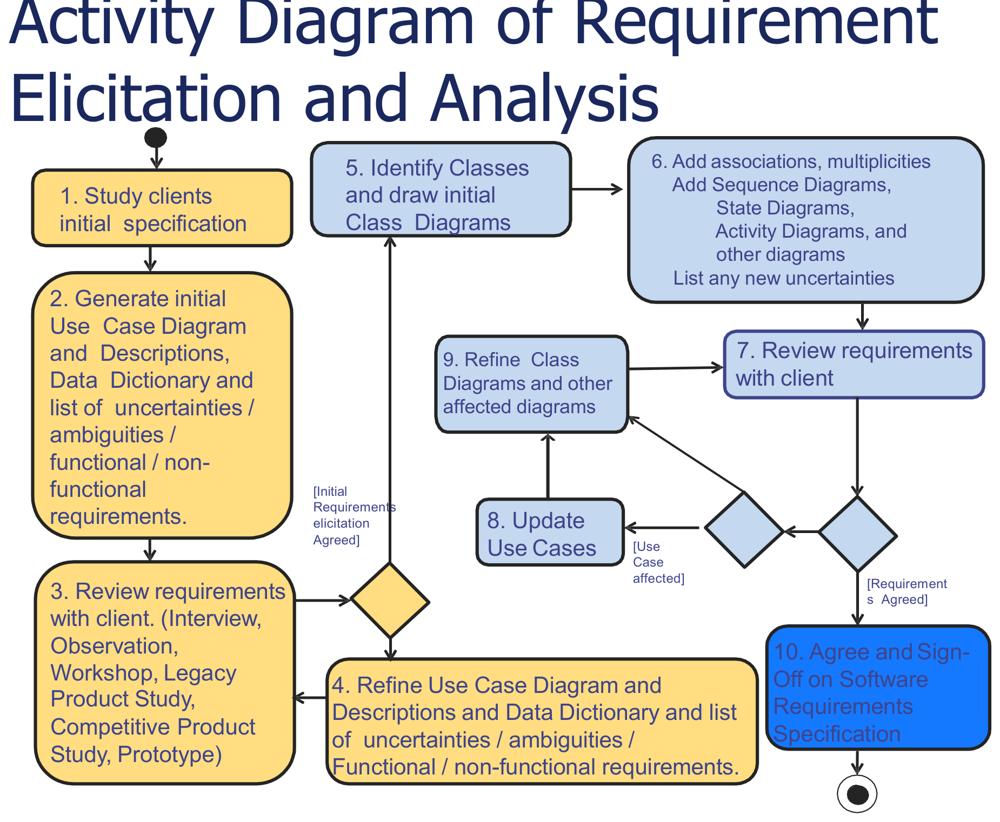
