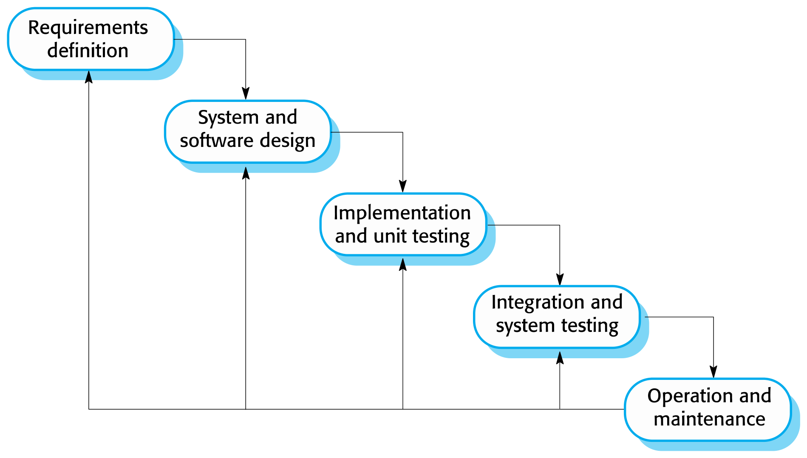
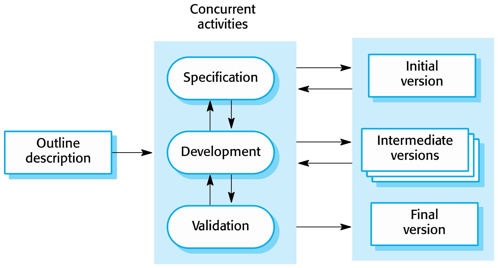
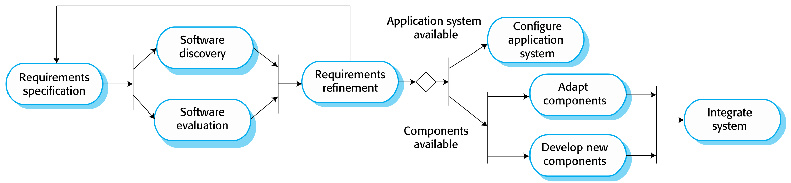

This was written entirely with AI.

# The software process

A **software process** is a structured set of activities that a team does to develop a software system. Different processes exist, but all of them have these four activities:

1. **Specification.** Define what the system must do.
2. **Design and implementation.** Define the structure of the system and build it.
3. **Validation.** Check that the system does what the customer wants.
4. **Evolution.** Change the system when the needs of the customer change.

A **software process model** is a simplified description of a process from one point of view. A process description can also give:

- **products:** the outcomes of each activity;
- **roles:** the responsibilities of the people;
- **pre- and post-conditions:** statements that are true before and after an activity.

# Plan-driven and agile processes

- In a **plan-driven** process, the team plans all activities in advance. It measures progress against this plan.
- In an **agile** process, the team plans in small steps. It is easier to change the process when the requirements of the customer change.

Most real processes mix both approaches. No process is right for every project.

# The three general process models

## 1. The Waterfall model

The phases are:

1. Requirements analysis and definition
2. System and software design
3. Implementation and unit testing
4. Integration and system testing
5. Operation and maintenance

Each phase must finish before the next phase starts. Waterfall is **plan-driven**.

**Main problem:** it is difficult to accept a change after the process starts. The project is split into fixed stages, so a change in requirements means going back to earlier phases and doing their work again.

**When to use it:**

- The requirements are well understood and will change little during the design.
- Large systems engineering projects, where different sites build parts of the system. The plan helps to coordinate the work.
- Few business systems have stable requirements, so Waterfall is not suitable for most business systems.

## 2. Incremental development

The team builds the system as a series of versions (increments). Each version adds function to the previous version. Specification, development and validation are **interleaved**. Incremental development can be plan-driven or agile.

**Benefits:**

- The cost of a change in requirements is lower. Less analysis and documentation must be done again than in Waterfall.
- It is easier to get feedback from the customer. Customers can see demonstrations and see how much is finished.
- The customer gets useful software sooner, and gets value from it sooner.

**Problems:**

- **The process is not visible.** Managers need regular documents to measure progress. When the system changes quickly, it costs too much to document each version.
- **The structure degrades.** Each new increment adds changes. Unless the team spends time and money on **refactoring**, the structure becomes worse, and each later change is more difficult and costly.

## 3. Integration and configuration (reuse-oriented)

The team builds the system from existing components or application systems. These are often **COTS** (commercial off-the-shelf) systems. The team configures each reused part to fit the requirements of the user. Reuse is now the standard approach for many business systems. It can be plan-driven or agile.

The steps are:

1. Specify the requirements.
2. Discover and evaluate existing software.
3. Refine the requirements to fit what is available.
4. Configure the application system, **or** adapt and integrate the components.

Types of reusable software:

- stand-alone application systems (COTS) that you configure for your environment;
- collections of objects for a component framework such as .NET or J2EE;
- web services that you call remotely.

| Advantages | Disadvantages |
|---|---|
| Less software to write from zero, so lower cost and risk | The requirements must change to fit the components, so the system may not meet the real needs of the users |
| Faster delivery | The team loses control over how the reused parts change in future versions |

# How each model organises the four activities

- **Waterfall:** the activities run **in sequence**, one time each.
- **Incremental:** the activities are **interleaved** and repeat for each increment.
- **Reuse:** specification is shaped by the components that are available. Development becomes configuration and integration.

# Waterfall versus Agile

This comparison occurs in many papers. Use these headings:

| Aspect | Waterfall | Agile |
|---|---|---|
| **Flexibility** | Low. Each phase is fixed. A change means going back to an earlier phase. | High. Requirements can change at each sprint. The backlog is updated all the time. |
| **Customer involvement** | Mostly at the start (requirements) and at the end (acceptance). | During the full project. The customer (product owner) sets priorities and reviews each increment. |
| **Delivery** | One delivery at the end of the project. | Frequent small deliveries of working software, every 2–4 weeks. |
| **Planning** | All planning in advance. Progress is measured against the plan. | Planning is incremental, one sprint at a time. |
| **Documentation** | Full documents at each phase. | Minimal documents. Working code is the focus. |
| **Advantage** | Easy to manage and coordinate. Clear milestones. Good for stable requirements and large, multi-site, safety-critical systems. | Responds quickly to change. Early feedback. The customer gets value early. |
| **Disadvantage** | Costly to change. Problems show only late. | Hard to scale to large systems. Needs a skilled team and a committed customer. Less documentation. |

## A requirement changes during the project

**In Waterfall:**

1. Stop and assess the impact of the change on the requirements, the design, the code and the schedule.
2. Raise a formal change request. Get the client to agree to the change and to the new cost and time.
3. Update the SRS, then the design documents, then the code and the tests, in phase order.
4. Re-plan the schedule and the budget.
5. If the requirements changed a lot, consider switching to an incremental or agile approach for the rest of the project.

**In Agile:**

1. The product owner adds or changes items in the product backlog.
2. The product owner gives the changed items a new priority.
3. The team takes the changed items into a future sprint at sprint planning. The current sprint goal does not change.
4. The team shows the result at the next sprint review and gets feedback.

# Getting ready for exam questions

- For "compare Waterfall and Agile", use the headings that the question gives (for example flexibility, customer involvement, delivery). Give one advantage for each model.
- For "how does each model handle this change", describe the steps for each model. Then name the cost. Waterfall goes back through the phases. Agile changes the backlog.
- Know when Waterfall is the better choice: stable requirements, large or multi-site projects, strong need for documents and contracts.
