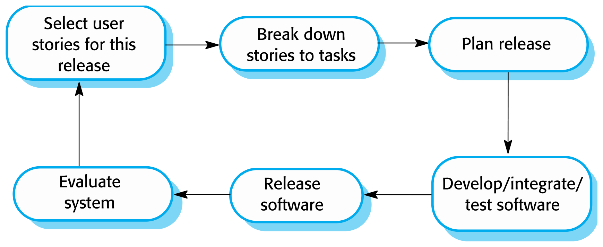
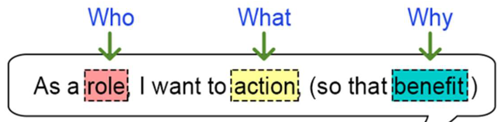
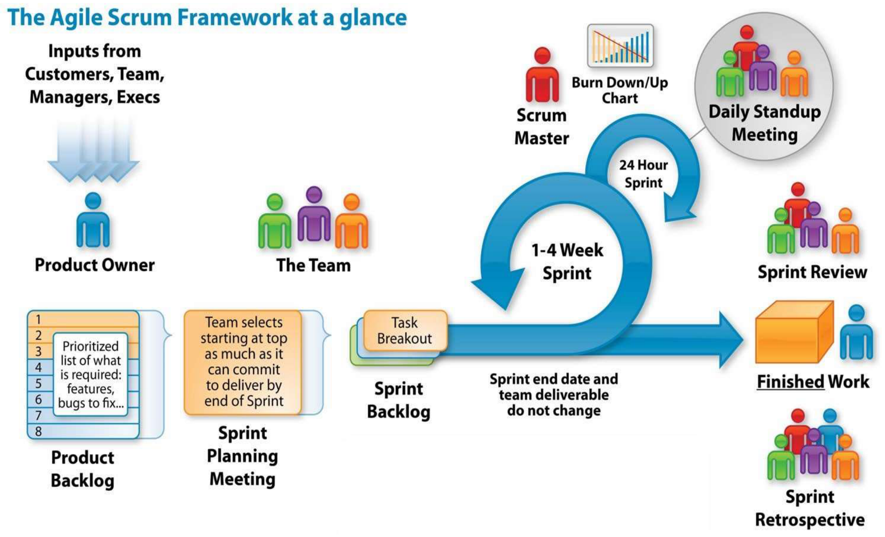
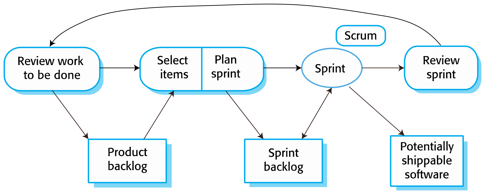
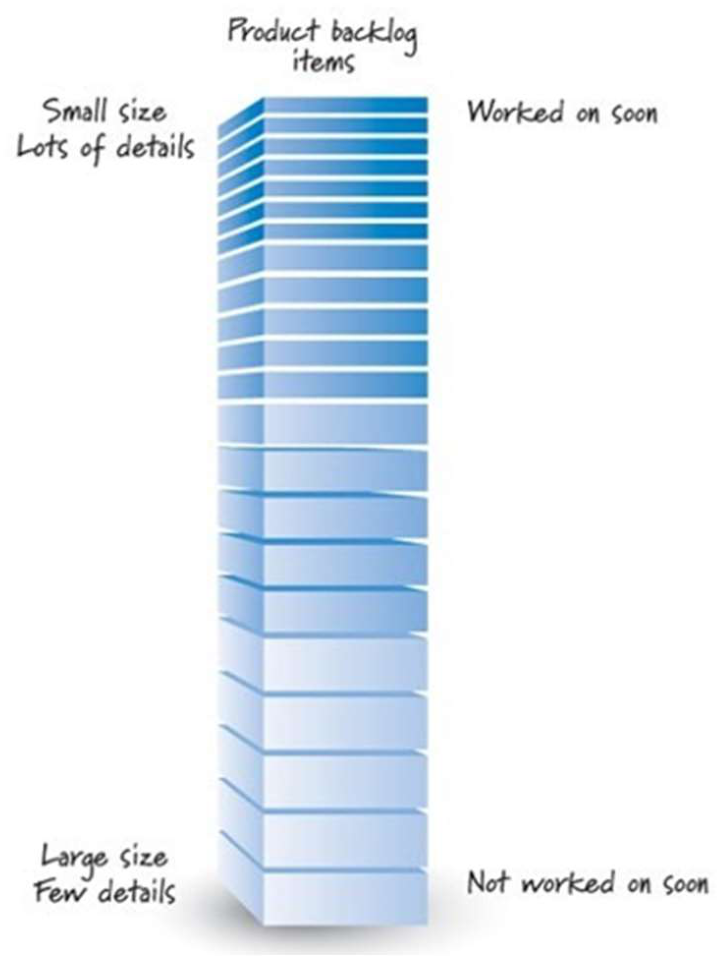
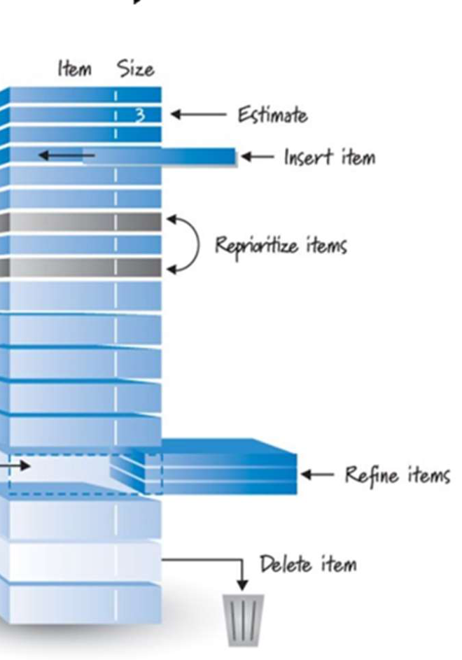
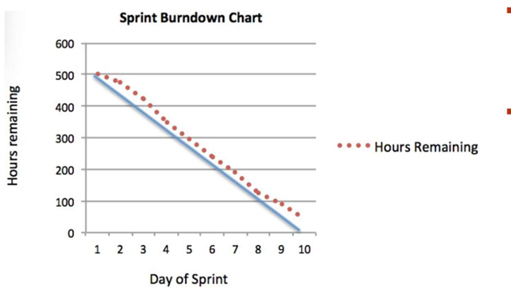

This was written entirely with AI.

# Why agile methods exist

Businesses change fast. Their software requirements change fast too, so it is almost impossible to write a stable set of requirements at the start. Often, quick delivery is the most important requirement. Plan-driven development is necessary for some systems, but it does not meet these business needs.

Agile methods appeared in the late 1990s. Their aim is to make the delivery time for working software much shorter. In agile development:

- specification, design and implementation are interleaved;
- the system is developed as a series of versions (increments), and stakeholders help to specify and evaluate each version;
- new versions are delivered often for evaluation;
- tools support the work, for example automated testing tools;
- documentation is minimal. The focus is working code.

# The Agile Manifesto

> We value:
> **Individuals and interactions** over processes and tools.
> **Working software** over comprehensive documentation.
> **Customer collaboration** over contract negotiation.
> **Responding to change** over following a plan.
>
> The items on the right have value, but we value the items on the left more.

# The five principles of agile methods

| Principle | Meaning |
|---|---|
| **Customer involvement** | Customers work closely with the team during the full project. They give and prioritise new requirements and evaluate each iteration. |
| **Incremental delivery** | The software is developed in increments. The customer chooses the requirements for each increment. |
| **People, not process** | The team uses the skills of its members. Members choose their own ways of working, without fixed rules. |
| **Embrace change** | Expect the requirements to change. Design the system so that it can change easily. |
| **Maintain simplicity** | Keep the software and the process simple. Remove complexity where possible. |

# When agile methods work, and when they do not

Agile methods work well for:

- a small or medium product that a company develops for sale;
- a custom system inside an organisation, when the customer commits to take part, and when few external rules and regulations apply.

Agile methods are difficult in large organisations:

- Project managers who have no agile experience may not accept the risk.
- Large organisations have quality procedures and standards for all projects. These bureaucratic rules often do not fit agile methods.
- Agile methods work best with highly skilled team members. Large organisations have a wide range of skill levels.
- Organisations with a long history of plan-driven processes may resist the change in culture.

## Should a project use Agile/Scrum?

Consider these points:

- **Team experience and skill.** The team needs skilled, motivated developers who can take many roles (cross-functional).
- **Customer involvement.** The customer must be available to give feedback all the time.
- **Requirements.** Agile suits requirements that are not clear or that change often.
- **Rate of change.** Agile suits projects where changes come often.
- **Organisational culture.** The organisation must accept frequent change and frequent contact with the customer.
- **Documentation.** Agile suits projects that can accept minimal documentation. Projects that must produce full documents for regulators may need a plan-driven process.

# Extreme Programming (XP)

XP is an important agile method from the late 1990s. It takes iterative development to the "extreme":

- The team can build new versions several times each day.
- The team delivers increments to the customer every 2 weeks.
- The team runs all tests for each build. It accepts the build only if all tests pass.

## XP practices

| Practice | Meaning |
|---|---|
| Incremental planning | Requirements are on story cards. Time and priority decide which stories go into a release. Developers split stories into tasks. |
| Small releases | Build the smallest useful set of functions first. Release often. Each release adds functions. |
| Simple design | Design only enough to meet the current requirements. |
| Test-first development | Write an automated unit test for a function **before** you write the function. |
| Refactoring | All developers improve the code all the time, as soon as they find a possible improvement. |
| Pair programming | Developers work in pairs and check each other's work. |
| Collective ownership | All pairs work on all parts of the system. Anyone can change anything. |
| Continuous integration | When a task is finished, integrate it into the full system at once. All unit tests must then pass. |
| Sustainable pace | No large amounts of overtime. Overtime decreases code quality and productivity. |
| On-site customer | A representative of the users works full-time with the team. The customer brings the requirements to the team. |

XP focuses on technical practice, so it is hard to fit into the management practice of most organisations. Few teams use full XP. But agile teams use four XP practices often: **user stories, refactoring, test-first development and pair programming.**

XP suits projects that:

- use new technology, where requirements change fast or where developers must discover problems as they work;
- are research projects, where the result is knowledge and not the software;
- are small and can be managed informally.

## User stories

In XP, the customer is part of the team and makes the decisions about requirements. Requirements are written as **user stories** on cards. The team splits each story into **tasks** and writes each task on a **task card**. The tasks are the base for the schedule and the cost estimates. The customer chooses the stories for the next release, based on priority and on the estimates.

The usual format:

> As a **[role]**, I want **[action]**, so that **[benefit]**.

Example: "As a homeowner, I want to give a guest access for a fixed time, so that the guest cannot enter after the visit."

### INVEST: properties of a good user story

| Letter | Property | Meaning |
|---|---|---|
| I | **Independent** | The team can build it without other stories, in any order. |
| N | **Negotiable** | It is a starting point for discussion, not a fixed contract. |
| V | **Valuable** | It gives value to the user or the customer. |
| E | **Estimable** | The team can estimate its size. |
| S | **Small** | It fits into one sprint. |
| T | **Testable** | There is a clear test that shows it is done. |

## Refactoring

The usual advice in software engineering is to **design for change**: spend effort now to prepare for changes later. XP says that this is not worth it, because nobody can reliably predict the changes. Instead, XP improves the code all the time (**refactoring**), so that changes are easy when they come.

Refactoring improves the structure of the code without changing what it does. It makes the code easier to understand, so the team needs fewer documents. Examples:

- reorganise a class hierarchy to remove duplicate code;
- tidy and rename attributes and methods to make them easier to understand;
- replace inline code with calls to methods in a program library.

Refactoring removes duplication and **increases cohesion while it decreases coupling**. Some changes need the architecture to be refactored, and this is much more costly.

## Test-first development (TDD)

Testing is central to XP. The program is tested after every change.

- Writing a test **before** the code makes the requirement clear.
- Tests are programs, not data, so they run automatically. Each test checks that it ran correctly.
- A test framework such as JUnit runs the tests.
- When the team adds a new function, it runs **all old and new tests**. This shows at once if the new code broke something.

TDD joins three activities closely: **coding**, **testing** (writing unit tests) and **design** (refactoring). The cycle is: write a test that fails → write the code to make it pass → refactor → repeat.

## Pair programming

Two programmers sit at one computer. One writes code. The other reviews it, suggests improvements and finds mistakes.

- Each line of code is reviewed by a second person, so it is an informal review.
- Knowledge spreads across the team. This reduces the risk when a member leaves.
- Pairs change often, so all members work with each other.
- It supports collective ownership and encourages refactoring.
- Some evidence shows that a pair is more productive than two programmers who work alone.

# Scrum

Scrum is an agile method that focuses on **managing** iterative development. It does not prescribe technical practices. Scrum has three phases:

1. **Outline planning.** Set the general objectives and design the software architecture.
2. **A series of sprint cycles.** Each sprint develops one increment of the system.
3. **Project closure.** Finish the project, complete the documents (help frames, user manuals) and record the lessons learned.

## Scrum roles

The **Scrum team** has three roles.

**Product Owner (PO)**

- Has a clear vision and goals for the product. Represents the customers and the stakeholders.
- Is responsible for getting the **most value** from the work of the team. The PO balances scope, schedule, cost and quality to get "the right product".
- **Owns the product backlog:** creates it, manages it and sets its priorities.
- Can be a customer, a product manager or another stakeholder representative.

**Scrum Master**

- Is a **servant-leader**. Focuses on the needs of the team and of the customer.
- Teaches and coaches the team and the organisation to use Scrum well.
- Facilitates the Scrum events: arranges the daily meetings, tracks the backlog, records decisions and measures progress.
- Helps the team to remove and prevent **impediments** (problems that block work).
- Protects the team from outside distractions. Talks with customers and management outside the team.
- **The Scrum Master is not a project manager.** The Scrum Master does not assign work.

**Development Team**

- A self-organising team of about 5–9 people. The team is **responsible for the working product** at the end of each sprint.
- Flat structure: everyone is a "developer". There are no sub-teams.
- **Owns the sprint backlog.** Only the Development Team decides how much work is realistic for a sprint.
- Produces a tested, defect-free "Done" increment in each sprint.

## Scrum artifacts

**Product backlog (PB)**

- An **ordered list** of everything that the product needs, to give the most value.
- The **single source of requirements** for any change to the product.
- The PO is responsible for its content, its availability and its order.
- Features in the backlog are often written as **user stories**.

**Sprint backlog**

- The product backlog items (PBIs) selected for the sprint, **plus a plan** to deliver the increment and meet the sprint goal.
- The team breaks each PBI into **tasks**. Tasks are estimated in hours, usually 1–16 hours. A task longer than 16 hours is split again.
- Team members **sign up** for tasks. Nobody assigns tasks to them.
- The team updates the estimated remaining work **every day**.
- The sprint backlog does **not change** during the sprint.
- Items that are not "Done" at the end of the sprint go back to the product backlog for a later sprint.

**Product increment**

- At the end of each sprint, the "Done" items are integrated and tested with the increments of all earlier sprints. The result is a **potentially shippable product**.
- The PO can release it if they want to. In practice, this is not always possible.

**Burndown chart** — a chart of the work remaining against time (see below).

## Scrum events

**Sprint**

- A **time-box** of 2–4 weeks. In it, the team makes a "Done" product increment.
- Each sprint has a **sprint goal**. The goal does not change during the sprint.
- The time-box is never extended. The sprint ends when the time is up.
- At each sprint, the team **inspects and adapts** both the product and the process.

**Sprint planning** answers two questions:

1. *What work can the team do in this sprint?* The PO presents the ordered PBIs. The Scrum Master facilitates. The team breaks the PBIs into tasks and estimates them together in hours. **Only the Development Team decides how much it can do.**
2. *How will the team do the chosen work?* The Development Team plans and designs how to build a "Done" increment that meets the sprint goal. It can invite other people for technical or domain advice.

**Daily Scrum (stand-up)**

- A **15-minute** time-box, at the same place and the same time each day.
- Each member answers three questions: *What did I do yesterday? What will I do today? Are there any issues or impediments?*
- The team checks the work since the last meeting and adapts its plan towards the sprint goal. Everyone knows what is happening. The team can re-plan short-term work when a problem occurs.

**Sprint review**

- At the end of each sprint. Time-box: **1 hour × the number of weeks in the sprint**.
- The team, the PO and key stakeholders look at what was built. They discuss: *What is the current state of the product? What should be added or improved in future sprints?*
- Output: a **revised product backlog** from the PO.

**Sprint retrospective**

- After the sprint review. Time-box: **45 minutes × the number of weeks in the sprint**. Only the Scrum team attends.
- The team checks how the sprint went for **process, tools and people**. It finds what went well and what to improve.
- Input: the results of the sprint. Output: lessons learned, improvements and an **action list** for the next sprint.

## The sprint cycle

1. **Review the work to do.** Start from the product backlog.
2. **Select items.** The team and the customer select features from the product backlog for this sprint.
3. **Plan the sprint.** Put the selected items into the sprint backlog and split them into tasks.
4. **Sprint.** The team organises itself and develops the software. During the sprint, the team is isolated from the customer and the organisation. All communication goes through the Scrum Master.
5. **Review the sprint.** Present the work to the stakeholders. Unfinished items go back into the product backlog. The next sprint starts.

## User stories, epics and acceptance criteria

A **user story** describes one goal (what) from the view of a user (who), and the reason (why), in everyday language. The format is in the XP section above.

An **epic** is a large piece of work that splits into many features. It starts very big, with few details. During backlog refinement, the team splits epics into smaller, more detailed user stories.

**The 3Cs of a user story:**

| C | Meaning |
|---|---|
| **Card** | The statement of intent, written on an index card or a sticky note. Cards are easy to re-order when requirements change. |
| **Conversation** | The discussion behind the story. It gives the details and a shared understanding that formal documents cannot give. |
| **Confirmation** | The **acceptance criteria**. They confirm that the story delivers its value. |

**Acceptance criteria** are the conditions that the work must meet before the team can call the story finished. They can be:

- **functional:** a user function or business process that must work. Example: "A user can see a list of available reports."
- **non-functional:** a condition that the implementation must meet. Example: "Edit buttons follow the site button design."

Good acceptance criteria:

- state an **intent, not a solution** ("The user can choose an account", not "The user selects the account from a drop-down");
- are **independent of the implementation** (the same text works for web, mobile or voice);
- are **high level** (not every detail must be written).

## A good product backlog: DEEP

| Property | Meaning |
|---|---|
| **Detailed appropriately** | Items for the next sprints are at the top. They are small and detailed. Items for later are larger and less detailed. |
| **Emergent** | The backlog is never complete or frozen. It changes all the time as new information arrives. |
| **Estimated** | Each item has a size estimate (effort). The PO uses the estimates to help set priorities. |
| **Prioritised** | The items for the next few sprints are in priority order. |

**Backlog refinement** (grooming) keeps the backlog DEEP. It has three main activities:

1. create and refine PBIs (add details, split large items);
2. estimate PBIs;
3. prioritise PBIs.

Refinement never stops. Items are reviewed and revised all the time. As a general rule, the Development Team spends **up to 10% of its time** in each sprint on refinement.

## Velocity

**Velocity** is the average size of product backlog items, in points, that the team delivers in one sprint. It measures the amount of work done in a sprint. It is a key metric in Scrum.

- Velocity is meaningful only as an **average**. The number from one sprint means little.
- PBIs are sized in **story points**. Tasks are estimated in real units (hours or quarter-days). You **cannot convert points to hours**.
- When the team knows its velocity, it can estimate how much fits into a sprint and how many sprints the project needs. Velocity also shows whether the team improves.

### Three ways to estimate velocity before the team has data

1. **Use a proxy project.** Take a similar recent project. Use its item sizes and velocity.
2. **Best case / worst case.** Estimate the number of sprints for the best case and the worst case. Derive a range of velocity.
3. **Simulate sprints (capacity-based planning).** Plan 2–3 sprints in detail, based on the hours that the team has. Use the result as the velocity.

### Velocity and cost calculations

$$\text{velocity} = \frac{\text{total story points}}{\text{number of sprints}}$$

$$\text{number of sprints} = \left\lceil \frac{\text{total story points}}{\text{velocity}} \right\rceil$$

$$\text{cost} = \text{number of sprints} \times \text{number of Scrum team members} \times \text{cost per member per sprint}$$

The **Scrum team** includes the Product Owner, the Scrum Master **and** the developers. Count all of them unless the question says otherwise.

**Example.** The backlog has 64 points. The Scrum team has a PO, a Scrum Master and 6 developers. Each member costs $2K per sprint. The project needs 8 sprints.

- Velocity = 64 / 8 = **8 points per sprint**
- Cost per sprint = (1 + 1 + 6) × $2K = $16K
- Project cost = $16K × 8 = **$128K**

## Burndown chart

The vertical axis is the work remaining (hours or points). The horizontal axis is the days of the sprint. The straight line from the start to zero is the ideal progress. If the real line is **above** the ideal line, the team is behind schedule.

The burndown chart is used to:

- monitor **scope creep** (work added during the sprint makes the line go up);
- keep the team on schedule;
- compare the planned work with the real progress of the team.

## Why each sprint must deliver working software

1. **It gives better feedback.** Users give more and better feedback when they see and use a working (but partial) product than when they read documents. The team shows it at the sprint review.
2. **It shows real progress.** When much of the system is unfinished, nobody knows how much work remains. Working software at each sprint removes this risk.
3. **It allows an early release.** The company can release early with fewer features if the market needs it.

## Benefits of Scrum

- The product is split into small parts that are easy to understand and manage.
- Unstable requirements do not stop progress.
- The whole team sees everything, so communication improves.
- Customers see increments delivered on time and give feedback.
- Customers and developers trust each other. Everyone expects the project to succeed.

# Getting ready for exam questions

Scrum questions in the papers are often "situation" questions. Use the roles, events and artifacts as your tools.

**Two advantages and two challenges of sprints.**

- Advantages:
  - Feedback comes early and often, at each sprint review.
  - A changed requirement goes into the next sprint. It does not disturb the current sprint.
  - Progress is visible in the burndown chart and in the working increment.
  - The fixed time-box keeps the team focused on one goal.
- Challenges:
  - The fixed time-box can push the team to cut quality to finish on time.
  - New teams estimate badly, so their sprints overrun.
  - The customer must be available for every review.
  - Large architecture work is hard to split into sprint-sized items.
  - The many meetings take time.

**Sprints often overrun. Give causes and corrective actions.**

| Cause | Corrective action |
|---|---|
| The team commits to more points than its velocity | Use the measured velocity from past sprints at sprint planning. Commit to less. |
| Backlog items are too large or not clear | Refine the backlog. Split items until they fit in a sprint (INVEST: Small). Add acceptance criteria. |
| Scope changes during the sprint | The Scrum Master protects the sprint. New requests go into the product backlog for a later sprint. |
| Hidden work (testing, integration, bugs) | Include testing in the definition of done. Estimate it. Use continuous integration. |
| Blockers are found late | Raise blockers at the daily Scrum. The Scrum Master removes them. |

**The customer is unhappy after the first sprint.**

1. Hold the sprint review with the customer and collect the exact problems.
2. Hold a retrospective: find why the team built the wrong thing or too little.
3. Work with the Product Owner to re-prioritise the backlog, so that the next sprint delivers what the customer values most.
4. Make the backlog items clearer, with acceptance criteria that the customer agrees.
5. Involve the customer more: in backlog refinement, in sprint planning and at each review.
6. Agree a realistic velocity so that the customer's expectations match what the team can deliver.
