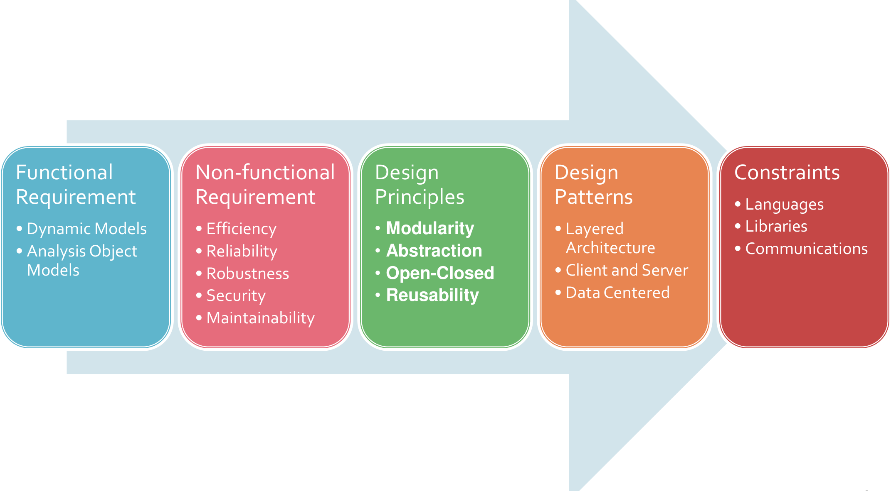
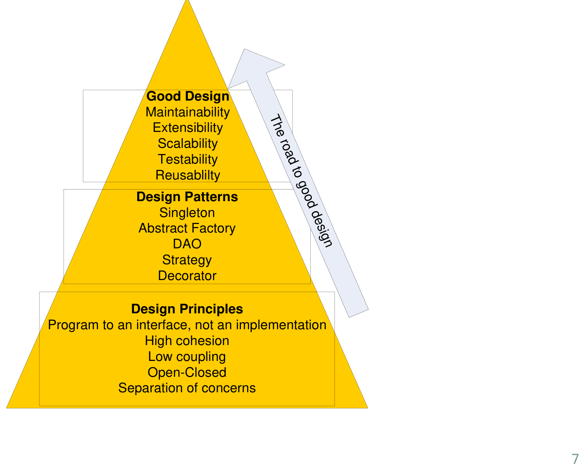
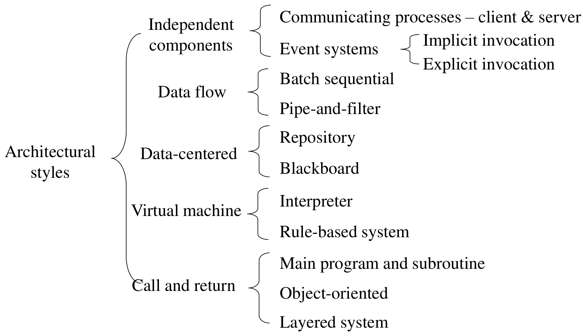
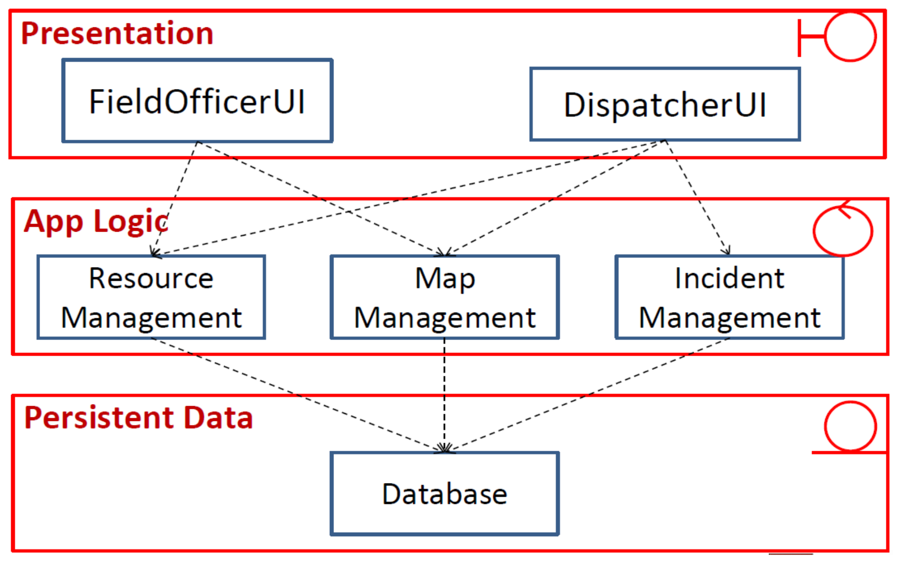
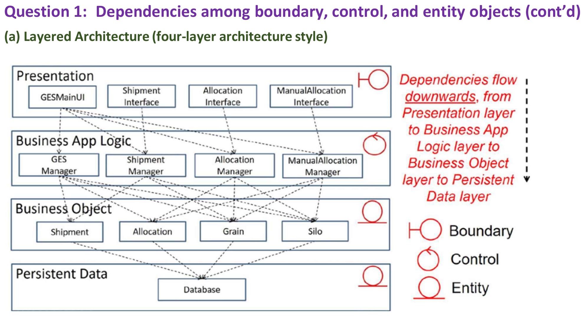
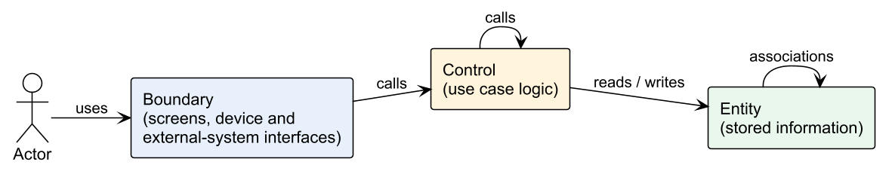
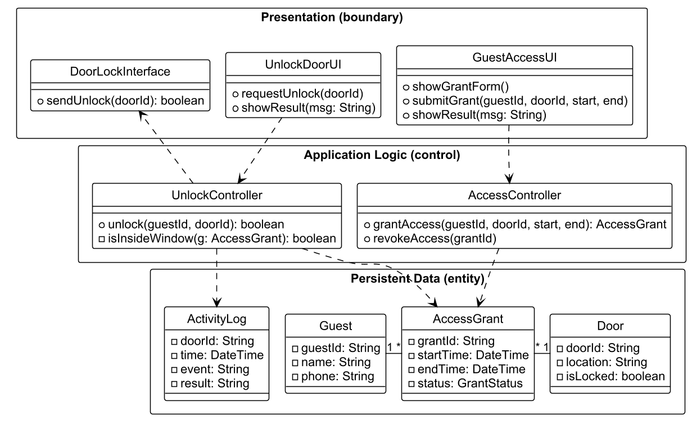

This was written entirely with AI.

# From the problem to the solution

Requirements elicitation and analysis describe the **problem**. Design describes the **solution**. Design has two levels:

1. **System design** decides the **software architecture**: the large parts of the system and how they connect.
2. **Object design** (Parts 10–11) decides the detailed classes, interfaces and design patterns inside each part.

The analysis model (boundary, control and entity classes) is the input to system design.

Each SDLC activity produces a model. Each model builds on the model before it:

| Activity | Model it produces |
|---|---|
| Requirements elicitation | Use case model |
| Requirements analysis | Analysis model: problem-domain objects (boundary, control, entity) |
| System design | Software architecture: subsystems |
| Object design | Design model: solution-domain objects (detailed classes) |
| Implementation | Source code |
| Testing | Test cases that verify the code against the requirements |

# Why architecture matters

Software systems become larger in every way: more code, more users, more developers, a longer life (often decades) and more versions. The technology and the hardware also change. At the same time, the budget is limited, the schedule is tight, and the system must be easy to maintain.

The architecture decides most of the **non-functional** qualities of a system:

- performance;
- availability;
- security;
- scalability;
- extensibility and maintainability.

A wrong architecture is very costly to change later, because every part of the system depends on it.

# What a software architecture is

> Software architecture describes the elements from which systems are built, the interactions among those elements, the patterns that guide their composition, and the constraints on these patterns. (Shaw and Garlan, 1996)

In short: **Software architecture = {Components, Connectors}.**

- A **component** is a unit of software that does a function at run time. Examples: programs, objects, processes, clients, servers, databases.
- A **connector** is an interaction between components: communication, coordination or cooperation. Examples: shared variables, procedure calls, remote procedure calls, communication protocols, data streams.

An architecture is:

- **abstract** — it hides the details of the components and connectors;
- **about structure and interactions** — it shows the topology, the components, and the data and control flow between them;
- **purposeful** — it lets the team show and analyse important properties, and it documents design knowledge for other people.

# How to develop an architecture

| Input | Question it answers | Examples |
|---|---|---|
| Functional requirements | **What** must the system do? | Dynamic models, analysis object models |
| Non-functional requirements | **Why** choose this design over another? | Efficiency, reliability, robustness, security, maintainability |
| Design principles | **How** do we make a good design? | Modularity, abstraction, open–closed, reuse |
| Design patterns and architectural styles | **How** have others solved this problem? | Layered, client–server, data-centred |
| Constraints | What limits do we have? | Programming languages, libraries, communication methods |

# Design principles

| Principle | Meaning |
|---|---|
| **Single responsibility** | Each class has one reason to change. |
| **Separation of concerns** | Put different concerns (display, logic, storage) in different parts. |
| **High cohesion** | All the parts inside one class or module belong to the same task. |
| **Low coupling** | Classes depend on each other as little as possible. A change in one class does not force changes in many others. |
| **Open–closed** | Classes are **open for extension** but **closed for modification**. You add new behaviour with new classes, not by editing old classes. |
| **Program to an interface, not an implementation** | Code depends on an interface. Any class that implements the interface can then be used. |
| **Favour composition over inheritance** | Give an object a part that does the varying work, instead of making many subclasses. |
| **Encapsulate what varies** | Find what changes and separate it from what stays the same. |
| **Least knowledge** | A class talks only to its immediate "friends", not to the friends of its friends. |
| **Don't repeat yourself (DRY)** | Each piece of knowledge exists in one place only. |
| **Modularity** | Split the system into separate modules with clear interfaces. |

Design principles are the base. Design patterns apply the principles to common problems. The result is a good design: maintainable, extensible, scalable, testable and reusable.

# Architectural styles

An **architectural style** is a pattern for how to organise a whole system. It defines:

- a vocabulary of **component types** (for example filters, layers, clients and servers);
- a vocabulary of **connector types** (for example procedure calls, data streams, sockets);
- **constraints** on how they combine (for example "filters do not share state", "a layer may call only the layer below it");
- a way to work out the properties of the whole system from the properties of its parts.

The style does not fix the number of components, the type of each connector, or the exact data. A pipe-and-filter system can have 2 filters or 20 filters.

## Layered architecture

The system is a stack of layers. Each layer gives services to the layer above it and uses only the services of the layer below it.

The usual **three-layer architecture** matches the boundary, control and entity classes:

| Layer | Contains | Stereotype |
|---|---|---|
| Presentation | Screens and interfaces | Boundary |
| Application logic | Use case logic | Control |
| Persistent data | Stored data | Entity |

A **four-layer** version splits the entity layer into business objects and the database:

The rules for dependencies between stereotypes become rules between layers:

**Benefits of layers:**

- **Separation of concerns.** Each layer handles a smaller problem.
- **Low coupling.** A layer knows only the interface of the layer below. It does not know how the lower layer works.
- **Changeability.** You can replace a whole layer, if its interface stays the same. A web app and a mobile app can share the same logic and data layers.
- **Easy maintenance.** A change inside a lower layer does not force changes in the layers above.

**Drawbacks of layers:**

- **Performance.** Each request passes through all layers. More layers mean more overhead.
- **Up-calls.** Sometimes a lower layer must tell a higher layer that something changed (for example, data changed and the screen must update). A direct call upward breaks the layer rule. The Observer pattern solves this (Parts 10 and 11).

## Client–server

Clients send requests to one or more servers over a network. Servers provide shared services, such as data or computation. Many clients can use one server.

- Good for: many users, shared data, web and mobile access, central security.
- Scalability: add more servers behind a load balancer.
- Risk: the server or the network is a single point of failure, unless servers are replicated.

## Data flow: pipe-and-filter and batch sequential

Data passes through a series of processing steps (filters), connected by pipes. Filters do not share state. Good for data transformation, such as compilers and media processing. Batch sequential runs each step on the whole data set before the next step starts.

## Data-centred: repository and blackboard

All components share one central data store. Components communicate through the data store and not directly. Good when many tools work on the same data, such as an IDE.

## Independent components: event systems

Components do not call each other directly. A component announces an event. Other components that registered for that event react to it (implicit invocation). This is the architecture-level form of the Observer pattern.

| Advantages | Disadvantages |
|---|---|
| Modifiability: computation is decoupled | Components are independent, so one component does not know if another received the message |
| Concurrent execution | Needs complicated protocols to make sure that messages arrive |
| Scalability | Correctness is hard to achieve and to prove |
| Easy integration of new components | |

## Virtual machine: interpreter and rule-based system

The system runs a program or a set of rules that is not native code. An **interpreter** runs a script language. A **rule-based system** applies "if–then" rules to facts. Good when users must change the behaviour without recompiling.

## Call and return: main program and subroutine, object-oriented

The main program calls subroutines, or objects call methods of other objects. This is the normal style inside one program.

## Model–View–Controller

MVC is an architecture for interactive systems. Part 11 covers it in detail.

# How designers work

Designers do not find the final design in one step. They:

1. understand the requirements and build a model of the problem;
2. propose one or more design solutions;
3. check each solution against the requirements;
4. revise the solution, or look for a new solution, where it does not match;
5. compare the solutions and select one;
6. work out the selected solution in detail, as a blueprint.

# From architecture to a detailed class diagram

A frequent exam question: "Propose an architecture and draw a detailed class diagram with key attributes and methods that reflects the architecture."

Method:

1. **Choose the architecture and say why.** For most systems with a UI, logic and stored data, choose a **layered** architecture (three layers). For strongly interactive systems with many views of the same data, choose **MVC**. Give one or two reasons that come from the requirements.
2. **Draw each layer** as a package or a labelled box: Presentation, Application Logic, Persistent Data.
3. **Put the classes into the layers:**
   - boundaries in Presentation (one UI per human actor, one interface per external system or device);
   - controls in Application Logic (one manager or controller per use case group);
   - entities in Persistent Data.
4. **Give each class key attributes and methods.** Attributes: the data from the data dictionary, with types. Methods: the steps from the use case descriptions.
5. **Draw the dependencies.** UI → controller → entity. A controller can also call a device or external-system interface (control → boundary is allowed). A UI never calls an entity directly. Add multiplicities to the entity associations.
6. **Add interfaces where the design must be flexible** (for example `PaymentMethod`, `NotificationChannel`). This shows "program to an interface".
7. Check that **no boundary calls an entity directly**.

# Proposing an alternative architecture for a non-functional requirement

Another frequent question: "Identify one relevant non-functional requirement and propose an alternative architecture that addresses it."

1. Pick the NFR that the description stresses most. Look for words such as "real time", "many users", "secure", "must always be available", "notify".
2. Explain why the first architecture is weak for that NFR.
3. Propose a style that fixes it, and explain how.

| NFR in the description | Weakness of a simple layered design | Alternative |
|---|---|---|
| Scalability (many users, peak load) | One server handles all requests | Client–server with several replicated servers and a load balancer |
| Availability (must always work) | One server is a single point of failure | Client–server with redundant servers and a replicated database |
| Real-time updates and notifications | Lower layers must call up to the UI | Event-based (publish–subscribe) architecture, or MVC with Observer |
| Security (authentication, roles) | Each UI checks access in its own way | Add a security layer or an authentication server that all requests pass through |
| Extensibility (new devices, new channels) | New types force changes in the logic | Layered design with interfaces plus Strategy and Factory patterns |
| Many different UIs (web, mobile, voice) | UI and logic are mixed | MVC, so that many views share one model |

# Getting ready for exam questions

- Always **justify** the architecture with the requirements. Example: "The system has a web app and a voice assistant. Both use the same data. A layered architecture lets both UIs share the logic and data layers."
- Name the layers and the stereotype in each layer.
- In the class diagram, keep the layer rule: a UI calls a controller, and a controller calls entities. A UI never calls an entity.
- Know two benefits and one drawback of layered architecture.
- Know the advantages and disadvantages of event-based systems.
