# Network Layers and Physical Resilience

This chapter covers Lectures 1 and 2 of Part I. It answers three questions:

1. What is a computer network, and where did the Internet come from?
2. Why do we split a network into layers, and what does each layer do?
3. How do we calculate the chance that a network stays connected when links break?

Question 3 is a calculation. It comes up in almost every past paper, usually as Question 1. Learn the method in Section 7 well.

---

## 1. What a Computer Network Is

### 1.1 The basic idea

* A **computer network** is a set of devices that exchange data over links.
* A **link** is one connection between two devices. It can be a copper cable, an optical fibre or a radio channel.
* A **node** is any device on the network, for example a computer, a switch or a router.
* A **host** (also called a **station** or **end system**) is a node that runs user programs, for example your laptop or a web server.
* The **Internet** is a network of networks. Many separate networks join together, and they all exchange information with the same standard rules.

### 1.2 A short history (know the names)

One past paper (AY16/17 S2) asked you to match each technology to its inventor. The table gives the pairs.

| Year | Event | People |
| :--- | :--- | :--- |
| 1961–64 | Theory of packet switching | Leonard Kleinrock |
| 1969 | ARPANET starts with 4 nodes: UCLA, SRI, UCSB, University of Utah | ARPA (US Defense) |
| 1970 | ALOHAnet, the first radio packet network (Hawaii) | Norm Abramson |
| 1971 | First network e-mail | Ray Tomlinson |
| 1973 | Ethernet invented at Xerox PARC | Robert Metcalfe |
| 1974 | TCP/IP design published | Vint Cerf and Bob Kahn |
| 1983 | ARPANET changes to TCP/IP; DNS changes names into IP addresses | |
| 1989–91 | World Wide Web (WWW) | Tim Berners-Lee |

---

## 2. Why Networks Use Layers

### 2.1 The problem

A network must do many different jobs. It must send bits down a wire, find a path, recover lost data and talk to a program. If one big program does all of these jobs, the program is very hard to build and very hard to change.

### 2.2 The solution: a stack of layers

We divide the work into **layers**. Each layer does one group of jobs. The layers sit on top of each other like a stack.

* Each layer uses the **service** of the layer directly below it.
* Each layer gives a service to the layer directly above it.
* A layer does not need to know *how* the layer below does its work. It only needs to know *what* that layer gives.

### 2.3 What layering gives us

| Benefit | What it means |
| :--- | :--- |
| Simplicity | You design and test one small layer at a time. |
| Flexibility | You can replace one layer (for example, change Ethernet to Wi-Fi). The other layers do not change. |
| Incremental change | You can improve one layer without a full redesign. |

### 2.4 Protocols and architecture

* A **protocol** is a set of rules that two machines follow when they talk at the **same layer**. A protocol defines three things:
  1. The **format** of each message (which bits mean what).
  2. The **order** of the messages.
  3. The **action** that each side takes when it receives a message.
* A **network architecture** is the full set of layers and the protocols in each layer.

---

## 3. How Two Layers Talk: SAP, SDU and PDU

### 3.1 Peer processes

The same layer on two different machines is called a **peer**. For example, the transport layer on your laptop and the transport layer on the server are peers.

Peers do not have a direct wire between them. Data goes **down** the stack on the sender, across the physical link, and **up** the stack on the receiver. But each layer *acts as if* it talks directly to its peer. We call this a **logical** (or peer-to-peer) connection.

### 3.2 The three terms

* **Service Access Point (SAP):** the point where layer $n+1$ hands data to layer $n$. We name it after the lower layer, which gives the service. So the point between layer 4 and layer 3 is the **3-SAP**.
* **Service Data Unit (SDU):** the data that layer $n+1$ passes down to layer $n$ through the SAP. Layer $n$ must deliver this data. It does not look inside it.
* **Protocol Data Unit (PDU):** the unit that layer $n$ builds and sends to its peer. It is the SDU plus layer $n$'s own header (and sometimes a trailer):

$$\text{PDU}_n = \text{Header}_n + \text{SDU}_n \; (+\ \text{Trailer}_n)$$

The PDU of one layer becomes the SDU of the layer below:

$$\text{PDU}_{n} = \text{SDU}_{n-1}$$

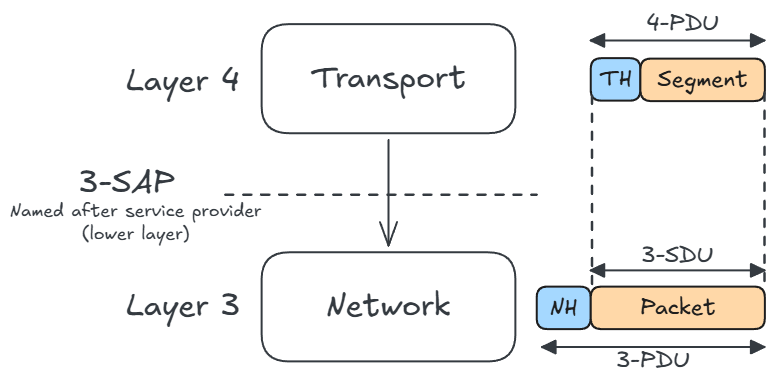{width=62%}

### 3.3 Encapsulation and decapsulation

* **Encapsulation (sender):** each layer, from top to bottom, adds its own header. The data gets bigger as it goes down.
* **Decapsulation (receiver):** each layer, from bottom to top, reads its own header, removes it, and passes the rest up.

---

## 4. The OSI Reference Model (7 Layers)

The **Open Systems Interconnection (OSI)** model is a reference model from ISO. It has seven layers. Learn them from the top down with "**A**ll **P**eople **S**eem **T**o **N**eed **D**ata **P**rocessing".

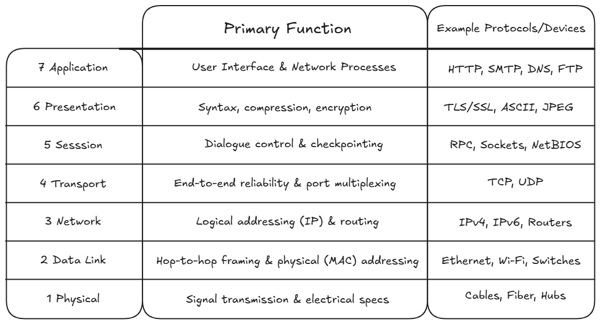

| # | Layer | Main jobs | Unit of data |
| :---: | :--- | :--- | :--- |
| 7 | Application | Gives network services to user programs (web, e-mail, file transfer). | Data |
| 6 | Presentation | Changes the data format so that both sides understand it. Does compression and encryption. | Data |
| 5 | Session | Controls the dialogue between two programs. Does log-in and checkpointing (restart from a saved point). | Data |
| 4 | Transport | Gives reliable, in-order delivery between the two end hosts with no loss and no duplicates. Can be connection-oriented or connectionless. Lets many programs share one network connection (multiplexing). | Segment |
| 3 | Network | Gives logical addresses, finds a route, controls congestion, joins different networks (internetworking), and breaks large packets into fragments. | Packet |
| 2 | Data Link | Puts bits into frames, sends ACKs and retransmits, does flow control across one link. Supports point-to-point and broadcast links, and simplex, half-duplex or full-duplex operation. | Frame |
| 1 | Physical | Sends raw bits over the medium. Defines the mechanical, electrical, functional and procedural details (plug shape, voltage, pin use, order of signals). | Bit |

* Layers 7 to 4 are the **host layers**. Only the end hosts run them.
* Layers 3 to 1 are the **media layers**. Every node on the path runs them.

---

## 5. The TCP/IP Model (5 Layers)

The Internet does not use OSI. It uses the **TCP/IP** model, which has five layers.

| # | TCP/IP layer | Unit of data | Example protocols |
| :---: | :--- | :--- | :--- |
| 5 | Application | Message | HTTP, DNS, SMTP |
| 4 | Transport | Segment | TCP, UDP |
| 3 | Network (Internet) | Datagram | IP, ICMP |
| 2 | Link | Frame | Ethernet, Wi-Fi |
| 1 | Physical | Bit | Cable, fibre, radio |

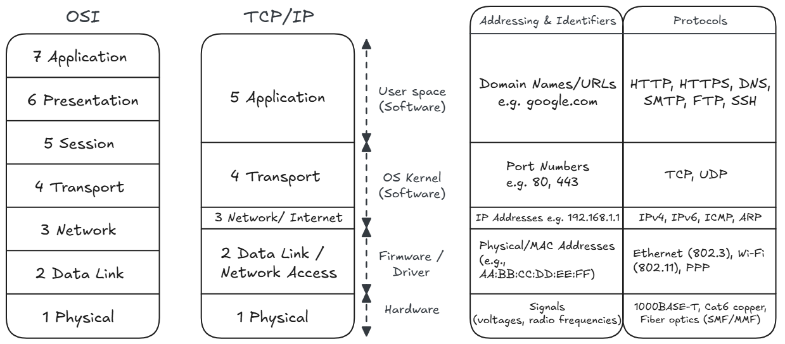

### 5.1 OSI versus TCP/IP (Tutorial 1.1 Q1)

| Point | OSI | TCP/IP |
| :--- | :--- | :--- |
| Number of layers | 7 | 5 |
| Session and presentation | Separate layers | Put inside the application layer |
| Where it came from | A model first, protocols later | Protocols first (from ARPANET), model later |
| Use today | A reference for teaching and discussion | What the real Internet runs |
| Network layer | Supports connection-oriented and connectionless service | Connectionless only (IP) |

---

## 6. What Happens to Headers Along the Path (Tutorial 1.1 Q2)

### 6.1 At the sending host

The sending host runs every layer. Each layer adds a header. The data link layer also adds a **trailer** (DT) at the end. The trailer usually holds an error check.

```
Application              AH | Data
Presentation          PH AH | Data
Session            SH PH AH | Data
Transport       TH SH PH AH | Data
Network      NH TH SH PH AH | Data
Data link DH NH TH SH PH AH | Data | DT
Physical  ---------------- bits ----------------
```

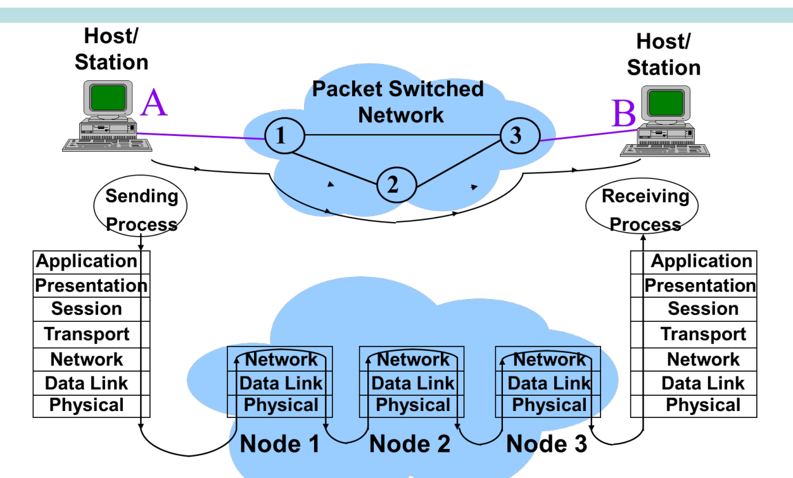{width=80%}

### 6.2 At each switching node (router) in the WAN

A switching node only runs layers 1 to 3. It does these steps for each frame:

1. The physical layer receives the bits and builds the frame.
2. The data link layer checks the frame, then **removes** the old header DH and trailer DT.
3. The network layer reads the network header NH. It uses the destination address to choose the next link.
4. The data link layer for the next link adds a **new** header DH' and trailer DT'.
5. The physical layer sends the new bits.

The node does **not** read or change TH, SH, PH, AH or the data. Only the end host reads those.

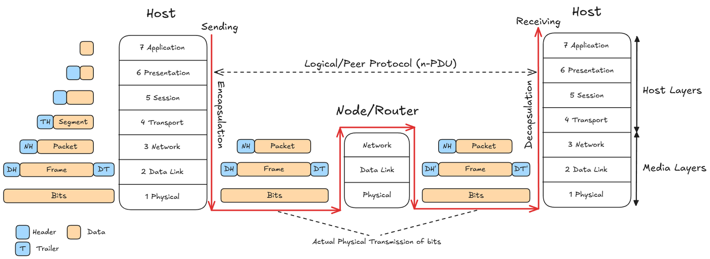

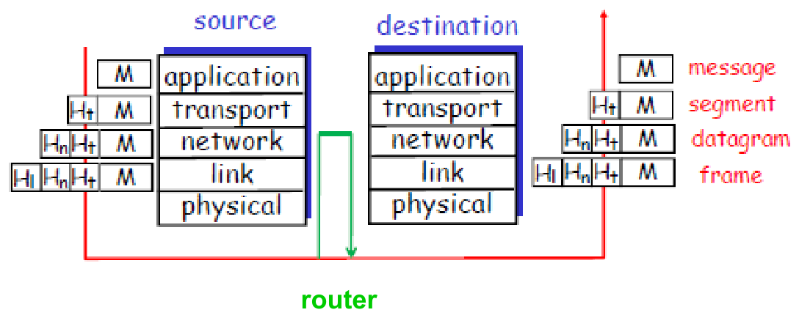{width=75%}

> **Exam answer pattern.** "At each switching node, the data link header and trailer are removed and replaced for the next link. The network header is read to make the routing decision. The higher-layer headers are passed unchanged."

---

## 7. Network Reliability

### 7.1 Three times you must know

A link works for some time, then it breaks, then someone repairs it, and then it works again.

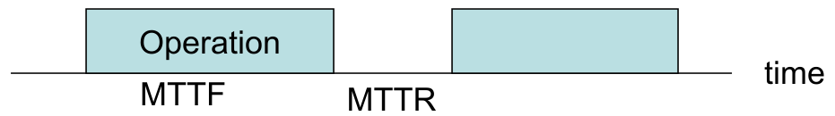{width=65%}

* **MTTF (Mean Time To Failure):** the average time a link works before it breaks.
* **MTTR (Mean Time To Repair):** the average time to repair a broken link.
* **MTBF (Mean Time Between Failures):** the average time of one full cycle.

$$\text{MTBF} = \text{MTTF} + \text{MTTR}$$

### 7.2 Availability and failure probability

For one link $i$:

* $r_i$ = the **availability** (also called reliability) = the fraction of time the link works.
* $b_i$ = the **failure probability** (break probability) = the fraction of time the link is broken.

$$r_i = \frac{\text{MTTF}}{\text{MTTF} + \text{MTTR}}, \qquad b_i = \frac{\text{MTTR}}{\text{MTTF} + \text{MTTR}}, \qquad r_i + b_i = 1$$

Because $b$ is a fraction of time, the downtime in a time window is:

$$\text{downtime} = b \times (\text{length of the window})$$

### 7.3 The "nines"

"$k$ nines" means $r$ has $k$ nines, so $b = 10^{-k}$. One year has $365 \times 24 \times 3600 = 31\,536\,000$ s.

| Availability | Failure probability $b$ | Downtime per year |
| :--- | :--- | :--- |
| 90% (one nine) | $10^{-1}$ | 36.5 days |
| 99% (two nines) | $10^{-2}$ | 3.65 days |
| 99.9% (three nines) | $10^{-3}$ | 8.76 hours |
| 99.99% (four nines) | $10^{-4}$ | 52.6 minutes |
| 99.999% (five nines) | $10^{-5}$ | 5.26 minutes |
| 99.9999% (six nines) | $10^{-6}$ | 31.5 seconds |

**Worked example (Tutorial 1.1 Q3).** A carrier-grade network needs six nines. Find the allowed downtime per year.

$$b = 1 - 0.999999 = 10^{-6}$$
$$\text{downtime} = 10^{-6} \times 31\,536\,000 \text{ s} = \mathbf{31.5\ s}$$

---

## 8. Network Resilience

### 8.1 What resilience means

**Resilience** is a measure of how well a network tolerates faults. We give it as the **probability that the network stays connected** between two points.

We always make one assumption: **links break independently of each other.** So the probability that link A *and* link B are both broken is $b_A \times b_B$.

### 8.2 The two basic rules

**Rule 1: links in series.** The data must cross every link. The path works only if **all** links work.

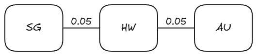{width=55%}

$$r_{\text{series}} = r_1 \times r_2 \times \cdots \times r_n \qquad b_{\text{series}} = 1 - r_{\text{series}}$$

**Rule 2: links in parallel.** The data can use any one of the links. The connection breaks only if **all** links are broken.

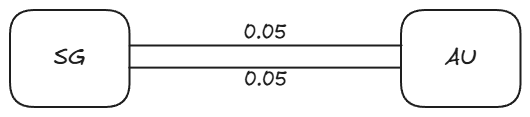{width=55%}

$$b_{\text{parallel}} = b_1 \times b_2 \times \cdots \times b_n \qquad r_{\text{parallel}} = 1 - b_{\text{parallel}}$$

> **Memory hook.** For **series, multiply the $r$**. For **parallel, multiply the $b$**. Change between $r$ and $b$ with $1 - (\cdot)$ every time you change from one rule to the other.

### 8.3 Method for a mixed network

1. Find each group of parallel links between the same two nodes. Replace the group with one equivalent link: $b = \prod b_i$.
2. Find each path from the source to the destination. Each path is a chain of links in series. Calculate $r_{\text{path}} = \prod r_i$, then $b_{\text{path}} = 1 - r_{\text{path}}$.
3. If the paths share **no** link, they are parallel. The source and destination are cut off only when every path is broken: $b_{\text{total}} = \prod b_{\text{path}}$.
4. The answer is $b_{\text{total}}$ (disconnected) or $1 - b_{\text{total}}$ (connected). Read the question to see which one it asks for.

> **Caution: paths that share a link.** Step 3 is only correct when the paths share no link. If two paths share link $X$, split into two cases. Case 1: $X$ works. Case 2: $X$ is broken. Then $P(\text{cut}) = r_X \cdot P(\text{cut} \mid X \text{ up}) + b_X \cdot P(\text{cut} \mid X \text{ down})$. Each case is now a simple series or parallel problem.

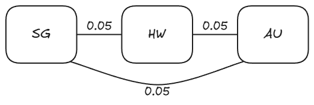{width=55%}

**Lecture example.** Every link has $b = 0.05$.

* Series path SG–HW–AU: $r = 0.95 \times 0.95 = 0.9025$, so $b = 0.0975$.
* Direct link SG–AU: $b = 0.05$.
* Both must break: $b_{\text{total}} = 0.0975 \times 0.05 = \mathbf{0.004875}$.

### 8.4 Worked example: Tutorial 1.1 Q4

SG connects to SF through HW. There are **two** independent links SG–HW, **one** link HW–SF, and **one** direct link SG–SF. Every link has $b = 0.05$. Find the probability that SG is disconnected from SF.

1. Two parallel links SG–HW: $b_{\text{SG-HW}} = 0.05 \times 0.05 = 0.0025$, so $r_{\text{SG-HW}} = 0.9975$.
2. Indirect path SG–HW–SF is in series: $r = 0.9975 \times 0.95 = 0.947625$, so $b = 0.052375$.
3. The direct link and the indirect path are in parallel:

$$b_{\text{total}} = 0.05 \times 0.052375 = \mathbf{0.00261875}$$

### 8.5 Worked example with an unknown (AY20/21 S2 Q1)

The numbers on each link are $P/R$: failure probability / data rate.

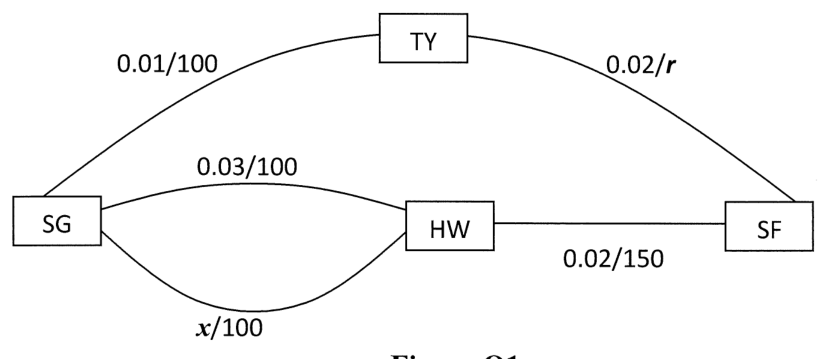{width=70%}

**(a) Find $P(\text{SG cut off from SF})$ as a function of $x$.**

* Upper path SG–TY–SF (series): $r = 0.99 \times 0.98 = 0.9702$, so $b_1 = 0.0298$.
* SG–HW has two parallel links: $b = 0.03x$.
* Lower path SG–HW–SF (series): $r = (1 - 0.03x)(0.98)$, so $b_2 = 1 - 0.98 + 0.0294x = 0.02 + 0.0294x$.
* The two paths share no link, so they are parallel:

$$b_{\text{total}} = 0.0298\,(0.02 + 0.0294x) = 0.000596 + 0.00087612\,x$$

**(b) The connection must have three nines. Find the largest $x$.**

$$0.000596 + 0.00087612\,x \le 10^{-3} \;\Rightarrow\; x \le 0.461$$

**(c) Let $x = 0.01$. A new direct link SG–SF must lift the connection to five nines. Find the largest failure probability $p$ for the new link.**

* Without the new link: $b = 0.000596 + 0.0000087612 = 0.00060476$.
* The new link is in parallel with everything else: $b_{\text{new total}} = p \times 0.00060476 \le 10^{-5}$.
* So $p \le 0.0165$, which gives $p \approx 0.017$ to three decimal places.

### 8.6 Worked example: how many links in series? (AY22/23 S1 Q1a)

A WAN needs three nines. Two cities connect through $n$ links in series. Each link has $b = 10^{-4}$. Find the largest $n$.

$$(1 - 10^{-4})^n \ge 0.999 \;\Rightarrow\; n \le \frac{\ln 0.999}{\ln 0.9999} = 10.004 \;\Rightarrow\; n = \mathbf{10}$$

For small $b$, $(1-b)^n \approx 1 - nb$. This gives the same quick answer: $n \times 10^{-4} \le 10^{-3}$, so $n \le 10$.

If a question then asks for more links than this (for example, 20 links in AY18/19 S2), the answer is to **add parallel paths**. Series links always reduce availability. Parallel paths increase it.

---

## 9. Exam Checklist

* State the assumption "**link failures are independent**" at the start of every resilience answer.
* Series: multiply $r$. Parallel: multiply $b$. Change with $1-(\cdot)$ between them.
* Check whether the question asks for "disconnected" ($b$) or "connected / availability" ($r$).
* For "$k$ nines", use $b = 10^{-k}$.
* Downtime $= b \times$ the time window. Show the seconds-per-year step.
* For a header question, draw the stack and say which headers each node adds, removes or only reads.
