# 2. Data Link Layer (DLL): Flow & Error Control

This chapter covers Lectures 3 (flow control) and 4 (error control). Both look at **one link** between two nodes: a sender and a receiver. They answer two questions:

1. **Flow control:** how does the sender avoid sending faster than the receiver can store the frames?
2. **Error control:** what does the sender do when a frame is lost or damaged?

These topics give the most calculation marks in Part I. Almost every paper has a link-utilisation question, a window-size question, or a "do not flood the buffer" question.

---

## 1. Where This Fits

The data link layer (DLL) moves **frames** across one link. Its jobs are framing, link access, flow control and reliable delivery. IEEE splits the DLL into two sub-layers: **LLC** (Logical Link Control, which faces the network layer) and **MAC** (Medium Access Control, which faces the medium).

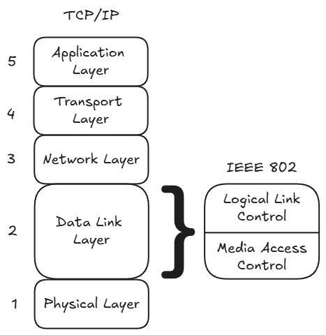{width=45%}

> **Not examinable (slide labels):** the list of DLL roles, framing (byte-oriented and bit-oriented), asynchronous start/stop bits, and link configuration (topology and duplex). Everything about **flow control** and **ARQ** is examinable.

---

## 2. The Four Times You Need

Every calculation in this chapter uses these quantities. Get the units right first.

| Symbol | Name | Formula | What it depends on |
| :--- | :--- | :--- | :--- |
| $L$ | Frame length | given, in bits | Convert bytes to bits: $\times 8$. |
| $R$ | Data rate | given, in bit/s | |
| $T_{\text{frame}}$ | Transmission time | $T_{\text{frame}} = L / R$ | The time to push all bits of one frame onto the link. |
| $T_{\text{prop}}$ | Propagation time | $T_{\text{prop}} = d / v$ | The time for one bit to travel the distance $d$ at speed $v$ (often $2\times10^8$ m/s). Some questions give a delay per km instead. |
| $a$ | Normalised propagation delay | $a = T_{\text{prop}} / T_{\text{frame}}$ | How long the link is, measured in frame times. |

Think of $a$ like this: if $a = 3$, the first bit of a frame arrives at the receiver only after the sender has sent 3 frames' worth of time.

---

## 3. Flow Control

### 3.1 The problem

The receiver keeps each arriving frame in a **buffer** (a small memory) until it can process the frame. If the sender sends too fast, the buffer fills and new frames are lost. **Flow control** makes the sender wait for permission from the receiver.

In this section we assume that **no frame has errors**. Section 4 adds errors.

### 3.2 Stop-and-wait

The simplest method:

1. The source sends one frame.
2. The destination receives the frame.
3. The destination sends back an **acknowledgement (ACK)** when it is ready for the next frame.
4. The source waits until the ACK arrives.
5. The source sends the next frame.

The receiver can stop the flow at any time. It simply does not send the ACK.

**Sequence numbers.** Stop-and-wait only needs a 1-bit number: frames alternate 0, 1, 0, 1, …. The ACK carries the number of the frame that the receiver **expects next**. So "ACK1" means "I have frame 0, now send frame 1".

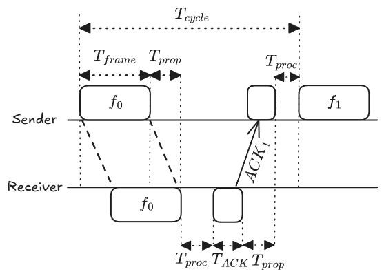{width=75%}

### 3.3 Link utilisation of stop-and-wait

**Link utilisation** $U$ is the fraction of time the link carries useful data:

$$U = \frac{\text{time spent sending data}}{\text{total time of one cycle}} = \frac{T_{\text{frame}}}{T_{\text{cycle}}}$$

One cycle has these parts:

$$T_{\text{cycle}} = T_{\text{frame}} + T_{\text{prop}} + T_{\text{proc}} + T_{\text{ACK}} + T_{\text{prop}} + T_{\text{proc}}$$

The ACK is very short and processing is fast, so we ignore $T_{\text{ACK}}$ and $T_{\text{proc}}$:

$$T_{\text{cycle}} \approx T_{\text{frame}} + 2T_{\text{prop}} \quad\Rightarrow\quad \boxed{U_{\text{S\&W}} = \frac{T_{\text{frame}}}{T_{\text{frame}} + 2T_{\text{prop}}} = \frac{1}{1 + 2a}}$$

**Worked example (lecture).** $R = 2.4$ Mbit/s, $d = 50$ km, $v = 2\times10^8$ m/s, $L = 300$ bytes.

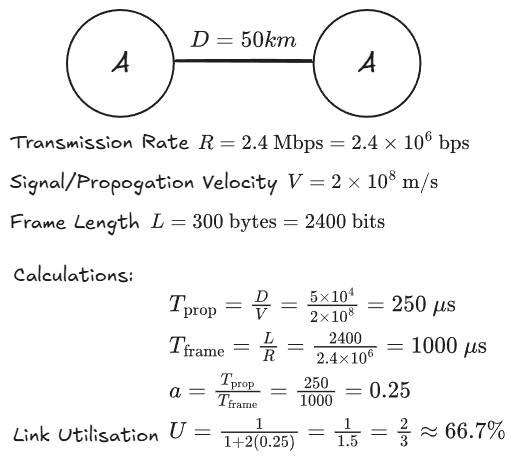{width=60%}

* $T_{\text{prop}} = 50\,000 / (2\times10^8) = 250\ \mu$s
* $T_{\text{frame}} = 2400 / (2.4\times10^6) = 1000\ \mu$s
* $a = 250 / 1000 = 0.25$
* $U = 1 / (1 + 0.5) = 2/3 \approx \mathbf{66.7\%}$

### 3.4 What is wrong with stop-and-wait

* **Lost frame or lost ACK.** The source waits for ever. We need a **timeout**: if no ACK arrives in time, the source sends the frame again. (Section 4 covers this.)
* **Long links.** When $a$ is large, the sender is idle for most of the cycle. For example, $a = 10$ gives $U = 1/21 < 5\%$. The bottom of the fraction, $1 + 2a$, is set by physics. We cannot make it smaller. But we **can** make the top bigger by sending more than one frame per cycle. That is the sliding window.

### 3.5 Sliding window

**The idea.** The receiver has buffers for $N$ frames. So the sender may send up to $N$ frames **before** it gets an ACK.

**Rules:**

* Each frame carries a sequence number with $k$ bits. The numbers go $0, 1, \dots, 2^k - 1$, then start again at 0 (we count **modulo $2^k$**).
* An ACK carries the number of the **next frame the receiver expects**. "ACK 3" means "I have everything up to frame 2. Send frame 3 next." One ACK can acknowledge many frames at once.
* **Sender window:** the list of frames that the sender may send now. It **shrinks** from the left (trailing edge) each time the sender sends a frame. It **grows** at the right (leading edge) each time an ACK arrives.
* **Receiver window:** the list of frames the receiver can accept. It shrinks as frames arrive and grows as the receiver sends ACKs.

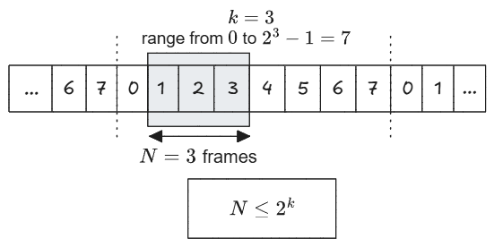{width=60%}

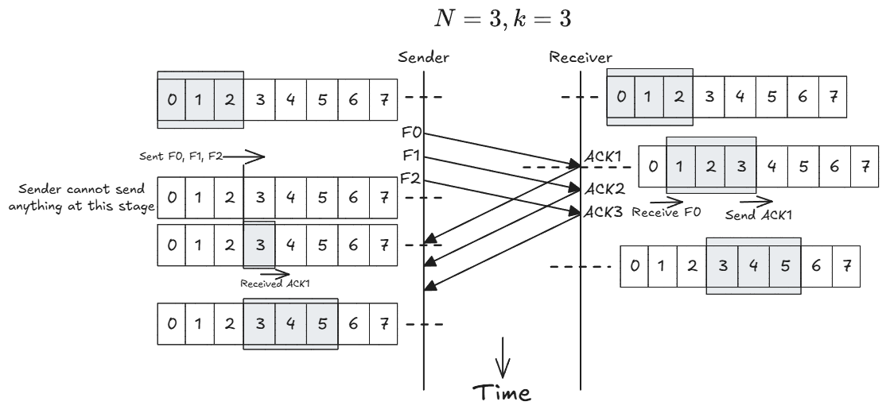{width=80%}

**Two extra controls:**

* **RNR (Receive Not Ready):** "I have your frames up to $n-1$, but stop sending." To restart the flow, the receiver later sends a normal ACK (RR).
* **Piggybacking:** when both sides send data, a node puts its ACK number inside its own data frame. This saves sending a separate ACK frame.

**Window size limit for pure flow control.** With $k$ bits there are $2^k$ different numbers, so the window can hold at most $2^k$ frames:

$$N \le 2^k$$

The ARQ methods in Section 4 need a **smaller** limit. Use the ARQ limit when the question includes errors.

### 3.6 Link utilisation of sliding window

Time starts when the sender sends the first bit of frame 0. The ACK for frame 0 comes back at time $T_{\text{frame}} + 2T_{\text{prop}} = T_{\text{frame}}(1 + 2a)$. In that time the sender can send $(1 + 2a)$ frames. There are two cases:

* **Case 1: $N \ge 1 + 2a$.** The ACK for frame 0 arrives before the window is used up. The sender never stops. $U = 1$.
* **Case 2: $N < 1 + 2a$.** The sender sends $N$ frames in $N \cdot T_{\text{frame}}$, then waits for the ACK. Each cycle lasts $T_{\text{frame}}(1+2a)$.

$$\boxed{U_{\text{SW}} = \begin{cases} 1 & N \ge 1 + 2a \\[4pt] \dfrac{N}{1 + 2a} & N < 1 + 2a \end{cases}}$$

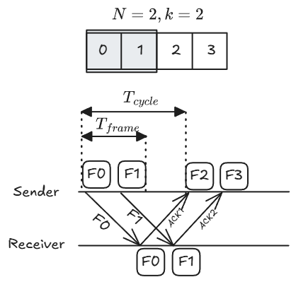{width=55%}

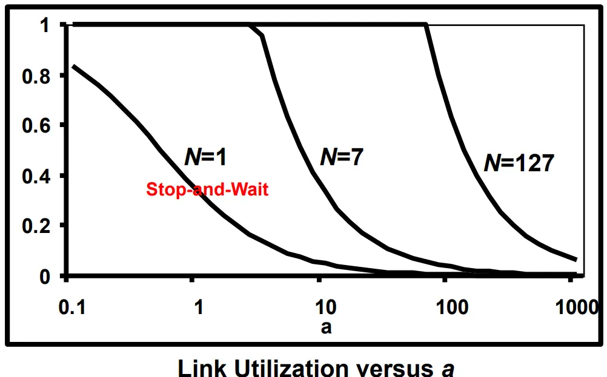{width=60%}

Stop-and-wait is the special case $N = 1$.

**Worked example (Tutorial 1.2 Q1).** A 64 kbit/s line uses a 3-bit sequence number. Frames are 80 bytes. $T_{\text{prop}} = 10$ ms. No errors. Find the smallest window for a throughput of at least 32 kbit/s.

* $T_{\text{frame}} = 640 / 64\,000 = 10$ ms, so $a = 10/10 = 1$ and $1 + 2a = 3$.
* We need $U \ge 32/64 = 0.5$.
* $N/(1+2a) \ge 0.5 \Rightarrow N \ge 1.5$. Round up: $N = \mathbf{2}$. Check: $2 \le 2^3 = 8$, so the 3-bit number is enough.

---

## 4. Error Control (ARQ)

### 4.1 Two kinds of frame error

* **Lost frame:** the frame does not arrive, or its header is so damaged that the receiver cannot recognise it.
* **Damaged frame:** the frame arrives, but some bits are wrong. The receiver's error check finds this.

### 4.2 Two ways to deal with errors

* **Forward Error Correction (FEC):** the sender adds extra bits so that the receiver can repair errors itself (for example, Hamming codes and Reed–Solomon codes).
* **Automatic Repeat reQuest (ARQ):** the receiver finds the error, and the sender sends the frame again. This happens in two ways:
  * **retransmission after a timeout** (no ACK arrives in time), and
  * **retransmission on request** (the receiver sends a **NAK**, a negative acknowledgement).

ARQ turns an unreliable link into a reliable one. Each flow-control method has an ARQ version:

| Flow control | ARQ version |
| :--- | :--- |
| Stop-and-wait | Stop-and-wait ARQ |
| Sliding window | Go-back-N ARQ, or Selective-reject ARQ |

> **Not examinable (slide labels):** parity check, the "seven prisoners" puzzle, and CRC.

### 4.3 Stop-and-wait ARQ

The source keeps a copy of the frame and starts a timer when it sends.

| Event | What happens |
| :--- | :--- |
| Frame is **lost** | No ACK comes. The timer runs out. The source sends the frame again. |
| Frame is **damaged** | The destination discards it. It may also send a NAK. The source sends the frame again (after the NAK, or after the timeout). |
| **ACK is lost** | The timer runs out. The source sends the frame again. The destination now has two copies. The sequence number (0 or 1) shows that the second one is a **duplicate**. The destination discards it and sends the ACK again. |
| **ACK is damaged** | The source ignores it. The timer runs out, and the case is the same as a lost ACK. |

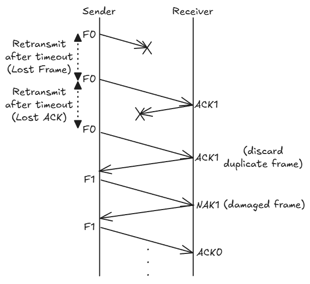{width=60%}

**Utilisation.** Let $P$ be the probability that a frame is in error. On average a frame needs $1/(1-P)$ attempts. So:

$$\boxed{U_{\text{S\&W ARQ}} = \frac{1 - P}{1 + 2a}}$$

Lecture example: with $a = 0.25$ and $P = 0.1$, $U = 0.9 / 1.5 = 0.6$.

### 4.4 Go-back-N ARQ (the "cautious" method)

The receiver accepts frames **only in order**.

* **Frame types:** RR = ACK (receive ready), RNR = receive not ready (flow control), REJ = NAK (reject).
* **At the destination:** when frame $i$ has an error, the destination sends REJ $i$. It then **discards frame $i$ and every frame after it** until a good copy of frame $i$ arrives.
* **At the source:** after a REJ $i$ or a timeout, the source goes back and sends **frame $i$ and every frame after it** again.

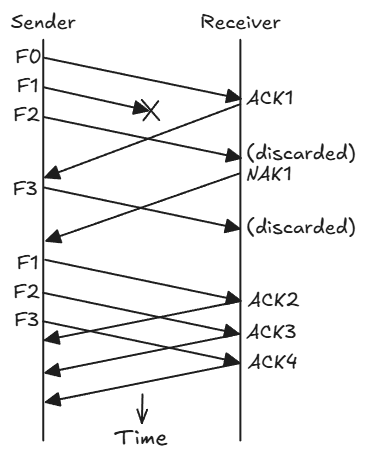{width=55%}

**Maximum window for Go-back-N:**

$$\boxed{N_{\text{GBN}} \le 2^k - 1}$$

**Why not $2^k$?** Take $k = 3$, so the numbers are 0 to 7.

* With $N = 8$: the source sends frames 0 to 7. All arrive, and the receiver now expects a **new** frame 0. Its ACK is lost. The source times out and sends the **old** frame 0 again. The receiver cannot tell old from new. It accepts the old frame 0 as new data. **Error.**
* With $N = 7$: the source sends frames 0 to 6. The receiver now expects frame 7. The old frame 0 arrives. It is not frame 7, so the receiver discards it. **Correct.**

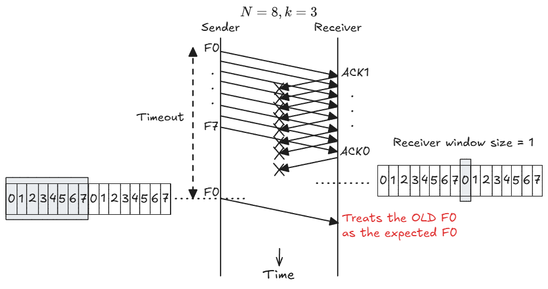{width=60%}

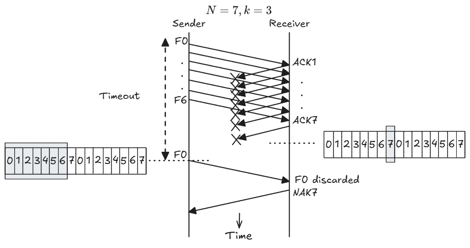{width=60%}

**Utilisation.** The exact Go-back-N formula is not required. The lecture says: **use the selective-reject formula for Go-back-N** too. (Past papers repeat this hint.)

### 4.5 Selective-reject ARQ (the "efficient" method)

Also called **selective repeat**. The receiver **accepts frames out of order** if they fall inside its window.

* **At the destination:** when frame $i$ has an error, the destination sends **SREJ $i$** (selective reject). It keeps and buffers the frames that arrive after $i$.
* **At the source:** the source sends again **only** frame $i$ (and any frame whose timer ran out).
* When the good copy of frame $i$ arrives, the destination puts the frames back in order and passes them up.

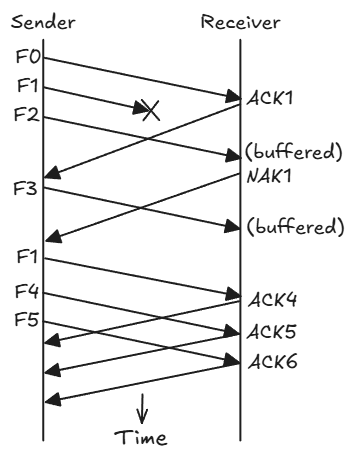{width=55%}

**Maximum window for selective-reject:**

$$\boxed{N_{\text{SR}} \le 2^{k-1}}$$

**Why half?** Take $k = 3$.

* With $N = 5$: the source sends frames 0 to 4. All arrive. The receiver window moves to {5, 6, 7, 0, 1}. The ACKs are lost. The source times out and sends the **old** frame 0. Frame 0 is inside the new window, so the receiver accepts it as new. **Error.**
* With $N = 4$: the window moves to {4, 5, 6, 7}. The old frame 0 is outside the window, so the receiver discards it and sends ACK 4 again. **Correct.**

The rule: the old window and the new window must not share any number. Two windows of size $N$ must fit inside $2^k$ numbers, so $2N \le 2^k$.

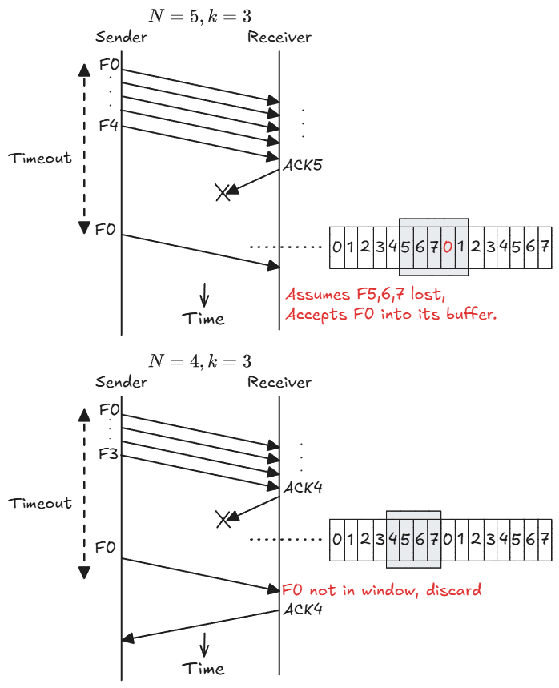{width=60%}

**Utilisation:**

$$\boxed{U_{\text{SR}} = \begin{cases} 1 - P & N \ge 1 + 2a \\[4pt] \dfrac{N(1 - P)}{1 + 2a} & N < 1 + 2a \end{cases}}$$

### 4.6 Go-back-N versus selective-reject (AY17/18 S1 Q1a)

| | Go-back-N | Selective-reject |
| :--- | :--- | :--- |
| What is resent | The bad frame and **all** frames after it | **Only** the bad frame |
| Receiver buffer | One frame (accepts in order only) | A full window (stores out-of-order frames) |
| Receiver logic | Simple | Complex: must buffer and reorder |
| Bandwidth wasted on errors | More (good frames are sent again) | Less |
| Maximum window | $2^k - 1$ | $2^{k-1}$ |
| Best for | Low error rates, simple hardware | High error rates, long links (large $a$) |

---

## 5. Formula Summary

| Method | Max window | $U$ when $N \ge 1+2a$ | $U$ when $N < 1+2a$ |
| :--- | :--- | :--- | :--- |
| Stop-and-wait (no error) | 1 | — | $\dfrac{1}{1+2a}$ |
| Sliding window (no error) | $2^k$ | $1$ | $\dfrac{N}{1+2a}$ |
| Stop-and-wait ARQ | 1 | — | $\dfrac{1-P}{1+2a}$ |
| Go-back-N ARQ | $2^k - 1$ | use SR | use SR |
| Selective-reject ARQ | $2^{k-1}$ | $1-P$ | $\dfrac{N(1-P)}{1+2a}$ |

**Throughput** (in bit/s) $= U \times R$.

If the question gives a **bit** error probability $p_b$ instead of a frame error probability, the frame is good only if every bit is good:

$$P = 1 - (1 - p_b)^{L}$$

---

## 6. Worked Exam Problems

### 6.1 Selective-reject utilisation and window size (Tutorial 1.2 Q3)

$R = 100$ kbit/s, $L = 25$ bytes, $d = 5$ km at 3 ms/km, $P = 0.2$, selective-reject.

* $T_{\text{frame}} = 200 / 100\,000 = 2$ ms. $T_{\text{prop}} = 5 \times 3 = 15$ ms. $a = 7.5$, so $1 + 2a = 16$.
* **(a) $N = 10$:** $10 < 16$, so $U = 10 \times 0.8 / 16 = \mathbf{0.5}$.
* **(b) Maximum $U$:** we need $N \ge 16$, so the smallest window is $N = \mathbf{16}$. Then $U = 1 - P = 0.8$.
* **Sequence bits:** for selective-reject, $2^{k-1} \ge 16 \Rightarrow k - 1 \ge 4 \Rightarrow k = \mathbf{5}$.

### 6.2 The same type with header overhead (AY18/19 S2 Q2a)

$R = 1$ Mbit/s, $L = 1000$ bits, $d = 40$ km at 0.5 ms/km, $P = 0.1$, selective-reject.

* $T_{\text{frame}} = 1$ ms, $T_{\text{prop}} = 20$ ms, $a = 20$, $1 + 2a = 41$.
* (i) $N = 10$: $U = 10 \times 0.9 / 41 = \mathbf{0.2195}$.
* (ii) Smallest window for the maximum: $N = 41$. Then $U = 0.9$.
* (iii) $2^{k-1} \ge 41 \Rightarrow k - 1 = 6 \Rightarrow k = 7$ bits. These 7 bits sit in the header and carry no user data. So the actual utilisation is $0.9 \times (1000 - 7)/1000 = \mathbf{0.894}$.

### 6.3 Two links in parallel (AY17/18 S1 Q2a)

Both links run at 20 Mbit/s, frames are 125 bytes (1000 bits), and propagation is 10 µs/km. $T_{\text{frame}} = 50\ \mu$s.

* Link A: 10 km, no errors, stop-and-wait. $T_{\text{prop}} = 100\ \mu$s, $a = 2$. $U = 1/5$. Throughput $= 0.2 \times 20 = \mathbf{4}$ **Mbit/s**.
* Link B: 20 km, $P = 0.2$, selective-reject with $N = 10$. $T_{\text{prop}} = 200\ \mu$s, $a = 4$, $1 + 2a = 9$. $N \ge 9$, so $U = 0.8$. Throughput $= \mathbf{16}$ **Mbit/s**.

### 6.4 "Do not flood the buffer" at a middle node

This type appears in nearly every Question 1. Frames go **A → B → C**. Each link uses a different protocol. B must send frames out at least as fast as they come in, or B's buffer overflows.

**Method:**

1. Find the **incoming throughput** at B: $\text{throughput}_{AB} = U_{AB} \times R_{AB}$, with the correct $U$ formula for link A–B.
2. Write the **outgoing throughput** of link B–C in terms of the unknown rate $R$. For stop-and-wait, this is one frame per cycle: $\dfrac{L}{T_{\text{frame}} + 2T_{\text{prop}}}$ with $T_{\text{frame}} = L/R$.
3. Set outgoing $\ge$ incoming. Solve for $T_{\text{frame}}$, then $R = L / T_{\text{frame}}$.

**Worked example (Tutorial 1.2 Q2).** A–B: 2000 km, 100 kbit/s, sliding window $N = 3$. B–C: 500 km, stop-and-wait. 1000-bit frames, delay 10 µs/km, no errors.

* A–B: $T_{\text{frame}} = 10$ ms, $T_{\text{prop}} = 20$ ms, $1 + 2a = 5$. Since $3 < 5$, $U = 3/5$. Incoming $= 0.6 \times 100 = 60$ kbit/s. (In time: A sends 3 frames every 50 ms.)
* B–C: $T_{\text{prop}} = 5$ ms. One frame per $(T_{\text{frame}} + 10)$ ms.
* $\dfrac{1000}{T_{\text{frame}} + 10\text{ ms}} \ge 60 \text{ bit/ms} \Rightarrow T_{\text{frame}} \le 6.67$ ms $\Rightarrow R \ge \mathbf{150}$ **kbit/s**.

**Worked example (AY19/20 S1 Q1c).** NTU–SMU: 200 kbit/s, $T_{\text{prop}} = 10$ ms, sliding window $N = 2$. SMU–SUTD: $T_{\text{prop}} = 5$ ms, stop-and-wait. 2000-bit frames.

* NTU–SMU: $T_{\text{frame}} = 10$ ms, $1 + 2a = 3$, $U = 2/3$. Incoming $= 133.3$ kbit/s (2 frames every 30 ms).
* SMU–SUTD: $\dfrac{2000}{T_{\text{frame}} + 10} \ge 133.3 \Rightarrow T_{\text{frame}} \le 5$ ms $\Rightarrow r_x \ge \mathbf{400}$ **kbit/s**.

**Worked example with ARQ (AY18/19 S1 Q1).** A–B: 800 km, 1 Mbit/s, 3-bit sequence number. B–C: 100 km, stop-and-wait. 2000-bit frames, $v = 2\times10^8$ m/s.

* A–B: $T_{\text{frame}} = 2$ ms, $T_{\text{prop}} = 4$ ms, $1 + 2a = 5$. B–C: $T_{\text{prop}} = 0.5$ ms.
* **Go-back-N, window chosen for maximum throughput:** the largest window is $2^3 - 1 = 7 \ge 5$, so $U = 1$. Incoming is 1 Mbit/s. B–C: $2000/(T_{\text{frame}} + 1) \ge 1000$ bit/ms $\Rightarrow T_{\text{frame}} \le 1$ ms $\Rightarrow R \ge \mathbf{2}$ **Mbit/s**.
* **Selective-reject:** the largest window is $2^2 = 4 < 5$, so $U = 0.8$. Incoming is 0.8 Mbit/s. B–C: $T_{\text{frame}} \le 1.5$ ms $\Rightarrow R \ge \mathbf{1.33}$ **Mbit/s**.
* **With a bit error rate of $10^{-4}$:** $P = 1 - (1 - 10^{-4})^{2000} \approx 0.181$. Go-back-N (use the SR formula with $N = 7 \ge 5$): $U = 0.819$, so 0.819 Mbit/s. Selective-reject ($N = 4$): $U = 4 \times 0.819 / 5 = 0.655$, so 0.655 Mbit/s.

> **Sanity check.** Stop-and-wait can never carry more than $L / (2T_{\text{prop}})$, even with an infinite data rate. If the incoming throughput is larger than this, **no** rate works. Say so in your answer.

---

## 7. HDLC Time-Sequence Diagrams

Past papers (Tutorial 1.2 Q4, AY17/18 S2 Q2a, AY25/26 MCQ) give a diagram with blanks and ask you to fill in the numbers.

### 7.1 The three frame types

| Frame | Meaning |
| :--- | :--- |
| **I($i$, $j$)** | An information (data) frame. $i$ = the sequence number of **this** frame. $j$ = a piggybacked ACK: "I have your frames up to $j-1$; I expect your frame $j$ next." |
| **RR($j$)** | Receive Ready (an ACK with no data): "I have your frames up to $j-1$; send $j$ next." |
| **SREJ($j$)** | Selective Reject (a NAK): "Send your frame $j$ again." |

All numbers are modulo $2^k$. With 3 bits, the number after 7 is 0.

### 7.2 Method

1. Treat the two directions separately. Each side has its own sequence counter.
2. For each sender, number its I-frames one after another: $i, i+1, i+2, \dots$ (mod 8).
3. For the second number $j$ in an I-frame, look at the frames that this side has **received** so far from the other side. $j$ = (last in-order frame received) + 1.
4. A lost frame (marked X) does not move the receiver's counter. The receiver then sends SREJ for the missing number.
5. After the missing frame arrives, the RR or $j$ value jumps to one past the highest frame received.

### 7.3 Worked example: Tutorial 1.2 Q4

**(a)** The given labels are RR(1) from B and I(0, 4) from B.

* RR(1) means B has received up to frame 0. So A's two frames before it are **I(7, 0)** and **I(0, 0)**. (A has received nothing from B yet, so A expects B's frame 0.)
* A continues with **I(1, 0)**, **I(2, 0)**, **I(3, 0)**.
* B sends I(0, 4): B's first frame is number 0, and B has received up to A's frame 3.
* A's next frame is **I(4, 1)**: frame 4, and A has now received B's frame 0.

**(b)** The given labels are I(6, 4) from A, a lost frame X, and SREJ from B.

* A sends **I(4, 3)**, then **I(5, 3)**, which is lost (X).
* B sends **I(3, 5)**: B's frame 3; B has A's frame 4 and expects 5.
* A sends I(6, 4) (it now has B's frame 3) and **I(7, 4)**.
* B receives 6 and 7, but 5 is missing. B sends **SREJ(5)**.
* A sends frame 5 again: **I(5, 4)**.
* B now has 5, 6 and 7 in order. B sends **RR(0)**: "next I expect frame 0".

---

## 8. Exam Checklist

* Convert bytes to bits. Convert all times to the same unit.
* Write $T_{\text{frame}}$, $T_{\text{prop}}$, $a$ and $1 + 2a$ first. Most marks come from these four lines.
* Compare $N$ with $1 + 2a$ before you choose the formula.
* Window limits: flow control $2^k$; Go-back-N $2^k - 1$; selective-reject $2^{k-1}$.
* For the smallest window that gives the maximum $U$, use $N = \lceil 1 + 2a \rceil$. Then find $k$ from the correct limit.
* For a buffer question, find the incoming throughput first, then solve for the outgoing rate.
* ACK $n$ (or RR $n$) means "the next frame I expect is $n$".
