# 3. Data Link Layer (DLL): Medium Access Control & LANs

This chapter covers Lectures 5 to 8 of Part I: LAN basics, medium access control (MAC), Ethernet and wireless LANs. The core question is:

> Many stations share **one** channel. If two of them send at the same time, both frames are destroyed. How do the stations decide who sends, and when?

High-yield calculations from this chapter:

* ALOHA throughput and the best transmission probability (by differentiation).
* CSMA/CD minimum frame size and maximum cable length.
* Binary exponential backoff probabilities.
* MARP throughput.

---

## 1. LAN Basics

> **Mostly not examinable (Lecture 5 slide labels):** WAN/MAN/LAN definitions, the IEEE 802 table, topologies, media, and static channel allocation. Read this section for context only. Section 2 onward is examinable.

* A **LAN (Local Area Network)** joins devices in a small area, such as one building. A **MAN** covers a city. A **WAN** covers a country or the world.
* **IEEE 802** is the family of LAN standards. It splits the data link layer into two sub-layers:
  * **LLC (Logical Link Control):** the interface to the network layer above. It does flow and error control. The same LLC can sit on top of different MAC types.
  * **MAC (Medium Access Control):** builds frames with addresses and an error check. On receive, it checks the address and the error check. Its main job is to **control access to the shared medium**.
* Important standards: **802.3** = Ethernet (CSMA/CD). **802.11** = Wi-Fi (CSMA/CA).

{width=45%}

### 1.1 Where and how to control access (examinable)

* **Where:**
  * **Centralised:** one controller grants access. It is simple, but it is a single point of failure and a bottleneck.
  * **Distributed:** the stations decide together. There is no single point of failure.
* **How:**
  * **Synchronous (static):** each station gets a fixed share, for example a fixed time slot (TDM) or a fixed frequency (FDM). This wastes capacity when a station has nothing to send.
  * **Asynchronous (dynamic):** stations get capacity only when they need it. There are three kinds: **round robin**, **reservation**, and **contention**. Contention (ALOHA, CSMA) suits **bursty** traffic. It works well at light load and badly at heavy load.

---

## 2. The Multiple-Access Problem

### 2.1 Setting

* One **broadcast channel** with rate $R$ bit/s is shared by many nodes.
* If a node receives two or more signals at the same time, a **collision** happens. Both frames are lost.
* There is no separate control channel. The nodes must coordinate **through the same channel** that carries the data.

### 2.2 The ideal MAC protocol

1. When only one node has data, it sends at the full rate $R$.
2. When $M$ nodes have data, each one gets an average rate of $R/M$.
3. It is fully decentralised: no master node and no clock synchronisation.
4. It is simple.

### 2.3 The three families

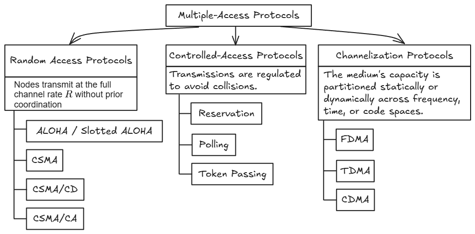{width=75%}

| Family | Idea | Examples |
| :--- | :--- | :--- |
| Random access | Send at the full rate $R$ with no planning. Detect collisions and recover. | ALOHA, slotted ALOHA, CSMA, CSMA/CD, CSMA/CA |
| Controlled access | Take turns, so no collisions happen. | Reservation, polling, token passing |
| Channelisation | Divide the channel into fixed pieces. | FDMA, TDMA, CDMA |

A random-access protocol must answer three design questions:

1. Does a node **listen** to the channel before it sends?
2. **How** does it send (at once, or with a probability)?
3. How does it **detect** a collision, and what does it do **after** one?

---

## 3. Slotted ALOHA

ALOHA came from Norm Abramson's ALOHAnet in Hawaii.

### 3.1 Assumptions

* All frames have the same size.
* Time is cut into equal **slots**. One slot = the time to send one frame.
* Nodes start to send only at the **start** of a slot. (So the nodes must have synchronised clocks.)
* If two or more nodes send in the same slot, all nodes detect the collision.

### 3.2 Operation

* When a node has a new frame, it sends the frame in the next slot.
* If there is no collision, the frame is delivered.
* If there is a collision, the node sends the frame again in **each later slot with probability $p$**, until it succeeds.

Each slot has one of three results: **S** (success, exactly one sender), **C** (collision, two or more senders), or **E** (empty, no sender).

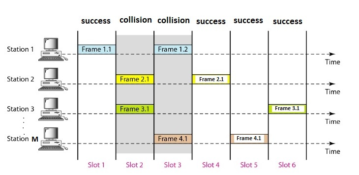{width=70%}

### 3.3 Throughput: first principles

Let $N$ nodes each send in a slot with probability $p$. A slot is a success when **exactly one** node sends.

* The chance that **one particular** node $i$ succeeds: node $i$ sends, and the other $N - 1$ nodes stay quiet.

$$P(S_i) = p\,(1-p)^{N-1}$$

* There are $N$ nodes, and only one can succeed per slot. So:

$$P(S) = N p\,(1-p)^{N-1}$$

Example with 4 nodes: $P(S) = 4p(1-p)^3$.

$P(S)$ is the **throughput**: the average number of good frames per slot (per frame time).

**Offered load.** Let $G = Np$. $G$ is the average number of transmissions per slot, counting new frames and retransmissions. For large $N$, $(1-p)^{N-1} \to e^{-G}$, so:

$$\boxed{S_{\text{slotted}} = G\,e^{-G}}$$

### 3.4 The best load: by differentiation

$$\frac{dS}{dG} = e^{-G} - G e^{-G} = e^{-G}(1 - G) = 0 \;\Rightarrow\; G = 1$$

$$S_{\max} = 1 \cdot e^{-1} = \frac{1}{e} \approx \mathbf{0.368}$$

* The best transmission probability is $p = G/N = \mathbf{1/N}$.
* At $G = 1$: $P(\text{empty}) = e^{-G} = 0.368$, $P(\text{success}) = 0.368$, and $P(\text{collision}) = 1 - 0.368 - 0.368 = 0.264$.

The same result without $G$: maximise $Np(1-p)^{N-1}$. Setting the derivative to zero gives $p = 1/N$. Then $S = (1 - 1/N)^{N-1} \to 1/e$ as $N$ grows.

**Pros:** one active node can use the full rate; it is decentralised (only slot timing is shared); it is simple.
**Cons:** collisions and empty slots waste time; the nodes need clock synchronisation.

### 3.5 Short calculations from MCQ papers

* **Two stations, $p = 0.2$. Probability of no success in the next two slots (AY25/26).** $P(S) = 2(0.2)(0.8) = 0.32$ per slot. No success in two slots: $(1 - 0.32)^2 = \mathbf{0.4624}$.
* **Three stations, $p = 0.2$. Probability of one success in a slot (AY23/24 S2).** $3(0.2)(0.8)^2 = \mathbf{0.384}$.

---

## 4. Pure ALOHA

### 4.1 Operation

There are no slots. When a node has a frame, it **sends at once**. After a collision, it waits a random time and sends again.

### 4.2 The vulnerable time is two frame times

Let one frame take time $T$. Node $i$ starts at time $t_0$ and ends at $t_0 + T$.

* Another frame that starts in $[t_0 - T, t_0]$ is still on the channel when node $i$ starts. It overlaps.
* Another frame that starts in $[t_0, t_0 + T]$ starts before node $i$ ends. It overlaps.

So no other node may start in a window of length $2T$.

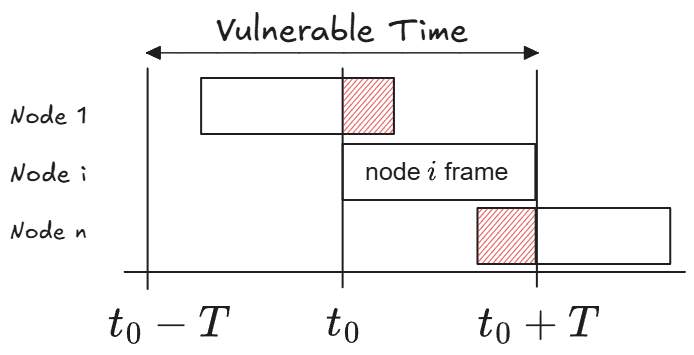{width=55%}

### 4.3 Throughput

The window is two slots long, so the other $N-1$ nodes must stay quiet for two slots:

$$P(S) = Np\,(1-p)^{N-1}(1-p)^{N-1} = Np(1-p)^{2(N-1)} \;\to\; \boxed{S_{\text{pure}} = G\,e^{-2G}}$$

$$\frac{dS}{dG} = e^{-2G}(1 - 2G) = 0 \;\Rightarrow\; G = \tfrac{1}{2}, \qquad S_{\max} = \frac{1}{2e} \approx \mathbf{0.184}$$

The best transmission probability is $p = 1/(2N)$.

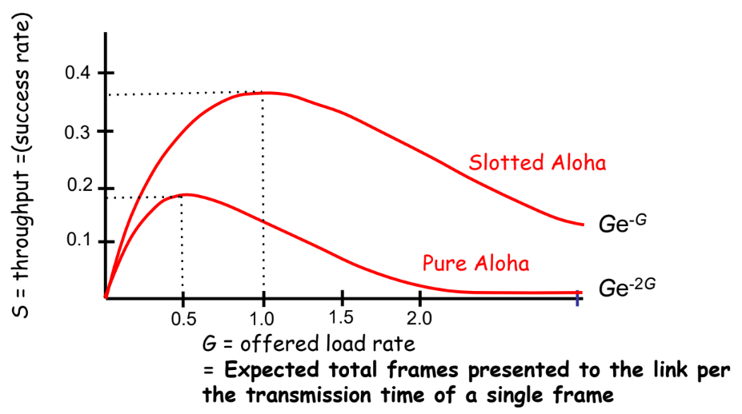{width=60%}

> **Two-link question (AY17/18 S2).** X–Y uses slotted ALOHA and Y–Z uses pure ALOHA. The path from X to Z can carry no more than its slowest link. The largest throughput is $1/(2e) = 0.184$, at offered load $G = 0.5$.

---

## 5. CSMA: Listen Before You Talk

### 5.1 The idea

**CSMA (Carrier Sense Multiple Access):** a node **listens** to the medium before it sends. If the medium is busy, it does not send.

In a LAN, the propagation delay is short compared with the frame time. So a node hears another node's frame almost at once. But collisions can still happen: two nodes can start within one **propagation time** of each other. Each one hears silence because the other's signal has not arrived yet.

The **vulnerable time of CSMA = the maximum propagation time** across the medium. A longer cable means a longer vulnerable time and more collisions.

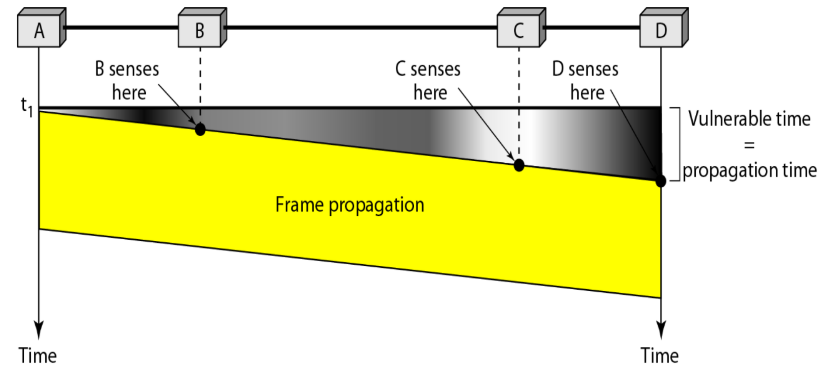{width=65%}

### 5.2 The three persistence rules

The rules say what a node does when the medium is **busy**.

| Rule | Medium idle | Medium busy | Nickname |
| :--- | :--- | :--- | :--- |
| **Non-persistent** | Send now. | Wait a **random** time, then listen again. | "Deferential" |
| **1-persistent** | Send now. | Keep listening. When it becomes idle, **send at once** (probability 1). | "Selfish" |
| **$p$-persistent** | Send with probability $p$. With probability $1-p$, wait one slot and repeat. (One slot = the maximum propagation delay.) | Keep listening until idle, then use the idle rule. | "Wise guy" |

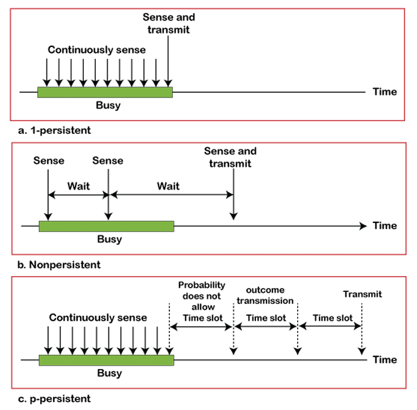{width=65%}

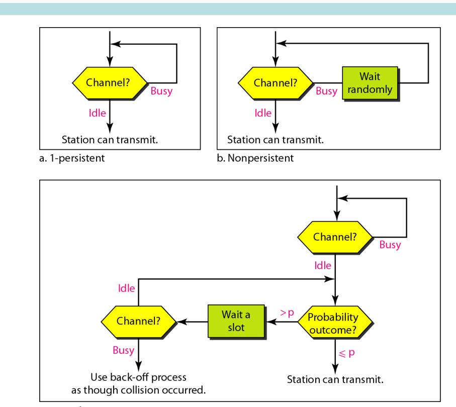{width=60%}

**Trade-offs:**

* **1-persistent:** no idle time is wasted. But if two nodes wait for the same busy period, both send the moment it ends. A collision is certain.
* **Non-persistent:** fewer collisions, because waiting nodes spread out in time. But the channel can sit idle while nodes wait.
* **$p$-persistent:** a compromise. It reduces both collisions and idle time.

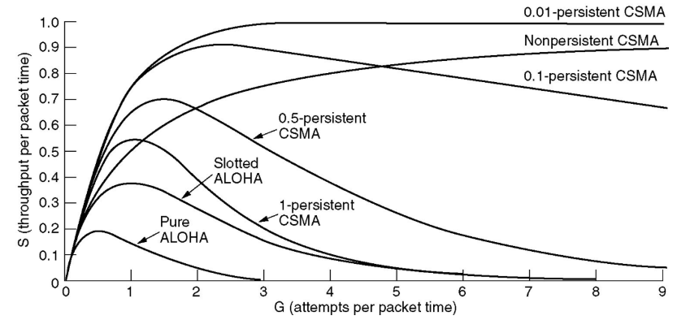{width=65%}

### 5.3 Why the curves look like this (AY17/18 S1 Q1b)

* **ALOHA does not depend on $a$** (the normalised propagation delay). ALOHA nodes never listen to the channel. So the propagation delay does not change how they act or how often they collide.
* **CSMA gets worse as $a$ grows.** Carrier sensing only works if a node hears other frames quickly. When $a$ is large, a node hears another node's frame late, so collisions become common. At large $a$, slotted ALOHA can beat CSMA.
* **Non-persistent beats 1-persistent at high load.** 1-persistent nodes all jump in together at the end of a busy period, so they collide. Non-persistent nodes wait random times, so they spread out.

---

## 6. CSMA/CD: Stop When You Hear a Collision

### 6.1 The idea

In plain CSMA, colliding nodes send their **whole** frames. The channel is wasted for the full frame time.

**CSMA/CD (Collision Detection)** adds one rule: **listen while you send. If you hear a collision, stop at once.** Ethernet (IEEE 802.3) uses CSMA/CD.

**How a node detects a collision:**

* On a cable: the transceiver sees more signal power on the wire than it sends itself.
* At a hub: the hub sees input on two ports at the same time. It sends a "collision present" signal on all ports.

### 6.2 The protocol

1. Use a persistence rule to decide when to start (Ethernet uses 1-persistent).
2. While sending, keep listening.
3. If a collision happens, **stop sending** and send a short **jam signal** (48 bits). The jam makes sure every station hears the collision and discards the broken frame.
4. Wait a **random backoff** time (Section 8), then try again.

### 6.3 How long does detection take? Worst case $2\tau$

Let $\tau$ be the one-way propagation time between the two stations that are **farthest apart**.

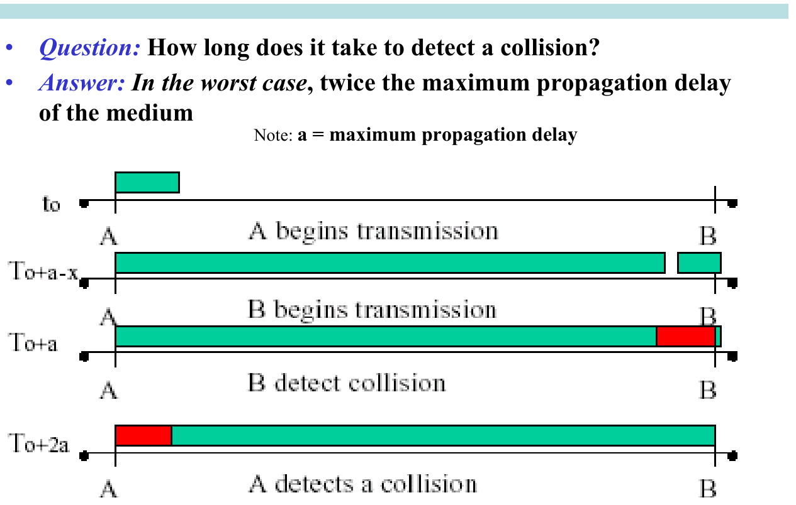{width=65%}

1. At time $t_0$, A starts to send.
2. Just before $t_0 + \tau$, A's signal has nearly reached B. B still hears silence, so B starts to send.
3. At $t_0 + \tau$, B hears A's signal and detects the collision at once.
4. B's signal now travels back to A. It reaches A at about $t_0 + 2\tau$.

So **A can be sure there was no collision only after $2\tau$** (one round trip).

### 6.4 Minimum frame size

A can only detect a collision **while it is still sending**. If A finishes before $2\tau$, it thinks the frame was delivered, but it was destroyed. So:

$$\boxed{T_{\text{frame}} \ge 2\tau \quad\Longleftrightarrow\quad L_{\min} = 2\tau \times R}$$

Here $\tau$ includes **every** delay on the worst path: cable delay in every segment, plus the delay in every repeater or hub.

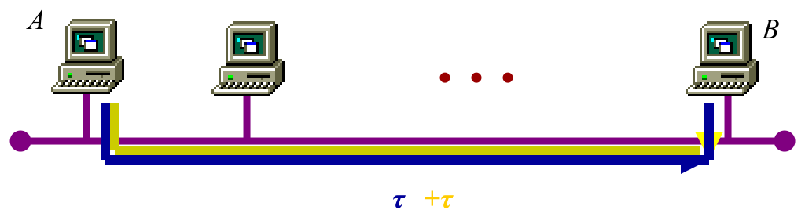{width=70%}

**Classic Ethernet numbers:** 10 Mbit/s, maximum round trip $2\tau = 51.2\ \mu$s (about 2500 m). This gives $51.2\ \mu\text{s} \times 10^7 = 512$ bits = **64 bytes**. Shorter frames get padding.

### 6.5 Worked examples

**Tutorial 1.3 Q1.** Segments of 200 m, with 1 µs per 100 m. Up to 4 repeaters, each with 2 µs delay. 20 Mbit/s.

* Four repeaters join **five** segments. Each segment: $200/100 \times 1 = 2\ \mu$s.
* One-way: $\tau = 5 \times 2 + 4 \times 2 = 18\ \mu$s. Round trip: $36\ \mu$s.
* $L_{\min} = 36\ \mu\text{s} \times 20\ \text{Mbit/s} = \mathbf{720}$ **bits**.

**AY16/17 S2 Q1b (10BASE5).** 5 segments of 500 m at 100 m/µs, 4 repeaters at 2 µs, 10 Mbit/s.

* $\tau = 5 \times 5 + 4 \times 2 = 33\ \mu$s, so $2\tau = 66\ \mu$s. $L_{\min} = 66 \times 10 = \mathbf{660}$ **bits**.

**AY19/20 S1 Q2a (bus, 10 Mbit/s).** $T$ = end-to-end propagation time. Minimum frame 64 bytes. Speed 100 m/µs.

* Condition: $T_{\text{frame}} \ge 2T$.
* $T_{\text{frame}} = 512 / 10^7 = 51.2\ \mu$s, so $T \le 25.6\ \mu$s. Maximum bus length $= 25.6 \times 100 = \mathbf{2560}$ **m**.

**AY19/20 S1 Q2b (star with a hub, 100 Mbit/s).** Each host has a cable of length $\ell$ to the hub. The hub adds 0.5 µs. Minimum frame 64 bytes.

* $T_{\text{frame}} = 512 / 10^8 = 5.12\ \mu$s.
* Worst path host → hub → host: $\tau = \ell/100 + 0.5 + \ell/100$ µs.
* $2\tau \le 5.12 \Rightarrow 0.02\ell + 0.5 \le 2.56 \Rightarrow \ell \le \mathbf{103}$ **m**.
* **If a switch replaces the hub:** there are **no collisions**, even with longer cables. Each switch port is its own collision domain. The switch stores frames in buffers and sends them one at a time, often in full-duplex.

**AY23/24 S2 MCQ.** The minimum frame is 512 bits, and the worst one-way delay is 8 µs. So $2\tau = 16\ \mu$s, and $R \le 512 / 16\ \mu\text{s} = \mathbf{32}$ **Mbit/s**.

---

## 7. Ethernet (IEEE 802.3)

> **Not examinable (Lecture 7 slide labels):** history, physical layer, media, Manchester coding, 10BASE-5/2/T details, Fast/Gigabit/10G Ethernet. **Examinable:** MAC addresses, minimum frame size, BEB and collision probability, and counting collision and broadcast domains.

### 7.1 Frame format

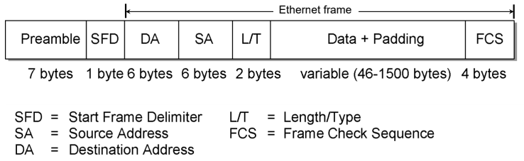{width=70%}

| Field | Size | Purpose |
| :--- | :--- | :--- |
| Preamble | 7 bytes | 10101010… The receiver uses it to lock its clock to the sender. |
| SFD (Start Frame Delimiter) | 1 byte | 10101011. "The frame starts now." |
| DA (Destination Address) | 6 bytes | The MAC address of the receiver. |
| SA (Source Address) | 6 bytes | The MAC address of the sender. |
| Length/Type | 2 bytes | Tells the receiver which upper protocol (for example IP) gets the data. |
| Data + Pad | 46 to 1500 bytes | The payload. Padding brings short data up to 46 bytes. |
| FCS (Frame Check Sequence) | 4 bytes | A CRC over DA to Pad. It detects bit errors. |

DA + SA + Type + 46 + FCS $= 6 + 6 + 2 + 46 + 4 = 64$ bytes, which is the minimum frame. The preamble and SFD are not counted.

### 7.2 MAC addresses

* A MAC address has **48 bits**, written as 6 hex bytes, for example `08:00:e4:b1:02:a2`. The manufacturer burns it into the network card. Each manufacturer has its own range, so every card has a unique address.
* **Delivery type.** Look at the **lowest bit of the first byte** (in practice, the **second** hex digit):
  * **Unicast** (to one station): the bit is 0. The second hex digit is **even**. Example: `4A:…`.
  * **Multicast** (to a group): the bit is 1. The second hex digit is **odd**. Example: `47:…`.
  * **Broadcast** (to all stations): all 48 bits are 1: `FF:FF:FF:FF:FF:FF`.

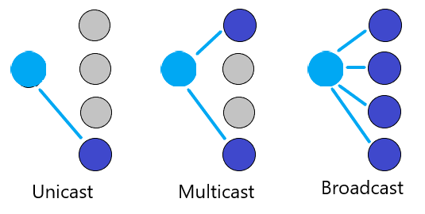{width=60%}

* A receiver passes a frame up if the DA is its own address, the broadcast address, or a multicast group it belongs to. In **promiscuous mode** it passes up every frame.

### 7.3 Ethernet's MAC algorithm

* **Idle line:** send at once. A frame has at most 1500 bytes of data. Between two back-to-back frames, the station must wait **9.6 µs**.
* **Busy line:** wait until it is idle, then send at once (**1-persistent**).
* **Collision:** stop, send the jam signal, then wait the **binary exponential backoff** time and try again.
* After **16** failed attempts, the station discards the frame and reports an error.

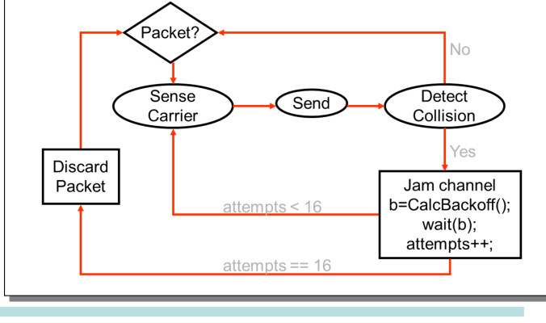{width=55%}

---

## 8. Binary Exponential Backoff (BEB)

### 8.1 The rule

After the $n$-th collision of a frame:

1. Choose $K$ at random from $\{0, 1, 2, \dots, 2^n - 1\}$. Every value is equally likely.
2. Wait $K \times 51.2\ \mu$s (one **slot time** = 512 bit times at 10 Mbit/s).
3. Try again.

The range stops growing after $n = 10$ (so $K \le 1023$). The station gives up after 16 attempts.

**Why random?** If all stations waited the same time, they would collide again in lock-step.
**Why does the range grow?** A small range is fine for two stations, but with many stations they would keep colliding. Each collision is a sign of more traffic, so the range doubles.

### 8.2 Two stations

After the first collision, each station picks slot 0 or 1. They collide again if they pick the **same** slot:

$$P(\text{collide again}) = P(0,0) + P(1,1) = 0.25 + 0.25 = 0.5$$

After the second collision, each picks from 0 to 3:

$$P(\text{collide again}) = 4 \times \tfrac{1}{4}\times\tfrac{1}{4} = 0.25$$

In general, for two stations after the $n$-th collision: $P(\text{collide again}) = 1/2^n$.

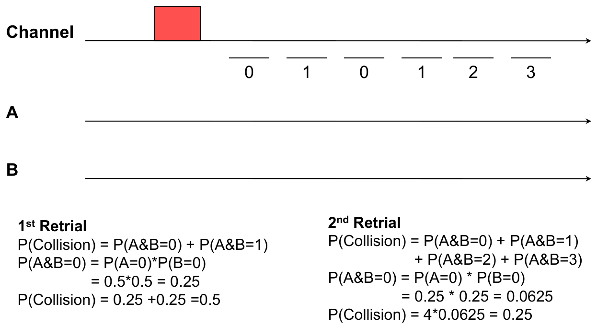{width=65%}

### 8.3 Method for more stations: list the slot choices

The **first event** on the channel is the first slot in which **someone** sends. An empty slot is not an event.

**Tutorial 1.3 Q2.** Three stations A, B, C collide. Each picks slot 0 or 1. What is $P(\text{next event is a collision})$?

There are $2^3 = 8$ equally likely choices.

| Who picks slot 0 | Slot 0 | Slot 1 | First event |
| :--- | :--- | :--- | :--- |
| All three (1 way) | collision | — | Collision |
| Exactly two (3 ways) | collision | — | Collision |
| Exactly one (3 ways) | success | — | Success |
| None (1 way) | empty | all three send | Collision |

$$P(\text{collision}) = \frac{1 + 3 + 1}{8} = \mathbf{0.625}, \qquad P(\text{success}) = \frac{3}{8} = 0.375$$

**AY24/25 S2 MCQ: four stations.** The first event is a success only if exactly one station picks 0: $\binom{4}{1}/16 = 4/16 = \mathbf{0.25}$. (If nobody picks 0, all four send in slot 1 and collide.)

**Tutorial 1.3 Q3: modified BEB.** A picks slot 0 with probability $p$. B picks slot 0 with probability $q$. Window = 2 slots.

| A | B | Probability | First event |
| :--- | :--- | :--- | :--- |
| 0 | 0 | $pq$ | Collision |
| 0 | 1 | $p(1-q)$ | Success |
| 1 | 0 | $(1-p)q$ | Success |
| 1 | 1 | $(1-p)(1-q)$ | Collision |

* $P(\text{success}) = p(1-q) + (1-p)q$. With $p = 1/3$, $q = 2/3$: $1/9 + 4/9 = \mathbf{5/9}$.
* To make it as large as possible, choose $p = 0, q = 1$ or $p = 1, q = 0$. Then $P(\text{success}) = 1$, because the two stations never pick the same slot.

---

## 9. Collision Domains and Broadcast Domains

* A **collision domain** is the part of a network where two frames sent at the same time collide.
  * **Repeaters and hubs** (layer 1) copy every signal to every port. They **extend** a collision domain.
  * **Bridges, switches and routers** (layers 2 and 3) do **not** pass collisions. **Each port is a separate collision domain.**
* A **broadcast domain** is the part of a network that a broadcast frame (DA = `FF:…:FF`) reaches.
  * Hubs, repeaters, bridges and switches **pass** broadcasts.
  * **Routers stop** broadcasts. Each router interface is the edge of a broadcast domain.

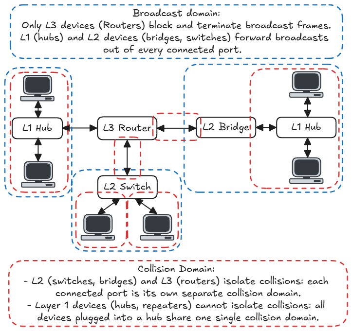{width=70%}

**How to count:**

1. **Collision domains:** count one for each port of each switch, bridge or router. A hub and everything on it counts as one domain (on whichever port it connects to).
2. **Broadcast domains:** count one for each router interface (one for each network the router joins).

**Hub versus switch:**

* A **hub** sends each signal out of every port except the one it came in on. Two stations that send at the same time collide.
* A **switch** sends each frame only to the port of the destination. If two frames arrive at once, the switch stores them in buffers and sends them later. There is no collision.

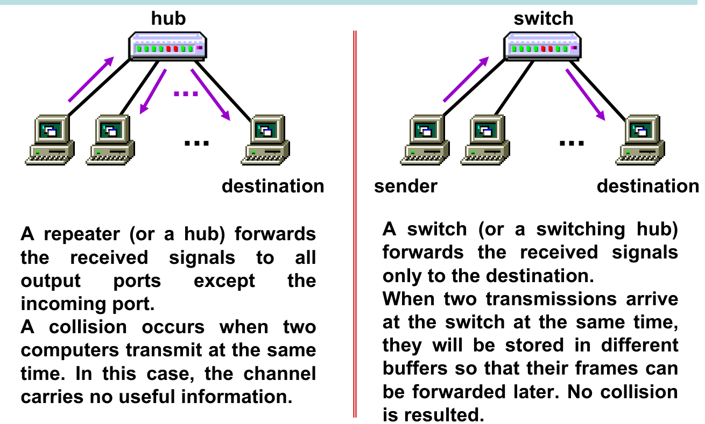{width=70%}

---

## 10. Wireless LANs (802.11)

> **Mostly not examinable (Lecture 8 slide labels):** standards, the architecture (BSS, ESS, AP), channels, association, DCF/PCF details and the frame format. **MARP (Section 11) is examinable.** The points below come up in short "explain" questions such as AY19/20 S1 Q2c.

**Why collision detection is hard in a WLAN:**

1. A station's own signal is very strong at its antenna. The signal from a far station is very weak. While the station sends, it cannot hear the weak signal.
2. The **hidden terminal problem:** A and C can both reach B, but they cannot hear each other (because of distance or a wall). Both see an idle channel and both send to B. The frames collide at B, but neither A nor C can detect this.

**What a WLAN does instead: collision avoidance (CSMA/CA).**

* Every correct frame gets an **ACK**. No ACK means the frame failed, so the sender sends it again.
* Optional **RTS/CTS** handshake: the sender sends a short **RTS** (Request To Send). The receiver answers with **CTS** (Clear To Send). Every station that hears the CTS (including hidden terminals) stays quiet for the time given in the frame (its **NAV**, network allocation vector). Only short RTS frames can collide, which wastes little time.
* RTS/CTS does **not** solve the **exposed terminal problem**: a station that hears the RTS stays quiet, even when its own transmission would not have caused harm. That chance to send is wasted.

---

## 11. MARP: Multi-Access Reservation Protocol (examinable)

### 11.1 The idea

Contention protocols waste time on collisions of **long** data frames. MARP uses contention only for **short** reservation frames.

Each cycle has two phases:

1. **Reservation phase:** stations send short **trial** (reservation) frames, each $v$ time units long. They use some MAC protocol with utilisation $S_r$ (for example slotted ALOHA). The phase ends when one trial succeeds.
2. **Transmission phase:** the station that won sends one data frame of $u$ time units. No collision is possible.

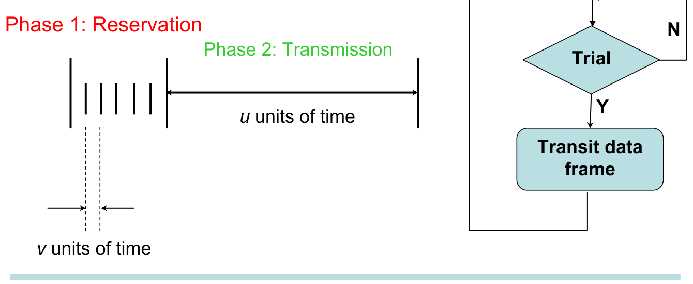{width=75%}

### 11.2 How many trials? (first principles)

Let $X$ be the number of trial frames until one succeeds. Each trial succeeds with probability $S_r$.

* $X = 1$ (the first trial succeeds) with probability $S_r$.
* $X = k$ (the first $k - 1$ trials fail, then the $k$-th succeeds) with probability $S_r(1 - S_r)^{k-1}$.

This is a **geometric** distribution, so $E[X] = 1/S_r$. The reservation phase lasts $v/S_r$ on average, and one cycle lasts:

$$\text{window} = u + \frac{v}{S_r}$$

### 11.3 Throughput: two cases

Read the question carefully. The two cases use different formulas.

**Case A. The reservation frame carries no user data.** Only the $u$ part is useful:

$$\boxed{S = \frac{u}{u + v/S_r}}$$

**Case B. The reservation frame carries some of the data bits.** The data frame is $u$ long in total, and the first $v$ of it goes out inside the winning trial. So the transmission phase only needs $u - v$:

$$\boxed{S = \frac{u}{(u - v) + v/S_r}}$$

### 11.4 Worked examples

**Lecture (Case A).** $u = 1$ s, $v = 5$ ms, $S_r = 0.5$: $S = 1/(1 + 0.01) = \mathbf{0.990}$.

**Tutorial 1.3 Q4 (Case B).** 1 Mbit/s, the data frame has 1000 bits, and 10 of them go in the reservation frame. So $u = 1000\ \mu$s and $v = 10\ \mu$s.

* (i) $S_r = 0.8$: $S = 1000 / (990 + 12.5) = \mathbf{0.9975}$.
* (ii) Slotted ALOHA in the reservation phase: the best choice is $p = 1/n$, which gives $S_r = 1/e$. Then $S = 1000/(990 + 10e) = 1000/1017.2 = \mathbf{0.983}$.

**AY22/23 S1 Q2b (Case B).** 10 Mbit/s, data frame 500 bytes, 10 bytes in the mini-frame, 150 stations.

* (i) $S_r = 0.6$: $S = 500 / (490 + 10/0.6) = 500/506.7 = \mathbf{0.987}$.
* (ii) Pure ALOHA in the reservation phase: the best choice is $G = 0.5$, so $p_{\text{opt}} = 1/(2n) = 1/300$, and $S_r = 1/(2e) = 0.184$. Then $S = 500/(490 + 10 \times 2e) = 500/544.4 = \mathbf{0.918}$. The gain over pure ALOHA alone is $0.918 / 0.184 \approx \mathbf{5.0}$ times.

**AY20/21 S2 Q2c (reverse problem, Case A).** 1000-bit frames with 20 information bits in the reservation frame. Here the reservation bits are **not** counted as useful, so $u = 980$ and $v = 20$. Find the smallest $S_r$ for $S \ge 0.975$:

$$\frac{980}{980 + 20/S_r} \ge 0.975 \;\Rightarrow\; \frac{20}{S_r} \le 25.13 \;\Rightarrow\; S_r \ge \mathbf{0.8}$$

---

## 12. Summary of MAC Protocols

| Protocol | Listens first? | After a collision | Max throughput | Key number |
| :--- | :--- | :--- | :--- | :--- |
| Pure ALOHA | No | Random wait | $1/(2e) = 0.184$ at $G = 0.5$ | Vulnerable time $2T$ |
| Slotted ALOHA | No | Resend with probability $p$ in each slot | $1/e = 0.368$ at $G = 1$ | Best $p = 1/N$ |
| CSMA | Yes | Random wait | Better than ALOHA when $a$ is small | Vulnerable time = propagation time |
| CSMA/CD (Ethernet) | Yes, and while sending | Jam, then BEB | Best of these when $a$ is small | $T_{\text{frame}} \ge 2\tau$ |
| CSMA/CA (Wi-Fi) | Yes | Random backoff, ACK, optional RTS/CTS | — | Avoids collisions, cannot detect them |
| MARP | Uses a MAC only for trials | — | $u / (u + v/S_r)$ | Short trials, long data |

---

## 13. Exam Checklist

* Slotted ALOHA: $S = Np(1-p)^{N-1} \to Ge^{-G}$. Differentiate to get $G = 1$, $p = 1/N$, $S_{\max} = 1/e$.
* Pure ALOHA: $S = Ge^{-2G}$. $G = 0.5$, $p = 1/(2N)$, $S_{\max} = 1/(2e)$.
* CSMA/CD: $T_{\text{frame}} \ge 2\tau$. Put **every** segment and repeater/hub delay into $\tau$. Count segments as repeaters + 1.
* BEB: write out all slot choices. An empty slot is not an event.
* MAC address: second hex digit even = unicast, odd = multicast, all F = broadcast.
* Domains: a switch/bridge/router port is a collision domain boundary; a router interface is a broadcast domain boundary.
* MARP: decide Case A or Case B **before** you put numbers in.
