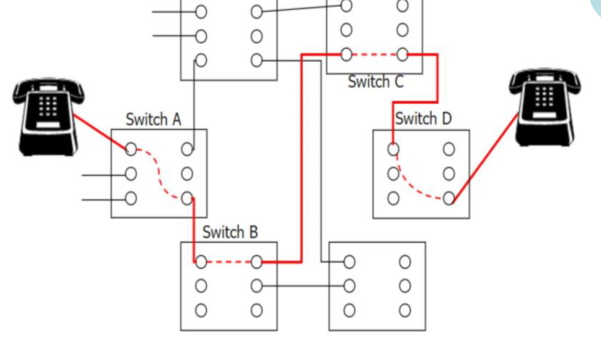
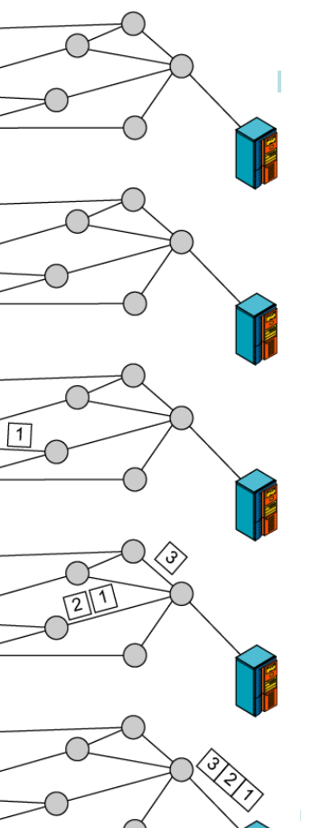
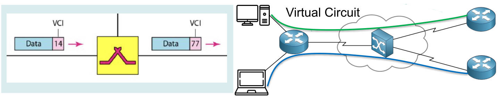
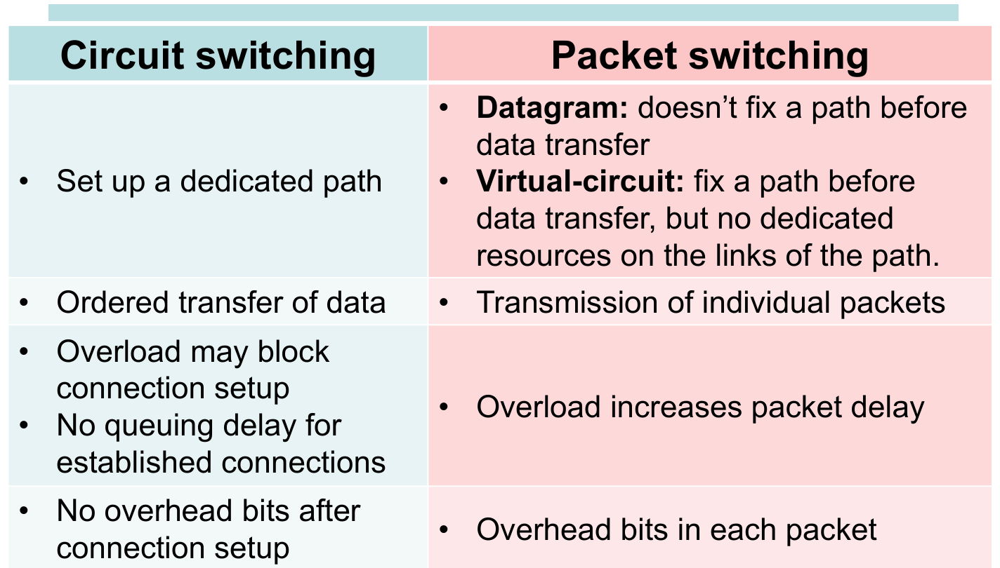
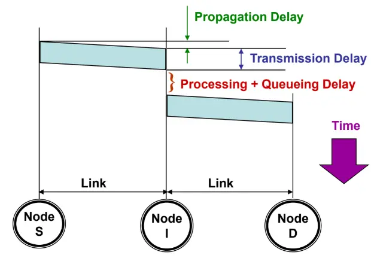
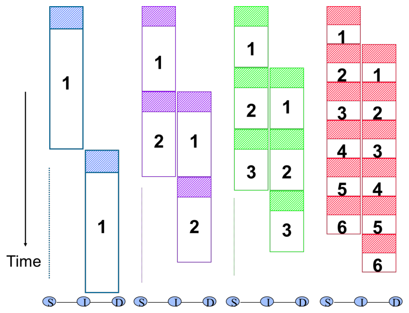
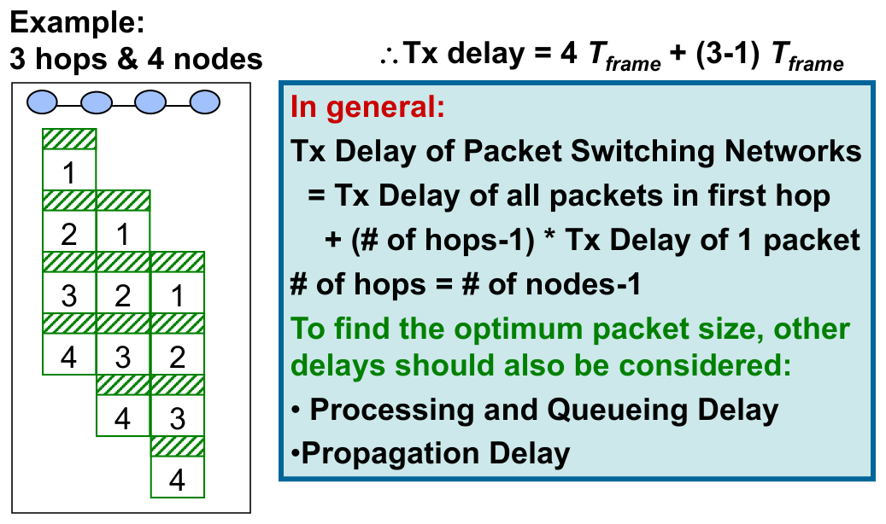
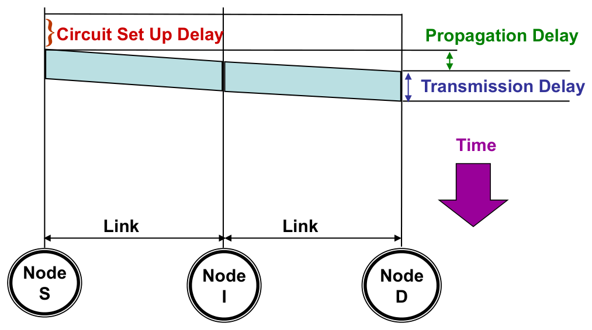

# Network Paradigms

This chapter covers Lecture 9 of Part I. It answers two questions:

1. How does a network move data from a source to a destination through many intermediate nodes? (Circuit switching, datagram packet switching, virtual-circuit packet switching.)
2. How long does that take? (Delay components and the **pipeline effect**.)

The delay formulas give calculation marks. The comparison tables give "explain" marks.

---

## 1. Why We Need Switching

If every pair of devices needed its own wire, $n$ devices would need $n(n-1)/2$ wires. That is impossible for a large network. Instead, devices connect to **switches** (switching nodes). The switches pass data along from one link to the next. The question is **how** the switches share their links between many users.

Three common uses:

| Paradigm | Where it is used |
| :--- | :--- |
| Circuit switching | Telephone networks (PSTN), 1G, 2G and 3G voice calls |
| Datagram packet switching | The Internet (IP) |
| Virtual-circuit packet switching | X.25 (for example, aeronautical data networks) |

---

## 2. Circuit Switching

### 2.1 The idea

The network **reserves a dedicated path** from the source to the destination **before** any data goes. The path holds resources on every link (for example, a time slot or a frequency band). Nobody else can use those resources while the call lasts.

{width=50%}

### 2.2 The three phases

1. **Circuit establishment.** A set-up request travels link by link through the switches. Each switch finds a free channel on the next link and reserves it. If any link has no free channel, the request is **blocked**.
2. **Data transfer.** Data flows along the reserved path in order. The data needs **no address or routing bits**, because the path is already fixed. There is no queuing delay at the switches.
3. **Circuit disconnect.** A release signal frees the resources on every link.

### 2.3 How many circuits fit on a trunk?

$$\text{number of circuits} = \frac{\text{trunk capacity}}{\text{capacity per circuit}}$$

Lecture example: a 10 Gbit/s trunk and 64 kbit/s voice calls give $10\times10^9 / 64\times10^3 \approx \mathbf{156\,250}$ calls at the same time.

A mobile call has three parts: a wireless link (Alice to base station A), a wired circuit (base station A to base station B), and a wireless link (base station B to Bob).

### 2.4 Good and bad points

* **Good:** data flows continuously, with no packet overhead. The capacity is guaranteed and protected from other users.
* **Bad:** the resources stay reserved even when nobody talks. Idle time is wasted. It does not scale to a very large number of users. The data rate is fixed.

**Why the Internet does not use it:** the Internet has billions of devices, and most of them send data in short bursts. Reserving a path for each one would need far too many resources, and most of them would sit idle.

---

## 3. Packet Switching

### 3.1 The idea

Packet switching was invented in the 1960s. The source cuts a long message into short **packets** (about 1000 bytes each). Each packet has two parts:

* a **header** with control information: the source and destination addresses, a sequence number, and so on;
* a **payload**: one piece of the user data.

### 3.2 Store-and-forward

At each node, the packet is **received in full, stored in a buffer, checked, and then sent on** to the next node. A node cannot start to send a packet on the next link until the whole packet has arrived. This rule is the reason for the pipeline delay in Section 5.

### 3.3 Two kinds of packet switching

**Datagram packet switching.**

* Each packet carries the **full destination address** and a sequence number.
* The network treats each packet **independently**. Two packets of the same message can take different paths.
* So packets can arrive **out of order**. The destination puts them back in order with the sequence numbers.
* The packets are called **datagrams**. A good analogy is posting parcels: each parcel finds its own way.

{width=30%}

**Virtual-circuit (VC) packet switching.**

* The network **sets up a path first**. All packets of the connection follow the same path, so they arrive in order.
* Each packet carries a short **Virtual Circuit Identifier (VCI)** instead of the full destination address. Each node on the path knows where to send packets with that VCI. The VCI can change from one link to the next (for example, 14 on one link and 77 on the next).
* **No resources are reserved.** The links are still shared by all users, as in datagram switching.

{width=80%}

### 3.4 Good and bad points of packet switching

* **Good:** links are shared dynamically, so they are used efficiently. Under heavy traffic, the network still accepts packets. They wait in queues.
* **Bad:** queues add delay, and the delay varies. Packets can be lost and must be sent again. There is no stable connection.

---

## 4. Comparisons

### 4.1 Circuit switching against packet switching

{width=80%}

| | Circuit switching | Datagram | Virtual circuit |
| :--- | :--- | :--- | :--- |
| Path set up first? | Yes, dedicated path | No | Yes, fixed path |
| Resources reserved? | Yes | No | No |
| Order of arrival | In order | Can be out of order | In order |
| Header in each packet | None after set-up | Full destination address | Short VCI |
| Effect of overload | New calls are **blocked**; no queuing delay for calls already set up | Packet **delay increases** | Packet delay increases |
| One node fails | Circuits through it are lost | Packets go round the failure | VCs through it are lost |

**Real-world use:** landline phones use circuits; the Internet uses packets; 1G, 2G and 3G voice use circuits; 4G and 5G use packets (voice is sent as high-priority data).

### 4.2 Connection-oriented against connectionless (Tutorial 1.4 Q1)

* **Connection-oriented** communication has three phases: **establish** a connection, **transfer** the data, **release** the connection. Data can only flow after the set-up phase succeeds. (Circuit switching, virtual circuits and TCP work this way.)
* **Connectionless** communication has no phases. It just sends the data. (Datagrams and IP work this way.)

### 4.3 Tutorial 1.4 Q2

*"In a virtual-circuit network, each packet follows a fixed route. So does the network not need to route packets from any source to any destination?"*

**No.** A VC network still needs this ability to route the **connection set-up packet**. The set-up packet must find a path from any source to any destination. Only after that do the data packets follow the fixed path.

---

## 5. Delay

### 5.1 The four delay components

{width=60%}

| Delay | Cause | Formula |
| :--- | :--- | :--- |
| **Transmission** | Pushing all bits of the packet onto the link | $L / R$ (packet size / data rate) |
| **Propagation** | The signal travelling along the link | $d / v$ (distance / signal speed) |
| **Processing** | The node checking the header and choosing the next link | Usually very small |
| **Queuing** | Waiting behind other packets in the buffer | Depends on traffic |

### 5.2 The pipeline effect

When a message is cut into packets, different packets are on different links **at the same time**. While node I sends packet 1 to D, the source S already sends packet 2 to I. The links work in parallel, like an assembly line.

{width=60%}

### 5.3 Packet-switching transmission delay

Take $n_p$ packets of equal size, each taking $T_{\text{frame}}$ to send, over $h$ hops (links). Let processing and propagation be zero.

1. The **first hop** must send every packet: this takes $n_p \times T_{\text{frame}}$.
2. When the **last** packet leaves the first hop, it still has to cross the other $h - 1$ hops, one $T_{\text{frame}}$ each.

$$\boxed{T_{\text{packet}} = n_p\,T_{\text{frame}} + (h - 1)\,T_{\text{frame}}}, \qquad h = \text{number of nodes} - 1$$

{width=70%}

With a propagation delay $d$ on each hop, every hop adds $d$:

$$T_{\text{packet}} = h\,(T_{\text{frame}} + d) + (n_p - 1)\,T_{\text{frame}}$$

### 5.4 Circuit-switching delay

After set-up, the bits flow through the circuit **without** store-and-forward. So the data only needs to be sent once:

$$T_{\text{circuit}} = s + \frac{x}{b} + h\,d$$

Here $s$ = set-up time, $x$ = message size, $b$ = data rate, $h$ = number of hops, $d$ = propagation per hop.

{width=60%}

Lecture example: 1000 bits at 10 kbit/s over 3 hops: transmission delay $= 1000/10\,000 = 0.1$ s, whatever the number of hops.

### 5.5 The best packet size

Smaller packets give more pipelining. But each packet carries a header, so smaller packets also mean more overhead. To find the best size, the lecture says to also consider processing, queuing and propagation delay.

---

## 6. Worked Exam Problems

### 6.1 Minimum link rate with pipelining (Tutorial 1.4 Q3)

S → I → D (2 hops). A 1000-byte message goes as 4 packets. Each packet gets a 50-byte header. All links have the same rate. Propagation is zero. The total delay must be at most 100 ms.

* Each packet: $1000/4 + 50 = 300$ bytes $= 2400$ bits.
* $T = 4T_f + (2 - 1)T_f = 5T_f \le 100$ ms, so $T_f \le 20$ ms.
* $2400 / R \le 0.02 \Rightarrow R \ge \mathbf{120}$ **kbit/s**.

### 6.2 Is switching time important? (Tutorial 1.4 Q4)

Switching time is 10 µs per switch. The signal speed is $\tfrac{2}{3}c = 2\times10^8$ m/s $= 200$ m/µs.

* In 10 µs a signal travels 2 km. So each switch adds the same delay as 2 km of extra cable.
* New York to California is about 5000 km. Even 50 switches add only 100 km, which is 2%.
* So switching time is **not** a major factor.

### 6.3 When is packet switching faster? (Tutorial 1.4 Q5)

An $x$-bit message, $k$ hops, set-up time $s$, propagation $d$ per hop, packet size $p$ bits, rate $b$ bit/s.

* Circuit: $s + \dfrac{x}{b} + kd$.
* Packet ($x/p$ packets): $k\left(\dfrac{p}{b} + d\right) + \left(\dfrac{x}{p} - 1\right)\dfrac{p}{b} = \dfrac{x}{b} + (k-1)\dfrac{p}{b} + kd$.
* Packet switching is faster when:

$$\boxed{(k - 1)\frac{p}{b} < s}$$

That is, when the extra store-and-forward time is less than the circuit set-up time.

### 6.4 Packets of different sizes (AY25/26 MCQ)

Three packets of 1000, 4000 and 2000 bytes go through **two routers** (so 3 hops) at 2 Mbit/s. Propagation is zero.

* Transmission times: 4 ms, 16 ms and 8 ms.
* A packet can start on a link only when (1) it has fully arrived at that node, and (2) the packet before it has left that link. Track the finish times:

| Packet | Link 1 ends | Link 2 ends | Link 3 ends |
| :--- | :--- | :--- | :--- |
| 1 (4 ms) | 4 | 8 | 12 |
| 2 (16 ms) | 20 | $\max(20, 8) + 16 = 36$ | $\max(36, 12) + 16 = 52$ |
| 3 (8 ms) | 28 | $\max(28, 36) + 8 = 44$ | $\max(44, 52) + 8 = 60$ |

Total time $= \mathbf{60}$ **ms**. The big packet holds up the small packet behind it.

### 6.5 The best number of packets (AY23/24 S1 Q2)

A file of $F$ bytes crosses $h$ links. It is cut into $N$ packets, and each packet gets an $H$-byte header. The rate is $R$ on every link.

$$T(N) = (N + h - 1)\,\frac{F/N + H}{R}$$

Set $dT/dN = 0$:

$$\frac{F}{N} + H - (N + h - 1)\frac{F}{N^2} = 0 \;\Rightarrow\; H = \frac{(h - 1)F}{N^2} \;\Rightarrow\; \boxed{N^* = \sqrt{\frac{(h-1)F}{H}}}$$

With $F = 200$ MB, $H = 600$ bytes and $h = 4$: $N^* = \sqrt{3 \times 2\times10^8 / 600} = \sqrt{10^6} = \mathbf{1000}$ packets.

---

## 7. Exam Checklist

* Circuit switching: 3 phases. Reserved resources, no per-packet header, overload causes **blocking**.
* Datagram: full address in each packet, independent paths, can arrive **out of order**.
* Virtual circuit: fixed path, VCI in each packet, **no** reserved resources.
* Packet delay: $n_p T_f + (h - 1) T_f$, and $h$ = nodes $- 1$. Add $h \cdot d$ for propagation.
* Circuit delay: $s + x/b + h d$.
* For unequal packet sizes, draw the finish-time table.
