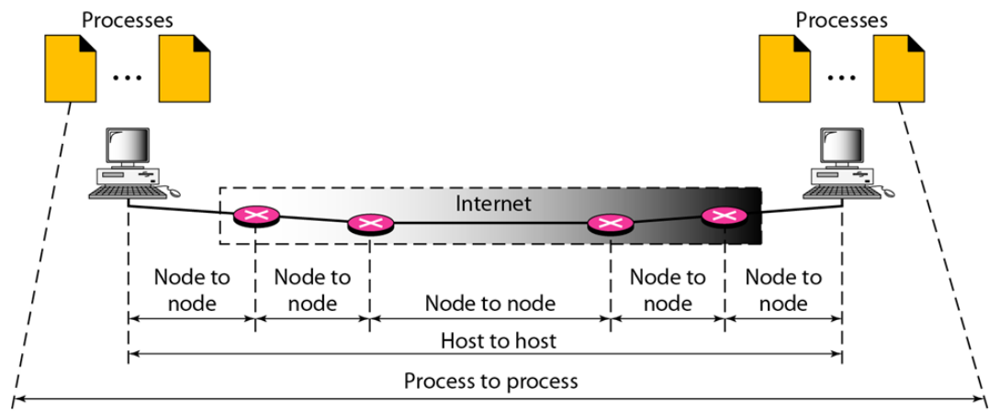
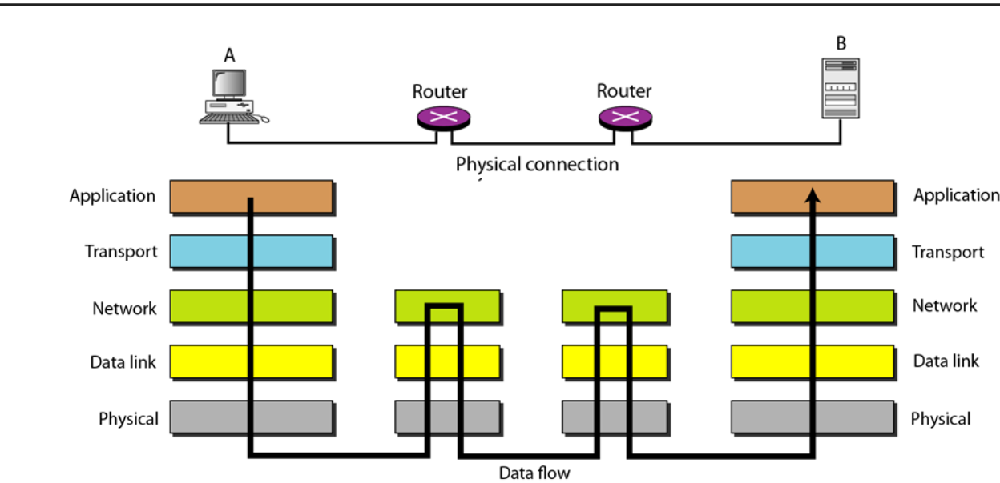
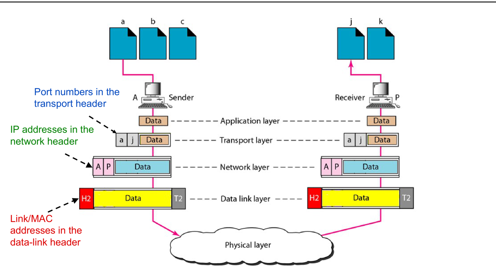
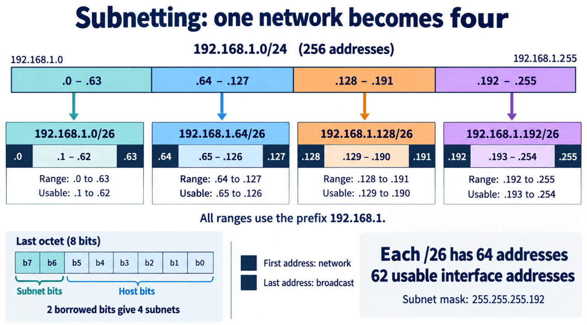
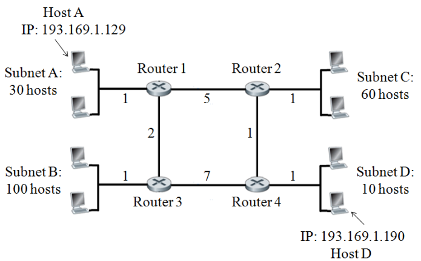
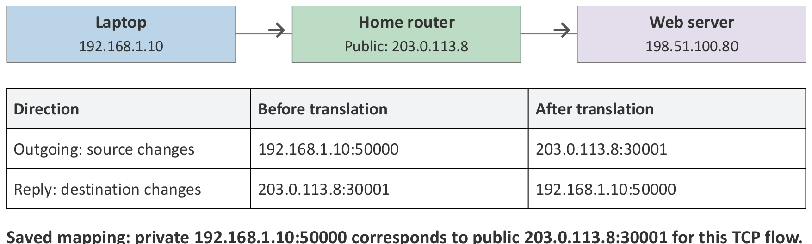
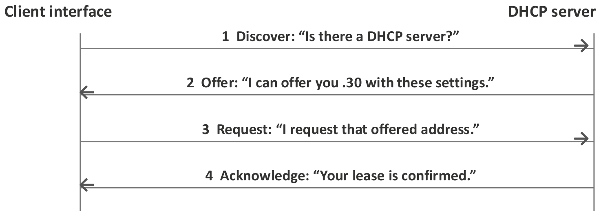

# 5. Network Layer: IP Addressing

This chapter starts Part II of the course. It covers Part II Lecture 1 (overview), the first half of Lecture 2 (IP addressing and subnetting), and the "IP addressing in practice" session (IP settings, DHCP, subnets, NAT).

Part I explained how frames cross **one** link. Part II explains how data crosses **many different networks** to reach the right program on the right computer.

Exam focus for this chapter:

* Find the network address, broadcast address and usable range from an address and a prefix.
* Choose subnet sizes and allocate blocks (fixed-size subnetting and VLSM). Assign router interface addresses.
* Find the longest common prefix of addresses (smallest subnet, or route aggregation).
* Fill in NAT and DHCP packet tables.

---

## 1. The Map of Part II

### 1.1 The upper three layers

Part I covered the physical and data link layers. Part II moves up three layers. Each layer uses the service of the layer below it.

| Layer | Problem it solves | Main protocols | Covered in |
| :--- | :--- | :--- | :--- |
| Network | Carry a packet from one **host** to another host, across many networks | IP, ARP, ICMP; routing with RIP, OSPF, BGP | Chapters 5 to 7 |
| Transport | Carry data from one **program** to another program, reliably and at a safe rate | TCP, UDP | (not yet released) |
| Application | What the programs say to each other | HTTP, DNS | (not yet released) |

### 1.2 Node to node, host to host, process to process

* A **node** is any device on the path, such as a computer or a router.
* A **host** is an end computer, such as a laptop or a server.
* A **process** is a program running on a host.

| Layer | Delivers from … to … |
| :--- | :--- |
| Data link | node to node (one link) |
| Network | host to host (the whole path) |
| Transport | process to process |

{width=75%}

The two **hosts** run all five layers. The **routers** in between run only the physical, data link and network layers.

{width=65%}

At each router, the **network layer chooses the next hop**. Then the **data link layer carries the packet across that one link**. The next router chooses again.

### 1.3 Why one address is not enough

Each layer uses its own identifier.

| Identifier | Layer | Size | Question it answers |
| :--- | :--- | :--- | :--- |
| MAC address | Data link | 48 bits | Which device on **this link**? |
| IP address | Network | 32 bits (IPv4) | Which computer, **anywhere** on the Internet? |
| Port number | Transport | 16 bits | Which **program** on that computer? |

* Ports go in the transport header, IP addresses in the network header, and MAC addresses in the frame header.
* An Ethernet frame that carries TCP or UDP data contains all three.

{width=75%}

### 1.4 What happens when you open a web page

| Step | Problem | What solves it |
| :--- | :--- | :--- |
| 1 | You typed a name, but routers need an address. | DNS (Domain Name System) changes the name into an IP address. |
| 2 | Which network does the address belong to? | IP addressing (this chapter) |
| 3 | Which way should the packet go at each router? | Routing tables and routing protocols (Chapters 6 and 7) |
| 4 | How does the packet cross each link? | Ethernet and Wi-Fi (Part I), joined to IP by ARP (Chapter 6) |
| 5 | Which program gets the data? | Port numbers (transport layer) |
| 6 | What if packets are lost or arrive out of order? | TCP (transport layer) |
| 7 | What do the browser and server say? | HTTP (application layer) |

---

## 2. IP Basics

### 2.1 Packet, header and payload

* **IP (Internet Protocol)** is the network-layer protocol of the Internet. It carries packets across joined networks.
* An **IP packet** (also called an **IP datagram**) has two parts:
  * the **IP header**, with control information such as the source and destination IP addresses;
  * the **payload**, the data after the header (for example a TCP segment or an ICMP message).
* An **Ethernet frame** carries the IP packet across one Ethernet link. At each router, the packet goes into a **new** frame for the next link.

### 2.2 Connectionless and best effort

* **Connectionless:** IP sends each datagram on its own. There is no set-up phase.
* **Best effort:** IP does **not** guarantee delivery. Packets can be lost, delayed, duplicated, or delivered out of order. IP does not retransmit. A higher layer (TCP) can add reliability.

> True/false trap (AY23/24 S1): "IP is a reliable protocol." **False.**

---

## 3. IPv4 Addresses

### 3.1 The format

* An **IPv4 address** is a **32-bit** number given to a network **interface**. An interface is a device's connection to a network, such as one Ethernet port or one Wi-Fi connection.
* We write it as four decimal numbers (each one byte, called an **octet**, from 0 to 255) with dots between them:

```
192    .168     .10      .77
11000000.10101000.00001010.01001101   (8 + 8 + 8 + 8 = 32 bits)
```

* A **router has one IP address on each interface.** Each interface belongs to the subnet on its own side.

### 3.2 Network part and host part

A MAC address is **flat**: it says *who* a device is, not *where* it is. If IP addresses were flat too, every router would need one entry for every computer on Earth.

So an IP address is built like a phone number with a country code:

* The **network prefix** (the leading bits) names the network.
* The **host part** (the remaining bits) names the interface inside that network.

Example: in 155.69.8.3, "155.69" names NTU and "8.3" names one machine at NTU. A router far away only needs one route for the whole NTU block.

### 3.3 Subnet, prefix and mask

* A **subnet** is a group of interfaces that share the same network prefix. On our Ethernet examples, hosts in one subnet can talk directly, without a router.
* A **subnet mask** is a 32-bit value. Its leading **1s** mark the network prefix, and its trailing **0s** mark the host bits.
* **Prefix notation** writes `/n` after the address. $n$ = the number of prefix bits = the number of 1s in the mask.

| Prefix | Mask | Host bits | Total addresses | Usable |
| :--- | :--- | :--- | :--- | :--- |
| /8 | 255.0.0.0 | 24 | 16 777 216 | 16 777 214 |
| /16 | 255.255.0.0 | 16 | 65 536 | 65 534 |
| /20 | 255.255.240.0 | 12 | 4 096 | 4 094 |
| /22 | 255.255.252.0 | 10 | 1 024 | 1 022 |
| /23 | 255.255.254.0 | 9 | 512 | 510 |
| /24 | 255.255.255.0 | 8 | 256 | 254 |
| /25 | 255.255.255.128 | 7 | 128 | 126 |
| /26 | 255.255.255.192 | 6 | 64 | 62 |
| /27 | 255.255.255.224 | 5 | 32 | 30 |
| /28 | 255.255.255.240 | 4 | 16 | 14 |
| /29 | 255.255.255.248 | 3 | 8 | 6 |
| /30 | 255.255.255.252 | 2 | 4 | 2 |

Learn the mask byte values: 128, 192, 224, 240, 248, 252, 254, 255. Each one adds the next bit: 128, +64, +32, +16, +8, +4, +2, +1.

### 3.4 Network, broadcast and usable addresses

With $h$ host bits:

* **Network address:** all host bits are **0**. It is the first address of the block. It names the subnet.
* **Broadcast address:** all host bits are **1**. It is the last address of the block. It means "every host on this subnet".
* **Usable addresses:** everything in between.

$$\text{total} = 2^h, \qquad \text{usable} = 2^h - 2$$

> **Always count the router interface.** A LAN with 62 computers and 1 gateway needs 63 usable addresses. A /26 has only 62, so you need a /25.

### 3.5 CIDR against classful addressing

**CIDR (Classless Inter-Domain Routing)** allows any prefix length. Today, always use the prefix or mask that the question gives. **Do not guess the boundary from the first number.**

The **old classful** system fixed the boundary from the first bits. Past papers still ask about it (AY20/21 S2 Q3a, AY23/24 S1 Q4).

| Class | Leading bits | First octet | Network bits | Number of networks | Hosts per network |
| :--- | :--- | :--- | :--- | :--- | :--- |
| A | 0 | 0–127 | 8 | $2^7 = 128$ (126 usable) | $2^{24} - 2 = 16\,777\,214$ |
| B | 10 | 128–191 | 16 | $2^{14} = 16\,384$ | $2^{16} - 2 = 65\,534$ |
| C | 110 | 192–223 | 24 | $2^{21} = 2\,097\,152$ | $2^8 - 2 = 254$ |
| D | 1110 | 224–239 | — | multicast | — |
| E | 1111 | 240–255 | — | reserved | — |

Example: 152.73.184.68 starts with 152, which is in 128–191, so it is **Class B**.

> True/false trap: "A Class B address starts with 110." **False.** It starts with **10**.

---

## 4. Method: From an Address to Its Subnet

### 4.1 The full method with bitwise AND

**Bitwise AND:** $1 \text{ AND } 1 = 1$. Every other pair gives 0. So **address AND mask** keeps the prefix bits and sets every host bit to 0. The result is the network address.

**Example: 192.168.10.77/26.**

1. Mask: 26 ones = `11111111.11111111.11111111.11000000` = **255.255.255.192**.
2. AND the last octet: `01001101` (77) AND `11000000` (192) = `01000000` = **64**.
3. Network address = **192.168.10.64/26**.
4. Set the 6 host bits to 1: last octet `01111111` = 127. Broadcast = **192.168.10.127**.
5. Usable: **.65 to .126**, which is 62 addresses.

### 4.2 The fast method: block size

The mask defines blocks of equal size that start on multiples of the block size.

1. Find the **interesting octet**: the octet where the mask is neither 255 nor 0.
2. **Block size** $= 256 -$ (mask value in that octet).
3. List the block starts: $0, B, 2B, 3B, \dots$ Find the block that holds the address.
4. Network = the start of that block (with host bits 0 in later octets). Broadcast = the next start $- 1$ (with 255 in later octets).

| Address | Mask octet | Block | Containing block | Network | Broadcast | Usable |
| :--- | :--- | :--- | :--- | :--- | :--- | :--- |
| 192.168.10.77/26 | 192 (4th) | 64 | 64–127 | .64 | .127 | .65 – .126 |
| 10.0.5.94/27 | 224 (4th) | 32 | 64–95 | 10.0.5.64 | 10.0.5.95 | .65 – .94 |
| 172.20.142.98/22 | 252 (3rd) | 4 | 140–143 | 172.20.140.0 | 172.20.143.255 | .140.1 – .143.254 |
| 145.32.128.0/19 | 224 (3rd) | 32 | 128–159 | 145.32.128.0 | **145.32.159.255** | |

The last row is Tutorial 2.1 Q2 (mask 255.255.224.0 = /19).

### 4.3 Are two hosts on the same subnet?

AND **each** address with the mask and compare the results.

* A = 192.168.10.77/26. Destination 192.168.10.126 gives .64, which is the same, so it is **local**. Destination 192.168.10.130 gives .128, which is different, so it is **remote**.
* 10.0.5.96 is **not** in 10.0.5.64/27. It starts the next /27 block. Being numerically close does not make it local.

### 4.4 Which addresses belong to a subnet? (AY19/20 S1, AY18/19 S1)

**133.23.176.0/21:** the mask octet is 248 in the 3rd octet, so the block size is 8. The block is 176–183 in the 3rd octet: 133.23.176.0 to 133.23.183.255.

| Address | In the subnet? | Why |
| :--- | :--- | :--- |
| 133.56.176.1 | No | The second octet is 56, not 23. |
| 133.23.180.55 | **Yes** | 180 is in 176–183. |
| 133.23.194.22 | No | 194 is outside 176–183. |
| 133.23.191.255 | No | 191 is outside 176–183. |
| 133.23.176.160 | **Yes** | 176 is in range. |

**155.69.8.0/22:** the block size is 4, so 155.69.8.0 to 155.69.11.255. 155.69.9.23 and 155.69.10.22 are in it. 155.69.7.55, 155.69.12.30 and 155.69.4.20 are not.

### 4.5 Is a block written correctly?

A network address must have **all host bits 0**. The interesting octet must be a **multiple of the block size**.

* 155.69.64.0/18 is correct: the block size is 64, and 64 is a multiple of 64.
* 155.69.112.0/19 is **wrong**: the block size is 32, and 112 is not a multiple of 32. (The /19 that holds 112 is 155.69.96.0/19.)

### 4.6 The longest common prefix (smallest subnet holding two addresses)

To find the longest prefix (the smallest subnet) that holds two addresses, write the first octet where they differ in binary. Count the leading bits that match.

**AY25/26: 16.25.200.90 and 16.25.250.60.**

```
200 = 1100 1000
250 = 1111 1010
      11            → 2 bits match in the 3rd octet
```

The prefix length is $16 + 2 = 18$, so the prefix is **/18** and the mask is **255.255.192.0**.

**AY23/24 S2: 8.9.200.90 and 8.9.100.60.** $200 = 11001000$ and $100 = 01100100$. They differ at the first bit, so the prefix is **/16** and the mask is **255.255.0.0**.

---

## 5. Subnetting: Splitting a Block

### 5.1 The rule

**Subnetting** divides a **parent** block into smaller, non-overlapping **child** blocks by making the prefix longer.

* Going from /$p$ to /$q$ uses $q - p$ extra bits to number the subnets.
* So the parent holds $2^{q-p}$ child subnets of size /$q$.
* Each child has $32 - q$ host bits.

More subnets means fewer addresses per subnet. The total does not grow.

{width=75%}

### 5.2 Method: choose the prefix for a LAN

1. Count the interfaces that need an address: **hosts + 1 for the router**.
2. Find the smallest $h$ with $2^h - 2 \ge$ that number.
3. The prefix is $32 - h$.

Example: 70 computers + 1 gateway = 71. $2^6 - 2 = 62$ is too small, and $2^7 - 2 = 126$ is enough. So **/25**.

### 5.3 Equal-size subnets (Tutorial 2.1 Q1)

The university has 155.69.0.0/16. There are 10 schools now, rising to 15. Three schools may grow to 4000 hosts. Give each school the same size.

1. Size: 4000 hosts + 1 router = 4001. $2^{12} - 2 = 4094 \ge 4001$, so $h = 12$, which gives **/20**. The mask is **255.255.240.0**.
2. Count: $20 - 16 = 4$ subnet bits give $2^4 = 16 \ge 15$ subnets. Both checks pass.
3. Block size in the 3rd octet: $256 - 240 = 16$.

| School | Subnet | Range |
| :--- | :--- | :--- |
| 1 | 155.69.0.0/20 | 155.69.0.0 – 155.69.15.255 |
| 2 | 155.69.16.0/20 | 155.69.16.0 – 155.69.31.255 |
| 3 | 155.69.32.0/20 | 155.69.32.0 – 155.69.47.255 |
| … | (add 16 each time) | … |
| 15 | 155.69.224.0/20 | 155.69.224.0 – 155.69.239.255 |
| Spare | 155.69.240.0/20 | 155.69.240.0 – 155.69.255.255 |

**Lecture example:** 10.20.0.0/20 for 6 departments of up to 300 computers + 1 gateway. A /23 gives 510 usable addresses. $23 - 20 = 3$ bits give 8 subnets. The blocks are 10.20.0.0/23, 10.20.2.0/23, …, 10.20.10.0/23 (the 3rd octet goes up by 2). 10.20.12.0/23 and 10.20.14.0/23 stay reserved.

**AY24/25 S2 MCQ:** 190.158.80.0/20 split for subnets of 800 hosts. 801 addresses need $h = 10$ (1022 usable), which is /22. $22 - 20 = 2$ bits give 4 subnets: .80.0, .84.0, .88.0 and .92.0. The last broadcast is **190.158.95.255**.

---

## 6. VLSM: Subnets of Different Sizes

### 6.1 The idea

**VLSM (Variable-Length Subnet Masking)** gives each segment its own prefix length. A big LAN gets a big block, and a small LAN gets a small block. A link between two routers needs only 2 addresses, so it gets a **/30**.

### 6.2 Method

1. **List every segment** that needs its own subnet: every LAN **and every router-to-router link**.
2. **Size each one:** hosts + router interfaces. Choose the smallest prefix.
3. **Check the total:** the block sizes must add up to no more than the parent block.
4. **Allocate the largest block first.** Each block must start on a multiple of its own size. This avoids gaps that you cannot use.
5. **Respect fixed addresses:** if the question fixes a host address, the subnet for that host must contain it. Place those blocks first.
6. **Avoid reserved blocks** that the question has already used.
7. **Assign interfaces:** give each router interface a usable address in its subnet, with the matching mask. Both ends of a /30 link get the two usable addresses.
8. **Check:** enough capacity, aligned blocks, no overlap, every address unique and usable.

### 6.3 Worked example (lecture)

Parent: 192.168.50.0/24. LAN A has 100 computers, LAN B 50, LAN C 20 and LAN D 10. Each LAN also needs one gateway. Four routers R1–R4 are joined by four point-to-point links.

| Segment | Needs | Prefix | Subnet | Usable | Router interface |
| :--- | :--- | :--- | :--- | :--- | :--- |
| LAN A | 101 | /25 | 192.168.50.0/25 | .1 – .126 | R1: .1/25 |
| LAN B | 51 | /26 | .128/26 | .129 – .190 | R2: .129/26 |
| LAN C | 21 | /27 | .192/27 | .193 – .222 | R3: .193/27 |
| LAN D | 11 | /28 | .224/28 | .225 – .238 | R4: .225/28 |
| R1–R2 | 2 | /30 | .240/30 | .241 – .242 | R1 .241, R2 .242 |
| R1–R3 | 2 | /30 | .244/30 | .245 – .246 | R1 .245, R3 .246 |
| R2–R4 | 2 | /30 | .248/30 | .249 – .250 | R2 .249, R4 .250 |
| R3–R4 | 2 | /30 | .252/30 | .253 – .254 | R3 .253, R4 .254 |

Total: $128 + 64 + 32 + 16 + 4 \times 4 = 256$. It fits exactly.

### 6.4 Worked example with fixed hosts (Tutorial 2.1 Q3)

Parent: 193.169.1.0/24. Here "hosts" **includes** the router interface. Host A is fixed at 193.169.1.129 and Host D at 193.169.1.190.

{width=60%}

**Sizes:**

| Segment | Addresses | Prefix | Block size |
| :--- | :--- | :--- | :--- |
| Subnet B | 100 | /25 | 128 |
| Subnet C | 60 | /26 | 64 |
| Subnet A | 30 | /27 | 32 |
| Subnet D | 10 | /28 | 16 |
| 4 router links | 2 each | /30 | 4 each |

Total $= 128 + 64 + 32 + 16 + 16 = 256$. It fits exactly, so every block must be placed with care.

**Placement:**

1. Host A (.129) must be in A's /27. The /27 that holds .129 is **.128/27** (.128–.159).
2. Host D (.190) must be in D's /28. The /28 that holds .190 is **.176/28** (.176–.191).
3. B needs a /25. The upper /25 (.128–.255) now holds A and D, so B = **.0/25**.
4. C needs a /26. Of .128–.255, only .192–.255 is still free. So C = **.192/26**.
5. The links use the last free space, .160–.175: **.160/30, .164/30, .168/30, .172/30**.

**Unofficial answer (no official solution was released):**

| Interface | Address / mask |
| :--- | :--- |
| Router 1, Subnet A side | 193.169.1.130/27 |
| Router 3, Subnet B side | 193.169.1.1/25 |
| Router 2, Subnet C side | 193.169.1.193/26 |
| Router 4, Subnet D side | 193.169.1.177/28 |
| R1–R2 link | R1: 193.169.1.161/30, R2: 193.169.1.162/30 |
| R1–R3 link | R1: 193.169.1.165/30, R3: 193.169.1.166/30 |
| R2–R4 link | R2: 193.169.1.169/30, R4: 193.169.1.170/30 |
| R3–R4 link | R3: 193.169.1.173/30, R4: 193.169.1.174/30 |

### 6.5 More past-paper patterns

**A reserved block already in use (AY22/23 S1 Q3b).** 203.8.9.0/24 has subnets A /25, B /26 and C /27. The router links already use 203.8.9.96/28.

* .96/28 lies inside .64–.127 and also inside .0–.127. So A (/25) cannot be .0/25 and must be **203.8.9.128/25**.
* B (/26) cannot be .64/26 (it holds .96), so **B = 203.8.9.0/26**.
* C (/27) = **203.8.9.64/27** (.64–.95). This sits just below the reserved .96.

**Two parent blocks (AY20/21 S2 Q3c).** The blocks are 155.69.36.0/24 and 155.69.61.192/26. The subnets need A 30, B 70, C 100, D 10, and one host in C is fixed at 155.69.36.186.

* C needs /25. It holds .186, so **C = 155.69.36.128/25**. B needs /25: **B = 155.69.36.0/25**. The /24 is now full.
* A, D and the four links must fit in 155.69.61.192/26 (64 addresses). This fits only if the host counts include the router interface: A = /27 (.192), D = /28 (.224), and links /30 at .240, .244, .248, .252.
* **Lesson:** add up the block sizes first. If they do not fit, re-read what "hosts" includes, and state your assumption.

---

## 7. Route Aggregation (Supernetting)

### 7.1 The idea

A router can replace many routes with **one shorter prefix** that covers them all. This makes the routing table smaller. This is also why CIDR prefixes help routing (Section 3.2).

**Method:** write the octet that changes in binary. Find the leading bits that **all** the networks share. The new prefix length is the number of shared bits.

### 7.2 Worked example (AY19/20 S1 Q3c)

The networks are 193.169.98.0/24, .99.0, .100.0, .101.0, .102.0 and .105.0/24.

```
 98 = 0110 0010
 99 = 0110 0011
100 = 0110 0100
101 = 0110 0101
102 = 0110 0110
105 = 0110 1001
      ^^^^          4 shared bits
```

The prefix is $16 + 4 = 20$. The aggregate route is **193.169.96.0/20**, which covers 193.169.96.0 to 193.169.111.255.

---

## 8. Private Addresses and NAT

### 8.1 Running out of IPv4

IPv4 has only $2^{32} \approx 4.29$ billion addresses, and not all of them are public. Two fixes:

* **Private addresses + NAT** (used today in almost every home).
* **IPv6**, which uses **128-bit** addresses. (True/false trap: IPv6 does **not** "double" the address size. It is 4 times as many bits.)

### 8.2 Private address blocks

| Block | Range | Typical use |
| :--- | :--- | :--- |
| 10.0.0.0/8 | 10.0.0.0 – 10.255.255.255 | Organisations |
| 172.16.0.0/12 | 172.16.0.0 – 172.31.255.255 | Organisations |
| 192.168.0.0/16 | 192.168.0.0 – 192.168.255.255 | Home routers |

* Many separate networks can reuse the same private addresses. Two homes can both use 192.168.1.10.
* The public Internet does **not** route private addresses.
* "Private" does not mean "same subnet". Use the mask to decide that.

### 8.3 Ports

An IP address names an interface. A **port number** (16 bits, in the transport header) names the **program** on that host. A port is a software number, not a physical socket. `IP:port` names one end of a connection, for example `192.168.1.10:50000`. A web server uses a well-known port (80 for HTTP, 443 for HTTPS). The client's operating system chooses a temporary source port for each connection.

### 8.4 NAT and NAPT

* **NAT (Network Address Translation):** a router changes the IP addresses in packets that cross the boundary between a private network and the public Internet.
* **NAPT (Network Address and Port Translation)**, also called **PAT**: the router also changes the **port**. This lets many private hosts share **one** public IP address.
* The router keeps a **translation table**:
  * **Outgoing packet:** it changes the **source** private IP:port to its public IP:new port, and saves the mapping.
  * **Reply:** it looks up the mapping and changes the **destination** back to the private IP:port.

{width=80%}

**Two hosts with the same source port:**

| Inside | After NAPT (public 203.0.113.5) | Reply goes back to |
| :--- | :--- | :--- |
| 10.0.0.10:50000 | 203.0.113.5:61001 | 10.0.0.10:50000 |
| 10.0.0.20:50000 | 203.0.113.5:61002 | 10.0.0.20:50000 |

The **different public ports** tell the two connections apart.

**Other points:**

* **CGNAT (carrier-grade NAT):** the ISP runs a second NAT, so many customers share one public address. The home router's ISP side then has an address in **100.64.0.0/10**, a shared range that is neither public nor one of the three private blocks.
* **Port forwarding:** an outside host cannot start a connection to a private server, because there is no mapping yet. A port-forwarding rule creates a fixed mapping, for example public 203.0.113.5:443 → 192.168.40.25:443. With CGNAT, a home rule alone is not enough.

### 8.5 Worked example: fill in the NAPT table (AY18/19 S2 Q3b)

A (private 10.8.8.10, MAC AA-22-11-22-A5-AA) talks to B (155.69.8.250, MAC BB-33-55-23-68-90) through router RA. RA does NAPT with public address 155.69.8.10. RA's MAC is CC-22-F8-34-28-89 on A's side and DD-78-92-EF-45-33 on B's side. P_1 and P_2 are the request. P_3 and P_4 are the reply.

| | P_1 (A → RA) | P_2 (RA → B) | P_3 (B → RA) | P_4 (RA → A) |
| :--- | :--- | :--- | :--- | :--- |
| Dest. MAC | CC-22-F8-34-28-89 | BB-33-55-23-68-90 | **DD-78-92-EF-45-33** | AA-22-11-22-A5-AA |
| Source MAC | **AA-22-11-22-A5-AA** | DD-78-92-EF-45-33 | BB-33-55-23-68-90 | CC-22-F8-34-28-89 |
| Source IP | 10.8.8.10 | **155.69.8.10** | **155.69.8.250** | 155.69.8.250 |
| Dest. IP | **155.69.8.250** | 155.69.8.250 | 155.69.8.10 | **10.8.8.10** |
| Source port | 5000 | **4980** | 6080 | **6080** |
| Dest. port | 6080 | **6080** | 4980 | 5000 |

How to reason:

* The **MAC addresses change on every link**. Each frame goes from the sender's interface to the next interface on that link.
* On the private side, A's private IP:port is used. On the public side, RA's public IP and the **translated** port (4980) are used.
* The reply simply swaps source and destination. RA then undoes its translation.

---

## 9. Getting IP Settings: Static or DHCP

### 9.1 What a host needs

| Setting | Example | Role |
| :--- | :--- | :--- |
| IPv4 address | 192.168.1.68 | This interface's address |
| Subnet mask | 255.255.255.0 | Defines the local subnet (/24) |
| Default gateway | 192.168.1.254 | The router for any destination that is not local |
| DNS server | 192.168.1.254 | Changes names into IP addresses |
| DHCP server | 192.168.1.254 | Gave this host its settings |

You can type these in by hand (**static**) or get them automatically (**DHCP**).

### 9.2 DHCP

* **DHCP (Dynamic Host Configuration Protocol)** gives a host its address, mask, gateway and DNS server.
* An administrator sets up a **pool** of addresses, for example .30–.50. The pool is only **part** of the subnet. A device outside the pool (for example a printer at a fixed .20) is still valid if it is inside the subnet and nobody else uses it.
* The host gets the address on a **lease**, for example for 8 hours. It can renew the lease.

**How DHCP works before the host has an address: DORA**

{width=70%}

1. **Discover:** the client broadcasts "Is there a DHCP server?". Source 0.0.0.0 (it has no address yet), destination 255.255.255.255 (local broadcast).
2. **Offer:** the server offers an address and the settings.
3. **Request:** the client asks for the offered address. It still uses source 0.0.0.0 and a broadcast destination.
4. **Acknowledge:** the server confirms the lease.

Routers do not forward the local broadcast. To reach a server on another LAN, a **DHCP relay** passes the messages on.

**Past-paper table (AY17/18 S2 Q3b).** The server is 192.168.0.90, it sends unicast, and it gives the address 192.168.0.105.

| # | Source IP | Destination IP | DHCP message |
| :--- | :--- | :--- | :--- |
| 1 | 0.0.0.0 | 255.255.255.255 | Discover |
| 2 | 192.168.0.90 | 192.168.0.105 | Offer |
| 3 | 0.0.0.0 | 255.255.255.255 | Request |
| 4 | 192.168.0.90 | 192.168.0.105 | Acknowledge (ACK) |

### 9.3 Choosing an address by hand

LAN 192.168.40.0/26 (usable .1–.62). The router is at .1 and a printer at .20.

| Proposed setting | Result |
| :--- | :--- |
| .15/26 | Valid, if no other device uses it and it is approved. |
| .70/26 | Wrong subnet. The host thinks its subnet is .64–.127, so the gateway .1 looks remote. |
| .1/26 | Conflicts with the router. |
| .63/26 | The subnet's broadcast address, not a host address. |
| .20/26 | A duplicate of the printer. Frames can reach the wrong device. |
| .15/26 with gateway .65 | The gateway is outside the subnet. Local traffic works, but remote traffic fails. |

The computer can **save** wrong settings. Saving does not check that the address is free or that the gateway is reachable.

### 9.4 What the home router does (Tutorial 2.3 Q3a)

The `ipconfig` output shows that one home router (or ADSL modem) is the default gateway, the DHCP server and the DNS server (all 192.168.1.254). So the box has these roles:

* **Router / default gateway:** forwards packets between the home LAN and the ISP.
* **DHCP server:** gives each home device its IP settings.
* **DNS server (proxy):** answers name look-ups, or passes them on to the ISP's DNS server.
* **NAT:** changes the private 192.168.1.x addresses to the public address from the ISP.
* **Modem:** sends the bits over the ADSL line.

### 9.5 Why have subnets at all?

* To **organise** addresses: each department gets a block, with room to grow.
* To **limit broadcasts:** an ARP broadcast stays on its own LAN.
* To **apply access rules:** traffic between subnets must pass a router, where rules can allow or deny it.

But **separate subnets do not block traffic by themselves.** With working routes, they can talk to each other. To restrict access, you need **access-control rules** on a router or firewall.

---

## 10. Exam Checklist

* Write the mask in decimal and find the block size before you do anything else.
* Network = host bits 0. Broadcast = host bits 1. Usable $= 2^h - 2$.
* Size = hosts **+ router interface**, unless the question says the count already includes it.
* VLSM: largest first, aligned, fixed hosts first, avoid reserved blocks, then /30 for router links.
* Check that the total fits **before** you allocate.
* Longest common prefix: write the changing octet in binary and count the shared leading bits.
* NAT: the MAC addresses change on every link. The IP and port change only at the NAT router.
* DHCP Discover and Request: 0.0.0.0 → 255.255.255.255.
