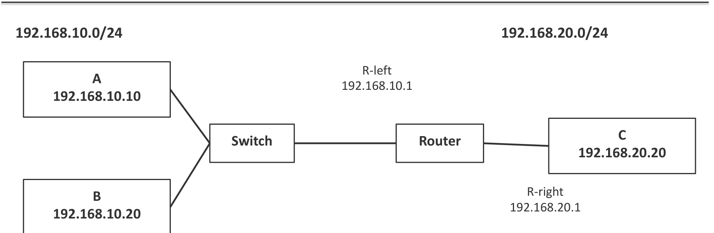
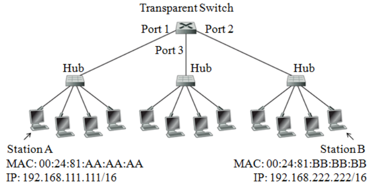
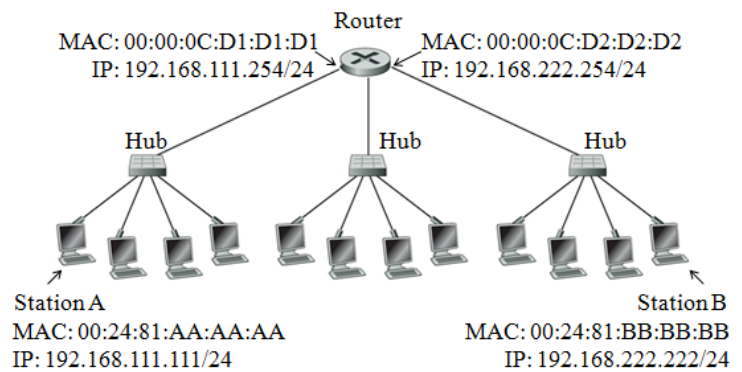
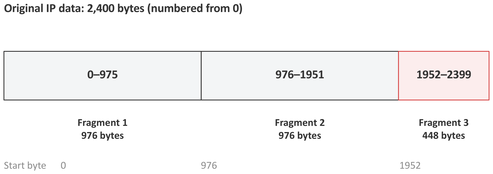
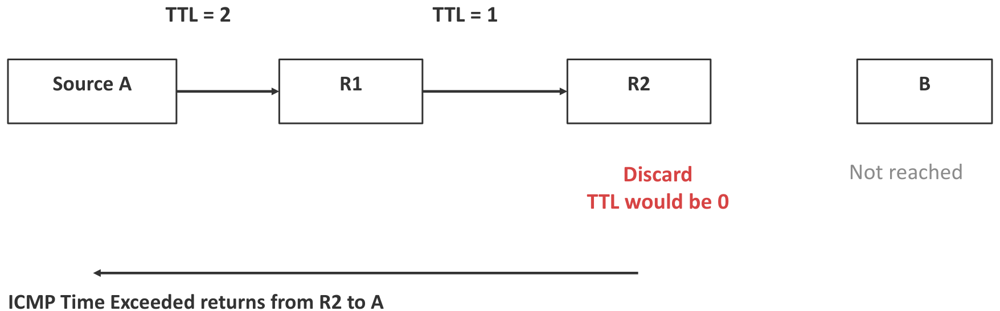
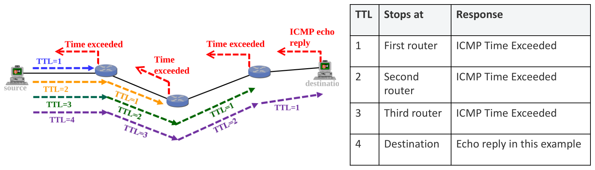
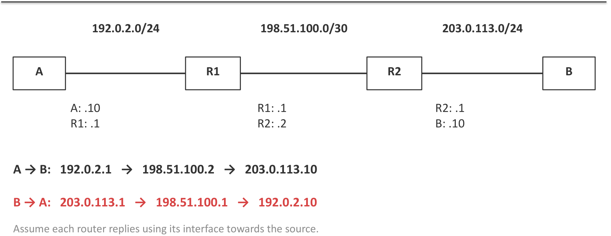

# 6. Network Layer: Forwarding, ARP, Fragmentation & ICMP

This chapter covers the second half of Part II Lecture 2. It answers four questions:

1. When a host or router has a packet, **where does it send it next?** (Forwarding, longest-prefix match.)
2. How does it find the **MAC address** of that next device? (ARP.)
3. What happens when a packet is **too big** for the next link? (Fragmentation.)
4. How do we **test** the path? (ICMP, ping, traceroute.)

High-yield exam tasks:

* List the frames seen at a station during a ping, with their MAC addresses and purposes.
* Pick the route with longest-prefix match.
* Build a fragmentation table (length, offset, MF flag, ID).
* Rebuild a topology from traceroute outputs.

---

## 1. Forwarding

### 1.1 Terms

* **Forwarding:** the decision to send a packet out of a particular interface towards its destination. It is **one lookup in a table** for each packet.
* **Routing:** the process that **fills in** that table (Chapter 7).
* **Next hop:** the device that should get the packet next. It is either the destination itself (when the destination is on the same subnet) or a router.
* **Routing table:** a list of entries. Each entry maps a **destination prefix** to an **outgoing interface** and, if needed, a **next-hop router**.
* **Default route:** 0.0.0.0/0. It matches **every** destination.
* **Default gateway:** the next-hop router for a host's default route. The host uses it when no more specific route matches.

### 1.2 How a host decides: local or remote

1. AND the destination address with **its own** mask.
2. Compare the result with its own network address.
3. **Same:** the destination is **local** (on-link). Send the frame directly to the destination.
4. **Different:** the destination is **remote**. Send the frame to the **default gateway**.

In both cases, the **IP destination stays the final host**. Only the next hop changes.

{width=80%}

Host A (192.168.10.10/24, gateway 192.168.10.1) has this table:

| Destination prefix | Next hop | Interface |
| :--- | :--- | :--- |
| 192.168.10.0/24 | the destination itself | A's Ethernet |
| 0.0.0.0/0 | 192.168.10.1 | A's Ethernet |

* To B (192.168.10.20): it is local, so A sends directly.
* To C (192.168.20.20): it is remote, so A sends to the gateway.

### 1.3 Why the mask matters (Tutorial 2.2)

A = 192.168.111.111 and the destination is 192.168.222.222.

| Host mask | A's network | Destination's network | Decision |
| :--- | :--- | :--- | :--- |
| /16 | 192.168.0.0 | 192.168.0.0 | **Local:** ARP for the destination itself |
| /24 | 192.168.111.0 | 192.168.222.0 | **Remote:** send to the gateway |

A **wrong mask** breaks things. In the lecture, a laptop with .10/24 instead of .10/26 thinks server .70 is local. It sends an ARP request for .70. That broadcast stays on its own LAN, so nobody answers, and the traffic fails. With the correct /26, the laptop ARPs for gateway .1 instead.

### 1.4 Longest-prefix match

Several entries can match one destination. The router chooses the match with the **longest prefix**, because it describes the most specific block. The default route /0 is the least specific, so it is the last choice.

**Method:**

1. For each entry, check whether the destination is inside that block. (AND the destination with the entry's mask and compare.)
2. Among the matches, choose the one with the largest $/n$.

**Lecture example:** the destination is 10.20.18.7. The entries 0.0.0.0/0, 10.0.0.0/8, 10.20.0.0/16 and 10.20.18.0/24 **all** match. Choose **/24**.

**AY17/18 S1 Q3b.**

| Network | Mask | Prefix | Covers | Interface |
| :--- | :--- | :--- | :--- | :--- |
| 0.0.0.0 | 0.0.0.0 | /0 | everything | Idx0 |
| 200.23.96.0 | 255.255.240.0 | /20 | 200.23.96.0 – 200.23.111.255 | Idx1 |
| 199.31.192.0 | 255.255.192.0 | /18 | 199.31.192.0 – 199.31.255.255 | Idx2 |
| 200.23.104.0 | 255.255.252.0 | /22 | 200.23.104.0 – 200.23.107.255 | Idx3 |

| Destination | Matches | Chosen |
| :--- | :--- | :--- |
| 200.23.107.7 | /0, /20, /22 | **Idx3** (the /22 is the longest) |
| 199.31.255.254 | /0, /18 | **Idx2** |
| 200.23.111.16 | /0, /20 (111 is outside 104–107) | **Idx1** |

### 1.5 Reading a real routing table

On Windows, `route print` shows the table. "0.0.0.0 with mask 0.0.0.0" is the default route. "On-link" means the destination is directly reachable (no gateway). First match the destination and the mask. Then read the gateway and the interface.

{width=75%}

---

## 2. ARP: From an IP Address to a MAC Address

### 2.1 Why we need ARP

Forwarding gives the **IP address** of the next hop. But an Ethernet frame needs the next hop's **MAC address**. **ARP (Address Resolution Protocol)** finds the MAC address for an IPv4 address on the local link.

### 2.2 How ARP works

1. The host looks in its **ARP cache** (a table of IP → MAC pairs it has learnt).
2. If the pair is missing, it sends an **ARP request** as an Ethernet **broadcast** (destination MAC `FF:FF:FF:FF:FF:FF`): "Who has 192.168.10.20? Tell 192.168.10.10."
3. The device that owns that IP sends an **ARP reply** as a **unicast**: "192.168.10.20 is at MAC B."
4. The host saves the pair in its cache. The other device also learns the sender's pair from the request.

| Field | ARP request | ARP reply |
| :--- | :--- | :--- |
| Ethernet source | A | B |
| Ethernet destination | FF:FF:FF:FF:FF:FF (broadcast) | A |
| Sender IP | 192.168.10.10 | 192.168.10.20 |
| Target IP | 192.168.10.20 | 192.168.10.10 |

* ARP stays on the **local link**. **Routers do not forward ARP broadcasts.**
* An ARP request is an **Ethernet** broadcast, not an IP broadcast.
* **Which IP does ARP ask for?** The **next-hop** IP. For a remote destination, that is the **gateway's** IP, not the final destination's IP.

**AY22/23 S2 Q3a: the ARP target.** Station A (192.168.111.111/24) sends to B (192.168.222.222/24) through the router (192.168.111.254). B is remote, so the ARP target is the gateway: **192.168.111.254**.

**Remote server example:** A is 192.168.10.10/24 with gateway .1, and the server is 203.0.113.80. ARP target = 192.168.10.1. Ethernet destination = the gateway's MAC. IP destination = 203.0.113.80.

{width=75%}

### 2.3 Three tables, three devices

| Table | Maps | Used by |
| :--- | :--- | :--- |
| ARP cache | next-hop IPv4 → MAC | a host or router that builds a frame |
| Switch forwarding table | MAC → switch port | a switch that forwards a frame |
| Routing table | destination prefix → next hop / interface | a host or router that forwards an IP packet |

The route lookup chooses the next hop. ARP finds its MAC. The switch chooses the output port.

### 2.4 How an Ethernet switch learns

* When a frame arrives, the switch **learns** its **source** MAC and the port it came in on.
* For a **known unicast** destination, it forwards the frame only out of the learnt port. If that port is the incoming port, it does not forward the frame at all.
* For a **broadcast** or an **unknown unicast**, it **floods** the frame out of every port except the incoming one.

The switch learns from **source** MACs and forwards on **destination** MACs. (This is a common MCQ trap.)

---

## 3. Frame Sequences During a Ping

`ping` sends an **ICMP Echo Request** inside an IP packet, inside a frame. The destination sends back an **ICMP Echo Reply**. Every IP packet still needs a route and a frame, so ARP runs first if the cache is empty.

### 3.1 Local ping through a switch (Tutorial 2.2 Q1)

{width=60%}

A = 192.168.111.111/16 (MAC AA). B = 192.168.222.222/16 (MAC BB). With /16, both are in 192.168.0.0/16, so **B is local**. All caches and the switch table start empty.

**Frames sent and received at A (unofficial answer; no official solution was released):**

| # | Source MAC | Destination MAC | Purpose | Switch action |
| :--- | :--- | :--- | :--- | :--- |
| 1 | 00:24:81:AA:AA:AA | FF:FF:FF:FF:FF:FF | ARP request: who has 192.168.222.222? | Learns AA on port 1. Floods to ports 2 and 3. |
| 2 | 00:24:81:BB:BB:BB | 00:24:81:AA:AA:AA | ARP reply: 192.168.222.222 is at BB | Learns BB on port 2. Forwards to port 1 only. |
| 3 | 00:24:81:AA:AA:AA | 00:24:81:BB:BB:BB | Ping (echo) request for 192.168.222.222 | Knows BB: forwards to port 2 only. |
| 4 | 00:24:81:BB:BB:BB | 00:24:81:AA:AA:AA | Ping (echo) reply from 192.168.222.222 | Knows AA: forwards to port 1 only. |

A hub repeats each frame to every station on its own segment. So the other stations on A's hub also see these frames, but they ignore frames that are not for them.

### 3.2 Remote ping through a router (Tutorial 2.2 Q2, AY22/23 S2 Q3a)

{width=60%}

Now the masks are /24, so **B is remote**. A's gateway is the router: 192.168.111.254, MAC D1. The router's other side is 192.168.222.254, MAC D2.

**Frames sent and received at A (unofficial answer):**

| # | Source MAC | Destination MAC | Purpose | Router action |
| :--- | :--- | :--- | :--- | :--- |
| 1 | 00:24:81:AA:AA:AA | FF:FF:FF:FF:FF:FF | ARP request: who has 192.168.111.254? | Sees its own IP. Saves A's IP → MAC pair. Replies. |
| 2 | 00:00:0C:D1:D1:D1 | 00:24:81:AA:AA:AA | ARP reply: 192.168.111.254 is at D1 | — |
| 3 | 00:24:81:AA:AA:AA | 00:00:0C:D1:D1:D1 | Ping request for 192.168.222.222 | Removes the frame. Looks up 192.168.222.0/24 (directly connected on D2). ARPs for B on the right LAN (A does not see this). Sends a **new frame** D2 → BB. Decreases TTL by 1 and updates the header checksum. |
| 4 | 00:00:0C:D1:D1:D1 | 00:24:81:AA:AA:AA | Ping reply from 192.168.222.222 | Got the reply from B. Already knows A's MAC from frame 1, so no ARP is needed. Sends a new frame D1 → AA. |

**What changes at the router** (for the packet in frame 3):

| Field | Arriving at the router | Leaving towards B |
| :--- | :--- | :--- |
| Ethernet source | AA (A) | **D2** (router, right side) |
| Ethernet destination | **D1** (router, left side) | BB (B) |
| IP source | 192.168.111.111 | 192.168.111.111 (same) |
| IP destination | 192.168.222.222 | 192.168.222.222 (same) |
| TTL | for example 64 | **63** |
| Header checksum | valid for the incoming header | **recalculated** |

> **Without NAT, the IP addresses stay the same end to end. The MAC addresses change on every hop.**

### 3.3 The full trace on both LANs (lecture)

A (192.168.10.10) pings C (192.168.20.20) through a router (R-left .10.1, R-right .20.1). All caches start empty.

| Event | LAN | Purpose | Ethernet source / destination |
| :--- | :--- | :--- | :--- |
| 1 | Left | ARP request for the gateway | A / broadcast |
| 2 | Left | Gateway's ARP reply | R-left / A |
| 3 | Left | Echo request for C | A / R-left |
| 4 | Right | ARP request for C | R-right / broadcast |
| 5 | Right | C's ARP reply | C / R-right |
| 6 | Right | Echo request reaches C | R-right / C |
| 7 | Right | Echo reply from C | C / R-right |
| 8 | Left | Echo reply reaches A | R-left / A |

**A sees only events 1, 2, 3 and 8.** Each ARP exchange stays on its own LAN.

---

## 4. IPv4 Fragmentation

### 4.1 MTU

The **MTU (Maximum Transmission Unit)** is the largest IP packet that a link can carry. It counts the **IP header + IP data**. It does not count the Ethernet header and trailer. Different links can have different MTUs. When a packet is bigger than the next link's MTU, an IPv4 router can split it into **fragments**.

### 4.2 The header fields

| Field | Meaning |
| :--- | :--- |
| **Total Length** | The size of **this** packet or fragment in bytes: header + data. |
| **IHL** (Internet Header Length) | The header length in 32-bit words. IHL = 5 means $5 \times 4 = 20$ bytes. |
| **Identification (ID)** | The same value in every fragment of one datagram. It groups them together. |
| **Fragment Offset** | Where this fragment's data starts in the original data, **in units of 8 bytes**. |
| **DF** (Don't Fragment) | DF = 1: the router must not fragment. If the packet is too big, the router **drops** it and normally sends ICMP "fragmentation needed". |
| **MF** (More Fragments) | MF = 1: more fragments follow. **The last fragment has MF = 0.** |

* Every fragment gets its **own** IP header.
* Only the **final destination** puts the fragments back together (reassembly). Routers in between do not. The destination groups fragments by ID, source, destination and protocol.
* Offsets put the data back in place even if fragments arrive out of order.

### 4.3 Method

1. **Data size:** original data = Total Length − header (usually 20 bytes). Read carefully whether the question gives the total length or the data length.
2. **Space per fragment:** MTU − 20.
3. **Round down to a multiple of 8:** max data per fragment $= 8 \times \lfloor (\text{MTU} - 20)/8 \rfloor$. Every fragment except the last must carry a multiple of 8 data bytes, because offsets count in 8-byte units.
4. **Number of fragments:** $\lceil \text{data} / \text{max data} \rceil$. The last fragment carries what is left.
5. **For each fragment:** Total Length = data + 20. Offset = (start byte) / 8. MF = 1 except for the last. ID = the original ID.
6. **Check:** the data adds up to the original; every Total Length $\le$ MTU; only the last has MF = 0.

### 4.4 Worked example (lecture)

Total Length 2420 bytes, 20-byte header, MTU 1000, DF = 0, ID = 77.

* Data $= 2420 - 20 = 2400$ bytes.
* Space $= 1000 - 20 = 980$, so max data $= 8 \times 122 = 976$ bytes.

{width=75%}

| Fragment | Data bytes | Total Length | Offset | MF | ID |
| :--- | :--- | :--- | :--- | :--- | :--- |
| 1 | 976 | 996 | 0 | 1 | 77 |
| 2 | 976 | 996 | 976/8 = **122** | 1 | 77 |
| 3 | 448 | 468 | 1952/8 = **244** | 0 | 77 |

### 4.5 Tutorial 2.1 Q4

A 3000-byte datagram (Total Length, with a 20-byte header), MTU 500, ID 422.

* Data $= 2980$. Space $= 480$, which is already a multiple of 8.
* $\lceil 2980 / 480 \rceil = 7$ fragments: six of 480 bytes and one of $2980 - 2880 = 100$ bytes.

| Fragment | Data | Total Length | Offset | MF | ID |
| :--- | :--- | :--- | :--- | :--- | :--- |
| 1 | 480 | 500 | 0 | 1 | 422 |
| 2 | 480 | 500 | 60 | 1 | 422 |
| 3 | 480 | 500 | 120 | 1 | 422 |
| 4 | 480 | 500 | 180 | 1 | 422 |
| 5 | 480 | 500 | 240 | 1 | 422 |
| 6 | 480 | 500 | 300 | 1 | 422 |
| 7 | 100 | 120 | 360 | 0 | 422 |

### 4.6 More past-paper numbers

| Question | Data | Max per fragment | Fragments (data) | Offsets |
| :--- | :--- | :--- | :--- | :--- |
| Lecture: 2020 B, MTU 620, ID 88 | 2000 | 600 | 600, 600, 600, 200 | 0, 75, 150, 225 |
| AY23/24 S2: 4200 B, MTU 1500 | 4180 | 1480 | 1480, 1480, 1220 | 0, 185, 370 |
| AY16/17 S2: 3500 B, MTU 1540 | 3480 | 1520 | 1520, 1520, 440 | 0, 190, 380 |
| AY22/23 S1: 5020 B, MTU 1000 | 5000 | 976 | 5 × 976, then 120 | 0, 122, 244, 366, 488, 610 |

### 4.7 What if one fragment is lost?

The destination needs **every** fragment. If one is missing when the reassembly timer runs out, it **discards the whole datagram**. IP does not ask for the missing piece. TCP or the application must recover the data.

So the probability that the whole packet arrives is:

$$P(\text{packet OK}) = (1 - p)^{n}$$

for $n$ fragments, each lost with probability $p$.

* **AY22/23 S1 Q3c:** 6 fragments, $p = 0.1$: $0.9^6 = \mathbf{0.531}$.
* **AY16/17 S2 Q3a:** 3 fragments, $p = 1/1000$: $0.999^3 = \mathbf{0.997}$. If the router sends **each fragment twice**, a fragment is lost only if both copies are lost: $p' = 10^{-6}$. Then $P = (1 - 10^{-6})^3 \approx \mathbf{0.999997}$.

### 4.8 Packet size is a trade-off

* **Large packets:** fewer headers and fewer packets to process. But one loss destroys more data.
* **Small packets:** less data lost per loss, and a shorter time to send each packet. But more header overhead. (Lecture: 5600 bytes as 4 × 1400 carries 80 header bytes; as 8 × 700 it carries 160.)

Fragmentation is **not** a way to make delivery more reliable.

### 4.9 DF and Path MTU Discovery

* **DF = 0:** the router may fragment. The destination must reassemble.
* **DF = 1:** the router drops the oversized packet and normally reports ICMP "fragmentation needed".
* **Path MTU Discovery** uses that ICMP feedback, so the sender learns to send packets that fit. If the feedback is blocked, **small pings work but large transfers fail.**
* A **tunnel** adds headers (for example 100 bytes). A 1500-byte inner packet becomes 1600 bytes and does not fit an MTU of 1500. The fix is to send 1400-byte inner packets.

---

## 5. ICMP, Ping and Traceroute

### 5.1 ICMP

**ICMP (Internet Control Message Protocol)** carries control and error messages **inside IP packets**. It **reports** problems. It does not repair them.

| Message | Meaning | Example |
| :--- | :--- | :--- |
| Echo Request / Echo Reply | Testing reachability | `ping` |
| Destination Unreachable | The packet could not be delivered | No route; or fragmentation needed with DF = 1 |
| Time Exceeded | TTL reached 0 at a router | `traceroute` uses this |

### 5.2 What ping tells you

* A reply proves that ICMP worked **for that probe**. It does not prove that the application (for example the website) works.
* A timeout only says that no reply came in time. It does **not** tell you the cause. Possible causes: a wrong gateway, a missing route on a router, a firewall rule, a wrong address or gateway on the server, or a server that is set not to answer pings.
* DNS is not needed when you ping a numeric address.
* In the output, `time` = the round-trip time, and `TTL` = the TTL left in the reply.

### 5.3 TTL

**TTL (Time To Live)** is an IPv4 header field that limits how many routers a packet can pass. **Each router decreases TTL by 1.** When TTL reaches 0, the router **discards** the packet and normally sends **ICMP Time Exceeded** back to the source. This stops a packet from going round a routing loop for ever.

{width=70%}

### 5.4 How traceroute works

`traceroute` (`tracert` on Windows) sends probes with TTL = 1, then 2, then 3, and so on.

* The TTL = 1 probe dies at the 1st router, which replies with Time Exceeded. Now we know router 1.
* The TTL = 2 probe dies at the 2nd router. Now we know router 2.
* This continues until a probe reaches the destination, which sends an Echo Reply.

{width=75%}

**Reading the output:** each row is one hop. The three times are the round-trip times of three probes. Then comes the address of the router interface that replied.

* A `*` means that no reply arrived before the timeout. The router may still forward traffic normally. (Many routers do not answer probes.)
* Traceroute combines the replies to **different** probes. It is not one packet that reports its whole journey. Different probes can take different paths.

### 5.5 Why the reverse trace shows different addresses

A router has **several interfaces**, each with its own IP address. In these questions, assume **a router replies with the interface towards the source**. So the same router shows a different address in the trace from A to B and in the trace from B to A.

{width=75%}

| Direction | Hops shown |
| :--- | :--- |
| A → B | 192.0.2.1 (R1) → 198.51.100.2 (R2) → 203.0.113.10 (B) |
| B → A | 203.0.113.1 (R2) → 198.51.100.1 (R1) → 192.0.2.10 (A) |

---

## 6. Rebuilding a Topology from Traceroutes

### 6.1 Method

1. For each trace, write the source, every hop in order, and the destination.
2. The **last** line of a trace is the destination host. The **first** line is the source's gateway (the interface on the source's LAN).
3. Group addresses by network (use the given masks). Two addresses on the same network are the two ends of one link, or two interfaces on one LAN.
4. Find addresses that belong to the **same router**. A router is the device "between" two networks in a trace.
5. Draw one diagram that explains **every** trace. If masks are missing, state your assumption. Traces alone may not give one unique answer.

### 6.2 Tutorial 2.2 Q3 (unofficial answer)

| From A to B | From C to A | From B to C |
| :--- | :--- | :--- |
| 155.69.8.10 | 200.20.80.12 | 196.19.5.104 |
| 10.203.20.10 | 170.105.10.21 | 130.21.80.90 |
| 130.21.10.30 | 80.90.10.3 | 90.80.120.10 |
| 196.19.5.5 | 155.69.8.12 | 170.105.10.20 |
| | | 200.20.80.15 |

The traces give no masks. The reissued tutorial tells us to assume the **historical classful boundaries**, for this question only:

| First octet | Historical class | Assumed prefix | Example |
| :--- | :--- | :--- | :--- |
| 1 to 126 | A | /8 | 10.203.20.10 → 10.0.0.0/8 |
| 128 to 191 | B | /16 | 155.69.8.9 → 155.69.0.0/16 |
| 192 to 223 | C | /24 | 196.19.5.5 → 196.19.5.0/24 |

So the networks in the traces are: 155.69.0.0/16 (LAN A), 196.19.5.0/24 (LAN B), 200.20.80.0/24 (LAN C), 10.0.0.0/8, 130.21.0.0/16, 80.0.0.0/8, 90.0.0.0/8 and 170.105.0.0/16. In modern classless addressing, always use the given prefix or mask instead.

* **The hosts** (the last line of each trace): **B = 196.19.5.5**, **A = 155.69.8.12**, **C = 200.20.80.15**.
* **The gateways** (the first line): A's gateway is 155.69.8.10. C's gateway is 200.20.80.12. B's gateway is 196.19.5.104.
Now work through each trace. Remember that each router replies with its interface **towards the source**.

* **Trace C → A.** The last router before A is A's gateway, **RA**. RA replies with **80.90.10.3**, so RA has a link on 80.0.0.0/8 towards the C side. The router before it, **R5**, replies with **170.105.10.21**. So R5 sits on network 170.105.0.0/16, next to C's gateway **RC** (200.20.80.12).
* **Trace B → C.** The last router before C is RC. RC replies with **170.105.10.20**, so the packet came in on the link 170.105.0.0/16. The router before RC is therefore R5, which replies with **90.80.120.10** (its link towards B's side). The router before R5 replies with **130.21.80.90**. Call it **R2**. R2 is next to B's gateway **RB** (196.19.5.104).
* **Trace A → B.** The last router before B is RB. RB replies with **130.21.10.30** (its link towards A's side). The router before RB replies with **10.203.20.10**, on the link from RA (155.69.8.10).

With the classful prefixes, 130.21.10.30 (RB) and 130.21.80.90 (R2) are both in **130.21.0.0/16**, so they are the two ends of one link. Likewise 10.203.20.10 lies in 10.0.0.0/8, on the link between RA and R2. So the links are RA–R2 (10.0.0.0/8), R2–RB (130.21.0.0/16), RA–R5 (80.0.0.0/8), R2–R5 (90.0.0.0/8) and R5–RC (170.105.0.0/16). The topology has five routers:

```
LAN A 155.69.0.0/16 — RA —(10.0.0.0/8)— R2 —(130.21.0.0/16)— RB — LAN B 196.19.5.0/24
                      |                  |
                (80.0.0.0/8)       (90.0.0.0/8)
                      |                  |
                      +------- R5 -------+
                               |
                       (170.105.0.0/16)
                               |
                              RC — LAN C 200.20.80.0/24
```

Check every trace against the drawing. A → B goes RA, R2, RB. C → A goes RC, R5, RA. B → C goes RB, R2, R5, RC. Each hop's reply address is that router's interface on the network the packet came in from.

### 6.3 Smallest address block from traces (AY22/23 S2 Q3b)

Three institutions SI, SU and SM connect through an NREN. To find the **smallest CIDR block** for each institution, collect the addresses seen inside it and take their **longest common prefix**.

| Institution | Addresses seen | Changing octet in binary | Block |
| :--- | :--- | :--- | :--- |
| SI | 155.69.192.15, 155.69.202.10, 155.69.197.13 | 192 = 1100 0000, 202 = 1100 1010, 197 = 1100 0101 → 4 shared bits | **155.69.192.0/20** |
| SU | 137.132.9.169, 137.132.15.120 | 9 = 0000 1001, 15 = 0000 1111 → 5 shared bits | **137.132.8.0/21** |
| SM | 202.161.32.55, 202.161.69.31 | 32 = 0010 0000, 69 = 0100 0101 → 1 shared bit | **202.161.0.0/17** |

---

## 7. Exam Checklist

* Host decision: AND the destination with **its own** mask. Local → ARP the destination. Remote → ARP the **gateway**.
* IP addresses stay the same end to end (no NAT). MAC addresses change on every hop. TTL decreases by 1 at each router, and the checksum is recalculated.
* ARP request = Ethernet broadcast. ARP reply = unicast. Routers never forward ARP.
* A switch learns from the **source** MAC, forwards on the **destination** MAC, and floods broadcasts and unknown destinations.
* A station sees only the frames on its **own** LAN.
* Longest-prefix match: check that the entry matches first, then take the largest /n.
* Fragments: data per fragment is a multiple of 8. Offset = start byte / 8. Last MF = 0. Same ID. Reassembly happens only at the destination.
* $P(\text{all fragments arrive}) = (1-p)^n$.
* Traceroute: a router replies with the interface towards the source. `*` does not mean the router is broken.
