# 7. Network Layer: Routing (RIP, OSPF, BGP)

This chapter covers Part II Lecture 3. Chapter 6 showed how a router **uses** its routing table (forwarding). This chapter shows how the table **gets filled in** (routing).

High-yield exam tasks:

* Update a distance-vector table from the vectors of the neighbours.
* Run Dijkstra's algorithm step by step and give the next hops.
* Explain count-to-infinity and poisoned reverse.
* Build a BGP table (AS paths, next hops, preferred path) and explain transit and policy.

---

## 1. Where Routes Come From

A routing table lists destination networks and how to reach them, usually through a next-hop router. An entry can come from three places:

1. **Directly connected networks:** the router knows these from its own interfaces.
2. **Static routes:** an administrator types them in.
3. **Dynamic routing protocols:** routers exchange information with each other and update the routes when the network changes.

> **Forwarding** is looking up the table for each packet. **Routing** is how the table gets filled in.

Typing routes by hand works for a tiny network. In a large network, links change, and the networks belong to different organisations. So we need routing protocols.

---

## 2. Two Levels of Routing

### 2.1 Autonomous systems

* An **autonomous system (AS)** is a group of IP networks and routers under **one administration** with **one routing policy**. Examples: a university campus, an ISP, a data centre.
* An **AS number (ASN)** identifies the AS. An **IP prefix** identifies a destination network inside it.

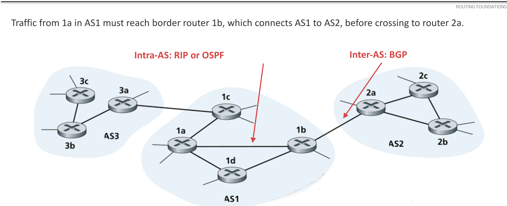{width=80%}

### 2.2 Intra-AS and inter-AS

| | Intra-AS (inside one AS) | Inter-AS (between ASes) |
| :--- | :--- | :--- |
| Protocols | RIP, OSPF (called **IGPs**, interior gateway protocols) | **BGP** |
| Policy | One administrator sets common goals. | Each AS decides which routes it accepts and which traffic it carries. |
| Performance | Can find efficient paths with a shared cost measure. | Business agreements and policy can matter more than the shortest path. |
| Scale | One organisation's network. | The whole Internet is too large for one detailed map. ASes share reachability, not their internal links. |

---

## 3. Distance Vector: RIP

### 3.1 The idea

**RIP (Routing Information Protocol)** is a **distance-vector** protocol used inside an AS.

* A **distance vector** is a list: for each destination network, the router's current distance to it.
* Each router sends its distance vector to its **neighbours** (the routers directly connected to it). It does this regularly (about every **30 s**) and also when a route changes (a **triggered update**).
* RIP normally measures distance in **hops**: each router crossed costs 1.

### 3.2 The update rule (Bellman–Ford)

When router X gets a vector from neighbour N:

$$\boxed{\text{distance}_X(\text{dest}) = \min_{N}\Big[\ \text{cost}(X \to N) + \text{distance reported by } N(\text{dest})\ \Big]}$$

The next hop for that destination is the neighbour $N$ that gave the minimum.

* With normal RIP, $\text{cost}(X \to N) = 1$.
* If the question gives a **link cost**, add **that** cost instead of 1. Example: a neighbour reports 4 and the link costs 3. The total is **7**, via that neighbour.

### 3.3 Worked example: building A's table (lecture)

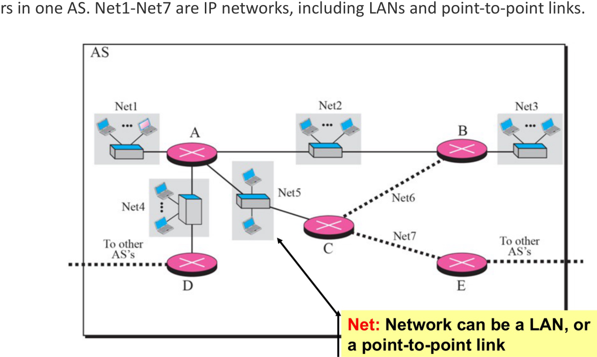{width=70%}

* **Start:** A knows only its own networks: Net1, Net2, Net4 and Net5, each with distance 1 and next hop "direct".
* **A gets reports:** B reports Net2, Net3 and Net6 at distance 1. C reports Net5, Net6 and Net7 at 1. D reports Net4 at 1.
* **A adds 1** to each reported distance and keeps the smallest:

| Destination | Distance | Next hop |
| :--- | :--- | :--- |
| Net1, Net2, Net4, Net5 | 1 | direct |
| Net3 | 2 | B |
| Net6 | 2 | B or C (a tie) |
| Net7 | 2 | C |

When later updates do not change any entry, the routes have **converged**.

### 3.4 Worked example: distance vector with link costs (AY20/21 S2 Q3b, AY22/23 S2 Q4a)

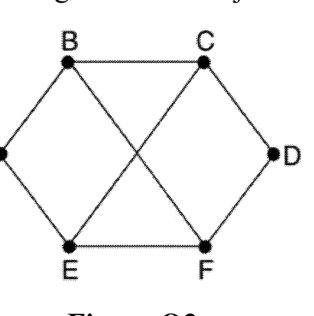{width=30%}

C's measured link costs: to B = 8, to D = 3, to E = 6. The vectors that arrive at C (destinations in the order A, B, C, D, E, F):

* from B: (5, 0, 8, 12, 6, 8)
* from D: (16, 12, 6, 0, 9, 5)
* from E: (8, 6, 3, 9, 0, 4)

**Step 1.** Add the link cost to every entry of each vector:

| Destination | Via B (+8) | Via D (+3) | Via E (+6) | **Best** | **Line** |
| :--- | :--- | :--- | :--- | :--- | :--- |
| A | 13 | 19 | 14 | **13** | B |
| B | 8 | 15 | 12 | **8** | B |
| C | — | — | — | **0** | — |
| D | 20 | 3 | 15 | **3** | D |
| E | 14 | 12 | 6 | **6** | E |
| F | 16 | 8 | 10 | **8** | D |

**Step 2.** C's new table is (13, 8, 0, 3, 6, 8) with outgoing lines (B, B, –, D, E, D). **For F, C uses the line to D, with delay 8.**

Note: C ignores its **old** table. The new table depends only on the neighbours' new vectors and the link costs.

### 3.5 The problem: count-to-infinity

A vector gives only a **distance**, not the **path**. So a router cannot see that a neighbour's route goes back through itself.

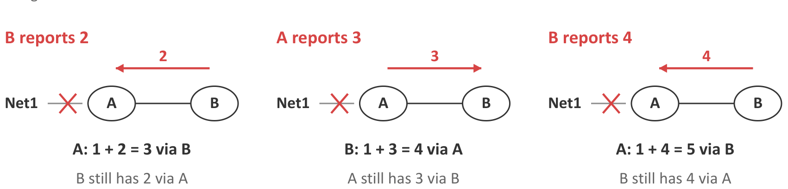{width=80%}

1. Before the failure: A reaches Net1 directly (1). B reaches Net1 through A (2).
2. A's link to Net1 fails.
3. Before B hears this, B tells A: "Net1: 2". A thinks it has a new path: $1 + 2 = 3$ via B. But B's route goes through A. **Packets now loop between A and B.**
4. A tells B "3". B updates to $1 + 3 = 4$ via A. A updates to 5. This goes on and on.

Each router keeps adding 1 to the other's distance. This is **count-to-infinity**.

### 3.6 Safeguards

**1. RIP's limit: 16 = infinity.** RIP treats a distance of **16** as **unreachable**. So the count stops at 16. The usable distances are **1 to 15**.

This limit also restricts the network. With a cost of 5 per hop, 3 hops give 15 (reachable), but 4 hops give 20, which becomes 16 (unreachable), even though the path exists.

**2. Poisoned reverse.** A router tells its next hop for a destination that **it cannot reach** that destination (distance 16).

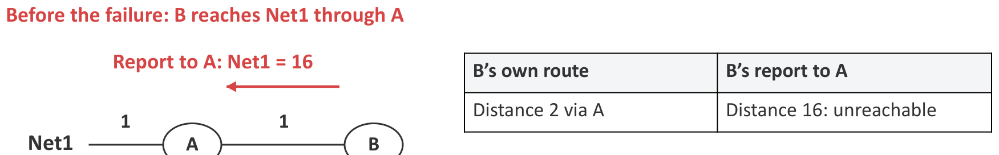{width=80%}

* B reaches Net1 through A. So B tells A: "Net1 = 16". In effect: "You cannot reach Net1 through me, because I reach it through you."
* B does this **all the time**, even while the route works.
* If A's link then fails, A will not use B as an alternative.
* Poisoned reverse stops **two-router** loops. **Loops of three or more routers can still happen.**

---

## 4. Link State: OSPF

### 4.1 The idea

**OSPF (Open Shortest Path First)** is a **link-state** protocol used inside an AS.

* RIP shares **distances to destinations**. OSPF shares **links and their costs**.
* Every router collects every link report and builds a **map** of the whole area.
* Each router then runs **Dijkstra's algorithm** on the map to find the least-cost path **from itself** to every destination.
* An OSPF **cost** is a number that an administrator sets. Lower is better. It is commonly based on **bandwidth**, so links need not count equally.

### 4.2 Hop count against link cost

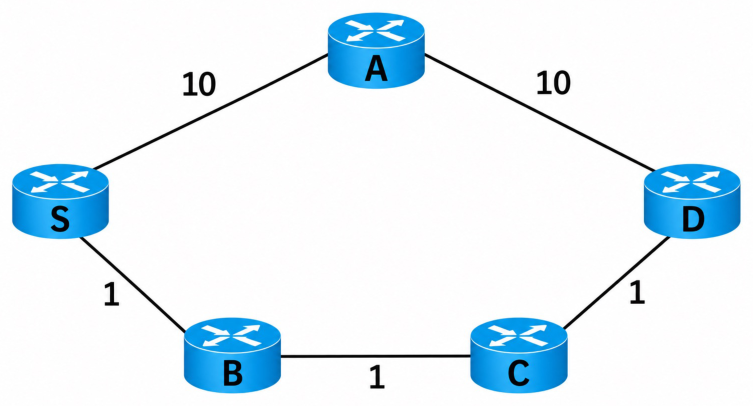{width=35%}

| Path | Hops (RIP) | Cost (OSPF) |
| :--- | :--- | :--- |
| S–A–D | **2** | 20 |
| S–B–C–D | 3 | **3** |

RIP chooses the 2-hop path. OSPF chooses the path with cost 3. The difference comes from the metric.

### 4.3 The five steps of OSPF

1. **Discover neighbours:** each router sends **Hello** packets on its links. (On Ethernet they go by multicast, so no list of neighbours is needed.) Regular Hellos also check that the neighbours still answer.
2. **Describe local links:** each router builds a **link-state advertisement (LSA)** that lists its own links and their costs. It does not need to know the rest of the network.
3. **Flood the reports:** each new LSA is passed from neighbour to neighbour through the whole **area** (a group of routers that share detailed link information). OSPF acknowledges LSAs, sends them again if they are lost, and ignores duplicates and old copies.
4. **Build the database:** each router stores every LSA in its **link-state database (LSDB)**. This is the map. After convergence, every router in the area has the **same** map.
5. **Calculate routes:** each router runs Dijkstra from **its own** position. So the routing tables differ, even though the maps are the same.

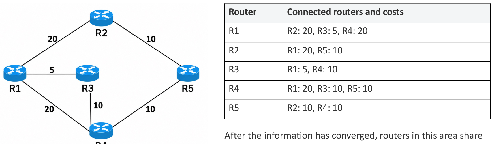{width=80%}

### 4.4 Dijkstra's algorithm

**Terms:**

* **Tentative distance:** the best cost found so far.
* **Settled:** a router whose distance is confirmed as the minimum.
* **Predecessor:** the router just before this one on the best path.

**Steps:**

1. Give the source distance 0 and every other router $\infty$.
2. **Settle** the unsettled router with the **smallest** tentative distance.
3. For each neighbour of that router: if (settled distance + link cost) is less than the neighbour's tentative distance, update it and record the predecessor.
4. Repeat steps 2 and 3 until every router is settled.
5. To get the **next hop** for a destination, follow the predecessors back to the source. The **first** router after the source is the next hop.

### 4.5 Worked example (lecture)

Links: R1–R2 = 20, R1–R3 = 5, R1–R4 = 20, R2–R5 = 10, R3–R4 = 10, R4–R5 = 10. The source is R1.

| Settled | R2 | R3 | R4 | R5 |
| :--- | :--- | :--- | :--- | :--- |
| R1 | 20 (R1) | **5 (R1)** | 20 (R1) | ∞ |
| R1, R3 | 20 | 5 | **15 (R3)** | ∞ |
| R1, R3, R4 | **20** | 5 | 15 | 25 (R4) |
| R1, R3, R4, R2 | 20 | 5 | 15 | **25** (via R2 it would be 30, so keep 25) |
| all | 20 | 5 | 15 | 25 |

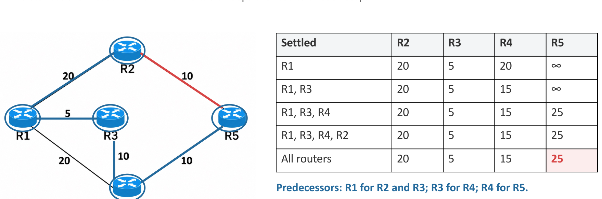{width=80%}

| Destination | Cost | Path | Next hop from R1 |
| :--- | :--- | :--- | :--- |
| R2 | 20 | R1–R2 | R2 |
| R3 | 5 | R1–R3 | R3 |
| R4 | 15 | R1–R3–R4 | R3 |
| R5 | 25 | R1–R3–R4–R5 | **R3** |

**Router paths to IP prefixes.** If each network attachment costs 2, then a network behind R5 (10.11.0.0/16) costs $25 + 2 = 27$, and the next hop is still R3.

**After the R3–R4 link fails:** R3 and R4 notice the failure. They send new LSAs, and flooding spreads them. R1 removes the link from its map and runs Dijkstra again. Now R4 = 20 (direct), and R5 = 30 through **either** R2 or R4. These are **equal-cost** paths, and OSPF can use both.

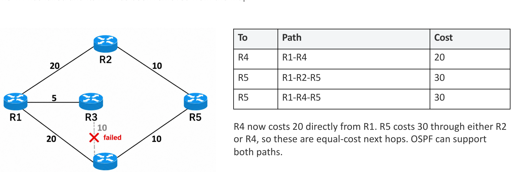{width=80%}

### 4.6 Worked example: Tutorial 2.2 Q4

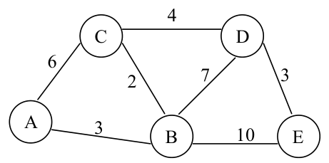{width=40%}

Links: A–B = 3, A–C = 6, B–C = 2, C–D = 4, B–D = 7, D–E = 3, B–E = 10.

| Step | Settled | B | C | D | E |
| :--- | :--- | :--- | :--- | :--- | :--- |
| 0 | A | **3 (A)** | 6 (A) | ∞ | ∞ |
| 1 | A, B | 3 | **5 (B)** | 10 (B) | 13 (B) |
| 2 | A, B, C | 3 | 5 | **9 (C)** | 13 (B) |
| 3 | A, B, C, D | 3 | 5 | 9 | **12 (D)** |
| 4 | all | 3 | 5 | 9 | 12 |

| Destination | Cost | Path | Next hop |
| :--- | :--- | :--- | :--- |
| B | 3 | A–B | B |
| C | 5 | A–B–C | B |
| D | 9 | A–B–C–D | B |
| E | 12 | A–B–C–D–E | B |

### 4.7 Worked example: AY24/25 S2 Q2a

Links (as read from the paper): A–B = 4, A–C = 7, B–C = 2, B–D = 4, B–F = 10, C–D = 1, D–E = 3, D–F = 5, E–F = 1. Find the least-cost path from A to F.

* Settle A (0): B = 4, C = 7.
* Settle B (4): C = min(7, 6) = 6 via B. D = 8 via B. F = 14 via B.
* Settle C (6): D = min(8, 7) = 7 via C.
* Settle D (7): E = 10 via D. F = min(14, 12) = 12 via D.
* Settle E (10): F = min(12, 11) = 11 via E.
* Settle F (11).

The path is **A–B–C–D–E–F** with cost **11**. The next hop is B.

---

## 5. RIP Against OSPF

| | RIP (distance vector) | OSPF (link state) |
| :--- | :--- | :--- |
| What is shared | Distances to destinations, with **neighbours only** | Link costs, **flooded to the whole area** |
| How routes are found | Add the cost to the neighbour to the neighbour's distance (Bellman–Ford) | Run **Dijkstra** on the full map |
| Usual metric | Hop count (configured costs are possible) | Configured cost, often based on bandwidth |
| Metric range | Total of 15 at most (16 = unreachable) | Much wider |
| After a failure | Can count to infinity. Poisoned reverse stops two-router loops. | Flood the changed LSA, then recalculate. Converges fast. |
| Knowledge | Each router knows only its neighbours' vectors | Each router knows the whole area's map |

> **True/false traps from MCQs:** "RIP is distance vector" (true). "OSPF is link state" (true). "OSPF uses Bellman–Ford" (**false**: it uses Dijkstra). "BGP uses UDP" (**false**: BGP runs over **TCP**). "BGP is used between ASes" (true).

---

## 6. Inter-AS Routing: BGP

### 6.1 Types of AS

**Transit traffic** passes through an AS when both its source and its destination are outside that AS.

| Type | External connections | Carries transit traffic? |
| :--- | :--- | :--- |
| **Stub AS** | One | No. Traffic starts or ends here. |
| **Multihomed non-transit AS** | More than one | No. Traffic starts or ends here. |
| **Transit AS** | Several | **Yes.** It carries traffic between other ASes. |

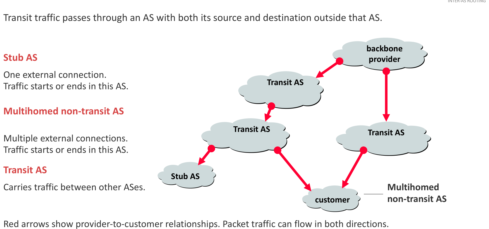{width=80%}

### 6.2 Business relationships

* **Customer–provider (transit):** the customer (for example a campus) **pays** the provider to reach the rest of the Internet.
* **Peering:** two ASes (P and Q) exchange traffic **between their own networks and customers**. They do not give each other unlimited transit. Peering is often free (settlement-free), but paid peering also exists.

### 6.3 Why not run OSPF over the whole Internet?

* **Policy:** each AS decides whose traffic it carries and which routes it offers. A physical link does not mean permission to use it.
* **Policy can beat performance:** a business agreement can matter more than a shorter path.
* **Scale:** ASes exchange **reachability** without sharing every internal router, link and change.

### 6.4 What BGP is

* **BGP (Border Gateway Protocol)** exchanges reachability information **between ASes**.
* A **border router** (gateway router) connects its AS to another AS.
* **eBGP (external BGP):** route exchange between routers in **different** ASes.
* **iBGP (internal BGP):** route exchange between routers in the **same** AS. It spreads routes learnt from outside to the other routers inside.
* BGP sends its messages over **TCP**.

### 6.5 What BGP sends: path vectors

A **BGP advertisement** says: "You can reach **this prefix** through me." It carries the **AS path**: the list of AS numbers on the route to that prefix. So BGP is a **path-vector** protocol.

* When an AS advertises a route to another AS, it adds (**prepends**) its own ASN to the **front** of the path.
* The data packets travel in the **opposite** direction to the advertisements.

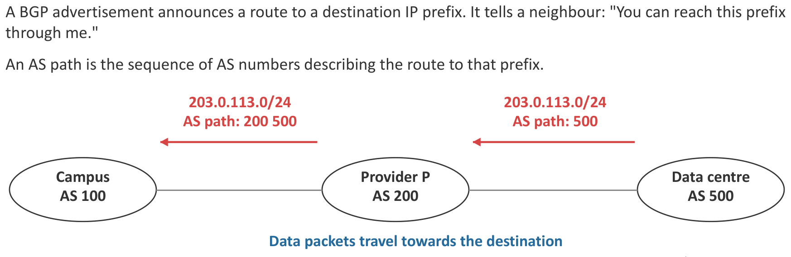{width=80%}

### 6.6 How an AS chooses and passes on routes

**Import policy:** which received routes the AS accepts, and what preference it gives them.
**Export policy:** which routes it advertises to each neighbour.

**Route selection (in this course):**

1. **Loop check:** **reject** any AS path that already contains **your own** ASN.
2. **Local preference:** choose the route with the **highest local preference** first. The AS sets this value with its import policy.
3. If preferences are equal: choose the **shortest AS path**.
4. If export policy allows, advertise the chosen route to the next AS **with your own ASN prepended**.

**Lecture example.** Campus AS 100 gets three routes to the same prefix:

| Via | AS path | Decision |
| :--- | :--- | :--- |
| P | 200 500 | **Choose** (2 ASes) |
| Q | 300 400 500 | Usable, but longer (3 ASes) |
| Another neighbour | 600 100 500 | **Reject:** it contains our ASN 100 (a loop) |

If the campus advertises its route, the path becomes **100 200 500**.

**Must the campus choose the shorter path?** No. If traffic through Q is cheaper, the campus gives Q's routes a **higher local preference**. Local preference is checked **before** the AS-path length, so the longer path through Q wins.

### 6.7 Multihomed does not mean transit

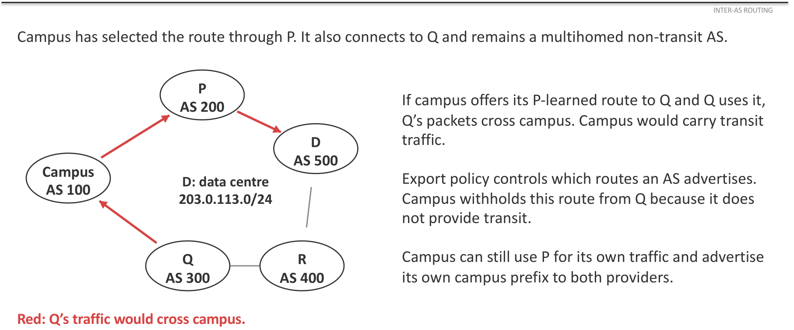{width=80%}

The campus connects to providers P and Q. It uses P's route to the data centre for its own traffic. If it **advertised** that P-learnt route to Q, Q could send its traffic **through** the campus. The campus would then carry transit traffic.

The campus stops this with its **export policy**: it does **not** advertise P's routes to Q (or Q's routes to P). It still advertises its **own** prefix to both providers. Choosing a route for your own traffic and offering a route to another AS are **separate decisions**.

### 6.8 When a false announcement spreads (YouTube, 2008)

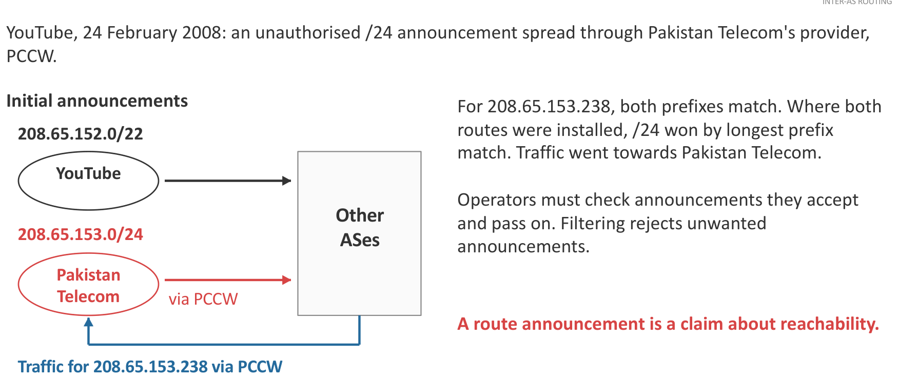{width=80%}

* YouTube announced **208.65.152.0/22**.
* Pakistan Telecom announced **208.65.153.0/24** without authority, and its provider (PCCW) passed it on.
* For 208.65.153.238, **both** prefixes match. Routers that installed both chose the **/24 by longest-prefix match**. So the traffic went to Pakistan Telecom.

**Lessons:** a route announcement is only a **claim** about reachability. Operators must **filter** the announcements they accept and pass on. **RPKI origin validation** checks whether an AS is allowed to announce a prefix. It does **not** check the whole AS path.

### 6.9 Worked example: a BGP table (AY22/23 S1 Q3a)

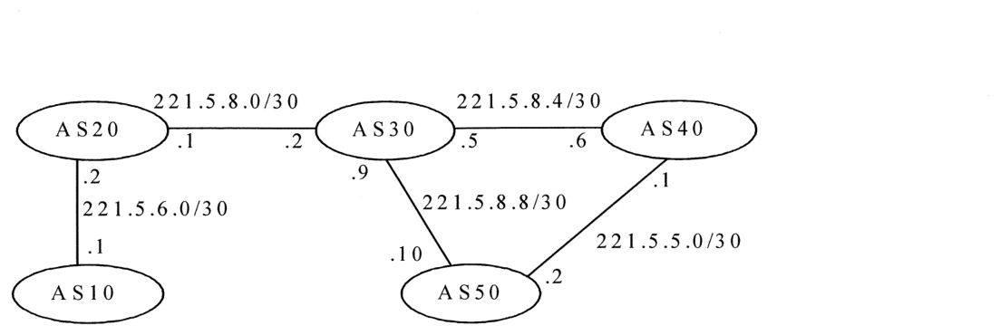{width=75%}

The peering links (from the figure):

| Link | Addresses |
| :--- | :--- |
| AS20 – AS10 | AS20: 221.5.6.2, AS10: 221.5.6.1 |
| AS20 – AS30 | AS20: 221.5.8.1, AS30: 221.5.8.2 |
| AS30 – AS40 | AS30: 221.5.8.5, AS40: 221.5.8.6 |
| AS30 – AS50 | AS30: 221.5.8.9, AS50: 221.5.8.10 |
| AS40 – AS50 | AS40: 221.5.5.1, AS50: 221.5.5.2 |

The prefixes: AS10 203.181.248.0/24, AS20 203.181.194.0/24, AS30 202.90.128.0/17, AS40 198.71.45.0/24, AS50 211.79.61.0/24.

**AS40's BGP table** (no preference setting, so the shortest AS path wins). The **next hop** is the address of the neighbour's interface on the shared link.

| Network prefix | Next hop | AS path | Preferred? |
| :--- | :--- | :--- | :--- |
| 203.181.248.0/24 (AS10) | 221.5.8.5 | 30 20 10 | **Yes** |
| 203.181.248.0/24 (AS10) | 221.5.5.2 | 50 30 20 10 | |
| 203.181.194.0/24 (AS20) | 221.5.8.5 | 30 20 | **Yes** |
| 203.181.194.0/24 (AS20) | 221.5.5.2 | 50 30 20 | |
| 202.90.128.0/17 (AS30) | 221.5.8.5 | 30 | **Yes** |
| 202.90.128.0/17 (AS30) | 221.5.5.2 | 50 30 | |
| 211.79.61.0/24 (AS50) | 221.5.5.2 | 50 | **Yes** |
| 211.79.61.0/24 (AS50) | 221.5.8.5 | 30 50 | |

**Traceroute across ASes (AY17/18 S2 Q3c).** From 203.181.248.10 (AS10) to 211.79.61.30 (AS50), the shortest AS path is 10 → 20 → 30 → 50. Each router replies with its interface towards the source:

| Hop | Address | Why |
| :--- | :--- | :--- |
| 1 | 203.181.248.160 | AS10's router (given) |
| 2 | 221.5.6.2 | AS20's interface towards AS10 |
| 3 | 221.5.8.2 | AS30's interface towards AS20 |
| 4 | 221.5.8.10 | AS50's interface towards AS30 |
| 5 | 211.79.61.30 | The destination |

---

## 7. Exam Checklist

* Distance vector: for each destination, take $\min_N[\text{cost to } N + N\text{'s distance}]$. The next hop is that $N$. Ignore your old table.
* RIP: 16 = unreachable, so totals 1–15 are usable. Poisoned reverse = advertise 16 to your own next hop. It stops two-router loops only.
* OSPF: Hello, LSA, flooding, LSDB, Dijkstra. The same map gives different tables.
* Dijkstra: write the step table with the predecessor in brackets. The next hop is the first router after the source.
* BGP: reject a path that contains your ASN. Then highest local preference, then shortest AS path. Prepend your ASN when you advertise.
* A multihomed AS avoids transit with its **export** policy.
* BGP runs over TCP. OSPF uses Dijkstra. RIP uses Bellman–Ford.
