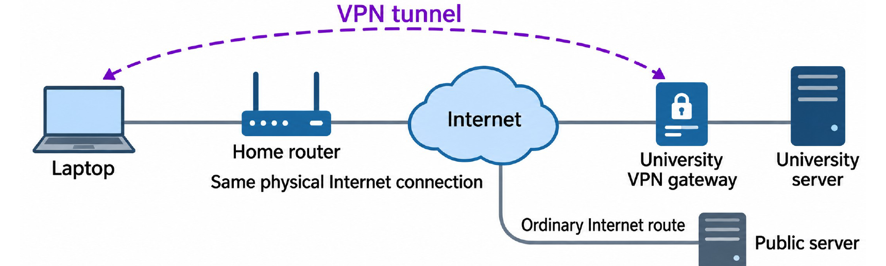
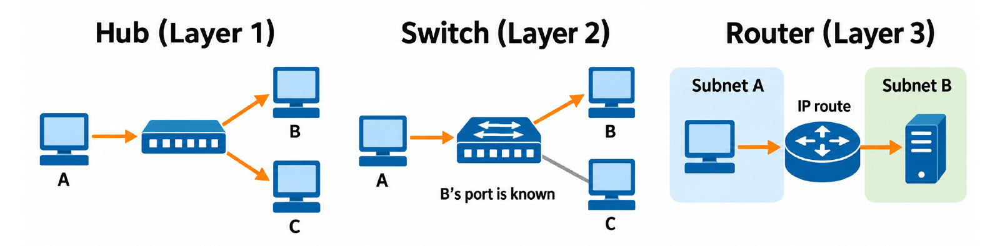
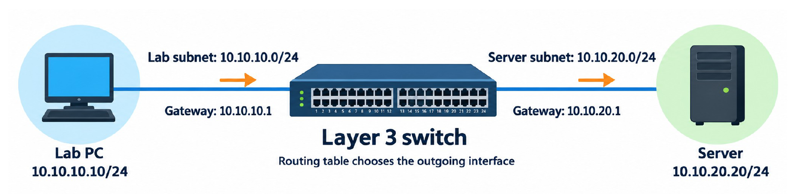
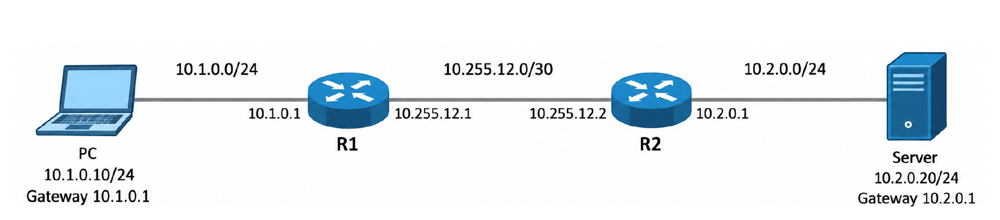
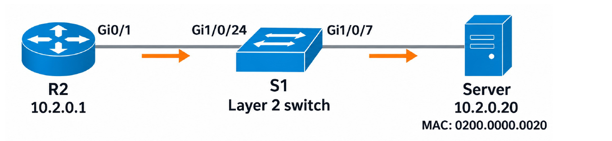
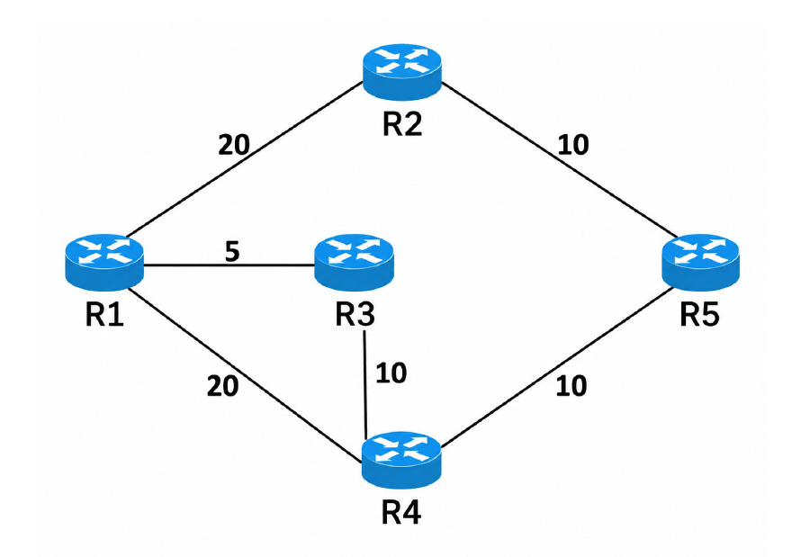
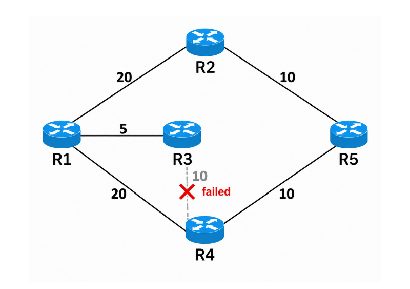
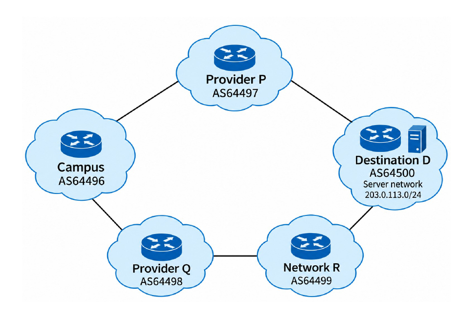
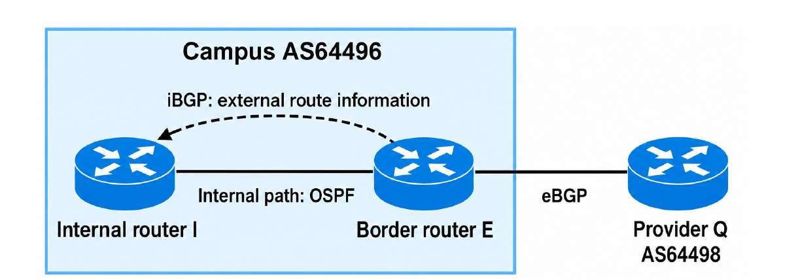
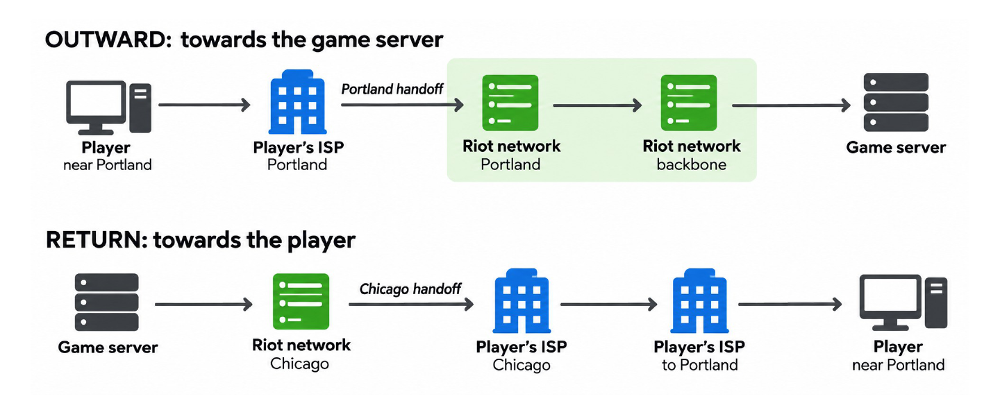

# 8. Routing in Practice

This chapter covers Part II Lecture 3.5, a live lecture. It takes the ideas from Chapters 6 and 7 (longest-prefix match, static routes, OSPF, distance vector and BGP) and applies them to real equipment and real command output. It adds no new algorithms. Instead, it asks one question again and again: **what information does this device have, and what decision does it make from that information?**

The lecture follows a packet outwards in three steps:

1. **Your computer:** how a laptop reads its own routing table, and how a VPN changes it.
2. **Inside an organisation:** what routers and switches do, how routes get into their tables, and what happens when a link fails.
3. **Between organisations:** how BGP policy picks a provider, why a reply can take a different path, and how filters stop bad route announcements.

High-yield exam tasks:

* Decide which routing-table entry a destination matches, and whether the host needs the gateway.
* Explain why a ping fails when only one direction has a route.
* Follow a packet through a router's table, its ARP table and a switch's MAC table.
* Find R1's OSPF route to a server network, before and after a remote link fails.
* Explain why a longer AS path can win, and how export and import checks stop transit.

---

## 1. Recap: What a Routing-Table Entry Says

Chapter 6 introduced the routing table. Each entry has three parts:

| Part | What it means | Example |
| :--- | :--- | :--- |
| **Destination prefix** | A group of destination addresses. | 10.20.18.0/24 |
| **Next hop** | The neighbouring router that gets the packet next. | 10.0.0.2 |
| **Outgoing interface** | This device's own connection that leads to the next hop. | Ethernet 1 |

The **default route**, 0.0.0.0/0, matches every IPv4 destination. A device uses it only when no more specific entry matches.

**Routing** builds and updates the table. **Forwarding** looks up the table for each packet. When several entries match, the **longest prefix wins** (Chapter 6, Section 1.4). For 10.20.18.7, both 10.20.18.0/24 and 0.0.0.0/0 match, so the /24 wins.

---

## 2. Your Computer: Routing Tables and VPNs

### 2.1 Every host has a routing table

Routers are not the only devices with routing tables. Your laptop has one too, and it uses the same longest-prefix rule. On Windows, the command `route print` shows it. Before a VPN connects, a typical laptop on home Wi-Fi has these two important rows:

| Network destination | Netmask | Gateway | Interface |
| :--- | :--- | :--- | :--- |
| 0.0.0.0 | 0.0.0.0 | 192.168.50.1 | 192.168.50.10 |
| 192.168.50.0 | 255.255.255.0 | On-link | 192.168.50.10 |

* **Network destination + netmask** together give the prefix. 0.0.0.0 with mask 0.0.0.0 is the default route, /0.
* **Gateway** is the next hop. **On-link** means "no gateway is needed: deliver directly on the attached network".
* **Interface** is the laptop's own address on the network it sends from (here, its Wi-Fi address).

(On macOS, `netstat -rn -f inet` shows the same table, and `route -n get 10.20.18.7` shows which entry a destination uses.)

### 2.2 Does the printer need the gateway?

The laptop is 192.168.50.10/24 with gateway 192.168.50.1. The VPN is off.

| Destination | Entries that match | Entry that wins | How the laptop sends |
| :--- | :--- | :--- | :--- |
| Printer 192.168.50.20 | 192.168.50.0/24 and 0.0.0.0/0 | **/24** | Directly on the Wi-Fi. ARP asks for the **printer's** MAC. |
| Public server 203.0.113.80 | 0.0.0.0/0 only | **/0** | Through gateway 192.168.50.1. ARP asks for the **gateway's** MAC. |

In both cases the **IP destination** in the packet is the real destination. Only the frame's MAC destination changes. This is the same local-or-remote decision as in Chapter 6, Section 1, seen from the routing table.

### 2.3 What a VPN does

Suppose a university lab server sits on a **private network**. Your home Internet connection has no route into that network, so you cannot reach the server directly.

A **remote-access VPN (Virtual Private Network)** solves this:

1. **Connect and sign in.** A VPN app on your laptop proves to the university's **VPN gateway** that you are allowed in.
2. **Carry traffic through a tunnel.** The app encrypts each university-bound packet. It then puts the whole original IP packet **inside another packet** addressed to the VPN gateway.
3. **Forward inside the university.** The gateway decrypts and unwraps the packet. It then forwards the original packet to the lab server. Replies come back through the same tunnel.

{width=80%}

Your home Wi-Fi and Internet connection still carry every packet. The VPN adds a **logical** connection to the university network. It does not add a new cable.

### 2.4 How the laptop chooses: the VPN adds a route

The laptop must decide which packets go into the tunnel. It does this with its routing table. In a **split tunnel**, the VPN software adds one route for the university's addresses and leaves the default route alone:

| Destination prefix | How to send | Where the entry came from |
| :--- | :--- | :--- |
| 192.168.50.0/24 | Local Wi-Fi network | Wi-Fi interface configuration |
| **10.20.0.0/16** | **VPN tunnel** | **The VPN software adds it** |
| 0.0.0.0/0 | Wi-Fi, via 192.168.50.1 | Default-gateway configuration |

* University server 10.20.18.7 matches both /16 and /0. The /16 is longer, so the packet goes **through the tunnel**.
* Public server 203.0.113.80 matches only /0, so it uses the **ordinary Internet route**.

**Split tunnel** means that only selected destinations use the VPN. Other VPN set-ups send most or all traffic through the tunnel.

### 2.5 A matching route does not mean the destination is reachable

The student disconnects the VPN. Public websites still work, but 10.20.18.7 stops answering.

* The VPN software **removes** its 10.20.0.0/16 route.
* 10.20.18.7 still matches **0.0.0.0/0**, so the laptop sends the packet to its home gateway.
* But the home Internet connection has **no path into the university's private network**. Only the VPN gave that access. So the packet never arrives.
* Public websites still work, because the default route is still correct for them.

> **A routing-table match only chooses the next hop. It does not prove that the destination is reachable.**

Note also that the laptop did not run any routing protocol. Its entries came from its interface settings, its gateway setting and the VPN software.

---

## 3. Inside an Organisation: The Devices

### 3.1 Cables, patch panels, switches and routers

In a building, network cables from the wall outlets end at **patch panels** in a rack. Patch panels only organise the cables. They do not choose routes. Short patch cables join the panels to **switches**, and other links join those switches to the rest of the network.

> A cable tells us what is **attached**. The forwarding tables tell us where traffic **goes**.

* A **router** (for example, a Cisco Catalyst 8300) has Ethernet interfaces that connect it to other networks. Your **default gateway** is the IP address of a router interface **in your own subnet**.
* A **switch** has many numbered Ethernet ports for computers, access points and printers, plus **uplink** ports that join it to the rest of the network. A label such as `Gi1/0/7` names one interface (GigabitEthernet, stack member 1, module 0, port 7).

A router and a switch can look alike. What they **do** tells them apart.

### 3.2 What hubs, switches and routers do

{width=85%}

| Device | Layer | What it looks at | What it does |
| :--- | :--- | :--- | :--- |
| **Hub** (historical) | 1 | Nothing | Repeats incoming bits out of every other port. All devices share one medium. |
| **Switch** | 2 | Destination **MAC** address | Looks up its MAC table and forwards the frame towards the known port. Separate links can carry traffic at the same time. |
| **Router** | 3 | Destination **IP** address | Looks up its routing table and forwards the packet **between networks**. |

### 3.3 How a switch learns which port leads to a device

A server sends a frame into switch S1 on port Gi1/0/7. The frame's **source** MAC is 0200.0000.0020.

* S1 records: "MAC 0200.0000.0020 is reachable through Gi1/0/7."
* Later, a frame **to** 0200.0000.0020 arrives. S1 sends it out of Gi1/0/7 only.
* A frame to an **unknown** MAC is **flooded** to every port in the same broadcast domain.

The switch learns from **any** frame, whether it carries an ARP message or ordinary data.

> **ARP** learns an **IP-to-MAC** mapping. A switch's **MAC table** learns a **MAC-to-port** mapping. These are two different tables in two different devices.

### 3.4 A switch can be your default gateway

The name "switch" does not always mean "Layer 2 only". A **Layer 3 switch** does both Ethernet switching and IP routing, so it can be the gateway between subnets.

{width=85%}

* The lab PC (10.10.10.10/24) sees that 10.10.20.20 is outside its /24. So it sends the packet to its gateway, 10.10.10.1.
* The Layer 3 switch looks up its routing table and forwards the packet out of its server-subnet interface (10.10.20.1).
* Routing makes a path between the subnets. **Access-control rules** can then restrict which traffic may use it. (Chapter 5, Section 9.5: separate subnets do not block traffic by themselves.)

---

## 4. Inside an Organisation: Static Routes and the Return Path

### 4.1 Where routes come from (recap)

Chapter 7, Section 1 listed three sources of routes. On a Cisco router, `show ip route` marks each entry with a code for its source:

| Code | Source | What made it appear |
| :--- | :--- | :--- |
| **C** | Connected | An interface has an address and is up, so the router knows the network it is attached to. |
| **S** | Static | An administrator typed the destination prefix and the next hop. |
| **O** | OSPF | The routing protocol calculated it from link-state information. |

**Each router uses only its own table.** A route you configure on one router does not appear on any other router.

### 4.2 Why does ping still fail after I added a route?

{width=90%}

The PC (10.1.0.10/24) pings the server (10.2.0.20/24). All links and host gateways are correct. At the start, each router has **only its connected routes**: no static routes, no default route, no NAT and no filtering.

* R1 knows 10.1.0.0/24 and 10.255.12.0/30 (connected).
* R2 knows 10.255.12.0/30 and 10.2.0.0/24 (connected).

The administrator adds one static route on R1:

```
R1(config)# ip route 10.2.0.0 255.255.255.0 10.255.12.2
```

This says: "to reach 10.2.0.0/24, send to 10.255.12.2 (R2)". Now follow the ping:

1. The PC sends the **Echo Request** to its gateway R1.
2. R1 matches 10.2.0.0/24 (the new static route) and sends the packet to R2.
3. R2 matches 10.2.0.0/24 (connected) and delivers the packet to the server. **The request arrives.**
4. The server sends the **Echo Reply** to 10.1.0.10, through its gateway R2.
5. R2 looks up 10.1.0.10. It has **no route to 10.1.0.0/24 and no default route**. So R2 drops the reply.

The request and the reply are **separate packets** with **different destinations**:

| Packet | Destination that each router looks up |
| :--- | :--- |
| Request from the PC | Server 10.2.0.20, in 10.2.0.0/24 |
| Reply from the server | PC 10.1.0.10, in 10.1.0.0/24 |

The fix is a **return route** on R2:

```
R2(config)# ip route 10.1.0.0 255.255.255.0 10.255.12.1
```

> **A route in one direction does not create a route in the other direction.** Both directions need a usable route.

### 4.3 How R2 knows that the server network is on Gi0/1

The administrator gives R2's server-facing interface an address and turns it on:

```
R2(config)# interface GigabitEthernet0/1
R2(config-if)# ip address 10.2.0.1 255.255.255.0
R2(config-if)# no shutdown
```

The address and mask together name the attached subnet, 10.2.0.0/24. When Gi0/1 is up, R2 **automatically** adds that subnet as a connected route:

```
R2# show ip route
C    10.2.0.0/24 is directly connected, GigabitEthernet0/1
```

No static route and no OSPF exchange is needed for a network the router is directly attached to.

### 4.4 The last hop: route, then ARP, then switch table

{width=70%}

The packet for 10.2.0.20 has reached R2. Three tables, in three steps, get it to the server:

1. **Route → interface.** 10.2.0.20 matches the connected route 10.2.0.0/24, so R2 chooses **Gi0/1**.
2. **ARP → MAC address.** R2 needs the server's MAC to build the frame. Its ARP table holds the mapping (R2 runs ARP first if the entry is missing):

    ```
    R2# show ip arp
    Address      Hardware Addr    Interface
    10.2.0.20    0200.0000.0020   GigabitEthernet0/1
    ```

    R2 sends a frame to MAC 0200.0000.0020. The **IP destination stays 10.2.0.20**.

3. **Switch table → port.** The frame reaches S1. S1 already learnt where that MAC is, from the source MAC of an earlier frame on Gi1/0/7:

    ```
    S1# show mac address-table
    Mac Address       Type      Ports
    0200.0000.0020    DYNAMIC   Gi1/0/7
    ```

    S1 forwards the frame out of Gi1/0/7 only.

> **The route selects the LAN. ARP supplies the MAC. The switch table selects the port.**

---

## 5. Inside an Organisation: OSPF in Practice

### 5.1 Why use a routing protocol at all?

Static routes work for a small network that rarely changes. With many routers and networks, a new subnet or a failed link means changing many tables by hand, on every router. A **dynamic routing protocol** such as OSPF exchanges information and **recalculates** the routes automatically. Administrators still configure which interfaces take part, the area and the costs.

A routing protocol can only choose among links that exist. It **cannot create** a missing link.

OSPF in five steps (full detail in Chapter 7, Section 4): discover neighbours with **Hello**, describe your own links in an **LSA**, **flood** the LSAs through the area, store them in the **LSDB** (the map), and run **Dijkstra** from your own position.

Remember that "shortest" means shortest **by the metric**. In Chapter 7's example, S–A–D has 2 hops but cost 20, and S–B–C–D has 3 hops but cost 3. OSPF picks the cost-3 path. An OSPF **cost** is a number an administrator configures. It is **not** a live measurement of delay.

### 5.2 Worked example: R1's route to the server network

{width=55%}

All routers are in one OSPF area, and the costs are the same in both directions. R5 connects to server network **10.11.0.0/16**, and that LAN attachment costs **2**. R1 sends to server 10.11.0.42. This is the same graph as Chapter 7, Section 4.5.

Dijkstra from R1 gives (Chapter 7): R2 = 20, R3 = 5, R4 = 15 (via R3), R5 = 25 (via R3, R4). Add the LAN cost:

$$\text{cost to } 10.11.0.0/16 = 5 + 10 + 10 + 2 = 27$$

The path is R1 → R3 → R4 → R5 → server LAN. The **next hop** is the **first** router on the path, R3, even though R4 is the last router before R5. R1 installs:

```
O    10.11.0.0/16 [110/27] via 10.255.13.2, GigabitEthernet0/1
```

| Part | Meaning |
| :--- | :--- |
| `O` | The route came from OSPF. |
| `10.11.0.0/16` | The destination prefix. |
| `110` | Cisco's **administrative distance** for OSPF. It ranks route **sources** (OSPF against static, for example) when two sources give the same prefix. It is **not** part of the path cost. |
| `27` | The OSPF **path cost**. |
| `via 10.255.13.2` | The next hop: R3's address on the R1–R3 link. |
| `GigabitEthernet0/1` | R1's own interface towards R3. |

### 5.3 What enabling OSPF looks like

On R1, Gi0/1 already has its address on the link to R3. The administrator adds:

```
R1(config)# interface GigabitEthernet0/1
R1(config-if)# ip ospf 1 area 0
R1(config-if)# ip ospf cost 5
```

| Line | Meaning |
| :--- | :--- |
| `interface GigabitEthernet0/1` | Select R1's interface towards R3. |
| `ip ospf 1 area 0` | Run OSPF on this interface, in area 0. "1" is a local process number. |
| `ip ospf cost 5` | Sending out of this interface costs 5. |

This configures **one** interface. Every other interface and router that takes part needs matching configuration too.

### 5.4 Three views that answer three different questions

| Command | Question it answers | For R1 in this example |
| :--- | :--- | :--- |
| `show ip ospf neighbor` | Which **directly connected** OSPF routers are there, and what state are they in? | R2, R3 and R4, all **FULL** |
| `show ip ospf database` | What link-state information has R1 learnt? (the map) | Every router's links, including links far from R1 |
| `show ip route ospf` | Which OSPF routes did R1 **install**? | 10.11.0.0/16 via R3, cost 27 |

**The neighbour list.** OSPF names each router by a **router ID** that looks like an IP address. Here R1 = 1.1.1.1, R2 = 2.2.2.2, and so on. A router ID need not be any of the router's link addresses.

```
R1# show ip ospf neighbor
Neighbor ID   State   Address        Interface
2.2.2.2       FULL    10.255.12.2    Gi0/0
3.3.3.3       FULL    10.255.13.2    Gi0/1
4.4.4.4       FULL    10.255.14.2    Gi0/2
```

**FULL** means the two routers have finished synchronising their databases. **R5 is not in the list**, because it has no direct link to R1. R1 still learns about R5 through flooded LSAs.

**The database.** Each router's own LSA (a **Router-LSA**) lists its links. Under each link, "TOS 0 Metrics" is that link's cost. R1's own LSA lists links to 2.2.2.2 (cost 20), 3.3.3.3 (cost 5) and 4.4.4.4 (cost 20). R1 also stores **R5's** LSA, even though R5 is not its neighbour:

```
R1# show ip ospf database router 5.5.5.5
  Advertising Router: 5.5.5.5
   Link connected to: another Router (point-to-point)
    (Link ID) Neighboring Router ID: 2.2.2.2
     TOS 0 Metrics: 10
   Link connected to: another Router (point-to-point)
    (Link ID) Neighboring Router ID: 4.4.4.4
     TOS 0 Metrics: 10
   Link connected to: a Stub Network
    (Link ID) Network/subnet number: 10.11.0.0
    (Link Data) Network Mask: 255.255.0.0
     TOS 0 Metrics: 2
```

The last entry is R5's server LAN. "Stub Network" here means an attached network with no other OSPF router behind it. Its cost, 2, is the number R1 adds at the end of the path.

> **Neighbour list: local peers. Database: the learnt map. Routing table: the next hop to use.**

### 5.5 Worked example: the R3–R4 link fails

{width=55%}

Only the **R3–R4** link fails. R1's own links to R2, R3 and R4 still work.

**New paths.** The old path R1–R3–R4–R5 is gone. R3 now reaches R5 only back through R1, so R3 is no help. Two paths survive:

| Surviving path | Cost to the server network |
| :--- | :--- |
| R1 → R2 → R5 | 20 + 10 + 2 = **32** |
| R1 → R4 → R5 | 20 + 10 + 2 = **32** |

The costs are equal, so R1 can install **both** next hops (equal-cost paths):

| | R1's route to 10.11.0.0/16 |
| :--- | :--- |
| Before the failure | via 10.255.13.2 (R3), cost 27 |
| After convergence | via 10.255.12.2 (R2), cost 32 **and** via 10.255.14.2 (R4), cost 32 |

**Does R1 lose a neighbour?** No. The failed link is between two **other** routers. R1 still has direct links to R2, R3 and R4, so its neighbour list stays R2, R3, R4, all FULL. R1 learns about the failure from **updated LSAs** that R3 and R4 flood. Those LSAs change R1's database, so R1 runs Dijkstra again and changes its route.

> **A failure elsewhere can change your route even while all your own neighbours stay up.** An unchanged neighbour list does not prove that the rest of the network is unchanged.

### 5.6 Why traffic can pause when a backup path exists

**Convergence** is the process of settling on new routes after a change. A spare cable gives an alternative, but the routing information must catch up first:

| Stage | What happens in this example |
| :--- | :--- |
| 1. Detect the failure | R3 and R4 notice that their shared link (or their adjacency) has failed. |
| 2. Distribute new information | They flood updated LSAs over the links that still work. |
| 3. Recalculate | R1 updates its map and runs Dijkstra again. |
| 4. Install forwarding changes | R1 replaces the old next hop with the new ones. |

While routers still use old information, packets can be **lost**. Different routers can update at different times. How long convergence takes depends on how fast the failure is detected, the protocol settings and the implementation.

### 5.7 Distance vector, briefly

OSPF builds a map from link reports. **Distance-vector** routing (RIP) does not build a map. Each router only hears its neighbours' **distances to destinations**, adds the cost of the link to that neighbour, and keeps the lowest total (Chapter 7, Section 3).

Because a distance report hides the **path** behind it, an old report can mislead a router. When A's link to Net1 fails, B still reports "Net1 = 2", but B's route goes through A. A believes it, the two routers count upwards, and packets loop between them (**count-to-infinity**). **Poisoned reverse** stops this two-router loop: B reports Net1 as unreachable (16) to A all the time, because B reaches Net1 through A. Chapter 7, Sections 3.5 and 3.6, has the full trace.

---

## 6. Between Organisations: BGP in Practice

### 6.1 The set-up

Chapter 7, Section 6 explained why the Internet does not run one big OSPF: each **autonomous system (AS)** sets its own policy, and sharing every internal link would not scale. **BGP** exchanges **reachability** between ASes, while each AS runs its own internal routing.

The lecture's example network uses private-use AS numbers:

{width=55%}

| Network | ASN |
| :--- | :--- |
| Campus | 64496 |
| Provider P | 64497 |
| Provider Q | 64498 |
| Network R | 64499 |
| Destination D (server network 203.0.113.0/24) | 64500 |

An ASN names a **network under one administration**, not a single router.

### 6.2 How the AS path grows

Follow the advertisements for 203.0.113.0/24 along D → R → Q → Campus. Each AS adds (**prepends**) its own number on the **left** when it advertises the route to another AS:

| Advertisement | AS path sent |
| :--- | :--- |
| D to R | 64500 |
| R to Q | 64499 64500 |
| Q to Campus | 64498 64499 64500 |

The prefix stays the same. The AS path grows by one at each AS boundary. The advertisements travel D → R → Q → Campus. Traffic that uses the route travels the **opposite** way: Campus → Q → R → D.

Through P, the campus receives the path 64497 64500. So the campus has **two** routes to the same prefix, and BGP policy decides which one it uses.

### 6.3 Must the shorter AS path win?

| Provider | AS path | Local preference (case 1) | Local preference (case 2) |
| :--- | :--- | :--- | :--- |
| P | 64497 64500 (2 ASes) | 100 | 100 |
| Q | 64498 64499 64500 (3 ASes) | 100 | **200** |

* **Case 1.** Local preferences are equal, so the **shorter AS path** wins: **P**.
* **Case 2.** The campus wants Q as its main connection (perhaps Q is cheaper). The administrator gives Q's route local preference 200. A **higher** local preference wins, and BGP compares it **before** AS-path length. So **Q** wins, and traffic goes Campus → Q → R → D.

BGP applies the configured policy. It does **not** measure which provider gives the lowest delay. AS-path length only counts networks. It does not measure distance, delay or spare capacity.

### 6.4 The exit is chosen. How do internal routers reach it?

{width=75%}

The campus chose Q. But a packet from inside the campus first has to reach the **border router E**, the router that connects to Q. Two protocols work together:

* **eBGP** (external BGP) exchanges routes between E and Q.
* **iBGP** (internal BGP) passes that external route to the other BGP routers **inside** the campus. For them, E is the **BGP next hop**.
* **OSPF** gives the **internal path** from an internal router I to E.

So internal router I learns "for 203.0.113.0/24, go to E" from iBGP, and "to reach E, use this internal next hop" from OSPF.

### 6.5 The reply does not have to follow the same path

Riot Games built its own network, **Riot Direct**, to control more of the path between players and its game servers. With direct connections, a player's ISP can hand traffic to Riot's backbone earlier, so the traffic takes fewer detours.

{width=85%}

In Riot's historical example, a player near Portland sent traffic to a game server. Riot and the player's ISP were connected in **both** Portland and Chicago. A **handoff** is the place where traffic crosses from one network to the other.

* **Outward:** the request entered Riot's network in **Portland**.
* **Return:** the reply left Riot's network for the ISP in **Chicago**, and then travelled back to Portland inside the ISP.

**Why?** The request is addressed to the **game server**. The reply is addressed to the **player**. Each router looks up each destination **independently**. Ordinary IP forwarding does not remember the request's path and reverse it. Riot's chosen return route simply handed the reply to the ISP in Chicago.

Riot worked with the ISP to change the routing information and policy for the return path. A different return path is not automatically worse. What matters is how well the chosen path performs.

> **A game's ping includes both directions.** Fixing only the route to the server may not fix the delay.

This is the inter-AS version of Section 4.2: every direction needs its own route, and each direction's route is a separate decision.

### 6.6 Should the campus offer its provider's routes to another provider?

The campus uses P and Q to reach other networks. It does **not** want to carry traffic **between** its providers (Chapter 7, Section 6.7).

| Campus tells Q... | What happens if Q uses it |
| :--- | :--- |
| "I can reach my own campus prefix." | Traffic **to the campus** arrives through Q. This is wanted. |
| "I can reach D through P." | Q's traffic **to D** may go Q → Campus → P → D. The campus becomes a **transit** network for Q. |

Learning P's route lets the campus send **its own** traffic through P. **Advertising** that route to Q offers to carry **Q's** traffic as well. Being able to use a route does not mean you should offer it to someone else.

### 6.7 Export and import checks

Two checks, at two places, stop the unwanted advertisement:

| Where the check runs | Rule and result |
| :--- | :--- |
| **Campus: export to Q** | Advertise the campus's own prefix. **Withhold** the route to D learnt from P. |
| **Q: import from the campus** | Accept the campus's authorised prefixes. **Reject** D's prefix if it arrives from the campus. |

* An **export** check acts **before** an advertisement leaves the campus.
* An **import** check acts when Q **receives** it, before Q accepts it as a usable route.
* If the campus sends D's route by mistake, Q's import check still rejects it. Either check, if configured correctly, blocks the announcement.

These checks filter **routing information** (advertisements). They do not directly filter ordinary user packets. (The YouTube incident in Chapter 7, Section 6.8, is what happens when neither check catches a bad announcement.)

### 6.8 Four separate decisions about a route

| Decision | Question | Example |
| :--- | :--- | :--- |
| **Accept** (import) | Are we willing to learn this route from this neighbour? | Q rejects D's prefix from the campus, because the campus may not offer it. |
| **Select** | Which accepted route do we use for this prefix? | Prefer Q's route when its local preference is higher. |
| **Forward** | Which installed prefix best matches this packet? | A VPN /16 beats the default /0. |
| **Advertise** (export) | Which routes do we offer to this neighbour? | The campus advertises its own prefix but withholds provider-learnt routes. |

Route filters control what routers **learn and advertise**. Packet forwarding then uses whatever routes end up **installed**.

---

## 7. Review: Explain the Outcome

The lecture closed with four observations. For each one, name the routing information involved, where the decision happens, and what it means for the next packet.

| Observation | Explanation |
| :--- | :--- |
| University traffic uses the VPN. Public traffic uses the home gateway. | The VPN installed 10.20.0.0/16. It is the longest match for university addresses. Other destinations match only /0. |
| The PC's ping request reaches the server, but no reply returns. | R1 has the forward route, but R2 has no route (and no default) back to the PC's subnet. A forward route on R1 does not create the return route on R2. |
| R1's neighbours stay up, but its route to the server changes. | The R3–R4 link failed elsewhere in the area. Updated LSAs changed R1's database, so Dijkstra gave new paths. |
| Q does not learn a route to D through the campus. | The campus exports only its own prefix, and Q's import check rejects D's prefix from the campus. |

**Activity 3 (NTULearn, "Second Shift")** is an online routing game based on this lecture: a failed link, routing loops and provider-route decisions. One example from it: R-SCI has no direct link to HALL, so how does it learn the cost of HALL's link to DC? (Answer: from HALL's LSA, flooded through the area.)

---

## 8. Exam Checklist

* Longest-prefix match chooses the entry. A match on /0 does **not** prove that the destination is reachable.
* Local destination → ARP for the destination. Remote destination → ARP for the **gateway**. The IP destination never changes.
* A split-tunnel VPN adds a more specific route (for example /16). It wins over /0 for those addresses only.
* A switch learns **MAC → port** from source MACs. ARP learns **IP → MAC**. A Layer 3 switch can also route.
* Connected route = an addressed interface that is up. Static route = typed by an administrator, on **that** router only.
* A ping needs a route **both ways**. A forward route never creates the return route.
* Last hop: the route selects the LAN, ARP supplies the MAC, the switch table selects the port.
* OSPF route to a prefix = path cost to the attached router + the LAN cost. The next hop is the **first** router on the path.
* `[110/27]`: 110 = administrative distance (ranks sources), 27 = OSPF cost.
* Neighbour list, LSDB and routing table answer different questions. A remote failure changes the route but not the neighbour list.
* BGP: higher local preference beats a shorter AS path. Each AS prepends its ASN on the left.
* iBGP spreads the external route inside the AS. OSPF reaches the border router.
* Replies are routed independently and can take a different path.
* Export checks (sender) and import checks (receiver) filter advertisements, not user packets.
