# 9. Transport Layer: Ports, UDP and TCP

This chapter covers Part II Lecture 4, Parts I and II. Chapters 5 to 8 showed how IP moves a packet from one **host** to another host, router by router. This chapter goes one layer up. It shows how the data reaches the right **program** on that host (ports), and how TCP turns IP's unreliable delivery into a reliable, ordered stream of bytes that does not overload the receiver or the network.

High-yield exam tasks:

* Choose TCP or UDP for an application and give the reason.
* Fill in the SN and AN of every segment in a connection (handshake, data, close).
* Find how much new data a sender may send from AN, rwnd, cwnd and MSS.
* Trace cwnd round by round with slow start, congestion avoidance, Tahoe and Reno.
* Estimate throughput (W / RTT) and file-transfer time, or the largest RTT allowed.

---

## 1. From IP to the Transport Layer

### 1.1 What IP gives us, and what it does not

IP moves a packet from one host to another host, router by router. It is **best effort**: packets can be **lost, duplicated, delayed or delivered out of order**, and IP repairs none of this. Routers only forward IP packets. Any repair must happen at the two **end hosts**, and that is the job of the transport layer.

### 1.2 The IPv4 header, from the transport layer's point of view

Chapter 6 met most of the IPv4 header already. The fields group by job:

| Job | Fields | Notes |
| :--- | :--- | :--- |
| Housekeeping | Version, IHL, Type of Service, Total Length, Header Checksum | IHL counts 32-bit words: IHL = 5 means 20 bytes. The checksum covers the **header only**, not the data. |
| Fragmentation | Identification, Flags (DF, MF), Fragment Offset | Chapter 6, Section 5. |
| Forwarding | Time to Live (TTL) | Each router subtracts 1. At 0 the packet is dropped. Traceroute relies on this. |
| **Hand-over** | **Protocol** | Which protocol gets the payload. |
| Addressing | Source and Destination Address | The two **end hosts**. |
| Options | Options and padding | Rarely used. When present, IHL > 5. |

The first five rows of the header are always 20 bytes.

### 1.3 Step 1: the Protocol field picks TCP or UDP

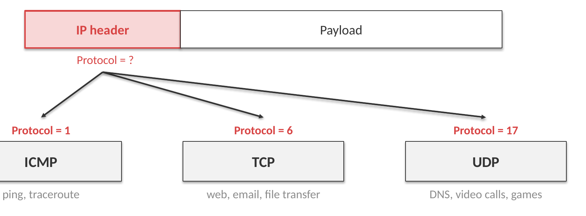{width=75%}

When a packet arrives, the host reads the IP header's **Protocol** field and hands the payload to that protocol:

| Protocol value | Protocol | Used by |
| :--- | :--- | :--- |
| **1** | ICMP | ping, traceroute |
| **6** | **TCP** | web, email, file transfer |
| **17** | **UDP** | DNS, video calls, games |

That is only the first step. TCP or UDP then reads **its own** header to find the right application. That second step uses **port numbers**.

### 1.4 Names for the data at each layer

| Layer | Unit name | What it contains |
| :--- | :--- | :--- |
| Application | **Message** | The data |
| Transport | **Segment** (TCP) or **datagram** (UDP) | TCP/UDP header + data |
| Network | **Packet** (also called an IP datagram) | IP header + segment |
| Link | **Frame** | Ethernet header + packet + trailer |

Careful: "datagram" on its own can mean a UDP unit **or** an IP packet. In this chapter, a **segment** is one TCP unit and a **UDP datagram** is one UDP unit.

---

## 2. Ports: Delivering to the Right Program

### 2.1 Process-to-process delivery

Your laptop runs many programs at once: browser tabs, Zoom, Spotify. A **process** is a program running on a host. When a packet arrives, which process should get it?

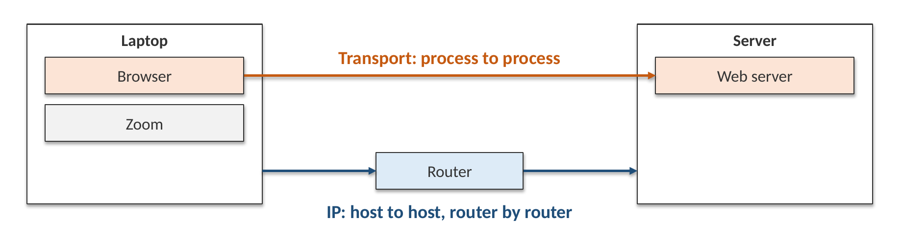{width=80%}

* **IP** gives **host-to-host** delivery.
* The **transport layer** gives **process-to-process** delivery.

Only the two end hosts run TCP or UDP. Routers in between only forward the IP packets underneath.

### 2.2 Port numbers

A **port number** is a **16-bit** number (0 to 65535) that names a process on a host.

> **The IP address gets the data to the right computer. The port gets it to the right program on that computer.**

* **Well-known ports (0 to 1023)** are used by standard services. Examples: DNS on **53**, HTTP on **80**, HTTPS on **443**, SMTP (email) on **25**, SSH (secure remote login) on **22**. A server can also listen on another port.
* An **ephemeral port** is a temporary port that the client's operating system picks for one conversation, for example 50432. It does **not** need to be registered with anyone.

Example: your browser asks the DNS server 8.8.8.8 on port 53 "where is www.ntu.edu.sg?". It then asks the web server 203.0.113.10 on port 443 for the page.

### 2.3 Multiplexing and demultiplexing

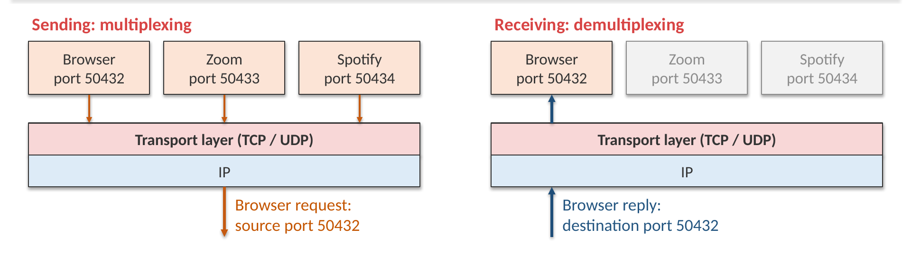{width=85%}

* **Multiplexing (sending):** the transport layer takes data from several applications and sends it all through one IP layer. Each segment carries its application's port as the **source port**.
* **Demultiplexing (receiving):** the transport layer reads the **destination port** of each arriving segment and gives the data to that application.

When the browser (port 50432) sends a request, the source port is 50432. When the reply comes back, its destination port is 50432, so the laptop gives it to the browser and not to Zoom.

### 2.4 How a server on port 443 tells thousands of clients apart

Every client talks to the **same** server port, 443. So the server port alone cannot separate them. A TCP connection is named by **four values**:

| Connection | Source IP | Source port | Destination IP | Destination port |
| :--- | :--- | :--- | :--- | :--- |
| 1 (tab 1 on a laptop) | 198.51.100.7 | 50432 | 203.0.113.10 | 443 |
| 2 (tab 2, same laptop) | 198.51.100.7 | **50433** | 203.0.113.10 | 443 |
| 3 (a different computer) | **192.0.2.25** | 50432 | 203.0.113.10 | 443 |

If **any one** of the four values differs, it is a different connection. Connections 1 and 3 even share the client port 50432, but their source IPs differ, so they are still separate.

**NAT** (Chapter 5) uses the same idea. It maps a private IP address **and port** to a public IP address and port, and uses that mapping to send replies back to the right inside device.

---

## 3. UDP: User Datagram Protocol

### 3.1 What UDP does

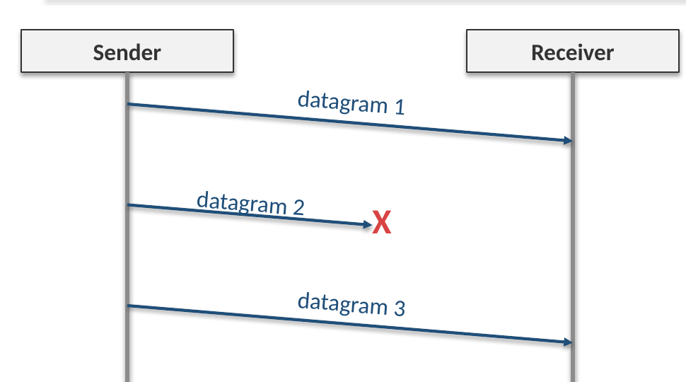{width=45%}

* UDP sends each message as a **separate datagram**, with **no set-up** first.
* It does **not** number, acknowledge or resend datagrams. A lost datagram is gone, and datagrams can arrive out of order.
* UDP adds only two things to IP: **port numbers**, so the data reaches the right process, and a **checksum**.

Think of posting letters: each one travels on its own, and nobody tells you if one goes missing.

### 3.2 The UDP header

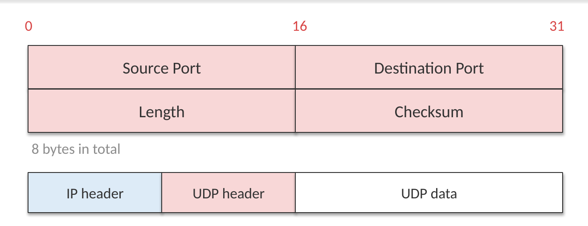{width=60%}

| Field (16 bits each) | Meaning |
| :--- | :--- |
| Source port, destination port | Which processes are talking. |
| Length | Header plus data, in bytes (at least 8). |
| Checksum | Detects a damaged datagram. The receiver then discards it. |

The header is always **8 bytes**. There are no sequence numbers, no acknowledgements and no connection.

---

## 4. TCP: Transmission Control Protocol

### 4.1 What TCP does

* TCP first **sets up a connection** between the two processes, using three messages.
* The receiver sends **acknowledgements (ACKs)** for what has arrived. Anything not acknowledged in time is sent again.
* TCP gives the bytes to the application **in order, with no gaps and no duplicates**.
* TCP slows down for a slow **receiver** (**flow control**) and for a busy **network** (**congestion control**).

Think of a phone call: you connect first, and you ask the other person to repeat anything you missed.

### 4.2 The TCP header

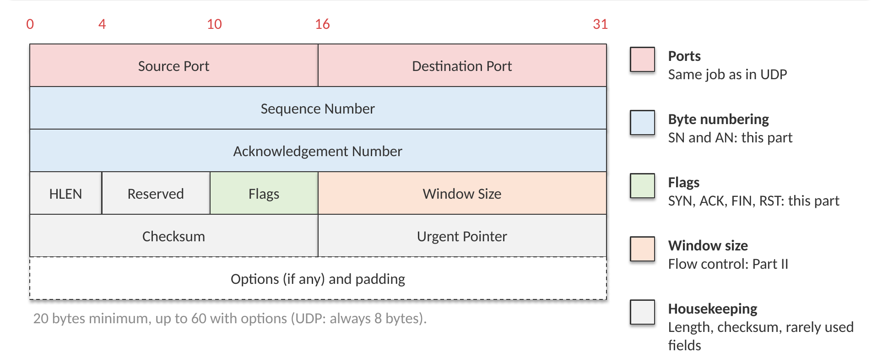{width=85%}

| Field | What it does | Section |
| :--- | :--- | :--- |
| Source port, destination port | Which processes are talking, as in UDP. | 2 |
| **Sequence Number (SN)** | The number of the **first data byte** in this segment. | 5 |
| **Acknowledgement Number (AN)** | The **next byte** that the sender of this segment expects to receive. | 5 |
| HLEN | Header length in 32-bit words. 5 means 20 bytes; the maximum, 15, means 60 bytes. | — |
| Flags | One-bit signals: SYN, ACK, FIN, RST. | 6 |
| **Window Size** | How many more bytes the receiver can accept (rwnd). | 8 |
| Checksum | Detects a damaged segment. | — |
| Urgent pointer | Marks urgent data. Rarely used. | — |
| Options | For example MSS, window scaling, selective ACKs, timestamps. | 5, 10 |

The TCP header is **20 to 60 bytes**. The UDP header is always 8 bytes.

### 4.3 UDP and TCP side by side

| | UDP | TCP |
| :--- | :--- | :--- |
| Set-up before data | None (connectionless) | Three-way handshake (connection-oriented) |
| Lost data | Not detected, not resent | Acknowledged; lost bytes are resent |
| Order of delivery | No guarantee | Bytes delivered in order |
| Unit the application sees | **Messages:** one send is one datagram | A **byte stream** with no message boundaries |
| Header size | 8 bytes, fixed | 20 bytes minimum, up to 60 |
| Also provides | Nothing else | Flow control and congestion control |

### 4.4 Why would anyone choose unreliable UDP?

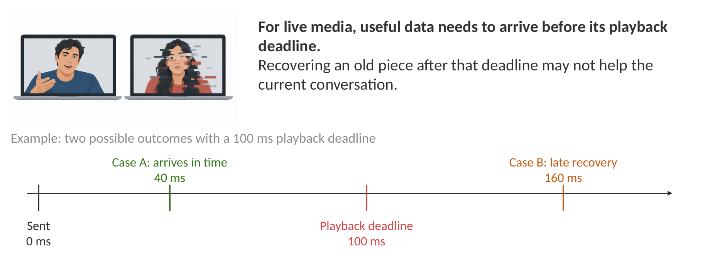{width=85%}

For **live media**, data is only useful if it arrives **before its playback deadline**. Suppose a video call plays each piece 100 ms after it is sent. A piece that arrives at 40 ms is played. A lost piece that TCP recovers at 160 ms is **too late**: the conversation has already moved on.

UDP has no handshake and no built-in resending. So the **application** decides whether and how to recover missing data. It may simply skip a lost frame.

### 4.5 Choosing TCP or UDP

| Application | Choice | Reason |
| :--- | :--- | :--- |
| Downloading a lecture PDF | **TCP** | Every byte must arrive, in order. |
| A web page (HTTP/1.1 or HTTP/2) | **TCP** | Every byte of the page must arrive. |
| Looking up www.ntu.edu.sg in DNS | **UDP** | One short question and one short answer. If it is lost, just ask again. |
| A live video call | **UDP** | A late frame is useless. Skip it rather than wait. |
| A fast multiplayer game | **UDP** | Only the newest position matters, not old ones. |
| Sending an email | **TCP** | The message must arrive complete. |

> **MCQ traps (AY23/24 S2, AY24/25 S2, AY25/26 S2):** "UDP is preferred for video conferencing / online gaming, and TCP for email" is **true**. "TCP port numbers are 16 bits long" is **true**. "TCP port number 58888 does not need to be registered" is **true** (it is an ephemeral port); "...needs to be registered" is **false**. "BGP uses UDP" is **false**: BGP runs over TCP.

---

## 5. Byte Numbering: SN and AN

### 5.1 What TCP adds, and the one idea under it

| Service | Problem it solves | Section |
| :--- | :--- | :--- |
| Connection management | Both sides agree to talk and agree their starting numbers. | 6 |
| Error control | Lost, duplicated, damaged or out-of-order segments. | 7 |
| Flow control | A fast sender overrunning a slow receiver's buffer. | 8 |
| Congestion control | Too much traffic overloading the network itself. | 9 |

All four depend on one idea: **TCP numbers every byte it sends.**

### 5.2 TCP is a byte stream

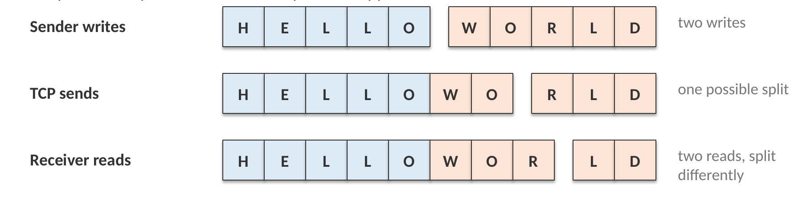{width=80%}

If the sender writes "HELLO" and then "WORLD", must the receiver read the same two pieces? **No.** TCP keeps the bytes **in order**, but it does not keep the **boundaries** between writes. TCP may send "HELLOWO" and "RLD", and the receiver may read "HELLOWOR" and "LD". Every row still holds HELLOWORLD in the same order.

TCP sends no marker for the end of each write. If an application needs separate messages, it must mark them itself, for example with a length field at the start of each message.

### 5.3 How much data fits in one segment: MSS and MTU

**Maximum segment size (MSS):** the most **TCP data** one segment can carry. The TCP and IP headers are **not** counted.

* Example: MSS = 1000 bytes and the application has 2500 bytes. TCP sends 1000 + 1000 + 500. MSS is a **maximum**, so the last segment can be smaller.
* Each segment has its own TCP and IP headers. Those are extra bytes on top of the data.

**Maximum transmission unit (MTU):** the largest **IP packet** a link carries without fragmentation.

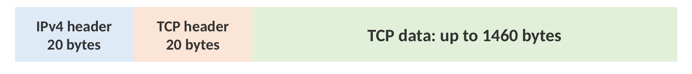{width=75%}

$$\text{MSS} = \text{MTU} - \text{IP header} - \text{TCP header} = 1500 - 20 - 20 = 1460 \text{ bytes}$$

MSS varies. Tutorial 2.3 Q1 uses 536 bytes. **Always use the value given in the question.**

### 5.4 The sequence number (SN)

TCP numbers the bytes so that the receiver can put the data in order and find gaps. **The SN of a segment is the number of its first data byte.**

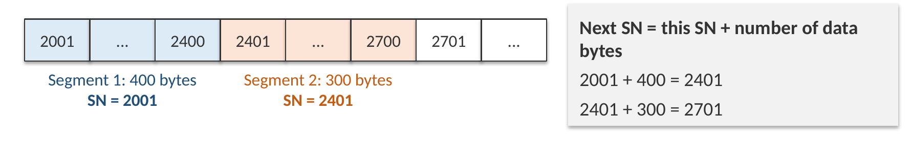{width=85%}

Suppose the first data byte is number 2001.

* Segment 1 carries 400 bytes: bytes 2001 to 2400. **SN = 2001.**
* Segment 2 carries 300 bytes: bytes 2401 to 2700. **SN = 2401.**

$$\text{next SN} = \text{this SN} + \text{number of data bytes}$$

The SN field is 32 bits, so the numbers wrap round to 0 after $2^{32} - 1$. Exam questions stay away from that limit.

### 5.5 The acknowledgement number (AN)

**The AN is the number of the next byte the receiver expects.**

* AN = 2401 means: "I have every byte up to 2400. Send 2401 next."
* ACKs are **cumulative**: one AN confirms **all** the bytes before it, not just the last segment. If one ACK is lost, the next ACK covers for it.
* The **ACK flag** is a separate bit that says "the AN field is valid".

### 5.6 Worked example: data in one direction

The connection is already open. The client's first data byte is 2001, and the server's is 5001.

| # | Direction | Segment | Why |
| :--- | :--- | :--- | :--- |
| 1 | Client → server | SN = 2001, 400 bytes | Bytes 2001 to 2400. |
| 2 | Server → client | ACK, SN = 5001, AN = 2401 | The server has everything up to 2400. |
| 3 | Client → server | SN = 2401, 300 bytes | Bytes 2401 to 2700. |
| 4 | Server → client | ACK, SN = 5001, AN = 2701 | Everything up to 2700. |

The server's ACKs carry **no data**. Such a **pure ACK** uses up **no** sequence number, so the server's SN stays at 5001.

### 5.7 Worked example: data in both directions

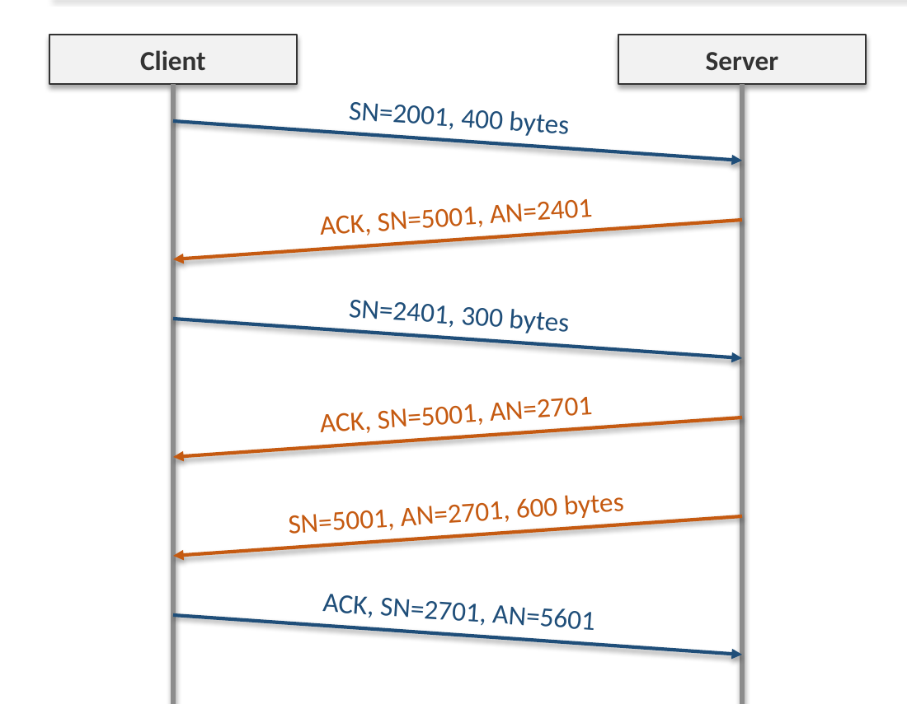{width=50%}

After segment 4 above, the server sends 600 bytes of its own:

* The server's segment has **SN = 5001** (its own first byte) and **AN = 2701** (it still acknowledges the client). Carrying an ACK on a data segment is called **piggybacking**.
* The client replies **AN = 5001 + 600 = 5601**, with SN = 2701.

> **SN always counts the sender's own bytes. AN always counts the other side's bytes.**

### 5.8 What happens when a segment goes missing

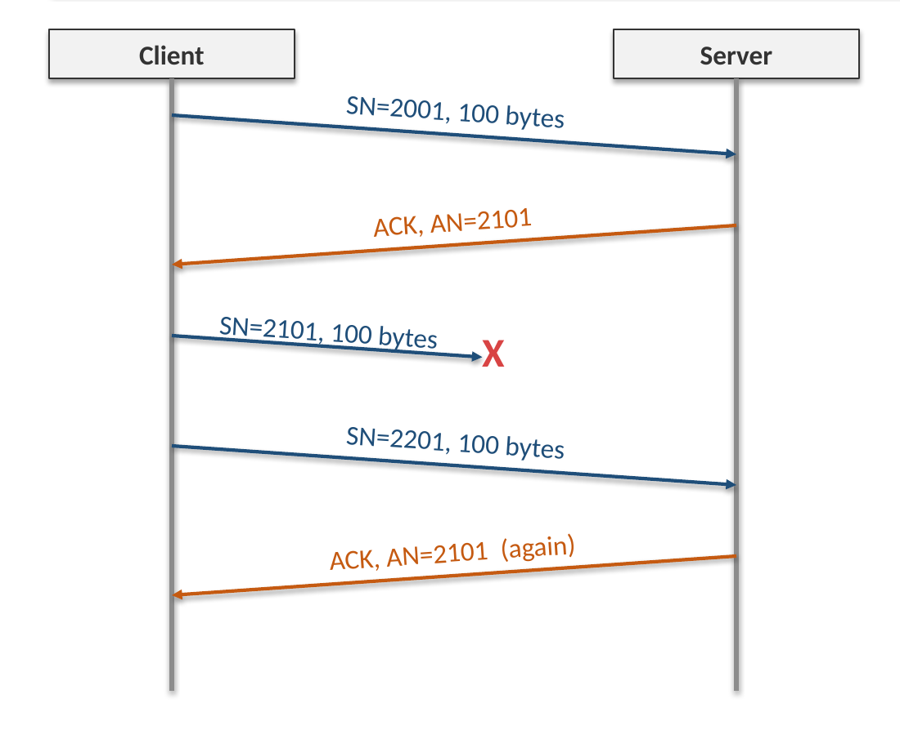{width=50%}

The client sends three 100-byte segments: 2001, 2101 and 2201. The segment 2101 is lost, but 2201 arrives.

* The receiver can only acknowledge up to the **first missing byte**. So it sends **AN = 2101 again**, even though bytes 2201 to 2300 have arrived.
* An ACK that repeats the previous AN is a **duplicate ACK**. It tells the sender: "something after this point did not arrive." Section 7 shows what the sender does with it.

**Example (lecture).** A segment has SN = 7301 and 180 bytes, and all earlier bytes have arrived.

* (a) The receiver sends **AN = 7301 + 180 = 7481**.
* (b) Next, SN = 7481 (200 bytes) is lost and SN = 7681 (150 bytes) arrives. The receiver sends **AN = 7481 again**, a duplicate ACK. Byte 7481 is missing, so it cannot acknowledge 7681 to 7830 yet.
* (c) The sender must eventually resend **SN = 7481**, the first byte of the lost segment.

---

## 6. Opening and Closing a Connection

### 6.1 Why set up a connection first?

A TCP connection is a **logical conversation** that both end hosts keep track of. It does **not** reserve a physical path. Before any data moves, both sides must:

* check that the other side exists and is ready;
* agree each side's starting sequence number, the **initial sequence number (ISN)**;
* tell each other how much buffer space they have (the window, Section 8);
* set aside memory to track the connection's numbers, windows and state.

This exchange is the **three-way handshake**.

### 6.2 The control flags

| Flag | Meaning when the bit is 1 |
| :--- | :--- |
| **SYN** | Synchronise: "my starting sequence number is in the SN field". Used only when opening. |
| **ACK** | The AN field is valid. |
| **FIN** | Finish: "I have no more data to send". Used when closing. |
| **RST** | Reset: abort the connection at once, for example when a segment arrives for a connection that does not exist. |

A segment can have more than one flag set, for example **SYN+ACK** or **FIN+ACK**.

### 6.3 The three-way handshake

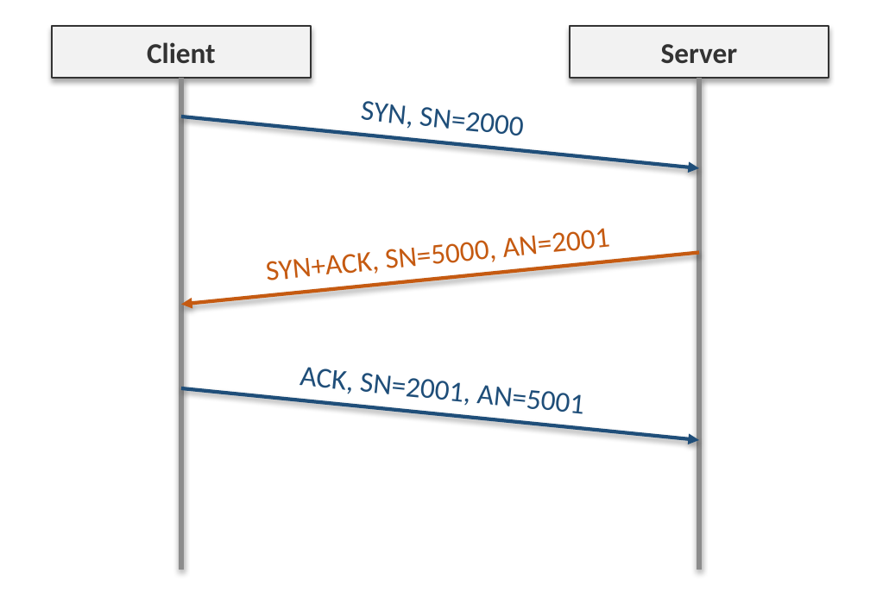{width=50%}

1. **Client → server: SYN, SN = 2000.** "My starting number is 2000."
2. **Server → client: SYN+ACK, SN = 5000, AN = 2001.** "I acknowledge yours. Mine is 5000."
3. **Client → server: ACK, SN = 2001, AN = 5001.** "I acknowledge yours too."

**Why a third message?** So that each side hears its own starting number confirmed. The SYN+ACK confirms the client's ISN. The third message confirms the server's ISN.

### 6.4 The rule: SYN and FIN each use up one number

* A SYN carries **no data**, but it **counts as one byte** in the numbering. So the first data byte is **ISN + 1**.
* That is why the server replies AN = **2001**, not 2000: it is acknowledging the SYN itself.
* A **pure ACK** (no data, no SYN, no FIN) uses up **nothing**. So the client's ACK in step 3 **and** its first data segment both have SN = 2001.
* Why count the SYN at all? So that it can be acknowledged, and resent if it is lost, just like data.

$$\boxed{\text{next SN} = \text{SN} + \text{data bytes}\ (+1 \text{ if SYN})\ (+1 \text{ if FIN})}$$

### 6.5 Closing a connection

When one side stops sending, silence is not enough: silence could just mean a pause or a delay. So each side sends an explicit **FIN**: "I have no more data to send."

* **Each direction closes separately.** The peer ACKs the FIN, but it may still send its own remaining data. One direction closed while the other is still open is a **half-close**.
* Normally the close takes four segments: FIN, ACK, FIN, ACK. The middle ACK and FIN can be combined into one FIN+ACK, which gives **three** segments.
* Each FIN uses up **one** sequence number.

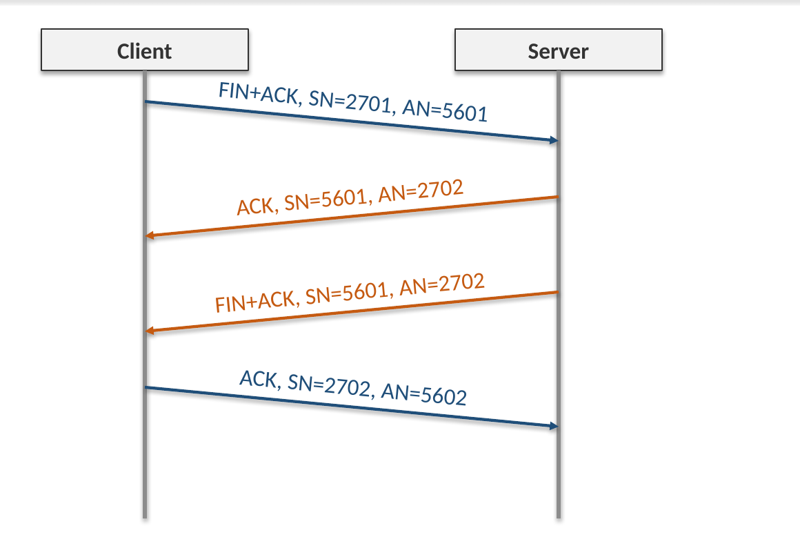{width=55%}

| # | Direction | Segment | Why |
| :--- | :--- | :--- | :--- |
| 1 | Client → server | FIN+ACK, SN = 2701, AN = 5601 | The client has finished. |
| 2 | Server → client | ACK, SN = 5601, AN = **2702** | The client's FIN used up 2701. |
| 3 | Server → client | FIN+ACK, SN = **5601**, AN = 2702 | The server's pure ACK used up nothing. Between rows 2 and 3 (the half-close), the server could still send data. Here it sends none. |
| 4 | Client → server | ACK, SN = 2702, AN = **5602** | The server's FIN used up 5601. |

### 6.6 The whole conversation in one table

| # | Direction | Flags | SN | AN | Data bytes |
| :--- | :--- | :--- | :--- | :--- | :--- |
| 1 | C → S | SYN | 2000 | – | 0 |
| 2 | S → C | SYN+ACK | 5000 | 2001 | 0 |
| 3 | C → S | ACK | 2001 | 5001 | 0 |
| 4 | C → S | ACK | 2001 | 5001 | 400 |
| 5 | S → C | ACK | 5001 | 2401 | 0 |
| 6 | C → S | ACK | 2401 | 5001 | 300 |
| 7 | S → C | ACK | 5001 | 2701 | 0 |
| 8 | S → C | ACK | 5001 | 2701 | 600 |
| 9 | C → S | ACK | 2701 | 5601 | 0 |
| 10 | C → S | FIN+ACK | 2701 | 5601 | 0 |
| 11 | S → C | ACK | 5601 | 2702 | 0 |
| 12 | S → C | FIN+ACK | 5601 | 2702 | 0 |
| 13 | C → S | ACK | 2702 | 5602 | 0 |

Rows 1 to 3 open the connection, rows 4 to 9 move data, and rows 10 to 13 close it. Add **+1 after each SYN and FIN**, the **data length** after each data segment, and **0** after a pure ACK.

### 6.7 Example: fill in the blanks (lecture)

Client ISN = 800, server ISN = 3000. After the handshake, the client sends 120 bytes, the server replies with 500 bytes, the client ACKs, and then the client closes.

| # | Segment | SN | AN | Why |
| :--- | :--- | :--- | :--- | :--- |
| 1 | Client: SYN | 800 | – | |
| 2 | Server: SYN+ACK | 3000 | **801** | Acknowledges the SYN: 800 + 1. |
| 3 | Client: ACK | **801** | 3001 | The first number after the SYN. |
| 4 | Client: 120 bytes | 801 | **3001** | The pure ACK in row 3 used up nothing. Server ISN + 1. |
| 5 | Server: 500 bytes (ACK piggybacked) | 3001 | **921** | 801 + 120. |
| 6 | Client: ACK | 921 | **3501** | 3001 + 500. |
| 7 | Client: FIN+ACK | **921** | 3501 | The ACK in row 6 used up nothing. |
| 8 | Server: ACK | 3501 | **922** | The FIN used up 921. |
| 9 | Server: FIN+ACK | **3501** | 922 | The pure ACK in row 8 used up nothing. |
| 10 | Client: ACK | 922 | **3502** | The server's FIN used up 3501. |

### 6.8 Worked example: AY25/26 S2 Q3(b) (unofficial answer)

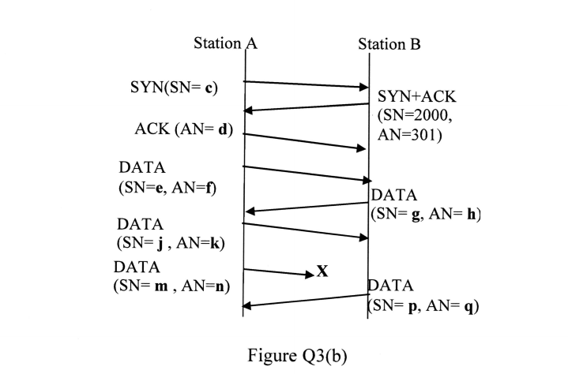{width=55%}

Every DATA segment carries 100 bytes. Find each bold letter.

| Letter | Value | Why |
| :--- | :--- | :--- |
| c | **300** | B's SYN+ACK has AN = 301 = A's ISN + 1. |
| d | **2001** | Acknowledges B's SYN: 2000 + 1. |
| e | **301** | The pure ACK used up nothing, so A's first data byte is 301. |
| f | **2001** | A has received nothing new from B. |
| g | **2001** | B's first data byte. |
| h | **401** | B received A's bytes 301 to 400. |
| j | **401** | A's next segment starts after 301 + 100. |
| k | **2101** | A received B's bytes 2001 to 2100. |
| m | **501** | 401 + 100. |
| n | **2101** | Still nothing new from B. |
| p | **2101** | B's next data byte: 2001 + 100. |
| q | **501** | B has bytes up to 500. Segment 501 was lost, so B still asks for 501. |

### 6.9 Worked example: AY23/24 S2 Q2(d) (unofficial answer)

Station B's SYN+ACK has SN = 4000 and AN = 1401. A then sends DATA (SN = 1401, AN = 4001, Len = 100) and DATA (SN = 1501, AN = 4001, Len = 200). B sends DATA (SN = y, AN = z, Len = 100), which crosses A's second segment in the figure.

* **w = 1400:** B's AN = 1401 = A's ISN + 1.
* **x = 4001:** acknowledges B's SYN.
* **y = 4001:** B's first data byte (ISN + 1).
* **z = 1501:** when B sends, it has only A's first segment (bytes 1401 to 1500). A's second segment has not arrived yet. This also explains why A's second segment still carries AN = 4001.

### 6.10 Worked example: Tutorial 2.3 Q1 (unofficial answer)

The client opens a socket, writes 30 bytes, reads 3000 bytes and closes. The server accepts, reads 30 bytes, writes 3000 bytes and closes. Client ISN = 100, server ISN = 600. Both windows are 2048 bytes. MSS = 536 bytes, and the initial congestion window is 1 MSS. Find the **minimum** number of segments, with no errors.

**Plan.** 3000 bytes need $\lceil 3000 / 536 \rceil = 6$ segments: five of 536 bytes and one of 320 bytes. The server starts in slow start with cwnd = 1 segment (Section 9), so it sends 1 segment, then 2, then the last 3. To keep the count minimal, every ACK that can ride on a data segment or a FIN does so.

| # | Direction | Flags | SN | AN | Data | Bytes carried |
| :--- | :--- | :--- | :--- | :--- | :--- | :--- |
| 1 | C → S | SYN | 100 | – | 0 | |
| 2 | S → C | SYN+ACK | 600 | 101 | 0 | |
| 3 | C → S | ACK | 101 | 601 | 30 | 101–130 (handshake ACK carries the 30 bytes) |
| 4 | S → C | ACK | 601 | 131 | 536 | 601–1136 (cwnd = 1) |
| 5 | C → S | ACK | 131 | 1137 | 0 | |
| 6 | S → C | ACK | 1137 | 131 | 536 | 1137–1672 (cwnd = 2) |
| 7 | S → C | ACK | 1673 | 131 | 536 | 1673–2208 |
| 8 | C → S | ACK | 131 | 2209 | 0 | one cumulative ACK for rows 6 and 7 |
| 9 | S → C | ACK | 2209 | 131 | 536 | 2209–2744 (cwnd ≥ 3) |
| 10 | S → C | ACK | 2745 | 131 | 536 | 2745–3280 |
| 11 | S → C | ACK | 3281 | 131 | 320 | 3281–3600 |
| 12 | C → S | FIN+ACK | 131 | 3601 | 0 | the client ACKs the last data and closes together |
| 13 | S → C | FIN+ACK | 3601 | 132 | 0 | the server ACKs the FIN and closes together |
| 14 | C → S | ACK | 132 | 3602 | 0 | |

That is **14 segments**. Checks:

* The window of 2048 bytes never limits the server: at most 3 × 536 = 1608 bytes are outstanding (rows 9 to 11).
* If the client sends its handshake ACK separately from the 30 bytes, add one segment (it also has SN = 101, because a pure ACK uses no number).

---

## 7. Error Control: Recovering Lost Data

### 7.1 What error control must handle

**Error control** makes sure every byte reaches the receiving application **exactly once, in order**, even though IP gives no such guarantee.

| Problem | How TCP notices | What TCP does |
| :--- | :--- | :--- |
| Segment lost | No ACK before a timer runs out, **or** three duplicate ACKs | The sender resends it. |
| Segment damaged | The checksum does not match. | The receiver discards it. It is then treated as lost. |
| Segment duplicated | Its bytes have already arrived. | The receiver discards it and ACKs again. |
| Out of order | Its SN is higher than the next byte expected. | The receiver keeps it in its buffer, sends a duplicate ACK, and puts the bytes in order later. |

### 7.2 The retransmission timeout

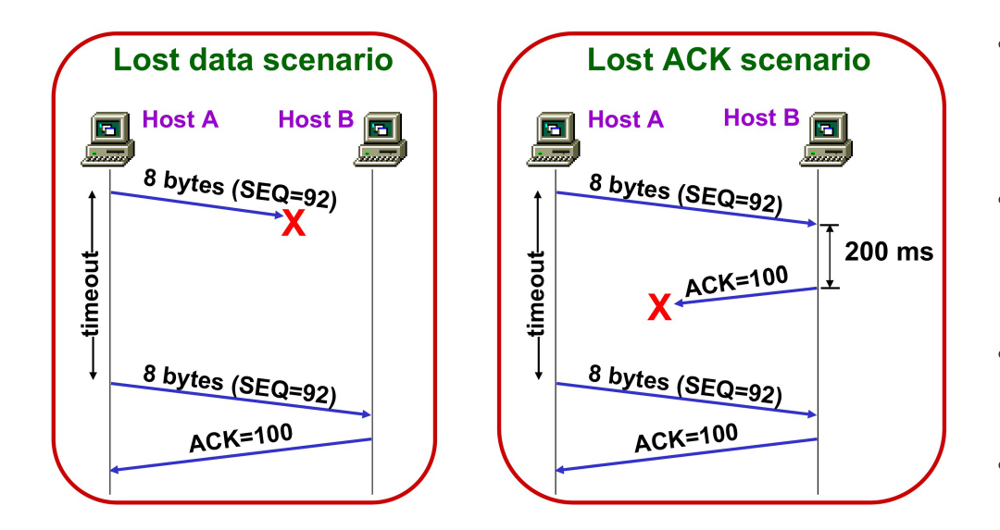{width=70%}

**Outstanding data** (data in flight) has been sent but not yet acknowledged. TCP runs a **retransmission timer** for it. If the timer runs out, TCP resends the **oldest unacknowledged** segment.

* **Lost data (left):** the receiver never saw the 8 bytes with SEQ = 92. The sender resends them after the timeout.
* **Lost ACK (right):** the receiver already has the bytes. It discards the second copy and sends ACK = 100 again.

(In the figure, SEQ means SN, and ACK = 100 means AN = 100.)

**How long should the timer be?** The **round-trip time (RTT)** is the time from sending a segment to receiving its ACK. RTT changes all the time, so one measurement is a poor guide.

* **Smoothed RTT** is a weighted running average of measured RTTs. One slow reply changes it only a little, but many slow replies raise it.
* **Retransmission timeout (RTO)** = the RTT estimate **plus** extra time for variation.
* Too short: the sender resends data that was not lost. Too long: the sender recovers slowly from a real loss.

### 7.3 Duplicate ACKs and fast retransmit

Can the sender find a loss **before** the timer runs out? Yes, from duplicate ACKs.

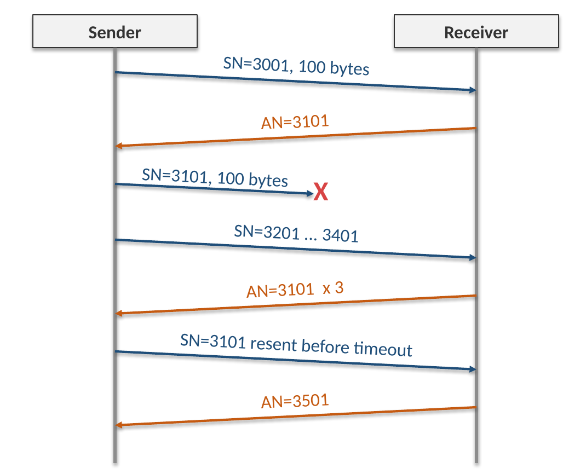{width=50%}

The sender sends 100-byte segments 3001, 3101, 3201, 3301 and 3401. Segment 3101 is lost.

1. 3001 arrives: AN = 3101.
2. 3201, 3301 and 3401 each arrive. Each one makes the receiver repeat **AN = 3101**, because byte 3101 is still missing. These are **duplicate ACKs 1, 2 and 3**.
3. **Fast retransmit:** after **three duplicate ACKs**, the sender resends 3101 at once, without waiting for the timer.
4. The receiver already holds 3201 to 3500. When 3101 arrives, one ACK confirms everything: **AN = 3501**.

**Why three, not one?** One or two duplicate ACKs can happen when segments are only **reordered** on the way. Three duplicates make a real loss much more likely.

### 7.4 Two ways to detect loss

| | Timeout | Three duplicate ACKs |
| :--- | :--- | :--- |
| What happens | The oldest outstanding data is not acknowledged before the timer runs out. | Later segments arrive, but the receiver is still waiting for an earlier byte. |
| Sender's response | Resend the oldest unacknowledged segment. | Fast retransmit: resend the missing segment without waiting. |

If not enough later segments arrive (for example, the lost segment was the last one), there are no three duplicate ACKs. **So the timer is still needed.**

**Example (lecture).** 200-byte segments start at SN = 6001. Segment 6201 is lost. Segments 6401, 6601 and 6801 arrive.

* (a) After 6001: AN = 6201. After 6401, 6601 and 6801: AN = **6201** each time, which is three duplicate ACKs.
* (b) After the **third** duplicate ACK, the sender resends **SN = 6201** by fast retransmit.
* (c) Then the receiver sends **AN = 6801 + 200 = 7001**, because it already held 6401 to 7000.

### 7.5 Head-of-line blocking

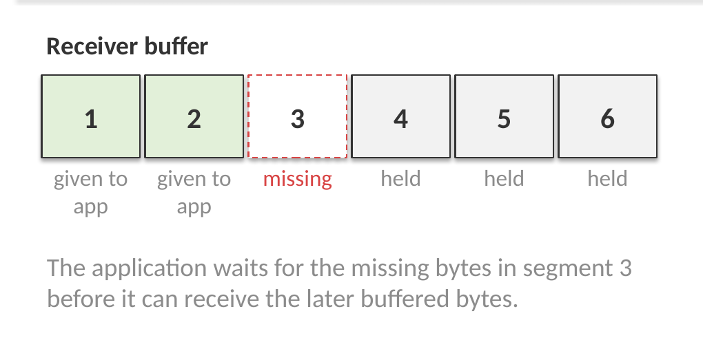{width=60%}

TCP gives bytes to the application **in order**. If segment 3 is lost, segments 4 to 6 wait in the receive buffer, even though they have arrived. This is **head-of-line blocking**: one loss holds up everything behind it.

For a file download this is fine, because every byte is needed anyway. For live media, the waiting can make later data miss its playback deadline. That is one reason such applications choose UDP and handle recovery themselves.

---

## 8. Flow Control: Protecting the Receiver

### 8.1 The receive window

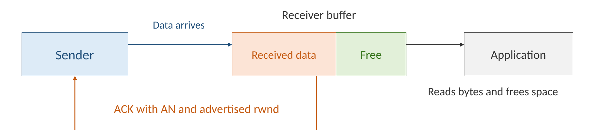{width=80%}

The **receive buffer** is memory where arrived data waits until the application reads it. **Flow control** stops the sender from overfilling it.

* The **receive window (rwnd)** is how much more data the receiver can accept: its **free buffer space**.
* The receiver puts rwnd in the **Window Size** field of every segment it sends. The AN says which byte is expected next.
* A byte can be acknowledged while it is still waiting in the buffer for the application. **Acknowledged does not mean read.**

### 8.2 The sender's window

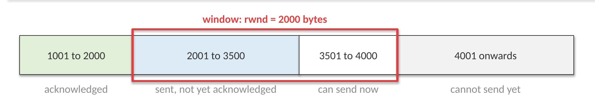{width=85%}

The sender keeps at most **rwnd** bytes unacknowledged.

* The **left edge** of the window is the first unacknowledged byte: the last AN received, here **2001**.
* The **right edge** is left edge + rwnd − 1. Here 2001 + 2000 − 1 = **4000**.
* So bytes 1001 to 2000 are acknowledged, 2001 to 3500 are sent but not acknowledged, **3501 to 4000 can be sent now**, and 4001 onwards must wait.
* When a new ACK arrives, the left edge moves to the new AN and the right edge moves to new AN + new rwnd − 1.
* If **rwnd = 0**, the sender stops sending new data until the receiver announces free space. TCP can send small probes to ask for an update.

### 8.3 Worked example: flow control (lecture)

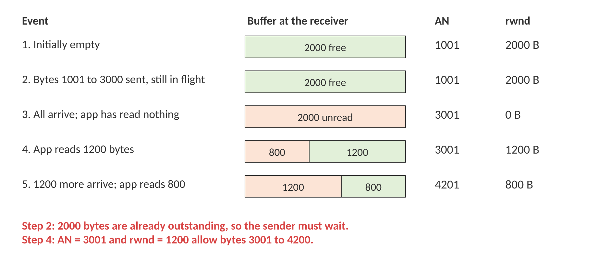{width=85%}

The receive buffer holds 2000 bytes.

| Event | Buffer | AN | rwnd |
| :--- | :--- | :--- | :--- |
| 1. Initially empty | 2000 free | 1001 | 2000 |
| 2. Bytes 1001 to 3000 sent, still in flight | 2000 free | 1001 | 2000 |
| 3. All arrive; the app has read nothing | 2000 unread | 3001 | **0** |
| 4. The app reads 1200 bytes | 800 unread, 1200 free | 3001 | 1200 |
| 5. 1200 more arrive; the app reads 800 | 1200 unread, 800 free | 4201 | 800 |

* At step 2, 2000 bytes are already outstanding, which fills the whole window. So the sender must wait.
* At step 4, AN = 3001 and rwnd = 1200 allow bytes **3001 to 4200**.

### 8.4 Example: the receive window (lecture)

The last ACK had AN = 6001 and rwnd = 3000. The sender has already sent every byte up to 8000.

* (a) The right edge is 6001 + 3000 − 1 = **9000**. The sender has sent up to 8000, so it may send **1000** more bytes (8001 to 9000).
* (b) Then AN = 7001 and rwnd = 1500 arrive. The right edge is 7001 + 1500 − 1 = **8500**. So it may send **500** more bytes (8001 to 8500).

Notice that the right edge **moved left** from 9000 to 8500, because the buffer filled up faster than the window slid.

---

## 9. Congestion Control: Protecting the Network

### 9.1 Congestion and congestion collapse

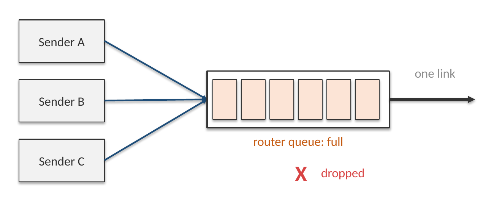{width=65%}

**Congestion** happens when more traffic arrives at a router than its outgoing link can carry. The queue grows, so delay grows. When the queue is full, packets are **dropped**.

> **Flow control protects the receiver. Congestion control protects the network.**

The receiver tells the sender its free space directly (rwnd). Nobody tells the sender how busy the network is. So, for the TCP variants in this course, the sender **infers** congestion from ACKs and loss signals.

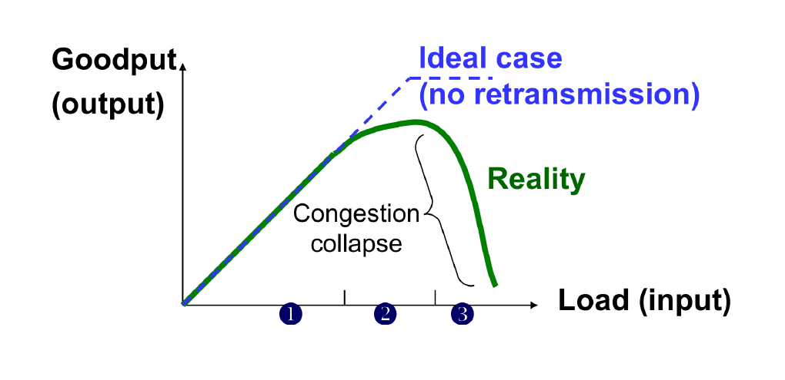{width=55%}

**Goodput** is useful data delivered per second, not counting resent copies.

1. At low load, goodput rises with the load (point 1).
2. As queues fill, dropped packets are resent, so part of the load is repeats (point 2).
3. Eventually the links are full of resent packets and goodput falls towards zero. This is **congestion collapse** (point 3).

### 9.2 The congestion window

* **Congestion control** adjusts how much data a sender allows into the network.
* The **congestion window (cwnd)** limits the data **sent but not yet acknowledged**.
* In this course, cwnd is in **MSS units** (segments). cwnd = 4 with MSS = 1000 bytes means a 4000-byte limit.

### 9.3 Two limits, one window

The sender must respect **both** windows, so it uses the smaller one:

$$\boxed{\text{maximum bytes in flight} = \min(\text{rwnd},\ \text{cwnd} \times \text{MSS})}$$

$$\text{new data allowed} = \max(0,\ \text{limit} - \text{bytes already outstanding})$$

| rwnd (receiver) | cwnd (network), MSS = 1000 | May have in flight | Who is the limit? |
| :--- | :--- | :--- | :--- |
| 20,000 bytes | 8 MSS = 8000 bytes | **8000** bytes | The network (congestion control) |
| 5000 bytes | 8 MSS = 8000 bytes | **5000** bytes | The receiver (flow control) |

If cwnd is already given in bytes, use min(rwnd, cwnd) directly.

**Worked example (lecture).** AN = 5001, MSS = 1000 bytes, rwnd = 3500 bytes, cwnd = 4 MSS. Bytes 5001 to 7000 are sent but not acknowledged.

1. Convert cwnd: 4 × 1000 = 4000 bytes.
2. Limit: min(3500, 4000) = **3500** bytes.
3. Already outstanding: 7000 − 5001 + 1 = 2000 bytes. New data allowed: 3500 − 2000 = **1500 bytes**, that is bytes 7001 to 8500. (For example, one 1000-byte segment and one 500-byte segment.)

From here on, assume the receiver has plenty of space, so **cwnd sets the pace**.

### 9.4 Transmission rounds

For tracing, one **transmission round** = one RTT: the sender sends a whole window of segments and gets their ACKs back. Assume data is always ready, the receiver has enough space, and each full segment gets an ACK.

### 9.5 Slow start

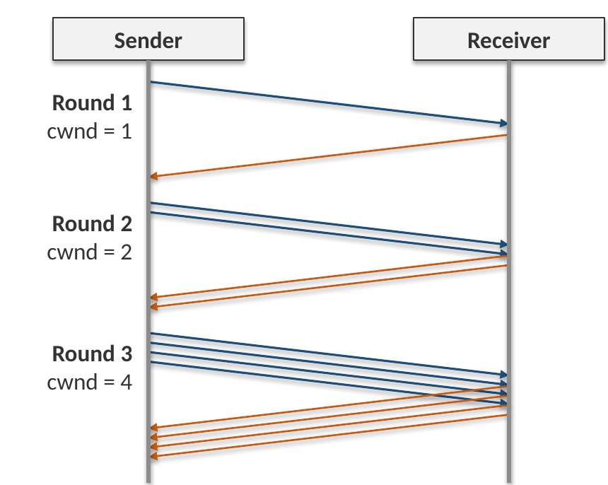{width=45%}

At the start, the sender does not know the path's capacity, so it starts small.

* In this course, the initial cwnd = **1 MSS**.
* For **each ACK of new data**, cwnd grows by 1 MSS. A round of $n$ segments returns $n$ ACKs, so cwnd **doubles every round**: 1, 2, 4, 8, 16, ...
* "Slow" refers to the **small start**, not the growth. The growth is exponential.
* Slow start ends when cwnd reaches the **slow start threshold (ssthresh)**, or earlier if a loss happens.

### 9.6 Congestion avoidance

At ssthresh, doubling becomes risky. TCP switches to **congestion avoidance**: cwnd grows by **1 segment per round**: 4, 5, 6, 7, ... This **linear** growth carefully probes for spare capacity. ssthresh is not a measured limit, so cwnd keeps growing past it until a loss happens.

**What if doubling would overshoot ssthresh?** Example: cwnd = 8 and ssthresh = 12. Doubling would give 16.

> **Course convention:** double cwnd up to ssthresh but **cap it at ssthresh**, then add 1 MSS per round. So the rounds go 8 → **12** → 13 → 14.

### 9.7 After a loss: Tahoe and Reno

Both variants first set:

$$\text{ssthresh} = \left\lfloor \text{cwnd} / 2 \right\rfloor$$

($\lfloor\ \rfloor$ means round down: cwnd = 13 gives ssthresh = 6.) Then:

| | After a **timeout** | After **three duplicate ACKs** |
| :--- | :--- | :--- |
| **Tahoe** | cwnd = 1, slow start again | cwnd = 1, slow start again |
| **Reno** | cwnd = 1, slow start again | **cwnd = ssthresh** (half the old cwnd), then congestion avoidance |

**Why does Reno treat three duplicate ACKs more gently?** Three duplicate ACKs mean later segments **are still arriving**, so the network is still delivering data. Reno does a fast retransmit, then **fast recovery**: it carries on with the halved window instead of restarting from 1 MSS. A timeout gives no such evidence, so both variants restart from 1. Tahoe's weakness is that it drops to 1 even when data is still flowing.

### 9.8 Worked example: Tahoe (lecture)

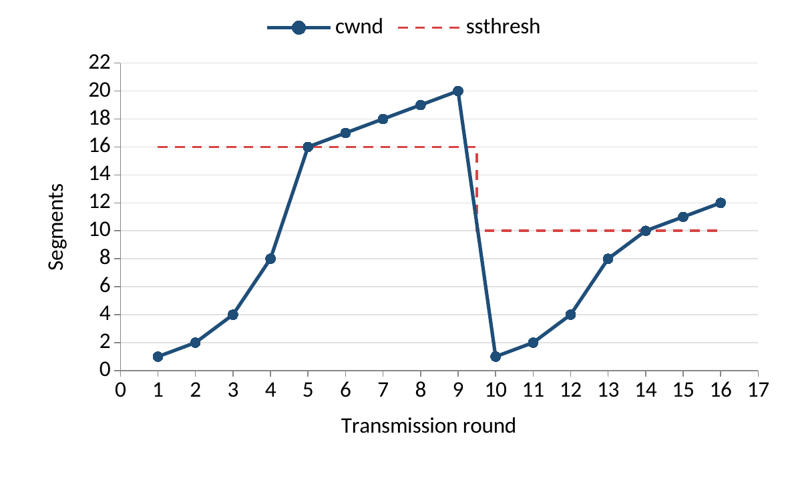{width=60%}

Initial ssthresh = 16.

| Round | 1 | 2 | 3 | 4 | 5 | 6 | 7 | 8 | 9 | 10 | 11 | 12 | 13 | 14 | 15 | 16 |
| :--- | :--- | :--- | :--- | :--- | :--- | :--- | :--- | :--- | :--- | :--- | :--- | :--- | :--- | :--- | :--- | :--- |
| cwnd | 1 | 2 | 4 | 8 | 16 | 17 | 18 | 19 | **20** | **1** | 2 | 4 | 8 | **10** | 11 | 12 |

* Rounds 1 to 5: slow start, 1 to 16.
* Rounds 6 to 9: congestion avoidance, 17 to 20.
* Timeout in round 9: ssthresh = 20 / 2 = **10**, cwnd = 1.
* Rounds 10 to 14: slow start again, capped at 10. Then congestion avoidance: 11, 12.

### 9.9 Worked example: Reno (lecture)

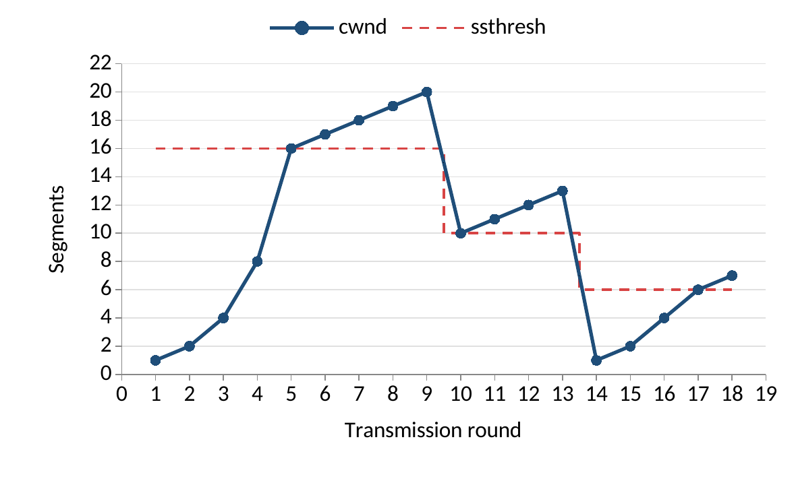{width=60%}

| Round | 1 | 2 | 3 | 4 | 5 | 6 | 7 | 8 | 9 | 10 | 11 | 12 | 13 | 14 | 15 | 16 | 17 | 18 |
| :--- | :--- | :--- | :--- | :--- | :--- | :--- | :--- | :--- | :--- | :--- | :--- | :--- | :--- | :--- | :--- | :--- | :--- | :--- |
| cwnd | 1 | 2 | 4 | 8 | 16 | 17 | 18 | 19 | **20** | **10** | 11 | 12 | **13** | **1** | 2 | 4 | **6** | 7 |

* Rounds 1 to 9: as in the Tahoe example.
* **Three duplicate ACKs** in round 9: ssthresh = 10, cwnd = **10**. Rounds 10 to 13: congestion avoidance.
* **Timeout** in round 13: ssthresh = ⌊13 / 2⌋ = **6**, cwnd = 1.
* Rounds 14 to 17: slow start, capped at 6. Then 7.

### 9.10 Which round sends segment *n*?

Keep a running total of segments sent. Using the first rounds of the Tahoe example:

| Round | 1 | 2 | 3 | 4 | 5 | 6 | 7 | 8 | 9 |
| :--- | :--- | :--- | :--- | :--- | :--- | :--- | :--- | :--- | :--- |
| cwnd | 1 | 2 | 4 | 8 | 16 | 17 | 18 | 19 | 20 |
| Sent so far | 1 | 3 | 7 | 15 | 31 | **48** | **66** | **85** | **105** |

* **Segment 50:** 48 have gone after round 6, and 66 after round 7. So segment 50 goes in **round 7**.
* **Segment 100:** 85 after round 8, and 105 after round 9. So segment 100 goes in **round 9**.

### 9.11 Example: read the graph (lecture)

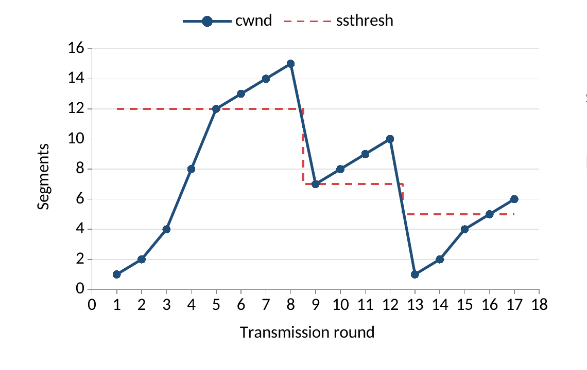{width=60%}

* (a) Initial ssthresh = **12**: slow start goes 1, 2, 4, 8, then **12** instead of 16.
* (b) Slow start runs in rounds **1 to 5** and **13 to 16**.
* (c) End of round 8: **three duplicate ACKs**. cwnd fell from 15 to 7 = ⌊15 / 2⌋ and then kept growing by 1. It did not go back to 1.
* (d) End of round 12: a **timeout**. cwnd fell to 1, and ssthresh became ⌊10 / 2⌋ = 5.
* (e) **Reno.** Tahoe would also have dropped to 1 at the end of round 8.

### 9.12 Worked example: Tutorial 2.3 Q2 (unofficial answer)

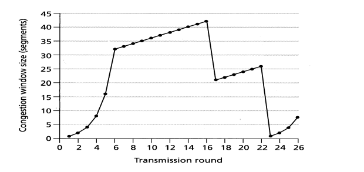{width=60%}

Reading the plot: 1, 2, 4, 8, 16, 32 (rounds 1 to 6), then +1 per round to 42 at round 16; 21 at round 17, then +1 to 26 at round 22; 1 at round 23, then 2, 4, 8.

* **(a) Slow start:** rounds **1 to 6** and **23 to 26**. cwnd doubles each round.
* **(b) Congestion avoidance:** rounds **6 to 16** and **17 to 22**. cwnd grows by 1 each round.
* **(c) After round 16: three duplicate ACKs.** cwnd fell to 21, half of 42, and carried on in congestion avoidance. A timeout would have sent it to 1.
* **(d) After round 22: a timeout.** cwnd fell to 1.
* **(e) Initial threshold = 32.** Slow start stopped doubling at 32.
* **(f) Threshold at round 18 = 21:** ⌊42 / 2⌋, set by the loss after round 16.
* **(g) Threshold at round 24 = 13:** ⌊26 / 2⌋, set by the timeout after round 22.
* **(h) Segment 70 goes in round 7.** Running total: 1, 3, 7, 15, 31, 63 after round 6. Round 7 has cwnd = 33, so it sends segments 64 to 96.

### 9.13 Past-paper timing questions (unofficial answers)

These MCQs give an RTT and ask for a time. Each round takes one RTT. Count the **rounds** in the course model, then multiply.

**AY24/25 S2 Q1(15).** cwnd = 13, RTT = 500 ms. A timeout happens. How long until cwnd is 13 again?

* Timeout: ssthresh = ⌊13 / 2⌋ = 6, cwnd = 1.
* Rounds: 1 → 2 → 4 → **6** (capped) → 7 → 8 → ... → 13. That is 3 slow-start steps + 7 linear steps = 10 rounds.
* Time = 10 × 0.5 s = **5 s** (B).

**AY25/26 S2 Q1(11).** cwnd = 14, RTT = 500 ms. Three duplicate ACKs happen, then a timeout 2 s later. How long after the timeout until cwnd is 14 again?

* Three duplicate ACKs (Reno): ssthresh = 7, cwnd = 7.
* 2 s = 4 rounds of congestion avoidance: 8, 9, 10, **11**.
* Timeout: ssthresh = ⌊11 / 2⌋ = 5, cwnd = 1.
* Rounds: 1 → 2 → 4 → **5** (capped) → 6 → ... → 14. That is 3 + 9 = 12 rounds.
* Time = 12 × 0.5 s = **6 s** (C).

**AY23/24 S2 Q1(11).** cwnd = 15. A timeout happens, then three duplicate ACKs 1 s later. RTT = 200 ms. What is cwnd just after the three duplicate ACKs?

* Timeout: ssthresh = 7, cwnd = 1.
* 1 s = 5 rounds: 2, 4, **7** (capped), 8, **9**.
* Three duplicate ACKs (Reno): ssthresh = ⌊9 / 2⌋ = 4, cwnd = **4** (B).

**AY23/24 S2 Q1(4).** A TCP session always gets three duplicate ACKs when cwnd reaches 32. What is the average cwnd?

* Reno halves 32 to 16, then grows by 1 per round back to 32, again and again. cwnd climbs evenly from 16 to 32.
* Average = (16 + 32) / 2 = **24** (B).

---

## 10. Throughput: How Fast Can TCP Go?

### 10.1 The window limits throughput

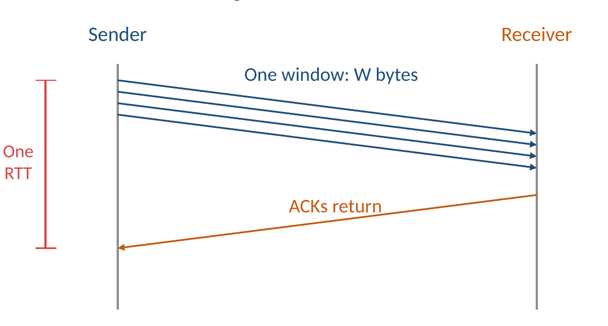{width=55%}

**Throughput** is the amount of data moved per second. The sender may have at most **W** bytes unacknowledged, where W is the smaller of rwnd and cwnd, both in bytes. After it sends one window, it must wait about one **RTT** for ACKs before it can send more. So:

$$\boxed{\text{throughput} \approx \min\!\left(\text{bottleneck capacity},\ \frac{W}{\text{RTT}}\right)} \qquad \text{transfer time} \approx \frac{\text{file size}}{\text{throughput}}$$

The **bottleneck** is the link with the lowest available capacity on the path. These estimates assume a constant W and RTT, no loss, and no start-up or header overhead. **Keep the units consistent:** bits against bytes, and decimal (1 MB = $10^6$ bytes) against binary ($2^{20}$) prefixes.

### 10.2 Worked example: file-transfer time (lecture)

A 100 MB file, cwnd = 10 segments, MSS = 1460 bytes, RTT = 50 ms. The receiver and the links do not set a smaller limit.

1. Window: W = 10 × 1460 = **14,600 bytes**.
2. Throughput ≈ 14,600 / 0.05 = **292,000 bytes/s** (about 2.34 Mbit/s).
3. Transfer time ≈ 100,000,000 / 292,000 = **342.5 s**, about 5.7 minutes.

### 10.3 Why is my 1 Gbit/s plan still slow?

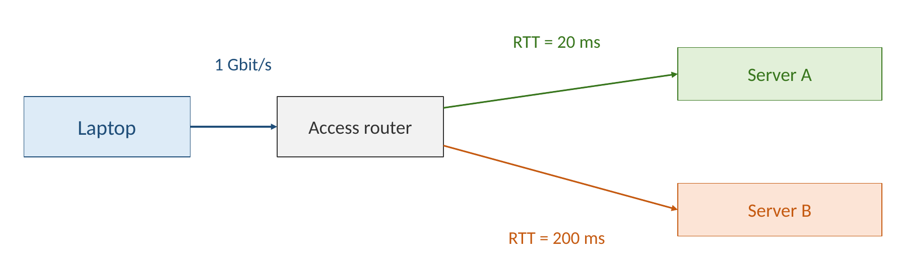{width=75%}

Your access link speed is only one limit. The path's RTT and the effective window matter too. With the same W = 65,535 bytes:

* Server A, RTT = 20 ms: 65,535 × 8 / 0.02 ≈ **26.2 Mbit/s**.
* Server B, RTT = 200 ms: 65,535 × 8 / 0.2 ≈ **2.62 Mbit/s**.

Both are far below 1 Gbit/s. The **16-bit Window Size field** can only say 65,535 bytes. The **window scaling** option applies an agreed multiplier so that the receiver can advertise a larger window.

### 10.4 Worked example: Tutorial 2.3 Q4 (unofficial answer)

Upload a 1 GByte file over a 10 Gbit/s link with RTT = 100 ms. MSS = 1 KByte, and the maximum window is 16 segments. No loss.

* W = 16 × 1 KB = 16 KB per RTT.
* Throughput ≈ 16 × 1024 / 0.1 = 163,840 bytes/s ≈ **1.31 Mbit/s**. This is far below 10 Gbit/s, so the **window** is the limit, not the link.
* Number of rounds = $2^{30} / (16 \times 2^{10}) = 65{,}536$. Time ≈ 65,536 × 0.1 s = **6553.6 s ≈ 1.8 hours**.
* (With decimal units, 1 GB = $10^9$ and 1 KB = 1000 bytes, the answer is 6250 s. State which you use.)

### 10.5 Past-paper RTT questions (unofficial answers)

These turn the formula round: given the time limit, find the **largest RTT**.

$$\text{RTT}_{\max} = \frac{W}{\text{required throughput}} = \frac{W \times \text{time limit}}{\text{file size}}$$

| Paper | MSS | Max segments | File | Time limit | W | Largest RTT |
| :--- | :--- | :--- | :--- | :--- | :--- | :--- |
| AY25/26 S2 Q1(5) | 1500 B | 12 | 1 GB | 20 min = 1200 s | 18,000 B | 18,000 × 1200 / $10^9$ = **21.6 ms** (B) |
| AY24/25 S2 Q1(14) | 1200 B | 15 | 1 GB | 10 min = 600 s | 18,000 B | 18,000 × 600 / $10^9$ = **10.8 ms** (A) |

The options only match with **1 GB = $10^9$ bytes**. In an MCQ, if one unit convention gives no option, try the other.

**AY23/24 S2 Q1(5).** The required throughput is at least 960 kbit/s, RTT = 100 ms and MSS = 1000 bytes. Find the smallest maximum window.

* W ≥ throughput × RTT = 960,000 × 0.1 = 96,000 bits = 12,000 bytes.
* 12,000 / 1000 = **12 segments** (A).

---

## 11. Not Examined

The lecture lists two kinds of material as **not assessed**:

* **Other congestion-control algorithms.** Real systems often use **CUBIC** (a cubic window-growth curve, designed for fast paths with long delays) or **BBR** (Bottleneck Bandwidth and Round-trip propagation time: it estimates the delivery rate and the minimum RTT to set its sending rate). Reno is still available. No calculations on CUBIC or BBR are required.
* **The appendix from the older SC2008 notes:** delayed ACK, silly window syndrome (Clark's solution at the receiver, Nagle's algorithm at the sender), Jacobson's algorithm for the RTO, and Karn's algorithm for RTT samples of resent segments.

---

## 12. Exam Checklist

* The IP Protocol field picks the transport protocol: 1 = ICMP, **6 = TCP, 17 = UDP**. Then the port picks the process.
* A port is 16 bits. Well-known ports are 0 to 1023 (DNS 53, HTTP 80, HTTPS 443, SMTP 25, SSH 22). Ephemeral client ports need no registration.
* A TCP connection = (source IP, source port, destination IP, destination port).
* UDP: 8-byte header, ports + checksum only. TCP: 20 to 60 bytes, reliable ordered byte stream, flow and congestion control.
* Live media, games and DNS → UDP. Files, web pages and email → TCP.
* MSS counts TCP data only. MSS = MTU − 20 − 20 = 1460 for a 1500-byte MTU.
* SN = number of the first data byte. AN = next byte expected (cumulative).
* Next SN = SN + data bytes (+1 for SYN) (+1 for FIN). A pure ACK uses up nothing.
* Handshake: SYN (ISN), SYN+ACK (AN = ISN + 1), ACK. The first data SN = ISN + 1.
* Close: FIN, ACK, FIN, ACK (or FIN, FIN+ACK, ACK). Each direction closes separately.
* A lost segment → the receiver repeats the same AN (duplicate ACKs). Three duplicates → fast retransmit.
* Sender window: right edge = AN + rwnd − 1. In flight ≤ min(rwnd, cwnd × MSS).
* Slow start: cwnd doubles per round, capped at ssthresh. Congestion avoidance: +1 per round.
* Any loss: ssthresh = ⌊cwnd / 2⌋. Timeout → cwnd = 1 (both). Three duplicate ACKs → Tahoe 1, **Reno = ssthresh**.
* Time questions: count rounds, then multiply by the RTT.
* Throughput ≈ min(bottleneck, W / RTT). Transfer time ≈ file / throughput. Watch the bits/bytes and $10^9$/$2^{30}$ units.
