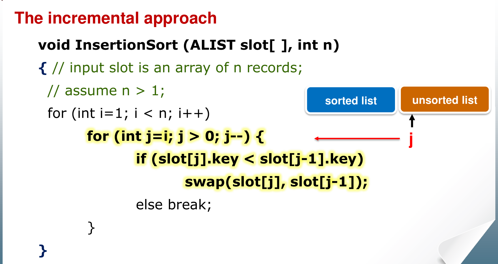
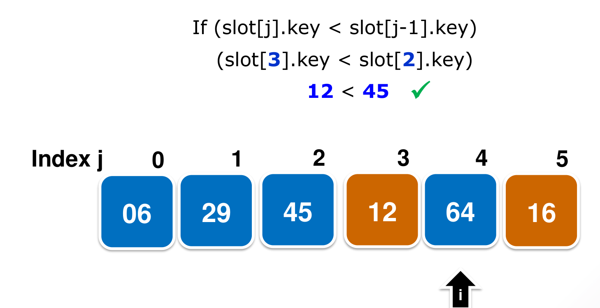

# 1. Foundations: Asymptotic Notation and Insertion Sort

This chapter covers Week 1: asymptotic notation (Lecture 1.2), the sorting problem (Lecture 1.3) and insertion sort (Lecture 1.4). It also covers loop invariants, which the course uses to prove that an algorithm is correct.

The rest of the course uses these tools again and again. Every later chapter states a running time with $O$, $\Omega$ or $\Theta$, and many exam questions ask you to count key comparisons the way this chapter does.

---

## 1. Why We Need Asymptotic Notation

### 1.1 Comparing two algorithms

Suppose algorithm A takes $2n + 5000$ steps on an input of size $n$, and algorithm B takes $3n$ steps.

* For $n = 100$, A takes 5200 steps and B takes 300 steps. B is faster.
* For $n = 10\,000$, A takes 25 000 steps and B takes 30 000 steps. A is faster.

So "which is faster" depends on the input size. To get one answer, computer science looks at what happens **when $n$ becomes very large**. This is called **asymptotic analysis**. For large $n$, $2n + 5000 < 3n$, so A is the better algorithm.

### 1.2 What we ignore, and why

When $n$ is large, two things stop mattering:

* **Lower-order terms.** In $n^2 + 100n$, the $n^2$ part grows much faster than the $100n$ part. For large $n$, the $100n$ part is small in comparison.
* **Constant factors.** $3n^2$ and $n^2$ grow at the same *rate*: double $n$ and both become 4 times larger. The constant depends on the computer and the compiler, not on the algorithm.

Asymptotic notation keeps only the part that controls the growth rate. All running-time functions in this course are non-negative ($f(n) \ge 0$).

---

## 2. The Five Notations

Each notation names a **set of functions**. We write $f(n) = O(g(n))$, but this really means $f(n) \in O(g(n))$: "$f$ is one of the functions in the set $O(g(n))$".

### 2.1 Big O: an upper bound

$f(n) = O(g(n))$ means $f$ grows **no faster** than $g$.

$$O(g(n)) = \{ f(n) : \exists\, c > 0, n_0 > 0 \text{ such that } 0 \le f(n) \le c\,g(n) \text{ for all } n \ge n_0 \}$$

Read it like this: you can find one constant $c$ so that $c\,g(n)$ stays above $f(n)$ for every $n$ from some point $n_0$ onwards. Before $n_0$, anything can happen.

Example: $3n^2 + 10n = O(n^2)$. Choose $c = 4$. Then $3n^2 + 10n \le 4n^2$ when $10n \le n^2$, that is, when $n \ge 10$. So $n_0 = 10$ works.

### 2.2 Big Omega: a lower bound

$f(n) = \Omega(g(n))$ means $f$ grows **no slower** than $g$.

$$\Omega(g(n)) = \{ f(n) : \exists\, c > 0, n_0 > 0 \text{ such that } 0 \le c\,g(n) \le f(n) \text{ for all } n \ge n_0 \}$$

### 2.3 Big Theta: a tight bound

$f(n) = \Theta(g(n))$ means $f$ grows **at the same rate** as $g$.

$$\Theta(g(n)) = \{ f(n) : \exists\, c_1, c_2, n_0 > 0 \text{ such that } 0 \le c_1 g(n) \le f(n) \le c_2 g(n) \text{ for all } n \ge n_0 \}$$

$f$ is squeezed between two copies of $g$: a lower one ($c_1 g$) and an upper one ($c_2 g$).

**Fact:** $f(n) = \Theta(g(n))$ if and only if $f(n) = O(g(n))$ and $f(n) = \Omega(g(n))$.

Proof idea, in two directions:

* **($\Rightarrow$)** If $f = \Theta(g)$, the definition gives $c_1, c_2, n_0$. The pair $(c_2, n_0)$ satisfies the definition of $O$. The pair $(c_1, n_0)$ satisfies the definition of $\Omega$.
* **($\Leftarrow$)** If $f = O(g)$, you get some $c_4, n_2$ with $f \le c_4 g$ for $n \ge n_2$. If $f = \Omega(g)$, you get some $c_3, n_1$ with $c_3 g \le f$ for $n \ge n_1$. The two ranges of $n$ can differ, so take $n_0 = \max(n_1, n_2)$. For every $n \ge n_0$, both facts hold, so $c_3 g \le f \le c_4 g$. That is the definition of $\Theta$.

The step "take the maximum of the two $n_0$ values" appears in many proofs. Remember it.

### 2.4 Little o and little omega: strict bounds

$f(n) = o(g(n))$ means $f$ grows **strictly slower** than $g$.

$$o(g(n)) = \{ f(n) : \forall\, c > 0, \exists\, n_0 > 0 \text{ such that } 0 \le f(n) < c\,g(n) \text{ for all } n \ge n_0 \}$$

$f(n) = \omega(g(n))$ means $f$ grows **strictly faster** than $g$. The definition is the same with $c\,g(n) < f(n)$. Also, $f = \omega(g)$ if and only if $g = o(f)$.

**The key difference is the quantifier on $c$.**

* Big O and Big Omega: the bound must hold for **at least one** $c$ ("there exists").
* Little o and little omega: the bound must hold for **every** $c > 0$, however small ("for all").

Example: $2n = O(n)$, because $c = 3$ works. But $2n \ne o(n)$, because $c = 1$ fails: $2n < 1 \cdot n$ is never true. On the other hand, $2n = o(n^2)$, because for any $c$, $2n < c\,n^2$ once $n > 2/c$.

### 2.5 The limit test

Often it is easier to look at the ratio $f(n)/g(n)$ as $n \to \infty$. Let $L = \lim_{n \to \infty} f(n)/g(n)$.

| If $L$ is ... | then ... |
| :--- | :--- |
| $0$ | $f = o(g)$, and so also $f = O(g)$ |
| a constant $0 < L < \infty$ | $f = \Theta(g)$ |
| $\infty$ | $f = \omega(g)$, and so also $f = \Omega(g)$ |

**The limit test works in one direction only.** If the limit does not exist (the ratio keeps jumping around), the test tells you nothing. Then you must go back to the definitions with $c$ and $n_0$.

### 2.6 Two functions that cannot be compared

For most pairs of functions, one is $O$ of the other. But not always. Let

$$f(n) = n, \qquad g(n) = \begin{cases} 1 & \text{if } n \text{ is even} \\ n^2 & \text{if } n \text{ is odd} \end{cases}$$

Then $f \ne O(g)$ and $g \ne O(f)$. Here is why $f \ne O(g)$, by contradiction:

1. Suppose $f = O(g)$. Then some $c$ and $n_1$ give $n \le c\,g(n)$ for all $n \ge n_1$.
2. Choose an **even** number $n_2$ that is larger than both $n_1$ and $c$.
3. For even $n_2$, $g(n_2) = 1$. So the inequality says $n_2 \le c$.
4. But we chose $n_2 > c$. This is a contradiction.

The proof that $g \ne O(f)$ is the same, but you choose an **odd** number. Then $g(n) = n^2$, and $n^2 \le c'n$ gives $n \le c'$, which again fails for a large enough odd $n$.

The method is general: to show $f \ne O(g)$, assume the constants exist, then choose one value of $n$ that breaks the inequality.

### 2.7 Notation inside equations

You may see asymptotic notation inside a formula.

* $4n^2 + 12n + 2 = 4n^2 + \Theta(n)$ means: there is **some** function $h(n) \in \Theta(n)$ with $4n^2 + 12n + 2 = 4n^2 + h(n)$.
* $4n^2 + \Theta(n) = \Theta(n^2)$ means: for **every** function $h(n) \in \Theta(n)$ on the left, there is **some** function in $\Theta(n^2)$ on the right that makes the equation true.

### 2.8 A statement with no meaning

"The running time is **at least** $O(n^2)$" tells you nothing. $O(n^2)$ is an upper bound. It includes very fast functions such as $1$ and $n$. "At least one of these functions" could be any of them. To say "at least", use $\Omega$.

### 2.9 Common growth rates

From slowest to fastest growth:

| Name | Function |
| :--- | :--- |
| Constant | $O(1)$ |
| Logarithmic | $O(\log n)$ |
| Linear | $O(n)$ |
| Log-linear | $O(n \log n)$ |
| Quadratic | $O(n^2)$ |
| Polynomial | $O(n^k)$, $k$ a constant |
| Exponential | $O(c^n)$, $c > 1$ a constant |

Two useful facts:

* The base of a logarithm does not matter inside $O$. $\log_a n = \log_b n / \log_b a$, and $1/\log_b a$ is a constant. So $\log_2 n = \Theta(\log_4 n)$. In this course, $\lg n$ means $\log_2 n$.
* The base of an exponential **does** matter. $3^n / 2^n = (1.5)^n \to \infty$, so $2^n = o(3^n)$. Also, $3^{n/2} = (\sqrt{3})^n \approx 1.73^n$, which grows slower than $2^n$.

---

## 3. The Sorting Problem

### 3.1 What sorting means

We have $n$ **records** $r_1, r_2, \dots, r_n$. Each record has a **key** $k_i$ and some other data. Sorting in ascending order means: rearrange the records into an order $s$ such that

$$k_{s_1} \le k_{s_2} \le \dots \le k_{s_n}.$$

In the lecture code, a record has this form:

```
class ALIST {
    KeyType  key;
    DataType data;
};
```

The keys must come from an **ordered set**: for any two keys, you can say which one is smaller.

### 3.2 Why sorting matters

* **Search.** In a sorted array, binary search finds an item in $O(\log n)$ time. In an unsorted array, you must check every item, which takes $O(n)$ time.
* **Building block.** Many algorithms sort first. Example: to check whether two sets of size $n$ have no common element, comparing every pair takes $n^2$ comparisons. Instead, sort the first set in $O(n \log n)$ time, then binary-search each element of the second set in it, which also takes $O(n \log n)$ time.
* **Design ideas.** Sorting algorithms show the main design strategies of this course: incremental (insertion sort), divide and conquer (mergesort, quicksort), and a data structure (heapsort).

### 3.3 How we measure a sorting algorithm

All sorts in this part of the course are **internal sorts**: all records fit in main memory during the sort. A sort does two basic actions:

1. **Key comparison**: compare the keys of two records.
2. **Swap** (or move): move records around.

We usually count **key comparisons**, because they dominate the work. We also care about **working space**: how much memory the algorithm needs beyond the input array. A sort that needs only $O(1)$ extra memory is called **in-place**.

A sort is **stable** if records with equal keys stay in their original relative order. Stability matters when you sort by one key and then by another (Chapter 4 uses this for radix sort).

---

## 4. Insertion Sort

### 4.1 The idea

Think of how you sort a hand of playing cards. You hold the sorted cards in your left hand. You pick up one new card at a time and slide it into the correct place among the sorted cards.

Insertion sort does the same with an array. It uses the **incremental approach**: it builds the answer one element at a time.

* The left part of the array, `slot[0..i-1]`, is the **sorted list**.
* The right part, `slot[i..n-1]`, is the **unsorted list**.
* Each step takes the first unsorted element, `slot[i]`, and moves it left until it reaches its correct place in the sorted list. Then the sorted list is one element longer.

At the start, the sorted list is just `slot[0]`. One element is always sorted. That is why the outer loop starts at $i = 1$.

### 4.2 The code

{width=80%}

```
void InsertionSort(ALIST slot[], int n) {
    for (int i = 1; i < n; i++)            // slot[i] is the next element to insert
        for (int j = i; j > 0; j--) {      // move it left, one place at a time
            if (slot[j].key < slot[j-1].key)
                swap(slot[j], slot[j-1]);
            else
                break;                     // left neighbour is not bigger: stop
        }
}
```

The inner loop compares the moving element with its left neighbour.

* If the left neighbour is **bigger**, the two swap, and the element moves one place left.
* If the left neighbour is **not bigger** (smaller or equal), the element is in its correct place, and the loop stops.
* If the element reaches index 0, the loop stops without a final comparison.

{width=75%}

### 4.3 Counting key comparisons

The outer loop runs $n - 1$ times (for $i = 1, 2, \dots, n-1$). In iteration $i$, the element `slot[i]` can make between 1 and $i$ comparisons.

**Best case: $n - 1$ comparisons.** If the array is already sorted, each new element makes 1 comparison with its left neighbour, finds that the neighbour is smaller, and stops. Total: $n - 1$ comparisons, 0 swaps. This is $\Theta(n)$.

**Worst case: $n(n-1)/2$ comparisons.** If the array is in reverse order, each new element is smaller than everything to its left. In iteration $i$ it makes $i$ comparisons and $i$ swaps and travels all the way to index 0. Total:

$$1 + 2 + \dots + (n-1) = \sum_{i=1}^{n-1} i = \frac{n(n-1)}{2} = \Theta(n^2).$$

**The reverse order is not the only worst case for comparisons.** The worst case only needs the element in iteration $i$ to make $i$ comparisons. It does not need $i$ swaps. Two other worst cases:

* $(n, n-1, \dots, 3, 1, 2)$: the last element, 2, compares with every element to its left. It swaps past all of them except the last comparison, with 1, which stops it. But that is still $i$ comparisons.
* $(1, n, n-1, \dots, 2)$: each new element moves left until it meets 1 at index 0. It compares with 1 too, so it makes $i$ comparisons.

**Average case: about $n^2/4$ comparisons.** Assume every position for the new element is equally likely. In iteration $i$, the element makes $1, 2, \dots, i$ comparisons, each with probability $1/i$. The average for iteration $i$ is

$$\frac{1}{i}(1 + 2 + \dots + i) = \frac{i+1}{2}.$$

Summed over all iterations:

$$\sum_{i=1}^{n-1} \frac{i+1}{2} = \frac{(n-1)(n+2)}{4} \approx \frac{n^2}{4} = \Theta(n^2).$$

So the average case is about half the worst case, but it is still $\Theta(n^2)$.

### 4.4 Comparisons and swaps are not the same count

* Each swap follows a comparison that said "left neighbour is bigger". So **swaps $\le$ comparisons**.
* Each iteration ends with either a comparison that stops the loop, or with the element reaching index 0. So in iteration $i$, comparisons = swaps + 1, unless the element reaches index 0 (then comparisons = swaps).
* **Equal keys.** The test is `<`, which is strict. An element equal to its left neighbour does not move. It makes 1 comparison and 0 swaps. This is why insertion sort is **stable**: an element never jumps over an equal element.

### 4.5 Swaps and inversions

An **inversion** is a pair of positions $(i, j)$ with $i < j$ but $A[i] > A[j]$: two elements in the wrong order.

* Each swap exchanges two **neighbours** that are in the wrong order. This removes exactly one inversion and creates no new one.
* So the number of swaps that insertion sort makes is **exactly the number of inversions** in the input.
* A sorted array has 0 inversions. A reversed array has $n(n-1)/2$ inversions, the maximum.
* If the input has only a few inversions (it is "almost sorted"), insertion sort runs in close to linear time. It is then a better choice than mergesort or quicksort.

This property also means insertion sort never goes backwards. If you stop it partway and restart it on the current array, it continues from where it was. Every swap still removes one inversion, so it still finishes with a sorted array. A recursive sort such as quicksort or mergesort keeps its progress in the recursion stack and in its loop indices. If that state is lost and you restart from the top, it does not simply continue where it stopped.

### 4.6 Space, strengths and weaknesses

* **Space:** $O(1)$ extra memory. It sorts in place.
* **Stable:** yes (see 4.4).
* **Strengths:** fast when the list is almost sorted. It needs only $n - 1$ comparisons to confirm that a list is already sorted. With a linked list, you can insert an element without moving the others.
* **Weaknesses:** an element that is inserted may still not be in its final place: a later, smaller element can push it right. With an array, each insertion moves many elements. If each record is large, these moves are expensive.

---

## 5. Proving Correctness with a Loop Invariant

### 5.1 What a loop invariant is

A **loop invariant** is a statement about the program's variables that is true before every iteration of a loop. If you can show this, and the statement at the end of the loop says "the answer is correct", then the algorithm is correct.

A loop-invariant proof has three parts. It works like proof by induction.

1. **Initialization.** The invariant is true before the first iteration. (This is the base case.)
2. **Maintenance.** If the invariant is true before an iteration, it is still true before the next iteration. (This is the inductive step.)
3. **Termination.** The loop stops. When it stops, the invariant gives a useful property that shows the algorithm is correct.

It is easier to state the invariant if you rewrite a `for` loop as a `while` loop. Then you can see the value of the loop variable when the loop stops.

### 5.2 Insertion sort is correct

**Invariant:** at the start of each iteration of the outer loop, the subarray `slot[0..i-1]` holds the elements that were originally in `slot[0..i-1]`, but in sorted order.

* **Initialization.** Before the first iteration, $i = 1$. The subarray is `slot[0..0]`, one element. One element is always sorted. The invariant holds.
* **Maintenance.** Suppose `slot[0..i-1]` is sorted. The inner loop moves `slot[i]` left past every larger element and stops at the first element that is not larger. Now `slot[0..i]` is sorted and holds the same elements as before. Then $i$ increases by 1, so the invariant holds again for the new $i$.
* **Termination.** The loop stops when $i = n$. The invariant then says `slot[0..n-1]`, the whole array, holds the original elements in sorted order. That is the definition of a correct sort.

### 5.3 A second example: a primality test

```
def isPrime(n):
    p = True
    i = 2
    while i <= floor(sqrt(n)):
        if n is divisible by i:
            p = False
        i = i + 1
    return p
```

**Invariant:** "$p$ is True if and only if no integer $k$ with $2 \le k < i$ divides $n$."

* **Initialization.** At the start, $i = 2$. No integer $k$ satisfies $2 \le k < 2$, so no such $k$ divides $n$. And $p$ is True. The invariant holds.
* **Maintenance.** The iteration tests $i$, then increases $i$ by 1. There are two cases.
    * If $i$ divides $n$, the code sets $p$ to False. A divisor now exists in the range, so "False" is correct for the new range.
    * If $i$ does not divide $n$, $p$ does not change. The range grew by one number, $i$, but that number is not a divisor. So the old truth value is still correct.
* **Termination.** The loop stops when $i = \lfloor \sqrt{n} \rfloor + 1$. The invariant says: $p$ is True if and only if no integer from 2 to $\lfloor \sqrt{n} \rfloor$ divides $n$. If $n$ had a divisor larger than $\sqrt{n}$, it would also have a matching divisor smaller than $\sqrt{n}$. So this condition means $n$ is prime (for $n > 1$).

### 5.4 How to choose an invariant

* Describe **what the loop has done so far**, in terms of the loop variable. For example, "the first $i$ elements are sorted" or "no divisor exists below $i$".
* Check that the invariant, at the value where the loop stops, gives exactly what the algorithm must return.
* Check that one iteration really moves the invariant from $i$ to $i + 1$.

---

## 6. Common Traps

* $O$ is an upper bound only. "Insertion sort is $O(n^2)$" is true. "Insertion sort is $O(n^3)$" is also true. "Insertion sort is $\Theta(n^2)$" is **false** as a statement about all inputs, because the best case is $\Theta(n)$. Use $\Theta$ for one case at a time: worst case $\Theta(n^2)$, best case $\Theta(n)$.
* Insertion sort's average case is $\Theta(n^2)$, not $\Theta(n \log n)$.
* Its worst case for **comparisons** has several inputs, not only the reversed array. The reversed array is the worst case for **swaps** too.
* Its best case is the sorted array, $n - 1$ comparisons, 0 swaps.
* Big O and Omega need **one** constant $c$. Little o and omega need the bound for **every** $c$.
* The limit test can fail when the limit does not exist. Then use the definitions.
* $\log_2 n$ and $\log_{10} n$ are the same in $\Theta$. $2^n$ and $3^n$ are not.
