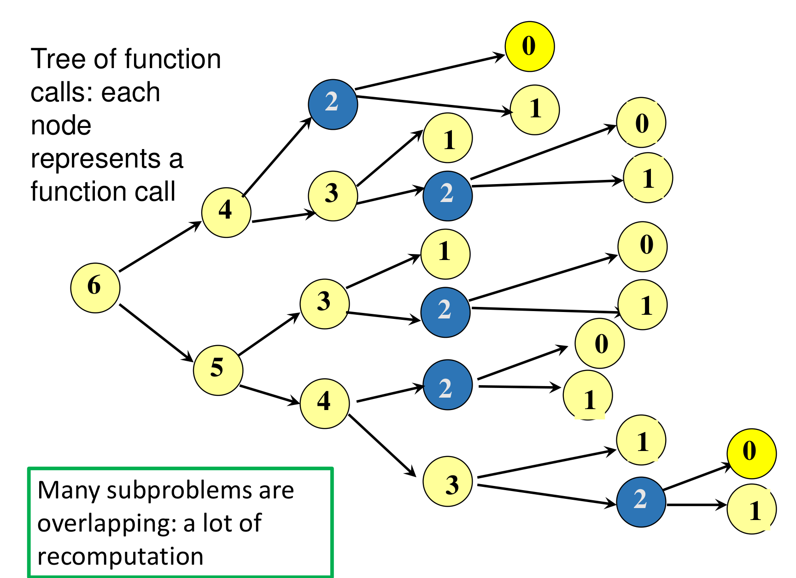
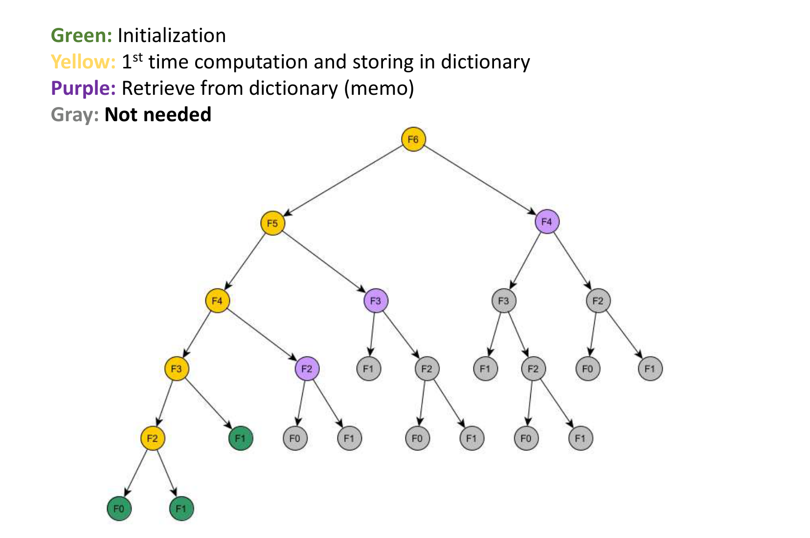
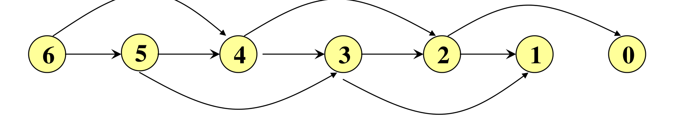
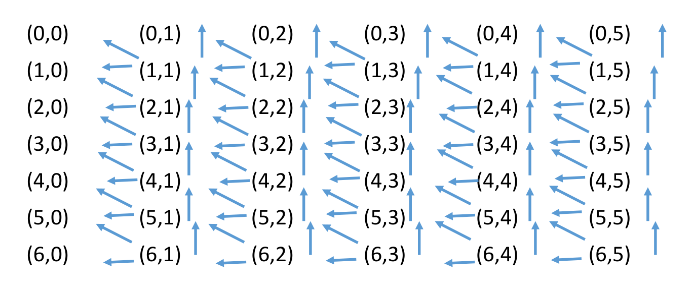
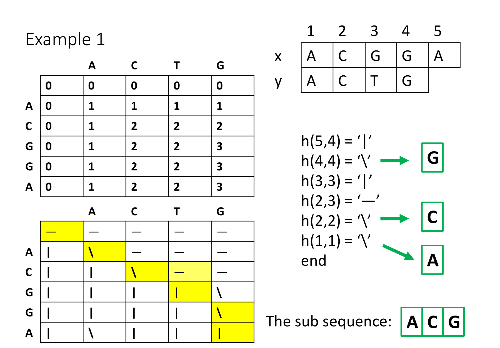
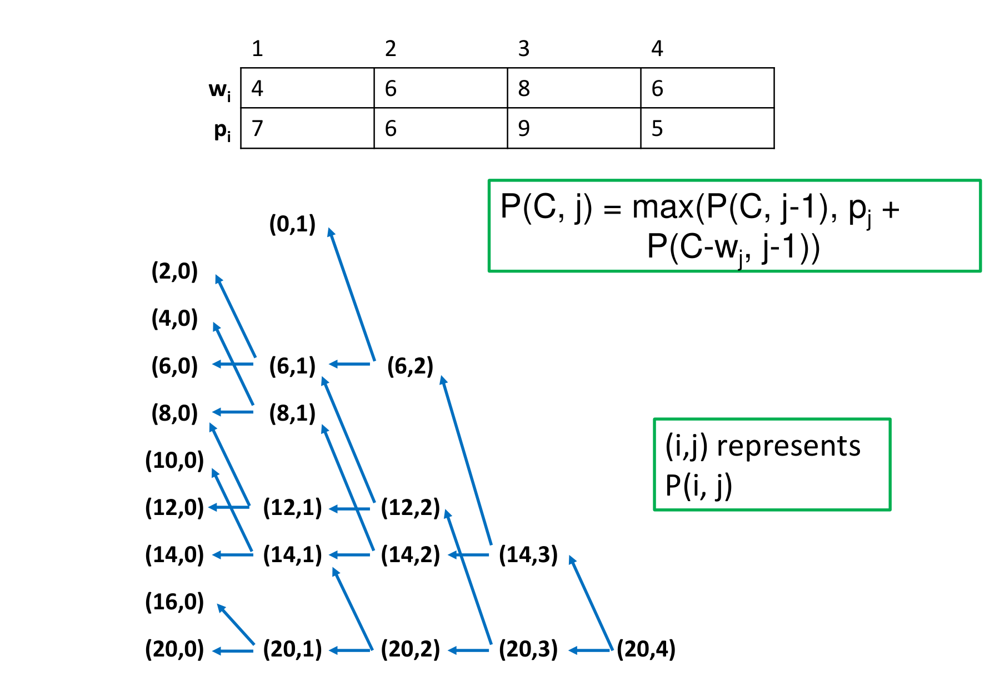

# 10. Dynamic Programming

This chapter covers the dynamic programming lectures (Weeks 9 and 10). **Dynamic programming** (DP) solves a problem by solving smaller versions of it, like divide and conquer. The difference: in DP the smaller problems **overlap**, so the same small problem would be solved again and again. DP solves each one **once**, stores the answer, and reuses it.

This often turns an exponential-time algorithm into a polynomial-time one. The chapter explains the idea with Fibonacci numbers, then applies it to two classic problems: the **longest common subsequence** and the **0/1 knapsack** problem. It ends with a general recipe for designing a DP algorithm for a new problem.

---

## 1. The Idea

### 1.1 Divide and conquer against dynamic programming

Both strategies follow the same outline:

1. Divide a problem into smaller sub-problems.
2. Solve each sub-problem recursively.
3. Combine the sub-solutions.

The difference is in step 1.

* **Divide and conquer:** the sub-problems are **independent**. In mergesort, the left half and the right half share no work.
* **Dynamic programming:** the sub-problems **overlap**. The same sub-problem appears in many places. DP adds one rule: **do not compute the answer to the same sub-problem more than once.**

### 1.2 Example: Fibonacci numbers

The Fibonacci numbers are $F_0 = 0$, $F_1 = 1$, and $F_n = F_{n-1} + F_{n-2}$ for $n \ge 2$. The direct recursive code:

```
int fib(n) {
    if (n == 0 || n == 1) return n;
    else return fib(n - 1) + fib(n - 2);
}
```

{width=80%}

The tree repeats a lot of work. `fib(4)` is computed twice, `fib(3)` three times, `fib(2)` five times.

**How many calls?** The tree is a full binary tree down to depth about $n/2$ (the shortest branch, which subtracts 2 each time), and its deepest branch has depth $n - 1$. So the number of calls $R$ satisfies

$$2^{n/2 + 1} - 1 < R < 2^n - 1.$$

This is **exponential**: $O(2^n)$ calls, but only $n + 1$ different sub-problems ($F_0$ to $F_n$).

### 1.3 Store the answers

Keep a **dictionary** (usually an array) of answers already computed. Before solving a sub-problem, check the dictionary:

* already solved: **retrieve** the stored answer;
* not solved yet: solve it, then **store** the answer.

{width=70%}

Only a thin path of the tree is actually computed. Every purple node costs $O(1)$, and everything below it disappears.

This is the main feature of DP: it **replaces an exponential-time computation with a polynomial-time one**, by storing solutions in memory and never recomputing them. It works like DFS on a graph: DFS only explores undiscovered vertices and just checks the others.

---

## 2. Two Ways to Implement DP

### 2.1 Top-down: memoization

Keep the recursive structure, and add the dictionary. The lecture's steps:

1. Formulate the problem $P$ in terms of smaller versions of itself, $Q_1, Q_2, \dots$
2. Turn this into a recursive function.
3. Use a dictionary to store the solutions of sub-problems.
4. In the recursive function:
    * before any recursive call on $Q_i$, check the dictionary. If $Q_i$ is solved, retrieve it. Otherwise, make the call;
    * just before returning the solution of $P$, store it in the dictionary.

Storing the result of a call this way is called **memoization**.

```
int fibDP(n) {
    int f1, f2;
    if (n == 0 || n == 1) { store(Soln, n, n); return n; }
    if (not member(Soln, n-1)) f1 = fibDP(n-1);
    else                       f1 = retrieve(Soln, n-1);
    if (not member(Soln, n-2)) f2 = fibDP(n-2);
    else                       f2 = retrieve(Soln, n-2);
    f1 = f1 + f2;
    store(Soln, n, f1);
    return f1;
}
```

The dictionary `Soln` is an array that starts filled with $-1$, meaning "not solved". Then:

* `member(Soln, j)`: return `Soln[j] != -1`.
* `store(Soln, j, s)`: set `Soln[j] = s`.
* `retrieve(Soln, j)`: return `Soln[j]`.

**Cost.** Each call does $O(1)$ work, not counting its own recursive calls. `fibDP` runs only once for each $n$ from 0 to $n$, so there are $n + 1$ real calls. Total: $O(n)$.

### 2.2 Bottom-up: tabulation

Instead of recursion, fill the dictionary in an order where every sub-problem's answer is ready **before** it is needed. Start from the smallest sub-problems and build up to the original one.

```
soln[0] = 0;
soln[1] = 1;
for j = 2 to n
    soln[j] = soln[j-1] + soln[j-2];
```

This is also $O(n)$, with no recursion overhead.

### 2.3 The subproblem graph

To find a correct order for bottom-up, draw the **subproblem graph**: one vertex per sub-problem, and an edge from $I$ to $J$ if solving $I$ calls $J$ directly.

{width=70%}

* The subproblem graph **must be a DAG** (Chapter 5). A cycle would mean a sub-problem depends on itself, and the recursion would never end.
* A correct fill order is a **reverse topological order** of this graph: solve every sub-problem after all the sub-problems it points to. For Fibonacci, that is $0, 1, 2, \dots, n$.
* **Number of vertices** = number of distinct sub-problems = size of the dictionary.
* **Number of edges** = total work spent combining. The total running time is about (number of sub-problems) $\times$ (work per sub-problem).

The lecture's bottom-up steps:

1. Formulate the problem in terms of smaller versions of itself (the **sub-problems**).
2. Relate the sub-problems with a **recursive function**.
3. Draw the **subproblem graph** (it must be a DAG), and find the dependencies and a topological order.
4. Use a **dictionary** to store the solutions of sub-problems.
5. In an iterative function: state the **base cases** and their solutions; fill in the dictionary in topological order, using the solutions of smaller sub-problems for larger ones; identify the original problem in the table. Possibly use **parent pointers** to recover the actual solution, not just its value.

### 2.4 Saving memory

The dictionary does not always need to keep every answer. Fibonacci's recurrence only looks back two steps, so keep just the last two values:

```
a = 0; b = 1;                 // F(0), F(1)
for j = 2 to n { c = a + b; a = b; b = c; }
return b;                     // for n >= 1
```

This uses $O(1)$ memory. The same trick works whenever each row of a table depends only on the row before it. But if you need parent pointers to rebuild the solution, you must keep the whole table.

---

## 3. The Principle of Optimality

DP is a tool for **optimization problems**: find the best (shortest, longest, cheapest, most profitable) solution. It works when the problem satisfies the **principle of optimality**:

> The sub-solutions of an optimal solution are themselves optimal solutions for their sub-problems.

Example: if $A \to B \to C \to D$ is a shortest path from $A$ to $D$, then $A \to B \to C$ is a shortest path from $A$ to $C$. (Chapter 6, Lemma 1 proved this.)

Why it matters: DP builds the optimal answer for a big problem **only** from the optimal answers of smaller problems. That is valid only if an optimal solution is always made of optimal parts.

**How to prove it** for a problem: assume an optimal solution contains a part that is **not** optimal for its sub-problem. Replace that part with a better solution of the sub-problem. The whole solution gets better. That contradicts "the solution was optimal". This is a cut-and-paste argument by contradiction.

**The DP selection rule:** when there are several possibilities, **compute all of them and take the best**. This is the difference from a greedy algorithm, which commits to one choice without checking the others.

---

## 4. Longest Common Subsequence (LCS)

### 4.1 Definitions

* A **subsequence** of $s = \langle s_1, \dots, s_n \rangle$ keeps some of its characters, **in their original order**, and drops the rest. The kept characters do not have to be next to each other. For $s$ = ACTTGCG: ACT, AG, ATTC, T and ACTTGC are subsequences. TTA and AGGC are not (the order is wrong, or there are not enough Gs).
* A **common subsequence** of $x$ and $y$ is a subsequence of both.
* A **longest common subsequence** (LCS) is a common subsequence of maximum length. It may not be unique.

The length of an LCS measures how similar two sequences are, for example two DNA strands or two versions of a document.

**Problem:** given $x = \langle x_1, \dots, x_n \rangle$ and $y = \langle y_1, \dots, y_m \rangle$, compute $LCS(n, m)$, the length of an LCS.

**The trivial algorithm:** list all subsequences of $x$ (up to $2^n$ of them) and check each against $y$. That is exponential.

### 4.2 Step 1: smaller versions of the problem

Let $LCS(i, j)$ be the length of an LCS of the prefixes $x_1 \dots x_i$ and $y_1 \dots y_j$. Look at the **last** characters, $x_i$ and $y_j$.

**Case 1: $x_i = y_j$.** Then this character can be the last character of the LCS. Before it comes an LCS of the shorter prefixes $x_1 \dots x_{i-1}$ and $y_1 \dots y_{j-1}$. So $LCS(i, j) = LCS(i-1, j-1) + 1$. (By the principle of optimality, the part before must itself be an LCS of the shorter prefixes. Otherwise a longer one would give a longer LCS for $(i, j)$.)

**Case 2: $x_i \ne y_j$.** Then they cannot both be the last character of a common subsequence. So $x_i$ is not used, or $y_j$ is not used (or neither):

* if $x_i$ is not used, the answer is $LCS(i-1, j)$;
* if $y_j$ is not used, the answer is $LCS(i, j-1)$.

We do not know which, so compute both and take the larger.

### 4.3 Step 2: the recursive function

$$LCS(i, j) = \begin{cases}
0 & \text{if } i = 0 \text{ or } j = 0, \\
LCS(i-1, j-1) + 1 & \text{if } i, j > 0 \text{ and } x_i = y_j, \\
\max\big(LCS(i-1, j),\; LCS(i, j-1)\big) & \text{if } i, j > 0 \text{ and } x_i \ne y_j.
\end{cases}$$

The base case: an empty prefix has only the empty subsequence in common with anything.

A plain recursive implementation of this is very inefficient, because the same $(i, j)$ pairs are reached again and again.

### 4.4 Steps 3 and 4: subproblem graph and table

Each $(i, j)$ depends on $(i-1, j-1)$, $(i-1, j)$ and $(i, j-1)$: the cells above-left, above and to the left.

{width=70%}

The dictionary is an $(n+1) \times (m+1)$ array `c`. Fill row 0 and column 0 with 0. Then fill **row by row from row 1 to row $n$, and left to right within each row**. Every cell's three dependencies are then already filled.

### 4.5 Step 5: the code

```
int LCS(n, m) {
    for i = 0 to n  c[i][0] = 0;
    for j = 1 to m  c[0][j] = 0;
    for i = 1 to n
        for j = 1 to m
            if (x[i] == y[j])
                c[i][j] = c[i-1][j-1] + 1;
            else if (c[i-1][j] >= c[i][j-1])
                c[i][j] = c[i-1][j];
            else
                c[i][j] = c[i][j-1];
    return c[n][m];
}
```

**Cost.** The two loops run $nm$ times, and each iteration takes constant time. **Time $O(nm)$, space $O(nm)$.**

### 4.6 Recovering the subsequence itself

The table gives only the **length**. To get the subsequence, also store a **hint array** `h` (parent pointers) that records which case produced each cell:

* `h[i][j] = '\'` if $c[i][j] = c[i-1][j-1] + 1$ (the characters matched);
* `h[i][j] = '|'` if $c[i][j] = c[i-1][j]$ (came from above);
* `h[i][j] = '—'` if $c[i][j] = c[i][j-1]$ (came from the left).

Column 0 is filled with `'|'` and row 0 with `'—'`. Note the tie rule in the code: when $c[i-1][j] = c[i][j-1]$, it takes **from above** (`'|'`).

To read the LCS, start at `h[n][m]` and follow the hints back until row 0 or column 0:

```
getSequence(n, m) {
    s = empty stack;
    i = n; j = m;
    while (i != 0 and j != 0) {
        if (h[i][j] == '\')      { s.push(x[i]); i--; j--; }
        else if (h[i][j] == '|')  i--;
        else                      j--;
    }
    pop and output everything from s;     // the LCS, in order
}
```

Each diagonal step contributes one character of the LCS. The characters come out last-first, so a stack reverses them. Each step lowers $i$ or $j$ (or both), so there are at most $n + m$ steps: **$O(n + m)$**.

{width=90%}

### 4.7 Filling the table by hand

1. Draw the table with $x$ down the side and $y$ across the top, plus a row 0 and a column 0 of zeros.
2. For each cell: if the row's character equals the column's character, take the **upper-left** value plus 1. Otherwise take the **larger** of the cell **above** and the cell to the **left** (above on a tie).
3. The answer is the bottom-right cell.
4. To get the subsequence, walk back from the bottom-right: on a match go diagonal and record the character; otherwise move to the neighbour you copied from.

---

## 5. The 0/1 Knapsack Problem

### 5.1 The problem

A knapsack holds a total weight of at most $C$ (a positive integer). There are $n$ objects. Object $i$ has weight $w_i$ and profit $p_i$ (all positive integers). Find the **largest total profit** of any subset of the objects whose total weight is at most $C$.

"0/1" means each object is either taken whole (1) or left behind (0). You cannot take part of an object. (If you could, a greedy rule by profit per unit weight would work. With whole objects, greedy fails.)

Example application: $C$ is an amount of money to invest, $w_i$ are the costs of possible investments, and $p_i$ their expected returns.

Checking every subset means $2^n$ subsets: $O(2^n)$ time.

### 5.2 Step 1: smaller versions of the problem

Look at the **last** object, object $n$. Either the best solution includes it, or it does not.

* **Include object $n$** (only possible if $w_n \le C$): it earns $p_n$ and uses up $w_n$ of the capacity. The rest of the profit comes from the best solution for the first $n - 1$ objects with capacity $C - w_n$.
* **Do not include object $n$:** the profit is the best solution for the first $n - 1$ objects with the full capacity $C$.

Compute both and take the better one (the DP selection rule).

### 5.3 Step 2: the recursive function

Let $P(C, j)$ be the largest profit from a subset of the first $j$ objects, with capacity $C$.

$$P(C, 0) = P(0, j) = 0 \quad \text{(base cases: no objects, or no capacity)}$$

$$P(C, j) = \begin{cases}
\max\big(P(C, j-1),\; p_j + P(C - w_j, j-1)\big) & \text{if } w_j \le C, \\
P(C, j-1) & \text{if } w_j > C.
\end{cases}$$

### 5.4 Step 3: the subproblem graph

$(C, j)$ depends on $(C, j-1)$ and $(C - w_j, j-1)$: always on column $j - 1$, at the same capacity and at a smaller capacity. Only the sub-problems reachable from $(C, n)$ are actually needed.

{width=75%}

### 5.5 Steps 4 and 5: the table and the code

The dictionary is `profit[C+1][n+1]`: rows are capacities $0 \dots C$, columns are objects $0 \dots n$. Fill row 0 and column 0 with 0. Then fill each row $r = 1 \dots C$ from left to right, $c = 1 \dots n$.

```
int knapsack(int[] w, int[] p, int C, int n) {
    for c = 0 to n  profit[0][c] = 0;
    for r = 1 to C  profit[r][0] = 0;
    for r = 1 to C                         // capacity
        for c = 1 to n {                   // objects 1..c are allowed
            profit[r][c] = profit[r][c-1];                 // leave object c
            if (w[c] <= r)
                if (profit[r][c] < profit[r - w[c]][c-1] + p[c])
                    profit[r][c] = profit[r - w[c]][c-1] + p[c];   // take object c
        }
    return profit[C][n];
}
```

![The completed table (rows 10 to 20) for C = 20, with weights 4, 6, 8, 6 and profits 7, 6, 9, 5. The answer is profit[20][4] = 22.](10-artifacts/knapsack-table.png){width=85%}

To find **which** objects give the best profit, store a parent pointer in each cell (whether it took object $c$), or walk back from `profit[C][n]`: if `profit[r][c] == profit[r][c-1]`, object $c$ was left out (move to column $c-1$); otherwise it was taken (move to row $r - w_c$, column $c - 1$).

### 5.6 Cost, and why it is "pseudo-polynomial"

The table has $(C+1)(n+1)$ cells, each filled in $O(1)$. **Time and space: $O(nC)$.**

That looks polynomial, but it is not polynomial in the usual sense:

* An algorithm is **strongly polynomial** if its running time is a polynomial in the **size** of the input: here, the $n$ weights and $n$ profits.
* An algorithm is **pseudo-polynomial** if its running time is a polynomial in the **numeric value** of the input.

$C$ is a single number. Writing it takes only about $\log_2 C$ bits. If $C$ doubles, the input grows by one bit, but the running time doubles. In terms of the input size, $O(nC)$ is exponential. So the DP algorithm for knapsack is **pseudo-polynomial**. It is fast only when $C$ is small.

---

## 6. Shortest Paths in a DAG

The lecture outline lists this topic, but its slides are not released yet. The standard method fits the recipe of this chapter:

* Sub-problem: $dist(v)$, the shortest distance from the source $s$ to $v$.
* Recursion: $dist(s) = 0$, and $dist(v) = \min_{(u, v) \in E} \big(dist(u) + w(u, v)\big)$.
* The graph is a DAG, so this recursion has no cycles. Compute the $dist$ values in **topological order** (Chapter 5), so every $u$ is done before $v$.
* Each edge is used once: $O(|V| + |E|)$.
* Unlike Dijkstra, this works with **negative** weights, because there is no cycle.

Replacing min with max gives the **longest** path in a DAG, which is otherwise a hard problem in general graphs.

---

## 7. Designing a DP Algorithm for a New Problem

Exam questions often give a new problem and ask for a recursive definition, the subproblem graph, a bottom-up algorithm and its complexity. Use the same five steps every time.

### 7.1 The recipe

1. **Define the sub-problem in words.** Say exactly what $F(i)$ or $F(i, j)$ means: "the maximum profit using only the first $i$ items", "the number of ways to reach cell $(i, j)$". Most errors start with a vague definition.
2. **Write the recursion with base cases.** Think about the **last decision**: what happens to the last item, the last character, the last cut, the last step? Each possible decision gives one term. Combine the terms with max, min or sum. State the base cases (empty input, size 0 or 1, the first row and column).
3. **Draw the subproblem graph.** Draw the original problem, and edges to the sub-problems its recursion calls, then theirs, down to the base cases. Label each node with its value if asked.
4. **Choose the table and the fill order.** One table entry per distinct sub-problem. Fill in an order where everything a cell needs is already filled (reverse topological order of the subproblem graph).
5. **State the complexity.** Time $\approx$ (number of sub-problems) $\times$ (work per sub-problem). Space = size of the table (often reducible, see 2.4).

### 7.2 Common shapes of recursion

| Shape | Sub-problem | Recursion looks like | Example problems |
| :--- | :--- | :--- | :--- |
| Take it or leave it | best using the first $i$ items | $F(i) = \max(F(i-1),\; \text{value}_i + F(\text{earlier compatible } i))$ | 0/1 knapsack (add capacity as a second index); choosing non-adjacent items |
| First piece | best for size $n$ | $F(n) = \max_{1 \le k \le n} (\text{value}(k) + F(n-k))$ | cutting a length into priced pieces |
| Two prefixes | best for $x_1..x_i$ and $y_1..y_j$ | depends on $(i-1, j-1)$, $(i-1, j)$, $(i, j-1)$ | LCS, comparing two strings |
| Grid | value at cell $(i, j)$ | $F(i, j) = F(i-1, j) + F(i, j-1)$, or min/max of them | counting paths that move right or down |
| Interval / split point | best for the segment $i..j$ | $F(i, j) = \min_{i < k < j} (F(i, k) + F(k, j) + \text{cost}(i, j))$ | order of cuts or of matrix multiplications |
| Sum over splits | count for size $n$ | $F(n) = \sum_{k} F(k)\,F(n-1-k)$ | counting tree shapes (Catalan numbers) |

The table size and the fill order follow from the shape:

* One index $i$: a 1-D array, filled $i = 0, 1, 2, \dots$
* Two prefix indices or a grid: a 2-D array, filled row by row.
* An interval $(i, j)$: a 2-D array, filled by **increasing interval length** $j - i$, because each interval needs shorter ones.
* A sum or min over $k$ choices: each cell costs $O(n)$, so time is (number of cells) $\times\, O(n)$. For example, $O(n^2)$ for a 1-D sum over splits, and $O(n^3)$ for intervals.

### 7.3 Top-down without memoization

If an exam asks for the running time of the plain recursive version, write its recurrence and solve it (Chapter 8). It is usually exponential. Example: a recursion $F(n) = \max_{k} (\dots + F(n - k))$ that tries every first piece calls all smaller sizes, so $T(n) = 1 + \sum_{k=0}^{n-1} T(k)$, which gives $T(n) = 2^n$.

---

## 8. DP, Divide and Conquer, and Greedy

| Statement | D&C | Greedy | DP |
| :--- | :--- | :--- | :--- |
| Divides a problem into sub-problems and builds larger solutions from smaller ones | Yes | — | Yes |
| Sub-problems are independent | Yes | — | **No** (they overlap) |
| Stores solutions of sub-problems and reuses them | No | No | **Yes** |
| Divides at fixed, pre-chosen points (such as the middle) | Yes | — | No (it tries all choices) |
| At each step, picks the locally best choice and never undoes it | — | **Yes** | No (it compares all choices) |
| At each step, selects the best from a collection of choices, after computing them all | — | — | **Yes** |
| Solves sub-problems in a fixed order (by size, or topological order) | — | — | Yes (bottom-up) |
| Guaranteed optimal | — | Only with a proof | Yes, if the principle of optimality holds |

---

## 9. Common Traps

* DP needs **overlapping** sub-problems and the **principle of optimality**. Without overlap, plain divide and conquer is enough.
* Memoization is top-down (recursion + dictionary). Tabulation is bottom-up (loops in a correct order). Both give the same complexity.
* The subproblem graph must be a DAG. Fill the table in reverse topological order.
* Time $\approx$ (number of sub-problems) $\times$ (work per sub-problem).
* LCS: time $O(nm)$, traceback $O(n + m)$. On a tie the lecture code takes from **above** ('|').
* A subsequence keeps the order but need not be contiguous. A **substring** must be contiguous.
* 0/1 knapsack: $O(nC)$ is **pseudo-polynomial**, not polynomial, because $C$ is a value, not an input size.
* The knapsack table in the lecture has **capacity as the row** and **objects as the column**: `profit[r][c]`.
* Fibonacci with memoization is $O(n)$ time. Bottom-up with two variables is $O(1)$ space.
