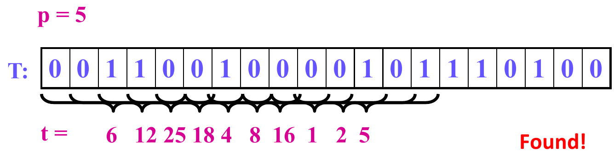
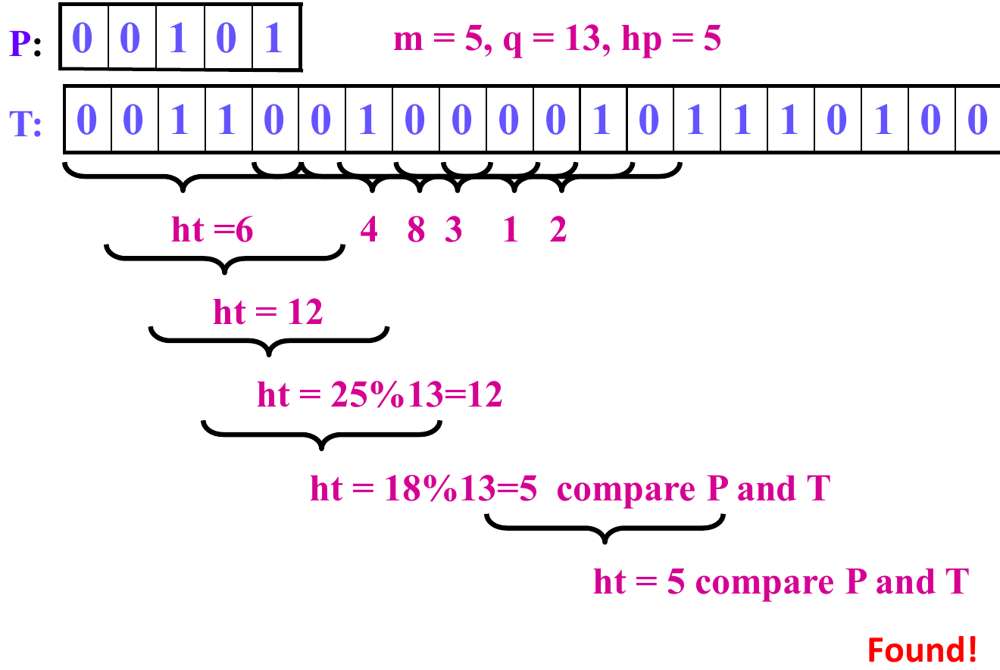
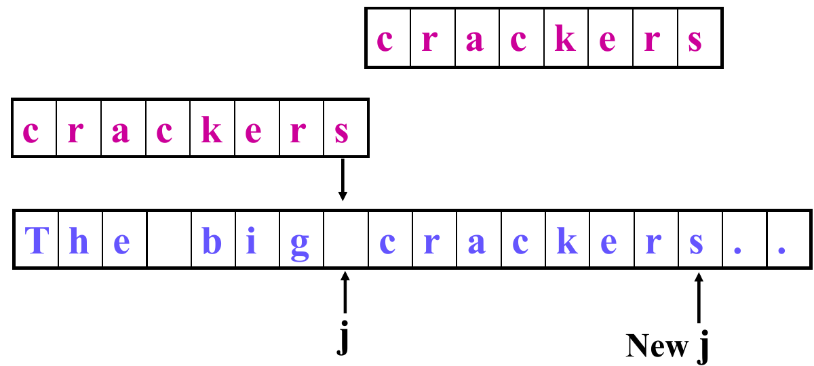
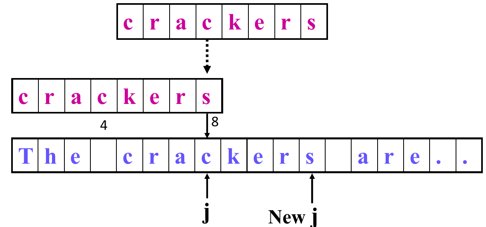
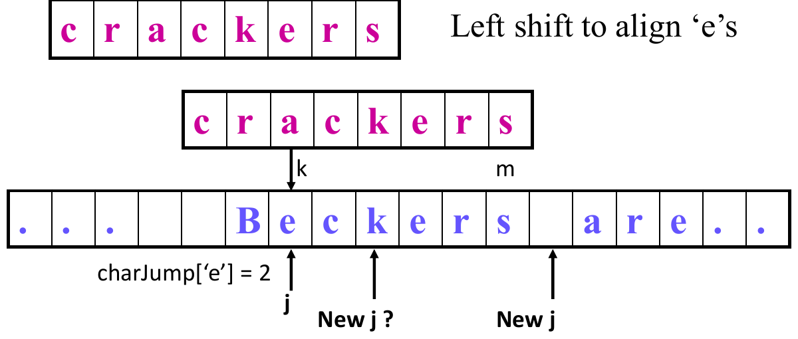
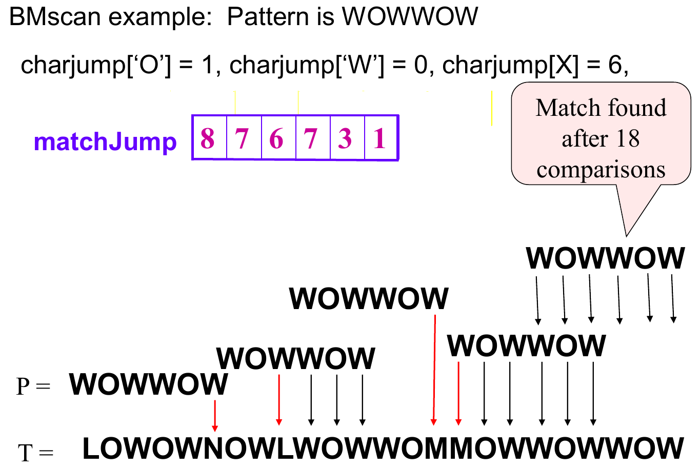

# 11. String Matching

This chapter covers Lecture 11, String Matching. Chapter 10 compared two whole sequences to find what they share. This chapter asks a narrower question: where does one short string appear **inside** a long one?

The chapter has three algorithms. Each one answers the same question: how can we avoid repeating work that we have already done?

* **Simple scan** (brute force): try every position. It repeats a lot of work.
* **Rabin-Karp:** turn each piece of text into a number, and compare numbers instead of characters.
* **Boyer-Moore:** compare from the right end of the pattern, and use what a mismatch tells you to skip ahead.

We run **one example** through all three algorithms, so you can see what each one saves.

---

## 1. The Problem

### 1.1 What we want

Given a **text** $T$ of $n$ characters and a **pattern** $P$ of $m$ characters, find the **first occurrence** of $P$ in $T$.

* Return the position in $T$ where that occurrence starts.
* Return $-1$ if $P$ does not occur in $T$.

We may be looking for:

* a word in a document;
* a pattern in a DNA sequence;
* a piece of coded data, such as part of an image, a sound or machine code;
* a sub-list in a linked list.

### 1.2 Names used in this chapter

| Name | Meaning |
| :--- | :--- |
| $T$ | the text, length $n$ |
| $P$ | the pattern, length $m$ (usually $m \le n$) |
| $j$ | the current position in $T$ |
| $k$ | the current position in $P$ |
| $\Sigma$ | the **alphabet**: the set of possible characters, for example $\{0, 1\}$ or $\{a, \dots, z\}$ |
| $d = |\Sigma|$ | the number of characters in the alphabet |

The simple scan and Rabin-Karp count positions from **0**. Boyer-Moore counts from **1**, as the lecture does. Keep this in mind when you trace the code. The same occurrence has a position one higher in Boyer-Moore than in the other two.

### 1.3 How we measure cost

The usual cost measure is the number of **character comparisons**: how many times the algorithm checks whether one character of $P$ equals one character of $T$.

### 1.4 The running example

We use this text and pattern in every section. The lecture uses them for the simple scan.

$$P = \text{ABABC}, \qquad T = \text{ABABABCCAC}.$$

So $m = 5$, $n = 10$, and the alphabet is $\Sigma = \{\text{A}, \text{B}, \text{C}\}$, so $d = 3$.

| Position in $T$ (from 0) | 0 | 1 | 2 | 3 | 4 | 5 | 6 | 7 | 8 | 9 |
| :--- | :---: | :---: | :---: | :---: | :---: | :---: | :---: | :---: | :---: | :---: |
| Character | A | B | A | B | A | B | C | C | A | C |

$P$ occurs once, at position 2 (characters 2 to 6 are ABABC). Each algorithm must find it. We count how much work each one does.

---

## 2. The Simple Scan (Brute Force)

### 2.1 The idea

Put the pattern under the text at position 0. Compare the characters from left to right.

* If all $m$ characters match: found. Return the position.
* At the first mismatch: shift the pattern **one** position to the right, and start comparing again from the pattern's first character.
* If fewer than $m$ characters of text remain: stop. There is no match.

### 2.2 The code

```
int SimpleScan(char[] P, char[] T, int m) {
    int i, j, k;
    // i: the current guess of where P begins in T
    // j: the current character in T
    // k: the current character in P
    j = k = 0;
    i = 0;
    while (j < n) {
        if (T[j] == P[k]) {          // match: move both forward
            j++;
            k++;
            if (k == m) return i;    // all m characters matched
        }
        else {                       // mismatch: shift P one place right
            j = ++i;
            k = 0;
            if (j > n - m) break;    // not enough text left
        }
    }
    return -1;
}
```

On a mismatch, the code sets $j$ back to $i + 1$. So the text characters that matched are read **again** at the next position. This repeated work is what the other two algorithms avoid.

### 2.3 The running example

$P$ = ABABC, $T$ = ABABABCCAC.

| Pattern starts at | Comparisons | What happens |
| :---: | :---: | :--- |
| 0 | 5 | A, B, A, B match. Then C against A fails. |
| 1 | 1 | B against A fails at once. |
| 2 | 5 | A, B, A, B, C all match. Return 2. |

Total: **11 comparisons**. At position 0 the scan learned that the text starts with ABAB. At position 2 it read the same characters again.

### 2.4 Worst case

The worst case happens when almost every position gives a **near match**: the first $m - 1$ characters match, and only the last one fails.

Lecture example: $P$ = AAAAC, $T$ = AAAAAAAAAAAA ($n = 12$).

* At every position, AAAA matches and C fails: $m = 5$ comparisons.
* There are $n - m + 1 = 8$ positions to try.

In general, there are $n - m + 1$ positions and each costs up to $m$ comparisons. So the worst-case number of comparisons is

$$m\,(n - m + 1) = O(mn).$$

Read this as: $m$ comparisons at each of $n - m + 1$ positions. For this example it is $5 \times 8 = 40$.

### 2.5 Best cases

* **Found at once:** the pattern is at position 0. Only $m$ comparisons: $O(m)$.
* **Not found, but fast:** the first character of $P$ never appears in $T$. Each position fails on its first comparison: $n - m + 1$ comparisons, $O(n)$.

In real text, a mismatch usually comes early, so the simple scan does better than its worst case.

---

## 3. Rabin-Karp: Compare Numbers, Not Strings

### 3.1 The idea

Comparing two strings of length $m$ takes up to $m$ character comparisons. Comparing two **numbers** takes one. So the plan is:

1. Turn the pattern into a number $p$.
2. Turn the first $m$ characters of the text (the first **window**) into a number $t$.
3. If $p = t$: the pattern is found.
4. Otherwise, shift the window one character right, compute its new number $t$, and go back to step 3. Stop at the end of the text.

This plan pays off only if two things are cheap:

* computing $p$ and the first $t$: $\Theta(m)$, once;
* computing each **next** $t$ from the previous one: $\Theta(1)$. If we rebuilt each number from scratch, every window would cost $\Theta(m)$ and we would gain nothing over the simple scan.

Sections 3.2 and 3.3 show how to get both.

### 3.2 Turning a string into a number

We need a rule that gives different strings different numbers. Read the string as a number in **base $d$**, where $d = |\Sigma|$. Each character becomes a **digit** from $0$ to $d - 1$. This is how the decimal number 36215 is read: each digit is multiplied by a power of 10, from $10^4$ down to $10^0$.

For digits, $d = 10$. For $P$ = "36215":

$$p = 3 \cdot 10^4 + 6 \cdot 10^3 + 2 \cdot 10^2 + 1 \cdot 10^1 + 5.$$

The leftmost digit has the largest weight, $10^{m-1}$. The rightmost digit has weight $1$.

Computing each power of 10 separately is slow: the power $10^k$ takes about $k$ multiplications, so all the powers together take $\Theta(m^2)$. **Horner's rule** avoids this. It factors out $d$ again and again, so that each step multiplies by $d$ only once:

$$p = \big(\big((3 \cdot 10 + 6) \cdot 10 + 2\big) \cdot 10 + 1\big) \cdot 10 + 5.$$

Read this from the inside out. Start with 3. Multiply by 10 and add 6: this gives 36. Multiply by 10 and add 2: this gives 362. Multiply by 10 and add 1: 3621. Multiply by 10 and add 5: 36215. Each step shifts the digits so far one place left, and adds the next digit. It uses only $m - 1$ multiplications.

In general, for a string $P[0..m-1]$:

$$p = \big(\dots\big((P[0] \cdot d + P[1]) \cdot d + P[2]\big) \cdot d + \dots + P[m-2]\big) \cdot d + P[m-1].$$

Here $P[i]$ is the digit value of the $i$-th character. As code:

```
p = P[0];
for j = 1 to m-1
    p = p * d + P[j];
```

This takes $\Theta(m)$ time. The first window's number $t$ is computed the same way.

For letters, we choose a digit for each letter. In the running example, A = 0, B = 1, C = 2, and $d = 3$. Then ABABC is the digits 0, 1, 0, 1, 2, and

$$p = \big(\big((0 \cdot 3 + 1) \cdot 3 + 0\big) \cdot 3 + 1\big) \cdot 3 + 2 = 32.$$

Check: $0 \cdot 81 + 1 \cdot 27 + 0 \cdot 9 + 1 \cdot 3 + 2 = 32$.

### 3.3 Sliding the window in constant time

When the window moves one place right, most of its digits stay in the window. Only two things change:

1. the leftmost digit leaves. It is the **most significant digit** (MSD), because it has the largest weight;
2. a new digit joins on the right. It is the **least significant digit** (LSD), because it has weight 1.

Look at what happens to the number, using the lecture's example. The text is 3 6 4 1 5 2, with $m = 5$ and $d = 10$. The old window is 36415. The new window is 64152.

* Remove the leading 3. Its weight is $10^4$, so subtract $3 \cdot 10^4$: $36415 - 30000 = 6415$.
* The remaining digits 6, 4, 1, 5 now have weights $10^3, 10^2, 10^1, 10^0$. In the new window, they need weights $10^4, 10^3, 10^2, 10^1$. Multiply by 10: $6415 \cdot 10 = 64150$.
* Add the new digit 2, with weight 1: $64152$.

Written as a formula, for any window and any $d$:

$$t_{\text{new}} = \big(t_{\text{old}} - \text{MSD} \cdot d^{\,m-1}\big) \cdot d + \text{LSD}.$$

Here $t_{\text{old}}$ is the current window's number, $\text{MSD}$ is its leftmost digit, $\text{LSD}$ is the new digit that enters on the right, and $d^{\,m-1}$ is the weight of the leftmost digit. Read it in words: subtract the leftmost digit's share, shift everything one place left, and add the new digit. It takes a fixed number of operations, so it is $\Theta(1)$.

In code, with the window starting at $T[i]$:

```
t = (t - T[i] * dM) * d + T[i+m];
// t before: the number for T[i .. i+m-1]
// t after:  the number for T[i+1 .. i+m]
```

Here `dM` is $d^{\,m-1}$. It is the same for every window, so we compute it once, before the scan:

```
dM = 1;
for j = 1 to m-1
    dM = dM * d;
```

The loop runs $m - 1$ times, so `dM` ends as $d^{\,m-1}$. It is not $d^{\,m}$: a number with $m$ digits has a leftmost weight of $d^{\,m-1}$.

### 3.4 Example (lecture): a binary text

$P$ = 00101, so $m = 5$, $d = 2$ and $p = 5$. The text is

$$T = 0\,0\,1\,1\,0\,0\,1\,0\,0\,0\,0\,1\,0\,1\,1\,1\,0\,1\,0\,0.$$

{width=85%}

| Window start | 0 | 1 | 2 | 3 | 4 | 5 | 6 | 7 | 8 | 9 |
| :--- | :---: | :---: | :---: | :---: | :---: | :---: | :---: | :---: | :---: | :---: |
| Window | 00110 | 01100 | 11001 | 10010 | 00100 | 01000 | 10000 | 00001 | 00010 | 00101 |
| $t$ | 6 | 12 | 25 | 18 | 4 | 8 | 16 | 1 | 2 | **5** |

The window at position 9 has $t = 5 = p$. Found.

### 3.5 The problem: numbers get too large

With a long pattern, say $m = 100$, the number has 100 digits. It does not fit in a machine word, and the arithmetic **overflows**.

**Fix:** keep only the remainder when we divide by a **prime** number $q$. The remainder after division is written $x \bmod q$ ("$x$ modulo $q$"). This is called **hashing**: we map a big number to a small one. The value $h = t \bmod q$ is the window's **hash**. The prime $q$ should be **large**. Sections 3.13 and 3.14 explain why.

### 3.6 What a hash match means

Hashing loses information. Many different numbers have the same remainder, so two different windows can have the same hash. This gives two cases:

* If $h_p \ne h_t$: the window is **definitely not** the pattern. Move on.
* If $h_p = h_t$: the window **might** be the pattern. Compare the characters one by one to be sure.

A hash match that turns out **not** to be a real match is a **spurious hit**. It costs up to $m$ wasted character comparisons.

The algorithm with hashing:

1. Hash the pattern to $h_p$.
2. Hash the first window to $h_t$.
3. If $h_p = h_t$, compare the pattern with the window character by character. If they are equal: found.
4. Otherwise, shift the window one character right and **rehash** it. Go to step 3. Stop at the end of the text.

### 3.7 Example (lecture): the binary text with $q = 13$

Same $P$ and $T$ as in Section 3.4. Now $h_p = 5 \bmod 13 = 5$.

| Window start | 0 | 1 | 2 | 3 | 4 | 5 | 6 | 7 | 8 | 9 |
| :--- | :---: | :---: | :---: | :---: | :---: | :---: | :---: | :---: | :---: | :---: |
| $t$ | 6 | 12 | 25 | 18 | 4 | 8 | 16 | 1 | 2 | 5 |
| $h_t = t \bmod 13$ | 6 | 12 | 12 | **5** | 4 | 8 | 3 | 1 | 2 | **5** |
| Result | | | | spurious hit | | | | | | found |

* At position 3, $18 \bmod 13 = 5 = h_p$. The algorithm compares 10010 with 00101 and finds they differ. This is a spurious hit.
* At position 9, $h_t = 5$ again. The comparison succeeds. Found.

{width=80%}

Note that the table shows $t$ only to explain the idea. The real algorithm never builds $t$. It computes $h_t$ directly, as Sections 3.8 to 3.10 show.

### 3.8 Arithmetic modulo $q$

We do not want to build the huge number $t$ and then take its remainder, because $t$ would overflow. Three rules let us take the remainder **at every step** instead. The numbers then stay small. Here $x$ and $y$ are any whole numbers:

$$\begin{aligned}
(x + y) \bmod q &= \big[(x \bmod q) + (y \bmod q)\big] \bmod q \\
(x \bmod q) \bmod q &= x \bmod q \\
(x \cdot y) \bmod q &= \big[(x \bmod q) \cdot (y \bmod q)\big] \bmod q
\end{aligned}$$

Read these in words. The first says: you can reduce each number mod $q$ before you add, and you get the same remainder. The second says: reducing twice changes nothing. The third says the same as the first, for multiplication. So we may reduce after every addition and multiplication, and the final answer is the same as if we had done all the work with big numbers and reduced once at the end.

Example (lecture), with $q = 13$:

$$\begin{aligned}
(3 \cdot 10 + 6) \bmod 13 &= \big[(3 \cdot 10) \bmod 13 + 6 \bmod 13\big] \bmod 13 \\
&= (4 + 6) \bmod 13 \\
&= 10.
\end{aligned}$$

Here $(3 \cdot 10) \bmod 13 = 30 \bmod 13 = 4$. Check: $36 \bmod 13 = 10$, the same answer.

### 3.9 The hash function

`hash` is Horner's rule from Section 3.2, with "mod $q$" at every step:

```
int hash(Txt, m, d) {
    int h = Txt[0] % q;
    for (int i = 1; i < m; i++)
        h = (h * d + Txt[i]) % q;
    return h;
}
```

Because of the rules in Section 3.8, `h` always equals the true number mod $q$. And `h` stays below $q$, so `h * d + Txt[i]` stays below $q \cdot d$: it never overflows if $q$ is not huge. It computes both $h_p$ and the first $h_t$, in $\Theta(m)$ time.

Example (lecture): `hash("36415", 5, 10)` with $q = 7$.

| Step | Calculation | $h$ |
| :--- | :--- | :---: |
| start | $3 \bmod 7$ | 3 |
| $i = 1$ | $(3 \cdot 10 + 6) \bmod 7 = 36 \bmod 7$ | 1 |
| $i = 2$ | $(1 \cdot 10 + 4) \bmod 7 = 14 \bmod 7$ | 0 |
| $i = 3$ | $(0 \cdot 10 + 1) \bmod 7 = 1 \bmod 7$ | 1 |
| $i = 4$ | $(1 \cdot 10 + 5) \bmod 7 = 15 \bmod 7$ | 1 |

So `hash("36415", 5, 10)` $= 1$. Check: $36415 = 7 \times 5202 + 1$.

### 3.10 The rehash function

`rehash` is the sliding update from Section 3.3, with "mod $q$" at every step. It runs in $\Theta(1)$:

```
int rehash(T, i, m, ht) {
    oldest = (T[i] * dM) % q;                 // dM is d^(m-1) mod q
    oldest_removed = ((ht + q) - oldest) % q;
    return (oldest_removed * d + T[i+m]) % q;
}
```

The three lines match the three parts of the formula $\big(t_{\text{old}} - \text{MSD} \cdot d^{\,m-1}\big) \cdot d + \text{LSD}$:

* `oldest` is the leftmost digit's share, $\text{MSD} \cdot d^{\,m-1}$, mod $q$.
* `oldest_removed` subtracts it from the old hash. This is $t_{\text{old}} - \text{MSD} \cdot d^{\,m-1}$, mod $q$.
* The last line multiplies by $d$ (shift left one place) and adds the new digit $T[i+m]$.

**Why `+ q` in the second line?** Both `ht` and `oldest` are remainders, so each is between $0$ and $q - 1$. But `ht` can be **smaller** than `oldest`. Then `ht - oldest` is negative, and in many languages the `%` of a negative number is negative too, which is not the remainder we want. Adding $q$ does not change the value mod $q$, and it makes the number positive: `ht + q` is at least $q$, and `oldest` is less than $q$.

`dM` is computed once, with mod $q$ at every step:

```
dM = 1;
for j = 1 to m-1
    dM = (dM * d) % q;
```

Example (lecture): the text 3 6 4 1 5 2, $m = 5$, $d = 10$, $q = 7$. The first window 36415 has $h_t = 1$. We want the hash of the next window, 64152.

* $dM = 10^4 \bmod 7 = 4$.
* `oldest` $= (3 \cdot 4) \bmod 7 = 5$. The 3 is the leaving digit.
* `oldest_removed` $= (1 + 7 - 5) \bmod 7 = 3$.
* Return $(3 \cdot 10 + 2) \bmod 7 = 32 \bmod 7 = 4$. The 2 is the entering digit.

Check: the new window is 64152, and $64152 = 7 \times 9164 + 4$. Correct.

### 3.11 The full algorithm

```
int RKscan(P, T) {
    m = Length(P);
    n = Length(T);
    dM = 1;
    for j = 1 to m-1  dM = dM * d % q;       // d = |Sigma|
    hp = hash(P, m, d);                      // Theta(m)
    ht = hash(T, m, d);                      // Theta(m)
    for (j = 0; j <= n - m; j++) {           // at most n-m+1 windows
        if (hp == ht && equal_string(P, T, 0, j, m))
            return j;
        if (j < n - m) ht = rehash(T, j, m, ht);
    }
    return -1;                               // pattern not found
}
```

`equal_string` compares $P$ with the window character by character. It runs **only** when the hashes are equal (the `&&` skips it otherwise).

### 3.12 The running example

$P$ = ABABC, $T$ = ABABABCCAC, with A = 0, B = 1, C = 2, $d = 3$, $m = 5$. We choose $q = 7$.

**Set-up.**

* $dM = 3^4 \bmod 7 = 81 \bmod 7 = 4$.
* $h_p$ = `hash(P)`. Start with $0$. Then $(0 \cdot 3 + 1) \bmod 7 = 1$, then $(1 \cdot 3 + 0) \bmod 7 = 3$, then $(3 \cdot 3 + 1) \bmod 7 = 3$, then $(3 \cdot 3 + 2) \bmod 7 = 4$. So $h_p = 4$. (Check: $p = 32$ and $32 \bmod 7 = 4$.)
* $h_t$ for the first window ABABA (digits 0, 1, 0, 1, 0) is $2$. (Check: the number is $30$ and $30 \bmod 7 = 2$.)

**Scan.**

| Window start | Window | Number $t$ (for reference) | $h_t$ | $h_t = h_p$? | Character comparisons |
| :---: | :---: | :---: | :---: | :--- | :---: |
| 0 | ABABA | 30 | 2 | no | 0 |
| 1 | BABAB | 91 | 0 | no | 0 |
| 2 | ABABC | 32 | 4 | yes: compare | 5 (all match) |

The two rehash steps, in full:

* Window 0 to 1: leaving digit $T[0] = 0$, entering digit $T[5] = 1$. `oldest` $= (0 \cdot 4) \bmod 7 = 0$. `oldest_removed` $= (2 + 7 - 0) \bmod 7 = 2$. Result: $(2 \cdot 3 + 1) \bmod 7 = 0$.
* Window 1 to 2: leaving digit $T[1] = 1$, entering digit $T[6] = 2$. `oldest` $= (1 \cdot 4) \bmod 7 = 4$. `oldest_removed` $= (0 + 7 - 4) \bmod 7 = 3$. Result: $(3 \cdot 3 + 2) \bmod 7 = 4$.

Rabin-Karp makes **5 character comparisons**, compared with 11 for the simple scan. It also does the arithmetic of two `hash` calls and two `rehash` calls. The saving comes from windows 0 and 1: the hash told us they were not the pattern, with no character comparison.

### 3.13 Cost

* **Preprocessing:** two `hash` calls, $\Theta(m)$.
* **Scan:** at most $n - m + 1$ windows. Each costs $\Theta(1)$ for the rehash and the number comparison, **plus** up to $m$ character comparisons when the hashes match.

**Worst case:** every window is a hash hit, so every window also costs $m$ character comparisons:

$$\Theta\big((n - m + 1)\,m\big).$$

This is the same count as in the simple scan's worst case, so Rabin-Karp is no better there.

**Expected case:** with few spurious hits, the time is

$$O(n + m) + \text{time for the spurious hits}.$$

The $O(m)$ part is the two `hash` calls. The $O(n)$ part is the loop with its $\Theta(1)$ rehash.

**How many spurious hits to expect** (not in the lecture; standard result). Suppose the hash spreads the windows evenly over the $q$ possible values. Then a window that is not the pattern has a chance of about $1/q$ of hashing to $h_p$. Over $n - m + 1$ windows, that gives about $(n - m + 1)/q$ spurious hits, each costing up to $m$ comparisons. So the expected time is

$$O\!\left(n + m + \frac{(n - m + 1)\,m}{q}\right).$$

Read this as: the normal cost $n + m$, plus the number of expected spurious hits times $m$ comparisons each. When $q$ is larger than $m$, the last term is $O(n)$, and the expected time is $O(n + m)$. This is why $q$ should be a **large** prime.

### 3.14 What makes a good hash

The number of spurious hits depends on the hash:

* **A large prime $q$** spreads the windows over many possible values, so two different windows rarely share a hash. (Not in the lecture: the reason for a *prime* is that $q$ must not share a factor with $d$. For example, with $d = 10$ and $q = 10$, the hash $t \bmod 10$ is only the last digit, and most windows would collide.)
* **The hash must depend on the position of each character**, not only on which characters appear. Horner's rule does this: each digit is multiplied by a different power of $d$. A hash that ignores position (for example, one that just adds the characters up) gives the same value to every rearrangement of the same characters. That causes many spurious hits.
* **Any hash still needs the final character check.** Equal hashes never prove a match.

---

## 4. Boyer-Moore: Skip Ahead Using the Mismatch

### 4.1 What a mismatch can teach us

The simple scan wastes information. When it finds a mismatch, it knows two things:

* which text character $T[j]$ failed to match;
* which part of the pattern matched just before the failure.

Yet it shifts the pattern by only one place, and then reads those characters again. Boyer-Moore uses these two facts to shift **as far as is safe**. A shift is **safe** if it cannot skip over an occurrence of $P$. Because the shift must be safe, we also want it to be the **largest** safe shift, as it skips the most work.

Boyer-Moore builds two tables from the pattern, **before** the scan. Each table turns one of the two facts into a safe shift:

* **charJump** uses the mismatched **text character**;
* **matchJump** uses the **part of the pattern that already matched**.

After a mismatch, the algorithm takes the larger of the two shifts. Both are safe, so the larger one is safe.

### 4.2 Compare from the right

Boyer-Moore moves along the text $T[1..n]$ from **left to right**, as before. But at each position, it compares the pattern $P[1..m]$ from **right to left**: the last character first.

Why start at the right? The text character under the **end** of the pattern is the one that decides how far we can shift. If that character does not occur in $P$ at all, no alignment that covers it can match, and we can shift the whole pattern past it, by $m$ places. Many text characters are then never compared. This is why Boyer-Moore works especially well with **long patterns**.

### 4.3 Shift and jump

We need two measures. Say the mismatch is at text position $j$ and pattern position $k$. The pattern's last character then sits $m - k$ places to the right of $j$, under $T[j + (m - k)]$.

* The **shift** $s$ is how many places the **pattern** moves right.
* The **jump** is how far **$j$** moves right.

After a shift, the next comparison starts again at the pattern's last character, which now sits $s$ places further right than the old end. So $j$ must go to the old end, and then $s$ more places:

$$\text{jump} = (m - k) + s.$$

Here $m - k$ is the distance from the current $j$ to the pattern's old end ($m - k = 0$ when the mismatch is at the last character). Read it as: first catch up to the end of the pattern, then move with the pattern. Boyer-Moore tracks $j$ and not the shift, so the tables hold **jumps**.

Example from the running example. $P$ = ABABC is aligned with $T[1..5]$. The comparison at $j = 5$, $k = 5$ is A (text) against C (pattern): a mismatch. Here $m - k = 0$, so $j$ already is the end. If $s = 2$, the jump is $0 + 2 = 2$, and $j$ becomes $7$: the end of the pattern, now aligned with $T[3..7]$.

### 4.4 The scan

```
int BMscan(char[] P, char[] T, int m, int[] charJump, int[] matchJump) {
    int j, k;
    j = m; k = m;                        // P[1] and T[1] are the first characters
    while (j <= n) {
        if (k < 1) return j + 1;         // match found
        if (T[j] == P[k]) { j--; k--; }  // match: move both left
        else {                           // mismatch: shift P right
            j += max(charJump[T[j]], matchJump[k]);
            k = m;
        }
    }
    return -1;                           // match not found
}
```

How it moves:

* **Start:** $k = m$ and $j = m$. The last character of $P$ sits under $T[m]$.
* **After a match:** $j$ and $k$ both go **left** by one.
* **When $k$ reaches 0:** all $m$ characters matched. $j$ is now one place before the start of the occurrence, so return $j + 1$.
* **After a mismatch:** $j$ jumps **right**, to the text position that lines up with the **last** character of the shifted pattern. Then $k$ goes back to $m$, and a new right-to-left comparison begins.

### 4.5 charJump: use the mismatched text character

Suppose $P[k]$ does not match $T[j]$, and the text character $T[j]$ is "d". The pattern cannot match at its current place. After a shift of $s$ places, the pattern character under $T[j]$ will be $P[k - s]$. For a match, this character must also be "d" (or $T[j]$ must be left of the pattern, so that no pattern character sits under it). This leaves two cases.

![The two cases for charJump. Top: d does not appear in P, so P slides to start just after T[j]. Bottom: d appears in P, so P slides until its rightmost d is under T[j].](11-artifacts/charjump-cases.png){width=80%}

**Case 1: "d" does not appear in $P$ at all.** No pattern character equals "d". The only safe choice is to put $T[j]$ outside the pattern: slide $P$ to start **just after** $T[j]$. This is a shift of $s = k$ places.

**Case 2: "d" appears in $P$.** Slide $P$ right until a "d" in $P$ is under $T[j]$. If $P$ has several "d"s, we choose the **rightmost** one. It gives the **smallest** shift, and a smaller shift cannot skip a match, because a shift smaller than that would put no "d" under $T[j]$ (so it fails for sure), and any larger shift might skip an occurrence. If the rightmost "d" in $P$ is at position $i$, the shift is $s = k - i$.

Now we turn both shifts into jumps with $\text{jump} = (m - k) + s$:

* Case 1: $(m - k) + k = m$.
* Case 2: $(m - k) + (k - i) = m - i$.

Both fit one definition. Here $d$ is a character (not the alphabet size), and $i$ is the position of its rightmost occurrence in $P$:

$$\text{charJump}[d] = \begin{cases} m & \text{if } d \text{ is not in } P, \\ m - i & \text{if the rightmost } d \text{ in } P \text{ is at position } i. \end{cases}$$

`charJump[d]` is the distance from the rightmost "d" in $P$ to the **end** of the pattern. Notice that $k$ is gone from the formula: the jump depends only on the text character, which is why the table needs only one entry per character. So `j += charJump[T[j]]` moves $j$ to the text position under the end of the shifted pattern.

### 4.6 charJump examples (lecture)

**"d" not in $P$.** $P$ = crackers ($m = 8$), and the mismatch is against a space. The space is not in $P$, so the pattern slides 8 places past it: $j = j + 8$.

{width=75%}

**"d" in $P$.** The mismatch is against "c". The rightmost "c" in crackers is at position 4. So $\text{charJump}[c] = 8 - 4 = 4$, and $j = j + 4$. This lines up the text's "c" with the pattern's rightmost "c".

{width=75%}

### 4.7 Computing charJump

```
void computeJumps(char[] P, int m, int alpha, int[] charJump) {
    char ch; int k;
    for (ch = 0; ch < alpha; ch++)      // alpha = |Sigma|
        charJump[ch] = m;               // default: not in P
    for (k = 1; k <= m; k++)
        charJump[P[k]] = m - k;         // distance from the end
}
```

* The second loop goes left to right. When a character appears more than once, a later (further right) position **overwrites** an earlier one. So the table keeps the **rightmost** occurrence.
* Example: in crackers, "c" first sets $\text{charJump}[c] = 8 - 1 = 7$, then $8 - 4 = 4$. The final value is 4.
* Cost: $O(|\Sigma| + m)$.

**How to build charJump by hand:**

1. Number the pattern's characters $1$ to $m$.
2. For each character in $P$, find its **rightmost** position $i$. Its entry is $m - i$.
3. Every character **not** in $P$ gets $m$.

The last character of $P$ always gets **0**, because its rightmost position is $m$.

Lecture examples, plus our running example:

| Pattern ($m$) | Entries |
| :--- | :--- |
| ABABC (5), running example | A 2, B 1, C 0 (the alphabet has no other letter) |
| crackers (8) | a 5, c 4, e 2, k 3, r 1, s 0; every other letter 8 |
| ratsandcats (11) | a 2, c 3, d 4, n 5, r 10, s 0, t 1; every other letter 11 |
| WOWWOW (6) | O 1, W 0; every other letter 6 |

Check one entry: in ratsandcats, "a" appears at positions 2, 5 and 9. The rightmost is 9, so $\text{charJump}[a] = 11 - 9 = 2$.

### 4.8 The running example with charJump only

$P$ = ABABC, $T$ = ABABABCCAC, with positions from 1. Here $T[1..10]$ = A B A B A B C C A C.

1. $j = 5, k = 5$: $T[5]$ = A against $P[5]$ = C. Mismatch (1 comparison). $\text{charJump}[A] = 2$, so $j = 5 + 2 = 7$ and $k = 5$.
2. $j = 7$: C against C. Match.
3. $j = 6$: B against $P[4]$ = B. Match.
4. $j = 5$: A against $P[3]$ = A. Match.
5. $j = 4$: B against $P[2]$ = B. Match.
6. $j = 3$: A against $P[1]$ = A. Match. Now $j$ drops to 2 and $k$ to 0, so the algorithm returns $j + 1 = 3$.

That is **6 comparisons** (1 mismatch and 5 matches), against 11 for the simple scan. The match is at position 3 counting from 1, which is position 2 counting from 0. The saving came from the first step: the simple scan would have compared the pattern at positions 0 and 1 as well.

### 4.9 When charJump alone fails

charJump looks only at the text character. It does not look at **where** in the pattern the mismatch happened. In Case 2, the shift is $s = k - i$. If the rightmost copy of the text character lies to the **right** of the mismatch ($i > k$), then $s$ is negative. Lining them up would move the pattern **left**.

Lecture example: $P$ = crackers. The last five characters, "ckers", match the text. Then $P[3]$ = "a" does not match the text's "e". $\text{charJump}[e] = 2$, and the rightmost "e" in $P$ is at position 6, to the right of $k = 3$. Lining up the "e"s would shift the pattern backwards.

{width=80%}

**Simplified Boyer-Moore** fixes this with a minimum shift of one place. With $s = 1$, the jump is $(m - k) + 1$:

```
j += max(charJump[T[j]], m - k + 1);
```

$m - k + 1$ always moves the pattern **one place right** of where it was. This is what the simple scan does. In the example: $8 - 3 + 1 = 6$, so $j = j + 6$ instead of $j + 2$.

The full algorithm uses matchJump instead of $m - k + 1$. matchJump is never smaller, and often larger.

### 4.10 matchJump: use the part that already matched

When the mismatch is at $P[k]$, the characters $P[k+1..m]$ have **already matched** the text. Call this matched part the **suffix** $s_k$. (A suffix is the end part of a string.) Its length is $m - k$. The text under it is the same string. matchJump uses the **structure of the pattern** to find how far it can slide without skipping a match.

The idea: after the shift, the new pattern must agree with the text we already know. The text we know is the matched suffix, in the place where the old pattern ended. So the shifted pattern must have, under that place, either a **copy of the suffix** or the **start of the pattern lined up with the end of the suffix**. If neither exists, nothing in the matched region can start a match.

Two values are defined for each position $k$:

* $\text{Slide}[k]$: how many places the **pattern** moves right (the shift $s$ above).
* $\text{matchJump}[k]$: how far $j$ moves right. By the formula of Section 4.3, with $s = \text{Slide}[k]$:

$$\text{matchJump}[k] = (m - k) + \text{Slide}[k].$$

Here $m - k$ is the length of the matched suffix: it takes $j$ back to the pattern's old end. $\text{Slide}[k]$ is then the pattern's own move.

To find $\text{Slide}[k]$, look for another copy of the matched suffix in $P$. Three cases.

**Case 1: the suffix appears earlier in $P$, preceded by a different character.**

Slide the pattern so that the earlier copy lines up with the matched text. If that earlier copy **ends** at position $q$, the old end of the pattern is $m - q$ places to the right of it. So the pattern slides:

$$\text{Slide}[k] = m - q.$$

Here $q$ is the end position of the earlier copy, so $m - q$ is the distance from that copy to the end of the pattern.

The earlier copy must be preceded by a character **different from $P[k]$**. We know the text character at the mismatch differs from $P[k]$. If the earlier copy were preceded by the same character as $P[k]$, that character would meet the same text character, and the pattern would fail again at once. So this slide would be wasted, and a larger one is also safe.

![Case 1 for P = ratsandcats, k = 8. The matched suffix "ats" also appears at positions 2 to 4, preceded by r, which differs from P[8] = c. That copy ends at q = 4, so Slide[8] = 11 - 4 = 7 and matchJump[8] = 3 + 7 = 10.](11-artifacts/matchjump-case1.png){width=85%}

**Case 2: only part of the suffix appears, at the very start of $P$.**

No full copy of the suffix exists. But a **prefix** of $P$ (its first $q$ characters) may equal the **last** $q$ characters of the suffix. Then we can slide the pattern so that this prefix lines up with the end of the matched text. The prefix ends at position $q$, so again:

$$\text{Slide}[k] = m - q.$$

Here $q$ is the length of the longest such prefix. The formula is the same as in Case 1, with a different meaning of $q$. A full copy that starts at position 1 has nothing before it, and it gives the same slide.

![Case 2 for P = catsandcats, k = 5. The matched suffix is "ndcats". It does not appear again, but the prefix "cats" (q = 4) equals its end. So Slide[5] = 11 - 4 = 7 and matchJump[5] = 6 + 7 = 13.](11-artifacts/matchjump-case2.png){width=85%}

**Case 3: neither case applies.**

Nothing in $P$ can line up with the matched text. Slide the pattern **completely past** it, so that it starts just after the old end:

$$\text{Slide}[k] = m \qquad (\text{that is, } q = 0).$$

This is the same formula $m - q$, with $q = 0$.

![Case 3 for P = dogsandcats, k = 8. The matched suffix "ats" appears nowhere else, and no prefix matches its end. So Slide[8] = 11 and matchJump[8] = 3 + 11 = 14.](11-artifacts/matchjump-case3.png){width=85%}

**The last position.** At $k = m$, nothing has matched yet, so there is no suffix to use. By definition $\text{Slide}[m] = 1$, so $\text{matchJump}[m] = 0 + 1 = 1$. The pattern still moves, by at least one place.

### 4.11 How to compute matchJump by hand

For each $k$ from $m$ down to 1:

1. **Matched suffix:** $s = P[k+1..m]$, of length $m - k$.
2. **Case 1:** look for an earlier copy of $s$ in $P$ whose preceding character is **not** $P[k]$. A copy that starts at position 1 has no preceding character, and also counts. If there are several, take the **rightmost** one (the smallest slide). Let $q$ be its **end** position.
3. **Case 2:** if there is no such copy, find the **longest** prefix of $P$ that equals the end of $s$. Let $q$ be its length.
4. **Case 3:** if there is neither, $q = 0$.
5. $\text{Slide}[k] = m - q$, and $\text{matchJump}[k] = (m - k) + \text{Slide}[k]$.

At $k = m$: $\text{matchJump}[m] = 1$.

### 4.12 Example: the running pattern, $P$ = ABABC, $m = 5$

| $k$ | $P[k]$ | Matched suffix | Case | $q$ | $\text{Slide}[k]$ | $\text{matchJump}[k]$ |
| :---: | :---: | :---: | :---: | :---: | :---: | :---: |
| 5 | C | (none) | — | — | 1 | 1 |
| 4 | B | C | 3 | 0 | 5 | $1 + 5 = 6$ |
| 3 | A | BC | 3 | 0 | 5 | $2 + 5 = 7$ |
| 2 | B | ABC | 3 | 0 | 5 | $3 + 5 = 8$ |
| 1 | A | BABC | 3 | 0 | 5 | $4 + 5 = 9$ |

C occurs only once in ABABC, and no prefix of the pattern ends in C. So every suffix is Case 3. For $k = 1$ to 5:

$$\text{matchJump} = [\,9,\; 8,\; 7,\; 6,\; 1\,].$$

In the scan of Section 4.8, the only mismatch was at $k = 5$. There $\text{matchJump}[5] = 1$ and $\text{charJump}[A] = 2$. The maximum is 2, so matchJump added nothing. The next two examples need it.

### 4.13 Example (lecture): $P$ = WOWWOW, $m = 6$

| $k$ | $P[k]$ | Matched suffix | Case | $q$ | $\text{Slide}[k]$ | $\text{matchJump}[k]$ |
| :---: | :---: | :---: | :---: | :---: | :---: | :---: |
| 6 | W | (none) | — | — | 1 | $0 + 1 = 1$ |
| 5 | O | W | 1 | 4 | 2 | $1 + 2 = 3$ |
| 4 | W | OW | 2 | 1 | 5 | $2 + 5 = 7$ |
| 3 | W | WOW | 2 | 3 | 3 | $3 + 3 = 6$ |
| 2 | O | WWOW | 2 | 3 | 3 | $4 + 3 = 7$ |
| 1 | W | OWWOW | 2 | 3 | 3 | $5 + 3 = 8$ |

* **$k = 6$:** nothing has matched, so $\text{Slide}[6] = 1$ by definition.
* **$k = 5$:** the suffix "W" also appears at position 4, preceded by W, which differs from $P[5] =$ O. Case 1, ending at $q = 4$.
* **$k = 4$:** the suffix "OW" also appears at positions 2–3, but it is preceded by W, the same as $P[4]$. So Case 1 does not apply. The longest prefix that equals the end of "OW" is "W": Case 2, $q = 1$.
* **$k = 3$ to 1:** the longest prefix that equals the end of the suffix is "WOW": Case 2, $q = 3$. (For $k = 3$ the suffix WOW is also a full copy at positions 1–3. It has nothing before it, and gives the same slide.)

So, for $k = 1$ to 6:

$$\text{matchJump} = [\,8,\; 7,\; 6,\; 7,\; 3,\; 1\,].$$

### 4.14 Example (lecture): $P$ = RATSCATS, $m = 8$

| $k$ | $P[k]$ | Matched suffix | Case | $q$ | $\text{Slide}[k]$ | $\text{matchJump}[k]$ |
| :---: | :---: | :---: | :---: | :---: | :---: | :---: |
| 8 | S | (none) | — | — | 1 | 1 |
| 7 | T | S | 3 | 0 | 8 | $1 + 8 = 9$ |
| 6 | A | TS | 3 | 0 | 8 | $2 + 8 = 10$ |
| 5 | C | ATS | 1 | 4 | 4 | $3 + 4 = 7$ |
| 4 | S | CATS | 3 | 0 | 8 | $4 + 8 = 12$ |
| 3 | T | SCATS | 3 | 0 | 8 | $5 + 8 = 13$ |
| 2 | A | TSCATS | 3 | 0 | 8 | $6 + 8 = 14$ |
| 1 | R | ATSCATS | 3 | 0 | 8 | $7 + 8 = 15$ |

* **$k = 7$:** the suffix "S" also appears at position 4, but it is preceded by T, the same as $P[7]$. No prefix of RATSCATS ends the suffix either. Case 3.
* **$k = 6$:** the suffix "TS" also appears at positions 3–4, but it is preceded by A, the same as $P[6]$. Case 3.
* **$k = 5$:** the suffix "ATS" also appears at positions 2–4, preceded by R, which differs from $P[5] =$ C. Case 1, ending at $q = 4$.
* **$k = 4$ to 1:** the suffix contains "CATS", which appears only once, and no prefix of the pattern ends it. Case 3.

The rows for $k = 7$ and $k = 6$ show why Case 1 needs a **different** preceding character. Without that rule, the slide would be smaller, and the pattern would fail again at the same text character.

So, for $k = 1$ to 8:

$$\text{matchJump} = [\,15,\; 14,\; 13,\; 12,\; 7,\; 10,\; 9,\; 1\,].$$

### 4.15 Putting it together

After a mismatch, Boyer-Moore takes the **larger** of the two jumps:

```
j += max(charJump[T[j]], matchJump[k]);
```

Both shifts are safe: neither can skip an occurrence. So the larger one is safe too. charJump is large when the text character is rare in the pattern. matchJump is large when the matched suffix is rare in the pattern. Each covers cases the other cannot.

Lecture example: $P$ = WOWWOW in $T$ = LOWOWNOWLWOWWOMMOWWOWWOW. With charJump (O 1, W 0, others 6) and matchJump $[8, 7, 6, 7, 3, 1]$, the match is found after **18** comparisons.

{width=85%}

Here is the same search as a table. "End" is the text position (from 1) under the last character of the pattern.

| End of $P$ | Comparisons | Mismatch | $\text{charJump}$ | $\text{matchJump}$ | After the jump |
| :---: | :---: | :--- | :---: | :---: | :---: |
| 6 | 1 | $k = 6$: N against W | 6 (N is not in P) | 1 | $j = 6 + 6 = 12$, next end 12 |
| 12 | 4 | $k = 3$: L against W, after WOW matched | 6 | 6 | $j = 9 + 6 = 15$, next end 15 |
| 15 | 1 | $k = 6$: M against W | 6 | 1 | $j = 15 + 6 = 21$, next end 21 |
| 21 | 6 | $k = 1$: M against W, after OWWOW matched | 6 | 8 | $j = 16 + 8 = 24$, next end 24 |
| 24 | 6 | none: all six match | | | return $j + 1 = 19$ |

The comparisons add up to $1 + 4 + 1 + 6 + 6 = 18$. The simple scan would shift by 1 each time. In the fourth row, matchJump (8) beats charJump (6). In the second row, they agree.

### 4.16 Tracing Boyer-Moore by hand

1. Build charJump and matchJump first.
2. Put $P$ under the start of $T$. Set $j = m$ and $k = m$.
3. Compare $T[j]$ with $P[k]$. Count **one comparison**.
    * Match: decrease $j$ and $k$. If $k = 0$, the pattern starts at $j + 1$.
    * Mismatch: add $\max(\text{charJump}[T[j]], \text{matchJump}[k])$ to $j$. Set $k = m$.
4. Stop with "not found" when $j > n$.

A useful check: after every shift, the new $j$ is the text position under the **last** character of the pattern.

### 4.17 Cost

**From the lecture:**

* **charJump** takes $O(|\Sigma| + m)$ to build.
* During the scan, many text characters are **never compared**. When the text character is not in the pattern, a whole pattern length is skipped. So on ordinary text the scan often makes **fewer than $n$** comparisons. This is called **sublinear** behaviour.
* The **longer** the pattern, the larger the possible jumps, so the faster the scan tends to go.

**Not in the lecture** (standard results, added to complete the picture):

* **Best case: about $n/m$ comparisons.** If no text character the scan meets appears in $P$, every window fails on its first comparison and charJump moves the pattern a full $m$ places.
* **matchJump** can be built in $O(m)$ time with a cleverer algorithm than the by-hand method in Section 4.11. The by-hand method is slower, but that does not matter for small exam patterns.
* **Simplified Boyer-Moore (charJump only) has a worst case of $\Theta(mn)$**, the same as the simple scan. Example: $P = \text{b}\underbrace{\text{a} \dots \text{a}}_{m-1}$ and $T = \text{aaa} \dots \text{a}$.
    * At each position, the $m - 1$ a's match from the right. Then $P[1] =$ b fails against an a: $m$ comparisons.
    * $\text{charJump}[a] = 0$, so the shift is $m - k + 1 = m$ in $j$, which moves the pattern only **one** place right.
    * So the scan makes $m$ comparisons at each of the $n - m + 1$ positions.
* **Full Boyer-Moore (with matchJump) fixes this example.** At $k = 1$ the matched suffix is the $m - 1$ a's. No other copy exists, and no prefix ends it (every prefix starts with b). So it is Case 3: $\text{matchJump}[1] = (m - 1) + m$, and the pattern jumps $m$ places.
* **Full Boyer-Moore, first occurrence or no occurrence:** at most about **$3n$** comparisons in the worst case (Cole, 1994). So the scan is $O(n + m)$, linear in the worst case.
* **Full Boyer-Moore, finding every occurrence:** if the scan continues after each match, the worst case is again $O(mn)$. For example, $P = \text{aa} \dots \text{a}$ in $T = \text{aa} \dots \text{a}$ matches at every position. A later refinement (the Galil rule) brings this back to $O(n + m)$.

---

## 5. Which Algorithm Should You Use?

### 5.1 The running example side by side

| | Simple scan | Rabin-Karp | Boyer-Moore |
| :--- | :---: | :---: | :---: |
| Character comparisons for ABABC in ABABABCCAC | 11 | 5 | 6 |
| Other work | none | 2 hashes, 2 rehashes (arithmetic) | build 2 tables first |
| Why it saved work | – | hashes ruled out windows 0 and 1 | one mismatch moved the pattern 2 places |

The example is tiny. The savings grow with longer text and pattern. The comparison counts are only the main cost; Rabin-Karp's arithmetic is not free (Section 5.3).

### 5.2 Summary

| | Simple scan | Rabin-Karp | Boyer-Moore |
| :--- | :--- | :--- | :--- |
| Idea | Try every position; compare left to right | Compare hashes; check characters only on a hash hit | Compare right to left; jump using two tables |
| Preprocessing | None | $\Theta(m)$: hash $P$ and the first window, compute $d^{\,m-1}$ | charJump $O(|\Sigma| + m)$; matchJump $O(m)$\* |
| Worst case | $m(n - m + 1) = O(mn)$ | $\Theta((n - m + 1)\,m)$ | $O(n + m)$ for the first occurrence\*; $\Theta(mn)$ with charJump only\* |
| Usual case | Good: mismatches come early | $O(n + m)$ + spurious hits | Sublinear: skips many characters |
| Best case | $m$ (found at once) | $\Theta(n + m)$ | about $n/m$\* |
| Shift after a mismatch | Always 1 | Always 1 | Often much more than 1 |

\* Not in the lecture. See Section 4.17.

### 5.3 What the experiments showed (lecture)

The lecture compared brute force, Rabin-Karp, Knuth-Morris-Pratt (KMP, another algorithm not covered here) and Boyer-Moore on real texts.

* **Brute force did better than expected.** Its worst case needs near matches everywhere, and that is rare in real text.
* **Rabin-Karp did much worse.**
    * It makes several function calls, which are expensive.
    * Every `mod` is a division, which is slow.
    * Converting characters to numbers takes time.
* **Boyer-Moore** is considered the most efficient algorithm for usual applications, such as searching in a text editor.

### 5.4 Rules of thumb

* **Usual text, longer patterns:** Boyer-Moore.
* **Binary strings:** the payoff from Boyer-Moore is small, because a two-letter alphabet gives tiny charJump values. KMP is recommended.
* **Very short patterns:** the brute-force scan may be best. It has no preprocessing.

The lesson of Boyer-Moore: study the **structure** of the problem before designing the algorithm. Here, the structure of the pattern tells you how far you can safely skip.

---

## 6. Common Traps

* The simple scan's worst case is $m(n - m + 1)$ comparisons, from near matches at every position. Its best case is $m$ (found at position 0), or $n - m + 1$ (when the first character of $P$ never appears).
* After a mismatch, the simple scan moves the pattern by **one**, and restarts at the pattern's **first** character.
* Rabin-Karp: equal hashes do **not** prove a match. Always compare the characters. Different hashes **do** prove there is no match.
* A spurious hit is a hash match that is not a real match. It costs up to $m$ character comparisons.
* Rabin-Karp's worst case is $\Theta((n - m + 1)m)$, no better than brute force. Its advantage is only in the expected case.
* In `rehash`, the `+ q` stops the subtraction from going negative.
* `dM` is $d^{\,m-1}$, not $d^{\,m}$: the leftmost digit of an $m$-digit number has weight $d^{\,m-1}$.
* Take mod $q$ at **every** step. Do not build the full number first.
* A hash that ignores character positions gives many spurious hits.
* Letters need digit values before Rabin-Karp can hash them. Any fixed choice works, from $0$ to $d - 1$.
* Boyer-Moore compares the pattern **right to left**, but moves along the text **left to right**.
* Boyer-Moore code numbers from **1**: $P[1..m]$ and $T[1..n]$. When $k < 1$, the match starts at $j + 1$. The simple scan and Rabin-Karp number from 0, so their answer for the same occurrence is one lower.
* The tables hold **jumps** for $j$, not shifts of the pattern. A jump is the shift plus $m - k$.
* charJump uses the **rightmost** occurrence of each character. The last character of $P$ gets 0. A character not in $P$ gets $m$.
* charJump alone can shift the pattern **left**. Simplified Boyer-Moore uses $\max(\text{charJump}, m - k + 1)$.
* $\text{matchJump}[k] = (m - k) + \text{Slide}[k]$. Do not forget the $m - k$ that brings $j$ back to the end of the pattern.
* In matchJump Case 1, the earlier copy must be preceded by a character **different** from $P[k]$.
* $\text{matchJump}[m] = 1$ always.
* The full Boyer-Moore shift is the **maximum** of charJump and matchJump.
* Simplified Boyer-Moore (charJump only) can still be $\Theta(mn)$. matchJump is what protects the worst case.
