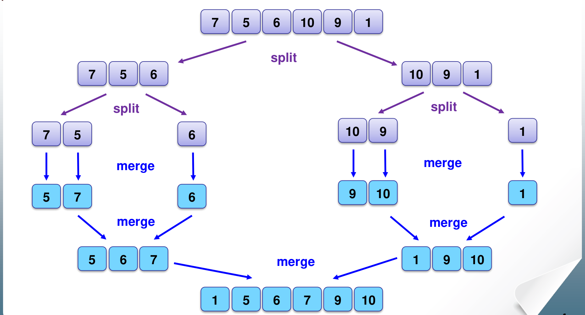
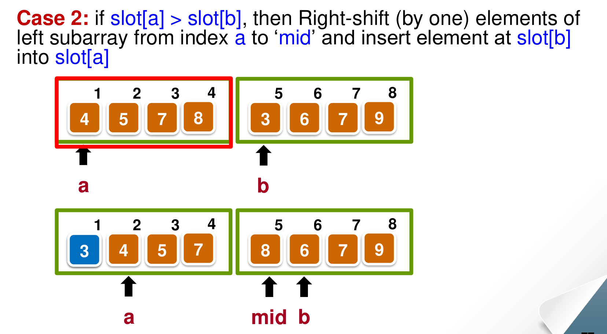
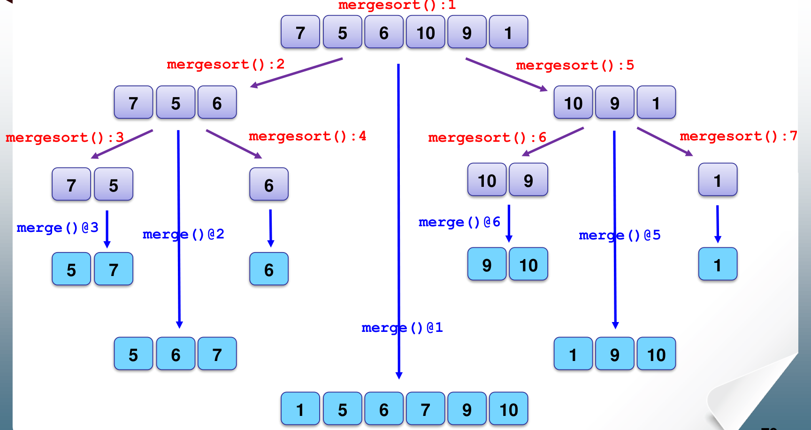
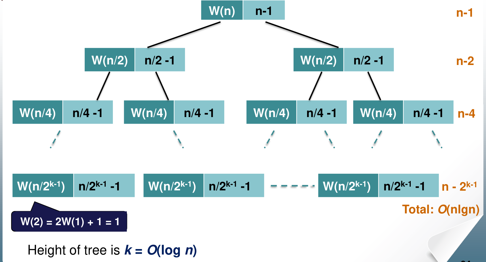

# 2. Divide and Conquer: Mergesort

This chapter covers Lecture 2.1. Mergesort is the course's main example of the **divide and conquer** strategy. The chapter also shows how to write and solve a **recurrence** for a recursive algorithm. Chapter 8 returns to recurrences in general.

---

## 1. The Divide and Conquer Strategy

### 1.1 The skeleton

Divide and conquer solves a problem in three steps:

1. **Divide** the problem into smaller sub-problems of the same type.
2. **Conquer**: solve each sub-problem by calling the same algorithm recursively.
3. **Combine** the sub-solutions into a solution for the whole problem.

When a sub-problem is small enough, you solve it directly. This is the **base case**, and it stops the recursion.

```
solve(problem of size n) {
    if (n <= minimum size)
        solve the problem directly;
    else {
        divide the problem into p1, p2, ..., pk;
        for each sub-problem ps
            solutions = solve(ps);
        combine all solutions;
    }
}
```

In divide and conquer, the sub-problems are **independent**: they do not share work. Sorting the left half of an array does not help with sorting the right half. Chapter 10 (dynamic programming) deals with problems whose sub-problems **overlap**.

### 1.2 Mergesort in one picture

Mergesort applies the skeleton to sorting:

1. **Divide**: split the list into two halves of (nearly) equal size.
2. **Conquer**: sort each half with mergesort.
3. **Combine**: **merge** the two sorted halves into one sorted list.

A list of 0 or 1 element is already sorted. That is the base case.

{width=80%}

All the real work happens in the merge step. Splitting only computes a middle index.

---

## 2. Merging Two Sorted Lists

### 2.1 The idea

You have two sorted lists. You want one sorted list that holds all their elements.

The smallest element overall must be the first element of one of the two lists. So:

1. Compare the first elements of the two lists. (1 key comparison.)
2. The smaller one goes to the end of the merged list. Remove it from its list.
3. Repeat until one list is empty.
4. Copy what is left of the other list to the end. No more comparisons are needed, because that list is already sorted and every element in it is larger than everything merged so far.

### 2.2 How many comparisons does one merge make?

Let the two lists have $n$ elements in total.

**Worst case: $n - 1$ comparisons.** Each comparison sends at least one element to the merged list, and that element is never compared again. When only one list still has elements, the merge stops comparing. In the worst case this happens when there are just 2 elements left, one in each list. The last comparison then places both. So at most $n - 1$ comparisons are made.

This happens when the two lists **interleave**: the largest element and the second-largest element are in different halves. Example: $[1, 3, 5, 7]$ and $[2, 4, 6, 8]$.

**Best case: $n/2$ comparisons** (for two halves of size $n/2$). If every element of one half is smaller than every element of the other half, that half empties after $n/2$ comparisons. The other half is then copied with no comparisons. Example: $[1, 2, 3, 4]$ and $[5, 6, 7, 8]$.

### 2.3 Merging inside the array (the lecture version)

The simple way to merge uses a second array, called a **buffer**, to hold the merged list. The lecture version merges **inside the original array**, with no buffer. It keeps two running indices:

* `a` runs through the left half, from `n` to `mid`.
* `b` runs through the right half, from `mid + 1` to `m`.

The part of the array to the left of `a` is already merged. At each step, compare `slot[a]` with `slot[b]`. There are three cases.

**Case 1: `slot[a] < slot[b]`.** The left element is already in its correct place. Move `a` one place right.

**Case 2: `slot[a] > slot[b]`.** The right element must go before `slot[a]`. Save `slot[b]`, shift every element from `a` to `mid` one place right, and put the saved element into `slot[a]`. Then move `a`, `mid` and `b` one place right.

{width=70%}

**Case 3: `slot[a] == slot[b]`.** If these are the last element of each half, stop. Otherwise `slot[a]` is in its correct place. Move `slot[b]` to the place just after it, again by shifting, and move `a` two places right (and `mid`, `b` one place right).

Two effects of working in place:

* **Moves are expensive.** One Case 2 step can shift up to $n/2$ elements. The **number of comparisons** is still at most $n - 1$ per merge, but the number of **data moves** can grow to $O(n^2)$ over the whole sort. A buffer avoids this, at the cost of $O(n)$ extra memory.
* **Equal keys save comparisons.** In Case 3, one comparison places **two** elements. So if all keys are equal, a merge of $n$ elements makes only $n/2$ comparisons, the same as the best case.

### 2.4 The mergesort code

```
void mergesort(int n, int m) {      // sort slot[n..m]
    int mid = (n + m) / 2;
    if (m - n <= 0)                 // 0 or 1 element: already sorted
        return;
    else if (m - n > 1) {           // 3 or more elements: recurse on both halves
        mergesort(n, mid);
        mergesort(mid + 1, m);
    }
    merge(n, m);                    // 2 or more elements: merge the halves
}
```

Note the middle test. When the range has exactly **2 elements** (`m - n == 1`), the code skips the two recursive calls, because each half would have only one element. It goes straight to `merge`, which makes 1 comparison.

### 2.5 The call graph

An exam may ask you to trace mergesort and number each call. The lecture numbers `mergesort()` calls in the order they start, and labels each `merge()` with the number of the `mergesort()` call that runs it.

{width=90%}

Useful counts for an array of $n$ elements:

* `merge()` runs once for every range with 2 or more elements. Each merge joins two groups into one. You start with $n$ groups of one element and end with one group. So `merge()` runs exactly **$n - 1$ times**.
* The recursion goes about $\lceil \lg n \rceil$ levels deep.

---

## 3. Running Time of Mergesort

### 3.1 Setting up the recurrence

Let $W(n)$ be the worst-case number of key comparisons to mergesort $n$ elements.

* Sorting 1 element needs no comparison: $W(1) = 0$.
* Sorting $n$ elements means sorting two halves, then merging them:

$$W(n) = W(\lfloor n/2 \rfloor) + W(\lceil n/2 \rceil) + (n - 1).$$

The two $W$ terms are the recursive calls. The $n - 1$ is the worst case of one merge.

### 3.2 Solving it by repeated substitution

Assume $n = 2^k$, so the halves are always equal: $W(n) = 2W(n/2) + n - 1$. Then $k = \lg n$ halvings reach size 1. Replace $W(n/2)$ with its own formula, again and again:

$$\begin{aligned}
W(2^k) &= 2W(2^{k-1}) + 2^k - 1 \\
&= 2\left(2W(2^{k-2}) + 2^{k-1} - 1\right) + 2^k - 1 = 2^2 W(2^{k-2}) + (2^k - 2) + (2^k - 1) \\
&= 2^3 W(2^{k-3}) + (2^k - 2^2) + (2^k - 2) + (2^k - 1) \\
&\;\;\vdots \\
&= 2^k W(1) + k \cdot 2^k - (1 + 2 + 4 + \dots + 2^{k-1}) \\
&= 0 + k \cdot 2^k - (2^k - 1).
\end{aligned}$$

Each expansion adds one term $2^k - 2^i$. After $k$ expansions, the $2^k$ parts give $k \cdot 2^k$. The $2^i$ parts give $1 + 2 + \dots + 2^{k-1}$, which we subtract.

With $n = 2^k$ and $k = \lg n$:

$$W(n) = n \lg n - n + 1 = \Theta(n \log n).$$

The last step uses the geometric series $1 + 2 + 4 + \dots + 2^{k-1} = 2^k - 1$.

### 3.3 The same answer from the recursion tree

Draw each call as a node, and write in it the work the call does **itself** (its merge), not counting its children.

{width=80%}

* The root merges $n$ elements: $n - 1$ comparisons.
* Level 1 has 2 nodes, each merging $n/2$ elements: $2(n/2 - 1) = n - 2$.
* Level $j$ has $2^j$ nodes: $2^j (n/2^j - 1) = n - 2^j$.
* There are $k = \lg n$ levels with merges.

Each level costs a little less than $n$, and there are $\lg n$ levels. So the total is about $n \lg n$. The recursion tree is a quick way to **guess** the answer. The substitution above **proves** it.

### 3.4 Best and average case

**Best case.** Every merge makes only $n/2$ comparisons:

$$B(1) = 0, \qquad B(n) = 2B(n/2) + n/2.$$

Each of the $\lg n$ levels costs $n/2$, so $B(n) = \frac{n}{2} \lg n = \Theta(n \log n)$.

This happens when, in every merge, one half is entirely smaller than the other. An array that is already sorted is a best case. So is an array in **descending order**: the left half is then entirely larger than the right half, and each merge stops when the right half runs out.

**Average case.** Every input costs at least $B(n)$ and at most $W(n)$. Both are $\Theta(n \log n)$. So the average $A(n)$ is squeezed between them:

$$B(n) \le A(n) \le W(n) \quad \Rightarrow \quad A(n) = \Theta(n \log n).$$

This "squeeze" argument is a standard way to get an average case without probabilities. It works **only** because the best and worst cases have the same order. For insertion sort it does not work: the best case is $\Theta(n)$ and the worst is $\Theta(n^2)$.

So mergesort is $\Theta(n \log n)$ in **every** case. Its running time does not depend on the order of the input, only on how much the halves interleave, which changes the constant.

### 3.5 Space

* With a buffer: $O(n)$ extra memory for the buffer, plus $O(\log n)$ for the recursion stack. Total $O(n)$.
* With the in-place merge of the lecture: no buffer, but still $O(\log n)$ for the recursion stack.

### 3.6 Is mergesort stable?

* **The buffer version** is stable if, on a tie, it takes the element from the **left** half first. Equal elements then keep their order.
* **The lecture's in-place version is not stable.** In Case 3 it puts the right element directly after the left element. If the left half has another equal element after that, the right element jumps over it. Example: left half $[4_a, 4_c]$, right half $[4_b]$. The first comparison finds $4_a = 4_b$ and moves $4_b$ next to $4_a$. The result is $4_a, 4_b, 4_c$. But the original order was $4_a, 4_c, 4_b$, so $4_b$ and $4_c$ have changed places.

### 3.7 Strengths and weaknesses

* **Strengths:** simple, and $\Theta(n \log n)$ in every case. Easy to implement on linked lists, where merging needs no shifting.
* **Weaknesses:** on an array, merging needs either a buffer ($O(n)$ extra memory) or many data moves.

---

## 4. Using Divide and Conquer and Sorting on Other Problems

### 4.1 Finding the minimum and the maximum together

The simple method scans the array twice, or compares each element with both the current minimum and the current maximum. That takes $2(n - 1)$ comparisons.

Divide and conquer does better:

* Base cases: 1 element is both min and max (0 comparisons). 2 elements need 1 comparison: the smaller is the min, the larger is the max.
* Otherwise, find (min, max) of each half recursively. Then compare the two minimums (1 comparison) and the two maximums (1 comparison).

Let $n = 2^k$. The two calls on halves cost $2W(n/2)$. The two final comparisons add 2. Two elements cost 1:

$$W(2) = 1, \qquad W(n) = 2W(n/2) + 2.$$

Expand until the size is 2. That leaves $2^{k-1}$ pairs, at 1 comparison each. The levels above add $2 + 4 + \dots + 2^{k-1}$:

$$W(n) = 2^{k-1} W(2) + (2^{k-1} + 2^{k-2} + \dots + 2) = \frac{n}{2} + 2\left(\frac{n}{2} - 1\right) = \frac{3n}{2} - 2.$$

That is about $1.5n$ comparisons, 25% fewer than $2n$. The saving comes from the base case: one comparison between a pair decides both which one can be the min and which one can be the max.

### 4.2 Sorting first makes some problems easy

Many problems become simple once the data is sorted, because related elements end up next to each other.

* **Duplicates.** To check whether an array has two equal elements, sort it in $\Theta(n \log n)$, then scan once and compare each element with its neighbour, $\Theta(n)$. Total $\Theta(n \log n)$. Without sorting, comparing every pair takes $\Theta(n^2)$.
* **Two sets with no common element.** Sort one set, then binary-search each element of the other set. Total $\Theta(n \log n)$.
* **Faster than $n \log n$ with extra information.** If the keys are small integers in a known range, for example $1$ to $2n$, you do not need comparisons at all. Use an array of counters, one per possible value. Add 1 to the counter of each element. A counter that reaches 2 means a duplicate. This takes $\Theta(n)$ time and $\Theta(n)$ extra memory. Chapter 4 (counting sort) uses the same idea.

---

## 5. Common Traps

* One merge of $n$ elements costs at most $n - 1$ comparisons, not $n$.
* `merge()` runs $n - 1$ times in total. A 2-element range goes straight to `merge()` without recursive calls.
* Mergesort is $\Theta(n \log n)$ in the best, average and worst case. A descending array is a **best** case for mergesort, not a worst case.
* The worst case of one merge needs the two halves to interleave. It does not depend on the array being reversed.
* The average case follows from the squeeze $B(n) \le A(n) \le W(n)$, because $B$ and $W$ have the same order.
* Mergesort is a divide-and-conquer algorithm. Insertion sort is **not**: it is incremental.
* Stability depends on the merge. The buffer version (left first on ties) is stable. The lecture's in-place version is not.
* In-place mergesort still uses $O(\log n)$ stack memory.
