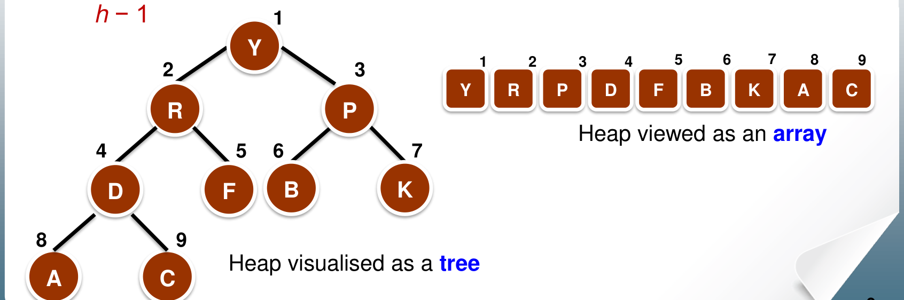
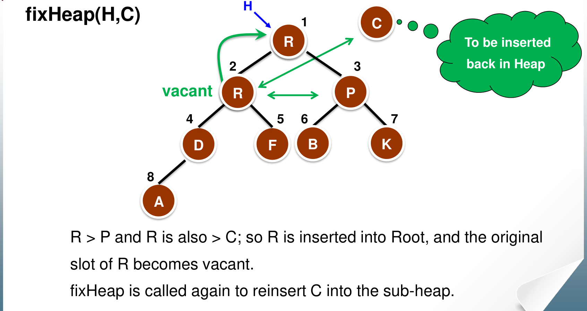
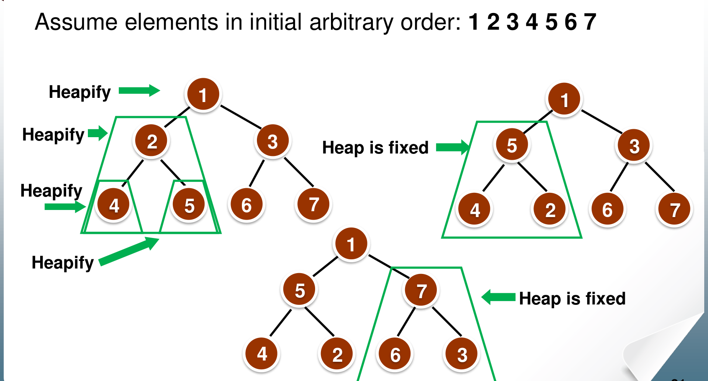
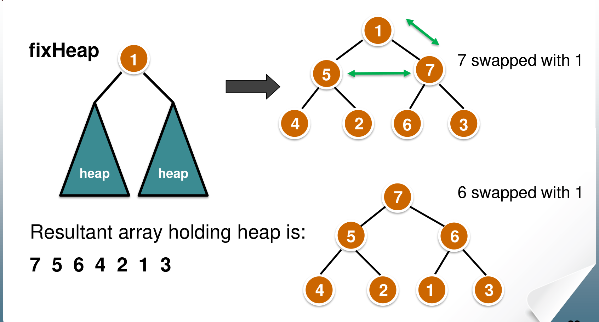

# 3. Heaps and Heapsort

This chapter covers Lecture 2.2. A **heap** is a tree that always keeps its largest key at the top, and it fits neatly inside an array. Heapsort uses a heap to sort in $\Theta(n \log n)$ time with $O(1)$ extra memory.

The heap is also a **priority queue**. Dijkstra's algorithm and Prim's algorithm (Chapter 6) use a priority queue to pick the next vertex, so this chapter is needed there too.

---

## 1. What a Heap Is

A heap must satisfy two separate rules: a rule about its **shape** and a rule about its **keys**.

### 1.1 The shape rule: a heap structure

A binary tree of height $h$ is a **heap structure** if:

* every level is full, except possibly the bottom level (depth $h$), and
* the nodes on the bottom level are packed to the **left**, with no gaps.

In other words, you fill the tree level by level, left to right. This is also called an **almost complete** binary tree. Because of this shape, a heap with $n$ nodes has height $\lfloor \lg n \rfloor$. A full tree with $k$ levels holds $2^k - 1$ nodes, so the height grows only as $\log n$.

### 1.2 The key rule: the partial order tree property

A tree is a **max-heap** (the lecture says a *maximising partial order tree*) if **every node's key is greater than or equal to the keys of its children**.

Two results follow:

* The **largest key is at the root**. Follow any path down from the root and the keys never increase.
* The rule says nothing about left against right. The left child can be larger or smaller than the right child. That is why it is only a *partial* order: a heap is not a sorted list.

A **min-heap** is the mirror image: every node is less than or equal to its children, so the smallest key is at the root.

### 1.3 Storing a heap in an array

Because the shape has no gaps, you can store the nodes level by level in an array, starting at index 1. No pointers are needed.

{width=85%}

For the node at index $k$:

| Relation | Index |
| :--- | :--- |
| Left child | $2k$ |
| Right child | $2k + 1$ |
| Parent | $\lfloor k/2 \rfloor$ |

* Node $k$ is a leaf if $2k > n$.
* The last node with a child is at index $\lfloor n/2 \rfloor$. So nodes $\lfloor n/2 \rfloor + 1$ to $n$ are all leaves: about half the nodes.
* In array form, the key rule says: $H[k] \ge H[2k]$ and $H[k] \ge H[2k+1]$, whenever those positions exist.

To check whether an array is a valid max-heap, check every parent against its children with these index rules. Example: $[20, 14, 9, 12, 3, 8, 5, 7, 10, 2]$. Node 4 holds 12, and its children (index 8 and 9) hold 7 and 10: fine. Node 5 holds 3, and its only child (index 10) holds 2: fine. Nodes 1 to 3 pass the same check, so this is a valid max-heap. A sorted-looking array is not needed: 10 sits after 7 and 12, but the heap rule only compares parent with child.

---

## 2. fixHeap: Repairing the Root

### 2.1 The situation

Suppose the root has an empty slot, and both subtrees below it are already heaps. You have one key, $k$, that must go somewhere in this tree. `fixHeap` finds the right place.

### 2.2 The idea

The root must hold the largest key. The candidates are $k$ and the two children. The largest child is already the largest key in its own subtree.

1. Compare the two children. Let the **larger child** be $c$. (1 comparison.)
2. Compare $k$ with $c$. (1 comparison.)
    * If $k \ge c$, put $k$ in the empty slot. Done.
    * Otherwise, move $c$ up into the empty slot. Now $c$'s old place is empty. Repeat from there.
3. If the empty slot reaches a leaf, put $k$ there.

So $k$ "sinks" down the tree, and at each level the larger child moves up to fill the gap.

{width=75%}

### 2.3 The code (iterative)

```
fixHeap(H, k) {                    // H[1..currentSize] with the root empty
    int j = 1, cj = 2;             // j: the empty slot; cj: its left child
    while (cj <= currentSize) {
        if (cj < currentSize && H[cj] < H[cj+1])
            cj++;                  // cj is now the larger child
        if (k >= H[cj])
            break;                 // k belongs in slot j
        H[j] = H[cj];              // move the larger child up
        j = cj;                    // the empty slot moves down
        cj = 2 * j;
    }
    H[j] = k;
}
```

When the empty slot has only one child (`cj == currentSize`), there is no sibling to compare with. That level costs only 1 comparison.

### 2.4 Cost of fixHeap

Each level costs at most 2 comparisons, and the empty slot moves down one level each time. The height is $\lfloor \lg n \rfloor$. So:

$$\text{fixHeap} \le 2 \lg n \text{ comparisons} = O(\log n).$$

The best case is 1 or 2 comparisons, when $k$ is already larger than both children: $O(1)$.

---

## 3. Building a Heap from an Unordered Array

### 3.1 The idea: fix from the bottom up

Start with the array in any order. It already has the heap **shape**, but not the key rule.

* A leaf is a heap of one node. So all the leaves are already heaps.
* Now take a node whose two subtrees are already heaps. Its own subtree is a heap except possibly at its root. That is exactly the situation `fixHeap` handles.
* So fix the nodes from the bottom of the tree to the top. When you reach a node, its subtrees are already heaps.

The lecture writes this recursively as `heapifying`:

```
heapifying(H) {
    if (H is not a leaf) {
        heapifying(left subtree of H);     // make the left subtree a heap
        heapifying(right subtree of H);    // make the right subtree a heap
        k = root(H);
        fixHeap(H, k);                     // then fix the root
    }
}
```

This visits the subtrees before their root, which is a **post-order traversal**.

On an array, the same result comes from a simple loop. Run `fixHeap` on the subtree rooted at each node, from the last parent, index $\lfloor n/2 \rfloor$, back to index 1:

```
constructHeap(H, n) {
    for (i = n / 2; i >= 1; i--)
        fixHeap on the subtree rooted at i, with k = H[i];
}
```

Both versions fix every child subtree before its parent, so both produce the **same heap**.

{width=80%}

{width=80%}

### 3.2 Building a heap takes only linear time

You might expect $O(n \log n)$: about $n/2$ calls to `fixHeap`, each up to $O(\log n)$. That bound is true but not tight. Most nodes are near the bottom, and a node near the bottom can sink only a short way.

* About $n/2$ nodes are leaves. They are never fixed.
* About $n/4$ nodes are one level above the leaves. Each sinks at most 1 level.
* About $n/8$ nodes can sink at most 2 levels, and so on.
* Only the root can sink the full $\lg n$ levels.

In general, about $n/2^{h+1}$ nodes sit $h$ levels above the leaves. Each sinks at most $h$ levels. Each level of sinking costs at most 2 comparisons. So the total is at most

$$2\left(\frac{n}{4} \cdot 1 + \frac{n}{8} \cdot 2 + \frac{n}{16} \cdot 3 + \dots\right) = 2 \cdot \frac{n}{4} \sum_{h \ge 1} \frac{h}{2^{h-1}} = O(n).$$

The sum $\sum_{h \ge 1} h/2^{h-1}$ is a constant (it equals 4). So heap construction is $O(n)$.

The lecture states the same fact as a recurrence. Take a full tree with $d$ levels: $n = 2^d - 1$ nodes.

* Without the root, $n - 1$ nodes remain, split evenly. So each subtree has $(n-1)/2$ nodes. The two calls cost $2W\left(\frac{n-1}{2}\right)$.
* `fixHeap` at the root sinks at most $\lg n$ levels, at 2 comparisons each: $2 \lg n$.

$$W(n) = 2W\left(\frac{n-1}{2}\right) + 2 \lg n.$$

This solves to $O(n)$. By the master method (Chapter 8): $a = 2$, $b = 2$, so $n^{\log_2 2} = n$. $2 \lg n$ is polynomially smaller than $n$. Case 1 gives $\Theta(n)$.

### 3.3 The best case for construction

If the array is in **decreasing order**, every parent is already larger than its children. Each `fixHeap` stops at once:

* a node with two children: 2 comparisons (pick the larger child, then compare), no moves;
* a node with one child: 1 comparison.

There are $\lfloor n/2 \rfloor$ parents. If $n$ is odd, all have two children: $2 \cdot \frac{n-1}{2} = n - 1$ comparisons. If $n$ is even, one parent has a single child: $2 \cdot \frac{n}{2} - 1 = n - 1$. So the best case is **exactly $n - 1$ comparisons** for construction. For example, 10 elements in decreasing order cost 9 comparisons.

---

## 4. Heapsort

### 4.1 The idea

1. Build a max-heap from the array. The largest key is now at the root, `H[1]`.
2. Take the root out and put it in the **last** position of the heap. That position now belongs to the sorted part. It is no longer in the heap.
3. The last element of the heap used to be in that position. Re-insert it with `fixHeap`. The heap is now one element smaller.
4. Repeat until the heap is empty.

The heap shrinks from the right, and the sorted part grows from the right. Both live in the same array, so no extra memory is needed.

### 4.2 The code

```
heapSort(array, n) {
    constructHeap(array, n);
    for (i = n; i >= 1; i--) {
        curMax = array[1];              // getMax: the root
        k = array[i];                   // the last element of the heap
        array[i] = curMax;              // the max goes to its final place
        fixHeap(array[1..i-1], k);      // re-insert k into the smaller heap
    }
}
```

The middle three lines together are **deleteMax**: copy the rightmost element of the lowest level to $k$, delete that position, then `fixHeap(H, k)`.

### 4.3 Running time

| Operation | Cost |
| :--- | :--- |
| getMax | $O(1)$ |
| fixHeap | $O(\log n)$ |
| deleteMax | $O(\log n)$ (one fixHeap) |
| constructHeap / heapifying | $O(n)$ |
| heapSort | $O(n \log n)$ |

Heapsort costs $O(n)$ to build, plus $n$ calls to deleteMax at $O(\log n)$ each. Total: $O(n \log n)$, about $2n \lg n$ comparisons in the worst case.

The lecture gives $\Theta(n \log n)$ for the **best, average and worst** case. A sorted or a reversed input does not help much: the element that `deleteMax` re-inserts comes from the bottom of the heap, so it is small and usually sinks most of the way down again. The heap getting smaller does not change the order: the last $n/2$ deletions still work on a heap of at least $n/2$ elements, with height about $\lg n - 1$.

### 4.4 Space and stability

* **Space:** $O(1)$ extra memory. Heapsort is **in-place**. It needs no recursion if `fixHeap` is iterative.
* **Not stable.** Example: $[2_a, 2_b, 1]$ is already a max-heap. The first deleteMax moves $2_a$ to the last position. Then $2_b$ moves to the root and is placed next. The result is $1, 2_b, 2_a$: the two 2s have changed order.

---

## 5. Priority Queues

### 5.1 What a priority queue does

A **priority queue** stores a set of elements, each with a key called its **priority**. It supports:

* `insert(x)`: add element $x$.
* `Maximum()`: return the element with the largest key.
* `extractMax()`: remove and return the element with the largest key.

A min-priority queue does the same with the smallest key. Priority queues are used in job scheduling, in simulation, and in Dijkstra's and Prim's algorithms.

### 5.2 A heap is a good priority queue

* `Maximum()` is the root: $O(1)$.
* `extractMax()` is deleteMax: $O(\log n)$.
* `insert(x)`: put $x$ in the next free position at the bottom (the end of the array). Then compare it with its parent, and swap while it is larger than its parent. It "bubbles up" at most the height of the tree: $O(\log n)$.
* **Decrease a key** (in a min-heap, used by Dijkstra and Prim): change the key, then bubble the element up the same way: $O(\log n)$.

An unsorted array gives $O(1)$ insert but $O(n)$ extractMax. A sorted array gives $O(1)$ extractMax but $O(n)$ insert. The heap gives $O(\log n)$ for both.

### 5.3 Applications

* **The $k$ largest elements.** Build a max-heap in $O(n)$, then call deleteMax $k$ times. Total $O(n + k \log n)$. This beats sorting everything when $k$ is small.
* **Merging $k$ sorted lists** with $n$ elements in total, into one sorted list:
    1. Build a heap from the first element of each list: $k$ elements, $O(k)$.
    2. Remove the root and append it to the output. Remember which list it came from.
    3. Insert the next element of that same list into the heap (or use it as the $k$ in `fixHeap`): $O(\log k)$.
    4. Repeat until all $n$ elements are output.

    Each element enters and leaves a heap of size at most $k$ once, so the total is $O(n \log k)$. Use a max-heap if the lists are in decreasing order, and a min-heap if they are in increasing order. If the lists are **not** sorted, sort each one first. Sorting lists with sizes $n_1, \dots, n_k$ costs $O(\sum n_i \log n_i) = O(n \log n)$, so then the total is $O(n \log n)$.

---

## 6. The Sorting Algorithms So Far

| Algorithm | Best | Average | Worst | Extra space | Stable |
| :--- | :--- | :--- | :--- | :--- | :--- |
| Insertion sort | $n$ | $n^2$ | $n^2$ | $O(1)$ | Yes |
| Mergesort | $n \log n$ | $n \log n$ | $n \log n$ | $O(n)$ buffer, or $O(\log n)$ stack in place | Buffer version yes |
| Heapsort | $n \log n$ | $n \log n$ | $n \log n$ | $O(1)$ | No |

All entries are $\Theta(\cdot)$. Chapter 4 adds quicksort, counting sort and radix sort to this table.

---

## 7. Common Traps

* A heap is not sorted. Siblings can be in either order.
* Use **1-based** indices: children of $k$ are $2k$ and $2k+1$. With 0-based indices they would be $2k+1$ and $2k+2$.
* fixHeap costs **2** comparisons per level: one to find the larger child, one to compare with $k$.
* Building a heap is $O(n)$, not $O(n \log n)$.
* A decreasing array is the **best** case for heap construction: exactly $n - 1$ comparisons, no moves.
* Heapsort is $O(n \log n)$ in every case, uses $O(1)$ extra memory, and is **not** stable.
* Heapsort needs no extra array for the sorted output: the sorted part grows from the right end of the same array.
* When you trace `fixHeap`, the element that sinks is the **last** element of the heap, not the old root.
