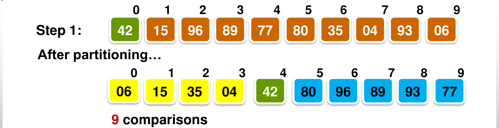
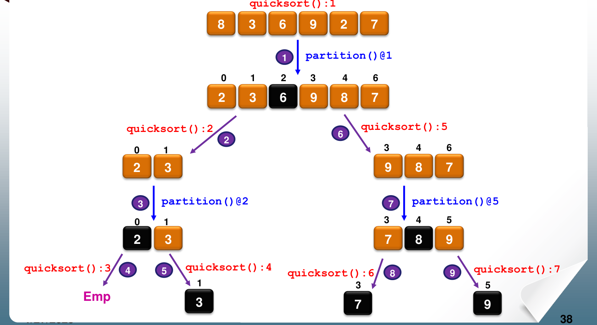
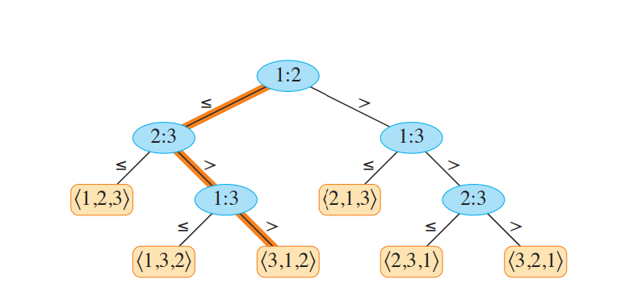
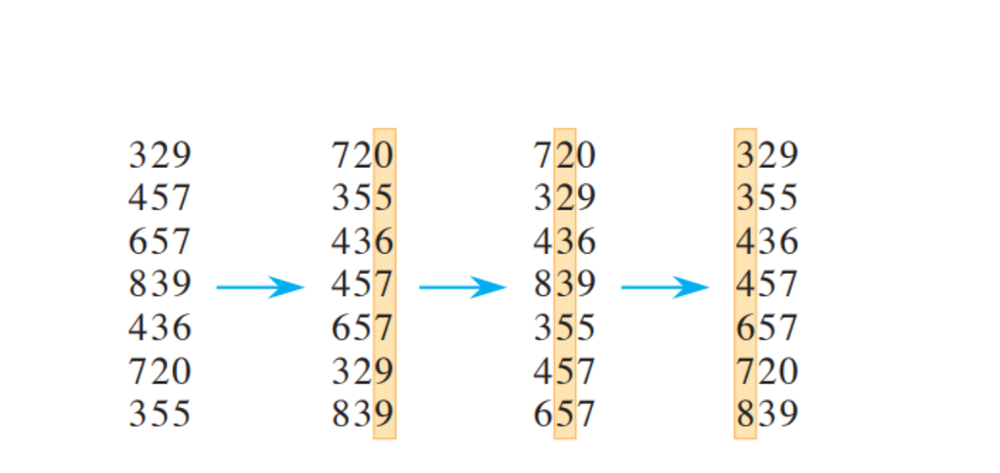

# 4. Quicksort, the Limit of Comparison Sorts, and Linear-Time Sorts

This chapter covers Week 3: quicksort (Lecture 3.1), and counting sort and radix sort (Lecture 3.2). Between them sits an important result: **no sort that only compares keys can beat $\Omega(n \log n)$ in the worst case.** Counting sort and radix sort get around this limit because they do not compare keys at all.

---

## 1. Quicksort

### 1.1 The idea

Quicksort is another divide-and-conquer sort, but it puts the work in a different place from mergesort.

* Mergesort splits the array **without looking at the keys**, then does the real work when it **merges**.
* Quicksort does the real work when it **splits**, then needs **no merge** at all.

The steps:

1. Choose one element as the **pivot**.
2. **Partition**: rearrange the range so that every element smaller than the pivot is on its left, and every element greater than or equal to the pivot is on its right. The pivot itself goes between the two groups.
3. Now the pivot is in its **final position**. Every element on its left belongs on its left in the sorted array, and the same for the right.
4. Sort the left group and the right group recursively. A group of 0 or 1 element is already sorted.

Because every pivot ends in its final place, nothing needs to be combined at the end.

### 1.2 The quicksort code

```
void quicksort(int n, int m) {        // sort slot[n..m]
    int pivot_pos;
    if (n >= m)                       // 0 or 1 element
        return;
    pivot_pos = partition(n, m);
    quicksort(n, pivot_pos - 1);      // left group
    quicksort(pivot_pos + 1, m);      // right group
}
```

Call `quicksort(0, size - 1)` to sort the whole array.

### 1.3 The partition code

The lecture uses the **middle element** as the pivot.

```
int partition(int low, int high) {
    int i, last_small, pivot;
    int mid = (low + high) / 2;
    swap(low, mid);                   // move the pivot to the front
    pivot = slot[low];
    last_small = low;                 // end of the "smaller than pivot" group
    for (i = low + 1; i <= high; i++)
        if (slot[i] < pivot)
            swap(++last_small, i);    // grow the small group by one
    swap(low, last_small);            // put the pivot between the groups
    return last_small;
}
```

During the loop, the range is in four parts, from left to right:

| Part | Holds |
| :--- | :--- |
| `slot[low]` | the pivot |
| `slot[low+1 .. last_small]` | elements **smaller** than the pivot |
| `slot[last_small+1 .. i-1]` | elements **greater than or equal** to the pivot |
| `slot[i .. high]` | elements not yet examined |

Each step examines `slot[i]`:

* If it is smaller than the pivot, it belongs in the small group. Increase `last_small` by 1, which points at the first "large" element, and swap that element with `slot[i]`. The small group grows by one, and the large group shifts one place right.
* Otherwise it already sits at the end of the large group. Do nothing.

At the end, swap the pivot (still at `slot[low]`) with the last small element. The pivot now sits between the two groups, at index `last_small`.

{width=85%}

**Cost of one partition:** the loop compares every element except the pivot with the pivot, once. A range of $k$ elements costs exactly **$k - 1$ comparisons**.

### 1.4 How to trace partition by hand

1. Find `mid = (low + high) / 2`, rounded down. Swap `slot[mid]` with `slot[low]`.
2. Set `last_small = low`. Go through $i = low+1, \dots, high$. Each time `slot[i] < pivot`, add 1 to `last_small` and swap positions `last_small` and `i`.
3. Swap positions `low` and `last_small`.

Write the whole array after each swap. Most errors come from forgetting the first swap (the pivot to the front), or from moving equal keys. Keys **equal** to the pivot stay in the right group, because the test is strict (`<`).

### 1.5 The execution order

As with mergesort, an exam may ask you to number the calls. Quicksort calls `partition` first, then sorts the left group completely, then the right group.

{width=85%}

---

## 2. Running Time of Quicksort

### 2.1 Worst case: $\Theta(n^2)$

The worst case happens when the pivot is the **smallest or largest** element of its range every time. Then one group is empty and the other has $k - 1$ elements. The recursion goes $n - 1$ levels deep, and the comparisons are

$$(n-1) + (n-2) + \dots + 1 = \frac{n(n-1)}{2} = \Theta(n^2).$$

A partition leaves one group empty exactly when the pivot is the minimum or the maximum of the range.

With the **middle element** as pivot, a sorted array is **not** a bad case: the middle element of a sorted range is its median. The worst case needs an input where the element at the middle position is always an extreme value. Such inputs exist, so the worst case is still $\Theta(n^2)$.

### 2.2 Best case: $\Theta(n \log n)$

The best case happens when every pivot splits its range into two equal halves. Let $T(n)$ be the number of comparisons for $n$ elements.

* The partition of $n$ elements costs $n - 1$ comparisons (Section 1.3). Write this as $cn$.
* The pivot then sits in the middle, and each side has about $n/2$ elements. The two recursive calls cost $2T(n/2)$.
* One element needs no comparison: $T(1) = 0$.

$$T(1) = 0, \qquad T(n) = 2T(n/2) + cn.$$

This is the same shape as mergesort's recurrence (Chapter 2): two half-size calls, plus linear work in the call itself. So $T(n) = \Theta(n \log n)$.

### 2.3 Average case: $\Theta(n \log n)$

Assume the keys are distinct and every order is equally likely. Then the pivot is equally likely to end up in any position $i = 0, 1, \dots, n-1$. If it ends at position $i$, the two groups have $i$ and $n - 1 - i$ elements. So the average number of comparisons satisfies

$$A(0) = A(1) = 0, \qquad A(n) = (n - 1) + \frac{1}{n} \sum_{i=0}^{n-1} \left[ A(i) + A(n-1-i) \right].$$

The $n - 1$ is the partition. The sum averages over the $n$ equally likely pivot positions. This solves to $A(n) \approx 1.39\, n \lg n = \Theta(n \log n)$. (The lecture does not require the proof.)

So the average is only about 39% worse than the best case. A bad split now and then does not hurt much. In practice quicksort is usually the fastest general-purpose sort in memory.

### 2.4 Space and stability

* **Space:** no buffer, but the recursion uses stack space. $O(\log n)$ when the splits are balanced. $O(n)$ in the worst case, when the recursion is $n - 1$ levels deep.
* **Not stable.** Partition swaps elements across long distances. An element can jump over an equal element.

### 2.5 Strengths and weaknesses

* **Strengths:** fast on average. No merge step. Sorts in place.
* **Weaknesses:** $\Theta(n^2)$ when the pivots split badly. Slow on very small lists, where the recursion costs more than the sorting. Choosing the pivot more carefully reduces the risk.

### 2.6 Choosing the pivot more carefully: median of three

**Median of three** takes the median of the first, middle and last elements as the pivot. This makes an extreme pivot less likely. It costs a few extra comparisons per partition, to find the median.

It does **not** remove the worst case. An adversary can arrange the input so that the median of the three is always the **second-smallest** element of the range. Then each partition removes only 2 elements (the pivot, and the one smaller element), and the ranges have sizes $n, n-2, n-4, \dots$. A range of size $s$ costs $s - 1$ comparisons, so the total is $(n-1) + (n-3) + (n-5) + \dots$. That is about $n/2$ terms, and their average is about $n/2$. So the comparisons add up to about $n^2/4$, which is still $\Theta(n^2)$.

Even a perfect median, found by some extra procedure, only gives $\Theta(n \log n)$ in the worst case if finding that median costs $O(n)$ per partition.

---

## 3. Partitioning into Three Groups

The partition idea solves other problems. A common one: an array holds only three kinds of key, say **red, white and blue**. Rearrange it so all reds come first, then all whites, then all blues. You may only look at a key and swap two elements.

Keep four regions, with three indices:

| Region | Holds |
| :--- | :--- |
| `A[0 .. r-1]` | red |
| `A[r .. u-1]` | white |
| `A[u .. b-1]` | not yet examined |
| `A[b .. n-1]` | blue |

```
r = 0; u = 0; b = n;
while (u < b) {
    if (A[u] == red)   { swap(A[r], A[u]); r++; u++; }
    else if (A[u] == white) { u++; }
    else               { b--; swap(A[u], A[b]); }   // blue: do not move u
}
```

When the element is blue, it swaps with the last unexamined element. The element that arrives at `u` has not been examined yet, so `u` stays where it is.

Each step shrinks the unexamined region by exactly one element, so the loop runs $n$ times. This is $\Theta(n)$ time and $O(1)$ extra memory.

---

## 4. The Limit of Comparison Sorts

### 4.1 The decision tree model

Insertion sort, mergesort, heapsort and quicksort are all **comparison sorts**. The only way they learn about the keys is to compare two of them: "is $a_i \le a_j$?".

Any comparison sort on $n$ elements can be drawn as a **decision tree**:

* Each **internal node** is one comparison, written $i{:}j$ (compare the elements that started at positions $i$ and $j$).
* Each node has two branches: one for "$\le$" and one for "$>$".
* Each **leaf** is a final order of the elements, a permutation.
* Running the algorithm on one input follows **one path** from the root to a leaf. The number of comparisons is the length of that path.

{width=60%}

### 4.2 Why $\Omega(n \log n)$

1. A correct sort must be able to produce **every** order of $n$ distinct elements. There are $n!$ orders. So the tree has at least $n!$ leaves.
2. A binary tree of height $h$ has at most $2^h$ leaves.
3. So $2^h \ge n!$, which gives $h \ge \lg(n!)$.
4. $\lg(n!) = \Theta(n \log n)$. A quick way to see the lower bound: the largest $n/2$ factors of $n!$ are each at least $n/2$, so $n! \ge (n/2)^{n/2}$ and $\lg(n!) \ge \frac{n}{2} \lg \frac{n}{2}$.
5. The height $h$ is the worst-case number of comparisons. So **every comparison sort makes $\Omega(n \log n)$ comparisons in the worst case.**

Mergesort and heapsort reach this bound. So, among comparison sorts, they are **asymptotically optimal** in the worst case.

### 4.3 Even the best case needs $n - 1$ comparisons

What is the shortest path to a leaf? It is **$n - 1$**. Insertion sort reaches it on a sorted array.

Why it cannot be shorter: suppose some leaf is reached after $k < n - 1$ comparisons. Draw a graph with one vertex per element and an edge for each comparison made. A graph with $n$ vertices and fewer than $n - 1$ edges is **not connected**. So the elements split into two groups, and no element of one group was ever compared with any element of the other. The algorithm knows nothing about how the two groups relate. Some input would then need a different order from the one at that leaf, so the leaf would be wrong for that input.

---

## 5. Counting Sort

### 5.1 Using the structure of the keys

A comparison only answers "smaller or not". If the keys have more structure, we can use it. Counting sort assumes the keys are **integers in a small range $0$ to $k$**. It uses each key directly as an **array index**, so it makes no comparisons at all. The $\Omega(n \log n)$ limit does not apply to it.

### 5.2 The idea

For each element $x$, count how many elements are **less than or equal to** $x$. If 17 elements are $\le x$, then $x$ belongs in position 17 of the output (position 16 with 0-based indices). Equal keys need care so that they do not all go to the same position.

### 5.3 The code

```
for i = 0 to k
    C[i] = 0;                         // 1. clear the counters             Theta(k)
for j = 0 to length[A] - 1
    C[A[j]] = C[A[j]] + 1;            // 2. C[v] = how many elements equal v  Theta(n)
for i = 1 to k
    C[i] = C[i] + C[i-1];             // 3. C[v] = how many elements are <= v Theta(k)
for j = length[A] - 1 downto 0 {      // 4. place each element             Theta(n)
    C[A[j]] = C[A[j]] - 1;            //    one fewer slot left for this key
    B[C[A[j]]] = A[j];                //    0-based position in the output
}
return B;
```

After step 3, `C[v]` is the number of elements $\le v$. That is one past the last position (0-based) where a key $v$ can go. Step 4 counts down: it first subtracts 1, then writes. So the last element with key $v$ goes to the last slot for $v$, the one before it goes one slot to the left, and so on.

### 5.4 Cost

* **Time:** $\Theta(n + k)$ in every case. If $k = O(n)$, that is $\Theta(n)$.
* **Space:** $\Theta(n + k)$: the counter array $C$ and the output array $B$. Counting sort is **not in place**.
* It is fast when the range of values, $k$, is small compared with $n$. If $k$ is huge (for example 32-bit keys), the counter array is too large.

### 5.5 Why step 4 runs backwards: stability

Step 4 goes from the **end** of $A$ to the start, and fills each key's slots from the **right**. So among equal keys, the last one in $A$ gets the rightmost slot. Equal keys keep their input order. **Counting sort is stable.**

If step 4 ran **forwards** ($j = 0$ up to $n-1$), the output would still be **sorted**: every element still lands inside the block of slots for its key. But the first equal key in $A$ would now get the **rightmost** slot. The order of equal keys would be **reversed**. The sort is still correct, but no longer stable.

---

## 6. Radix Sort

### 6.1 The idea

Radix sort sorts keys that have several **digits** (or characters, or fields such as day/month/year). It sorts **one digit at a time**, starting from the **least significant digit**:

```
for i = d downto 1                    // d digits; digit d is the least significant
    use a STABLE sort to sort A on digit i;
```

{width=65%}

### 6.2 Why the inner sort must be stable

After pass $i$, the numbers are sorted by their **last $i$ digits**. This is the loop invariant. Why it is maintained:

* Two numbers with **different** digits in the new position: the new pass puts them in the right order.
* Two numbers with the **same** digit in the new position: their order must come from the lower digits, which the earlier passes already put right. A **stable** pass keeps that order.

If the pass were not stable, it could undo the work of the earlier passes. After the last pass, the numbers are sorted by all $d$ digits, which means fully sorted.

### 6.3 Cost

* Each pass is a stable sort. With counting sort on digits $0$ to $k$, a pass costs $\Theta(n + k)$.
* Total: $\Theta(d(n + k))$.
* For decimal digits, $k = 9$ is a constant, so radix sort runs in $\Theta(dn)$. If $d$ is also a constant, that is $\Theta(n)$.

---

## 7. All the Sorts in One Table

| Algorithm | Best | Average | Worst | Extra space | In place | Stable |
| :--- | :--- | :--- | :--- | :--- | :--- | :--- |
| Insertion sort | $n$ | $n^2$ | $n^2$ | $O(1)$ | Yes | Yes |
| Mergesort | $n \log n$ | $n \log n$ | $n \log n$ | $O(n)$, or $O(\log n)$ in place | Lecture version yes | Buffer version yes |
| Heapsort | $n \log n$ | $n \log n$ | $n \log n$ | $O(1)$ | Yes | No |
| Quicksort | $n \log n$ | $n \log n$ | $n^2$ | $O(\log n)$ to $O(n)$ stack | Yes | No |
| Counting sort | $n + k$ | $n + k$ | $n + k$ | $O(n + k)$ | No | Yes |
| Radix sort | $d(n+k)$ | $d(n+k)$ | $d(n+k)$ | $O(n + k)$ | No | Yes |

### Which sort to choose

* **Almost sorted input** (few inversions): insertion sort. Its swaps equal the number of inversions, so it runs in close to $\Theta(n)$.
* **A guaranteed $\Theta(n \log n)$ with $O(1)$ extra memory:** heapsort.
* **A guaranteed $\Theta(n \log n)$ and a stable result:** mergesort with a buffer.
* **Fastest on average, in memory:** quicksort.
* **Small integer keys:** counting sort. **Fixed-length keys with several digits:** radix sort.

---

## 8. Common Traps

* After one partition, the **pivot** is in its final position. The other elements are only on the correct side, not in order.
* One partition of $k$ elements costs exactly $k - 1$ comparisons.
* With the middle element as pivot, a sorted array is a **good** case for quicksort.
* Quicksort's worst case is $\Theta(n^2)$, whatever the pivot rule, unless the rule finds the true median.
* Quicksort needs no extra array to partition. It is in place, apart from the stack.
* The $\Omega(n \log n)$ bound is for **comparison** sorts in the **worst** case. Counting sort and radix sort are not comparison sorts.
* The shortest path in a decision tree is $n - 1$, not $\lg(n!)$.
* Counting sort with a forward final loop is still correct, but not stable: equal keys come out reversed.
* Radix sort starts from the **least** significant digit and needs a **stable** sort for each pass.
