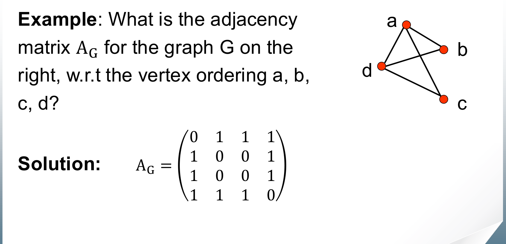
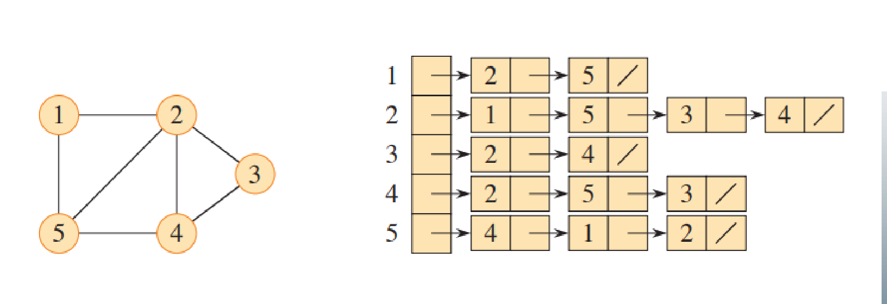
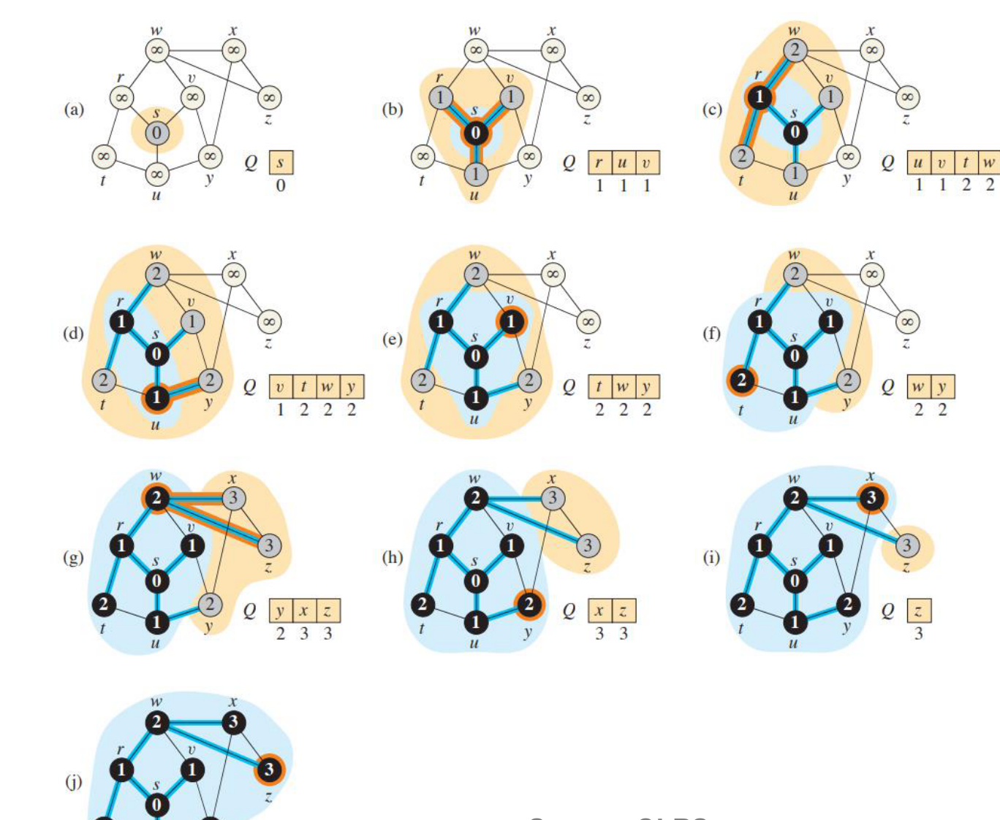
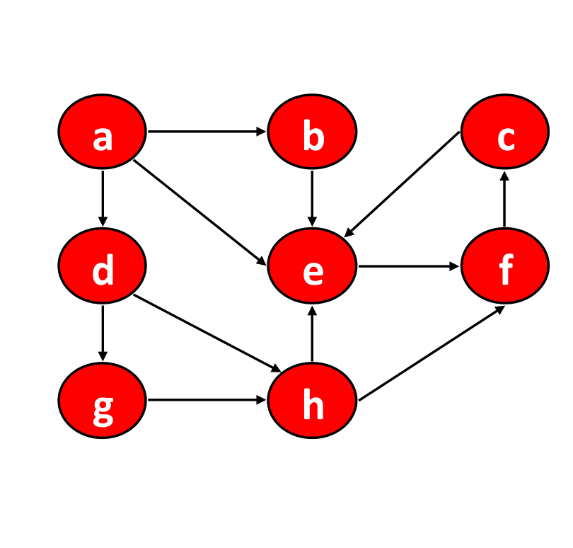
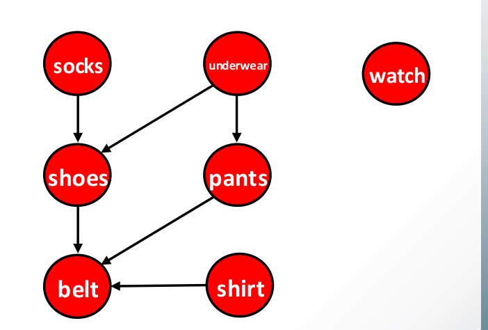

# 5. Graphs: Representations, BFS, DFS and Topological Sort

This chapter covers Lecture 4. It starts Part 2 of the course, on graphs. It explains how to store a graph, and the two basic ways to visit every vertex: **breadth-first search** (BFS) and **depth-first search** (DFS). It ends with **topological sort**, an application of DFS.

Chapters 6 and 7 build on this: Dijkstra's and Prim's algorithms grow outward from one vertex like BFS, and Kruskal's algorithm needs to detect cycles.

---

## 1. Basic Terms

### 1.1 Graphs

A **graph** $G = (V, E)$ has:

* a set $V$ of **vertices** (also called nodes), and
* a set $E$ of **edges**. Each edge connects two vertices. Formally, an edge is a pair $(v, w)$ with $v, w \in V$.

In an **undirected** graph, the edge $(v, w)$ is the same as $(w, v)$. In a **directed** graph, $(v, w)$ goes **from** $v$ **to** $w$, and $(w, v)$ is a different edge. A **weighted** graph also gives each edge a number, its **weight** (a length, a cost, a time).

We write $|V|$ for the number of vertices and $|E|$ for the number of edges.

### 1.2 Degree, paths and connectivity

* The **degree** of a vertex is the number of edges that touch it. In a directed graph, the **in-degree** counts edges coming in and the **out-degree** counts edges going out.
* A **path** from $a$ to $b$ is a sequence of edges you can follow from $a$ to reach $b$.
* A path is **simple** if it repeats no edge. (Later, for longest paths, "simple" means it repeats no vertex.)
* The **length** of a path is the number of edges in it. In a weighted graph, the **weight** of a path is the sum of its edge weights.
* Vertex $b$ is **reachable** from $a$ if some path goes from $a$ to $b$.
* An undirected graph is **connected** if every vertex is reachable from every other vertex.
* A **cycle** is a path of length at least 1 that starts and ends at the same vertex.

### 1.3 Sparse and dense graphs

A simple graph has at most about $|V|^2$ edges.

* A graph is **sparse** if $|E|$ is much smaller than $|V|^2$. Example: an airline network, where two random airports rarely have a direct flight.
* A graph is **dense** if $|E|$ is close to $|V|^2$.

This difference decides which way of storing the graph is better.

---

## 2. Storing a Graph

### 2.1 Adjacency matrix

Number the vertices $v_1, \dots, v_n$. The **adjacency matrix** is an $n \times n$ table $A$ with

$$a_{ij} = \begin{cases} 1 & \text{if there is an edge from } v_i \text{ to } v_j, \\ 0 & \text{otherwise.} \end{cases}$$

For a weighted graph, store the weight instead of 1, and $\infty$ where there is no edge (and usually 0 on the diagonal).

{width=65%}

* For an undirected graph, the matrix is **symmetric**: $a_{ij} = a_{ji}$.
* **Memory:** $\Theta(|V|^2)$, however few edges there are.
* **Is there an edge from $u$ to $v$?** Look at one cell: $\Theta(1)$.
* **List the neighbours of $u$:** read the whole row: $\Theta(|V|)$.

### 2.2 Adjacency list

The **adjacency list** is an array `Adj` with one list per vertex. `Adj[u]` holds every vertex $v$ with an edge $(u, v)$. For a weighted graph, each list entry also stores the weight.

{width=75%}

* The lists hold $2|E|$ entries in total for an undirected graph (each edge appears at both ends), and $|E|$ for a directed graph.
* **Memory:** $\Theta(|V| + |E|)$.
* **Is there an edge from $u$ to $v$?** Scan `Adj[u]`: $O(\deg(u))$, which is $\Theta(|V|)$ in the worst case.
* **List the neighbours of $u$:** $\Theta(\deg(u))$, only the neighbours that exist.

### 2.3 Which one to choose

| | Adjacency matrix | Adjacency list |
| :--- | :--- | :--- |
| Memory | $\Theta(\lvert V \rvert^2)$ | $\Theta(\lvert V \rvert + \lvert E \rvert)$ |
| Edge test | $\Theta(1)$ | $O(\deg(u))$ |
| Neighbours of $u$ | $\Theta(\lvert V \rvert)$ | $\Theta(\deg(u))$ |
| Better for | dense graphs | sparse graphs |

For a sparse graph, the list saves a lot of memory and time. For a dense graph, the matrix costs about the same memory and answers edge tests faster.

---

## 3. Breadth-First Search (BFS)

### 3.1 The idea

BFS explores a graph in **layers** from a start vertex $s$, called the **source**:

* first $s$ itself (distance 0),
* then every neighbour of $s$ (distance 1),
* then every new vertex next to those (distance 2), and so on.

It uses a **queue** (first in, first out). A vertex enters the queue when BFS first finds it. When BFS takes a vertex out of the queue, it looks at all its neighbours and adds the ones it has not seen yet. Because a queue serves vertices in the order they arrived, all vertices at distance $d$ come out before any vertex at distance $d + 1$.

### 3.2 The code

```
function bfs(s):
    mark all vertices as unvisited
    queue := {s}
    mark s as visited
    s.d = 0
    while queue is not empty:
        v := queue.removeFirst()
        for each unvisited neighbour n of v:
            mark n as visited
            n.d = v.d + 1          // one more edge than v
            n.pi = v               // remember how we reached n
            queue.addLast(n)
```

Mark a vertex as visited when it **enters** the queue, not when it leaves. Otherwise the same vertex can enter the queue several times.

### 3.3 What BFS computes

* **Shortest paths in an unweighted graph.** `n.d` is the smallest number of edges from $s$ to $n$. The intuition: BFS always finishes closer vertices before it reaches farther ones. To stop early at a target vertex $t$, check each vertex when it comes out of the queue.
* **The BFS tree.** The pointers `n.pi` form a tree rooted at $s$. Following `pi` from any vertex back to $s$ gives a shortest path, in reverse.

BFS does **not** find shortest paths when edges have different weights. A path with fewer edges can still be heavier. That needs Dijkstra's algorithm (Chapter 6).

{width=80%}

### 3.4 Colours

The figure uses three colours. They describe the state of each vertex:

* **White:** not found yet.
* **Grey:** found and in the queue, but its neighbours are not all examined yet. The grey vertices form the **frontier**.
* **Black:** taken out of the queue, and all its neighbours examined.

When a vertex turns black, every neighbour of it has been found. So **a black vertex never has a white neighbour.** The frontier of grey vertices always separates the black (finished) region from the white (unseen) region.

A black vertex **can** have a grey neighbour: a neighbour that was found but is still waiting in the queue.

### 3.5 Running time

* Each vertex enters and leaves the queue at most once. Each queue operation is $O(1)$ (use a linked list with pointers to both ends). Queue work: $O(|V|)$.
* When a vertex leaves the queue, BFS scans its neighbours once. With adjacency lists, all these scans together read every list once: $O(|E|)$.
* **Total: $O(|V| + |E|)$** with adjacency lists. This is linear in the size of the graph.

**With an adjacency matrix,** finding the neighbours of $v$ means scanning the whole row of $v$: $\Theta(|V|)$ per vertex. Total: $\Theta(|V|^2)$. The algorithm is the same, except that "for each neighbour $n$ of $v$" becomes "for each column $n$ where row $v$ has a 1".

### 3.6 BFS only reaches what is reachable

BFS from $s$ visits exactly the vertices reachable from $s$. If the graph is not connected, some vertices stay white. To visit every vertex, wrap BFS in a loop: "while some vertex is unvisited, run BFS from it".

---

## 4. Depth-First Search (DFS)

### 4.1 The idea

DFS goes **as deep as possible** along one path before it backs up. From the current vertex, it moves to an unvisited neighbour, then to an unvisited neighbour of that one, and so on. When it reaches a vertex with no unvisited neighbour, it **backtracks** to the previous vertex and tries its next neighbour.

DFS does not find shortest paths. It is useful for its structure: cycle detection, topological sort, and more.

### 4.2 The code (recursive)

```
function dfs():
    mark all vertices as unvisited
    while there exists an unvisited vertex v:
        dfsVisit(v)

function dfsVisit(v):              // explore everything reachable from v
    mark v as visited
    for each unvisited neighbour w of v:
        dfsVisit(w)
```

The outer loop in `dfs()` restarts the search from any vertex still unvisited. So **the lecture's DFS visits every vertex, even in a graph that is not connected.** The lecture's BFS starts from one source only.

{width=55%}

The order in which DFS tries neighbours changes the result. An exam question will fix the order (for example, alphabetical). Follow it exactly.

### 4.3 Running time

Each vertex gets one call of `dfsVisit`, and each call scans the vertex's adjacency list once. Total: **$O(|V| + |E|)$** with adjacency lists, $\Theta(|V|^2)$ with an adjacency matrix. Extra memory: $O(|V|)$ for the marks and the recursion stack.

### 4.4 DFS without recursion

Recursion uses the call stack. You can use your own **stack** (last in, first out) instead:

```
function dfsVisit(v):
    S := empty stack
    S.push(v)
    while S is not empty:
        w := S.pop()
        if w is visited: continue        // w was pushed more than once
        mark w as visited
        for each unvisited neighbour x of w:
            S.push(x)
```

A vertex can be pushed several times before it is visited, so check it when you pop it. Because the stack returns the **last** vertex pushed, this version takes the neighbours in the reverse of the recursive order. To match the recursive order exactly, push the neighbours in reverse.

BFS and DFS differ only in this one choice: **BFS uses a queue, DFS uses a stack.**

### 4.5 Colours and edge types

DFS also uses three colours:

* **White:** not visited yet.
* **Grey:** `dfsVisit` has started on it but not finished. The grey vertices are exactly the vertices on the current recursion stack: the path from the start to where DFS is now.
* **Black:** `dfsVisit` has finished on it. All vertices reachable from it are visited.

The edges that DFS follows to reach new vertices form a **depth-first tree**. Every edge $(u, v)$ of the graph is one of four types. The colour of $v$, at the moment DFS first examines the edge from $u$, tells you which:

| Colour of $v$ | Edge type | Meaning |
| :--- | :--- | :--- |
| White | **Tree edge** | DFS reaches $v$ for the first time through this edge. |
| Grey | **Back edge** | $v$ is an ancestor of $u$ on the current path. |
| Black | **Forward or cross edge** | $v$ is a descendant of $u$ found by another route (forward), or in a different branch (cross). |

When DFS finishes a vertex, all its neighbours have been visited. So, as in BFS, **a black vertex never has a white neighbour.** It can have a grey neighbour: in an undirected graph, the parent of a finished vertex is still grey.

### 4.6 Finding a cycle

**Theorem:** a directed graph has no cycle if and only if DFS finds **no back edge**.

A back edge $(u, v)$ goes from $u$ to its ancestor $v$. The tree path from $v$ down to $u$, plus this edge, is a cycle. So DFS detects a cycle when it examines an edge into a **grey** vertex:

```
function dfsVisit(v):
    mark v as grey
    for each vertex w adjacent to v:
        if w is grey:  report a cycle
        if w is white: dfsVisit(w)
    mark v as black
```

In an **undirected** graph, the edge back to the parent you just came from does not count. Every undirected edge looks like a cycle of length 2 otherwise. (Chapter 7 shows another way to find cycles in an undirected graph, with union-find.)

---

## 5. Topological Sort

### 5.1 DAGs and precedence

A **directed acyclic graph** (DAG) is a directed graph with no cycle. DAGs describe **precedence**: an edge $(u, v)$ means "$u$ must happen before $v$". Examples: course prerequisites, steps in a build, or the order to put on clothes.

{width=50%}

### 5.2 What a topological sort is

A **topological sort** of a DAG is a list of all its vertices such that **for every edge $(u, v)$, $u$ comes before $v$** in the list.

* A DAG usually has **many** topological sorts. For the clothes: "watch, underwear, socks, pants, shoes, shirt, belt" works, and so does "underwear, socks, pants, shoes, shirt, belt, watch".
* **A directed graph has a topological sort if and only if it has no cycle.**
    * If there is a cycle $v_1 \to v_2 \to \dots \to v_k \to v_1$, then $v_1$ must come before $v_2$, ..., before $v_k$, before $v_1$. That is impossible.
    * If there is no cycle, some vertex has in-degree 0 (otherwise, walking backwards along edges forever would repeat a vertex and give a cycle). Put it first, remove it and its edges, and repeat on what is left.

### 5.3 Method 1: remove vertices with in-degree 0

The proof above is itself an algorithm:

1. Find a vertex with in-degree 0 (no remaining prerequisites). Output it.
2. Remove it and its outgoing edges. This lowers the in-degree of its neighbours.
3. Repeat until no vertices remain. If vertices remain but none has in-degree 0, the graph has a cycle.

### 5.4 Method 2: DFS finishing order

```
function top_sort():
    L := []                          // empty list
    while there exists some unvisited vertex v:
        dfs(v)
    return L

function dfs(v):
    mark v as visited
    for each unvisited neighbour w of v:
        dfs(w)
    add v to the head of L           // v is finished
```

Each vertex goes to the **front** of the list at the moment it **finishes** (turns black). So the list is in **reverse finishing order**.

**Why it works.** It is enough to show that for every edge $(u, v)$, $v$ finishes before $u$. Then $v$ is added to the front earlier, so $u$ ends up ahead of $v$.

* If DFS visits $u$ first: $v$ is reachable from $u$, so DFS visits and finishes $v$ (through this edge or another path) before it can finish $u$.
* If DFS visits $v$ first: $u$ is not reachable from $v$, because that path plus the edge $(u, v)$ would be a cycle. So DFS finishes $v$ without ever reaching $u$, and visits $u$ later.

Add the grey check from 4.6 to report "no topological sort exists" when the graph has a cycle.

**Running time:** $O(|V| + |E|)$, the same as DFS.

---

## 6. Common Traps

* BFS uses a **queue**. DFS uses a **stack** (or recursion).
* BFS finds shortest paths only when every edge counts the same (unweighted).
* Mark a vertex in BFS when it **enters** the queue.
* BFS and DFS run in $O(|V| + |E|)$ with adjacency lists, but $\Theta(|V|^2)$ with an adjacency matrix.
* For a sparse graph, the adjacency **list** is better. The matrix suits dense graphs.
* A black vertex never has a white neighbour, in BFS or DFS. It can have a grey neighbour.
* The lecture's DFS has an outer loop, so it visits every vertex. BFS from one source reaches only the vertices reachable from it.
* A back edge (an edge into a grey vertex) means a cycle in a directed graph.
* A topological sort exists only for a DAG, and it is usually not unique.
* In the DFS method, a vertex is added to the **front** of the list when it **finishes**, not when it is first visited.
