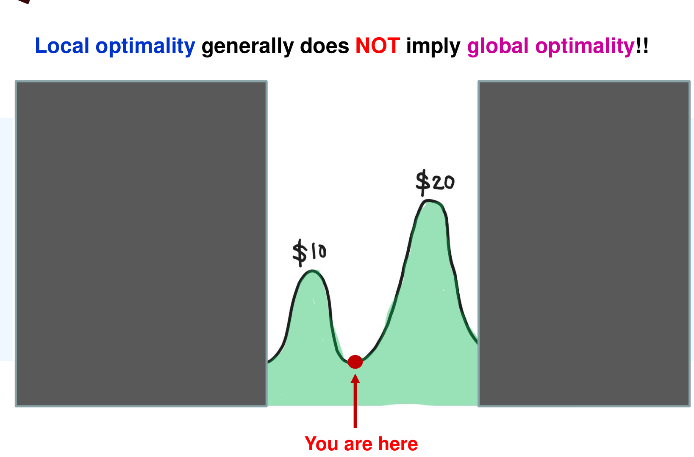
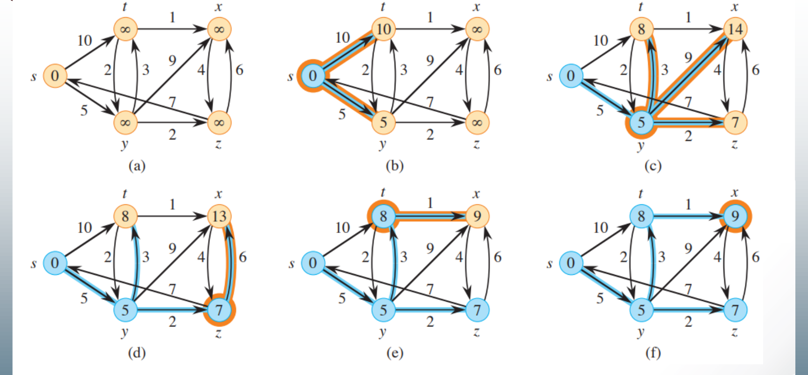
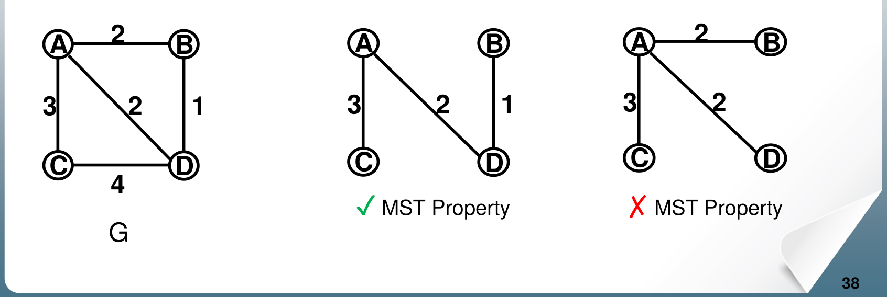

# 6. Greedy Algorithms: Dijkstra's Shortest Paths and Prim's MST

This chapter covers Lecture 5. It introduces the **greedy** strategy and two greedy algorithms that are provably correct:

* **Dijkstra's algorithm** finds the shortest paths from one vertex to every other vertex in a weighted graph.
* **Prim's algorithm** finds a **minimum spanning tree**: the cheapest set of edges that connects every vertex.

The two algorithms have almost the same code. The difference is one line, and understanding that line is most of this chapter.

---

## 1. The Greedy Strategy

### 1.1 Optimization problems

In an **optimization problem**, you make a series of choices, and the goal is to make the total cost as small as possible (or the total benefit as large as possible). Examples: the shortest route, the cheapest network.

### 1.2 What "greedy" means

A **greedy algorithm** makes each choice using only what it knows at that moment. It picks the option that looks best **right now**.

* Each choice is cheap to compute.
* A choice is **never undone**, even if it later turns out to be a bad one.

### 1.3 Greedy is usually not optimal

{width=60%}

A choice that is best locally is often not best overall. So greedy algorithms usually **do not guarantee** the optimal answer. For each greedy algorithm, you must **prove** that it is optimal. Dijkstra's and Prim's algorithms are two cases where the proof works. (Chapter 10 covers dynamic programming, which handles problems where greedy fails.)

---

## 2. The Shortest Path Problem

### 2.1 The problem

Given a weighted graph $G = (V, E, W)$ and a **source** vertex $s$, find the shortest path from $s$ to every other vertex. "Shortest" means the smallest total weight. This is the **single-source shortest paths** problem.

BFS (Chapter 5) solves it when every edge has the same weight. With different weights, a path with more edges can be lighter, so BFS can give the wrong answer.

### 2.2 Sub-paths of shortest paths are shortest

**Lemma 1.** Suppose a shortest path from $x$ to $z$ goes through $y$. Then its part from $x$ to $y$ is a shortest path from $x$ to $y$, and its part from $y$ to $z$ is a shortest path from $y$ to $z$.

**Proof by contradiction.** Suppose the part $P$ from $x$ to $y$ is not shortest. Then some path $P'$ from $x$ to $y$ is shorter. Follow $P'$, then the rest of the original path from $y$ to $z$. That is a path from $x$ to $z$ that is shorter than the shortest one. Contradiction.

This property (an optimal solution is built from optimal solutions of smaller problems) appears again in Chapter 10 as the **principle of optimality**.

---

## 3. Dijkstra's Algorithm

### 3.1 The idea

Dijkstra's algorithm works like BFS, but for weighted graphs. It finalizes vertices **in order of their distance from $s$**: first the closest vertex, then the next closest, and so on.

It keeps two groups of vertices:

* $S$: the vertices whose shortest distance is **final**. They form a tree of shortest paths.
* $V - S$: the rest.

Each vertex $v$ has two values:

* $v.d$: the length of the shortest path to $v$ found **so far**. It starts at $\infty$. It can only go down.
* $v.\pi$: the vertex before $v$ on that path (its **predecessor**).

### 3.2 The steps

1. Set $v.d = \infty$ and $v.\pi = \text{null}$ for every vertex. Set $s.d = 0$. $S$ is empty.
2. While some vertex is not in $S$:
    1. Choose the vertex $u$ outside $S$ with the **smallest** $u.d$. Add it to $S$. Its distance is now final.
    2. For each neighbour $v$ of $u$ that is not in $S$: if going through $u$ is shorter, that is, if $u.d + w(u, v) < v.d$, then set $v.d = u.d + w(u, v)$ and $v.\pi = u$.

Step 2.2 is called **relaxing** the edge $(u, v)$: it checks whether the edge gives a shorter way to reach $v$.

### 3.3 The code

```
Dijkstra_ShortestPath(Graph G, Node source) {
    for each vertex v {
        v.d = infinity;
        v.pi = null;
        S[v] = 0;                         // 1 when v is in S
    }
    source.d = 0;
    put every vertex in priority queue Q, ordered by v.d;
    while (not Empty(Q)) {
        u = ExtractCheapest(Q);           // smallest d
        S[u] = 1;                         // u.d is now final
        for each vertex v adjacent to u
            if (S[v] != 1 && v.d > u.d + w[u, v]) {
                remove v from Q;
                v.d = u.d + w[u, v];      // shorter path through u
                v.pi = u;
                insert v into Q according to v.d;
            }
    }
}
```

{width=90%}

### 3.4 How to trace it by hand

Exam questions ask for the arrays $S$, $d$ and $\pi$ after each iteration. Use a table with one column per vertex:

1. **Initial row:** $S$ all 0. $d = 0$ for the source, $\infty$ for the rest. $\pi$ all null.
2. **Each iteration:**
    * Among the vertices with $S = 0$, pick the one with the smallest $d$. (If there is a tie, use the rule the question gives, for example alphabetical order.) Set its $S$ to 1.
    * For each outgoing edge from that vertex to a vertex with $S = 0$: compute (its $d$) + (edge weight). If this is **smaller** than the neighbour's current $d$, write the new $d$ and set the neighbour's $\pi$ to the chosen vertex.
    * Write the full row of $S$, $d$, $\pi$.
3. After $|V|$ iterations, every $S$ is 1. Read each shortest path backwards with $\pi$, from the vertex back to the source.

Two checks catch most mistakes:

* The vertices join $S$ in order of **non-decreasing** $d$.
* Once a vertex is in $S$, its $d$ and $\pi$ never change.

You can also run this backwards: if a table shows the state after some iterations, the source is the vertex with $d = 0$ and $\pi = \text{null}$.

### 3.5 Why the greedy choice is correct

**Lemma 2.** Suppose every vertex $y$ in $S$ has the correct shortest distance $y.d$. Among all edges from a vertex in $S$ to a vertex outside $S$, let $(y, z)$ be the one that makes $y.d + w(y, z)$ smallest. Then the path "shortest path to $y$, then the edge $(y, z)$" is a shortest path to $z$.

**Proof idea.** Call this path $P$. Its length is $W(P) = y.d + w(y, z)$. Take any other path $P'$ from $s$ to $z$. $P'$ starts inside $S$ and ends outside $S$, so at some point it **leaves** $S$ for the first time, along some edge $(z_{k-1}, z_k)$.

* The part of $P'$ up to $z_k$ has length at least $z_{k-1}.d + w(z_{k-1}, z_k)$. By the choice of $(y, z)$, this is at least $y.d + w(y, z) = W(P)$.
* The rest of $P'$, from $z_k$ to $z$, has length **$\ge 0$**, because **all weights are non-negative**.

So $W(P') \ge W(P)$. No path to $z$ is shorter than $P$.

**Theorem.** With non-negative weights, Dijkstra's algorithm gives the correct shortest distance to every vertex reachable from $s$.

**Proof with a loop invariant:** "for every vertex $v$ in $S$, $v.d$ is the correct shortest distance".

* **Initialization.** The first vertex to join $S$ is $s$, with $s.d = 0$. Correct.
* **Maintenance.** The algorithm adds the vertex outside $S$ with the smallest $d$. That $d$ value is exactly $\min (y.d + w(y, z))$ over edges leaving $S$. By Lemma 2 it is the correct distance.
* **Termination.** At the end, every vertex is in $S$, so every $d$ is correct.

### 3.6 Running time

The cost depends on how the priority queue $Q$ is stored. There are $|V|$ extractions and up to $|E|$ updates of $d$.

| Priority queue | Extract min | Update $d$ | Total |
| :--- | :--- | :--- | :--- |
| Unsorted array (indexed by vertex) | $O(\lvert V \rvert)$ | $O(1)$ | $O(\lvert V \rvert^2)$ |
| Binary min-heap | $O(\log \lvert V \rvert)$ | $O(\log \lvert V \rvert)$ | $O((\lvert V \rvert + \lvert E \rvert) \log \lvert V \rvert)$ |

* For a **dense** graph ($|E| \approx |V|^2$), the array is better: $O(|V|^2)$ against $O(|V|^2 \log |V|)$.
* For a **sparse** graph, the heap is better: about $O(|E| \log |V|)$.

The lecture states $O(|V|^2)$ for the simple implementation.

### 3.7 What Dijkstra's algorithm can and cannot do

* **Directed or undirected:** both work. An undirected edge is two directed edges, one each way.
* **Cycles:** fine.
* **Zero weights:** fine. Lemma 2 only needs weights $\ge 0$.
* **Negative weights: not allowed.** Lemma 2 needs "the rest of the path costs $\ge 0$". With a negative edge, a path that leaves $S$ through a more expensive vertex can come back cheaper later. But Dijkstra has already finalized the vertex and never looks at it again.

    Example: edges $s \to a$ (weight 2), $s \to b$ (weight 3), $b \to a$ (weight $-2$). Dijkstra finalizes $a$ with $d = 2$ first. Later it finalizes $b$, but $a$ is already in $S$, so it ignores the edge $b \to a$. The true shortest distance to $a$ is $3 - 2 = 1$.

* **Adding a constant to every weight does not fix negative weights.** It changes which path is shortest. A path with more edges gets the constant added more times. Example: $s \to t$ with weight 5, against $s \to a \to t$ with weights 2 and 2 (total 4). Add 10 to every edge: the direct edge costs 15, and the two-edge path costs 24. The shortest path has changed. For the same reason, adding the same amount to every edge can change the shortest path even when all weights are positive.
* **Multiplying every weight by a positive constant** does not change which path is shortest. Every path is scaled by the same factor.
* **One source only.** One run gives shortest paths **from one source**. For all pairs of vertices, run it once from every vertex.
* **Smaller graphs give longer paths.** If you delete edges or vertices, a shortest path between two remaining vertices can only stay the same or get longer, because every path in the smaller graph also exists in the larger one.

### 3.8 Extension: counting the shortest paths

To count how many different shortest paths reach each vertex, add a counter `v.count`. Set `s.count = 1` and every other count to 0. When relaxing edge $(u, v)$:

* If $u.d + w(u, v) < v.d$: a strictly shorter path. Update $v.d$ and $v.\pi$, and set `v.count = u.count`. The old paths to $v$ are no longer shortest.
* If $u.d + w(u, v) = v.d$: more paths of the same shortest length. Add them: `v.count = v.count + u.count`.

Because all weights are positive, every vertex before $v$ on a shortest path joins $S$ before $v$, so all its paths are counted in time.

---

## 4. Minimum Spanning Trees

### 4.1 Definitions

* A **subgraph** of $G = (V, E)$ is a graph $G' = (V', E')$ with $V' \subseteq V$ and $E' \subseteq E$, where every edge in $E'$ joins two vertices in $V'$.
* A **spanning tree** of a connected graph $G$ is a subgraph that **contains every vertex**, is **connected**, and has **no cycle**.
* A spanning tree of a graph with $|V|$ vertices has exactly **$|V| - 1$ edges**. Fewer edges cannot connect all vertices. One more edge creates a cycle.
* A **minimum spanning tree** (MST) is a spanning tree with the smallest total edge weight.

Example use: connect $n$ towns with cables, using the least total cable.

### 4.2 The MST property

Let $T$ be a spanning tree. Take any edge $(u, v)$ of $G$ that is **not** in $T$. Adding it to $T$ creates exactly one cycle, because $T$ already has a path from $u$ to $v$.

$T$ has the **MST property** if, for every such edge, $(u, v)$ is a **maximum-weight edge on that cycle**. In words: no edge outside the tree could replace a heavier edge inside the tree.

{width=75%}

**Theorem 1.** A spanning tree $T$ is a minimum spanning tree **if and only if** it has the MST property.

* **($\Rightarrow$)** Suppose $T$ is an MST but lacks the property. Then some outside edge $(u, v)$ creates a cycle with a heavier tree edge $(x, y)$. Remove $(x, y)$ and add $(u, v)$. The result is still a spanning tree, and it is lighter than $T$. That contradicts "$T$ is minimum".
* **($\Leftarrow$)** First, any two spanning trees with the MST property have the same total weight (Lemma 1 below). An MST exists and, by the first half, has the MST property. So $T$ has the same weight as an MST, and $T$ is an MST too.

**Lemma 1 (idea).** Let $T_1$ and $T_2$ both have the MST property. Use induction on the number of edges where they differ. Take the lightest such edge, $uv$, say in $T_2$ only. The path from $u$ to $v$ in $T_1$ must contain an edge $w_iw_{i+1}$ that is not in $T_2$. By the MST property of $T_1$, $w(w_iw_{i+1}) \le w(uv)$. By the choice of $uv$ as the lightest differing edge, $w(w_iw_{i+1}) \ge w(uv)$. So they are equal. Swap them in $T_1$: the weight does not change, and the trees now differ in one fewer edge.

### 4.3 Useful facts about MSTs

* **The cycle rule.** The strictly heaviest edge on any cycle is in **no** MST. This follows from the MST property.
* **The cut rule.** Split the vertices into two groups. The lightest edge that crosses between the groups is in **some** MST. If it is the only lightest crossing edge, it is in **every** MST.
* **The lightest edge.** If one edge is strictly lighter than all others, every MST contains it. (Use the cut rule with one of its ends as a group by itself.)
* **Distinct weights mean one MST.** If all edge weights are different, the MST is unique.

    *Proof.* Suppose $T_1 \ne T_2$ are both MSTs. Among the edges in one tree but not the other, take the lightest, $(u, v)$. Say it is in $T_1$. Adding $(u, v)$ to $T_2$ creates a cycle. That cycle has some edge $e$ not in $T_1$ (otherwise $T_1$ would contain a cycle). $e$ is a differing edge, so it is heavier than $(u, v)$ (weights are distinct). Then $T_2 + (u, v) - e$ is a spanning tree lighter than $T_2$. Contradiction.
* **Equal weights can give several MSTs.** Example: a triangle with three edges of weight 1 has three MSTs (drop any one edge). If weights are not distinct, Prim and Kruskal may return different MSTs, all with the same total weight.
* **Negative weights are fine.** MST algorithms only compare edge weights with each other. They never add weights along a path. For the same reason, adding a constant to every edge does not change which tree is minimum: every spanning tree has $|V| - 1$ edges, so every tree's weight goes up by the same amount.
* **Shortest paths and MSTs are different.** The shortest path from $u$ to $v$ does not have to use only MST edges. Example: a triangle $a, b, c$ with $w(a,b) = 2$, $w(b,c) = 2$, $w(a,c) = 3$. The MST is $\{ab, bc\}$, but the shortest path from $a$ to $c$ is the direct edge, weight 3, not $2 + 2 = 4$.

---

## 5. Prim's Algorithm

### 5.1 The idea

Prim's algorithm grows **one tree** from a start vertex. At each step, it adds the **cheapest edge that connects the tree to a vertex not yet in the tree**.

It sorts the vertices into three groups:

* **Tree vertices:** already in the tree.
* **Fringe vertices:** not in the tree, but adjacent to some tree vertex.
* **Unseen vertices:** all the others.

Each step picks the fringe vertex with the cheapest edge to the tree, moves it into the tree, and moves its unseen neighbours into the fringe. When the fringe is empty, the tree contains every vertex (for a connected graph).

### 5.2 The code

Each vertex $v$ stores $v.d$, the weight of the **cheapest single edge** from $v$ to the current tree, and $v.\pi$, the tree vertex at the other end of that edge.

```
primMST(G, s) {
    for each vertex v { v.d = infinity; S[v] = 0; v.pi = null; }
    s.d = 0;
    insert(pq, s, 0);
    while (pq is not empty) {
        u = getMin(pq); deleteMin(pq);
        S[u] = 1;                         // u joins the tree, by edge (u.pi, u)
        updateFringe(pq, G, u);
    }
}

updateFringe(pq, G, v) {
    for all vertices w adjacent to v {
        if (S[w] != 1) {                  // w is not in the tree yet
            newWgt = weight of edge vw;
            if (w.d == infinity) {        // w was unseen: now fringe
                w.d = newWgt; w.pi = v;
                insert(pq, w, newWgt);
            } else if (newWgt < w.d) {    // a cheaper edge to the tree
                w.d = newWgt; w.pi = v;
                decreaseKey(pq, w, newWgt);
            }
        }
    }
}
```

At the end, the edges $(v.\pi, v)$ for every vertex except $s$ form the MST.

### 5.3 Prim against Dijkstra: one line

The two algorithms have the same structure: pick the cheapest vertex outside the set, add it, update its neighbours. The difference is what $d$ means.

| | Dijkstra | Prim |
| :--- | :--- | :--- |
| $v.d$ means | length of the whole path from $s$ to $v$ | weight of one edge from the tree to $v$ |
| Update rule | $v.d = u.d + w(u, v)$ | $v.d = w(u, v)$ |
| Result | shortest-path tree from $s$ | minimum spanning tree |
| Negative weights | not allowed | allowed |
| Graph | directed or undirected | undirected, connected |

So the two trees are usually **different**. Dijkstra minimizes each vertex's distance from $s$. Prim minimizes the total weight of all the edges.

### 5.4 How to trace it by hand

Use the same table as for Dijkstra: rows $S$, $d$, $\pi$, one column per vertex.

1. Start: $d = 0$ for the start vertex, $\infty$ elsewhere.
2. Each iteration: pick the vertex with $S = 0$ and the smallest $d$. Set its $S = 1$. For each neighbour $w$ with $S = 0$: if the **edge weight** to $w$ is smaller than $w.d$, set $w.d$ to that weight and $w.\pi$ to the chosen vertex.
3. The fringe after an iteration is the set of vertices with $S = 0$ and $d < \infty$. Their $d$ values are their distances to the tree.

The order in which vertices join the tree is the order the question usually asks for. The total MST weight is the sum of the final $d$ values.

### 5.5 Why Prim is correct

The lecture's argument: let $T_k$ be the tree after $k$ vertices have joined. One can show that $T_k$ has the MST property within the subgraph of those $k$ vertices. (The proof is not required.) So the final tree $T_n$ has the MST property in the whole graph, and by Theorem 1 it is an MST.

Intuitively: each step adds the lightest edge crossing between "tree" and "not tree". By the cut rule, that edge belongs to some MST.

### 5.6 Running time

The same as Dijkstra's algorithm, for the same reasons:

* Unsorted array: $O(|V|^2)$. Best for dense graphs.
* Binary heap: $O((|V| + |E|) \log |V|)$, which is $O(|E| \log |V|)$ for a connected graph. Best for sparse graphs.

Extra memory: $O(|V|)$ for $S$, $d$, $\pi$ and the priority queue.

---

## 6. Common Traps

* Dijkstra needs **non-negative** weights. Zero weights are fine. Adding a constant to all weights does not fix negative weights, and it can change the shortest path.
* One run of Dijkstra gives shortest paths from **one** source, not between all pairs.
* In Dijkstra, $d$ is a **path** length: $u.d + w(u, v)$. In Prim, $d$ is a single **edge** weight: $w(u, v)$.
* Once a vertex is in $S$, never change its $d$ or $\pi$.
* Prim and Kruskal work with negative weights. Dijkstra does not.
* A spanning tree has exactly $|V| - 1$ edges.
* Distinct weights give a unique MST. Equal weights can give several MSTs with the same total weight.
* The strictly lightest edge is in every MST. The strictly heaviest edge of a cycle is in no MST.
* The MST does not contain all shortest paths.
* Greedy algorithms are usually not optimal. Dijkstra and Prim are optimal because they come with a proof.
