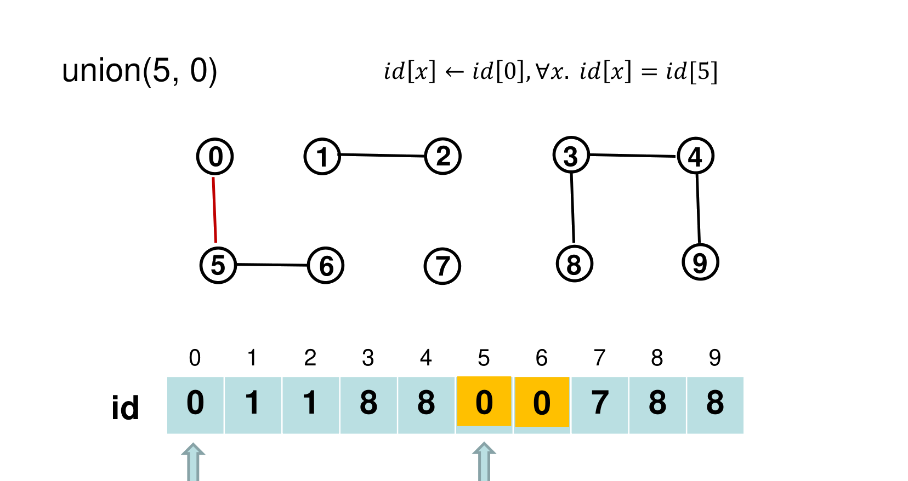
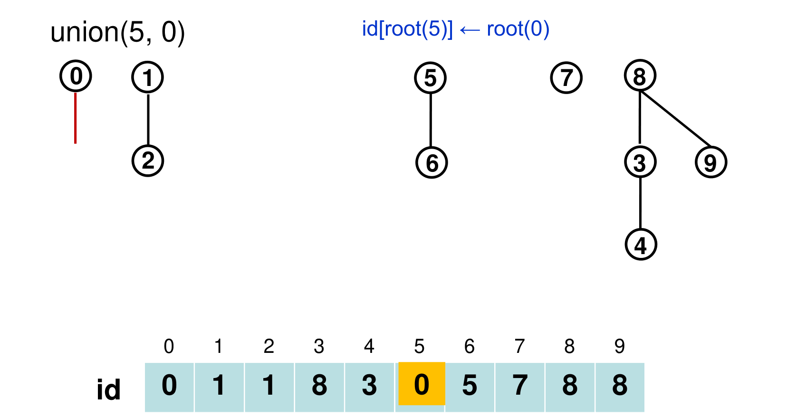
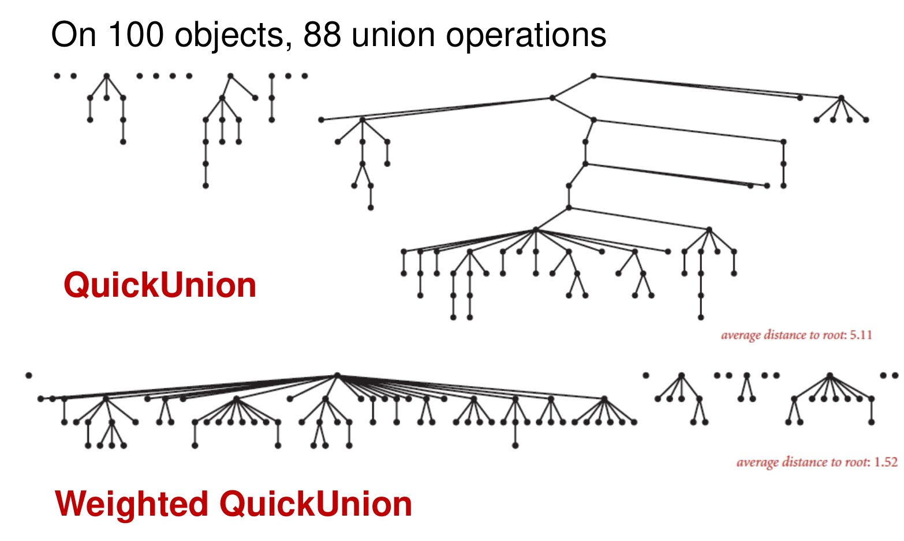
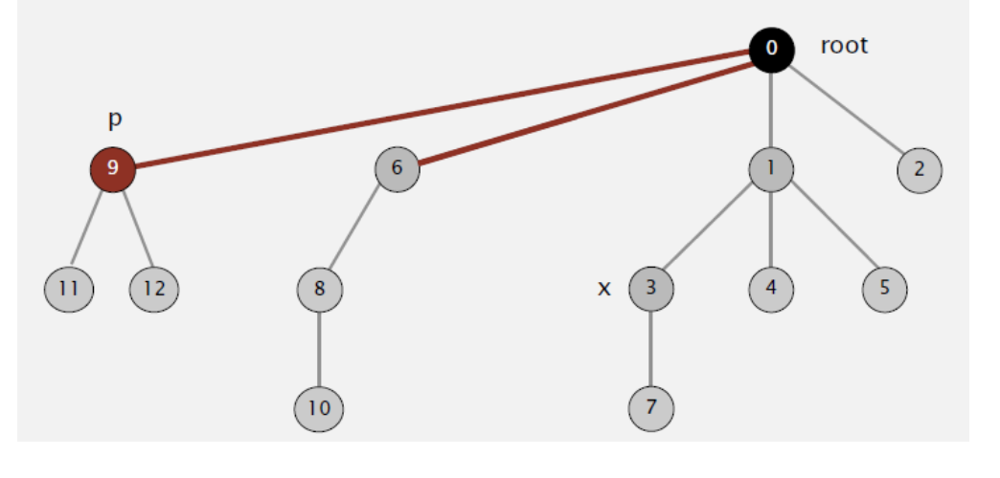
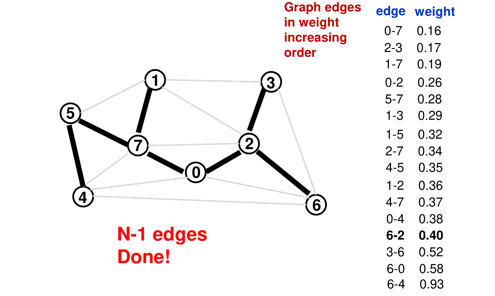

# 7. Union-Find and Kruskal's Algorithm

This chapter covers Lecture 6. **Union-find** is a data structure that keeps track of which objects are connected to which, while new connections keep arriving. **Kruskal's algorithm** is a second greedy algorithm for minimum spanning trees. It needs union-find to check quickly whether a new edge would create a cycle.

The chapter improves union-find in steps, from a slow version to an almost constant-time one. Each step fixes the main weakness of the one before.

---

## 1. The Problem: Dynamic Connectivity

### 1.1 Equivalence relations

A relation $R$ on a set $S$ is an **equivalence relation** if, for all $a, b, c \in S$:

* **Reflexive:** $a$ is related to $a$.
* **Symmetric:** if $a$ is related to $b$, then $b$ is related to $a$.
* **Transitive:** if $a$ is related to $b$ and $b$ to $c$, then $a$ is related to $c$.

"Is connected to" in an undirected graph is an equivalence relation. Its groups (its **equivalence classes**) are the **connected components**: sets of objects where every pair is joined by some path.

### 1.2 The task

We have $N$ objects, numbered $0$ to $N-1$. Connections arrive one at a time, mixed with questions:

* "Connect 4 and 5."
* "Connect 1 and 2."
* "Are 0 and 5 connected?"

The relation changes as we go, so it is a **dynamic** equivalence relation. Both $N$ and the number of operations $M$ can be huge (billions in a computer network or a social network). So each operation must be fast.

### 1.3 The operations

* `find(p)`: which component does $p$ belong to? It returns a name (an ID) for the component.
* `connected(p, q)`: are $p$ and $q$ in the same component? This is `find(p) == find(q)`.
* `union(p, q)`: connect $p$ and $q$. This merges their two components into one.

All versions below store an integer array `id[]` of length $N$. They differ in what `id[p]` means.

---

## 2. QuickFind: Fast find, Slow union

### 2.1 The idea

`id[p]` is the **component ID** of $p$. Two objects are connected exactly when they have the same ID. This is the "eager" approach: it keeps the answer ready at all times.

* `find(p)`: return `id[p]`. One array access.
* `union(p, q)`: change every entry whose ID equals `id[p]` to `id[q]`. The whole component of $p$ joins the component of $q$.

{width=70%}

### 2.2 The code

```
public int find(int p) { return id[p]; }

public void union(int p, int q) {
    int pid = id[p];                 // save both IDs first
    int qid = id[q];
    for (int i = 0; i < id.length; i++)
        if (id[i] == pid) id[i] = qid;
}
```

**Save `id[p]` before the loop.** A version that tests `if (id[i] == id[p])` inside the loop is **wrong**. When the loop reaches $i = p$, it changes `id[p]` itself. After that point, the test compares with the **new** ID, so the later members of $p$'s old component are not updated.

### 2.3 Cost

* `find` and `connected`: $\Theta(1)$.
* `union`: scans the whole array, $\Theta(N)$.
* $N$ unions on $N$ objects: $\Theta(N^2)$. For $10^{11}$ objects this would take thousands of years. Quadratic algorithms do not scale.

---

## 3. QuickUnion: Trees, Slow find

### 3.1 The idea

`id[p]` is the **parent** of $p$. The objects form a forest of trees. Each tree is one component, and its **root** names the component. A root is its own parent: `id[r] == r`.

* `find(p)`: follow parent links from $p$ until you reach the root.
* `union(p, q)`: find the root of $p$ and the root of $q$. Make $p$'s root a child of $q$'s root. Only **one** entry changes.

This is the "lazy" approach: union does almost nothing, and find does the work.

{width=70%}

### 3.2 The code

```
public int find(int i) {
    while (i != id[i]) i = id[i];    // climb to the root
    return i;
}

public void union(int p, int q) {
    int i = find(p);
    int j = find(q);
    id[i] = j;                       // p's root goes under q's root
}
```

### 3.3 Cost

The cost of `find` is the **depth** of the object in its tree. The trees can become tall: in the worst case, one long chain of $N$ objects. Then `find`, `connected` and `union` (which calls `find`) all cost $O(N)$.

QuickFind keeps trees flat but pays for it in every union. QuickUnion makes union cheap but lets trees grow tall.

---

## 4. Weighted QuickUnion: Keep the Trees Short

### 4.1 The idea

Tall trees come from hanging a big tree under a small one. So keep track of the **size** of each tree (the number of objects in it), and always hang the **smaller** tree under the root of the **larger** one.

An extra array `sz[r]` holds the size of the tree with root $r$.

```
public void union(int p, int q) {
    int i = find(p);
    int j = find(q);
    if (i == j) return;                      // already connected
    if (sz[i] < sz[j]) { id[i] = j; sz[j] += sz[i]; }
    else               { id[j] = i; sz[i] += sz[j]; }
}
```

`find` and `connected` are the same as in QuickUnion.

**On a tie** (`sz[i] == sz[j]`), the `else` branch runs: **$q$'s root goes under $p$'s root.** Follow this rule exactly when you trace by hand.

{width=85%}

### 4.2 Tracing by hand

For each `union(p, q)`:

1. Find the root $i$ of $p$ and the root $j$ of $q$, by following `id[]`.
2. If $i = j$, do nothing.
3. If `sz[i] < sz[j]`: set `id[i] = j`, then `sz[j] += sz[i]`.
4. Otherwise (including a tie): set `id[j] = i`, then `sz[i] += sz[j]`.

Only roots change. Only the size of the new root changes.

**Example** with objects 0 to 5, all starting as their own roots with size 1:

| Operation | Roots and sizes | Action | `id[]` after |
| :--- | :--- | :--- | :--- |
| union(0, 1) | 0 (1), 1 (1): tie | 1 goes under 0 | 0 0 2 3 4 5 |
| union(2, 3) | 2 (1), 3 (1): tie | 3 goes under 2 | 0 0 2 2 4 5 |
| union(1, 3) | 0 (2), 2 (2): tie | 2 goes under 0 | 0 0 0 2 4 5 |
| union(4, 5) | 4 (1), 5 (1): tie | 5 goes under 4 | 0 0 0 2 4 4 |
| union(5, 1) | 4 (2), 0 (4) | smaller 4 goes under 0 | 0 0 0 2 0 4 |

The final tree has root 0 and height 2, for 6 objects.

### 4.3 Why the depth is at most $\log_2 N$

**Claim:** in weighted QuickUnion, every object has depth at most $\log_2 N$.

* An object's depth increases by 1 only when its tree $T_1$ is hung under another tree $T_2$.
* That only happens when $|T_2| \ge |T_1|$. So the merged tree has at least $2|T_1|$ objects: the size of the object's tree **at least doubles**.
* A tree starts with 1 object and can never hold more than $N$. Starting from 1, you can double at most $\log_2 N$ times before you pass $N$.
* So the depth increases at most $\log_2 N$ times.

So `find`, `connected` and `union` all cost $O(\log N)$.

---

## 5. Path Compression: Flatten as You Go

### 5.1 The idea

When `find(p)` climbs from $p$ to the root, it has just visited every node on that path. Make each of them point **directly at the root**. The next `find` on any of them takes one step.

{width=70%}

Two ways to code it:

* **Two-pass:** first climb to find the root. Then climb again and set `id[]` of each node on the path to the root.
* **One-pass (path halving):** while climbing, make every node point to its **grandparent**. This needs one extra line:

```
public int find(int i) {
    while (i != id[i]) {
        id[i] = id[id[i]];           // skip one level
        i = id[i];
    }
    return i;
}
```

In practice, either way keeps the trees almost completely flat.

### 5.2 Cost

Weighted QuickUnion with Path Compression (**WQUPC**) is not quite linear in theory, but it is linear in practice. $M$ operations on $N$ objects cost $O(N + M \log^* N)$. Here $\log^* N$ is the number of times you must take $\log_2$ before the result falls to 1 or below. It is at most 5 for any $N$ that fits in this universe. (Fredman and Saks proved that no union-find structure can be truly linear.)

### 5.3 Summary of the versions

| Version | Initialize | union | find / connected | $M$ operations on $N$ objects |
| :--- | :--- | :--- | :--- | :--- |
| QuickFind | $\Theta(N)$ | $\Theta(N)$ | $\Theta(1)$ | $O(MN)$ |
| QuickUnion | $\Theta(N)$ | $O(N)$ | $O(N)$ | $O(MN)$ |
| Weighted QuickUnion | $\Theta(N)$ | $O(\log N)$ | $O(\log N)$ | $O(N + M \log N)$ |
| WQUPC | $\Theta(N)$ | almost $O(1)$ | almost $O(1)$ | $O(N + M \log^* N)$ |

For $10^{11}$ unions on $10^{11}$ objects, WQUPC takes seconds where QuickFind takes thousands of years. A faster computer cannot close a gap like that. A better algorithm can.

---

## 6. Kruskal's Algorithm

### 6.1 The idea

Kruskal's algorithm builds a minimum spanning tree (Chapter 6) in a different way from Prim's:

1. Sort all edges by weight, lightest first.
2. Go through the edges in that order. **Add an edge to the tree unless it would create a cycle.**
3. Stop when the tree has $|V| - 1$ edges.

Prim grows **one** tree outward from a start vertex. Kruskal grows a **forest** of many small trees, which merge until one tree is left. At any moment, Kruskal's chosen edges may form several separate pieces.

{width=85%}

### 6.2 Why it is correct

**Proof by contradiction.** Suppose Kruskal's tree $T$ is not an MST. Then, by Theorem 1 of Chapter 6, $T$ does not have the MST property. So some edge $u$-$v$ not in $T$ creates a cycle in $T$ that contains a heavier edge $x$-$y$: $w(x\text{-}y) > w(u\text{-}v)$.

* Because $u$-$v$ is lighter, Kruskal examined $u$-$v$ **before** $x$-$y$.
* $T$ is a tree, so it has only **one** path from $u$ to $v$, and that path uses $x$-$y$. When Kruskal examined $u$-$v$, it had not yet added $x$-$y$. So the edges chosen at that time had no path from $u$ to $v$, and adding $u$-$v$ would not have made a cycle.
* So Kruskal would have added $u$-$v$. That contradicts "$u$-$v$ is not in $T$".

### 6.3 Checking for a cycle with union-find

The key question for each edge $v$-$w$: "are $v$ and $w$ already connected by the edges chosen so far?" If yes, adding the edge closes a cycle.

* One option: run DFS from $v$ in the current tree and see whether it reaches $w$. That costs $O(|V|)$ per edge.
* Better: keep the chosen edges' components in a union-find structure. The test is `connected(v, w)`, almost $O(1)$ with WQUPC.

```
kruskal(G):
    sort the edges of G by weight, lightest first       // O(|E| log |E|)
    create a union-find structure on the |V| vertices    // O(|V|)
    T = empty
    for each edge (v, w) in sorted order:
        if not connected(v, w):                          // no cycle
            union(v, w)
            add (v, w) to T
            if T has |V| - 1 edges: stop
    return T
```

### 6.4 Running time

| Step | Cost |
| :--- | :--- |
| Sort the edges | $O(\lvert E \rvert \log \lvert E \rvert)$ |
| Initialize union-find | $O(\lvert V \rvert)$ |
| At most $\lvert E \rvert$ connected tests | $O(\lvert E \rvert \log^* \lvert V \rvert)$ |
| At most $\lvert V \rvert - 1$ unions | $O(\lvert V \rvert \log^* \lvert V \rvert)$ |
| **Total** | $O(\lvert E \rvert \log \lvert E \rvert)$ |

Sorting dominates. Also $O(|E| \log |E|) = O(|E| \log |V|)$: a simple graph has $|E| \le |V|^2$, so $\log |E| \le 2 \log |V|$.

**Faster with small integer weights.** If all weights are integers between 1 and $|V|$, sort the edges with **counting sort** (Chapter 4) in $O(|E| + |V|)$ instead. Then the union-find work dominates, and the total is about $O(|E| \log^* |V|)$, almost linear.

### 6.5 Counting components as Kruskal runs

Before any edge is added, every vertex is its own component: $|V|$ components. Each **accepted** edge joins two different components into one, so the count drops by exactly 1. A **rejected** edge (one that would close a cycle) changes nothing. After $k$ accepted edges there are $|V| - k$ components. At the end there is 1.

### 6.6 Other uses of the same method

* **Does an undirected graph have a cycle?** Start with every vertex alone in union-find. For each edge $(u, v)$: if `connected(u, v)` is already true, the graph has a cycle. Otherwise `union(u, v)`. This is Kruskal's test without the sorting.
* **Maximum spanning tree:** sort the edges **heaviest first** (or negate every weight) and run the same algorithm.
* **A graph that is not connected:** Kruskal does not need a start vertex. On a disconnected graph it returns a minimum spanning **forest**, one tree per component.

---

## 7. Prim against Kruskal

| | Prim | Kruskal |
| :--- | :--- | :--- |
| Grows | one tree from a start vertex | a forest that merges into one tree |
| Picks next | cheapest edge from the tree to a fringe vertex | cheapest edge overall that makes no cycle |
| Data structure | priority queue | sorted edge list + union-find |
| Time | $O(\lvert V \rvert^2)$ array, or $O(\lvert E \rvert \log \lvert V \rvert)$ heap | $O(\lvert E \rvert \log \lvert E \rvert)$ |
| Suits | dense graphs (array version) | sparse graphs |
| Negative weights | fine | fine |

If some weights are equal, Prim and Kruskal can return **different** MSTs. Both are correct, and both have the same total weight. If all weights are distinct, the MST is unique, so they return the same tree.

---

## 8. Common Traps

* QuickFind: `find` is $O(1)$, `union` is $O(N)$. Save `id[p]` before the loop.
* QuickUnion: `union` changes only the root of $p$, but its cost includes the two `find` calls, which can be $O(N)$.
* Weighted QuickUnion: the smaller tree goes under the larger. On a tie, $q$'s root goes under $p$'s root (lecture code).
* Weighted QuickUnion keeps every depth at most $\log_2 N$.
* The ID array holds **parents**, not roots, in QuickUnion. To find a component, climb to the root.
* Kruskal sorts **edges**. Prim keeps a priority queue of **vertices**.
* Kruskal is $O(|E| \log |E|)$, which equals $O(|E| \log |V|)$.
* Each accepted edge reduces the number of components by exactly one.
* Kruskal stops after $|V| - 1$ accepted edges. It does not need to look at the remaining edges.
