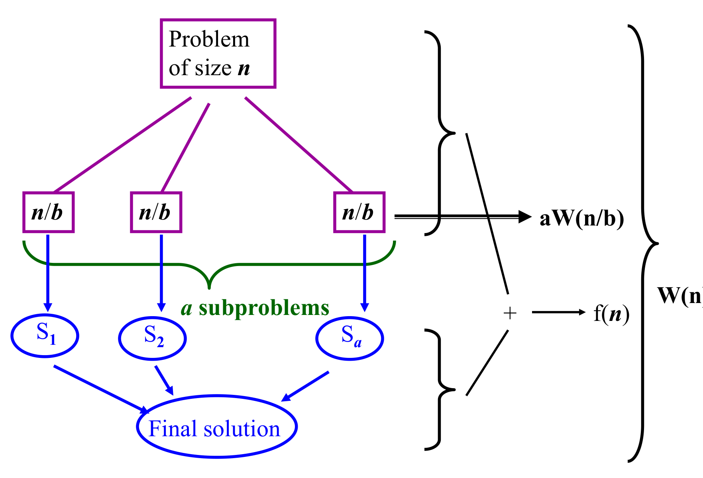
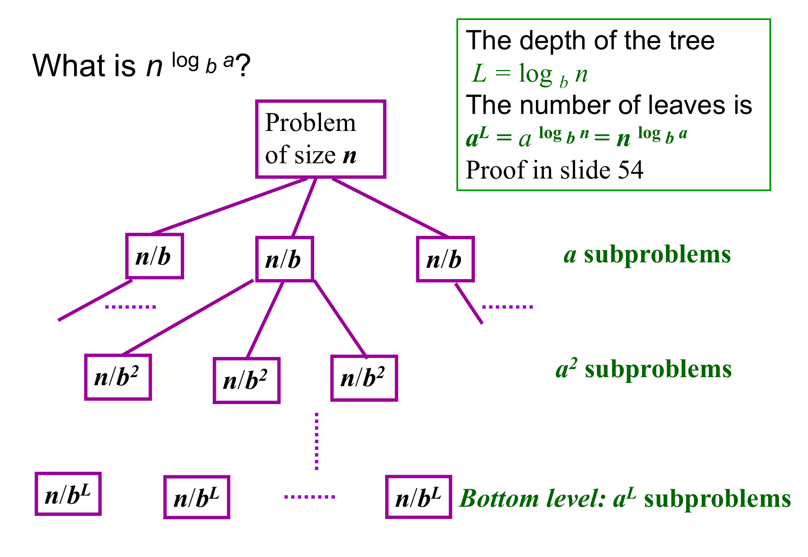

# 8. Analysis Techniques: Solving Recurrences

This chapter covers Lecture 8. Chapters 2 to 4 analysed recursive sorts, and each analysis ended with a **recurrence**: an equation that gives the cost on input $n$ in terms of the cost on smaller inputs, such as $T(n) = 2T(n/2) + O(n)$. A recurrence does not tell you how fast an algorithm is. To **solve** it means to find a formula in $n$ alone: an exact formula, or a bound ($O$, $\Omega$, $\Theta$). Chapter 1 defines these bounds. Here $\lg n$ means $\log_2 n$.

Five methods follow: substitution, iteration, recursion tree, master method and characteristic equation. Section 6 says which one to pick.

---

## 1. Divide-and-Conquer Recurrences

Most recurrences in this course have one shape:

$$W(n) = a\,W(n/b) + f(n), \qquad a \ge 1, \; b > 1.$$

* $n$ is the size of the problem.
* $a$ is the **number** of sub-problems made at each step.
* $b$ is the factor by which the input shrinks, so each sub-problem has size $n/b$.
* $f(n)$ is the work done outside the recursive calls: splitting the problem and combining the answers.

{width=75%}

Two things never change the order of growth ($\Theta$):

* **Rounding.** Sizes such as $\lfloor n/b \rfloor$ are really whole numbers. Treat $n$ as a power of $b$.
* **Base cases** that cost a constant. They matter only for an exact formula.

### Lecture benchmarks

| Algorithm | Recurrence | $a$ | $b$ | $f(n)$ | Solution |
| :--- | :--- | :---: | :---: | :--- | :--- |
| **Binary search** | $W(n) = W(n/2) + 2$ | 1 | 2 | $\Theta(1)$ | $\Theta(\log n)$ |
| **Max and min** | $W(n) = 2W(n/2) + 2$ | 2 | 2 | $\Theta(1)$ | $\Theta(n)$ |
| **Mergesort** | $W(n) = 2W(n/2) + n - 1$ | 2 | 2 | $\Theta(n)$ | $\Theta(n \log n)$ |
| **Integer multiplication** | $W(n) = 3W(n/2) + cn$ | 3 | 2 | $\Theta(n)$ | $\Theta(n^{\lg 3}) \approx \Theta(n^{1.58})$ |
| **Matrix multiplication** | $W(n) = 7W(n/2) + \frac{15}{4}n^2$ | 7 | 2 | $\Theta(n^2)$ | $\Theta(n^{\lg 7}) \approx \Theta(n^{2.81})$ |

The last two recurrences come from Karatsuba's and Strassen's methods, which make 3 and 7 half-size multiplications. *(Their origin is not in the lecture.)*

Mergesort is the running example. $W(n)$ counts comparisons. Two half-size sorts cost $2W(n/2)$, and one merge of $n$ elements costs at most $n - 1$. With $n = 2^k$ and $W(1) = 0$:

| $n$ | 1 | 2 | 4 | 8 |
| :--- | :---: | :---: | :---: | :---: |
| $W(n)$ | 0 | 1 | 5 | 17 |

Use this table to check every answer. The lecture's start value $W(2) = 1$ gives the same numbers.

---

## 2. The Substitution Method (Guess and Check)

**Workflow:**

1. **Guess** the form of the bound, for example $W(n) \le c \cdot n \lg n$.
2. **Hypothesis:** assume the bound for all smaller values.
3. **Step:** put the hypothesis into the recurrence. Show the **same** bound, with the **same** constant $c$, holds for $n$.
4. **Base case:** pick $c$ and $n_0$ so the bound holds at the start.

The recurrence links $n$ to $n/2$, so the induction runs on $k$ in $n = 2^k$. The step goes from $2^k$ to $2^{k+1}$:

$$W(2^{k+1}) = 2W(2^k) + 2^{k+1} - 1.$$

### Three guesses on mergesort

Recurrence: $W(n) = 2W(n/2) + n - 1$, with $W(2) = 1$.

**Guess 1: $W(n) \le n^2$.** Assume $W(2^k) \le (2^k)^2$.

$$W(2^{k+1}) \le 2(2^k)^2 + 2^{k+1} - 1 \le 4(2^k)^2 = (2^{k+1})^2.$$

*Verdict:* a valid proof, so $W(n) = O(n^2)$. But it is **loose**: the second step throws away a lot.

**Guess 2: $W(n) \le cn$.** Assume $W(2^k) \le c \cdot 2^k$.

$$W(2^{k+1}) \le 2c \cdot 2^k + 2^{k+1} - 1 = c \cdot 2^{k+1} + (2^{k+1} - 1).$$

*Verdict:* **fails.** The leftover $2^{k+1} - 1$ is positive, so we only reach about $(c+1)\,2^{k+1}$. The constant must stay the same $c$. Here the guess is also false, because $W(n) = n \lg n - n + 1$ grows faster than $cn$.

**Guess 3: $W(n) \le n \lg n$.** At $n = 2^k$, $n \lg n = k \cdot 2^k$. Assume $W(2^k) \le k \cdot 2^k$.

$$\begin{aligned}
W(2^{k+1}) &\le 2k \cdot 2^k + 2^{k+1} - 1 \\
&= k \cdot 2^{k+1} + 2^{k+1} - 1 \\
&= (k+1)\,2^{k+1} - 1 \le (k+1)\,2^{k+1}.
\end{aligned}$$

*Verdict:* this is exactly $n \lg n$ for $n = 2^{k+1}$. So $W(n) = O(n \lg n)$, and the bound is close.

### Fixes and pitfalls

**1. The strict constant rule.** The step must end with the exact bound you assumed. Reaching $cn + 1$ or $(c+1)n$ is a failed proof. A failed proof does not show the guess is false. It shows only that this proof failed.

**2. The step misses by a constant: subtract.** *(Not in the lecture. Standard fix, CLRS §4.3.)* Take $T(n) = 3T(n/3) + 1$, $T(1) = 1$. Guess $T(n) \le cn$:

$$T(n) \le 3 \cdot \frac{cn}{3} + 1 = cn + 1 \quad (\text{fails}).$$

Strengthen the guess by **subtracting** a constant: $T(n) \le cn - b$. Each of the 3 sub-problems now brings a $-b$:

$$T(n) \le 3\left(\frac{cn}{3} - b\right) + 1 = cn - 3b + 1.$$

We need $cn - 3b + 1 \le cn - b$, so $2b \ge 1$ and $b \ge \tfrac12$. Base case: $1 \le c - \tfrac12$, so $c \ge \tfrac32$. Both hold, so $T(n) = O(n)$. Adding a constant instead makes the step harder.

**3. The base case fails.** Take $W(1) = 1$ and try $W(n) \le c\,n \lg n$. At $n = 1$ the bound is $c \cdot 1 \cdot \lg 1 = 0 < 1$, for every $c$. Big-$O$ needs the bound only for $n \ge n_0$, so start at $n_0 = 2$. There $W(2) = 2W(1) + 1 = 3$ and the bound is $2c$, so $c \ge \tfrac32$. The step needs $c \ge 1$, so $c = \tfrac32$ works.

**4. The smoothness rule ($n$ is not a power of 2).** Runtimes never decrease as $n$ grows. So put $n$ between two powers of 2, $2^k < n < 2^{k+1}$, and use the larger one:

1. $W(n) \le W(2^{k+1}) \le c\,(k+1)\,2^{k+1}$.
2. $2^k < n$ gives $2^{k+1} < 2n$. Also $k + 1 < \lg(2n) \le 2\lg n$ for $n \ge 2$.
3. So $W(n) < c \cdot 2\lg n \cdot 2n = 4c\,n \lg n = O(n \lg n)$.

*Limit:* substitution needs a guess. Use it when you are given a bound to prove, or after another method has suggested one.

---

## 3. The Iteration Method (Unrolling)

Expand the recurrence repeatedly until a pattern appears. Work out how many expansions reach the base case. Then add up the series. No guess is needed. The key question is: **how many times must I expand?**

### Toolkit

* **Log swap:** $a^{\log_b n} = n^{\log_b a}$
* **Arithmetic sum:** $1 + 2 + \dots + n = \dfrac{n(n+1)}{2} = \Theta(n^2)$
* **Powers of 2:** $1 + 2 + \dots + 2^k = 2^{k+1} - 1$
* **Geometric sum** $\sum_{j=0}^{k} r^j = \dfrac{r^{k+1} - 1}{r - 1}$:
    * shrinking ($r < 1$): at most $\frac{1}{1-r}$, a constant, so the first term dominates;
    * growing ($r > 1$): $\Theta(r^k)$, so the last term dominates.

### Mergesort: exact closed form

$W(n) = 2W(n/2) + n - 1$, $W(1) = 0$, $n = 2^k$.

$$\begin{aligned}
W(n) &= (n-1) + 2W(n/2) \\
&= (n-1) + (n-2) + 4W(n/4) \\
&= (n-1) + (n-2) + (n-4) + 8W(n/8) \\
&= \sum_{j=0}^{i-1} (n - 2^j) + 2^i\,W(n/2^i).
\end{aligned}$$

After $i$ expansions there are $2^i$ sub-problems of size $n/2^i$. Each merges at cost $n/2^i - 1$, so the $i$-th term is $n - 2^i$.

* **Stop** when $n/2^i = 1$: $i = k = \lg n$.
* **Sum:** $W(n) = 2^k \cdot 0 + kn - (2^k - 1) = n \lg n - n + 1.$
* **Check:** $n = 4$ gives $8 - 4 + 1 = 5$. $n = 8$ gives $24 - 8 + 1 = 17$.
* **Order:** $W(n) = \Theta(n \lg n)$.

### Unequal branching: geometric decay

$W(n) = 3W(\lfloor n/4 \rfloor) + n$, with $W(1) = W(2) = W(3) = 1$.

After $j$ expansions there are $3^j$ calls of size $n/4^j$, so level $j$ costs $\left(\frac34\right)^j n$.

$$W(n) = n \sum_{j=0}^{i-1}\left(\tfrac34\right)^j + 3^i\,W(\text{base}).$$

* **Stop** when $n/4^i \le 3$: $i = \lfloor \log_4 n \rfloor$.
* **Internal work:** the ratio is $\frac34 < 1$, so the sum is at most $\frac{1}{1-3/4} = 4$. The total is at most $4n$.
* **Leaf work:** $3^i \le 3^{\log_4 n} = n^{\log_4 3} \approx n^{0.79}$.
* **Result:** $W(n) \le 4n + n^{0.79} = O(n)$. The root alone costs $n$, so $W(n) = \Theta(n)$.

### Subtracting sizes: Towers of Hanoi

Move $n$ disks: move $n-1$ to the spare pole, move the largest, move the $n-1$ back on top. Let $M(n)$ be the number of moves.

$M(1) = 1$ and $M(n) = 2M(n-1) + 1$. The size drops by 1, so expand $n-1$ times.

$$\begin{aligned}
M(n) &= 1 + 2M(n-1) = 1 + 2 + 4M(n-2) = \dots \\
&= (1 + 2 + \dots + 2^{n-2}) + 2^{n-1}M(1) = (2^{n-1} - 1) + 2^{n-1} = 2^n - 1.
\end{aligned}$$

*Result:* $M(n) = \Theta(2^n)$. Check: $M(2) = 3$, $M(3) = 7$.

* Multiply by $a > 1$ and subtract 1: a geometric sum, so the answer is about $a^n$.
* $T(n) = T(n-1) + n$: an arithmetic sum, $\frac{n(n+1)}{2} = \Theta(n^2)$.

---

## 4. Recursion Trees and the Master Method

### Recursion tree

A **recursion tree** draws the expansion as a tree. Each node is one call, and holds the work that call does **itself**, not the work of its children. The total is the sum over the levels.

{width=80%}

| Quantity | Value |
| :--- | :--- |
| Depth | $L = \log_b n$ |
| Nodes at level $j$ | $a^j$, each of size $n/b^j$ |
| Work at level $j$ | $a^j f(n/b^j)$ |
| Root work | $f(n)$ |
| Leaves | $a^L = a^{\log_b n} = n^{\log_b a}$ |
| Leaf work | $\Theta(n^{\log_b a})$ |

**The core idea:** the total is a tug-of-war between the root work $f(n)$ and the leaf work $n^{\log_b a}$.

*Mergesort check* ($n = 8$). Level $i$ costs $n - 2^i$ at the merge levels, and the leaves cost 0:

| Level | Nodes | Size | Work per node | Level work |
| :---: | :---: | :---: | :---: | :---: |
| 0 | 1 | 8 | 7 | 7 |
| 1 | 2 | 4 | 3 | 6 |
| 2 | 4 | 2 | 1 | 4 |
| 3 | 8 | 1 | 0 | 0 |
| | | | **Total** | **17** |

This is the same sum as iteration. Every level costs close to $n$, and there are $\lg n$ levels.

**Unequal sub-problems** *(not in the lecture)*. For $T(n) = T(n/2) + T(n/3) + n$, level 0 costs $n$, level 1 costs $\left(\frac12 + \frac13\right)n = \frac56 n$, and level 2 costs $\left(\frac56\right)^2 n$. The ratio is below 1, so the total is at most $6n$, and the root costs $n$. This suggests $\Theta(n)$. A tree gives a **guess**. Prove it by substitution.

### The master theorem

Compare $f(n)$ with the **leaf function** $n^{\log_b a}$.

| Case | Condition | Who wins | $W(n)$ |
| :---: | :--- | :--- | :--- |
| **1** | $f(n) = O(n^{\log_b a - \varepsilon})$ for some $\varepsilon > 0$ | **Leaves.** Level costs grow down the tree. | $\Theta(n^{\log_b a})$ |
| **2** | $f(n) = \Theta(n^{\log_b a} \log^k n)$ for some $k \ge 0$ | **Tie.** Levels cost about the same. | $\Theta(n^{\log_b a} \log^{k+1} n)$ |
| **3** | $f(n) = \Omega(n^{\log_b a + \varepsilon})$ for some $\varepsilon > 0$, **and** $a f(n/b) \le c f(n)$ for some $c < 1$ | **Root.** Level costs shrink down the tree. | $\Theta(f(n))$ |

The usual case 2 has $k = 0$: $f(n) = \Theta(n^{\log_b a})$ gives $\Theta(n^{\log_b a} \log n)$.

**Why it works.** Take $f(n) = n^p$. Level $j$ costs $n^p\,(a/b^p)^j$, a geometric sum with ratio $r = a/b^p$. If $p < \log_b a$, then $r > 1$ and the leaves dominate. If $p = \log_b a$, then $r = 1$ and every level is equal. If $p > \log_b a$, then $r < 1$ and the root dominates.

**Applying it:**

1. Read off $a$, $b$ and $f(n)$.
2. Compute $n^{\log_b a}$.
3. Compare: smaller by a factor $n^\varepsilon$ is case 1. The same order is case 2. Larger by a factor $n^\varepsilon$ needs the regularity check, then case 3.

| Recurrence | $n^{\log_b a}$ | $f(n)$ against it | Case | Answer |
| :--- | :--- | :--- | :---: | :--- |
| $3W(n/3) + 2$ | $n$ | smaller by $n^{1}$ | 1 | $\Theta(n)$ |
| Max and min: $2W(n/2) + 2$ | $n$ | smaller by $n^{1}$ | 1 | $\Theta(n)$ |
| Integers: $3W(n/2) + cn$ | $n^{\lg 3}$ | smaller by $n^{0.58}$ | 1 | $\Theta(n^{\lg 3})$ |
| Matrices: $7W(n/2) + \frac{15}{4}n^2$ | $n^{\lg 7}$ | smaller by $n^{0.81}$ | 1 | $\Theta(n^{\lg 7})$ |
| Binary search: $W(n/2) + 2$ | $n^0 = 1$ | same order | 2 | $\Theta(\log n)$ |
| Mergesort: $2W(n/2) + n - 1$ | $n$ | same order | 2 | $\Theta(n \log n)$ |
| $4W(n/4) + n - 1$ | $n$ | same order | 2 | $\Theta(n \log n)$ |
| $2W(n/2) + n\lg n$ | $n$ | $n \lg^1 n$, so $k = 1$ | 2 | $\Theta(n \lg^2 n)$ |
| $2W(n/4) + n$ | $n^{0.5}$ | larger by $n^{0.5}$, and $2\cdot\frac n4 = \frac12 n \le \frac34 n$ | 3 | $\Theta(n)$ |

### Technical conditions

**Why a polynomial gap ($n^\varepsilon$)?** A gap of $n^\varepsilon$ makes the ratio between neighbouring levels a constant away from 1, so the sum is geometric and one end dominates. A gap of only a $\log$ factor does not.

*Log-gap failure.* $W(n) = 3W(n/3) + \frac{n}{\lg n}$. Here $n^{\log_3 3} = n$, and $f(n)$ is smaller than $n$ but **not** by a factor $n^\varepsilon$:

$$\lim_{n\to\infty} \frac{n/\lg n}{n^{1-\varepsilon}} = \lim_{n\to\infty} \frac{n^\varepsilon}{\lg n} = \infty.$$

It is not $\Theta(n \log^k n)$ either, so no case applies and the master method **does not apply**. (The slide says the gap is between cases 2 and 3. It is between cases 1 and 2.) A recursion tree gives $\Theta(n \log\log n)$ *(not in the lecture)*.

**Regularity (the case 3 guardrail).** Level 1 costs $a f(n/b)$. Regularity says it is at most $c f(n)$ with $c < 1$. Then level $j$ costs at most $c^j f(n)$, and the root sets the answer. For $f(n) = n^p$ with $p > \log_b a$ it holds automatically.

*Regularity failure.* $W(n) = W(n/3) + f(n)$, with $f(n) = 3n + 2^{3n}$ when $n = 2^i$ and $f(n) = 3n$ otherwise.

* $n^{\log_3 1} = 1$ and $f(n) = \Omega(n^1)$, so it looks like case 3.
* But $f$ spikes at powers of 2. Take $n = 3 \cdot 2^i$. The child has size $2^i$ and does $f(2^i) = n + 2^n$ work. The parent did only $3n$. The work grows down the tree, so regularity fails.
* Example: $n = 6$. The child does $f(2) = 70$, but $c\,f(6) = 18c < 18$.

### Shapes the master method cannot handle

| Recurrence | Why | Use |
| :--- | :--- | :--- |
| $W(n) = W(n-1) + 1$ | size is subtracted | Iteration |
| $W(n) = W(n/2) + W(n/3) + n$ | different sub-problem sizes | Recursion tree, then substitution |
| $W(n) = nW(n/2) + n$ | $a$ is not constant | Iteration |
| $W(n) = W(n-1) + W(n-2)$ | size is subtracted | Characteristic equation |

---

## 5. Linear Homogeneous Recurrences

These give **exact formulas** for recurrences that subtract, such as Fibonacci.

### Definition and checks

$$a_n = c_1 a_{n-1} + c_2 a_{n-2} + \dots + c_k a_{n-k}, \qquad c_k \ne 0.$$

* **Linear:** every $a_{n-i}$ is to the first power. No $a_{n-1}^2$, no $a_{n-1}a_{n-2}$.
* **Homogeneous:** no stand-alone term such as $+1$, $+n$ or $+5$.
* **Constant coefficients:** each $c_i$ is a fixed number, not $n \cdot a_{n-1}$.
* **Degree $k$:** the furthest step back. $a_n = a_{n-3}$ has degree 3.

| Recurrence | Verdict |
| :--- | :--- |
| $a_n = a_{n-1} + a_{n-2}$ | Yes, degree 2 |
| $a_n = 1.04\,a_{n-1}$ | Yes, degree 1 |
| $a_n = a_{n-3}$ | Yes, degree 3 |
| $a_n = a_{n-1} + a_{n-2} + 1$ | No: not homogeneous |
| $a_n = a_{n-1}\,a_{n-2}$ | No: not linear |
| $a_n = n\,a_{n-1}$ | No: coefficient not constant |

Towers of Hanoi, $M(n) = 2M(n-1) + 1$, has a constant term. Use iteration for it.

### The characteristic equation

Try the solution $a_n = t^n$. Substitute it, then divide by $t^{n-k}$:

$$t^k - c_1 t^{k-1} - c_2 t^{k-2} - \dots - c_k = 0.$$

Each root $t$ gives a solution $t^n$. For degree 2, $a_n = A a_{n-1} + B a_{n-2}$ gives $t^2 - At - B = 0$, and:

1. **Distinct roots $r \ne s$:** $a_n = C\,r^n + D\,s^n$.
2. **Repeated root $r = s$:** $a_n = C\,r^n + D\,n\,r^n = (C + Dn)\,r^n$.

Find $C$ and $D$ from the two start values, $a_0$ and $a_1$. To check: compute $a_2$ from the recurrence and from the formula.

*Why this works.* Any combination $C r^n + D s^n$ of solutions is a solution, and two constants can match two start values. For a repeated root, $n r^n$ is the second solution.

### Worked examples

**Distinct roots.** $a_n = 5a_{n-1} - 6a_{n-2}$, $a_0 = 9$, $a_1 = 20$.

* $t^2 - 5t + 6 = (t-2)(t-3) = 0$, so $r = 2$, $s = 3$.
* $a_n = C \cdot 2^n + D \cdot 3^n$.
* $n=0$: $C + D = 9$. $n=1$: $2C + 3D = 20$. So $D = 2$, $C = 7$.
* **Answer:** $a_n = 7(2^n) + 2(3^n)$.
* **Check:** $a_2 = 5(20) - 6(9) = 46$, and $7(4) + 2(9) = 46$.

**Repeated root.** $b_n = 4b_{n-1} - 4b_{n-2}$, $b_0 = 1$, $b_1 = 3$.

* $t^2 - 4t + 4 = (t-2)^2 = 0$, so $r = 2$ twice.
* $b_n = C \cdot 2^n + D\,n\,2^n$.
* $n=0$: $C = 1$. $n=1$: $2 + 2D = 3$, so $D = \tfrac12$.
* **Answer:** $b_n = \left(1 + \frac n2\right)2^n$.
* **Check:** $b_2 = 4(3) - 4(1) = 8$, and $(1 + 1)\cdot 4 = 8$.

**Fibonacci.** $F_n = F_{n-1} + F_{n-2}$, $F_0 = F_1 = 1$.

* $t^2 - t - 1 = 0$, so $r = \frac{1+\sqrt5}{2}$ and $s = \frac{1-\sqrt5}{2}$. Note $r - s = \sqrt5$, $r + s = 1$, $rs = -1$.
* $F_n = C r^n + D s^n$.
* $n=0$: $C + D = 1$. $n=1$: $Cr + Ds = 1$. Solving gives $C = \frac{r}{\sqrt5}$ and $D = -\frac{s}{\sqrt5}$.
* **Answer:**

$$F_n = \frac{1}{\sqrt5}\left[\left(\frac{1+\sqrt5}{2}\right)^{n+1} - \left(\frac{1-\sqrt5}{2}\right)^{n+1}\right].$$

* **Check:** $F_2 = \frac{r^3 - s^3}{\sqrt5} = \frac{(r-s)(r^2 + rs + s^2)}{\sqrt5} = 1 + 1 = 2$.
* **Growth:** $|s| < 1$, so $s^{n+1} \to 0$. Thus $F_n = \Theta(1.618^n)$.

**Higher degree ($k > 2$).** $k$ distinct roots give $a_n = \sum_{j=1}^{k} C_j r_j^n$. A root $r$ repeated $m$ times contributes $(C_1 + C_2 n + \dots + C_m n^{m-1})\,r^n$. You need $k$ start values.

---

## 6. Which Method Should I Use?

```
                      What type of recurrence is it?
                                    |
     -----------------------------------------------------------------
     |                                                               |
Subtracts: a_n = c1*a_{n-1} + ...                       Divides: T(n) = a*T(n/b) + f(n)
     |                                                               |
Is it homogeneous?                                     Equal sub-problems, constant a and b?
  |-- YES: characteristic equation                       |-- YES: master method
  |-- NO (+1, +n): iteration                             |-- NO (T(n/2) + T(n/3)):
                                                              recursion tree, then substitution
```

| Task | Method |
| :--- | :--- |
| Quick bound for standard divide and conquer | **Master method** |
| Master method gap, or a tricky log factor ($n/\lg n$) | **Recursion tree** or iteration |
| Input drops by a constant ($n-1$) | **Iteration** |
| Subtracting, constant coefficients, homogeneous | **Characteristic equation** |
| "Prove that $T(n) = O(g(n))$" | **Substitution** |
| Unequal branches ($n/2 + n/3$) | **Recursion tree** to guess, **substitution** to prove |

On mergesort: substitution proves $O(n \lg n)$ (the guess $n$ fails, $n^2$ is loose). Iteration and the tree give the exact $n \lg n - n + 1$. The master method gives $\Theta(n \log n)$ in three lines. The characteristic equation does not apply.

---

## 7. Common Traps

* **Same constant.** In substitution, reaching $cn + 1$ when you assumed $cn$ fails the proof.
* **Subtract, never add.** If the step overshoots by a constant, guess $T(n) \le cn - b$. Adding $+b$ makes the cancellation impossible.
* **Shift the base case.** If a guess fails at $n = 1$ because $\lg 1 = 0$, start at $n_0 = 2$. Big-$O$ needs $n \ge n_0$ only.
* **Count the expansions first.** In iteration, the number of expansions to the base case is the number of terms.
* **Tree nodes hold their own work.** A node holds the work of that call, not of its children.
* **Log gap.** The master method needs an $n^\varepsilon$ gap. $n/\lg n$ against $n$ is a gap: the method does not apply.
* **Regularity.** In case 3, check $a f(n/b) \le c f(n)$ with $c < 1$.
* **Shape.** The master method does not cover $W(n-1)$, unequal sub-problems, or a non-constant $a$.
* **Base case.** For an order it does not matter. For an exact formula it does.
* **Homogeneous.** $a_n = a_{n-1} + 1$ and $a_n = a_{n-1} + n$ are not homogeneous.
* **Repeated roots.** Write $C r^n + D n r^n$, not $(C + D) r^n$.
* **Degree.** It is the furthest step back, not the number of terms.
* **Always check.** Compute $a_2$ from the recurrence and from the formula.
