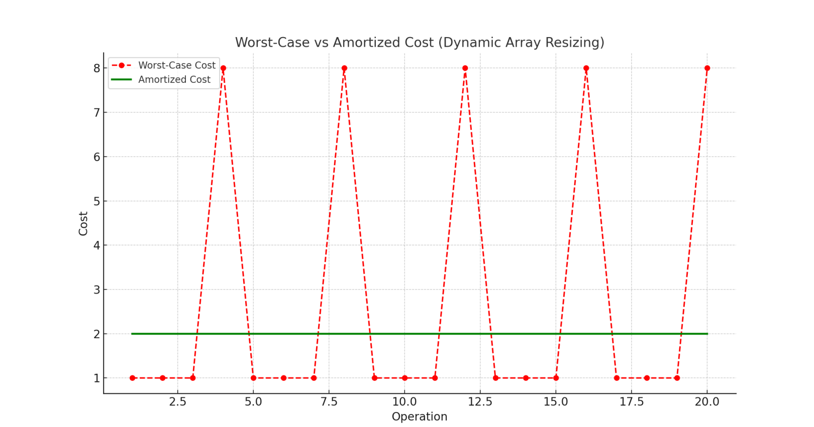
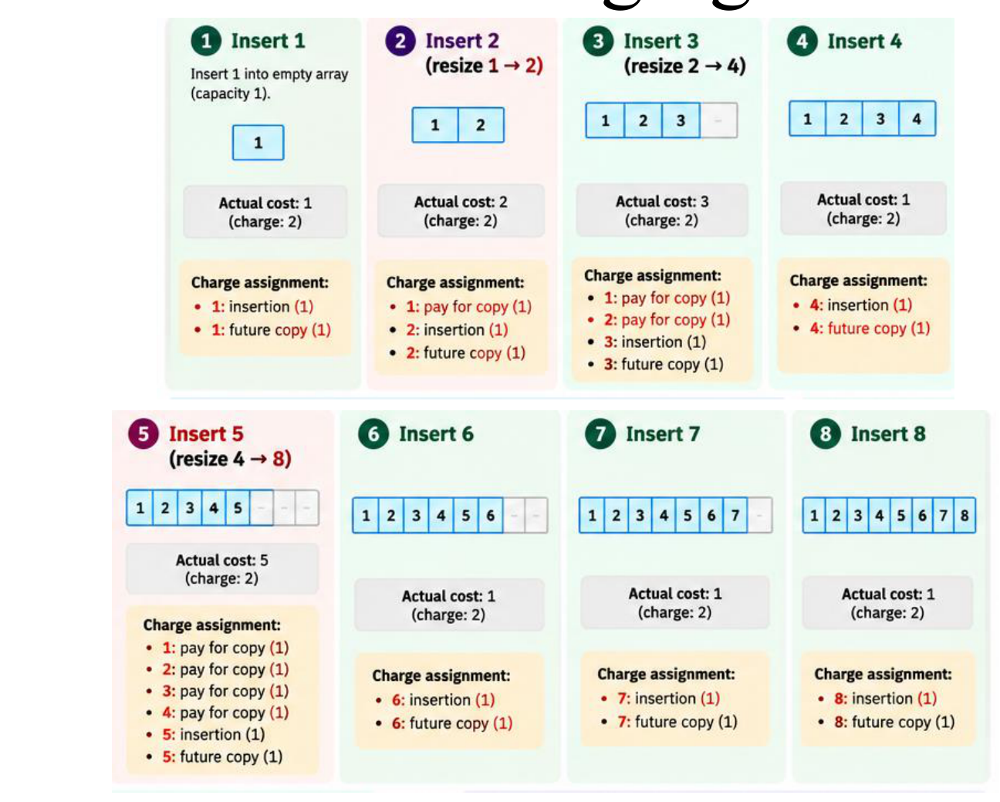
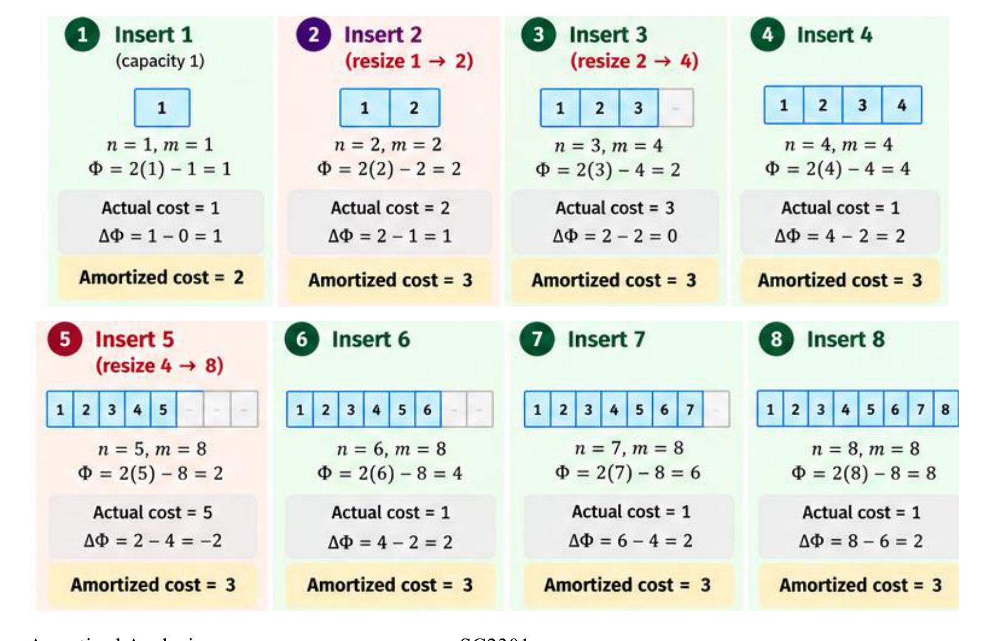

# 9. Amortized Analysis

This chapter covers Lecture 9, Amortized Analysis. Chapter 8 found the cost of **one** call of a recursive algorithm. This chapter asks a different question: what is the total cost of a **sequence** of operations on a data structure?

The lecture gives four methods: aggregate, accounting, charging and potential. They all prove the same bound. They differ only in how they keep the books. This chapter solves **one** problem, table doubling, with all four, so you can see what each method adds. Then it applies the aggregate and potential methods to a second problem, the binary counter.

---

## 1. Why Is Worst-Case-Per-Operation Too Pessimistic?

Some data structures have operations that are cheap almost every time, but very expensive once in a while. If you price every operation at the expensive cost, the bound for a long sequence is far too high. This section defines the words we need to fix that.

* A **sequence of operations** is $n$ operations done one after another on one data structure, starting from its initial state. Example: $n$ insertions into an empty table.
* The **actual cost** of an operation is the real amount of work it does. We count one unit for each basic step, such as writing one element or copying one element.
* The **amortized cost** of an operation is a number we assign to it, so that the total of the amortized costs of **any** sequence is at least the total of the actual costs. Then $n$ operations cost at most $n$ times the amortized cost.

| Analysis | The question it answers |
| :--- | :--- |
| Worst case | What is the **largest** actual cost of one operation? |
| Average case | What is the **expected** cost of one operation, over random inputs? |
| Amortized | What is the cost **per operation**, when we look at the worst possible **sequence**? |

Two points are easy to get wrong:

* Amortized cost is **not** an average over random inputs. No probability is involved. The bound holds for the worst sequence.
* One single operation can still cost much more than its amortized cost. Only the **total** of the sequence is bounded.

> Worst-case-per-operation thinking multiplies the most expensive operation by $n$. Amortized analysis shows that the expensive operations are too rare for that to happen.

---

## 2. The Running Example: Table Doubling

### 2.1 The problem

We want to store $n$ elements in an array, but we do not know $n$ in advance. An array has a fixed size in memory. So we start with a small array and grow it when it is full. We use these words:

* **capacity** $m$: the number of slots in the array;
* $n$: the number of elements stored now. Always $n \le m$. The array is **full** when $n = m$.

To insert into a full array, we must:

1. allocate a new, larger array;
2. copy every old element into it (one unit per element);
3. write the new element (one unit).

**Growing by one slot is too slow.** Insertion number $i$ copies $i - 1$ elements and writes 1, so it costs $i$. For $n$ insertions:

$$1 + 2 + \dots + n = \frac{n(n+1)}{2} = \Theta(n^2).$$

The left side is the sum of the costs of the $n$ insertions. The right side is the standard sum of $1$ to $n$. So the average cost per insertion is $\Theta(n)$.

**Table doubling** is the fix. When the array is full, the new array has **twice** the capacity. Copying then happens only when the capacity is $1, 2, 4, 8, \dots$

### 2.2 What one insertion costs

With table doubling, an insertion costs:

* **1** if the array has room: we only write the element;
* **$m + 1$** if the array is full and has capacity $m$: we copy $m$ elements, then write 1. The new capacity is $2m$.

The array starts with capacity 1 and no elements. The table shows the first nine insertions. "Before" means before the insertion.

| Insertion $i$ | $n$ before | $m$ before | Copies | Cost | $m$ after | Total cost so far |
| :-: | :-: | :-: | :-: | :-: | :-: | :-: |
| 1 | 0 | 1 | 0 | 1 | 1 | 1 |
| 2 | 1 | 1 | 1 | **2** | 2 | 3 |
| 3 | 2 | 2 | 2 | **3** | 4 | 6 |
| 4 | 3 | 4 | 0 | 1 | 4 | 7 |
| 5 | 4 | 4 | 4 | **5** | 8 | 12 |
| 6 | 5 | 8 | 0 | 1 | 8 | 13 |
| 7 | 6 | 8 | 0 | 1 | 8 | 14 |
| 8 | 7 | 8 | 0 | 1 | 8 | 15 |
| 9 | 8 | 8 | 8 | **9** | 16 | 24 |

The expensive insertions are numbers 2, 3, 5 and 9. Each comes right after $2^k$ elements fill the array, and each costs about as much as the number of elements it copies.

{width=75%}

### 2.3 The worst-case bound is true but loose

One insertion can cost $n + 1$, which is $\Theta(n)$. Multiplying by $n$ insertions gives $O(n^2)$. That bound is true. But look at the table: after the array doubles, many cheap insertions follow before the next spike. After the doubling at insertion 5, insertions 6, 7 and 8 cost 1 each. After the doubling at insertion 9, the next seven insertions are cheap. The spikes are far apart, so $O(n^2)$ is much too high.

The goal is to prove that $n$ insertions cost $O(n)$ in total, so $O(1)$ per insertion. The four methods below each prove it in a different way. The question that each method answers is: **who pays for the big copy?**

---

## 3. Method 1: The Aggregate Method

### 3.1 The idea

The **aggregate method** computes the **total** actual cost $T(n)$ of $n$ operations, in the worst case. Then it divides by $n$. It needs no cleverness except a way to count the total.

$$\text{amortized cost per operation} = \frac{T(n)}{n}.$$

Here $T(n)$ is the total actual cost of the $n$ operations. The result is one number, the same for every operation.

### 3.2 Table doubling

Count the two kinds of work separately.

* **Writing:** each insertion writes one element. That is $n$ units in total.
* **Copying:** the array copies only when an insertion finds it full. That happens when the capacity is $1, 2, 4, \dots$, and each time the copy costs that capacity. The last copy has size $2^j$, the largest power of 2 that is less than $n$. So the total copy cost is a geometric sum:

$$1 + 2 + 4 + \dots + 2^j = 2^{j+1} - 1.$$

This identity says that each power of 2 is one more than the sum of all smaller ones. Because $2^j < n$, we have $2^{j+1} < 2n$. So the copying costs less than $2n$.

Add the two parts:

$$T(n) < n + 2n = 3n, \qquad \frac{T(n)}{n} < 3.$$

So the total cost of $n$ insertions is $O(n)$, and the amortized cost is $O(1)$.

**Check with the table.** For $n = 8$: writing costs 8, and copying costs $1 + 2 + 4 = 7$. So $T(8) = 15$. This matches the "Total cost so far" column. For $n = 9$: $9 + (1 + 2 + 4 + 8) = 24$, which also matches. The most expensive single insertion among the first 8 is number 5, with cost 5. Worst-case thinking says $8 \times 5 = 40$. The true total is 15, less than 2 per insertion.

### 3.3 What this method gave us, and why it works

The method works because we could **count** how often the expensive step happens (at each power of 2) and how much it costs each time (the capacity). Those costs form a geometric sum, and a geometric sum is dominated by its last term, which is less than $n$. The method gives one amortized cost for all operations. If a structure has several operation types with different costs, the next methods can give each type its own amortized cost.

---

## 4. Method 2: The Accounting Method

### 4.1 The problem it solves

The aggregate method needs a total that you can count. For complicated structures, that count is hard. The **accounting method** replaces the count with a rule that we can check one operation at a time.

### 4.2 The idea

We **choose** a fixed price for each operation, the **amortized cost**. It may be more or less than the actual cost.

* When the price is **more** than the actual cost, we store the difference. The stored amount is called **credit**. The lecture calls one unit of credit a **coin**. A coin is a literal unit of saved work, nothing more.
* When the price is **less** than the actual cost, the operation pays the difference by spending stored credit.

The **bank balance** is the total credit stored so far:

$$\text{balance} = (\text{total charged so far}) - (\text{total actual cost so far}).$$

Here "total charged" is the sum of the prices of all operations done. The balance is the difference between what we charged and what the work really cost.

**The one rule: the balance must never go negative.** If it never goes negative, then total charged $\ge$ total actual cost, at every moment. So $n$ operations cost at most $n$ times the price. If the balance went negative, we would have charged less than the real work, and the bound would be false.

### 4.3 Table doubling: charge 3

Charge every insertion **3**. We split the 3 into three jobs:

1. **1** pays for writing this element now.
2. **1** is saved to pay for copying **this** element at the next doubling.
3. **1** is saved to pay for copying **one older element** at the next doubling. Older elements have already used their own credit, so someone must pay for them.

**Running balance.** The balance after insertion $i$ is the balance before it, plus 3, minus the actual cost.

| Insertion $i$ | Balance before | Charge | Actual cost | Balance after |
| :-: | :-: | :-: | :-: | :-: |
| 1 | 0 | 3 | 1 | 2 |
| 2 | 2 | 3 | 2 | 3 |
| 3 | 3 | 3 | 3 | 3 |
| 4 | 3 | 3 | 1 | 5 |
| 5 | 5 | 3 | 5 | 3 |
| 6 | 3 | 3 | 1 | 5 |
| 7 | 5 | 3 | 1 | 7 |
| 8 | 7 | 3 | 1 | 9 |
| 9 | 9 | 3 | 9 | 3 |

The balance never goes below 0. The balance drops at each expensive insertion (2, 3, 5, 9) and climbs during the cheap ones.

**Why 3 is enough for every $n$.** Look at the doubling that copies $m$ elements (the array is full, with capacity $m$). Those $m$ elements split into two halves:

* The **older half**, $m/2$ elements, was already in the array at the previous doubling. Their credit was spent then.
* The **newer half**, $m/2$ elements, was inserted since the previous doubling. Each carries 2 unspent coins (jobs 2 and 3). That is $2 \cdot \frac{m}{2} = m$ coins.

The copy costs exactly $m$, and the newer half holds exactly $m$ coins. So the copy is fully paid, and the balance cannot go negative.

The lecture writes the same check with $c$ coins saved per insertion. A doubling from $n$ to $2n$ costs $n$. The $n/2$ insertions since the last doubling saved $c \cdot \frac{n}{2}$ coins. The amortized cost of the doubling is $n - c \cdot \frac{n}{2}$. For $c = 2$, this is $n - n = 0$: the doubling is free at amortized cost. The amortized cost of one insertion is then $1 + c = 3$.

### 4.4 What this method gave us, and why it works

The method gave a fixed price of 3 per insertion. It works because the credit saved by cheap insertions covers each expensive copy **exactly**, and the rule "balance never negative" turns that into a proof for every sequence. The result is $T(n) \le 3n$, the same bound the aggregate method gave.

---

## 5. Method 3: The Charging Method

### 5.1 The idea

The accounting method pays **in advance**: it saves credit now and spends it later. The **charging method** bills **afterwards**. When an expensive operation happens, it sends its bill **back** to earlier operations. Then we show that no operation is billed too much in total.

The lecture gives this rule for the amortized cost of an operation:

$$\text{amortized cost} = \text{actual cost} - \text{cost charged to past operations} + \text{cost charged by future operations}.$$

In words:

* "Actual cost" is what the operation really does.
* "Charged to past operations" is the part of its cost that it bills to earlier operations. This part is subtracted, because earlier operations pay it.
* "Charged by future operations" is the part that later operations bill to **this** one. This part is added, because this operation pays it.

### 5.2 Table doubling

When the array doubles from capacity $m$ to $2m$, the copy costs $m$. It bills that cost to the $m/2$ insertions made **since the last doubling**. Each of them receives a bill of about 2. This is the same split as in the accounting method: 1 for copying itself and 1 for copying an older element.

An insertion is billed **only once**. After a doubling bills it, it belongs to the older half. The next doubling bills only the insertions that come after this one.

So every insertion has this amortized cost:

* **1** for its own write;
* about **2** billed to it by the next doubling.

$$\text{amortized cost} = 1 + 2 = 3 = O(1).$$

An insertion that triggers a doubling has actual cost $m + 1$, but it bills $m$ of it to the past. Its own part is $(m + 1) - m = 1$, plus the future bill of about 2. That is again 3.

The lecture's picture shows the first 8 insertions. Each box lists what each insertion pays: its own write, a share of its future copy, and the bills it sends back at a resize.

{width=75%}

**A caution on this figure.** The figure bills **one** unit to **every** earlier element at each resize. For the 8 insertions shown, this works: the total cost is 15, and the figure's charge of 2 per insertion gives 16. But for the next doubling (insertion 9), the total cost is 24, which is more than $2 \times 9 = 18$. So a charge of 2 does not hold for longer sequences. The rule in the text (bill only the newer half, 2 each, so 3 per insertion) is the one that holds for every $n$. The figure's early elements get billed at several resizes, which breaks the "billed only once" rule.

### 5.3 What this method gave us, and why it works

The charging method gave the same price, 3 per insertion. It works because the bills sent back are covered by the elements that receive them, and each element receives at most one bill. It is the accounting method seen from the other side. The accounting method asks "how much must I save now?". The charging method asks "who pays for this expensive step?".

---

## 6. Method 4: The Potential Method

### 6.1 The problem it solves

The accounting method tracks credit as a separate number from the data structure. That is easy to get wrong when the structure is complicated. The **potential method** puts the credit **inside** the structure: it is a function of the state, so you can compute it at any time.

### 6.2 The idea

The **potential function** $\Phi$ assigns a number to each state of the data structure. $\Phi$ depends only on the current state, not on the history. The lecture requires that $\Phi$ is at its lowest point at the start.

For operation $i$, define:

* $c_i$: the actual cost of operation $i$;
* $\Phi_{i-1}$: the potential before operation $i$;
* $\Phi_i$: the potential after operation $i$;
* $\hat{c}_i$: the amortized cost of operation $i$.

$$\hat{c}_i = c_i + \Phi_i - \Phi_{i-1}.$$

The amortized cost is the actual cost plus the **change** in potential. If an operation raises the potential, it pays extra now (it saves). If it lowers the potential, it pays less than its actual cost (it spends). So $\Phi$ plays the role of the bank balance, but it is read off the state.

### 6.3 Why the sum is a valid upper bound

We want a bound on $\sum c_i$. Write out the amortized costs of the first three operations:

$$
\begin{aligned}
\hat{c}_1 &= c_1 + \Phi_1 - \Phi_0,\\
\hat{c}_2 &= c_2 + \Phi_2 - \Phi_1,\\
\hat{c}_3 &= c_3 + \Phi_3 - \Phi_2.
\end{aligned}
$$

Add the three lines. The terms $\Phi_1$ and $\Phi_2$ each appear once with a plus and once with a minus, so they cancel:

$$\hat{c}_1 + \hat{c}_2 + \hat{c}_3 = c_1 + c_2 + c_3 + \Phi_3 - \Phi_0.$$

This is called a **telescoping sum**: the middle terms cancel, and only the first and last potentials remain. For $n$ operations the same cancellation gives

$$\sum_{i=1}^{n} \hat{c}_i = \sum_{i=1}^{n} c_i + \Phi_n - \Phi_0.$$

Here $\Phi_0$ is the potential at the start and $\Phi_n$ is the potential at the end. Rearrange:

$$\sum_{i=1}^{n} c_i = \sum_{i=1}^{n} \hat{c}_i - (\Phi_n - \Phi_0) \le \sum_{i=1}^{n} \hat{c}_i \qquad \text{if } \Phi_n \ge \Phi_0.$$

In words: the total actual cost is at most the total amortized cost, as long as the potential at the end is not below the potential at the start. We cannot know in advance how long the sequence is, so we need $\Phi_n \ge \Phi_0$ for **every** $n$. The usual way is to make $\Phi_0 = 0$ and $\Phi \ge 0$ always.

### 6.4 How to choose $\Phi$

A good $\Phi$ does three things:

* It is **low** right after an expensive operation, because the expensive operation used it up.
* It **rises** a little with each cheap operation, so it saves for the next expensive one.
* It is **never below** its starting value.

**Choosing $\Phi$ for table doubling.** Use $n$ for the number of elements and $m$ for the capacity. We want:

* $\Phi$ near 0 just after a doubling. Then the array holds about $m/2$ elements.
* $\Phi = m$ just before the next doubling, where $n = m$. This equals the cost of the copy.
* $\Phi$ rises by the same amount at each cheap insertion.

Try $\Phi = a\left(n - \frac{m}{2}\right)$. It is 0 when $n = m/2$. At $n = m$ it equals $a \cdot \frac{m}{2}$. We want this to be $m$, so $a = 2$:

$$\Phi(n, m) = 2n - m.$$

Each cheap insertion raises $n$ by 1, so it raises $\Phi$ by 2. This is the same "2 coins saved" as in the accounting method.

### 6.5 Table doubling, both cases

Every insertion is one of two cases. For each, we list the actual cost, the potential before and after, and the amortized cost.

**Case A: the array has room** ($n < m$).

* Actual cost: $c = 1$.
* Before: $n$ elements, capacity $m$, so $\Phi = 2n - m$.
* After: $n + 1$ elements, capacity $m$, so $\Phi = 2(n+1) - m$.

$$\Delta\Phi = \big(2(n+1) - m\big) - \big(2n - m\big) = 2, \qquad \hat{c} = 1 + 2 = 3.$$

The change is 2 because $n$ grows by 1 and $m$ does not change.

**Case B: the array is full and doubles** ($n = m$).

* Actual cost: copy $m$, write 1, so $c = m + 1$.
* Before: $n = m$ elements, capacity $m$, so $\Phi = 2m - m = m$.
* After: $m + 1$ elements, capacity $2m$, so $\Phi = 2(m+1) - 2m = 2$.

$$\Delta\Phi = 2 - m, \qquad \hat{c} = (m + 1) + (2 - m) = 3.$$

The potential falls by $m - 2$. That drop pays for almost all of the copy. The $m$ in the actual cost and the $-m$ in $\Delta\Phi$ cancel, so the amortized cost does not depend on $m$.

Every insertion has amortized cost 3. So $n$ insertions cost at most $3n$ plus the change in potential. Here $\Phi \ge 0$ always, because $n \ge m/2$ after the first insertion.

**Check with the lecture's table.** The lecture treats the empty table at the start as $\Phi_0 = 0$. (The formula $2n - m$ gives $-1$ for $n = 0$, $m = 1$. Using 0 instead gives $\hat{c}_1 = 2$, and the formula's own value would give 3. Both are below the bound.)

| Insertion $i$ | $n$ after | $m$ after | $\Phi$ after | Actual cost $c_i$ | $\Delta\Phi$ | $\hat{c}_i$ |
| :-: | :-: | :-: | :-: | :-: | :-: | :-: |
| 1 | 1 | 1 | 1 | 1 | 1 | 2 |
| 2 | 2 | 2 | 2 | 2 | 1 | 3 |
| 3 | 3 | 4 | 2 | 3 | 0 | 3 |
| 4 | 4 | 4 | 4 | 1 | 2 | 3 |
| 5 | 5 | 8 | 2 | 5 | $-2$ | 3 |
| 6 | 6 | 8 | 4 | 1 | 2 | 3 |
| 7 | 7 | 8 | 6 | 1 | 2 | 3 |
| 8 | 8 | 8 | 8 | 1 | 2 | 3 |
| 9 | 9 | 16 | 2 | 9 | $-6$ | 3 |

The sums agree with the telescoping rule. For 9 insertions: $\sum \hat{c}_i = 2 + 8 \times 3 = 26$, and $\sum c_i + \Phi_9 - \Phi_0 = 24 + 2 - 0 = 26$.

{width=90%}

### 6.6 What this method gave us, and why it works

The potential method gave 3 per insertion, again. It works because $\Phi = 2n - m$ stores exactly the work that the next doubling will need: 0 just after a doubling, $m$ just before the next. Once you have $\Phi$, the amortized cost of each operation is a short calculation for each case. This makes the method the most systematic of the four.

---

## 7. The Four Methods Side by Side

All four methods prove that $n$ insertions into a doubling table cost $O(n)$, so $O(1)$ each.

| Method | What you do | Result on table doubling |
| :--- | :--- | :--- |
| Aggregate | Count the total cost $T(n)$, then divide by $n$ | $T(n) < 3n$, so under 3 per insertion |
| Accounting | Choose a price; save the extra as credit; the credit never goes negative | Price 3: 1 to write, 2 saved |
| Charging | The expensive operation bills earlier operations; each is billed once | $1 + 2 = 3$ |
| Potential | $\hat{c}_i = c_i + \Phi_i - \Phi_{i-1}$; $\Phi$ never below its start | $\Phi = 2n - m$ gives 3 |

All four use the same fact: between two doublings, about $m/2$ cheap insertions happen, and each can pay for 2 units of the next copy.

---

## 8. The Binary Counter

### 8.1 The setting

A **$k$-bit binary counter** is a row of $k$ bits, written as 0 or 1. It starts at 0. The operation INCREMENT adds 1. To add 1:

* flip the **trailing 1s** to 0. These are the run of 1s at the right end of the number;
* then flip the first 0 to 1.

Each flip of one bit costs 1. So with $t$ trailing 1s, the actual cost is $1 + t$.

$$c = 1 + t.$$

Examples: $0111 \to 1000$ flips 4 bits ($t = 3$). $1000 \to 1001$ flips 1 bit ($t = 0$).

In the worst case, one increment flips all $k$ bits. A naive bound for $n$ increments is $O(nk)$. The table shows the first 8 increments of a 4-bit counter:

| Increment | Counter after | Trailing 1s $t$ | Flips $1 + t$ | Ones in counter after |
| :-: | :-: | :-: | :-: | :-: |
| 1 | 0001 | 0 | 1 | 1 |
| 2 | 0010 | 1 | 2 | 1 |
| 3 | 0011 | 0 | 1 | 2 |
| 4 | 0100 | 2 | 3 | 1 |
| 5 | 0101 | 0 | 1 | 2 |
| 6 | 0110 | 1 | 2 | 2 |
| 7 | 0111 | 0 | 1 | 3 |
| 8 | 1000 | 3 | 4 | 1 |

The total is $1 + 2 + 1 + 3 + 1 + 2 + 1 + 4 = 15$ flips for 8 increments, less than 2 per increment.

### 8.2 The aggregate method

Count the flips **bit by bit** over $n$ increments, not increment by increment.

* Bit 0 (the rightmost) flips on every increment: $n$ times.
* Bit 1 flips on every second increment: $\lfloor n/2 \rfloor$ times.
* Bit 2 flips on every fourth increment: $\lfloor n/4 \rfloor$ times.
* Bit $j$ flips $\lfloor n/2^j \rfloor$ times.

Add these up:

$$T(n) \le n + \frac{n}{2} + \frac{n}{4} + \dots < 2n.$$

Each bit flips half as often as the bit to its right. So the sum is a geometric series with ratio $\frac{1}{2}$, and it is less than $2n$. The amortized cost of one increment is $T(n)/n < 2$, which is $O(1)$.

**Check:** in the table above, the four bits flip $8, 4, 2, 1$ times, a total of 15.

### 8.3 The potential method

**The problem.** An expensive increment flips many 1s to 0. We want a potential that drops by about the same amount, so the drop pays for those flips.

Choose $\Phi$ = the **number of 1s** in the counter, times a constant $c$. The lecture writes $\Phi = c \times (\text{number of 1s})$. With cost counted in bit flips, $c = 1$, so $\Phi$ is just the number of 1s. The counter starts at 0, so $\Phi_0 = 0$. A count is never negative, so $\Phi \ge 0$ and the bound is valid.

Suppose an increment meets $t$ trailing 1s.

* **Actual cost:** $1 + t$ flips.
* **Change in $\Phi$:** $t$ ones become zeros, and one zero becomes a one. So the number of ones changes by $1 - t$.
* **Amortized cost:** the actual cost plus the change in $\Phi$.

$$\hat{c} = (1 + t) + (1 - t) = 2.$$

The $t$ cancels. Every increment has amortized cost 2, however many bits it flips. So the amortized cost is $O(1)$.

**Check with the table.** Increment 8 flips 4 bits and lowers the number of ones from 3 to 1, so $\Delta\Phi = -2$ and $\hat{c} = 4 - 2 = 2$. Increment 1 flips 1 bit and raises the number of ones from 0 to 1, so $\hat{c} = 1 + 1 = 2$. Every row of the table gives 2.

---

## 9. Does a Bound Survive a New Operation?

Every argument above used one fact: after an expensive step, the structure is in a **cheap state**, and many cheap steps must happen before the next expensive one. Table doubling is in a cheap state just after a doubling. The counter is in a cheap state just after a long carry.

An amortized bound holds only for the **set of operations** it was proved for. Suppose you add a new operation that can put the structure straight back into an expensive state. Then an adversary can choose a sequence in which **every** operation is expensive, and the bound no longer holds. When a data structure gains a new operation, you must redo the amortized analysis.

The next section gives an example from the lecture: a table that can also shrink.

---

## 10. Growing and Shrinking a Table

### 10.1 The problem

Deleting elements can leave the array mostly empty, which wastes memory. So we want the table to shrink too. We still want $O(1)$ amortized cost for each insertion **and** each deletion.

### 10.2 First idea: halve at half full (this fails)

Halve the table (from capacity $m$ to $m/2$) when it becomes half full. Take an array that is exactly full, with $n = m$:

1. Insert one element. The array doubles to capacity $2m$ and holds $m + 1$ elements.
2. Delete one element. Now $n = m$, which is half of $2m$. So the array halves to capacity $m$. It is full again.
3. Repeat from step 1.

Each operation triggers a resize that copies about $m$ elements. The cost of every operation is $\Theta(m)$, so there is no saving at all. The reason: right after a resize, the table is **one step away** from the opposite resize.

### 10.3 The fix: halve at a quarter full (lecture)

* **Double** when the array is full: from $m$ to $2m$.
* **Halve** when it is only **1/4 full**, that is $n = m/4$: from $m$ to $m/2$.

After **any** resize, the array is about **half full**. It is far from both triggers. Let $M$ be the capacity just after a resize, so $n \approx M/2$:

* To double again, $n$ must reach $M$. That takes about $M/2$ insertions.
* To halve, $n$ must fall to $M/4$. That takes about $M/4$ deletions.

So at least a constant fraction of $M$ operations must happen before the next resize.

### 10.4 The charging argument

* A **doubling** from $m$ to $2m$ costs $\Theta(m)$. Charge it to the $m/2$ insertions since the last resize. Each gets a bill of $\Theta(1)$.
* A **halving** from $m$ to $m/2$ costs $\Theta(m)$. It happens when $n = m/4$. Charge it to the deletions since the last resize. The lecture says "more than $m/4$ deletions". Each gets a bill of $\Theta(1)$.
* Each insertion or deletion is billed **only once**, because the resize resets the table to half full.

So both INSERT and DELETE have amortized cost $O(1)$. The lecture says $c = O(1)$ coins per operation is enough.

### 10.5 The general recipe for any resizing rule (not in the lecture)

The lecture shows one rule. This part is **not in the lecture**. It states the reasoning that makes any other rule work, such as growing by another factor or shrinking at another fill level. Check three things:

1. **After any resize, the table is at a fill level that is far from both triggers.** For example, half full, with triggers at full and at a quarter full.
2. **So reaching the next trigger takes $\Omega(M)$ operations,** where $M$ is the capacity after the resize. Count them: the gap between the fill level after a resize and the trigger, times the capacity.
3. **The resize costs $O(M)$,** because it copies the current elements.

Then the resize cost divided by the number of operations since the last resize is a constant. So each operation has amortized cost $O(1)$.

**A potential for the rule in 10.3 (also not in the lecture).** Choose a $\Phi$ that is 0 right after a resize and grows as the fill level moves away from half full, in either direction:

$$\Phi = \big|\,2n - m\,\big|.$$

Here $n$ is the number of elements and $m$ the capacity. The value $2n - m$ is 0 when the table is half full, positive when it is more than half full, and negative when it is less. The absolute value makes $\Phi$ rise in both directions.

* Right after a halving, $n = m/4$ of old capacity $m$, and the new capacity is $m/2$. So $2n - (m/2) = 0$, and $\Phi = 0$.
* An insertion or deletion with no resize changes $n$ by 1, so $\Phi$ changes by at most 2. Its amortized cost is at most $1 + 2 = 3$.
* A doubling is triggered by an insertion at $n = m$. There $\Phi = m$ before and $2$ after, and the cost is $m + 1$. So $\hat{c} = (m + 1) + (2 - m) = 3$.
* A halving is triggered by a deletion that leaves $n = m/4$. Before the deletion $\Phi = m/2 - 2$. After the halving $\Phi = 0$. The actual cost is $1 + m/4$ (one deletion and $m/4$ copies). So $\hat{c} = (1 + m/4) - (m/2 - 2) = 3 - m/4 \le 3$.

For another rule, change the constant in front of $n$ so that $\Phi$ is 0 at the new "after resize" fill level. Then scale $\Phi$ so that its value at each trigger covers the copying cost.

---

## 11. Common Traps

* Amortized cost is **not** average-case cost. It needs no probability. It bounds the total of **any** sequence, in the worst case.
* A single operation can still cost much more than its amortized cost. Table doubling: one insertion is $\Theta(n)$ in the worst case, but $O(1)$ amortized.
* Growing the array by a **constant** number of slots gives $\Theta(n^2)$ total. Growing by a constant **factor** gives $O(n)$ total.
* In the accounting method, the balance (total charged minus total actual) must never go negative. A price of 2 fails for table doubling: the balance reaches $-2$ at insertion 5.
* In the accounting and charging methods, bill each operation **once**. A figure that bills the same early element at every resize understates the cost.
* In the potential method, use $\hat{c}_i = c_i + \Phi_i - \Phi_{i-1}$, with $\Delta\Phi$ = after minus before. A reversed sign gives nonsense, such as negative amortized costs for cheap operations.
* Check that $\Phi$ never falls below its initial value. Otherwise the telescoping sum does not give an upper bound.
* The binary counter potential is the number of 1s. The $t$ trailing 1s cancel, so every increment costs 2.
* Shrink at **1/4 full**, not 1/2 full. Halving at 1/2 lets an insert-delete pair trigger a resize every time.
* An amortized bound is proved for a fixed set of operations. Adding an operation that returns the structure to an expensive state can break it.
* Amortized analysis never makes an algorithm faster. It only shows that the total was smaller than the per-operation worst case suggested.
* All four methods give the same answer. They differ only in the bookkeeping.
