## Tutorial 1: Asymptotic Notation and Insertion Sort

### Q1. Other worst cases for insertion sort

The worst case for insertion sort occurs when the input list contains the keys $a_1 < \dots < a_n$ in decreasing order: $[a_n, \dots, a_1]$. Suppose the performance of insertion sort is measured by the total number of comparisons between array elements (not counting the number of swaps). Show at least two other initial arrangements of keys that are also worst cases for insertion sort.

<details class="qa box">
<summary><strong>Concepts: when does one insertion make the most comparisons?</strong> <span class="qa-caret" aria-hidden="true"></span></summary>

::: qa-answer
Insertion sort takes the next element, `slot[i]`, and compares it with its left neighbour, again and again.

* If the left neighbour is bigger, the two swap.
* If the left neighbour is not bigger, the loop stops. That costs one comparison.
* If the element reaches index 0, the loop stops with no further comparison.

So iteration $i$ makes between 1 and $i$ comparisons. The worst total is $1 + 2 + \dots + (n-1) = \frac{n(n-1)}{2}$. Every iteration must make $i$ comparisons to reach it.
:::

</details>

<details class="qa box">
<summary><strong>Answer</strong> <span class="qa-caret" aria-hidden="true"></span></summary>

::: qa-answer
Two other worst cases:

$$(n, n-1, n-2, \dots, 3, 1, 2) \qquad \text{and} \qquad (1, n, n-1, n-2, \dots, 2).$$

In each list, the $i$-th key still needs $i$ comparisons to find its place. But a comparison is not always followed by a swap.

* **$(n, n-1, \dots, 3, 1, 2)$.** Every key up to 1 is smaller than everything on its left, so it travels to index 0. The last key, 2, swaps past $n, \dots, 3$. Then it compares with 1, which is smaller, and stops. That last comparison has no swap, but it is still the $i$-th comparison.
* **$(1, n, n-1, \dots, 2)$.** Each new key is smaller than every key on its left except 1. It swaps all the way to index 1, then compares with 1 and stops. Again $i$ comparisons.
:::

</details>

<details class="qa box">
<summary><strong>General method: test an input for the comparison worst case</strong> <span class="qa-caret" aria-hidden="true"></span></summary>

::: qa-answer
Iteration $i$ makes all $i$ comparisons exactly when the new element reaches **index 1**. After that, either it moves to index 0, or the element at index 0 stops it. Both cost $i$ comparisons.

So an input is a worst case for comparisons when **each new element is smaller than every element on its left, except possibly the smallest one**.

* Check this for each position from left to right.
* Comparisons and swaps are different counts. Swaps equal the number of **inversions** (pairs in the wrong order). Only the reversed array has the most swaps, $\frac{n(n-1)}{2}$.
:::

</details>

**Extension 1.1.** Insertion sort runs on the array $[2, 4, 3, 1]$. Count the comparisons and the swaps. Is this array a worst case for comparisons? Is it a worst case for swaps?

<details class="qa box">
<summary><strong>Answer (Extension 1.1)</strong> <span class="qa-caret" aria-hidden="true"></span></summary>

::: qa-answer
| Iteration | Element | What happens | Comparisons | Swaps |
|---|---|---|---|---|
| 1 | 4 | 4 against 2: not smaller, stop | 1 | 0 |
| 2 | 3 | swaps past 4, then 3 against 2: stop | 2 | 1 |
| 3 | 1 | swaps past 4, 3 and 2, reaches index 0 | 3 | 3 |

Comparisons: $1 + 2 + 3 = 6 = \frac{4 \cdot 3}{2}$. So it **is** a worst case for comparisons. Each new element is smaller than everything on its left except the smallest, as the method says.

Swaps: 4, which equals the inversions $(2,1), (4,3), (4,1), (3,1)$. The maximum is 6. So it is **not** a worst case for swaps.
:::

</details>

### Q2. Theta is O and Omega together

Prove that, for any two functions $f(n)$ and $g(n)$, we have $f(n) = \Theta(g(n))$ if and only if $f(n) = O(g(n))$ and $f(n) = \Omega(g(n))$.

<details class="qa box">
<summary><strong>Answer</strong> <span class="qa-caret" aria-hidden="true"></span></summary>

::: qa-answer
**The → direction.** Suppose $f(n) = \Theta(g(n))$. By definition, there are $c_1, c_2, n_0 > 0$ such that

$$0 \le c_1 g(n) \le f(n) \le c_2 g(n) \quad \text{for all } n \ge n_0.$$

Pick the constants from here. The pair $c_2, n_0$ satisfies the definition of $O(g(n))$. The pair $c_1, n_0$ satisfies the definition of $\Omega(g(n))$. So $f(n)$ lies in both sets.

**The ← direction.** Suppose $f(n) = O(g(n))$ and $f(n) = \Omega(g(n))$. Then, for some constants $c_3$ and $c_4$:

$$0 \le c_3 g(n) \le f(n) \quad \text{for all } n \ge n_1,$$

$$0 \le f(n) \le c_4 g(n) \quad \text{for all } n \ge n_2.$$

Pick $n_3 = \max\{n_1, n_2\}$. Both inequalities hold from $n_3$ on, so merge them:

$$0 \le c_3 g(n) \le f(n) \le c_4 g(n) \quad \text{for all } n \ge n_3.$$

That is the definition of $f(n) = \Theta(g(n))$.
:::

</details>

<details class="qa box">
<summary><strong>General method: prove a fact about O, Omega and Theta</strong> <span class="qa-caret" aria-hidden="true"></span></summary>

::: qa-answer
1. Write out each definition you are given, with its own constants: "$\exists\, c, n_0$ such that … for all $n \ge n_0$". Give each one a new name ($c_1, n_1$, then $c_2, n_2$).
2. Write out the definition you must reach.
3. Build its constants from the ones you have. Two tools cover most proofs:
    * **Take the maximum of the thresholds.** Each fact holds from its own $n_i$. All of them hold from $\max_i n_i$.
    * **Multiply or add the constants.** If $f \le c_1 g$ and $g \le c_2 h$, then $f \le c_1 c_2 h$.
:::

</details>

**Extension 2.1.** Prove that $O$ is transitive: if $f(n) = O(g(n))$ and $g(n) = O(h(n))$, then $f(n) = O(h(n))$.

<details class="qa box">
<summary><strong>Answer (Extension 2.1)</strong> <span class="qa-caret" aria-hidden="true"></span></summary>

::: qa-answer
From the first fact: $0 \le f(n) \le c_1 g(n)$ for all $n \ge n_1$. From the second: $0 \le g(n) \le c_2 h(n)$ for all $n \ge n_2$.

Take $n_0 = \max\{n_1, n_2\}$. For $n \ge n_0$, both hold, so

$$0 \le f(n) \le c_1 g(n) \le c_1 c_2\, h(n).$$

With $c = c_1 c_2$, this is the definition of $f(n) = O(h(n))$. The proof used both tools of the method: the maximum threshold and the product of constants.
:::

</details>

### Q3. Two functions that cannot be compared

Give an example of non-negative functions $f(n)$ and $g(n)$ such that $f(n) \notin O(g(n))$ and $g(n) \notin O(f(n))$.

<details class="qa box">
<summary><strong>Answer</strong> <span class="qa-caret" aria-hidden="true"></span></summary>

::: qa-answer
Take

$$f(n) = n \qquad \text{and} \qquad g(n) = \begin{cases} 1 & \text{if } n \text{ is even}, \\ n^2 & \text{otherwise}. \end{cases}$$

**Proof that $f(n) \notin O(g(n))$.** Suppose, for a contradiction, that $f(n) \in O(g(n))$. Then for some positive constants $c$ and $n_1$:

$$0 \le n \le c\,g(n) \quad \text{for all } n \ge n_1. \qquad (*)$$

Let $n_2$ be the smallest even number strictly larger than $\max\{n_1, c\}$. In particular, $n_2 > c$. $(**)$

Put $n_2$ into $(*)$. Since $n_2$ is even, $g(n_2) = 1$, so $0 \le n_2 \le c$. This contradicts $(**)$.

**Proof that $g(n) \notin O(f(n))$.** The official solution leaves this as an exercise. The proof is the same, with an **odd** number. Suppose $g(n) \le c\,n$ for all $n \ge n_1$. Let $n_2$ be an odd number larger than $\max\{n_1, c\}$. Then $g(n_2) = n_2^2$, so $n_2^2 \le c\,n_2$, which gives $n_2 \le c$. This contradicts $n_2 > c$.
:::

</details>

<details class="qa box">
<summary><strong>General method: show that f is not O(g)</strong> <span class="qa-caret" aria-hidden="true"></span></summary>

::: qa-answer
1. Assume the constants exist: $f(n) \le c\,g(n)$ for all $n \ge n_0$.
2. Choose **one** value of $n$ that is larger than $n_0$ and breaks the inequality. Usually you pick $n$ larger than both $n_0$ and $c$, from the part of the domain where $g$ is small.
3. Put it in and reach a contradiction such as $n \le c$ with $n > c$.

To build two functions that cannot be compared, make one of them **jump** between a value below the other and a value above it, for example on even and odd $n$.
:::

</details>

**Extension 3.1.** Let $f(n) = n$ and $g(n) = n^{1.5}$ for even $n$ and $g(n) = n^{0.5}$ for odd $n$. Is $f(n) = O(g(n))$? Is $g(n) = O(f(n))$?

<details class="qa box">
<summary><strong>Answer (Extension 3.1)</strong> <span class="qa-caret" aria-hidden="true"></span></summary>

::: qa-answer
**Neither.**

* $f \ne O(g)$: suppose $n \le c\,g(n)$ for $n \ge n_0$. Take an odd $n > \max\{n_0, c^2\}$. Then $n \le c\sqrt{n}$, so $\sqrt{n} \le c$, so $n \le c^2$. Contradiction.
* $g \ne O(f)$: suppose $g(n) \le c\,n$ for $n \ge n_0$. Take an even $n > \max\{n_0, c^2\}$. Then $n^{1.5} \le c\,n$, so $\sqrt{n} \le c$. Contradiction.

Here $g$ jumps above $f$ on even $n$ and below it on odd $n$, as the method says.
:::

</details>

### Q4. A loop invariant for a primality test

Consider the following function for testing primality of a natural number $n > 1$:

```
def isPrime(n):
    p = True
    for i = 2 to floor(sqrt(n)):
        if n is divisible by i then:
            p = False
    return p
```

State a (non-trivial) loop invariant for the function above, and use your invariant to prove the function's correctness.

<details class="qa box">
<summary><strong>Concepts: the three parts of a loop-invariant proof</strong> <span class="qa-caret" aria-hidden="true"></span></summary>

::: qa-answer
A **loop invariant** is a statement that is true before every iteration of the loop.

1. **Initialization:** it is true before the first iteration.
2. **Maintenance:** if it is true before one iteration, it is true before the next.
3. **Termination:** when the loop stops, the invariant shows that the answer is correct.
:::

</details>

<details class="qa box">
<summary><strong>Answer</strong> <span class="qa-caret" aria-hidden="true"></span></summary>

::: qa-answer
First rewrite the `for` loop as a `while` loop. Then you can see the value of `i` when the loop stops.

```
def isPrime(n):
    p = true
    i = 2
    while (i <= floor(sqrt(n))):
        if n is divisible by i then:
            p = false
        i++
    return p
```

**Invariant:** "$p$ is true if and only if there is no integer $k$ such that $2 \le k < i$ and $k$ divides $n$."

**Initialization.** At the start, $i = 2$. No integer $k$ satisfies $2 \le k < 2$, and $p$ is true. So the invariant holds before the loop.

**Maintenance.** After one full iteration, $i$ has grown by 1. The iteration tested the number that is now $i - 1$. There are two cases.

* If $i - 1$ divides $n$, the code set $p$ to false. The invariant for the new $i$ holds, because $k = i - 1$ divides $n$.
* If $i - 1$ does not divide $n$, $p$ is unchanged. By the inductive hypothesis, the old value of $p$ was correct for the range $2 \le k < i - 1$. The range grew by one number, $i - 1$, and that number does not divide $n$. So the answer to "is there a divisor in the range?" did not change, and $p$ is still correct. (The official solution asks "why?". This is the reason.)

**Termination.** The loop stops when $i = \lfloor \sqrt{n} \rfloor + 1$. By the invariant, $p$ is true if and only if no integer $k$ with $2 \le k < \lfloor \sqrt{n} \rfloor + 1$ divides $n$.

This condition means $n$ is prime, for every $n > 1$. (The official solution says "prove it!". Here is the proof.) Suppose $n$ is not prime, so $n = a \cdot b$ with $2 \le a \le b$. Then $a \cdot a \le a \cdot b = n$, so $a \le \sqrt{n}$, and $a \le \lfloor \sqrt{n} \rfloor$ because $a$ is a whole number. So a composite $n$ always has a divisor in the range, and $p$ is false. A prime $n$ has no divisor in the range, and $p$ stays true.
:::

</details>

<details class="qa box">
<summary><strong>General method: write a loop-invariant proof</strong> <span class="qa-caret" aria-hidden="true"></span></summary>

::: qa-answer
1. Rewrite a `for` loop as a `while` loop, so the loop variable has a clear value at every check and at the end.
2. State the invariant as **what the loop has done so far**, in terms of the loop variable: "the first $i$ elements are sorted", "$m$ is the largest of $A[0..i-1]$", "no divisor below $i$".
3. **Initialization:** put in the start value of the loop variable. The range is usually empty, so the statement is easy.
4. **Maintenance:** follow one iteration. Split into cases by the `if` inside the loop.
5. **Termination:** put in the stop value. The invariant must now say exactly what the function returns.
:::

</details>

**Extension 4.1.** State a loop invariant for the function below, and use it to prove that the function returns the largest element of $A[0..n-1]$, for $n \ge 1$.

```
def findMax(A, n):
    m = A[0]
    i = 1
    while i < n:
        if A[i] > m:
            m = A[i]
        i = i + 1
    return m
```

<details class="qa box">
<summary><strong>Answer (Extension 4.1)</strong> <span class="qa-caret" aria-hidden="true"></span></summary>

::: qa-answer
**Invariant:** "$m$ is the largest element of $A[0..i-1]$."

* **Initialization.** $i = 1$, and $m = A[0]$, the largest (only) element of $A[0..0]$.
* **Maintenance.** The iteration looks at $A[i]$. If $A[i] > m$, then $A[i]$ is the new largest of $A[0..i]$, and $m$ becomes $A[i]$. Otherwise $m$ is still the largest. Then $i$ grows by 1, so $m$ is the largest of $A[0..i-1]$ for the new $i$.
* **Termination.** The loop stops at $i = n$. Then $m$ is the largest of $A[0..n-1]$, the whole array.
:::

</details>

---

## Tutorial 2: Divide and Conquer and Mergesort

### Q1. Maximum and minimum together in about 1.5n comparisons

Use the divide and conquer approach to design an algorithm that finds both the largest and the smallest elements in an array of $n$ integers, assuming that $n$ is a power of two, i.e., $n = 2^k$ for some $k \ge 0$. Show that your algorithm does at most about $1.5n$ comparisons of the elements.

<details class="qa box">
<summary><strong>Answer: the algorithm</strong> <span class="qa-caret" aria-hidden="true"></span></summary>

::: qa-answer
```
void findMinMax(int[] ar, int start, int end, int[] minMax)
// minMax is an array of two integers to return the minimum
// and maximum found
{
    int tempMinMax1[] = new int[2];
    int tempMinMax2[] = new int[2];
    int mid;

    if (start == end) {              // one element array
        minMax[0] = ar[start];
        minMax[1] = ar[start];
    }
    else if (end - start == 1) {     // two element array
        if (ar[start] > ar[end]) {
            minMax[1] = ar[start];
            minMax[0] = ar[end];
        } else {
            minMax[0] = ar[start];
            minMax[1] = ar[end];
        }
    }
    else {                           // array longer than two elements
        mid = (start + end) / 2;

        findMinMax(ar, start, mid, tempMinMax1);
        findMinMax(ar, mid+1, end, tempMinMax2);

        if (tempMinMax1[0] < tempMinMax2[0])
            minMax[0] = tempMinMax1[0];
        else minMax[0] = tempMinMax2[0];

        if (tempMinMax1[1] > tempMinMax2[1])
            minMax[1] = tempMinMax1[1];
        else minMax[1] = tempMinMax2[1];
    }
}
```

* One element: it is both the min and the max. No comparison.
* Two elements: one comparison decides both the min and the max.
* More: solve each half, then compare the two minimums and the two maximums: 2 comparisons.
:::

</details>

<details class="qa box">
<summary><strong>Answer: the count</strong> <span class="qa-caret" aria-hidden="true"></span></summary>

::: qa-answer
Let $W_i$ be the number of comparisons for $i$ elements. Then the recurrence is

$$W_1 = 0, \qquad W_2 = 1, \qquad W_n = W_{n/2} + W_{n - n/2} + 2.$$

If $n = 2^k$, where $k$ is a positive integer, the two halves are equal:

$$W_n = 2W_{n/2} + 2.$$

Expand it:

$$\begin{aligned}
W_n &= 2W_{n/2} + 2 \\
&= 2(2W_{n/2^2} + 2) + 2 = 2^2 W_{n/2^2} + 2^2 + 2 \\
&= 2^2(2W_{n/2^3} + 2) + 2^2 + 2 = 2^3 W_{n/2^3} + 2^3 + 2^2 + 2 \\
&\;\;\vdots \\
&= 2^{k-1} W_{n/2^{k-1}} + 2^{k-1} + 2^{k-2} + \dots + 2^2 + 2.
\end{aligned}$$

Since $n = 2^k$, we get $n/2^{k-1} = 2$, and $W_2 = 1$. So

$$\begin{aligned}
W_n &= 2^{k-1} + 2^{k-1} + 2^{k-2} + \dots + 2^2 + 2 \\
&= 2^{k-1} + 2\,(2^{k-2} + 2^{k-3} + \dots + 2 + 1) \\
&= 2^{k-1} + 2\,(2^{k-1} - 1) \qquad \text{(geometric series)} \\
&= 2^{k-1} + 2^k - 2 \\
&= \frac{n}{2} + n - 2 = \frac{3}{2}n - 2.
\end{aligned}$$
:::

</details>

<details class="qa box">
<summary><strong>General method: count the comparisons of a divide-and-conquer algorithm</strong> <span class="qa-caret" aria-hidden="true"></span></summary>

::: qa-answer
1. Read the base cases off the code, with their cost. Here: 1 element costs 0, 2 elements cost 1.
2. Write the recurrence: (number of recursive calls) $\times$ $W$(size of each) + (comparisons in the combine step).
3. Expand it until the size reaches a base case. Count the expansions: from $n = 2^k$ down to size 2 takes $k - 1$ halvings.
4. Add up the combine costs, usually as a geometric series $1 + 2 + \dots + 2^j = 2^{j+1} - 1$.

The saving here comes from the **base case of 2**: one comparison does the work of two. Compare it with the plain scan, which compares each element with both the current min and the current max: $2(n - 1)$ comparisons.
:::

</details>

**Extension 1.1.** Remove the two-element base case from `findMinMax`, so the recursion stops only at one element. How many comparisons does it make for $n = 2^k$? What does this show?

<details class="qa box">
<summary><strong>Answer (Extension 1.1)</strong> <span class="qa-caret" aria-hidden="true"></span></summary>

::: qa-answer
Now $W_1 = 0$ and $W_n = 2W_{n/2} + 2$. Expand all the way, $k$ times:

$$W_n = 2^k W_1 + (2 + 4 + \dots + 2^k) = 0 + (2^{k+1} - 2) = 2n - 2.$$

That is no better than the plain scan. The $\frac{3}{2}n$ result depends on the two-element base case. At the bottom level there are $n/2$ pairs. Without the base case, each pair costs 2 comparisons (min against min, max against max) instead of 1.
:::

</details>

### Q2. Tracing mergesort

Show how merge sort sorts each of the arrays below, and give the number of comparisons among array elements in each case.

* 14 40 31 28 3 15 17 51
* 23 23 23 23 23 23 23 23

<details class="qa box">
<summary><strong>Answer (first array)</strong> <span class="qa-caret" aria-hidden="true"></span></summary>

::: qa-answer
The array is first divided into two equal parts. Each part is sorted by mergesort, which divides it again, until each part holds one item:

| Level | Parts |
|---|---|
| Split 1 | [14 40 31 28] [3 15 17 51] |
| Split 2 | [14 40] [31 28] [3 15] [17 51] |
| Split 3 | [14] [40] [31] [28] [3] [15] [17] [51] |

Then the parts are merged back:

| Merge | Result | Comparisons |
|---|---|---|
| Each pair | [14 40] [28 31] [3 15] [17 51] | 4 |
| Each pair of pairs | [14 28 31 40] [3 15 17 51] | 5 |
| Final | [3 14 15 17 28 31 40 51] | 7 |

In total, $4 + 5 + 7 = 16$ comparisons are made.

Where the 5 comes from: merging [14 40] with [28 31] compares 14:28, 40:28, 40:31, then the right list is empty (3). Merging [3 15] with [17 51] compares 3:17, 15:17, then the left list is empty (2).
:::

</details>

<details class="qa box">
<summary><strong>Answer (second array)</strong> <span class="qa-caret" aria-hidden="true"></span></summary>

::: qa-answer
The splits are the same as for the first array, down to eight single 23s. Then:

| Merge | Result | Comparisons |
|---|---|---|
| Each pair | [23 23] [23 23] [23 23] [23 23] | 4 |
| Each pair of pairs | [23 23 23 23] [23 23 23 23] | 4 |
| Final | [23 23 23 23 23 23 23 23] | 4 |

In total, $4 + 4 + 4 = 12$ comparisons.

Why only 4 at each level: with equal keys, a merge of $m$ elements costs only $m/2$ comparisons. In the lecture's in-place merge, one comparison of two equal keys places both of them (Case 3). In a buffer merge that takes from the left on a tie, the left list empties after $m/2$ comparisons. Either way, the count is the best case.
:::

</details>

<details class="qa box">
<summary><strong>General method: count the comparisons of one merge</strong> <span class="qa-caret" aria-hidden="true"></span></summary>

::: qa-answer
Each comparison sends one element to the output. The comparisons stop when one list is empty. So for two lists with $m$ elements in total:

$$\text{comparisons} = m - (\text{elements still left in the other list}).$$

* **Most:** $m - 1$, when the last two elements are in different lists (the lists interleave).
* **Fewest:** the size of the smaller list, when all of it is smaller than all of the other list.

Trace mergesort bottom-up, level by level, and add one count per merge. Check the total against the bounds for $n = 2^k$: best $\frac{n}{2}\lg n$, worst $n \lg n - n + 1$.
:::

</details>

**Extension 2.1.** Mergesort runs on the sorted array 1 2 3 4 5 6 7 8. How many comparisons does it make? Check the answer, and the two answers above, against the best and worst cases for $n = 8$.

<details class="qa box">
<summary><strong>Answer (Extension 2.1)</strong> <span class="qa-caret" aria-hidden="true"></span></summary>

::: qa-answer
In every merge, the left list is entirely smaller, so it empties first. A merge of $m$ elements costs $m/2$:

* pairs: $4 \times 1 = 4$;
* pairs of pairs: $2 \times 2 = 4$;
* final: $4$.

Total 12, the best case $\frac{n}{2}\lg n = 4 \times 3 = 12$.

The worst case is $n \lg n - n + 1 = 24 - 8 + 1 = 17$. So the three arrays give 12 (sorted), 12 (all equal) and 16 (first array). All lie between 12 and 17, as they must.
:::

</details>

### Q3. Finding duplicates

Suppose we have an unsorted array $A$ of $n$ elements, and we want to know if the array contains any duplicate elements.

a) Outline (clearly) an efficient method for solving this problem.

<details class="qa box">
<summary><strong>Answer (a)</strong> <span class="qa-caret" aria-hidden="true"></span></summary>

::: qa-answer
First, sort the array in increasing (or decreasing) order. Then scan the sorted array once and check for equal **adjacent** elements. After sorting, equal elements always sit next to each other.

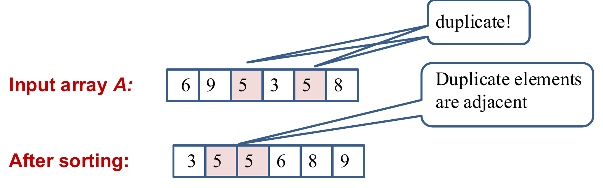{width=75%}

```
Bool ExistDuplicate(int A[], int n) {
    MergeSort(A, n);   // or Heapsort
    for (int i = 1; i < n; i++) {
        if (A[i] == A[i-1])
            return true;
    }
    return false;
}
```
:::

</details>

b) What is the asymptotic order of the running time of your method in the worst case? Justify your answer.

<details class="qa box">
<summary><strong>Answer (b)</strong> <span class="qa-caret" aria-hidden="true"></span></summary>

::: qa-answer
The worst-case time for sorting is $\Theta(n \lg n)$, using mergesort (or heapsort). The time for the scan is $\Theta(n)$. Therefore, the overall worst-case running time is $\Theta(n \lg n)$.

Do not use quicksort here: its worst case is $\Theta(n^2)$.
:::

</details>

c) Suppose we know the $n$ elements are integers from the range $1, \dots, 2n$, so other operations besides comparing keys may be done. Give an algorithm for the same problem that is specialized to use this information. Give the asymptotic order of the worst case running time for this solution. It should be of lower order than your solution for part (a).

<details class="qa box">
<summary><strong>Answer (c)</strong> <span class="qa-caret" aria-hidden="true"></span></summary>

::: qa-answer
Count how many elements have each key value. Use an array of $2n$ counters, one for each possible value, and **use the key value as the index**.

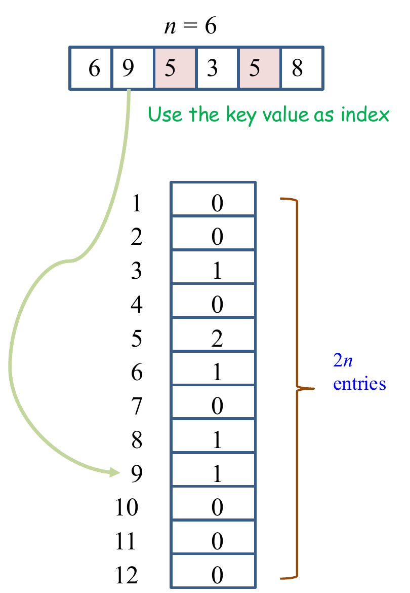{width=45%}

* We can quit as soon as any count becomes 2.
* We scan the $n$-element array once, and each element takes constant time to count. So the overall worst-case running time is $\Theta(n)$.
* It uses $\Theta(n)$ extra memory for the counters. Setting them all to 0 also costs $\Theta(n)$.
:::

</details>

<details class="qa box">
<summary><strong>General method: two ways to bring equal items together</strong> <span class="qa-caret" aria-hidden="true"></span></summary>

::: qa-answer
Many problems ask whether two items are equal, or close, or related. Comparing every pair costs $\Theta(n^2)$. Two faster ways:

1. **Sort, then scan neighbours.** Related items end up next to each other. Cost: $\Theta(n \log n)$ with mergesort or heapsort, plus $\Theta(n)$ for the scan. This needs only comparisons.
2. **Use the key as an index.** If the keys are integers in a range of size $R$, an array of $R$ counters answers in $\Theta(n + R)$ time and $\Theta(R)$ memory. This beats sorting only when $R$ is $O(n)$, or at least $o(n \log n)$.
:::

</details>

**Extension 3.1.** An unsorted array holds $n$ integers. Decide whether two of them add up to a given number $x$. Use only comparisons and additions. Aim for $O(n \log n)$.

<details class="qa box">
<summary><strong>Answer (Extension 3.1)</strong> <span class="qa-caret" aria-hidden="true"></span></summary>

::: qa-answer
Sort the array with mergesort: $\Theta(n \log n)$. Then scan from both ends:

```
i = 0; j = n - 1;
while (i < j) {
    if (A[i] + A[j] == x) return true;
    else if (A[i] + A[j] < x) i++;   // need a bigger sum
    else j--;                        // need a smaller sum
}
return false;
```

Each step moves $i$ or $j$ by one, so the scan is $\Theta(n)$. Total: $\Theta(n \log n)$. It is the "sort, then scan" method: after sorting, the scan never needs to look back.
:::

</details>

**Extension 3.2.** The $n$ integers now come from the range $1, \dots, n^2$. Is the counter method from (c) still better than sorting?

<details class="qa box">
<summary><strong>Answer (Extension 3.2)</strong> <span class="qa-caret" aria-hidden="true"></span></summary>

::: qa-answer
No. The counter array now needs $R = n^2$ entries. Setting them to 0 alone costs $\Theta(n^2)$ time, and they take $\Theta(n^2)$ memory. Sorting and scanning costs $\Theta(n \log n)$, which is better. The counter method pays off only when the range $R$ is small compared with $n \log n$.
:::

</details>

---

## Tutorial 3: Comparison-Sort Limits, Counting Sort and Quicksort

### Q1. The shallowest leaf of a decision tree

Recall the $\Omega(n \log n)$ lower bound on the worst-case runtime of any comparison sort, which was shown by considering the possible decision trees of the algorithm. What is the smallest possible depth of a leaf in a decision tree for a comparison sort?

<details class="qa box">
<summary><strong>Concepts: decision trees</strong> <span class="qa-caret" aria-hidden="true"></span></summary>

::: qa-answer
A comparison sort on $n$ elements can be drawn as a **decision tree**. Each internal node is one comparison. Each leaf is one final order. One run of the algorithm follows one path from the root to a leaf, and the number of comparisons is the length of that path.

* The **height** (the longest path) is the worst case. It is at least $\lg(n!) = \Omega(n \log n)$, because the tree needs at least $n!$ leaves.
* The **shallowest leaf** is the best case. This question asks for it.
:::

</details>

<details class="qa box">
<summary><strong>Answer</strong> <span class="qa-caret" aria-hidden="true"></span></summary>

::: qa-answer
The smallest possible depth of a leaf is $n - 1$.

**Proof sketch.**

* Suppose, for a contradiction, that there is a leaf of depth $k < n - 1$.
* Construct a graph $G$ whose vertices are the elements of the array. Connect $(i, j)$ if the algorithm compared the elements at these positions on the path to that leaf. With $k$ comparisons, the graph has only $k < n - 1$ edges, so it **cannot be connected**.
* In particular, you can split the vertices into two non-empty parts $A$ and $B$, such that no element of $A$ was compared to any element of $B$.
* So the algorithm knows nothing about the order of any element of $A$ against any element of $B$.
* So the order that the leaf gives must be wrong (not sorted) on some input. For example, take an input that agrees with every comparison made, then add a large constant to every element of $A$. The comparisons give the same results, so the run reaches the same leaf, but the correct order has changed.

Insertion sort reaches depth $n - 1$ on a sorted array, so $n - 1$ is achieved.
:::

</details>

<details class="qa box">
<summary><strong>General method: bounds from a decision tree</strong> <span class="qa-caret" aria-hidden="true"></span></summary>

::: qa-answer
* **Worst case** (height): the tree has at least as many leaves as there are possible answers, $L$. A binary tree of height $h$ has at most $2^h$ leaves. So $h \ge \lceil \lg L \rceil$. For sorting, $L = n!$.
* **Best case** (shallowest leaf): every element must be linked to every other by some chain of comparisons. A connected graph on $n$ vertices needs $n - 1$ edges.
:::

</details>

**Extension 1.1.** Any comparison sort runs on 3 distinct elements. How many comparisons does it need in the worst case? In the best case?

<details class="qa box">
<summary><strong>Answer (Extension 1.1)</strong> <span class="qa-caret" aria-hidden="true"></span></summary>

::: qa-answer
* **Worst case:** the tree needs $3! = 6$ leaves. Height 2 gives at most $2^2 = 4$ leaves, which is too few. So the height is at least $\lceil \lg 6 \rceil = 3$.
* **Best case:** at least $n - 1 = 2$. Insertion sort reaches it on a sorted input: $a_1 \le a_2$, then $a_2 \le a_3$, and it stops.
:::

</details>

### Q2. Running the last loop of counting sort forwards

Recall the final `for` loop in counting sort, responsible for placing the elements into their sorted positions, which took the form:

$$\textbf{for } j \leftarrow \text{length}[A] - 1 \textbf{ downto } 0$$

(i.e., iterating from the end of the input list $A$ through to the beginning). Suppose the order of iteration was reversed by swapping the line above with:

$$\textbf{for } j \leftarrow 0 \textbf{ upto } \text{length}[A] - 1$$

Would this new version of counting sort still be correct? Justify your answer. What else do you observe about this modified algorithm?

<details class="qa box">
<summary><strong>Answer</strong> <span class="qa-caret" aria-hidden="true"></span></summary>

::: qa-answer
The two versions differ only in the last loop:

```
for i <- 0 to k                        for i <- 0 to k
    do C[i] <- 0;                          do C[i] <- 0;
for j <- 0 to length[A] - 1            for j <- 0 to length[A] - 1
    do C[A[j]] <- C[A[j]] + 1;             do C[A[j]] <- C[A[j]] + 1;
for i <- 1 to k                        for i <- 1 to k
    do C[i] <- C[i] + C[i-1];              do C[i] <- C[i] + C[i-1];
for j <- length[A] - 1 downto 0   =>   for j <- 0 upto length[A] - 1
    do begin                               do begin
        C[A[j]] <- C[A[j]] - 1;                C[A[j]] <- C[A[j]] - 1;
        B[C[A[j]]] <- A[j];                    B[C[A[j]]] <- A[j];
    end-for                                end-for
return B                               return B
```

**Example of the "new" counting sort** on $[3, 4, 1, 4]$, with keys 0 to 4:

* Histogram: $[0, 1, 0, 1, 2]$.
* Cumulative sum: $[0, 1, 1, 2, 4]$.
* Placement loop run, from $j = 0$:

| $j$ | $A[j]$ | Output $B$ after the step |
|---|---|---|
| start | | [ , , , ] |
| 0 | 3 | [ , 3, , ] |
| 1 | 4 | [ , 3, , 4] ← which 4 is this? |
| 2 | 1 | [1, 3, , 4] |
| 3 | 4 | [1, 3, 4, 4] |

* **It would still be correct.** Every element still lands in the block of slots for its key, so the output is sorted.
* **But it would no longer be stable.** The first 4 in $A$ took the **last** slot for 4. The order of equal-valued elements is reversed, instead of being preserved.
:::

</details>

<details class="qa box">
<summary><strong>General method: check whether a sort is stable</strong> <span class="qa-caret" aria-hidden="true"></span></summary>

::: qa-answer
Take two equal keys, $x_a$ before $x_b$ in the input. Follow the algorithm and ask: which one ends at the higher index?

* For counting sort, the last loop fills each key's slots **from the right**, because it decrements before it writes. So the element it meets **first** gets the rightmost slot. To keep $x_a$ before $x_b$, the loop must meet $x_b$ first: it must run **backwards**.
* Correctness and stability are separate questions. A sort can be correct and not stable.
:::

</details>

**Extension 2.1.** Radix sort sorts the two-digit numbers 12 and 11 (in that input order). Each pass uses the **forward** counting sort from this question. Show the result after each pass. Is it sorted?

<details class="qa box">
<summary><strong>Answer (Extension 2.1)</strong> <span class="qa-caret" aria-hidden="true"></span></summary>

::: qa-answer
* **Pass 1, last digit:** the digits are 2 and 1. The keys differ, so the pass sorts them correctly: 11, 12.
* **Pass 2, first digit:** both first digits are 1, so the keys are equal. The forward loop reverses equal keys: 12, 11.

The result, 12 then 11, is **not sorted**. Radix sort needs a stable inner sort. The second pass must keep the order that the first pass set up.
:::

</details>

### Q3. Quicksort with the median of three

Instead of using the middle element as pivot, quicksort also can use the median of first, middle, and last elements (sometimes called the "median of three" strategy). If this pivot selection scheme is used, how many key comparisons will quicksort do in the worst case to sort $n$ elements? (Remember to count the comparisons done in choosing the pivot.)

<details class="qa box">
<summary><strong>Answer: comparisons in one partition</strong> <span class="qa-caret" aria-hidden="true"></span></summary>

::: qa-answer
Consider a subrange of $k$ elements to be partitioned.

* Choosing the pivot requires 3 key comparisons in the worst case.
* Now $k - 3$ elements remain to be compared to the pivot. It is easy to avoid comparing the other two candidates again: swap them to the two ends of the subrange. Their side is already known.
* So $k$ comparisons are done by the time the partition is finished.
* This is one more than if the middle element is simply chosen as the pivot ($k - 1$).
:::

</details>

<details class="qa box">
<summary><strong>Answer: the worst case</strong> <span class="qa-caret" aria-hidden="true"></span></summary>

::: qa-answer
* An example of the worst case: E[first] = 100, E[(first + last)/2] = 99, E[last] = 98, and all other elements are over 100.
* Then 99 becomes the pivot. 98 is the only element smaller than the pivot, and $k - 2$ elements are greater than the pivot.
* The remaining keys can be chosen so that the worst case repeats: the median of three always comes out as the **second-smallest** key in the range.
* The larger subrange shrinks by only 2 at each level of recursion. So quicksort needs $n/2$ calls to partition, on ranges of size $n, n-2, n-4, \dots, 2$ (suppose $n$ is even). The total number of comparisons is

$$\begin{aligned}
f &= n + (n-2) + (n-4) + \dots + 2 \\
f &= 2 + 4 + \dots + (n-2) + n \\
2f &= (n+2) + (n+2) + \dots + (n+2) = \frac{n(n+2)}{2} \qquad (n/2 \text{ terms}) \\
f &= \frac{n^2 + 2n}{4} = \Theta(n^2).
\end{aligned}$$

* When $n$ is odd, the total number of comparisons is also about $n^2/4$.
* So the worst-case time complexity with the median-of-3 strategy is $\Theta(n^2)$.

**Error in the official solution:** it writes the middle position as "E[first + last/2]". The middle index is $\lfloor(\text{first} + \text{last})/2\rfloor$. Without the brackets, it would be first + (last/2).
:::

</details>

<details class="qa box">
<summary><strong>General method: the worst case of quicksort under any pivot rule</strong> <span class="qa-caret" aria-hidden="true"></span></summary>

::: qa-answer
1. Find the **worst pivot the rule can pick**: how many elements can the adversary force onto the small side? Say the small side gets $r - 1$ elements, so each partition removes only $r$ elements (the pivot plus $r - 1$).
2. The ranges then have sizes $n, n - r, n - 2r, \dots$. That is about $n/r$ partitions.
3. Each partition of $k$ elements costs about $k$ comparisons. The sum is about $\frac{n}{r} \cdot \frac{n}{2} = \frac{n^2}{2r}$.

Any rule that looks at a **constant** number of elements leaves $r$ constant, so the worst case stays $\Theta(n^2)$. Middle element: $r = 1$, about $n^2/2$. Median of three: $r = 2$, about $n^2/4$.
:::

</details>

**Extension 3.1.** The pivot is now the median of **five** elements: first, last, and three others at fixed positions. What is the worst-case number of comparisons, roughly?

<details class="qa box">
<summary><strong>Answer (Extension 3.1)</strong> <span class="qa-caret" aria-hidden="true"></span></summary>

::: qa-answer
The adversary makes the five sampled elements the five smallest of the range. Their median is then the **third-smallest** of the range. Only 2 elements go to the small side, so each partition removes $r = 3$ elements.

By the method: about $\frac{n^2}{2 \cdot 3} = \frac{n^2}{6}$ comparisons, plus a few more per partition to find the median. Still $\Theta(n^2)$.
:::

</details>

### Q4. Red, white and blue

Each of $n$ elements in an array may have one of the key values red, white, or blue. Give an efficient algorithm for rearranging the elements so that all the reds come before all the whites, and all the whites come before all the blues. (It may happen that there are no elements of one or two of the colours.) The only operations permitted on the elements are examination of a key to find out what colour it is, and a swap, or interchange, of two elements (specified by their indices). What is the asymptotic order of the worst case running time of your algorithm? (There is a linear-time solution.)

<details class="qa box">
<summary><strong>Answer: the four regions</strong> <span class="qa-caret" aria-hidden="true"></span></summary>

::: qa-answer
At an intermediate step, the elements are divided into four regions:

* the first contains only reds;
* the second contains only whites;
* the third contains elements whose colours are not known yet;
* the fourth contains only blues.

There are three indexes: r (end of the reds), u (first unknown) and b (the edge of the blues).

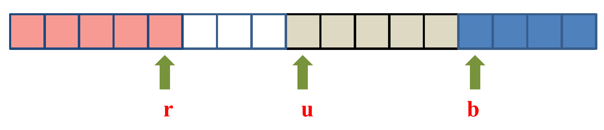{width=70%}
:::

</details>

<details class="qa box">
<summary><strong>Answer: the algorithm and its cost</strong> <span class="qa-caret" aria-hidden="true"></span></summary>

::: qa-answer
The official algorithm:

```
int r; // index of last red
int u; // index of first unknown
int b; // index of first blue

r = 0; u = 0; b = n-1;
while (u < b)
    if (E[u] == red)
        Interchange E[r] and E[u];
        r++;
        u++;
    else if (E[u] == white)
        u++;
    else // (E[u] == blue)
        Interchange E[b] and E[u]
        b--;
```

* With each iteration of the while loop, either u increases by one or b decreases by one. So there are $n$ iterations.
* Each iteration takes constant time, so the overall time is linear, $\Theta(n)$.

**Error in the official code.** With `b = n-1` and the blue case "swap, then `b--`", the index `b` points at the **last unknown** element, not the first blue. The loop `while (u < b)` then stops one element early: the element at `u == b` is never examined. Example: $[\text{white}, \text{red}]$. It starts with r = 0, u = 0, b = 1. E[0] is white, so u = 1. Now `u < b` is false and the loop ends, leaving white before red.

The fix is one character: `while (u <= b)`. (Chapter 4 uses the other common form: `b = n`, and in the blue case `b--` first, then swap, with `while (u < b)`.)
:::

</details>

<details class="qa box">
<summary><strong>General method: partition in one pass with regions</strong> <span class="qa-caret" aria-hidden="true"></span></summary>

::: qa-answer
1. Draw the array as regions, one per group, plus one **unknown** region. Name the index at each border.
2. Write what each region holds. This is the loop invariant.
3. For each possible value of the next unknown element, write the swap and the index moves that put it in its region and keep the invariant.
4. Check that every iteration shrinks the unknown region by exactly one. Then the loop runs $n$ times: $\Theta(n)$.
5. Test the code by hand on two-element inputs. Off-by-one errors in the stop condition show up at once.
:::

</details>

**Extension 4.1.** In the corrected algorithm, what is the largest number of swaps for an array of $n$ elements? Give an input that reaches it.

<details class="qa box">
<summary><strong>Answer (Extension 4.1)</strong> <span class="qa-caret" aria-hidden="true"></span></summary>

::: qa-answer
Each iteration makes at most one swap, and there are $n$ iterations. So at most $n$ swaps.

An array of $n$ blues reaches it. Every iteration finds a blue at `u` and swaps it with the element at `b` (also a blue), then moves `b` down. That is $n$ swaps, even though nothing needed to move. Each iteration still shrinks the unknown region by one, as the method requires.
:::

</details>


---

## Tutorial 4: Heapsort, Priority Queues, BFS and DFS

### Q1. Building a max-heap of dates

Given an array with content (of type date): 1 Jul, 30 Jan, 22 Mar, 22 Dec, 30 May, 21 Feb, 3 Nov, 7 Jun, 22 Feb, 21 Nov, 30 Dec; all of the same year. Suppose an earlier date is considered larger than a later date; for example, "30 Jan" is larger than "30 Dec". In order to sort these dates by heapsort, we construct a max-heap. Show the contents of the array (representing the max-heap) after the heap construction phase.

<details class="qa box">
<summary><strong>Concepts: fixHeap and the build order</strong> <span class="qa-caret" aria-hidden="true"></span></summary>

::: qa-answer
* In a **max-heap**, every node is at least as large as its children. Node $k$ has children $2k$ and $2k+1$.
* `fixHeap` repairs one node whose two subtrees are already heaps. At each level it makes 2 comparisons: one to find the larger child, one to compare that child with the sinking key. If the child is larger, the child moves up.
* To build a heap, fix every node that has a child, children before parents. The lecture's recursive `heapifying` does this in post-order: left subtree, right subtree, then the root. The loop from node $\lfloor n/2 \rfloor$ down to 1 gives the same heap.
* Here "larger" means "earlier in the year".
:::

</details>

<details class="qa box">
<summary><strong>Answer</strong> <span class="qa-caret" aria-hidden="true"></span></summary>

::: qa-answer
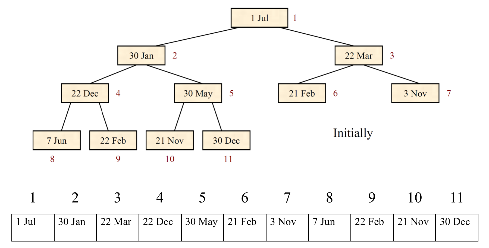{width=80%}

`heapifying` fixes the nodes in post-order: 4, 5, 2, 3, then 1.

| Fix at node | Key | What happens | Comparisons | Swaps |
|---|---|---|---|---|
| 4 | 22 Dec | Children 7 Jun, 22 Feb. 22 Feb is larger and beats 22 Dec, so 22 Feb moves up. 22 Dec goes to node 9. | 2 | 1 |
| 5 | 30 May | Children 21 Nov, 30 Dec. 30 May is larger than both. No move. | 2 | 0 |
| 2 | 30 Jan | Children 22 Feb, 30 May. 30 Jan is larger than both. No move. | 2 | 0 |
| 3 | 22 Mar | Children 21 Feb, 3 Nov. 21 Feb is larger, so it moves up. | 2 | 1 |
| 1 | 1 Jul | 30 Jan moves up to node 1. Then 22 Feb moves up to node 2. Then 7 Jun moves up to node 4. 1 Jul ends at node 8. | 6 | 3 |

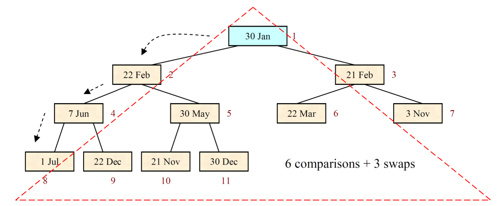{width=80%}

Heapifying performs **14** date comparisons and **5** swaps in the heap construction phase. The resulting array is:

| 1 | 2 | 3 | 4 | 5 | 6 | 7 | 8 | 9 | 10 | 11 |
|---|---|---|---|---|---|---|---|---|---|---|
| 30 Jan | 22 Feb | 21 Feb | 7 Jun | 30 May | 22 Mar | 3 Nov | 1 Jul | 22 Dec | 21 Nov | 30 Dec |
:::

</details>

<details class="qa box">
<summary><strong>General method: trace heap construction by hand</strong> <span class="qa-caret" aria-hidden="true"></span></summary>

::: qa-answer
1. Draw the array as a tree, level by level. Number the nodes.
2. List the nodes with children: $\lfloor n/2 \rfloor$ down to 1. (Post-order gives the same final heap.)
3. For each one, sink its key: compare the two children (1), then compare the larger child with the key (1). If the child is larger, it moves up and the key continues down. A node with one child costs only 1 comparison at that level.
4. Count per fix: moves = levels sunk; comparisons = about 2 per level visited.
5. Check the result: every parent beats both children.
:::

</details>

**Extension 1.1.** Insert the date 15 Jan into the final heap from Q1. Show the array and count the comparisons.

<details class="qa box">
<summary><strong>Answer (Extension 1.1)</strong> <span class="qa-caret" aria-hidden="true"></span></summary>

::: qa-answer
Insert puts 15 Jan at the next free position, node 12, then bubbles it up while it beats its parent.

* The parent of 12 is node 6 (22 Mar). 15 Jan is earlier, so they swap. (1 comparison)
* The parent of 6 is node 3 (21 Feb). Swap. (1 comparison)
* The parent of 3 is node 1 (30 Jan). 15 Jan is earlier. Swap. (1 comparison)

| 1 | 2 | 3 | 4 | 5 | 6 | 7 | 8 | 9 | 10 | 11 | 12 |
|---|---|---|---|---|---|---|---|---|---|---|---|
| 15 Jan | 22 Feb | 30 Jan | 7 Jun | 30 May | 21 Feb | 3 Nov | 1 Jul | 22 Dec | 21 Nov | 30 Dec | 22 Mar |

3 comparisons, one per level. Insert costs at most the height, $\lfloor \lg 12 \rfloor = 3$.
:::

</details>

### Q2. Heap construction on a decreasing array

An array of distinct keys in decreasing order is to be sorted (into increasing order) by heapsort.

a) How many comparisons of keys are done in the heap construction phase if there are 10 elements?

<details class="qa box">
<summary><strong>Answer (a)</strong> <span class="qa-caret" aria-hidden="true"></span></summary>

::: qa-answer
$2 + 1 + 2 + 2 + 2 = 9$.

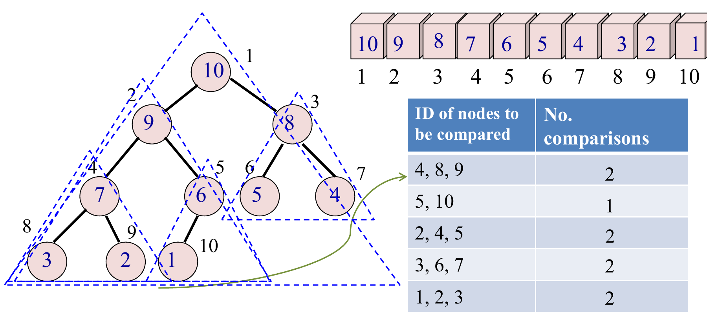{width=80%}

| Nodes compared | Comparisons |
|---|---|
| 4, 8, 9 | 2 |
| 5, 10 | 1 |
| 2, 4, 5 | 2 |
| 3, 6, 7 | 2 |
| 1, 2, 3 | 2 |
:::

</details>

b) How many are done if there are $n$ elements? Show how you derive your answer.

<details class="qa box">
<summary><strong>Answer (b)</strong> <span class="qa-caret" aria-hidden="true"></span></summary>

::: qa-answer
Node $i$ is an **internal** node (not a leaf) if and only if $1 \le 2i \le n$, so $\frac{1}{2} \le i \le \frac{n}{2}$. Thus:

* if $n$ is even, there are $n/2$ internal nodes;
* if $n$ is odd, there are $(n-1)/2$ internal nodes.

Since the keys are in decreasing order, fixHeap does only one or two key comparisons each time it is called, and no key moves.

* **If $n$ is even**, the last internal node has only one child. So fixHeap does only one comparison at that node, and two at each other internal node. Total: $2(n/2 - 1) + 1 = n - 1$.
* **If $n$ is odd**, each of the $(n-1)/2$ internal nodes has two children. fixHeap does two comparisons at each. Total: $2 \times (n-1)/2 = n - 1$.

In both cases, the total is $n - 1$ key comparisons.
:::

</details>

c) Is an array in decreasing order the best case, the worst case, or an intermediate case for this algorithm? Justify your answer.

<details class="qa box">
<summary><strong>Answer (c)</strong> <span class="qa-caret" aria-hidden="true"></span></summary>

::: qa-answer
It is the **best case**. No key moves. So in the heapifying algorithm, fixHeap only compares the root with its two children, and never needs to continue down, as it does in an intermediate or worst case.

Every internal node must be compared with its children at least once, so no input can do fewer comparisons.
:::

</details>

<details class="qa box">
<summary><strong>General method: count heap-construction comparisons</strong> <span class="qa-caret" aria-hidden="true"></span></summary>

::: qa-answer
* **Best case** (no key moves): each internal node costs 2, or 1 if it has a single child. There are $\lfloor n/2 \rfloor$ internal nodes, and only node $n/2$ (when $n$ is even) has one child. The total is always $n - 1$.
* **Any other input:** trace it with the method of Q1. Each extra level a key sinks costs up to 2 more comparisons.
* **Worst case:** still $O(n)$, because most nodes sit near the bottom and can sink only a little.
:::

</details>

**Extension 2.1.** Build a max-heap from the **increasing** array 1 2 3 4 5 6 7 8 9 10. Count the comparisons. Compare with part (a).

<details class="qa box">
<summary><strong>Answer (Extension 2.1)</strong> <span class="qa-caret" aria-hidden="true"></span></summary>

::: qa-answer
Use the loop order 5, 4, 3, 2, 1.

| Fix at node | What happens | Comparisons | Array after |
|---|---|---|---|
| 5 (key 5) | One child, 10: 1 comparison. 10 moves up. | 1 | 1 2 3 4 10 6 7 8 9 5 |
| 4 (key 4) | Children 8, 9: 9 is larger and beats 4. 9 moves up. | 2 | 1 2 3 9 10 6 7 8 4 5 |
| 3 (key 3) | Children 6, 7: 7 moves up. | 2 | 1 2 7 9 10 6 3 8 4 5 |
| 2 (key 2) | Children 9, 10: 10 moves up (2). At node 5, one child (5): 5 moves up (1). | 3 | 1 10 7 9 5 6 3 8 4 2 |
| 1 (key 1) | 10 moves up (2), then 9 (2), then 8 (2). 1 ends at node 8. | 6 | 10 9 7 8 5 6 3 1 4 2 |

Total: $1 + 2 + 2 + 3 + 6 = 14$ comparisons, against 9 for the decreasing array. The increasing array is not the best case, because keys must sink.
:::

</details>

### Q3. Merging k sorted lists in O(n log k)

Given $k$ lists with a total of $n$ numbers, where $k \ge 2$ and each list has been sorted in decreasing order, design an algorithm to merge the $k$ lists into one list sorted in decreasing order, in running time $O(n \log k)$.

<details class="qa box">
<summary><strong>Answer</strong> <span class="qa-caret" aria-hidden="true"></span></summary>

::: qa-answer
One algorithm is to use a maximizing heap.

1. First, insert the $k$ elements from the heads of the $k$ sorted lists into a maximizing heap. This takes $O(k)$ time.
2. Then, use getMax() to obtain the maximum element from the heap, and append it at the end of the merged list (initially empty). Suppose this element came from the $j$-th list. Then insert the element from the **next** position of the $j$-th list into the heap, using fixHeap: it takes the place of the root and sinks.
3. Continue in this fashion until all the $k$ lists have been exhausted. (When list $j$ is empty, the last heap element takes the root's place instead, and the heap shrinks by one.)

**Analysis.** For one element, an insertion using fixHeap takes $O(\log k)$ time, because the heap never holds more than $k$ elements. Hence for the $n$ elements, the running time is $O(n \log k)$.

**Example.** Input: three sorted arrays $A_1 = [9, 7, 5, 2]$, $A_2 = [4, 3, 1]$, $A_3 = [8, 6, 2, 1, 0]$. Output: a merged list $M$.

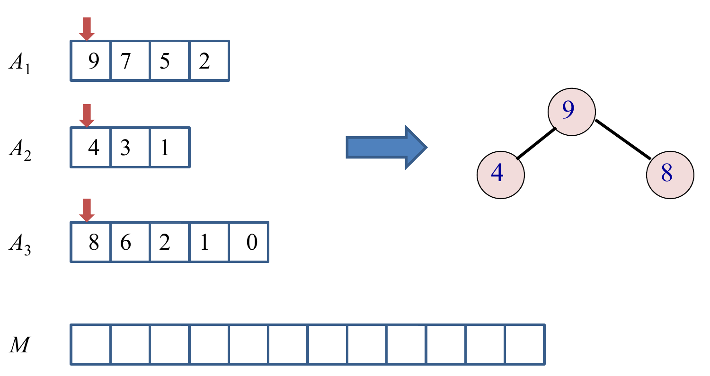{width=65%}

| Step | Output | Comes from | Inserted next | Heap after |
|---|---|---|---|---|
| 1 | 9 | $A_1$ | 7 | 8, 4, 7 |
| 2 | 8 | $A_3$ | 6 | 7, 4, 6 |
| 3 | 7 | $A_1$ | 5 | 6, 4, 5 |

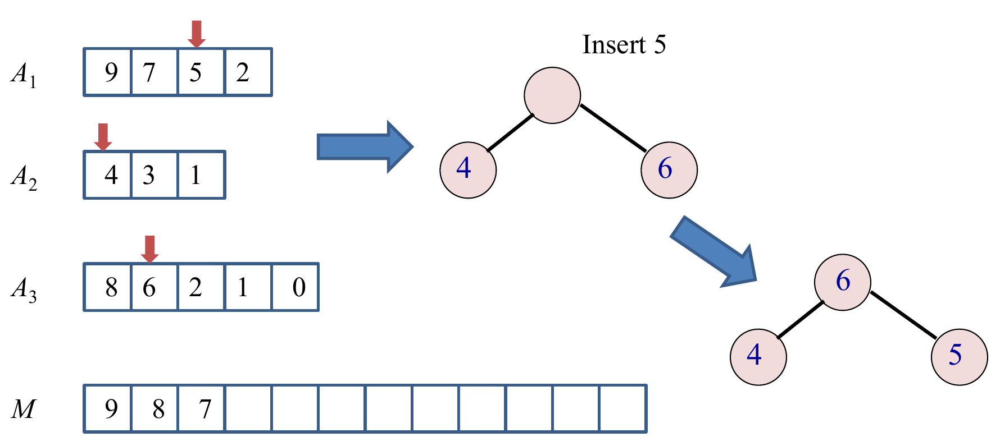{width=75%}

Continue in this fashion until all the input lists are exhausted.
:::

</details>

<details class="qa box">
<summary><strong>General method: keep a heap of size k, not n</strong> <span class="qa-caret" aria-hidden="true"></span></summary>

::: qa-answer
When the answer comes out in order but only a few items can be "next" at any time, keep **only those candidates** in a heap.

* Here, the next output is always one of the $k$ current heads. So the heap holds $k$ items, and each step costs $O(\log k)$, not $O(\log n)$.
* Total = (number of outputs) $\times$ (cost per heap step) = $n \times O(\log k)$.
* Use a max-heap for lists in decreasing order, a min-heap for increasing order.
:::

</details>

**Extension 3.1.** A simpler plan merges list 1 with list 2, then the result with list 3, and so on, with the merge from mergesort. Each list has $n/k$ elements. How long does it take?

<details class="qa box">
<summary><strong>Answer (Extension 3.1)</strong> <span class="qa-caret" aria-hidden="true"></span></summary>

::: qa-answer
Merging two lists costs about their total length.

* Merge $i$ joins a list of $i \cdot n/k$ elements with one of $n/k$, so it costs about $(i+1)\,n/k$.
* Summed over $i = 1, \dots, k-1$: about $\frac{n}{k} \cdot \frac{k^2}{2} = \frac{nk}{2}$.

That is $O(nk)$, worse than $O(n \log k)$. The early elements are copied again in every merge. The heap touches each element only once.
:::

</details>

### Q4. BFS on an adjacency matrix

The running time analysis of BFS discussed in lectures assumed that the input graph was represented by an adjacency list. What is the running time if the input graph was instead represented by an adjacency matrix? How would you modify the algorithm to handle this form of input?

<details class="qa box">
<summary><strong>Answer</strong> <span class="qa-caret" aria-hidden="true"></span></summary>

::: qa-answer
The BFS from the lecture:

```
function bfs(v1):
    queue := {v1}
    mark v1 as visited
    v1.d = 0

    while queue is not empty:
        v := queue.removeFirst()
        for each unvisited neighbour n of v:
            n.d = v.d + 1
            mark n as visited
            queue.addLast(n)
```

**Adjacency list.**

* We iterate through Adj[$v$] once for every vertex.
* This has worst-case runtime $\Theta(|E|)$ per vertex (when all edges are adjacent to $v$), but is typically lower.
* The overall runtime is $\Theta(|V| + |E|)$, by considering the total length of the adjacency lists.

**Adjacency matrix.**

* We must iterate through the whole row of $v$ in the matrix $A_G$.
* This **always** has runtime $\Theta(|V|)$.
* Since we do this for every vertex, the overall runtime is $\Theta(|V|^2)$.

**The modification:** replace "for each unvisited neighbour $n$ of $v$" with a scan of row $v$:

```
        for n = 1 to |V|:
            if A[v][n] == 1 and n is unvisited:
                n.d = v.d + 1
                mark n as visited
                queue.addLast(n)
```
:::

</details>

<details class="qa box">
<summary><strong>General method: the cost of a graph traversal</strong> <span class="qa-caret" aria-hidden="true"></span></summary>

::: qa-answer
Total = (work per vertex) + (cost of finding the neighbours of every vertex once).

| Storage | Neighbours of one vertex | All vertices | BFS or DFS total |
|---|---|---|---|
| Adjacency list | $\Theta(\deg v)$ | $\Theta(\lvert E \rvert)$ | $\Theta(\lvert V \rvert + \lvert E \rvert)$ |
| Adjacency matrix | $\Theta(\lvert V \rvert)$ | $\Theta(\lvert V \rvert^2)$ | $\Theta(\lvert V \rvert^2)$ |

The algorithm is the same. Only the neighbour loop changes. The same table holds for DFS.
:::

</details>

**Extension 4.1.** A graph has 1000 vertices and 3000 edges. Roughly how many basic steps does BFS take with each storage? Which storage suits this graph?

<details class="qa box">
<summary><strong>Answer (Extension 4.1)</strong> <span class="qa-caret" aria-hidden="true"></span></summary>

::: qa-answer
* Adjacency list: about $|V| + |E| = 1000 + 3000 = 4000$. (An undirected graph stores each edge twice, so about 7000.)
* Adjacency matrix: about $|V|^2 = 1{,}000{,}000$.

The graph is **sparse** ($3000 \ll 1000^2$), so the list is far better.
:::

</details>

### Q5. DFS without recursion

Rewrite the depth-first search procedure taught in lectures in a way that doesn't use recursion.

<details class="qa box">
<summary><strong>Answer</strong> <span class="qa-caret" aria-hidden="true"></span></summary>

::: qa-answer
We can use a last-in, first-out (LIFO) stack.

```
function dfs():
    mark all vertices as unvisited
    while there exists an unvisited vertex v:
        dfsVisit(v)

// Explore all vertices reachable from v in depth-first order
function dfsVisit(v):
    S = empty stack
    S.push(v)

    while S is non-empty:
        w = S.pop()
        mark w as visited
        for each unvisited neighbour x of w:
            S.push(x)
```

**A gap in the official code.** A vertex can be pushed more than once before it is visited. Example: the triangle $a$–$b$, $a$–$c$, $b$–$c$. Visiting $a$ pushes $b$ and $c$. Popping $c$ visits it and pushes $b$ again, because $b$ is still unvisited. Now $b$ is on the stack twice, and the code visits it twice. Add one line after the pop:

```
        w = S.pop()
        if w is visited: continue     // w was pushed more than once
        mark w as visited
```
:::

</details>

<details class="qa box">
<summary><strong>General method: turn a recursion into a loop with a stack</strong> <span class="qa-caret" aria-hidden="true"></span></summary>

::: qa-answer
* The call stack holds "work still to do". Replace it with your own stack: push what the recursion would call, pop to continue.
* The stack returns the **last** item pushed. So to visit the neighbours in the same order as the recursive version, push them in **reverse** order.
* Check "already visited" when you **pop**, because an item can be pushed several times.
* BFS is the same loop with a **queue** in place of the stack.
:::

</details>

**Extension 5.1.** An undirected graph has edges $a$–$b$, $a$–$c$ and $b$–$d$. Neighbours are listed in alphabetical order. Give the visiting order of the recursive DFS from $a$, and of the stack version (with the visited check). How do you make the stack version match?

<details class="qa box">
<summary><strong>Answer (Extension 5.1)</strong> <span class="qa-caret" aria-hidden="true"></span></summary>

::: qa-answer
* **Recursive:** $a$, then its first neighbour $b$, then $b$'s neighbour $d$. Back up to $a$, then $c$. Order: $a, b, d, c$.
* **Stack:** pop $a$, push $b$ then $c$. Pop $c$ (last pushed): visit it. Pop $b$: visit it, push $d$. Pop $d$. Order: $a, c, b, d$.

Push the neighbours in reverse alphabetical order ($c$ then $b$). Then $b$ is popped first, and the order becomes $a, b, d, c$.
:::

</details>

---

## Tutorial 5: Dijkstra's Algorithm and Unique MSTs

### Q1. Tracing Dijkstra's algorithm

Apply Dijkstra's algorithm on the graph represented by the following adjacency matrix $A$ to find the shortest distances and shortest paths from vertex 1 to all other vertices. Show the contents of the array $S$, as well as the $d$ and $pi$ attributes after each iteration of the while loop.

$$A = \begin{pmatrix}
0 & 4 & 2 & 6 & 8 \\
\infty & 0 & \infty & 4 & 3 \\
\infty & \infty & 0 & 1 & \infty \\
\infty & 1 & \infty & 0 & 3 \\
\infty & \infty & \infty & \infty & 0
\end{pmatrix}$$

<details class="qa box">
<summary><strong>Answer: the graph</strong> <span class="qa-caret" aria-hidden="true"></span></summary>

::: qa-answer
Row $i$, column $j$ holds the weight of the edge from $i$ to $j$.

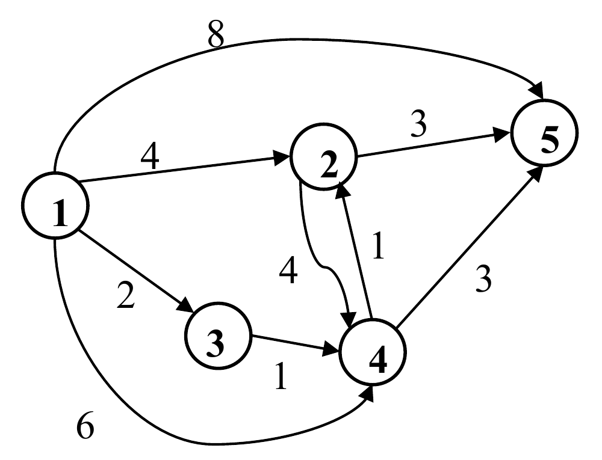{width=50%}
:::

</details>

<details class="qa box">
<summary><strong>Answer: the trace</strong> <span class="qa-caret" aria-hidden="true"></span></summary>

::: qa-answer
**After initialization:**

| | 1 | 2 | 3 | 4 | 5 |
|---|---|---|---|---|---|
| S | 0 | 0 | 0 | 0 | 0 |
| d | 0 | ∞ | ∞ | ∞ | ∞ |
| pi | null | null | null | null | null |

**1st iteration:** vertex 1 joins $S$. Its edges set $d$ = 4, 2, 6, 8.

| | 1 | 2 | 3 | 4 | 5 |
|---|---|---|---|---|---|
| S | 1 | 0 | 0 | 0 | 0 |
| d | 0 | 4 | 2 | 6 | 8 |
| pi | null | 1 | 1 | 1 | 1 |

**2nd iteration:** vertex 3 ($d = 2$) joins. Edge 3→4: $2 + 1 = 3 < 6$.

| | 1 | 2 | 3 | 4 | 5 |
|---|---|---|---|---|---|
| S | 1 | 0 | 1 | 0 | 0 |
| d | 0 | 4 | 2 | 3 | 8 |
| pi | null | 1 | 1 | 3 | 1 |

**3rd iteration:** vertex 4 ($d = 3$) joins. Edge 4→2: $3 + 1 = 4$, not smaller than 4. Edge 4→5: $3 + 3 = 6 < 8$.

| | 1 | 2 | 3 | 4 | 5 |
|---|---|---|---|---|---|
| S | 1 | 0 | 1 | 1 | 0 |
| d | 0 | 4 | 2 | 3 | 6 |
| pi | null | 1 | 1 | 3 | 4 |

**4th iteration:** vertex 2 ($d = 4$) joins. Edge 2→5: $4 + 3 = 7$, not smaller than 6. (Edge 2→4 leads to a vertex already in $S$.)

| | 1 | 2 | 3 | 4 | 5 |
|---|---|---|---|---|---|
| S | 1 | 1 | 1 | 1 | 0 |
| d | 0 | 4 | 2 | 3 | 6 |
| pi | null | 1 | 1 | 3 | 4 |

**5th iteration:** vertex 5 joins.

| | 1 | 2 | 3 | 4 | 5 |
|---|---|---|---|---|---|
| S | 1 | 1 | 1 | 1 | 1 |
| d | 0 | 4 | 2 | 3 | 6 |
| pi | null | 1 | 1 | 3 | 4 |

**Shortest paths** (follow $pi$ back to 1): 1 – 2, 1 – 3, 1 – 3 – 4, 1 – 3 – 4 – 5.
:::

</details>

<details class="qa box">
<summary><strong>General method: trace Dijkstra in a table</strong> <span class="qa-caret" aria-hidden="true"></span></summary>

::: qa-answer
1. One column per vertex, rows $S$, $d$, $pi$. Start: $d = 0$ at the source, $\infty$ elsewhere.
2. Each iteration: among the vertices with $S = 0$, pick the smallest $d$ (break ties by the rule the question gives). Set its $S = 1$.
3. For each edge from it to a vertex with $S = 0$: if $d(u) + w < d(v)$, write the new $d$ and set $pi = u$. **Equal is not smaller**: leave it.
4. Checks: vertices join $S$ in non-decreasing $d$; a vertex in $S$ never changes again.
5. Read each path backwards through $pi$.
:::

</details>

**Extension 1.1.** Change the weight of edge 3→4 from 1 to 5, and run Dijkstra from vertex 1 again. Give the final $d$ and $pi$.

<details class="qa box">
<summary><strong>Answer (Extension 1.1)</strong> <span class="qa-caret" aria-hidden="true"></span></summary>

::: qa-answer
* Iteration 1: vertex 1. $d$ = (0, 4, 2, 6, 8), $pi$ = (null, 1, 1, 1, 1).
* Iteration 2: vertex 3 ($d = 2$). 3→4: $2 + 5 = 7$, not smaller than 6. No change.
* Iteration 3: vertex 2 ($d = 4$). 2→4: $8$, no. 2→5: $4 + 3 = 7 < 8$, so $d(5) = 7$ and $pi(5) = 2$.
* Iteration 4: vertex 4 ($d = 6$). 4→5: $9$, no.
* Iteration 5: vertex 5.

| | 1 | 2 | 3 | 4 | 5 |
|---|---|---|---|---|---|
| d | 0 | 4 | 2 | 6 | 7 |
| pi | null | 1 | 1 | 1 | 2 |

Vertex 4 is now reached by the direct edge, and vertex 5 through vertex 2.
:::

</details>

### Q2. Counting shortest paths

Let $G = (V, E, W)$ be a weighted graph, and let $s$ and $z$ be distinct vertices. In the graph, there may be more than one shortest path from $s$ to $z$. Explain how to modify Dijkstra's shortest-path algorithm to determine the number of distinct shortest paths from $s$ to $z$. Assume all edge weights are positive.

<details class="qa box">
<summary><strong>Answer</strong> <span class="qa-caret" aria-hidden="true"></span></summary>

::: qa-answer
Add a counter `v.count`: the number of shortest paths from the source to $v$ found so far.

```
shortest_paths( Graph g, Node source )
// The array count[] records the number of shortest paths from
// source to each of the vertices
{
    for each vertex v {
        v.d = infinity;
        v.pi = null pointer;
        S[v] = 0;
        v.count = 0;
    }
    source.d = 0;
    source.count = 1;
    put all vertices in queue, Q, in v.d's order;

    while not Empty(Q) {
        u = ExtractCheapest( Q );
        S[u] = 1;  /* Add u to S */
        for each vertex v adjacent to u
            if (S[v] != 1 && v.d > u.d + w[u,v]) {
                remove v from Q;
                v.d = u.d + w[u,v];
                v.pi = u;
                // the shortest paths to u extends to v, the
                // previously known shortest path(s) to v is replaced
                v.count = u.count;
                insert v into Q according to its v.d;
            }
            else if (v.d == u.d + w[u, v]) {
                // additional shortest path(s) through u to v is found
                v.count += u.count;
            }
    }
}
```

At the end, `z.count` is the answer.

* **A strictly shorter path through $u$:** every old path to $v$ is no longer shortest. The new shortest paths are exactly the shortest paths to $u$, plus the edge. So `v.count = u.count`.
* **An equally short path through $u$:** these are new shortest paths, added to the old ones. So `v.count += u.count`.

**Error in the official code:** it sets `source.d = 1` after `source.d = 0`. It must be `source.count = 1`. Otherwise every count stays 0, and the source's distance is wrong.
:::

</details>

<details class="qa box">
<summary><strong>General method: extend Dijkstra to compute more than distances</strong> <span class="qa-caret" aria-hidden="true"></span></summary>

::: qa-answer
Attach an extra value to each vertex, and update it in the relax step, with two cases:

| Relax result | Distance | Extra value |
|---|---|---|
| $d(u) + w < d(v)$ | replace | **replace** with a value built from $u$ |
| $d(u) + w = d(v)$ | keep | **combine** with a value built from $u$ |

* Count of shortest paths: replace with `u.count`; combine by adding.
* Fewest edges among the shortest paths: replace with `u.edges + 1`; combine by taking the minimum.

**Why positive weights matter:** every vertex before $v$ on a shortest path has a strictly smaller $d$, so it leaves the queue before $v$. Its count is final before it is passed on. With a zero-weight edge, $u$ and $v$ can have the same $d$, and $v$ may leave the queue first and miss $u$'s paths.
:::

</details>

**Extension 2.1.** A graph has edges $s \to a$ (1), $s \to b$ (1), $a \to t$ (1), $b \to t$ (1) and $s \to t$ (2). Run the counting algorithm from $s$, breaking ties alphabetically. How many shortest paths reach $t$?

<details class="qa box">
<summary><strong>Answer (Extension 2.1)</strong> <span class="qa-caret" aria-hidden="true"></span></summary>

::: qa-answer
| Step | Vertex out | Effect |
|---|---|---|
| 1 | $s$ (d 0, count 1) | $a$: d 1, count 1. $b$: d 1, count 1. $t$: d 2, count 1. |
| 2 | $a$ (d 1) | $a \to t$: $1 + 1 = 2 = d(t)$, equal: count(t) = 1 + 1 = 2. |
| 3 | $b$ (d 1) | $b \to t$: $2 = d(t)$, equal: count(t) = 2 + 1 = 3. |
| 4 | $t$ | done |

**3 shortest paths**, each of length 2: $s \to t$, $s \to a \to t$, $s \to b \to t$. The first relax of $t$ used "replace". The next two used "combine".
:::

</details>

### Q3. Distinct weights give a unique MST

Show that every connected weighted graph whose edge weights are all different has a *unique* minimum spanning tree.

<details class="qa box">
<summary><strong>Answer</strong> <span class="qa-caret" aria-hidden="true"></span></summary>

::: qa-answer
**Proof by contradiction.** Suppose there exists a connected weighted graph $G = (V, E, W)$ whose edge weights are all different, with two distinct minimum spanning trees $T_1$ and $T_2$.

Among all the edges where $T_1$ and $T_2$ differ, that is, from the set $(T_1 \setminus T_2) \cup (T_2 \setminus T_1)$, select the edge $(p, q)$ of minimum weight. This edge is unique, because all edge weights are different. Assume, without loss of generality, that $(p, q) \in T_1$. Now, $T_2$ must contain some other path from $p$ to $q$, which is not simply the edge $(p, q)$.

In particular, there must be some edge $e$ along this path in $T_2$ which does not occur in $T_1$. If all edges in the path occurred in $T_1$, then $T_1$ would contain a cycle (that path plus $(p, q)$). Notice that $T = T_2 \cup \{(p, q)\} \setminus e$ is a spanning tree: adding $(p, q)$ makes one cycle, and removing $e$ from that cycle breaks it again.

However, from the way we selected $(p, q)$, we know that $e$ must have greater weight than $(p, q)$: $e$ is also a differing edge, and $(p, q)$ is the lightest of them. Thus, $T$ is a spanning tree of smaller weight than $T_2$. This contradicts the assumption that $T_2$ is a minimum spanning tree.
:::

</details>

<details class="qa box">
<summary><strong>General method: the exchange argument for spanning trees</strong> <span class="qa-caret" aria-hidden="true"></span></summary>

::: qa-answer
Most MST proofs use the same swap:

1. Add an edge $e$ that is not in tree $T$. This creates **exactly one** cycle.
2. Remove any other edge $f$ of that cycle. The result is again a spanning tree.
3. Its weight changes by $w(e) - w(f)$. If that is negative, $T$ was not minimum.

To prove uniqueness, pick the **lightest edge where two trees differ**, and swap it into the other tree. To prove that an edge is in no MST, show that some swap would remove it and lower the weight.
:::

</details>

**Extension 3.1.** Does a graph whose edge weights are all different always have a unique shortest path between two vertices? Give a proof or a counter-example.

<details class="qa box">
<summary><strong>Answer (Extension 3.1)</strong> <span class="qa-caret" aria-hidden="true"></span></summary>

::: qa-answer
**No.** Take edges $s$–$a$ (1), $a$–$t$ (2) and $s$–$t$ (3). All weights differ. Both $s \to t$ and $s \to a \to t$ have length 3.

The MST argument works because two trees can be compared by swapping **one edge for one edge**. A path length is a sum along a path, and two different sums of distinct numbers can still be equal.
:::

</details>

---

## Tutorial 6: Prim, Kruskal and Union-Find

### Q1. Tracing Prim's algorithm

Execute Prim's algorithm for finding a minimum spanning tree on the graph below, starting at vertex G. Show the contents of the array $S$, as well as the $d$ and $pi$ attributes after each iteration of the while loop.

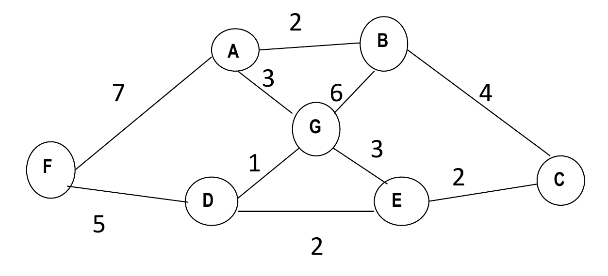{width=60%}

<details class="qa box">
<summary><strong>Concepts: what d means in Prim</strong> <span class="qa-caret" aria-hidden="true"></span></summary>

::: qa-answer
In Prim's algorithm, $v.d$ is the weight of the **cheapest single edge** from $v$ to the tree so far, and $v.\pi$ is the tree vertex at the other end. The update is $v.d = w(u, v)$, not $u.d + w(u, v)$ as in Dijkstra. Each iteration adds the vertex outside the tree with the smallest $d$.
:::

</details>

<details class="qa box">
<summary><strong>Answer</strong> <span class="qa-caret" aria-hidden="true"></span></summary>

::: qa-answer
**After initialization** (the official tables mark G in $S$ from the start):

| | A | B | C | D | E | F | G |
|---|---|---|---|---|---|---|---|
| S | 0 | 0 | 0 | 0 | 0 | 0 | 1 |
| d | ∞ | ∞ | ∞ | ∞ | ∞ | ∞ | 0 |
| pi | null | null | null | null | null | null | null |

**1st iteration:** G's edges update A, B, D and E.

| | A | B | C | D | E | F | G |
|---|---|---|---|---|---|---|---|
| S | 0 | 0 | 0 | 0 | 0 | 0 | 1 |
| d | 3 | 6 | ∞ | 1 | 3 | ∞ | 0 |
| pi | G | G | null | G | G | null | null |

**2nd iteration:** edge GD becomes part of the MST. D's edges: E gets 2 (better than 3), F gets 5.

| | A | B | C | D | E | F | G |
|---|---|---|---|---|---|---|---|
| S | 0 | 0 | 0 | 1 | 0 | 0 | 1 |
| d | 3 | 6 | ∞ | 1 | 2 | 5 | 0 |
| pi | G | G | null | G | D | D | null |

**3rd iteration:** edge DE becomes part of the MST. E's edges: C gets 2.

| | A | B | C | D | E | F | G |
|---|---|---|---|---|---|---|---|
| S | 0 | 0 | 0 | 1 | 1 | 0 | 1 |
| d | 3 | 6 | 2 | 1 | 2 | 5 | 0 |
| pi | G | G | E | G | D | D | null |

**4th iteration:** edge EC becomes part of the MST. C's edges: B gets 4 (better than 6).

| | A | B | C | D | E | F | G |
|---|---|---|---|---|---|---|---|
| S | 0 | 0 | 1 | 1 | 1 | 0 | 1 |
| d | 3 | 4 | 2 | 1 | 2 | 5 | 0 |
| pi | G | C | E | G | D | D | null |

**5th iteration:** edge GA becomes part of the MST. A's edges: B gets 2 (better than 4). F: 7 is not better than 5.

| | A | B | C | D | E | F | G |
|---|---|---|---|---|---|---|---|
| S | 1 | 0 | 1 | 1 | 1 | 0 | 1 |
| d | 3 | 2 | 2 | 1 | 2 | 5 | 0 |
| pi | G | A | E | G | D | D | null |

**6th iteration:** edge AB becomes part of the MST.

| | A | B | C | D | E | F | G |
|---|---|---|---|---|---|---|---|
| S | 1 | 1 | 1 | 1 | 1 | 0 | 1 |
| d | 3 | 2 | 2 | 1 | 2 | 5 | 0 |
| pi | G | A | E | G | D | D | null |

**7th iteration:** edge DF becomes part of the MST.

| | A | B | C | D | E | F | G |
|---|---|---|---|---|---|---|---|
| S | 1 | 1 | 1 | 1 | 1 | 1 | 1 |
| d | 3 | 2 | 2 | 1 | 2 | 5 | 0 |
| pi | G | A | E | G | D | D | null |

The MST edges are GD, DE, EC, GA, AB and DF. The total weight is $1 + 2 + 2 + 3 + 2 + 5 = 15$, the sum of the final $d$ values.
:::

</details>

<details class="qa box">
<summary><strong>General method: trace Prim in a table</strong> <span class="qa-caret" aria-hidden="true"></span></summary>

::: qa-answer
It is Dijkstra's table with one change in the update.

1. Pick the vertex with $S = 0$ and the smallest $d$. Set $S = 1$. The edge $(\pi, v)$ joins the tree.
2. For each neighbour $w$ with $S = 0$: if the **edge weight** $w(v, w)$ is smaller than $w.d$, set $w.d$ to that weight and $w.\pi = v$.
3. The MST weight is the sum of the final $d$ values.
:::

</details>

**Extension 1.1.** Run **Dijkstra's** algorithm from G on the same graph, breaking ties alphabetically. Which edges form the shortest-path tree? Compare its weight with the MST.

<details class="qa box">
<summary><strong>Answer (Extension 1.1)</strong> <span class="qa-caret" aria-hidden="true"></span></summary>

::: qa-answer
* G: A 3, B 6, D 1, E 3.
* D (1): E: $1 + 2 = 3$, not smaller. F: $1 + 5 = 6$.
* A (3, before E by the tie rule): B: $3 + 2 = 5 < 6$, so $\pi(B) = A$. F: 10, no.
* E (3): C: $3 + 2 = 5$.
* B (5, before C): C: 9, no.
* C (5), then F (6).

The shortest-path tree is GD, GA, GE, AB, EC, DF. Its weight is $1 + 3 + 3 + 2 + 2 + 5 = 16$, more than the MST's 15. Dijkstra uses GE, to make E's **distance from G** small. Prim uses DE, the **cheapest edge** that reaches E.
:::

</details>

### Q2. Tracing Kruskal's algorithm with weighted QuickUnion

For the same graph as in Problem 1 above, execute Kruskal's algorithm to find a minimum spanning tree. Use the weighted QuickUnion algorithm shown in lectures for your union-find data structure.

<details class="qa box">
<summary><strong>Concepts: weighted QuickUnion</strong> <span class="qa-caret" aria-hidden="true"></span></summary>

::: qa-answer
* `id[v]` is the **parent** of $v$. A root has `id[r] == r`. `sz[r]` is the size of the tree with root $r$.
* `union(p, q)`: find the root $i$ of $p$ and the root $j$ of $q$. If $i = j$, do nothing. If `sz[i] < sz[j]`, set `id[i] = j`. Otherwise (a tie included), set `id[j] = i`. Then add the sizes at the new root.
* Only a **root** gets a new parent. A non-root never changes.
:::

</details>

<details class="qa box">
<summary><strong>Answer: the official trace</strong> <span class="qa-caret" aria-hidden="true"></span></summary>

::: qa-answer
The edges in increasing weight: GD 1; AB 2, DE 2, EC 2; AG 3, GE 3; BC 4; DF 5; BG 6; AF 7.

The official tables, one per edge examined. Only roots carry a size.

| After | Edge | id (A B C D E F G) | Sizes of roots | Result |
|---|---|---|---|---|
| start | | A B C D E F G | all 1 | |
| 1st | GD (1) | A B C D E F **D** | D 2, others 1 | added |
| 2nd | AB (2) | A **A** C D E F D | A 2, D 2 | added |
| 3rd | DE (2) | A A C D **D** F D | A 2, D 3 | added |
| 4th | EC (2) | A A **E** D D F D | A 2, D 4 | added |
| 5th | AG (3) | **G** A E D D F D | D 6, F 1 | added |
| 6th | GE (3) | G A E D D F D | D 6, F 1 | rejected: cycle |
| 7th | BC (4) | D D D D D F D | D 6, F 1 | rejected: cycle |
| 8th | DF (5) | G A E D D **D** D | D 7 | added |

The MST is GD, AB, DE, EC, AG, DF, with weight $1 + 2 + 2 + 2 + 3 + 5 = 15$, the same as Prim's.
:::

</details>

<details class="qa box">
<summary><strong>Answer: the trace by the lecture code (errors in the official tables)</strong> <span class="qa-caret" aria-hidden="true"></span></summary>

::: qa-answer
The official tables do not follow the lecture's weighted QuickUnion code in three places:

* **4th step (EC):** the official sets `id[C] = E`. But E is not a root. The roots are C (size 1) and D (size 3), so the code hangs the smaller root under the larger: `id[C] = D`.
* **5th step (AG):** the official sets `id[A] = G`. The roots are A (size 2) and D (size 4), so the code sets `id[A] = D`.
* **7th step:** the official table shows D for every vertex except F. Nothing was added, so `id[]` cannot change. That row lists each vertex's **root** (what `find` returns), not the `id` array.

Here is the trace by the lecture code. The union is called with the edge's endpoints in alphabetical order, so the tie rule ("$q$'s root goes under $p$'s root") matches the official first step.

| Edge | Roots found | Action | id (A B C D E F G) | Sizes of roots |
|---|---|---|---|---|
| DG (1) | D, G: tie | `id[G] = D` | A B C D E F D | D 2, others 1 |
| AB (2) | A, B: tie | `id[B] = A` | A A C D E F D | A 2, C 1, D 2, E 1, F 1 |
| DE (2) | D (2), E (1) | `id[E] = D` | A A C D D F D | A 2, C 1, D 3, F 1 |
| CE (2) | C (1), D (3) | `id[C] = D` | A A D D D F D | A 2, D 4, F 1 |
| AG (3) | A (2), D (4) | `id[A] = D` | D A D D D F D | D 6, F 1 |
| EG (3) | D, D | reject | D A D D D F D | D 6, F 1 |
| BC (4) | D (B→A→D), D | reject | D A D D D F D | D 6, F 1 |
| DF (5) | D (6), F (1) | `id[F] = D` | D A D D D D D | D 7 |

The algorithm stops, because it has $|V| - 1 = 6$ edges. The tree is the same as in the official answer. Only the `id` entries of A and C differ.
:::

</details>

<details class="qa box">
<summary><strong>General method: trace Kruskal with union-find</strong> <span class="qa-caret" aria-hidden="true"></span></summary>

::: qa-answer
1. Sort the edges by weight. Fix the order of equal weights (usually alphabetical).
2. For each edge $(v, w)$: climb `id[]` from $v$ to its root, and from $w$ to its root.
3. Same root: reject. The edge would close a cycle.
4. Different roots: union. **Only the roots change.** The smaller tree's root points to the larger tree's root. On a tie, $q$'s root goes under $p$'s root. Add the sizes.
5. Stop after $|V| - 1$ accepted edges.
:::

</details>

**Extension 2.1.** Run the same edge sequence with **plain** QuickUnion: `union(p, q)` sets `id[find(p)] = find(q)`, with no sizes. What is the deepest vertex at the end? Compare with the weighted version.

<details class="qa box">
<summary><strong>Answer (Extension 2.1)</strong> <span class="qa-caret" aria-hidden="true"></span></summary>

::: qa-answer
| Edge | Roots | Action |
|---|---|---|
| DG | D, G | `id[D] = G` |
| AB | A, B | `id[A] = B` |
| DE | G, E | `id[G] = E` |
| CE | C, E | `id[C] = E` |
| AG | B, E | `id[B] = E` |
| EG | E, E | reject |
| BC | E, E | reject |
| DF | E, F | `id[E] = F` |

The final root is F. The path D → G → E → F has depth 3, and so has A → B → E → F. In the weighted version, the deepest vertex is B (B → A → D), at depth 2. Weighting keeps every depth at most $\log_2 N = \log_2 7 \approx 2.8$.
:::

</details>

### Q3. Detecting a cycle with union-find

Design an algorithm using a union-find data structure to determine whether or not an undirected graph $G$ contains a cycle.

<details class="qa box">
<summary><strong>Answer</strong> <span class="qa-caret" aria-hidden="true"></span></summary>

::: qa-answer
The algorithm is as follows:

* Start with every vertex in its own component.
* Process every edge $(u, v)$ one by one.
* If $u$ and $v$ are from different components, then `union(u, v)`.
* Otherwise, return TRUE: $u$ and $v$ are already joined by a path, so the edge closes a cycle.
* After all edges are processed, return FALSE.

**Complexity:** $O(|E| \log^* |V|)$ with weighted QuickUnion and path compression.
:::

</details>

<details class="qa box">
<summary><strong>General method: union-find for "already connected?" questions</strong> <span class="qa-caret" aria-hidden="true"></span></summary>

::: qa-answer
Use union-find when edges arrive one at a time and you must keep asking "are these two already connected?".

* `connected(u, v)` before you add an edge tells you whether the edge closes a cycle.
* Each accepted edge lowers the number of components by exactly one.
* A quick check first: a forest on $|V|$ vertices has at most $|V| - 1$ edges. So if $|E| \ge |V|$, the graph has a cycle, with no work at all.
:::

</details>

**Extension 3.1.** Run the algorithm on the graph with vertices 1 to 5 and the edges (1, 2), (3, 4), (2, 3), (4, 1), (4, 5), in that order. When does it stop, and what does it return?

<details class="qa box">
<summary><strong>Answer (Extension 3.1)</strong> <span class="qa-caret" aria-hidden="true"></span></summary>

::: qa-answer
* (1, 2): different. Union. Components {1, 2}, {3}, {4}, {5}.
* (3, 4): different. Union. {1, 2}, {3, 4}, {5}.
* (2, 3): different. Union. {1, 2, 3, 4}, {5}.
* (4, 1): **same** component. Return TRUE.

The cycle is 1 – 2 – 3 – 4 – 1. The edge (4, 5) is never examined.
:::

</details>

### Q4. Kruskal with small integer weights

Can we improve the runtime of Kruskal's algorithm if we know that the edge weights of the input graph $G = (V, E, W)$ are between 1 and $|V|$? Explain your answer.

<details class="qa box">
<summary><strong>Answer</strong> <span class="qa-caret" aria-hidden="true"></span></summary>

::: qa-answer
**Yes.** The time complexity of Kruskal's algorithm is $O(|E| \log |E| + |V| \log^* |V|)$.

The first term comes from sorting the edge weights with a comparison sort. Since we know they are between 1 and $|V|$, we can use counting sort instead, in $O(|E| + |V|)$ time.

Thus, the running time of Kruskal's algorithm becomes $O(|E| + |V| + |V| \log^* |V|)$, which is asymptotically faster.
:::

</details>

<details class="qa box">
<summary><strong>General method: speed up an algorithm whose bottleneck is a sort</strong> <span class="qa-caret" aria-hidden="true"></span></summary>

::: qa-answer
1. Write the running time as a sum of steps, and find the largest term.
2. If that term is a comparison sort, $\Theta(m \log m)$, look at the keys. Integers in a range $0..k$ allow counting sort, $\Theta(m + k)$. Keys with $d$ digits in base $k$ allow radix sort, $\Theta(d(m + k))$.
3. Recompute the total. The next largest term now dominates.
:::

</details>

**Extension 4.1.** The edge weights are now integers between 1 and $|V|^2$. Is counting sort still a good idea? What can you do instead?

<details class="qa box">
<summary><strong>Answer (Extension 4.1)</strong> <span class="qa-caret" aria-hidden="true"></span></summary>

::: qa-answer
Counting sort would cost $O(|E| + |V|^2)$. For a sparse graph, that is worse than $O(|E| \log |E|)$.

Instead, write each weight $w - 1$ as a two-digit number in base $|V|$: $w - 1 = a \cdot |V| + b$, with $0 \le a, b < |V|$. Radix sort with $d = 2$ and $k = |V|$ sorts the edges in $O(2(|E| + |V|)) = O(|E| + |V|)$. The total stays almost linear.
:::

</details>

---

## Tutorial 8: Solving Recurrences

### Q1. Solving recurrences by iteration

Solve the following recurrences by the iteration method.

(1) $T(1) = 1$, and for $n \ge 2$, $T(n) = 3T(n-1) + 2$.

<details class="qa box">
<summary><strong>Answer (1)</strong> <span class="qa-caret" aria-hidden="true"></span></summary>

::: qa-answer
Expand the recurrence again and again. Each step replaces $T(\cdot)$ by its definition.

$$
\begin{aligned}
T(n) &= 3T(n-1) + 2 \\
&= 3\bigl(3T(n-2) + 2\bigr) + 2 = 3^2 T(n-2) + 3 \cdot 2 + 2 \\
&= 3^2\bigl(3T(n-3) + 2\bigr) + 3 \cdot 2 + 2 = 3^3 T(n-3) + 3^2 \cdot 2 + 3 \cdot 2 + 2
\end{aligned}
$$

After $i$ expansions the pattern is $3^i T(n-i) + 2(3^{i-1} + \dots + 3 + 1)$. The argument reaches the base case $T(1)$ when $n - i = 1$, so $i = n - 1$:

$$
T(n) = 3^{n-1} T(1) + 2\,(3^{n-2} + \dots + 3^2 + 3 + 1)
$$

Put $T(1) = 1$. The bracket is a geometric sum with $n - 1$ terms, and its value is $(3^{n-1} - 1)/(3 - 1)$:

$$
T(n) = 3^{n-1} + 2 \cdot \frac{3^{n-1} - 1}{3 - 1} = 3^{n-1} + 3^{n-1} - 1 = 2 \cdot 3^{n-1} - 1
$$

This is the exact value. Check: $T(2) = 3 \cdot 1 + 2 = 5$, and $2 \cdot 3^1 - 1 = 5$.

Now drop the $-1$, because it only makes the value smaller. Then change the 2 to a 3, because $2 \cdot 3^{n-1} \le 3 \cdot 3^{n-1}$:

$$
T(n) = 2 \cdot 3^{n-1} - 1 \le 2 \cdot 3^{n-1} \le 3^n
$$

So $T(n) = O(3^n)$.
:::

</details>

(2) $T(1) = 1$, and for $n \ge 2$, a power of 2, $T(n) = 2T(n/2) + 6n$.

<details class="qa box">
<summary><strong>Answer (2)</strong> <span class="qa-caret" aria-hidden="true"></span></summary>

::: qa-answer
Expand three times.

$$
\begin{aligned}
T(n) &= 2T(n/2) + 6n \\
&= 2\bigl(2T(n/2^2) + 6(n/2)\bigr) + 6n = 2^2 T(n/2^2) + 6n + 6n \\
&= 2^2\bigl(2T(n/2^3) + 6(n/2^2)\bigr) + 6n + 6n = 2^3 T(n/2^3) + 6n + 6n + 6n
\end{aligned}
$$

Each expansion adds exactly $6n$. The reason: after $i$ expansions there are $2^i$ copies of $T$. Each copy adds $6 \cdot (n/2^i)$ when it expands. So the new cost is $2^i \cdot 6n/2^i = 6n$. The copies double and the sizes halve, and the two changes cancel.

After $k$ expansions, $T(n) = 2^k T(n/2^k) + 6kn$. The size reaches 1 when $n = 2^k$, so $k = \lg n$:

$$
T(n) = 2^k T(1) + 6kn = n + 6n \lg n
$$

Check: $T(2) = 2 \cdot 1 + 12 = 14$, and $2 + 6 \cdot 2 \cdot 1 = 14$.

The $6n \lg n$ term dominates $n$. So $T(n) = O(n \lg n)$.
:::

</details>

<details class="qa box">
<summary><strong>General method: the iteration method</strong> <span class="qa-caret" aria-hidden="true"></span></summary>

::: qa-answer
1. Expand the recurrence 2 or 3 times. Write each line in full, and do not simplify too early.
2. Find the pattern after $i$ expansions. Write the answer as: (number of copies of $T$) $\times$ $T$(smaller input) + (cost added so far).
3. Count the expansions to the base case. For $T(n-1)$ the input shrinks by 1 each time, so $i = n - 1$. For $T(n/2)$ the input halves each time, so $n/2^i = 1$ and $i = \lg n$.
4. Replace $T$(base) by its value and add up the extra costs.
5. Recognise the sum.
    * Same cost each level (here $6n$): cost $\times$ number of levels.
    * Costs that grow by a constant factor ($2 \cdot 3^j$): a **geometric sum**. $1 + r + \dots + r^{m-1} = (r^m - 1)/(r - 1)$. The largest term decides the order.
    * Costs that grow by a constant step ($2n$, $2(n-1)$, ...): an **arithmetic sum**. It gives $n^2$ order.
6. State the exact value if you can. Check it on $T(2)$. Then simplify to a big-O bound.
:::

</details>

**Extension 1.1.** Let $T(1) = 1$ and, for $n \ge 2$, $T(n) = T(n-1) + 2n$. Solve it by the iteration method.

<details class="qa box">
<summary><strong>Answer (Extension 1.1)</strong> <span class="qa-caret" aria-hidden="true"></span></summary>

::: qa-answer
Expand:

$$
T(n) = T(n-1) + 2n = T(n-2) + 2(n-1) + 2n = \dots = T(1) + 2 \cdot 2 + 2 \cdot 3 + \dots + 2n
$$

The input shrinks by 1 each time, so we stop after $n - 1$ expansions. The extra costs are $2 \cdot 2, 2 \cdot 3, \dots, 2n$. This is an arithmetic sum:

$$
T(n) = 1 + 2(2 + 3 + \dots + n) = 1 + 2\left(\frac{n(n+1)}{2} - 1\right) = n^2 + n - 1
$$

Check: $T(2) = 1 + 4 = 5$, and $2^2 + 2 - 1 = 5$. Also $T(3) = 5 + 6 = 11$, and $9 + 3 - 1 = 11$.

So $T(n) = O(n^2)$. In the general method this is step 5, the arithmetic sum.
:::

</details>

**Extension 1.2.** Let $T(1) = 1$ and, for $n \ge 2$ a power of 2, $T(n) = 4T(n/2) + n$. Solve it by the iteration method.

<details class="qa box">
<summary><strong>Answer (Extension 1.2)</strong> <span class="qa-caret" aria-hidden="true"></span></summary>

::: qa-answer
After $i$ expansions there are $4^i$ copies of $T$, each of size $n/2^i$. Each copy adds $n/2^i$ when it expands. So level $i$ adds $4^i \cdot n/2^i = 2^i n$. The costs now grow by a factor of 2 per level, so this is a geometric sum.

$$
T(n) = 4^k T(1) + n(1 + 2 + 4 + \dots + 2^{k-1}), \qquad k = \lg n
$$

Here $4^k = (2^k)^2 = n^2$, and $1 + 2 + \dots + 2^{k-1} = 2^k - 1 = n - 1$. So:

$$
T(n) = n^2 + n(n - 1) = 2n^2 - n
$$

Check: $T(2) = 4 \cdot 1 + 2 = 6$, and $2 \cdot 4 - 2 = 6$.

So $T(n) = O(n^2)$. Compare with Q1 (2): there the level costs were equal, so the answer had a $\lg n$ factor. Here the level costs grow, so the last level wins.
:::

</details>

### Q2. Solving recurrences by substitution

Solve the recurrences in Problem 1 by the substitution method.

(1) $T(1) = 1$, and for $n \ge 2$, $T(n) = 3T(n-1) + 2$.

<details class="qa box">
<summary><strong>Concepts: the substitution method</strong> <span class="qa-caret" aria-hidden="true"></span></summary>

::: qa-answer
* **Substitution** has two steps: guess the bound, then prove it by induction.
* To prove $T(n) \le g(n)$:
    * **Base case:** show it for the smallest $n$.
    * **Inductive step:** assume it for smaller inputs. Put the assumption into the recurrence. Show it for the next input.
* The proof must end with the **same expression** that you assumed. If you assume $T(k) \le g(k)$, you must end with $T(k+1) \le g(k+1)$ exactly. Ending with $g(k+1) + 2$ does not prove it.
:::

</details>

<details class="qa box">
<summary><strong>Answer (1)</strong> <span class="qa-caret" aria-hidden="true"></span></summary>

::: qa-answer
Guess $T(n) = O(3^n)$. We first try to prove $T(n) \le 3^n$ for $n \ge 1$.

* **Base case:** $T(1) = 1 \le 3^1$.
* **Inductive step:** assume $T(k) \le 3^k$. We must show $T(k+1) \le 3^{k+1}$.

$$
T(k+1) = 3T(k) + 2 \le 3 \cdot 3^k + 2 = 3^{k+1} + 2
$$

This proves only $T(k+1) \le 3^{k+1} + 2$, not $T(k+1) \le 3^{k+1}$. The proof fails. The expressions must be the same, so we have to get rid of the "$+2$".

The fix is to prove a stronger claim: $T(n) \le 3^n - 2$ for $n \ge 1$.

* **Base case:** $T(1) = 1 \le 3^1 - 2 = 1$.
* **Inductive step:** assume $T(k) \le 3^k - 2$. We must show $T(k+1) \le 3^{k+1} - 2$.

$$
T(k+1) = 3T(k) + 2 \le 3(3^k - 2) + 2 = 3^{k+1} - 6 + 2 = 3^{k+1} - 4 \le 3^{k+1} - 2
$$

So $T(n) \le 3^n - 2$ for all $n \ge 1$. Thus $T(n) = O(3^n - 2) = O(3^n)$.

Why subtracting 2 works: the recurrence multiplies the assumption by 3, so the "$-2$" becomes "$-6$". The "$+2$" in the recurrence then cancels only part of it, and "$-4$" is left, which is below the target "$-2$". A plain $3^n$ has no room to absorb the extra 2.
:::

</details>

(2) $T(1) = 1$, and for $n \ge 2$, a power of 2, $T(n) = 2T(n/2) + 6n$.

<details class="qa box">
<summary><strong>Answer (2)</strong> <span class="qa-caret" aria-hidden="true"></span></summary>

::: qa-answer
Guess $T(n) = O(n \lg n)$. We try $c = 1$ for simplicity: prove $T(n) \le n \lg n$. We start at $n = 2$, not $n = 1$, because $\lg 1 = 0$ and $T(1) = 1 > 0$.

**Base case with $c = 1$.** $T(2) = 2 \cdot 1 + 6 \cdot 2 = 14$, but $n \lg n = 2 \lg 2 = 2$. So $T(2) \le 2\lg 2$ is false. The constant $c = 1$ is too small. We try $c = 8$ instead, and prove $T(n) \le 8 n \lg n$ for $n \ge 2$.

**Base case with $c = 8$.** $T(2) = 14$, and $8 \cdot 2 \lg 2 = 16$. So $T(2) \le 16$ holds.

**Inductive step.** Write $n = 2^k$ with $k \ge 1$. Assume $T(2^k) \le 8k \cdot 2^k$. We must show $T(2^{k+1}) \le 8(k+1) \cdot 2^{k+1}$.

$$
\begin{aligned}
T(2^{k+1}) &= 2T(2^k) + 6 \cdot 2^{k+1} \\
&\le 2 \cdot 8k \cdot 2^k + 6 \cdot 2^{k+1} \\
&= 8k \cdot 2^{k+1} + 6 \cdot 2^{k+1} \\
&= (8k + 6) \cdot 2^{k+1} \\
&\le 8(k+1) \cdot 2^{k+1}
\end{aligned}
$$

The last step holds because $8k + 6 \le 8k + 8$. So $T(n) \le 8n \lg n$ for $n \ge 2$, and $T(n) = O(n \lg n)$.

A note on $c$ *(new)*: the base case is not the only problem with $c = 1$. The step would give $(k + 6) 2^{k+1}$, which is larger than $(k+1) 2^{k+1}$. With $c = 8$ the factor 8 on $k$ leaves room: $8k + 6 \le 8k + 8$.
:::

</details>

<details class="qa box">
<summary><strong>General method: the substitution method</strong> <span class="qa-caret" aria-hidden="true"></span></summary>

::: qa-answer
1. **Guess** the bound. Use the iteration method, a recursion tree or the master method to get the guess.
2. **State** what you prove, with a constant: $T(n) \le c \cdot g(n)$ for $n \ge n_0$.
3. **Base case.** Pick $n_0$ so that $g(n_0) > 0$. Check the base value. If it fails, make $c$ bigger.
4. **Inductive step.** Assume the claim for $k$ (or $n/2$). Put it into the recurrence. Show the claim for the next input.
5. **End with the same expression** that you assumed. Do not accept "$g$ + something".
6. If you are off by a **lower-order term** (a constant, or $n$), prove a stronger claim: subtract that term. Use $T(n) \le g(n) - d$ (or $g(n) - dn$). The subtracted term is multiplied by the recurrence, and that creates the room you need.
7. If the base case fails, **move the base case** (use $n_0 = 2$) or increase $c$. Only the inequality for large $n$ matters.
:::

</details>

**Extension 2.1.** Let $T(1) = 1$ and, for $n \ge 2$ a power of 2, $T(n) = 4T(n/2) + n$. Prove $T(n) = O(n^2)$ by the substitution method.

<details class="qa box">
<summary><strong>Answer (Extension 2.1)</strong> <span class="qa-caret" aria-hidden="true"></span></summary>

::: qa-answer
**First try: $T(n) \le cn^2$.** Assume $T(n/2) \le c(n/2)^2$. Then

$$
T(n) = 4T(n/2) + n \le 4c(n/2)^2 + n = cn^2 + n
$$

We reach $cn^2 + n$, not $cn^2$. The proof fails. The recurrence leaves an extra $n$, and no choice of $c$ removes it.

**Fix: subtract a lower-order term.** Prove $T(n) \le cn^2 - dn$ for $n \ge 1$.

* **Inductive step.** Assume $T(n/2) \le c(n/2)^2 - d(n/2)$. Then
$$
T(n) \le 4\left(c\frac{n^2}{4} - d\frac{n}{2}\right) + n = cn^2 - 2dn + n = cn^2 - dn - (d - 1)n
$$
This is at most $cn^2 - dn$ when $d \ge 1$. Take $d = 1$.
* **Base case.** $T(1) = 1 \le c \cdot 1 - d \cdot 1 = c - 1$. This needs $c \ge 2$. Take $c = 2$.

So $T(n) \le 2n^2 - n$ for all powers of 2, and $T(n) = O(n^2)$. This matches the exact value $2n^2 - n$ from Extension 1.2. The "$-dn$" trick of the general method (step 6) found it.
:::

</details>

### Q3. Solving recurrences by the master method

Solve the following recurrences by the master method.

(1) $W(n) = W(n/3) + 5$

<details class="qa box">
<summary><strong>Concepts: the master theorem</strong> <span class="qa-caret" aria-hidden="true"></span></summary>

::: qa-answer
For $T(n) = aT(n/b) + f(n)$ with $a \ge 1$ and $b > 1$, compare $f(n)$ with $n^{\log_b a}$.

* **Case 1:** $f(n) = O(n^{\log_b a - \varepsilon})$ for some $\varepsilon > 0$ ($f$ is polynomially smaller). Then $T(n) = \Theta(n^{\log_b a})$.
* **Case 2:** $f(n) = \Theta(n^{\log_b a})$ (a tie). Then $T(n) = \Theta(n^{\log_b a} \lg n)$.
* **Case 3:** $f(n) = \Omega(n^{\log_b a + \varepsilon})$ for some $\varepsilon > 0$ ($f$ is polynomially larger), **and** $a f(n/b) \le c f(n)$ for some $c < 1$ (regularity). Then $T(n) = \Theta(f(n))$.
:::

</details>

<details class="qa box">
<summary><strong>Answer (1)</strong> <span class="qa-caret" aria-hidden="true"></span></summary>

::: qa-answer
Here $a = 1$, $b = 3$ and $f(n) = 5$.

$n^{\log_b a} = n^{\log_3 1} = n^0 = 1$, and $f(n) = 5 = \Theta(1) = \Theta(n^0)$.

$f$ and $n^{\log_b a}$ have the same order. This is **case 2**:

$$
W(n) = \Theta(n^0 \lg n) = \Theta(\lg n)
$$
:::

</details>

(2) $T(n) = 2T(n/2) + n/4$

<details class="qa box">
<summary><strong>Answer (2)</strong> <span class="qa-caret" aria-hidden="true"></span></summary>

::: qa-answer
Here $a = 2$, $b = 2$ and $f(n) = n/4$.

$n^{\log_b a} = n^{\log_2 2} = n^1$, and $f(n) = n/4 = \Theta(n) = \Theta(n^1)$. The constant $1/4$ does not change the order.

This is **case 2**:

$$
T(n) = \Theta(n \lg n)
$$
:::

</details>

(3) $W(n) = 2W(n/4) + \sqrt{n^3}$

<details class="qa box">
<summary><strong>Answer (3)</strong> <span class="qa-caret" aria-hidden="true"></span></summary>

::: qa-answer
Here $a = 2$, $b = 4$ and $f(n) = \sqrt{n^3} = n^{3/2}$.

$n^{\log_b a} = n^{\log_4 2} = n^{0.5}$. We have $f(n) = n^{3/2} = n^{0.5 + 1} = \Omega(n^{0.5 + 1})$. So $f$ is polynomially larger, with $\varepsilon = 1$. This points to **case 3**.

Case 3 also needs the regularity condition. Check $a f(n/b) \le c f(n)$ with $c < 1$:

$$
2f(n/4) = 2\left(\frac{n}{4}\right)^{3/2} = 2 \cdot n^{3/2} \cdot \left(\frac14\right)^{3/2} = 2 \cdot n^{3/2} \cdot \frac18 = \frac14 n^{3/2}
$$

So $2f(n/4) = \frac14 f(n) \le c f(n)$ with $c = 1/4 < 1$. The condition holds. By case 3:

$$
W(n) = \Theta(f(n)) = \Theta(n^{1.5})
$$
:::

</details>

<details class="qa box">
<summary><strong>General method: the master method</strong> <span class="qa-caret" aria-hidden="true"></span></summary>

::: qa-answer
1. Read $a$ (the number of subproblems), $b$ (the shrink factor) and $f(n)$ (the cost outside the recursive calls). Write $f$ as a power of $n$ (for example $\sqrt{n^3} = n^{1.5}$).
2. Compute the critical exponent $\log_b a$. Then $n^{\log_b a}$ is the cost of the leaves. Note that $a = 1$ gives $n^0 = 1$.
3. Compare $f(n)$ with $n^{\log_b a}$.
    * Smaller by a polynomial factor $n^\varepsilon$: **case 1**, answer $\Theta(n^{\log_b a})$.
    * Same order: **case 2**, answer $\Theta(n^{\log_b a} \lg n)$. Constants such as $1/4$ or $5$ do not matter.
    * Larger by a polynomial factor: **case 3**, answer $\Theta(f(n))$, but only if regularity holds.
4. For case 3, compute $a f(n/b)$ and compare it with $f(n)$. You need a constant $c < 1$ with $a f(n/b) \le c f(n)$. For $f(n) = n^p$ the ratio is $a/b^p$, so the check is $a < b^p$.
5. If $f$ is only a log factor away (for example $n \lg n$ against $n$), no basic case applies. Use the general case 2 when $f = \Theta(n^{\log_b a} \lg^k n)$ with $k \ge 0$. Otherwise the master theorem does not apply.
:::

</details>

**Extension 3.1.** Solve $W(n) = 9W(n/3) + n$ by the master method.

<details class="qa box">
<summary><strong>Answer (Extension 3.1)</strong> <span class="qa-caret" aria-hidden="true"></span></summary>

::: qa-answer
Here $a = 9$, $b = 3$ and $f(n) = n$.

$n^{\log_3 9} = n^2$. We have $f(n) = n = O(n^{2 - 1})$. So $f$ is polynomially smaller, with $\varepsilon = 1$. This is **case 1**:

$$
W(n) = \Theta(n^2)
$$

No regularity check is needed in case 1.
:::

</details>

**Extension 3.2.** Solve $W(n) = 2W(n/2) + n \lg n$ by the master method.

<details class="qa box">
<summary><strong>Answer (Extension 3.2)</strong> <span class="qa-caret" aria-hidden="true"></span></summary>

::: qa-answer
Here $a = 2$, $b = 2$ and $f(n) = n \lg n$.

$n^{\log_2 2} = n$. Now $f(n)$ is larger than $n$, but only by a factor $\lg n$. That is not a polynomial factor, so case 3 does not apply. Write $f(n) = \Theta(n^1 \lg^1 n)$. This is the **general case 2** with $k = 1$:

$$
W(n) = \Theta(n^{\log_b a} \lg^{k+1} n) = \Theta(n \lg^2 n)
$$
:::

</details>

### Q4. Linear homogeneous recurrences with constant coefficients

Determine which of the following are linear homogeneous recurrence relations with constant coefficients. Also find the degree of those that are.

<details class="qa box">
<summary><strong>Concepts: what the words mean</strong> <span class="qa-caret" aria-hidden="true"></span></summary>

::: qa-answer
A recurrence is a **linear homogeneous recurrence relation with constant coefficients** if it has the form

$$
a_n = c_1 a_{n-1} + c_2 a_{n-2} + \dots + c_d a_{n-d}
$$

where $c_1, \dots, c_d$ are constants and $c_d \ne 0$.

* **Linear:** each $a_{n-i}$ appears to the power 1, alone, and is not multiplied by another $a$.
* **Homogeneous:** there is no extra term that lacks an $a$ (no $+n$, no $+5$).
* **Constant coefficients:** each $c_i$ is a number, not a function of $n$.
* **Degree** $d$: how far back the furthest term reaches.
:::

</details>

(1) $a_n = 4a_{n-2} + 5a_{n-3}$

<details class="qa box">
<summary><strong>Answer (1)</strong> <span class="qa-caret" aria-hidden="true"></span></summary>

::: qa-answer
Yes. The coefficients 4 and 5 are constants. The furthest term is $a_{n-3}$, so the degree is **3**. (The missing $a_{n-1}$ term just has coefficient 0.)
:::

</details>

(2) $a_n = 2n a_{n-1} + a_{n-2}$

<details class="qa box">
<summary><strong>Answer (2)</strong> <span class="qa-caret" aria-hidden="true"></span></summary>

::: qa-answer
No. The coefficient $2n$ changes with $n$. It is **not constant coefficient**.
:::

</details>

(3) $a_n = a_{n-1} + a_{n-4}$

<details class="qa box">
<summary><strong>Answer (3)</strong> <span class="qa-caret" aria-hidden="true"></span></summary>

::: qa-answer
Yes. The coefficients are both 1. The furthest term is $a_{n-4}$, so the degree is **4**.
:::

</details>

(4) $a_n = a_{n-1}^2 + a_{n-2}$

<details class="qa box">
<summary><strong>Answer (4)</strong> <span class="qa-caret" aria-hidden="true"></span></summary>

::: qa-answer
No. The term $a_{n-1}^2$ is squared. It is **not linear**.
:::

</details>

(5) $a_n = a_{n-2} + n$

<details class="qa box">
<summary><strong>Answer (5)</strong> <span class="qa-caret" aria-hidden="true"></span></summary>

::: qa-answer
No. The term $n$ does not contain any $a$. It is **not homogeneous**.
:::

</details>

<details class="qa box">
<summary><strong>General method: the four checks</strong> <span class="qa-caret" aria-hidden="true"></span></summary>

::: qa-answer
Look at the right side of the recurrence, term by term.

1. **Linear?** Every $a_{n-i}$ is to the power 1 and is not multiplied by another $a$ (no $a_{n-1}^2$, no $a_{n-1} a_{n-2}$).
2. **Homogeneous?** Every term has an $a$ in it. A lone $n$, constant or $2^n$ breaks it.
3. **Constant coefficients?** Each multiplier is a plain number. A multiplier that holds $n$ (such as $2n$ or $(-1)^n$) breaks it.
4. **Degree:** if all three checks pass, the degree is the largest $i$ in $a_{n-i}$.

Only a recurrence that passes all three can be solved with the characteristic equation (Q5).
:::

</details>

**Extension 4.1.** Classify each recurrence. Give the degree if it qualifies, and the failed check if it does not.

(a) $a_n = a_{n-5}$  (b) $a_n = 0.5a_{n-1} - a_{n-2}$  (c) $a_n = a_{n-1} + 1$  (d) $a_n = (-1)^n a_{n-1}$

<details class="qa box">
<summary><strong>Answer (Extension 4.1)</strong> <span class="qa-caret" aria-hidden="true"></span></summary>

::: qa-answer
* (a) Yes. The only coefficient is 1. The furthest term is $a_{n-5}$, so the degree is **5**.
* (b) Yes. The coefficients $0.5$ and $-1$ are constants. The degree is **2**. A negative or fractional coefficient is fine.
* (c) No. The "$+1$" is a term without an $a$. It is **not homogeneous** (check 2).
* (d) No. The coefficient $(-1)^n$ changes with $n$. It is **not constant coefficient** (check 3).
:::

</details>

### Q5. Solving linear homogeneous recurrences

Solve the following recurrence relations together with the initial conditions given.

(1) $a_n = 7a_{n-1} - 10a_{n-2}$ for $n \ge 2$, $a_0 = 1$, $a_1 = 0$

<details class="qa box">
<summary><strong>Concepts: the characteristic equation</strong> <span class="qa-caret" aria-hidden="true"></span></summary>

::: qa-answer
* For $a_n = c_1 a_{n-1} + c_2 a_{n-2}$, try $a_n = t^n$. This gives $t^n = c_1 t^{n-1} + c_2 t^{n-2}$. Divide by $t^{n-2}$ to get the **characteristic equation**: $t^2 - c_1 t - c_2 = 0$.
* **Two distinct roots** $t_1, t_2$: the general solution is $a_n = C t_1^n + D t_2^n$.
* **One repeated root** $t$: the general solution is $a_n = (C + nD) t^n$.
* The two constants $C$ and $D$ come from the two initial conditions $a_0$ and $a_1$.
:::

</details>

<details class="qa box">
<summary><strong>Answer (1)</strong> <span class="qa-caret" aria-hidden="true"></span></summary>

::: qa-answer
The characteristic equation is $t^2 - 7t + 10 = 0$, so $(t - 2)(t - 5) = 0$.

There are two distinct roots: $t_1 = 2$ and $t_2 = 5$. So $a_n = C \cdot 2^n + D \cdot 5^n$.

Put in the initial conditions to find $C$ and $D$.

* $a_0 = 1$: $C + D = 1$. Multiply by 2: $2C + 2D = 2$.
* $a_1 = 0$: $2C + 5D = 0$.

Subtract the second equation from the first: $-3D = 2$, so $D = -2/3$. Then $C = 1 - D = 5/3$.

$$
a_n = \frac53 \cdot 2^n - \frac23 \cdot 5^n
$$

Check: from the recurrence, $a_2 = 7 \cdot 0 - 10 \cdot 1 = -10$. From the formula, $\frac53 \cdot 4 - \frac23 \cdot 25 = \frac{20 - 50}{3} = -10$.
:::

</details>

(2) $a_n = 4a_{n-2}$ for $n \ge 2$, $a_0 = 6$, $a_1 = 8$

<details class="qa box">
<summary><strong>Answer (2)</strong> <span class="qa-caret" aria-hidden="true"></span></summary>

::: qa-answer
The characteristic equation is $t^2 - 4 = 0$, so $t^2 = 4$.

There are two distinct roots: $t_1 = 2$ and $t_2 = -2$. So $a_n = C \cdot 2^n + D \cdot (-2)^n$.

* $a_0 = 6$: $C + D = 6$. Multiply by 2: $2C + 2D = 12$.
* $a_1 = 8$: $2C - 2D = 8$.

Add the two equations: $4C = 20$, so $C = 5$. Then $D = 6 - 5 = 1$.

$$
a_n = 5 \cdot 2^n + (-2)^n
$$

Check: from the recurrence, $a_2 = 4 \cdot 6 = 24$. From the formula, $5 \cdot 4 + 4 = 24$.
:::

</details>

(3) $a_n = 2a_{n-1} - a_{n-2}$ for all $n \ge 2$, $a_0 = 1$, $a_1 = 3$

<details class="qa box">
<summary><strong>Answer (3)</strong> <span class="qa-caret" aria-hidden="true"></span></summary>

::: qa-answer
The characteristic equation is $t^2 - 2t + 1 = 0$, so $(t - 1)^2 = 0$.

There is a single (repeated) root: $t = 1$. So $a_n = (C + nD) \cdot 1^n = C + nD$.

* $a_0 = 1$: $C = 1$.
* $a_1 = 3$: $C + D = 3$, so $D = 2$.

$$
a_n = 1 + 2n
$$

Check: from the recurrence, $a_2 = 2 \cdot 3 - 1 = 5$. From the formula, $1 + 2 \cdot 2 = 5$.
:::

</details>

<details class="qa box">
<summary><strong>General method: the characteristic equation</strong> <span class="qa-caret" aria-hidden="true"></span></summary>

::: qa-answer
1. Check the recurrence is linear, homogeneous, with constant coefficients (Q4).
2. Write the characteristic equation: replace $a_{n-i}$ by $t^{d-i}$ and move everything to the left. For $a_n = c_1 a_{n-1} + c_2 a_{n-2}$ it is $t^2 - c_1 t - c_2 = 0$.
3. Find the roots. Factor, or use the quadratic formula.
4. Write the general solution.
    * Distinct roots $t_1, t_2$: $a_n = C t_1^n + D t_2^n$.
    * A repeated root $t$: $a_n = (C + nD) t^n$. The extra factor $n$ gives the second independent solution *(new)*: without it, there is only one constant and two initial conditions cannot be met.
5. Put $n = 0$ and $n = 1$ into the general solution. Set them equal to $a_0$ and $a_1$. Solve the two equations for $C$ and $D$.
6. Check on $a_2$: compute it from the recurrence and from the formula. The two must agree.
:::

</details>

**Extension 5.1.** Solve $a_n = 6a_{n-1} - 9a_{n-2}$ for $n \ge 2$, with $a_0 = 1$ and $a_1 = 6$.

<details class="qa box">
<summary><strong>Answer (Extension 5.1)</strong> <span class="qa-caret" aria-hidden="true"></span></summary>

::: qa-answer
The characteristic equation is $t^2 - 6t + 9 = 0$, so $(t - 3)^2 = 0$. There is a repeated root $t = 3$. So $a_n = (C + nD) \cdot 3^n$.

* $a_0 = 1$: $C = 1$.
* $a_1 = 6$: $(C + D) \cdot 3 = 6$, so $C + D = 2$ and $D = 1$.

$$
a_n = (1 + n) \cdot 3^n
$$

Check: from the recurrence, $a_2 = 6 \cdot 6 - 9 \cdot 1 = 27$. From the formula, $(1 + 2) \cdot 9 = 27$.

This is the repeated-root case of Q5 (3), with a root other than 1. Note that the root multiplies the whole bracket: $(C + nD) \cdot 3^n$, not $C + nD \cdot 3^n$.
:::

</details>


---

## Tutorial 9: Amortized Analysis

### Q1. A counter with DECREMENT

Show that if a DECREMENT operation were included in the k-bit counter example, n operations could cost as much as O(nk) time.

<details class="qa box">
<summary><strong>Concepts: what a counter operation costs</strong> <span class="qa-caret" aria-hidden="true"></span></summary>

::: qa-answer
* A **k-bit counter** is an array of $k$ bits. The cost of an operation is the number of bits it flips.
* **INCREMENT** flips the trailing 1s to 0, then flips one 0 to 1. Adding 1 to `0111` gives `1000`: 4 flips.
* **DECREMENT** does the reverse. It flips the trailing 0s to 1, then flips one 1 to 0. Subtracting 1 from `1000` gives `0111`: 4 flips.
* Without DECREMENT, the lecture proves that $n$ INCREMENTs cost $O(n)$ in total. A long carry always leaves many trailing 0s, so the next INCREMENTs are cheap. The proof depends on that.
:::

</details>

<details class="qa box">
<summary><strong>Answer</strong> <span class="qa-caret" aria-hidden="true"></span></summary>

::: qa-answer
Start the counter at $0111\ldots1$: a 0, then $k-1$ ones ($k$ bits). Then do INCREMENT, DECREMENT, INCREMENT, DECREMENT, and so on. This is $n/2$ pairs of INCREMENT and DECREMENT.

* INCREMENT turns $0111\ldots1$ into $1000\ldots0$. All $k$ bits flip.
* DECREMENT turns $1000\ldots0$ back into $0111\ldots1$. All $k$ bits flip again.
* The counter is back in its start state, so the next pair costs the same.

Every operation takes $k$ flips, which is $O(k)$. There are $n$ operations. The total is $n \cdot k = O(nk)$.

So with DECREMENT, the average cost per operation can still be $\Theta(k)$: the amortized cost is no better than the worst case.
:::

</details>

<details class="qa box">
<summary><strong>General method: can a new operation break an amortized bound?</strong> <span class="qa-caret" aria-hidden="true"></span></summary>

::: qa-answer
1. Find the **expensive state** of the structure. Here it is $0111\ldots1$ (a long carry for INCREMENT).
2. Ask: after the expensive operation, is the structure still in an expensive state? If the new operation can push it back, the cheap operations that "paid" for the expensive one never happen.
3. Build a sequence that alternates the two operations. Each one costs the worst case. Add up: $n \times \text{worst case}$.
4. One such sequence is enough to show that the amortized bound is lost.
:::

</details>

**Extension 1.1.** Add DECREMENT to the counter. Try the potential $\Phi$ = number of 1s in the counter, which proves $O(1)$ per INCREMENT. Show that it fails for DECREMENT. Take DECREMENT on $1000\ldots0$ ($k$ bits).

<details class="qa box">
<summary><strong>Answer (Extension 1.1)</strong> <span class="qa-caret" aria-hidden="true"></span></summary>

::: qa-answer
* Before: $1000\ldots0$ has one 1. $\Phi_{\text{before}} = 1$.
* After: $0111\ldots1$ has $k-1$ ones. $\Phi_{\text{after}} = k-1$.
* Actual cost: all $k$ bits flip, so $k$.
* Amortized cost $= k + (k-1) - 1 = 2k - 2$.

For this operation the amortized cost is $\Theta(k)$, not $O(1)$. Here $\Phi$ goes **up** by $k-2$ after an expensive operation. A good potential does the reverse: it drops when an operation is expensive, and pays for it. The number of 1s cannot do that for DECREMENT, because DECREMENT turns 0s into 1s. This matches Q1: no potential can fix it, because the sequence in Q1 really costs $\Theta(nk)$.
:::

</details>

### Q2. Aggregate analysis: power-of-2 costs

Suppose we perform a sequence of n operations on a data structure in which the i-th operation costs i if i is an exact power of 2, and 1 otherwise. Use aggregate analysis to determine the amortized cost per operation.

<details class="qa box">
<summary><strong>Concepts: aggregate analysis</strong> <span class="qa-caret" aria-hidden="true"></span></summary>

::: qa-answer
* **Aggregate analysis** finds the worst-case **total** cost $T(n)$ of any sequence of $n$ operations. The amortized cost per operation is $T(n)/n$.
* Every operation gets the same amortized cost, even if some are cheap and some are expensive.
* Here the costs are given for each $i$, so you can add them up directly.
:::

</details>

<details class="qa box">
<summary><strong>Answer</strong> <span class="qa-caret" aria-hidden="true"></span></summary>

::: qa-answer
Take $n = 2^k$. The costs are:

$$1 + 2 + 1 + 4 + 1 + 1 + 1 + 8 + \cdots + 2^k$$

Split the operations into two groups.

* **Powers of 2.** Operation $i = 2^j$ costs $2^j$. The sum is $\sum 2^j = 2^{k+1} - 1$.
* **All others.** Each costs 1. There are about $2^k - k$ of them.

The official answer adds the two groups:

$$T(n) = 2^{k+1} - 1 + (2^k - k) = 3 \cdot 2^k - k - 1 < 3 \cdot 2^k = 3n$$

So the amortized cost per operation is $T(n)/n < 3$, that is $O(1)$.

**Small error in the official slide.** The powers of 2 up to $2^k$ are $2^0, 2^1, \ldots, 2^k$. That is $k+1$ values, and their sum is $2^{k+1} - 1$. So the other operations number $2^k - (k+1)$, not $2^k - k$. The exact total is

$$2^{k+1} - 1 + 2^k - (k+1) = 3 \cdot 2^k - k - 2.$$

Check with $n = 8$ ($k = 3$): $1+2+1+4+1+1+1+8 = 19$. The exact formula gives $24 - 3 - 2 = 19$. The slide formula gives 20. (The slide also writes the sum as $\sum_{i=1}^{k} 2^k$, which should read $\sum_{i=0}^{k} 2^i$.) The conclusion does not change: $T(n) < 3n$, so $O(1)$.

For $n$ that is not a power of 2, let $2^k$ be the largest power of 2 not above $n$. Then $T(n) < 3 \cdot 2^k \le 3n$. The same bound holds.
:::

</details>

<details class="qa box">
<summary><strong>General method: aggregate analysis recipe</strong> <span class="qa-caret" aria-hidden="true"></span></summary>

::: qa-answer
1. Split the $n$ operations into **cheap** (cost $O(1)$) and **expensive** ones.
2. Count the cheap ones. The count is at most $n$, and each costs 1, so they add at most $n$.
3. List the costs of the expensive ones. They usually grow by a constant factor each time, so they form a **geometric series**. A geometric series is dominated by its last term: $1 + 2 + 4 + \cdots + 2^k < 2 \cdot 2^k$.
4. Add the totals, bound by $c \cdot n$, and divide by $n$.
5. The answer is a constant if the last (largest) term is at most $n$. *(new)*
:::

</details>

**Extension 2.1.** The i-th operation costs i if i is an exact power of 3, and 1 otherwise. Use aggregate analysis to find the amortized cost per operation.

<details class="qa box">
<summary><strong>Answer (Extension 2.1)</strong> <span class="qa-caret" aria-hidden="true"></span></summary>

::: qa-answer
Let $3^j$ be the largest power of 3 not above $n$. So $3^j \le n$.

* **Powers of 3.** The costs are $3^0, 3^1, \ldots, 3^j$. The sum is $\dfrac{3^{j+1} - 1}{2} < \dfrac{3 \cdot 3^j}{2} = 1.5 \cdot 3^j \le 1.5n$.
* **All others.** At most $n$ operations, each cost 1. They add at most $n$.

Total: $T(n) < 1.5n + n = 2.5n$. The amortized cost per operation is $T(n)/n < 2.5 = O(1)$.

Check with $n = 9$: costs $1, 1, 3, 1, 1, 1, 1, 1, 9$ (operations 1, 3 and 9 are powers of 3). The total is 19, and $2.5 \times 9 = 22.5 > 19$.
:::

</details>

### Q3. A potential function for a min-heap

Consider an ordinary binary min-heap data structure with n elements supporting the instructions INSERT and EXTRACT-MIN in O(log n) worst-case time. Give a potential function Φ such that the amortized cost of INSERT is O(log n) and the amortized cost of EXTRACT-MIN is O(1), and show that it works. Does this have any effect on the running time analysis of Heapsort?

<details class="qa box">
<summary><strong>Concepts: the potential method</strong> <span class="qa-caret" aria-hidden="true"></span></summary>

::: qa-answer
* A **potential function** $\Phi$ maps the state of the structure to a number. It is stored "credit".
* The **amortized cost** of an operation is
$$\hat{c} = c_{\text{actual}} + \Phi_{\text{after}} - \Phi_{\text{before}}.$$
* Add up over $n$ operations: $\sum \hat{c} = \sum c_{\text{actual}} + \Phi_{\text{final}} - \Phi_{\text{initial}}$. If $\Phi_{\text{final}} \ge \Phi_{\text{initial}}$, the amortized total is an upper bound for the actual total.
* A **min-heap** keeps the smallest key at the root. INSERT adds a key at the bottom and moves it up. EXTRACT-MIN removes the root and moves the last key down from the root. Both take $O(\log n)$ in the worst case.
:::

</details>

<details class="qa box">
<summary><strong>Answer</strong> <span class="qa-caret" aria-hidden="true"></span></summary>

::: qa-answer
**The potential.** Let $n$ be the number of elements in the heap. Define

$$\Phi = c \cdot n \log n,$$

where $c$ is a constant to choose. An empty heap has $\Phi = 0$, and $\Phi \ge 0$ always.

**INSERT.** $n$ becomes $n+1$.

* Actual cost: $O(\log n)$.
* Change of potential: $\Delta\Phi = c\big((n+1)\log(n+1) - n\log n\big) = c\big(n \log\tfrac{n+1}{n} + \log(n+1)\big)$. The first term is at most $c \log e$, a constant, because $\log(1 + 1/n) \le \log e / n$. So $\Delta\Phi = O(\log n)$.
* Amortized cost: $O(\log n) + O(\log n) = O(\log n)$.

**EXTRACT-MIN.** $n$ becomes $n-1$.

* Actual cost: at most $a \log n + b$, for constants $a$ and $b$.
* Change of potential: $\Delta\Phi = c\big((n-1)\log(n-1) - n\log n\big)$. Since $\log(n-1) \le \log n$, we get $(n-1)\log(n-1) \le (n-1)\log n$. So $\Delta\Phi \le c\big((n-1)\log n - n \log n\big) = -c\log n$.
* Amortized cost: $\le a\log n + b - c\log n$. Choose $c \ge a$. Then the amortized cost is at most $b = O(1)$.

So INSERT is $O(\log n)$ and EXTRACT-MIN is $O(1)$.

**Heapsort.** Heapsort builds a heap, then does $n$ EXTRACT-MINs. Each has amortized cost $O(1)$. It looks as if the extraction phase costs only $O(n)$. That is wrong. The potential $c\,n\log n$ has to come from earlier INSERTs. Heapsort builds the heap **without INSERTs**, so no one paid for the potential. The heap starts with $\Phi_{\text{initial}} = c\,n\log n$ and drains to $\Phi_{\text{final}} = 0$. Use the sum rule:

$$\sum c_{\text{actual}} = \sum \hat{c} + \Phi_{\text{initial}} - \Phi_{\text{final}} = O(n) + c\,n\log n = O(n\log n).$$

So the **running time of Heapsort stays $O(n \log n)$**. The potential function has no effect on the analysis.
:::

</details>

<details class="qa box">
<summary><strong>General method: choose a potential function</strong> <span class="qa-caret" aria-hidden="true"></span></summary>

::: qa-answer
1. **Find the expensive operation** and what makes it expensive. Here, EXTRACT-MIN costs $\log n$, so the potential must fall by about $\log n$ at each extraction.
2. **Make $\Phi$ high just before an expensive operation** and low just after it. $\Phi = c\,n\log n$ falls by about $c \log n$ when one element leaves. The cheap operation (INSERT) must raise $\Phi$ by about the same amount, and that is what it can afford.
3. **Keep $\Phi \ge \Phi_{\text{initial}}$ always.** Here $\Phi \ge 0 = \Phi_{\text{initial}}$ for an empty heap. Then the amortized total is an upper bound on the actual total.
4. **Compute $\Delta\Phi = \Phi_{\text{after}} - \Phi_{\text{before}}$** (after minus before, never the reverse) for each operation. Bound it: a clean inequality such as $(n-1)\log(n-1) \le (n-1)\log n$ is enough. *(new)*
5. **Choose the constant** ($c$ here) so that the potential drop cancels the actual cost.
6. **If an algorithm starts with $\Phi > 0$** (as Heapsort does), add $\Phi_{\text{initial}} - \Phi_{\text{final}}$ back to the amortized total to get the actual total.
:::

</details>

**Extension 3.1.** Start from an empty heap. Do $n$ INSERTs, then $n$ EXTRACT-MINs. Use the potential from Q3 to bound the total actual cost. Is it consistent with a direct count?

<details class="qa box">
<summary><strong>Answer (Extension 3.1)</strong> <span class="qa-caret" aria-hidden="true"></span></summary>

::: qa-answer
* $n$ INSERTs: $n \cdot O(\log n) = O(n\log n)$ amortized.
* $n$ EXTRACT-MINs: $n \cdot O(1) = O(n)$ amortized.
* Amortized total: $O(n\log n)$. The heap starts and ends empty, so $\Phi_{\text{initial}} = \Phi_{\text{final}} = 0$. The actual total equals the amortized total, so it is also $O(n \log n)$.

Direct count: each of the $2n$ operations costs $O(\log n)$ at worst, so the total is $O(n\log n)$. The two answers agree.

The difference from Heapsort: here the INSERTs build up the potential, so the EXTRACT-MINs use credit that was really paid. *(new)*
:::

</details>

### Q4. Contracting a table by 2/3

Suppose that instead of contracting a table by halving its size when its load factor drops below 1/4, we contract it by multiplying its size by 2/3 when its load factor drops below 1/3. Show that the amortized cost of a DELETE operation that uses this strategy is bounded above by a constant.

<details class="qa box">
<summary><strong>Concepts: dynamic tables and load factor</strong> <span class="qa-caret" aria-hidden="true"></span></summary>

::: qa-answer
* A **dynamic table** is an array that changes its size. The **load factor** is the number of stored elements divided by the table size.
* When the table is full, INSERT **expands** it: it makes a bigger array and copies every element. This costs one unit per element copied.
* When the table is nearly empty, DELETE **contracts** it, so memory is not wasted. This also copies every element.
* The rule must keep the load factor **away from both triggers** after a resize. Then many operations happen before the next resize, and they pay for it.
* In the lecture, the rule is: expand by 2 when full, contract by 1/2 when the load factor drops below 1/4. Here, the question changes the contraction rule only.
:::

</details>

<details class="qa box">
<summary><strong>Answer</strong> <span class="qa-caret" aria-hidden="true"></span></summary>

::: qa-answer
**The potential.** Let $T$ be the table, $\text{num}$ its number of elements and $\text{size}(T)$ its size.

$$\Phi(T) = \big|\,2\cdot\text{num} - \text{size}(T)\,\big|.$$

$\Phi$ is 0 when the table is exactly half full. It grows as the load factor moves away from 1/2.

**Case 1/3 < load factor $\le$ 1/2, no contraction.** Here $2\cdot\text{num} \le \text{size}$, so $\Phi = \text{size} - 2\cdot\text{num}$. A DELETE lowers num by 1. So $\Phi$ goes up by 2.

* Actual cost: 1.
* Amortized cost $= 1 + 2 = 3$.

**Contraction is triggered.** Let the size before be $S$.

* The load factor reaches 1/3, so the number of elements is about $S/3$.
* The table shrinks to $\tfrac{2}{3}S$, and it then holds about $S/3$ elements. So $2 \cdot \text{num}_{\text{after}} = \tfrac{2}{3}S$, and
$$\Phi_{\text{after}} = \big|2\cdot\text{num}_{\text{after}} - \tfrac{2}{3}S\big| = 0.$$
* Before the delete, the table held $S/3 + 1$ elements. So
$$\Phi_{\text{before}} = \big|2(S/3 + 1) - S\big| = S/3 - 2.$$
* Actual cost: one unit to delete, and about $S/3$ units to copy the remaining elements. So $c_{\text{actual}} = S/3 + O(1)$.
* Amortized cost:
$$\hat{c} = \underbrace{S/3 + O(1)}_{\text{actual}} + \underbrace{0}_{\Phi_{\text{after}}} - \underbrace{(S/3 - 2)}_{\Phi_{\text{before}}} = O(1).$$

The $S/3$ terms cancel. The amortized cost of DELETE is a constant.

**Note on the exact boundary** *(new)*. The slide uses $S/3 + 1$ elements before the delete, so the table holds exactly $S/3$ after it. A strict "below 1/3" trigger would make $\text{num}_{\text{after}} = S/3 - 1$ and $\text{num}_{\text{before}} = S/3$. Then $\Phi_{\text{before}} = S/3$ and $\Phi_{\text{after}} = 2$. The sum is still $S/3 + O(1) + 2 - S/3 = O(1)$. Only the constant changes.

**Case load factor $> 1/2$, no contraction** *(added, not on the slide)*. Now $\Phi = 2\cdot\text{num} - \text{size}$. A DELETE lowers num by 1, so $\Phi$ goes **down** by 2. Amortized cost $= 1 - 2 = -1$. A negative amortized cost is fine: the credit is stored in $\Phi$ and it is bounded below by 0. So every DELETE costs at most the constant 3.
:::

</details>

<details class="qa box">
<summary><strong>General method: check a resizing rule</strong> <span class="qa-caret" aria-hidden="true"></span></summary>

::: qa-answer
1. **Find the load factor right after a resize.** Is it far from both triggers (the full table that expands it, and the low load that contracts it)? Here, after contracting to $\tfrac{2}{3}S$, the table holds $S/3$ elements. The load factor is $\tfrac{S/3}{2S/3} = 1/2$.
2. **Count the operations needed to reach a trigger again.** From load 1/2, $\Theta(S)$ DELETEs lower it to 1/3, and $\Theta(S)$ INSERTs fill it. So there are $\Omega(S)$ operations before the next resize.
3. **A resize costs $O(S)$** (one copy of each element). Spread over the $\Omega(S)$ operations, that is $O(1)$ each.
4. **Choose $\Phi$ to match.** $\Phi = |2\,\text{num} - \text{size}|$ is 0 at the load factor that a resize leaves. It rises by 2 for each operation that moves away from it. It equals about $\text{size}/3$ at the trigger, exactly the cost of the resize. *(new)*
5. **Check each case:** ordinary operation (the potential changes by a constant) and resize (the copy cost cancels against $\Phi_{\text{before}}$).
:::

</details>

**Extension 4.1.** A table doubles its size when it is full. It halves its size when its load factor drops below 1/2. (This differs from Q4: the contraction trigger is 1/2, not 1/3.) Show a sequence of operations where every few operations cost $\Theta(n)$. Which check of the general method does the rule fail?

<details class="qa box">
<summary><strong>Answer (Extension 4.1)</strong> <span class="qa-caret" aria-hidden="true"></span></summary>

::: qa-answer
Say a table of size $S$ has just halved to size $S/2$. It holds $S/2 - 1$ elements, so one slot is free. Follow this sequence.

1. INSERT: the table fills up ($S/2$ elements, size $S/2$). No resize.
2. INSERT: the table is full, so it doubles to size $S$ and copies $S/2$ elements. Now $S/2 + 1$ elements, load factor just above 1/2.
3. DELETE: $S/2$ elements. Load factor is exactly 1/2, not below. No resize.
4. DELETE: $S/2 - 1$ elements. Load factor is below 1/2, so the table halves to $S/2$ and copies $S/2 - 1$ elements.

The table is back in its start state. Four operations cost about $S/2 + S/2 = S$ copies. The same four operations can repeat for ever. The cost per operation is about $S/4 = \Theta(n)$. The amortized cost is not $O(1)$.

**Check that fails:** step 1 of the method. After halving, the load factor is nearly 1, so the very next INSERT expands again. After doubling, the load factor is just above 1/2, so a DELETE or two triggers a contraction. The resize leaves the table next to a trigger, so no $\Omega(S)$ operations pay for it.

The lecture's rule (contract at 1/4, to size $S/2$) leaves a load factor of 1/2 after contraction. That is $\Omega(S)$ operations away from both triggers.
:::

</details>

### Q5. Fibonacci with memoization

Recall the recursive computation of Fibonacci numbers using memoization.

a) Draw the pruned recursion tree containing all recursive calls needed to calculate Fib(6).

b) In order to calculate the first n Fibonacci numbers, the memoization approach presented in the lecture needs an array of size O(n). Can the computation be performed using only O(1) memory space?

<details class="qa box">
<summary><strong>Concepts: memoization and the recursion tree</strong> <span class="qa-caret" aria-hidden="true"></span></summary>

::: qa-answer
* The Fibonacci numbers are $F_0 = 0$, $F_1 = 1$ and $F_n = F_{n-1} + F_{n-2}$.
* The **regular recursion tree** has one node for every call of the plain recursive function. Each node $F_n$ has two children, $F_{n-1}$ and $F_{n-2}$. The same sub-problem appears many times: $F_4$ is computed twice and $F_3$ three times in the tree for $F_6$. That is why the plain version takes $O(2^n)$ time.
* **Memoization** keeps a dictionary of solved sub-problems. Before a call, check the dictionary. If the answer is there, use it. If not, call, then store the answer.
* In the **pruned tree**, a sub-problem is expanded only the **first** time. Every later appearance is a leaf that reads the dictionary.
:::

</details>

<details class="qa box">
<summary><strong>Answer (a)</strong> <span class="qa-caret" aria-hidden="true"></span></summary>

::: qa-answer
**The regular tree** for $F_6$ has 25 nodes. $F_6$ calls $F_5$ and $F_4$. $F_5$ calls $F_4$ and $F_3$, and so on. $F_4$ appears twice, $F_3$ three times, $F_2$ five times. Each appearance is expanded in full.

**The pruned tree** expands each $F_i$ once. The calls run left first, so the left spine $F_6 \to F_5 \to F_4 \to F_3 \to F_2$ goes down to the base cases. As each call returns, it stores its answer. Then the right child of each node finds the answer in the dictionary.

* **Green** (base case): $F_0$ and $F_1$ under $F_2$, and $F_1$ under $F_3$.
* **Yellow** (computed for the first time and stored): $F_6, F_5, F_4, F_3, F_2$.
* **Purple** (read from the dictionary): $F_2$ under $F_4$, $F_3$ under $F_5$, and $F_4$ under $F_6$.

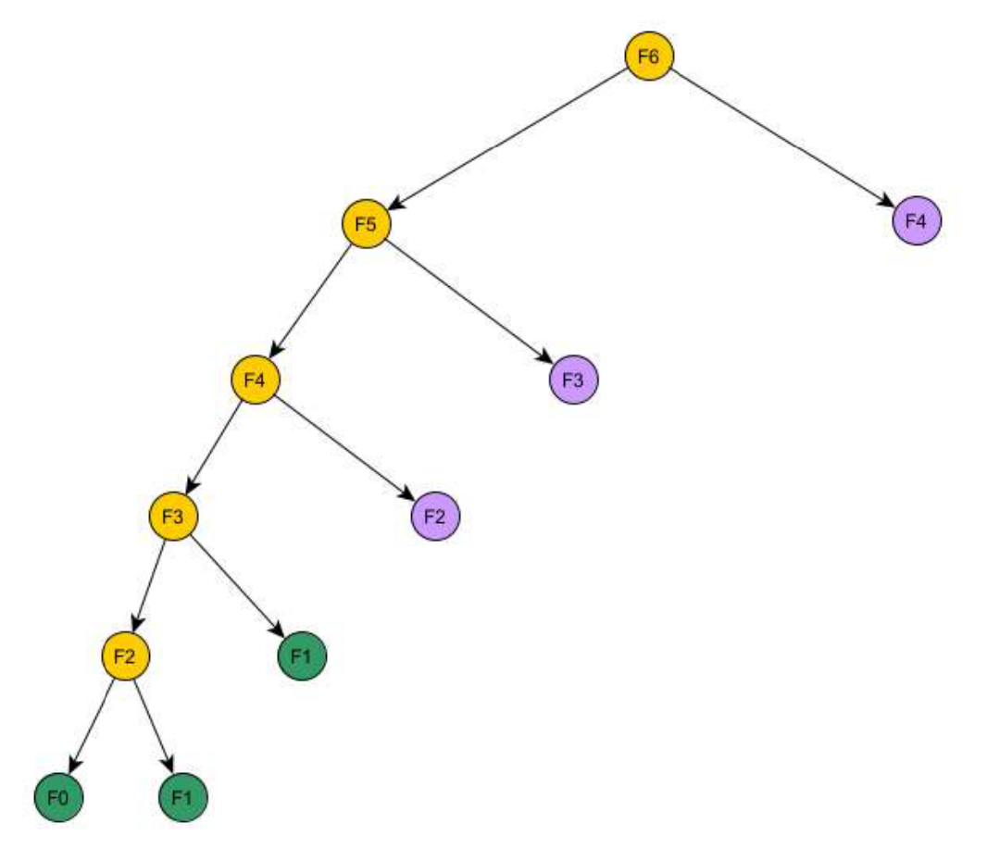{width=55%}

The tree has **11 nodes**, against 25 in the regular tree. The slide's grey nodes are the calls that never happen.
:::

</details>

<details class="qa box">
<summary><strong>Answer (b)</strong> <span class="qa-caret" aria-hidden="true"></span></summary>

::: qa-answer
**Yes.** $F_n$ depends only on $F_{n-1}$ and $F_{n-2}$. So after computing $F_j$, the numbers before $F_{j-1}$ are never read again. Keep only the last two numbers, in 2 variables.

```
a = 0; b = 1;                 // F(0), F(1)
for j = 2 to n {
    c = a + b;                // F(j)
    a = b;                    // F(j-1) becomes the older one
    b = c;                    // F(j) becomes the newer one
}
return b;                     // F(n), for n >= 1
```

Time is $O(n)$, the same as the array. Memory is 3 variables ($a$, $b$, $c$), which is $O(1)$.

Trace for $n = 6$:

| $j$ | start | 2 | 3 | 4 | 5 | 6 |
|---|---|---|---|---|---|---|
| `a` | 0 | 1 | 1 | 2 | 3 | 5 |
| `b` | 1 | 1 | 2 | 3 | 5 | 8 |

The loop returns $F_6 = 8$.

*(new)* This version uses a loop, not recursion. A recursive version still uses $O(n)$ stack space for its $n$ nested calls, even with no array.
:::

</details>

<details class="qa box">
<summary><strong>General method: memoization</strong> <span class="qa-caret" aria-hidden="true"></span></summary>

::: qa-answer
1. **Draw the regular tree.** Mark the repeated sub-problems.
2. **Prune it.** Expand a sub-problem only the first time. Any later appearance becomes a leaf that reads the dictionary.
3. **Count the calls.** There is one expanded call for each **distinct** sub-problem, and each expanded call makes a bounded number of other calls. So the total is (distinct sub-problems) $\times$ (work per call). For Fibonacci: $n+1$ sub-problems, $O(1)$ each, so $O(n)$ time.
4. **Look at what each answer needs.** If each row depends only on the last few, keep only those: $O(1)$ space. If you need to rebuild the whole solution later, keep the full table.
:::

</details>

**Extension 5.1.** Count the calls that the memoized `fibDP(n)` makes, including the calls that only read the dictionary. Give the answer for $n = 6$ and for general $n \ge 1$.

<details class="qa box">
<summary><strong>Answer (Extension 5.1)</strong> <span class="qa-caret" aria-hidden="true"></span></summary>

::: qa-answer
Count the nodes of the pruned tree.

* The left spine has nodes $F_n, F_{n-1}, \ldots, F_2$. That is $n - 1$ nodes.
* $F_2$ has two children, $F_1$ and $F_0$. That is 2 nodes.
* Each of $F_n, \ldots, F_3$ has one right child ($F_{n-2}, \ldots, F_1$). That is $n - 2$ nodes.

Total: $(n-1) + 2 + (n-2) = 2n - 1$.

For $n = 6$: $2 \cdot 6 - 1 = 11$. This matches the 11 nodes in the figure. Check for small $n$: $n = 1$ gives 1 node ($F_1$), and $n = 2$ gives 3 nodes ($F_2, F_1, F_0$).

Only $n + 1 = 7$ of these 11 nodes do real work (the yellow and green nodes). The other $n - 2 = 4$ are purple dictionary reads. The count is $O(n)$ either way. The regular tree has $2F_{n+1} - 1$ nodes, which is 25 for $n = 6$.
:::

</details>

---

## Tutorial 10: Dynamic Programming

### Q1. LCS of CAGAG and ACTGG

Find the length of the longest common subsequence and a longest common subsequence of CAGAG and ACTGG by the dynamic programming algorithm in the lecture notes.

<details class="qa box">
<summary><strong>Concepts: the c table and the h table</strong> <span class="qa-caret" aria-hidden="true"></span></summary>

::: qa-answer
* $c[i][j]$ is the length of an LCS of the first $i$ letters of $x$ and the first $j$ letters of $y$. Row 0 and column 0 are 0, because an empty string has no common letters with anything.
* $h[i][j]$ records which neighbour gave $c[i][j]$. It is the arrow you follow to read the answer back.
* The lecture code uses three cases, in this order: `x[i] == y[j]` gives `\` (diagonal, take the letter). Otherwise `c[i-1][j] >= c[i][j-1]` gives `|` (up, drop $x_i$). Otherwise `—` (left, drop $y_j$). The `>=` is the **tie rule**: when both neighbours are equal, go up.
* Chapter 10 explains why this is correct. This page only fills and traces the tables.
:::

</details>

<details class="qa box">
<summary><strong>Answer</strong> <span class="qa-caret" aria-hidden="true"></span></summary>

::: qa-answer
The lecture code, with $x$ = CAGAG ($n$ = 5) and $y$ = ACTGG ($m$ = 5):

```
for i = 1 to n
    for j = 1 to m
        if x[i] == y[j] {
            c[i][j] = c[i-1][j-1] + 1;
            h[i][j] = '\';
        }
        else if c[i-1][j] >= c[i][j-1] {
            c[i][j] = c[i-1][j];
            h[i][j] = '|';
        }
        else {
            c[i][j] = c[i][j-1];
            h[i][j] = '—';
        }
```

The $c$ table:

| c | ∅ | A | C | T | G | G |
|---|---|---|---|---|---|---|
| **∅** | 0 | 0 | 0 | 0 | 0 | 0 |
| **C** | 0 | 0 | 1 | 1 | 1 | 1 |
| **A** | 0 | 1 | 1 | 1 | 1 | 1 |
| **G** | 0 | 1 | 1 | 1 | 2 | 2 |
| **A** | 0 | 1 | 1 | 1 | 2 | 2 |
| **G** | 0 | 1 | 1 | 1 | 2 | 3 |

The $h$ table (the lecture shows `|` in column 0 and `—` in row 0):

| h | ∅ | A | C | T | G | G |
|---|---|---|---|---|---|---|
| **∅** | — | — | — | — | — | — |
| **C** | \| | \| | \\ | — | — | — |
| **A** | \| | \\ | \| | \| | \| | \| |
| **G** | \| | \| | \| | \| | \\ | \\ |
| **A** | \| | \\ | \| | \| | \| | \| |
| **G** | \| | \| | \| | \| | \\ | \\ |

The length of an LCS is $c[5][5] = 3$.

Now follow the arrows from $(5,5)$:

1. $(5,5)$ is `\`. G = G. Write down G. Go to $(4,4)$.
2. $(4,4)$ is `|`. Go up to $(3,4)$.
3. $(3,4)$ is `\`. G = G. Write down G. Go to $(2,3)$.
4. $(2,3)$ is `|`. Go up to $(1,3)$.
5. $(1,3)$ is `—`. Go left to $(1,2)$.
6. $(1,2)$ is `\`. C = C. Write down C. Go to $(0,1)$. Row 0 stops the walk.

The letters come out backwards: G, G, C. Read them in reverse. **LCS = CGG**, length 3.
:::

</details>

<details class="qa box">
<summary><strong>General method: fill and trace an LCS table by hand</strong> <span class="qa-caret" aria-hidden="true"></span></summary>

::: qa-answer
1. Draw a grid with $x$ down the side and $y$ across the top. Add a row 0 and a column 0 of zeros.
2. Fill row by row, left to right. For each cell, compare the two letters that label it.
    * Same letters: copy the diagonal cell and add 1. Mark `\`.
    * Different letters: take the larger of the cell above and the cell to the left. If they are equal, take the one above (`|`). Mark the one you took.
3. The bottom-right cell is the length.
4. Start at the bottom-right cell. Follow the marks. Write down a letter only at a `\`. Stop at row 0 or column 0.
5. Reverse what you wrote.
6. Check: the answer must be a subsequence of both strings, and its length must equal $c[n][m]$.

The grid has $(n+1)(m+1)$ cells and each costs $O(1)$, so the time is $O(nm)$. The trace walks at most $n + m$ steps.
:::

</details>

**Extension 1.1.** Find the LCS of $x$ = ABAB and $y$ = BABA. Use the lecture tie rule.

<details class="qa box">
<summary><strong>Answer (Extension 1.1)</strong> <span class="qa-caret" aria-hidden="true"></span></summary>

::: qa-answer
| c | ∅ | B | A | B | A |
|---|---|---|---|---|---|
| **∅** | 0 | 0 | 0 | 0 | 0 |
| **A** | 0 | 0 | 1 | 1 | 1 |
| **B** | 0 | 1 | 1 | 2 | 2 |
| **A** | 0 | 1 | 2 | 2 | 3 |
| **B** | 0 | 1 | 2 | 3 | 3 |

Two cells in full:

* $c[2][3]$: B = B, so $c[2][3] = c[1][2] + 1 = 1 + 1 = 2$.
* $c[4][4]$: B $\ne$ A. The cell above is 3 and the cell to the left is 3. They tie, so take the one above: $c[4][4] = 3$, mark `|`.

Trace:

1. $(4,4)$ is `|`. Go up to $(3,4)$.
2. $(3,4)$: A = A. Write A. Go to $(2,3)$.
3. $(2,3)$: B = B. Write B. Go to $(1,2)$.
4. $(1,2)$: A = A. Write A. Go to $(0,1)$. Stop.

Reversed: **ABA**, length 3. BAB is also an LCS of length 3. An LCS is not unique. The tie rule decides which one the trace finds.
:::

</details>

### Q2. The H-number

The H-number $H(n)$ is defined as follows: $H(0) = 1$, and for $n > 0$:

* $H(n) = H(n-1) + H(n-3) + H(n-5) + \dots + H(0)$, when $n$ is odd;
* $H(n) = H(n-2) + H(n-4) + H(n-6) + \dots + H(0)$, when $n$ is even.

a) Give a recursive algorithm to compute $H(n)$ for an arbitrary $n$ as suggested by the recurrence equation given for $H(n)$. Draw the tree that represents the recursive calls made when $H(8)$ is computed.

<details class="qa box">
<summary><strong>Concepts: subproblem graph and repeated calls</strong> <span class="qa-caret" aria-hidden="true"></span></summary>

::: qa-answer
* A **subproblem** is one value the answer needs, here one $H(k)$. A **subproblem graph** has one node per subproblem and an arrow from $H(a)$ to $H(b)$ when computing $H(a)$ needs $H(b)$.
* The graph has no cycles, because every arrow goes to a smaller index. So it is a DAG. You can solve the subproblems in an order where every arrow points to something already solved. That is the order that goes from the sinks (here $H(0)$) up to the answer.
* A **call tree** is different. It has one node for each *call*. If two calls ask for the same $H(k)$, the tree shows both. Repeated nodes in the call tree are the wasted work that dynamic programming removes.
:::

</details>

<details class="qa box">
<summary><strong>Answer (a)</strong> <span class="qa-caret" aria-hidden="true"></span></summary>

::: qa-answer
```
int hn(int n) {
    if (n == 0) return 1;
    else {
        S = 0;
        if (n mod 2) j = n-1;
        else j = n-2;
        for (k = 0; k <= j; k = k+2)
            S += hn(k);
    }
    return S;
}
```

The loop starts at $k = 0$ and steps by 2. So it adds $H(0), H(2), \dots, H(j)$, where $j$ is the largest even number below $n$. For odd $n$ this is $n-1$. For even $n$ this is $n-2$. Both cases of the definition reduce to a sum over the even indices below $n$.

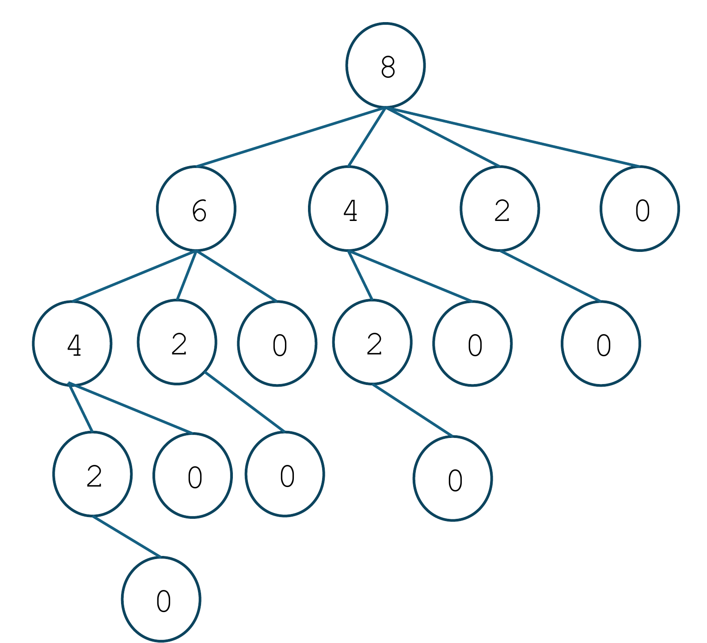{width=55%}

The tree has 16 nodes. The call for $H(0)$ appears 8 times and the call for $H(2)$ appears 4 times.
:::

</details>

<details class="qa box">
<summary><strong>Answer (a), call counts</strong> <span class="qa-caret" aria-hidden="true"></span></summary>

::: qa-answer
*(new)* Let $T(n)$ be the number of calls made by $\text{hn}(n)$, counting the first call. Then $T(0) = 1$, $T(2) = 1 + T(0) = 2$, $T(4) = 1 + T(0) + T(2) = 4$, $T(6) = 8$ and $T(8) = 16$. In general $T(2m) = 2^m$. The recursive algorithm takes exponential time, because it solves the same $H(k)$ again and again.
:::

</details>

b) Draw the subproblem graph for $H(8)$ and $H(9)$.

<details class="qa box">
<summary><strong>Answer (b)</strong> <span class="qa-caret" aria-hidden="true"></span></summary>

::: qa-answer
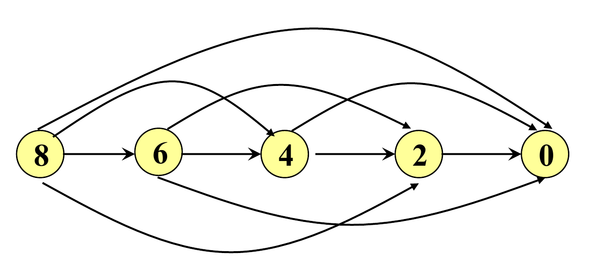{width=60%}

$H(8)$ uses only the **even** indices: nodes 8, 6, 4, 2, 0. Each node has an arrow to every even node below it. There are 5 nodes and 10 arrows.

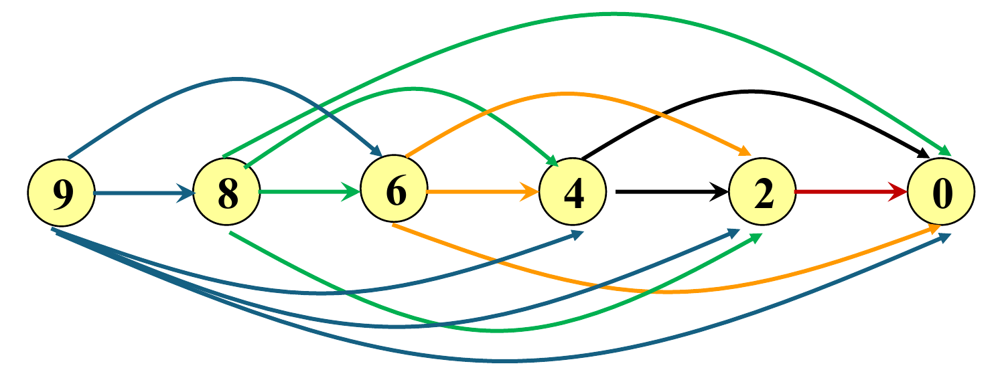{width=60%}

$H(9)$ needs $H(8), H(6), H(4), H(2), H(0)$. So the graph for $H(9)$ is the graph for $H(8)$ plus one new node 9, with an arrow to each of 8, 6, 4, 2, 0. There are 6 nodes and 15 arrows.

Both graphs have 5 or 6 nodes, not 9 or 10, so a DP needs few subproblems. A valid order to solve them is $H(0)$ first, then $H(2)$, $H(4)$, and so on up to the target.
:::

</details>

c) Write an iterative algorithm using dynamic programming (bottom-up). Analyze time and space complexity.

<details class="qa box">
<summary><strong>Answer (c)</strong> <span class="qa-caret" aria-hidden="true"></span></summary>

::: qa-answer
```
int hn_DP(int n)
{   // Make use of an array S[0..n]
    S[0] = 1;
    for (i = 1; i <= n; i++) {
        S[i] = 0;
        if (i mod 2) j = i-1;
        else j = i-2;
        while (j >= 0) {
            S[i] += S[j];
            j -= 2;
        }
    }
    return S[n];
}
```

The array $S[0..n]$ stores every $H(i)$ as it is found. Each $S[i]$ only needs smaller indices, and those are already stored.

* **Space:** $O(n)$, for the array $S$.
* **Time:** $O(n^2)$. The loop for $i$ adds about $i/2$ values. The total is about $\frac{1}{2}(1 + 2 + \dots + n) = O(n^2)$.

The slide then asks: *Is there a faster algorithm?* Yes. See the next drawer.
:::

</details>

<details class="qa box">
<summary><strong>Answer (c), a faster algorithm</strong> <span class="qa-caret" aria-hidden="true"></span></summary>

::: qa-answer
*(new)* The slide asks the question and gives no answer. Here is one.

For odd $n = 2m - 1$ with $m \ge 1$, the terms are $H(2m-2), H(2m-4), \dots, H(0)$. For even $2m$, the terms are the same list. So:

* $H(2m) = H(2m-1)$ for $m \ge 1$.

For odd $n = 2m + 1$ with $m \ge 1$, the terms are $H(2m)$ plus $H(2m-2) + \dots + H(0)$. That second part is exactly $H(2m)$. So:

* $H(2m+1) = 2 \cdot H(2m)$ for $m \ge 1$.
* $H(0) = H(1) = 1$. The rule $H(1) = 2H(0)$ does not hold, because $H(1) = H(0)$ has only one term.

Check against the definition:

| n | 0 | 1 | 2 | 3 | 4 | 5 | 6 | 7 | 8 |
|---|---|---|---|---|---|---|---|---|---|
| H(n) | 1 | 1 | 1 | 2 | 2 | 4 | 4 | 8 | 8 |

Each step looks only at the previous value, so one variable is enough. Loop from $i = 3$ to $n$: if $i$ is odd, double the value. If $i$ is even, keep it. Start from 1. This runs in **$O(n)$ time and $O(1)$ space**. (In fact $H(n) = 2^{\lfloor (n-1)/2 \rfloor}$ for $n \ge 1$, but the $O(n)$ loop shows the DP idea.)
:::

</details>

<details class="qa box">
<summary><strong>General method: from a recurrence to a DP</strong> <span class="qa-caret" aria-hidden="true"></span></summary>

::: qa-answer
1. Write the recurrence. Find its subproblems: the values the answer calls for.
2. Draw the subproblem graph. Check that it is a DAG (every arrow goes to a smaller problem). If a call tree repeats nodes, DP will help.
3. Fix an order that solves every subproblem after the ones it points to. This is the reverse of a topological order. Here it is $i = 0, 1, 2, \dots, n$.
4. Store each answer in an array indexed by the subproblem. Fill it in that order.
5. **Time** $\approx$ (number of subproblems) $\times$ (work per subproblem). Here: $n$ subproblems, each adds up to $O(n)$ stored values, so $O(n^2)$.
6. **Space** $\approx$ the size of the array, unless a later step needs only the last few values.
7. Look for a pattern in the recurrence. When two subproblems share almost all their terms, one can be computed from the other in $O(1)$ time. That is how $H$ drops to $O(n)$.
:::

</details>

**Extension 2.1.** Use the $O(n)$ rule to compute $H(10)$ and $H(11)$. Check $H(10)$ against the definition.

<details class="qa box">
<summary><strong>Answer (Extension 2.1)</strong> <span class="qa-caret" aria-hidden="true"></span></summary>

::: qa-answer
Start from $H(8) = 8$.

* $H(9) = 2 \cdot H(8) = 16$ (9 is odd).
* $H(10) = H(9) = 16$ (10 is even).
* $H(11) = 2 \cdot H(10) = 32$ (11 is odd).

Check $H(10)$ from the definition: $H(10) = H(8) + H(6) + H(4) + H(2) + H(0) = 8 + 4 + 2 + 1 + 1 = 16$. It matches.
:::

</details>

### Q3. Binomial coefficients

The binomial coefficients can be defined by the recurrence equation:

* $C(n, k) = C(n-1, k-1) + C(n-1, k)$ for $n > 0$ and $k > 0$;
* $C(n, 0) = 1$ for $n \ge 0$;
* $C(0, k) = 0$ for $k > 0$.

$C(n, k)$ is also called "n choose k". It is the number of ways to choose $k$ distinct objects from a set of $n$ objects.

a) Give a recursive algorithm as suggested by the recurrence equation given for $C(n, k)$.

<details class="qa box">
<summary><strong>Answer (a)</strong> <span class="qa-caret" aria-hidden="true"></span></summary>

::: qa-answer
```
int C(int n, int k)
{
    if (k == 0) return 1;
    if (n == 0) return 0;
    return C(n-1, k-1) + C(n-1, k);
}
```

The two base cases come first: $k = 0$ gives 1 and $n = 0$ gives 0. Because the $k = 0$ test is first, $C(0, 0) = 1$, as the definition says.
:::

</details>

b) Draw the subproblem graph for $C(5, 3)$.

<details class="qa box">
<summary><strong>Answer (b)</strong> <span class="qa-caret" aria-hidden="true"></span></summary>

::: qa-answer
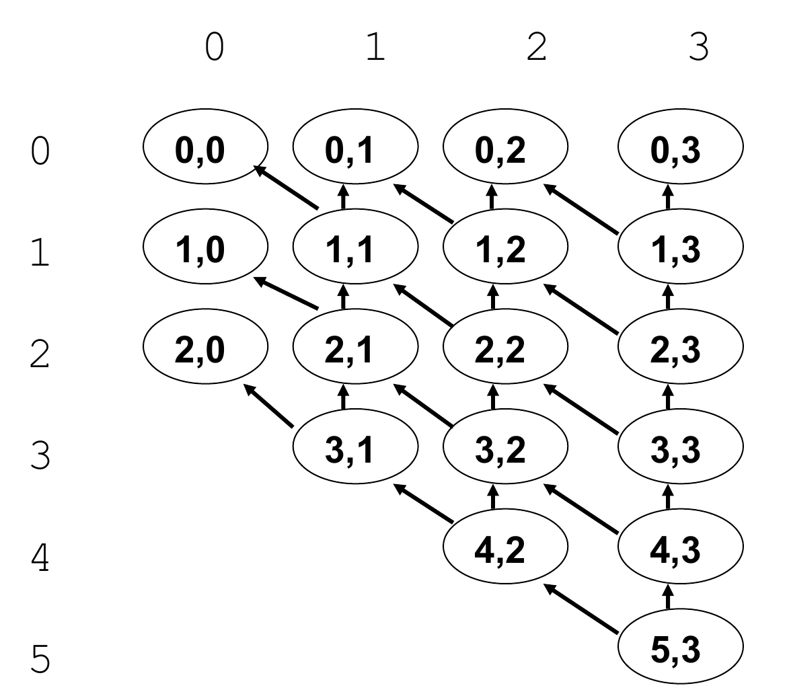{width=50%}

Each node $(n, k)$ with $n > 0$ and $k > 0$ has two arrows: to $(n-1, k-1)$ and to $(n-1, k)$. Nodes with $k = 0$ or $n = 0$ are base cases and have no arrows. The graph has 18 nodes, not the 24 cells of a full $6 \times 4$ grid, because the answer never needs $(3,0)$, $(4,0)$, $(4,1)$, $(5,0)$, $(5,1)$, $(5,2)$.

Several nodes have two incoming arrows. For example $(3,2)$ is needed by both $(4,2)$ and $(4,3)$. A plain recursion would solve it twice.
:::

</details>

c) Implement a top-down dynamic programming algorithm with memoization. State the data structure used for the dictionary.

<details class="qa box">
<summary><strong>Answer (c)</strong> <span class="qa-caret" aria-hidden="true"></span></summary>

::: qa-answer
The dictionary is a two-dimensional array `int dic[n+1][k+1]`, with **every entry set to -1** at the start. The value -1 means "not computed yet". A real answer is never negative, so no clash is possible.

```
int C(int n, int k, int [][] dic)
{
    int c1, c2;

    if (k == 0) {
        dic[n][0] = 1;
        return 1;
    }
    if (n == 0) {
        dic[0][k] = 0;
        return 0;
    }

    if (dic[n-1][k-1] == -1)
        c1 = C(n-1, k-1, dic);
    else c1 = dic[n-1][k-1];

    if (dic[n-1][k] == -1)
        c2 = C(n-1, k, dic);
    else c2 = dic[n-1][k];

    dic[n][k] = c1 + c2;
    return dic[n][k];
}
```

Before each recursive call, the code looks in `dic`. It calls only if the entry is -1. So each subproblem is solved once, and every later request reads the stored value.

* **Time:** $O(nk)$. There are at most $(n+1)(k+1)$ subproblems and each does $O(1)$ work besides its calls.
* **Space:** $O(nk)$ for the array (plus $O(n)$ for the recursion stack).
:::

</details>

d) Implement a bottom-up approach and analyze its time and space complexity.

<details class="qa box">
<summary><strong>Answer (d)</strong> <span class="qa-caret" aria-hidden="true"></span></summary>

::: qa-answer
```
int C(int n, int k)
{
    int dic[n+1][k+1];

    for (i = 1; i <= k; i++) dic[0][i] = 0;
    for (i = 0; i <= n; i++) dic[i][0] = 1;
    for (i = 1; i <= n; i++)
        for (j = 1; j <= k; j++)
            dic[i][j] = dic[i-1][j-1] + dic[i-1][j];

    return dic[n][k];
}
```

The first two loops fill the base cases: row 0 and column 0. The double loop then fills row by row. Each cell reads the row above, which is already full.

* **Time:** $O(nk)$.
* **Space:** $O(nk)$.

The slide also gives a **more optimized** version:

```
int C(int n, int k)    // more optimized
{
    int dic[n+1][k+1];

    for (i = 1; i <= k; i++)
        dic[0][i] = 0;
    for (i = 0; i <= n-k; i++)
        dic[i][0] = 1;
    for (i = 1; i <= n; i++)
        for (j = max(i-(n-k), 1); j <= k; j++)
            dic[i][j] = dic[i-1][j-1] + dic[i-1][j];

    return dic[n][k];
}
```

It fills only the cells that $C(n, k)$ really uses. Each step down a row adds 0 or 1 to $j$, so from cell $(i, j)$ you can reach $(n, k)$ only if $k - j \le n - i$. That means $j \ge i - (n-k)$, which is the loop start. Cells to the left of that are never read, so the code skips them. For the same reason only the column 0 cells with $i \le n-k$ are needed. This is the shape of the graph in part (b). The loops visit about $k(n-k)$ cells. The worst-case bound is still $O(nk)$ time and $O(nk)$ space.
:::

</details>

<details class="qa box">
<summary><strong>General method: memoized and bottom-up DP</strong> <span class="qa-caret" aria-hidden="true"></span></summary>

::: qa-answer
Both methods use the same subproblem graph. They differ only in the order.

| | Top-down (memoization) | Bottom-up |
|---|---|---|
| Order | Follows the recursion. Starts at the answer. | You choose it: a reverse topological order. |
| Table start | All entries -1 | Base cases filled first |
| Solves | Only the subproblems the answer needs | All the cells in the loops |
| Cost | Stack space and call overhead | None. Loops only. |

* **Time** is (number of distinct subproblems) $\times$ (work per subproblem). For $C(n, k)$: $O(nk) \times O(1)$.
* **Space** is the table. If a row needs only the row above, you can keep one row. See Extension 3.1.
* To restrict the loops (the optimized version), ask which cells can reach the answer in the graph, and loop over those.
:::

</details>

**Extension 3.1.** Fill the bottom-up table for $C(5, 3)$. Then show that one row of size $k+1$ is enough.

<details class="qa box">
<summary><strong>Answer (Extension 3.1)</strong> <span class="qa-caret" aria-hidden="true"></span></summary>

::: qa-answer
Cell $(i, j)$ is the sum of the cell above and the cell above-left.

| i \\ j | 0 | 1 | 2 | 3 |
|---|---|---|---|---|
| **0** | 1 | 0 | 0 | 0 |
| **1** | 1 | 1 | 0 | 0 |
| **2** | 1 | 2 | 1 | 0 |
| **3** | 1 | 3 | 3 | 1 |
| **4** | 1 | 4 | 6 | 4 |
| **5** | 1 | 5 | 10 | 10 |

So $C(5, 3) = 10$. Two cells in full: $C(4,3) = C(3,2) + C(3,3) = 3 + 1 = 4$. $C(5,3) = C(4,2) + C(4,3) = 6 + 4 = 10$.

*(new)* Row $i$ reads only row $i-1$. Keep one array `row[0..k]`, with `row[0] = 1` and the rest 0. For each $i$ from 1 to $n$, run $j$ **downward** from $k$ to 1 and do `row[j] = row[j] + row[j-1]`. Going downward matters: `row[j-1]` must still hold the old value from row $i-1$ when you read it. Going upward would use the new value and give a wrong answer. Time is still $O(nk)$. Space falls to $O(k)$.
:::

</details>

### Q4. Knapsack

Given a knapsack of size 10 and 4 objects with:

* Profits (p): {10, 40, 30, 50},
* Sizes (s): {5, 4, 6, 3},

determine the subset maximizing profit using dynamic programming.

<details class="qa box">
<summary><strong>Concepts: the 0/1 knapsack table</strong> <span class="qa-caret" aria-hidden="true"></span></summary>

::: qa-answer
* Each object is taken once or not at all. The goal is the largest total profit with total size at most $C$.
* $\text{profit}[r][c]$ is the best profit that uses only objects $1..c$ in a knapsack of size $r$. The rows are capacities $0..C$. The columns are objects $0..n$. Column 0 (no objects) and row 0 (no space) are 0.
* To fill a cell, ask about object $c$. **Leave it:** the value is $\text{profit}[r][c-1]$. **Take it** (only if $s_c \le r$): the value is $\text{profit}[r - s_c][c-1] + p_c$. Keep the larger.
* Chapter 10 has the full argument.
:::

</details>

<details class="qa box">
<summary><strong>Answer</strong> <span class="qa-caret" aria-hidden="true"></span></summary>

::: qa-answer
The lecture code (the slide calls the sizes `w`):

```
for r = 1 to C
    for c = 1 to n
        profit[r][c] = profit[r][c-1];
        if (w[c] <= r)
            if (profit[r][c] < profit[r-w[c]][c-1] + p[c])
                profit[r][c] = profit[r-w[c]][c-1] + p[c];
```

The table with $C = 10$. Objects: 1 (size 5, profit 10), 2 (size 4, profit 40), 3 (size 6, profit 30), 4 (size 3, profit 50).

| r \\ c | 0 | 1 | 2 | 3 | 4 |
|---|---|---|---|---|---|
| **0** | 0 | 0 | 0 | 0 | 0 |
| **1** | 0 | 0 | 0 | 0 | 0 |
| **2** | 0 | 0 | 0 | 0 | 0 |
| **3** | 0 | 0 | 0 | 0 | 50 |
| **4** | 0 | 0 | 40 | 40 | 50 |
| **5** | 0 | 10 | 40 | 40 | 50 |
| **6** | 0 | 10 | 40 | 40 | 50 |
| **7** | 0 | 10 | 40 | 40 | 90 |
| **8** | 0 | 10 | 40 | 40 | 90 |
| **9** | 0 | 10 | 50 | 50 | 90 |
| **10** | 0 | 10 | 50 | 70 | 90 |

The best profit is $\text{profit}[10][4] = 90$.

Four cells in full:

* $(r, c) = (4, 1)$: object 1 has size 5, and $5 > 4$. It does not fit. Copy the left cell: 0.
* $(5, 1)$: $5 \le 5$. Take it: $\text{profit}[0][0] + 10 = 10 > 0$. Value 10.
* $(10, 3)$: leave object 3: $\text{profit}[10][2] = 50$. Take it: $\text{profit}[4][2] + 30 = 40 + 30 = 70$. $70 > 50$, so the value is 70.
* $(7, 4)$: leave object 4: $\text{profit}[7][3] = 40$. Take it: $\text{profit}[4][3] + 50 = 40 + 50 = 90$. $90 > 40$, so the value is 90.

The slide gives the table and the code only. It does not name the subset. Trace it back. *(new)* At cell $(r, c)$: if $\text{profit}[r][c] \ne \text{profit}[r][c-1]$, object $c$ is taken, so move to $(r - s_c, c-1)$. If they are equal, object $c$ is left, so move to $(r, c-1)$.

1. $(10, 4)$: $90 \ne \text{profit}[10][3] = 70$. **Take object 4** (size 3). Go to $(7, 3)$.
2. $(7, 3)$: $40 = \text{profit}[7][2] = 40$. Leave object 3. Go to $(7, 2)$.
3. $(7, 2)$: $40 \ne \text{profit}[7][1] = 10$. **Take object 2** (size 4). Go to $(3, 1)$.
4. $(3, 1)$: $0 = \text{profit}[3][0] = 0$. Leave object 1. Done.

The subset is **{object 2, object 4}**, with total size $4 + 3 = 7 \le 10$ and total profit $40 + 50 = 90$.
:::

</details>

<details class="qa box">
<summary><strong>General method: fill a knapsack table and trace it back</strong> <span class="qa-caret" aria-hidden="true"></span></summary>

::: qa-answer
1. Make a grid. Rows are capacities $0..C$. Columns are objects $0..n$. Fill row 0 and column 0 with 0.
2. Fill row by row, left to right. For cell $(r, c)$:
    * Copy the cell on the left (leave object $c$).
    * If $s_c \le r$, compute $\text{profit}[r - s_c][c-1] + p_c$. This looks one column left and $s_c$ rows up. If it is larger, use it.
3. The bottom-right cell is the best profit.
4. Trace back from $(C, n)$. If the cell differs from its left neighbour, take object $c$ and go to $(r - s_c, c-1)$. If equal, go to $(r, c-1)$. Stop at column 0.
5. Check: the sizes of the taken objects add to at most $C$, and the profits add to the bottom-right cell.

Time and space are both $O(C \cdot n)$. This is *pseudo-polynomial*: it depends on the number $C$, not on the number of bits in $C$.
:::

</details>

**Extension 4.1.** A knapsack has size 10. There are three objects with sizes {6, 5, 5} and profits {7, 5, 5}. A greedy rule takes objects in order of profit per unit of size, and stops when the next one does not fit. Show that it is not optimal.

<details class="qa box">
<summary><strong>Answer (Extension 4.1)</strong> <span class="qa-caret" aria-hidden="true"></span></summary>

::: qa-answer
The ratios are $7/6 \approx 1.17$, $5/5 = 1$ and $5/5 = 1$. Greedy takes object 1 first (size 6). The space left is 4. Neither remaining object (size 5) fits. Greedy ends with profit **7**.

The DP table gives the optimum:

| r \\ c | 0 | 1 | 2 | 3 |
|---|---|---|---|---|
| **5** | 0 | 0 | 5 | 5 |
| **6** | 0 | 7 | 7 | 7 |
| **10** | 0 | 7 | 7 | 10 |

Cell $(10, 3)$: leave object 3 gives $\text{profit}[10][2] = 7$. Take it gives $\text{profit}[5][2] + 5 = 5 + 5 = 10$. So the value is 10. The trace takes objects 3 and 2 (sizes 5 + 5 = 10). The optimum is **10**.

Greedy fails because an object cannot be split. It commits to object 1 and wastes 4 units of space. The DP tries both choices for every object.
:::

</details>

### Q5. Alignment of two sequences

Let $S_1$ and $S_2$ be sequences of characters from {'a', 'c', 'g', 't'}. Alignment involves inserting '_' so both sequences have the same length. The cost is the number of insertions. Example: $S_1$ = "ctatg", $S_2$ = "ttaagc", $S_1'$ = "ct_at_g_", $S_2'$ = "_tta_agc". The cost is 5.

a) Give a recursive definition of alignment($n_1$, $n_2$).

<details class="qa box">
<summary><strong>Answer (a)</strong> <span class="qa-caret" aria-hidden="true"></span></summary>

::: qa-answer
Let $\text{Alignment}(n_1, n_2)$ be the least cost to align the first $n_1$ characters of $S_1$ with the first $n_2$ characters of $S_2$. The official analysis:

* **Two base cases.** (i) $S_2$ is empty: $S_2'$ must have $n_1$ '_' characters, so the cost is $n_1$. (ii) $S_1$ is empty: $S_1'$ must have $n_2$ '_' characters, so the cost is $n_2$.
* **Both sequences are not empty.** Look at the last characters. There are two possibilities.
    * (i) $S_1[n_1] = S_2[n_2]$. No insertion is needed. The last character of $S_1'$ and of $S_2'$ is this character. Before it comes the best alignment of the shorter strings: $\text{Alignment}(n_1 - 1, n_2 - 1)$.
    * (ii) $S_1[n_1] \ne S_2[n_2]$. Either align the last character of $S_1$ with '_', and find $\text{Alignment}(n_1 - 1, n_2)$. Or align the last character of $S_2$ with '_', and find $\text{Alignment}(n_1, n_2 - 1)$. Take the smaller and add 1 for the new '_'.

The recursive definition:

* $\text{Alignment}(n_1, 0) = n_1$
* $\text{Alignment}(0, n_2) = n_2$
* $\text{Alignment}(n_1, n_2) = \text{Alignment}(n_1 - 1, n_2 - 1)$ if $S_1[n_1] = S_2[n_2]$
* $\text{Alignment}(n_1, n_2) = \min(\text{Alignment}(n_1 - 1, n_2),\ \text{Alignment}(n_1, n_2 - 1)) + 1$ otherwise

*(new)* A mismatch is never paired with a mismatch. The alignment may only insert '_', so two different letters cannot share a column. The only choices are to put a '_' under one of them.
:::

</details>

b) Draw the subproblem graph for alignment(3, 4).

<details class="qa box">
<summary><strong>Answer (b)</strong> <span class="qa-caret" aria-hidden="true"></span></summary>

::: qa-answer
The nodes are all pairs $(x, y)$ with $0 \le x \le 3$ and $0 \le y \le 4$:

| | | | | |
|---|---|---|---|---|
| (0, 0) | (0, 1) | (0, 2) | (0, 3) | (0, 4) |
| (1, 0) | (1, 1) | (1, 2) | (1, 3) | (1, 4) |
| (2, 0) | (2, 1) | (2, 2) | (2, 3) | (2, 4) |
| (3, 0) | (3, 1) | (3, 2) | (3, 3) | (3, 4) |

For each $(x, y)$ where $x \ne 0$ and $y \ne 0$, there is an edge to $(x-1, y-1)$, $(x-1, y)$ and $(x, y-1)$. Nodes in row 0 and column 0 are base cases and have no edges.

The graph has 20 nodes and $3 \times 4 \times 3 = 36$ edges. Every edge goes up, left, or up-left, so the graph is a DAG. Solving the rows from top to bottom, and each row from left to right, solves every node after the nodes it points to.

(The recurrence uses the diagonal edge only when the characters match, and the two other edges only when they do not. The graph shows all the edges that any input could use.)
:::

</details>

c) Design a dynamic programming algorithm of alignment($n_1$, $n_2$) using the bottom-up approach.

<details class="qa box">
<summary><strong>Answer (c)</strong> <span class="qa-caret" aria-hidden="true"></span></summary>

::: qa-answer
```
for (r = 0 to n1) cost[r][0] = r;
for (c = 1 to n2) cost[0][c] = c;

for (r = 1 to n1)
    for (c = 1 to n2)
        if (S1[r] == S2[c])
            cost[r][c] = cost[r-1][c-1];
        else if (cost[r-1][c] < cost[r][c-1])
            cost[r][c] = cost[r-1][c] + 1;
        else
            cost[r][c] = cost[r][c-1] + 1;

return cost[n1][n2];
```

The first two lines fill the base cases. The loops then follow the order of the graph in part (b). The `else if` picks the smaller of the cell above and the cell to the left, then adds 1. This is the $\min(\dots) + 1$ of part (a).

* **Time:** $O(n_1 n_2)$.
* **Space:** $O(n_1 n_2)$.

*(new)* The table for $S_1$ = "ctatg" (rows) and $S_2$ = "ttaagc" (columns):

| cost | ∅ | t | t | a | a | g | c |
|---|---|---|---|---|---|---|---|
| **∅** | 0 | 1 | 2 | 3 | 4 | 5 | 6 |
| **c** | 1 | 2 | 3 | 4 | 5 | 6 | 5 |
| **t** | 2 | 1 | 2 | 3 | 4 | 5 | 6 |
| **a** | 3 | 2 | 3 | 2 | 3 | 4 | 5 |
| **t** | 4 | 3 | 2 | 3 | 4 | 5 | 6 |
| **g** | 5 | 4 | 3 | 4 | 5 | 4 | 5 |

The answer is $\text{cost}[5][6] = 5$, as the question states. Two cells in full:

* $\text{cost}[2][1]$: t = t, so it copies the diagonal cell $\text{cost}[1][0] = 1$.
* $\text{cost}[1][1]$: c $\ne$ t. The cell above is $\text{cost}[0][1] = 1$ and the cell to the left is $\text{cost}[1][0] = 1$. The test "above $<$ left" fails, so the `else` branch runs: $\text{cost}[1][0] + 1 = 2$.
:::

</details>

<details class="qa box">
<summary><strong>General method: design a DP from the last decision</strong> <span class="qa-caret" aria-hidden="true"></span></summary>

::: qa-answer
1. Define the subproblem as a **prefix pair**: $f(i, j)$ is the answer for the first $i$ items of one input and the first $j$ of the other.
2. Ask what happens to the **last** item of each prefix. List every choice. Here: the last characters are matched in one column (free if equal), or one of them sits above a '_' (cost 1).
3. Each choice leaves a smaller prefix pair. Write $f(i, j)$ as the best of those choices.
4. Write the base cases: one prefix empty.
5. The subproblem graph is the grid of $(i, j)$ pairs. Edges go to smaller $i$, smaller $j$, or both. Fill the grid row by row.
6. Time is (number of cells) $\times$ (choices per cell) $= O(n_1 n_2)$. Space is the grid.

This is the same shape as the LCS in Q1. Both are two-string prefix-pair tables.
:::

</details>

**Extension 5.1.** Show that $\text{Alignment}(n_1, n_2) = n_1 + n_2 - 2 \cdot \text{LCS}(n_1, n_2)$. Check it on "ctatg" and "ttaagc".

<details class="qa box">
<summary><strong>Answer (Extension 5.1)</strong> <span class="qa-caret" aria-hidden="true"></span></summary>

::: qa-answer
*(new)* Look at an alignment. Each column has two characters, or one character and a '_'. Call a column **matched** if it holds the same character in both rows. The matched columns, read left to right, spell a common subsequence of $S_1$ and $S_2$. Every other character of $S_1$ or $S_2$ sits above or below a '_'.

* If $L$ columns are matched, $L$ characters of $S_1$ and $L$ of $S_2$ are used. The other $n_1 - L$ characters of $S_1$ and $n_2 - L$ of $S_2$ each need one '_'.
* The cost is $(n_1 - L) + (n_2 - L) = n_1 + n_2 - 2L$.
* The cost is smallest when $L$ is largest. The largest $L$ is the length of an LCS. So the minimum cost is $n_1 + n_2 - 2 \cdot \text{LCS}$.

(The two characters in a column are never different letters, because an alignment can only insert '_'.)

Check on the example. Take $S_1$ = "ctatg" and $S_2$ = "ttaagc". An LCS is "tag": the t at position 2 of $S_1$ and position 1 or 2 of $S_2$, then a, then g. It has length 3.

Length 4 is not possible. The LCS table of the two strings has bottom-right cell 3:

| c | ∅ | t | t | a | a | g | c |
|---|---|---|---|---|---|---|---|
| **∅** | 0 | 0 | 0 | 0 | 0 | 0 | 0 |
| **c** | 0 | 0 | 0 | 0 | 0 | 0 | 1 |
| **t** | 0 | 1 | 1 | 1 | 1 | 1 | 1 |
| **a** | 0 | 1 | 1 | 2 | 2 | 2 | 2 |
| **t** | 0 | 1 | 2 | 2 | 2 | 2 | 2 |
| **g** | 0 | 1 | 2 | 2 | 2 | 3 | 3 |

So $\text{Alignment}(5, 6) = 5 + 6 - 2 \cdot 3 = 5$. This matches the cost 5 in the question and the $\text{cost}[5][6]$ cell in part (c).
:::

</details>
