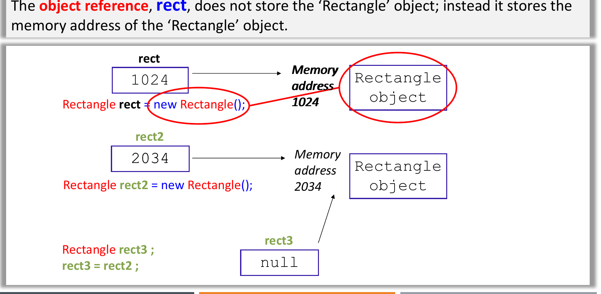
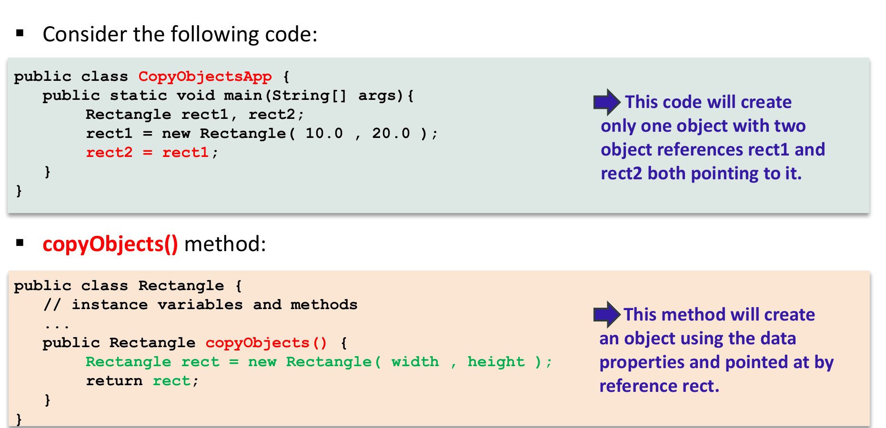

# Classes, Objects and Encapsulation

<style>
table.wide-table { width: max-content; min-width: 100%; table-layout: auto; }
</style>

This chapter covers Lectures 1 and 2. It gives the words that every later
chapter uses, so learn the terms here first.

## 1. Procedural and Object-Oriented Programming

A **procedural** program (C, Pascal) is a list of steps. Functions change data
that sits in shared memory, and any function can change any global variable.

An **object-oriented (OO)** program (Java, C++, C#) puts data and the functions
that change that data together in one unit, the **object**. Objects do the work
by sending messages to each other. One object cannot change the data of
another object directly. It must ask that object through a method.

| | Procedural (C) | Object-oriented (Java) |
|---|---|---|
| Basic unit | Function | Object (data + methods) |
| Data | Global variables, any function can change them | Private fields inside each object |
| Work happens by | Function calls in sequence | Objects sending messages to objects |
| File name rule | Any name | A `public class X` must be in `X.java` |

: { .wide-table }

**How Java runs a program.** The compiler `javac` changes source code (`.java`)
into **bytecode** (`.class`). The **Java Virtual Machine (JVM)** runs the
bytecode. A just-in-time (JIT) compiler in the JVM changes hot bytecode into
machine code. Because every platform has a JVM, the same `.class` file runs
anywhere ("compile once, run anywhere"). Java has no pointers, no multiple
inheritance of classes, and automatic garbage collection.

## 2. The Basic Terms

### Four basic components of the OO model

- **Object**: one thing that has data (its state) and actions (its behaviour).
- **Message**: a request from one object to another object to do a task. In
  Java, a message is a method call, for example `bill.comeDown()`.
- **Method**: the code that an object runs when it receives a message.
- **Class**: the template that all objects of one type share. It lists the
  fields and the methods.

### Three characteristics of every object

| Characteristic | Meaning | Person example |
|---|---|---|
| **Identity** | What makes this object different from all other objects, even an object with the same values (the object identifier, OID). | Barack Obama, not Bill Gates |
| **State** | The current values of all its fields (attributes). | height 187 cm, age 49 |
| **Behaviour** | What the object can do: its methods. | eat, walk, sleep |

: { .wide-table }

### Class and object

- A **class** is a blueprint. `Person` is a class.
- An **object** is one instance made from the class. `obama` is an object of
  class `Person`. Making an object is **instantiation**.
- The **attributes** (fields, instance variables) are the data. The
  **methods** are the behaviour.

To decide if a word is a class, an object, an attribute or a behaviour, ask:

- Is it a general type with many members? It is a **class** (`Student`, `Book`).
- Is it one named member? It is an **object** (`MichaelJackson`, `Person1`).
- Is it a value that describes a thing? It is an **attribute** (`Age`, `Color`).
- Is it an action? It is a **behaviour** (`Work`, `Shoot`).

### The four main OO concepts

| Concept | One-line meaning |
|---|---|
| **Abstraction** | Keep only the features that matter for the task. Hide the rest. A `Car` class in a parking system needs a plate number, not the engine design. |
| **Encapsulation / information hiding** | Put the data and its methods in one class. Make the data private. Other code uses the data only through public methods. |
| **Inheritance** | Make a new class from an existing class. The new class gets the fields and methods of the old class ("is-a"). See Chapter 2. |
| **Polymorphism** | "Many forms". Send the same message to different objects, and each object does the version that suits its class. See Chapter 4. |

: { .wide-table }

**Abstraction** (Booch): "the essential characteristics of an object that
distinguish it from all other kinds of objects, relative to the perspective
of the viewer". The last part is important: the same real thing gives
different classes in different systems.

## 3. Encapsulation and Information Hiding

These two terms are close, but they are not the same. Questions often ask for
the difference.

- **Encapsulation** puts a barrier around the private data of an object.
  Other code gets to the data only through the public methods of the class
  (for example, get and set methods).
- **Information hiding** hides *how* the class does its work. A user of the
  class knows *what* each method does and how to call it. The user does not
  know the method body or the private fields.

In Java, you get both with `private` fields and `public` methods. The set of
public method headers and public constants is the class's **API**
(application programming interface). The private fields and all method bodies
are the **implementation**.

Benefits: the class protects its data (a setter can reject a bad value), and
you can change the implementation without changing any code that uses the class.

## 4. Writing a Class

```java
public class Rectangle {
    // class constants: one copy, cannot change
    public static final double MAX_WIDTH = 100;

    // class (static) variable: one copy shared by all Rectangle objects
    private static int numRectangles = 0;

    // instance variables: each object has its own copy
    private double width;
    private double height;

    // constructors
    public Rectangle() {
        this(1.0, 1.0);              // call the other constructor
    }
    public Rectangle(double width, double height) {
        this.width = width;          // this.width is the field
        this.height = height;        // height alone is the parameter
        numRectangles++;
    }

    // accessor (get) and mutator (set)
    public double getWidth() { return width; }
    public void setWidth(double w) {
        width = (w >= MAX_WIDTH) ? MAX_WIDTH : w;   // keep the data valid
    }

    // instance method: uses the fields of one object
    public double findArea() { return width * height; }

    // class method: does not use any object
    public static int getNumRectangles() { return numRectangles; }
}
```

A method header has this format:
`public <static> ReturnType methodName(ParameterList)`. Use `void` if the
method returns nothing.

### Naming rules

| Style | Example | Use for |
|---|---|---|
| lowercase | `packagename` | Packages |
| UPPERCASE with `_` | `MAX_HOURS` | Constants, enum values |
| UpperCamelCase | `CustomerAccount` | Classes, interfaces |
| lowerCamelCase | `customerFirstName` | Methods, variables |

: { .wide-table }

## 5. Objects in Memory

### A variable holds a reference, not the object

`Rectangle rect = new Rectangle();` does two things:

1. `Rectangle rect` makes a **reference variable**. It can hold the memory
   address of a `Rectangle` object.
2. `new Rectangle()` makes the object in memory (on the heap), runs a
   constructor, and gives back the object's address. The `=` puts that
   address in `rect`.

A reference that points to no object holds `null`. If you call a method
through a `null` reference, Java throws a `NullPointerException`.



### Copying a reference is not copying an object

```java
Rectangle r1 = new Rectangle(10, 20);
Rectangle r2 = r1;          // ONE object, TWO references
r2.setWidth(50);
System.out.println(r1.getWidth());   // 50.0, because r1 and r2 share the object
```

To get a second, separate object, call `new` again (for example, a
`copyObject()` method that returns `new Rectangle(width, height)`).



**Primitives are different.** An `int`, `double`, `char` or `boolean`
variable holds the value itself. `int j = i;` copies the value. A later
change to `i` does not change `j`.

**Java always passes arguments by value.** For a primitive, the method gets a
copy of the value. For an object, the method gets a copy of the *reference*.
So the method can change the object's fields through that reference, but if
the method assigns a new object to its parameter, the caller's variable does
not change.

### Default values

- Fields (instance and static) get a default value when the object is made:
  `0`, `0.0`, `false`, `'\u0000'` or `null`.
- Local variables get **no** default. If you read a local variable before you
  give it a value, the compiler gives an error ("might not have been
  initialized").

## 6. Constructors

A **constructor** sets the start values of a new object. It has the same name
as the class and no return type (not even `void`).

- If you write **no** constructor, Java adds a **default constructor** with no
  parameters and an empty body.
- If you write **any** constructor, Java does **not** add the default one.
  `new Rectangle()` then fails to compile unless you wrote a no-argument
  constructor yourself.
- You can **overload** constructors: write several with different parameter
  lists.
- `this(...)` calls another constructor of the same class. It must be the
  first statement in the constructor.

**No destructor.** Java has no destructor. The **garbage collector** frees an
object when no reference points to it. Before it frees the object, it can call
the object's `finalize()` method (the **finalizer**).

## 7. The Keyword `this`

`this` is a reference to the current object: the object that received the
message. Uses:

1. **Fix name clashes.** When a parameter has the same name as a field, the
   parameter hides the field. `this.width = width;` puts the parameter value
   in the field. Without `this`, `width = width;` assigns the parameter to
   itself and the field stays `0`.
2. **Call another constructor:** `this(1.0, 1.0);` (first line only).
3. **Call a method of the same object:** `this.findArea()`. If you write only
   `findArea()`, Java adds `this.` for you.
4. **Pass or return the current object:** `new ClassB(this)`, `return this;`.

`super` is the matching keyword for the parent class. See Chapter 2.

## 8. Accessors and Mutators

- An **accessor** (getter, `getX()`) returns the value of a field.
- A **mutator** (setter, `setX(value)`) changes a field. It is the place to
  check the new value, so the object always stays valid (data consistency).

Code outside the class *can* change a public field directly, but that is bad
OO design. Make fields `private` and give methods.

## 9. The Keyword `static`

| | Instance member | Static (class) member |
|---|---|---|
| Belongs to | One object | The class |
| Copies in memory | One per object | One for the whole class |
| Call it with | `objectRef.method()` | `ClassName.method()` |
| Can use instance fields and methods | Yes | **No**: there is no `this` |
| Can use static fields and methods | Yes | Yes |
| Example | `rect.findArea()` | `Math.sqrt(2)`, `Rectangle.getNumRectangles()` |

: { .wide-table }

- A static variable is good for a value that all objects share, such as a
  count of objects made. When one object changes it, all objects see the new
  value.
- A static method cannot call an instance method or read an instance field
  directly. `findArea()` inside a static method is a compile error, because
  there is no current object.
- You *can* call a static method through an object reference
  (`a1.getCount()`). Java uses the class of the **declared type**, not the
  object. This is legal but bad style.
- `static final` makes a **class constant**. Write it in UPPERCASE. A constant
  is easy to change in one place and its name explains the value.

## 10. Object Composition ("has-a")

A class can have a field whose type is another class. This is **object
composition**: the object holds a reference to another object. It is a
"has-a" relationship. A `Student` has a `Course`:

```java
public class Course {
    private int courseId;
    private int score;
    public Course(int courseId, int score) { this.courseId = courseId; this.score = score; }
    public int getScore() { return score; }
}

public class Student {
    private String name;
    private Course course;               // composition: a reference field
    public Student(String name, Course course) {
        this.name = name;
        this.course = course;
    }
    public void printInfo() {
        System.out.println(name + " scored " + course.getScore());
    }
}
```

The field can also be an array (`private Course[] courses = new Course[3];`)
or a collection, so one object holds many objects. Chapter 6 shows how UML
divides "has-a" into association, aggregation and composition.

### Defensive copies

A reference field can leak. If a constructor stores a caller's array or
mutable object directly, the caller can still change it from outside. If a
getter returns the field directly, any caller can change it.

- In the constructor, make a new array or object and copy the values in.
- In the getter, return a copy, not the field.

## 11. Strings

`String` is a class in `java.lang`. A string is always an object.

```java
String s1 = "Java";
String s2 = "Java";
String s3 = new String("Java");
s1 == s2        // true:  both point to one literal in the string pool
s1 == s3        // false: new always makes a separate object
s1.equals(s3)   // true:  same characters
```

- `==` on two references compares **addresses**: are they the same object?
- `.equals()` compares **content**, if the class overrides it (`String` does).
  If a class does not override `equals`, it acts the same as `==`.
- Strings are **immutable**. A method such as `toUpperCase()` returns a new
  string; it does not change the old one. `s = "I love Java";` makes `s` point
  to a new object. Any other variable that pointed to the old string still
  sees the old value.
- Useful methods: `length()`, `charAt(i)` (index starts at 0),
  `equals`, `equalsIgnoreCase`, `substring`, `toUpperCase`.
- `+` with a `String` joins text, and Java works from left to right:
  `"a" + 1 + 2` gives `"a12"`, but `1 + 2 + "a"` gives `"3a"`.

## 12. What Happens During `new`

When `new SubClass(...)` runs, Java does these steps in this order:

1. Get memory for the whole object, including the fields from all parent
   classes. Set every field to its default (`0`, `false`, `null`).
2. Start the subclass constructor. Its first action is to call the parent
   constructor (`super(...)`, written or added by the compiler). This repeats
   up to `Object`.
3. For each class from the top down: run that class's field initialisers
   (`int x = 5;`) in the order they are written, then the rest of that class's
   constructor body.

**Trap: an overridden method called from a parent constructor.** In step 3,
the parent constructor runs *before* the child's field initialisers. If the
parent constructor calls a method that the child overrides, Java runs the
child's version (dynamic binding, Chapter 4). That method sees the child's
fields still at their default values.

```java
class Shape  { Shape()  { System.out.println("area = " + area()); }
               double area() { return 0; } }
class Square extends Shape {
    double side = 4;
    Square() { System.out.println("area = " + area()); }
    double area() { return side * side; }
}
new Square();   // prints "area = 0.0" then "area = 16.0"
```

The first line is `0.0` because `side` is still `0` when `Shape()` runs.

## 13. Quiz Traps

- A class is a type; an object is one instance. "The schoolbag Justin carries"
  is an object; "schoolbag" is a class.
- `r2 = r1` makes one object with two references. A change through `r2` shows
  through `r1`.
- `int j = i;` copies the value. Strings are immutable, so `str2 = str;
  str = "new";` leaves `str2` with the old text.
- Writing any constructor removes the free default constructor.
- `width = width;` in a constructor (no `this`) leaves the field at `0`.
- A static method cannot use instance fields or `this`. A static field is
  shared: `a1.s = 100` also changes `a2.s`. An instance field is not shared.
- A local variable has no default value; a field has one.
- `==` compares addresses; `equals` compares content (for `String`).
- An overridden method called from a parent constructor sees the child's
  fields at their default values.
