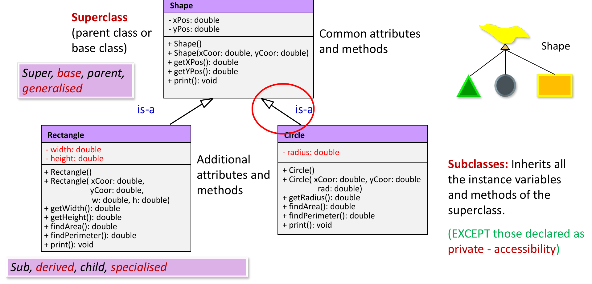
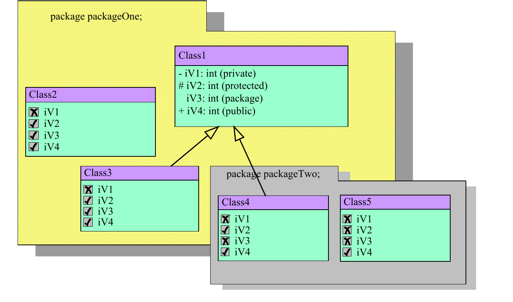

# Inheritance, Overriding and Visibility

<style>
table.wide-table { width: max-content; min-width: 100%; table-layout: auto; }
</style>

This chapter covers the first part of Lecture 3: inheritance, overloading,
overriding, visibility, packages, `final` and abstract classes. Chapter 3
covers interfaces.

## 1. Inheritance

**Inheritance** makes a new class from an existing class. The new class:

1. gets (inherits) the fields and methods of the existing class, and
2. adds new fields and methods, or changes inherited methods.

This lets you reuse code. The link is an **"is-a"** relationship: a `Student`
is a `Person`.

| Old class | New class |
|---|---|
| superclass, base class, parent class | subclass, derived class, child class |
| more **general** (generalisation) | more **specific** (specialisation) |

: { .wide-table }

In Java, write `class Rectangle extends Shape`. Every class that has no
`extends` clause extends `java.lang.Object`, so `Object` is the root of every
class.



### What the subclass gets

- It inherits all fields and methods **except** the `private` ones. A private
  field still exists inside the subclass object, but subclass code cannot use
  its name. Subclass code reaches it through public or protected methods of
  the parent (for example `getXPos()`).
- It does **not** inherit **constructors**. Each class writes its own.
- A class can **extend only one class**. `class C extends A, B` is a compile
  error. A chain is fine: `C extends B`, `B extends A` (indirect inheritance).

### Is it really "is-a"?

Use inheritance only when the subclass *is* a special kind of the superclass.

- A `Circle` is **not** a `Point`; a circle **has** a centre point. Use a
  `Point` field (composition), not `extends Point`.
- A `Cylinder` is **not** a `Circle`; a cylinder **has** a circular base.
- **Role vs inheritance.** `Father` and `Mother` are roles that a `Person`
  plays. They add no new state or behaviour, so they are values (for example
  an enum `FamilyRole`), not subclasses. `Student` and `Lecturer` add their
  own fields and methods, so they are real subclasses of `Person`.

## 2. `super`

`super` refers to the parent part of the current object.

1. **`super(args)`** calls the parent constructor. It must be the **first
   statement** in the subclass constructor.
2. **`super.method()`** calls the parent version of a method that the subclass
   overrides.
3. **`super.field`** reads a parent field that a subclass field hides.

**Constructor rules.**

- If a constructor does not start with `super(...)` or `this(...)`, the
  compiler adds `super();` (no arguments) for you.
- So if the parent has **no** no-argument constructor (because it only has
  `Parent(int x)`), the subclass constructor must call `super(x)` itself.
  Otherwise it does not compile.
- A constructor cannot call both `super(...)` and `this(...)`. Both must be the
  first statement, so only one can be there. (A `this(...)` call reaches the
  parent through the other constructor.)
- Parent constructors always run before child constructors. `new C()` where
  `C extends B extends A` prints A's output, then B's, then C's.

> Note: Java 25 allows some statements before `super(...)`. The course uses
> the rule above: `super(...)` or `this(...)` is the first statement.

## 3. Overloading and Overriding

These two words look alike, but they work in different ways.

| | Overloading | Overriding |
|---|---|---|
| Where | Same class (or inherited plus new in a subclass) | Subclass changes a parent method |
| Method name | Same | Same |
| Parameter list | **Different** (number or types of parameters) | **Exactly the same** |
| Return type | Can be anything; it alone cannot tell two methods apart | Same type (or a subtype) |
| Caused by inheritance? | No | Yes |
| Chosen when | **Compile time** (static binding), from the declared types of the arguments | **Run time** (dynamic binding), from the real object |

: { .wide-table }

### Overloading

Overloading lets one name do similar tasks for different inputs, for example
`print(String)`, `print(int)`, `print(boolean)`, instead of `printString`,
`printInt`, `printBool`.

```java
public int    findMin(int a, int b)        { ... }
public double findMin(double a, double b)  { ... }
public int    findMin(int a, int b, int c) { ... }
// public int findMin(int x, int y, int z) -> ERROR: same parameter types as above
```

Only the parameter **types** and their **number** count. Different parameter
names or a different return type do not make a new overload.

### Overriding

To override, write a method in the subclass with the **same name, the same
parameter list and the same return type** as the parent method. There are two
ways to override a parent method:

1. **Replacement**: the new body replaces the parent body. It does not call
   `super.method()`.
2. **Refinement**: the new body calls `super.method()` and adds more work.

```java
class Employee extends Person {
    public void printInfo() {          // refinement
        super.printInfo();             // prints name and age
        System.out.println("Salary is " + salary);
    }
}
```

The lecture lists **three ways of method overriding** (a common short
question):

1. A subclass method overrides a superclass method.
2. A subclass method implements an **abstract method** of an abstract class.
3. A concrete class method implements a method of an **interface**.

### Overriding rules

- You cannot **reduce** visibility. A `public` parent method stays `public` in
  the child. Overriding it as `protected` or package-private is a compile
  error.
- The child method cannot throw a new or broader **checked** exception than
  the parent method (Chapter 5).
- A **`final`** method cannot be overridden.
- A **`static`** method is not overridden. A static method with the same
  header in the child **hides** the parent one. Java picks the version from the
  declared type, not the object.
- A **`private`** method is not inherited, so it cannot be overridden. A method
  with the same name in the child is a new, unrelated method.
- Use `@Override` above an overriding method. If the header does not match a
  parent method, the compiler gives an error. This catches a parameter-type
  mistake that would silently make an overload instead.
- Inside an override, call the parent version with `super.method()`. If you
  write `method()`, the method calls itself forever and the program ends with
  a `StackOverflowError`.

### How Java finds the method to run

When an object gets a message, Java looks for a matching method:

1. Start in the class of the object.
2. If there is no match, look in the parent class.
3. Repeat up the chain until a match is found, or until no parent is left.
   If no class has the method, the compiler reports an error.

## 4. Visibility (Access) Modifiers

"Access" means read and change.

| Modifier | Same class | Same package | Subclass in another package | Any other class | UML |
|---|:---:|:---:|:---:|:---:|:---:|
| `public` | Yes | Yes | Yes | Yes | `+` |
| `protected` | Yes | Yes | Yes | No | `#` |
| *(none)* package-private | Yes | Yes | No | No | `~` |
| `private` | Yes | No | No | No | `-` |

: { .wide-table }

- `protected` means "stay in the family": the class, its subclasses, **and**
  all classes in the same package.
- No modifier means **package access**. Every class in the same package can
  use it. A subclass in a different package cannot.
- In a subclass in a **different** package, the subclass can use an inherited
  `protected` member on itself (or on objects of its own type). It cannot use
  it through a reference of the parent type.



## 5. Packages

A **package** groups related classes in one folder, for example `java.util`.

- Write `package packageOne;` as the first line of the file.
- Use another package's class with `import java.util.Scanner;` or with its
  full name, `java.util.Scanner`.
- Package names come from the internet domain, reversed:
  `sg.edu.ntu.projects`.
- Packages solve **name clashes**. `casino.game.Deck` and `star.cruise.Deck`
  can both exist. If you import both, a plain `Deck` is ambiguous; use the full
  names.
- A class with no `package` line is in the unnamed **default package**.

## 6. `final`

| `final` on | Effect |
|---|---|
| A variable | Its value cannot change after it gets one. `static final` makes a constant. |
| A method | Subclasses cannot override it. |
| A class | Nothing can extend it. All its methods are in effect final. (`String` is final.) |

: { .wide-table }

Why use `final` methods and classes:

1. **Security**: subclasses cannot change the behaviour.
2. **Efficiency**: the compiler can bind the call at compile time (static
   binding), with no search at run time.

## 7. Abstract Classes

Higher classes in a hierarchy are more general. Sometimes a class is so
general that no real object of it makes sense. A `Figure` has an area, but
there is no way to compute the area of "a figure". Make such a class
**abstract**.

```java
public abstract class Figure {
    private String color;
    public Figure(String c) { color = c; }   // abstract classes CAN have constructors
    public String getColor() { return color; }
    public abstract double findArea();       // no body, ends with ;
}

public class Circle extends Figure {
    private double radius;
    public Circle(String c, double r) { super(c); radius = r; }
    public double findArea() { return Math.PI * radius * radius; }   // implements it
}
```

- An **abstract method** has no body. A subclass must give the body.
- A class that has **at least one** abstract method **must** be declared
  `abstract`.
- An abstract class **can** have fields, constructors and normal methods. Its
  constructor runs when a subclass object is made (`super(c)`).
- You **cannot** create an object of an abstract class: `new Figure("red")` is
  a compile error. You *can* declare a variable of that type:
  `Figure f = new Circle("red", 2);`
- A subclass that does not give a body for **every** inherited abstract method
  must itself be declared `abstract`. Otherwise it does not compile.
- A **concrete** class has a body for every method (no abstract methods).
- `abstract` cannot go with `private`, `final` or `static` on a method. Each of
  these stops the subclass from overriding, but an abstract method needs an
  override.
- In UML, write the abstract class or method name in *italics*, or add
  `{abstract}`.

## 8. Quiz Traps

- Constructors are not inherited. Private members are inherited in memory but
  their names are not visible.
- Parent has only `Parent(int)` and the child constructor does not call
  `super(x)`: **compile error** in the child.
- `super(...)` and `this(...)` in one constructor: **compile error**.
- Same name and same parameter types but a different return type: **compile
  error**, not an overload.
- A child method with parameter `(Cat c)` does **not** override a parent method
  with parameter `(Animal a)`. It is an overload.
- Overriding with weaker access (`public` to `protected`): **compile error**.
- Static methods hide, they do not override. Private methods are not
  overridden.
- `new AbstractClass()`: **compile error**. A missing implementation of an
  abstract method makes the subclass fail unless it is also abstract.
- `protected` also gives access to the whole package, not only subclasses.
